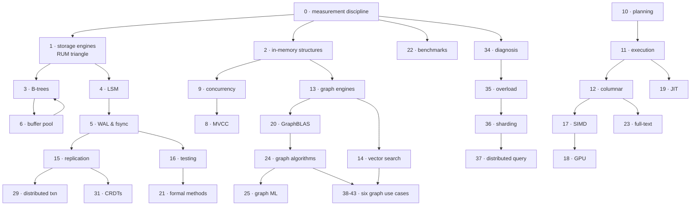

# Findings

One measured headline per topic, and the command that re-derives it. This is the
whole argument for this format over a reading list in one table: a link
collection cannot be wrong in a way you can detect, and every row below can.

Every figure here comes from a benchmark in this repo, measured on an **Apple M3
Pro (5P + 6E, 36 GB)** on 2026-07-28, except rows 17, 18, 20, 22 and 25
(2026-07-10, the runs those topics' notes and guides compute against), row 44 (2026-08-26), and rows
27, 32, 42 and 45–50 (2026-10-26; row 50 is a seeded simulation whose figures
do not depend on the machine). Generators are seeded, so counts,
ratios and distributions reproduce exactly; timings will differ on your
hardware. Run everything with `./verify.sh`, one topic with `./verify.sh 12`, or
`./verify.sh --list` to see every lane.

**Markers.** A row with no marker is a measurement on this machine that
`./verify.sh` re-derives on a fresh clone. Three markers say otherwise, in front
of the figures they cover:

- **`[REFERENCE]`** — printed by the reference solution of an exercise lane and
  recorded in that topic's `notes.md`. On a fresh clone `./verify.sh` prints the
  provided lane and a stub note; implement the stubs and it prints these.
- **`[MODEL]`** — computed by a seeded simulation or priced with constants taken
  from a paper; no hardware or service of that kind was used.
- **`[MEASURED + MODEL]`** — a real timed loop in which one component (a slow
  memory tier) is emulated by a named model constant.

Two topics have no row: **4 (LSM deep dive)** and **10 (query planning)** are the
two whose benchmarks measure only *your* implementation, so there is nothing to
report on a fresh clone. Their READMEs say so and explain what to predict
instead.

| # | Topic | Measured finding | Lane |
|---|---|---|---|
| 0 | [Performance Toolbox](topics/00-performance-toolbox/README.md) | The DRAM latency ladder verified at ~1 / 5 / 100 ns — and `cache_ladder` measured its own 8 MB working set until the pointer chase was fixed to carry state. **21%** of a HashMap lookup is SipHash. | `./verify.sh --criterion 00` |
| 1 | [Storage Engine Landscape](topics/01-storage-engine-landscape/README.md) | Same 108 MB of records: fjall (LSM) writes **48 MB**, redb (CoW B-tree) writes **6.8 GB** — space amp **0.45× vs 63.28×**, a 140× spread. | `./verify.sh 01` |
| 2 | [In-Memory Structures](topics/02-in-memory-structures/README.md) | hashbrown insert: p50 **42 ns**, max **58.4 ms**. A 1.4-millionfold spread inside one operation, invisible to any throughput number. | `./verify.sh 02` |
| 3 | [B-Tree Internals](topics/03-btree-internals/README.md) | The "height is the metric" story fails: lookups climb **862 → 1101 ns** from 1e6 to 4e6 keys while height stays at 3. Height sets pages touched; cache residency sets what a touch costs. In memory, bbtree 0.1.5's single `get` is **2.3–3.2×** std's `BTreeMap` at 10M random `u64` keys, not its README's 5×; batches of 16 add 2.1–2.7× on top. | `./verify.sh 03` |
| 5 | [Durability & WAL](topics/05-durability-wal/README.md) | `write()` **857k/s**, `fsync` **44k/s**, `F_FULLFSYNC` **337/s** — a 2540× spread, and only the last is durable on this drive. | `./verify.sh 05` |
| 6 | [Buffer Pool](topics/06-buffer-pool/README.md) | mmap page reads: p50 **42 ns**, max **182 µs**. A 4300× spread, entirely minor page faults the database cannot see or schedule. A hash lookup in front of a dependent page read costs 213 ns against 102 for a direct pointer; predicting the frame and reading it beside the lookup gets it back to 107.5 ns. **`[MODEL]`** Under the Bf-Tree paper's Zipf 0.9 workload an oracle page cache hits **0.57** when hot keys are scattered across pages and 0.81 when adjacent, a record cache 0.73–0.85. | `./verify.sh 06` |
| 7 | [Networking & Protocols](topics/07-networking-protocols/README.md) | Identical zero-work requests: **44k ops/s at P=1**, **12.3M at P=256** — a **279×** swing that is pure syscalls and round trips. | `./verify.sh 07` |
| 8 | [Transactions & MVCC](topics/08-transactions-mvcc/README.md) | One global mutex, fully serialized: **1.39 M txn/s** read-heavy, 0.81 M write-heavy, 1.09 M on 64 hot keys — the rows differ only by what the critical section costs. **`[REFERENCE]`** A reference MVCC wins every row by **1.4–1.6×**, including the hot one; the crossover is at **~1 key per thread** (0.70× at 1 key, 1.06× at 4, 1.24× at 8). Building keys inside the lock, as an earlier version of the lane did, halves the lock and inflates the win to 3.5×. | `./verify.sh 08` |
| 9 | [Concurrency](topics/09-concurrency/README.md) | A global mutex gets **2.9× slower** from 1 to 16 threads (8.65 → 2.96 Mops/s). Padding "independent" counters to 128 B is worth **17.8×**; 64 B only half-fixes it on M-series. | `./verify.sh 09` |
| 11 | [Execution Models](topics/11-execution-models/README.md) | Volcano tops out at **103 M rows/s**, and gets *slower* as selectivity rises (74.7 M at 95%) — surviving the filter is what costs, not the filter. **`[REFERENCE]`** Vectorized is **1.7×** over Volcano at 50% selectivity and a fused branch-free kernel **9.2×** — not "one to two orders of magnitude". | `./verify.sh 11` |
| 12 | [Columnar Analytics](topics/12-columnar-analytics/README.md) | The scan floor is **24–57 GB/s** on a 150 GB/s machine. This lane previously printed **19,047,619 GB/s** — a hoisted loop, caught by its own implausibility. | `./verify.sh 12` |
| 13 | [Graph Engines](topics/13-graph-engines/README.md) | **`[REFERENCE]`** The same two-hop query is **~98× slower** from supernodes than from random nodes on every layout (adjacency list, CSR, masked SpMV) because it scans **85× more edges** — 89,034 against 1,042 — at 1.16× the cost per edge; CSR buys a flat 1.2× and leaves the tail alone. C FalkorDB returns the same counts at 183 µs / 14.9 ms. | `./verify.sh 13` |
| 14 | [Vector Search](topics/14-vector-search/README.md) | Brute force: **117 QPS** at recall 1.000 — the denominator. Filters rewrite the arithmetic, exactly: a 1% independent filter needs **959** fetched candidates for 10 results, and at one 50% selectivity the over-fetch spans **10.2 / 19.9 / 337.8** (aligned / independent / anti-aligned, 33×). **`[REFERENCE]`** HNSW reaches **22,336 QPS at recall 0.962**. | `./verify.sh 14` |
| 15 | [Replication & Consensus](topics/15-replication-consensus/README.md) | Follower fsync policy alone spans **59×** (341 → 20,174 entries/s). Batching fixes the median and leaves the p99 at 2980 µs. | `./verify.sh 15` |
| 16 | [Testing & Correctness](topics/16-testing-correctness/README.md) | The 48.8%–99.6% per-seed detection spread is **one to five seeds**: 95% detection needs 5 seeds for the slowest planted bug (TornWriteAccepted, p = 0.4884) and 1 for the fastest, confirmed on 1,000 disjoint 5-seed blocks (977 hit). Workload length is the real dial: 40 → 80 ops lifts it from 50.6% to 75.5%. | `./verify.sh 16` |
| 17 | [SIMD](topics/17-simd/README.md) | Eight accumulators and no intrinsics: **10.89 → 42.12 GB/s** (3.9×). Branchy filtering collapses to **1.19 GB/s** at 50% selectivity while branchless stays flat at ~12–13. | `./verify.sh 17` |
| 18 | [GPU Acceleration](topics/18-gpu/README.md) | **No crossover up to 2^24 elements.** At 16 M, upload alone costs 7385 µs against a 2258 µs CPU total — the transfer tax, measured. | `./verify.sh 18` |
| 19 | [JIT & Compilation](topics/19-jit/README.md) | Interpretation cost compounds with expression size: 7 → 511 nodes costs the interpreter **94×** but the vectorized evaluator only **47×**, so the gap widens from 6× to 12×. | `./verify.sh 19` |
| 20 | [GraphBLAS](topics/20-graphblas/README.md) | SpMV bandwidth decays **19.1 → 15.8 GB/s** as the graph grows. Handing a Rust CSR to a real GraphBLAS through `GxB_Container` costs **0.12–0.17 µs at every size** (120K to 8.2M entries) against 349 → 6,822 µs for `GrB_Matrix_build`; `GrB_mxv` on that same matrix is 3–4× slower than the Rust kernel with GraphBLAS's JIT off and at parity with it on. | `./verify.sh 20` |
| 21 | [Formal Methods](topics/21-formal/README.md) | The hand-ordered rewriter answers `(a*2)/2` with `(a << 1) / 2` and stops — and not as a corner case: over 200 seeded random expressions per depth it misses the cheapest form its own rules allow on **2%** (depth 2), **11.5%** (depth 4) and **59%** (depth 6) of them. Swapping the two rules changes **0 of 1,000** outputs: the traversal is bottom-up, so rule order is not the lever. | `./verify.sh 21` |
| 22 | [Standard Benchmarks](topics/22-benchmarks/README.md) | TPC-H Q1 and Q6 measured at **4.7–5.6** and **11.9–15.7 GB/s** effective (SF 0.05–0.25); YCSB-E's p999 is **2.0 µs** against read-only's 0.96 µs. | `./verify.sh 22` |
| 23 | [Full-Text Search](topics/23-fulltext/README.md) | Exhaustive BM25 spans **0.009 ms to 10.378 ms** across four queries — 272,310 postings against 159. Term rarity, not query complexity. | `./verify.sh 23` |
| 24 | [Graph Algorithms](topics/24-graph-algorithms/README.md) | Same node and edge count, RMAT vs uniform: **15.6 M triangles vs 5428**, and 447 ms vs 195 ms. Degree skew is the workload. | `./verify.sh 24` |
| 25 | [Graph ML](topics/25-graph-ml/README.md) | The message-passing kernel *is* an SpMM: **3.42 ms at 21.2 GFLOP/s**, against 5.12 ms for the dense transform beside it. | `./verify.sh 25` |
| 26 | [Probabilistic Structures](topics/26-probabilistic/README.md) | A point miss costs **246 ns** (binary search) or **299 ns** (BTreeMap); a 224 MB HashSet does it in **28 ns**. That gap is what a filter is bidding for. **`[REFERENCE]`** A blocked Bloom filter answers in 28 ns at 0.96% false positives in 19× less memory; HyperLogLog counts in 16 KB. | `./verify.sh 26` |
| 27 | [Streaming & IVM](topics/27-streaming/README.md) | 100 edge changes to a 500k-edge graph costs **924 ms** to re-derive a wedge join — the batch is 0.02% of the graph, the work is 100% of it. **`[REFERENCE]`** Maintained incrementally: triangles 1,271× faster, reachability 43×, the wedge join only 24× (its state is re-merged every batch). | `./verify.sh 27` |
| 28 | [Cloud-Native Storage](topics/28-cloud-native/README.md) | Local NVMe p50 **0.10 ms**; raw S3 p50 **14.17 ms**, p99 **112.99 ms**. A 140× median gap and a far worse tail. | `./verify.sh 28` |
| 29 | [Distributed Transactions](topics/29-distributed-txn/README.md) | **`[MODEL]`** Priced in round trips (Percolator-shaped, batches of 8, 4 RTT per commit and 3 per abort), a commit costs **4.00 RTT at Zipf θ 0.5 and 12.07 at 1.3** (3.02×). The 0.3% → 99.6% collision rates are the generator; this is what they cost. | `./verify.sh 29` |
| 30 | [Time-Series](topics/30-timeseries/README.md) | Delta+varint timestamps cost **3.00 B/sample** on every shape; the values separate them, 0.50 B (constant) to 7.48 B (random). On decimal-origin values an ALP-style decimal-to-integer codec costs **1.50 B/value** against 6.79 for byte-XOR and 8.03 for Gorilla — worse than raw — but the same random walk left as f64 arithmetic is 95% exceptions and costs the full 8.00 B. | `./verify.sh 30` |
| 51 | [Dynamic Graph Storage](topics/51-dynamic-graph-storage/README.md) | One edge insert into a 16 M-edge CSR costs **0.641 ms** (a splice); into a FalkorDB-style delta **154 ns** plus a 6.28 ms flush every 10,000 changes — **782 ns steady state**, 1.4× a `Vec<Vec<u32>>`. The scan stays flat to 100,000 pending changes; a per-edge tombstone test, not delta size, is what slows it. In C FalkorDB one insert pays **24–29 ms**: the flush. | `./verify.sh 51` |
| 52 | [Graph Reordering & Compression](topics/52-graph-compression/README.md) | One 64.7 M-edge graph, only the vertex ids changed: random → community-ordered ids is **24.11 → 14.40 varint bits/edge** and 90.3% → 23.5% simulated gather misses; sorting by degree moves the size 0.5%. WebGraph reference copying gains nothing on independent lists and 30% on copied ones; the compressed scan is 2.2× slower at one thread. | `./verify.sh 52` |
| 53 | [Cardinality Estimation for Graph Patterns](topics/53-graph-cardinality/README.md) | The average-degree product Kùzu and Neo4j ship underestimates every path, median q-error **9.6 → 57.5 → 324.0** at 2 → 3 → 4 hops when hubs are shared across edge types, and 1.1 when they are not; a degree-sequence bound is 1.0 on the first graph. Yet a 348× underestimate changed no plan's cost (regret ≤ 1.06): the answer dominates every order. | `./verify.sh 53` |
| 54 | [Main-Memory Join Algorithms](topics/54-join-algorithms/README.md) | A shared-table probe costs **8.5 ns up to a 4 MiB table and 21.4 ns at 256 MiB** — but the same probes sorted by table address cost **4.4–5.8 ns at every size**: probe order, not cache size, is most of the price. **`[REFERENCE]`** A radix-partitioned join beats the shared table at every build size, 1.16–2.31×. | `./verify.sh 54` |
| 55 | [Datalog Engines](topics/55-datalog-engines/README.md) | Transitive closure of a 500-vertex chain: naive evaluation derives **41,417,499** tuples for a 124,750-tuple answer, semi-naive exactly **124,750** (332×). On a power-law graph semi-naive still derives 72,193 duplicates in 137,482 — and the masked matrix product `(Δ·A)⟨¬T⟩` makes exactly those same derivations: the algebra changes what a derivation costs, not how many there are. | `./verify.sh 55` |
| 56 | [Memory Allocators](topics/56-memory-allocators/README.md) | Every 16-byte-quantum allocator holds **1.12–1.13×** the live bytes of a graph trace because a 40-byte edge rounds to 48; jemalloc built as Redis builds it (`lg-quantum=3`) holds **1.01×**. Query temporaries cost **1.7 ns** from an arena against 26.4 ns from libmalloc (15×); a cross-thread free costs 46.5 ns in libmalloc, 21.1 in mimalloc, 15.4 in jemalloc. | `./verify.sh 56` |
| 57 | [Sorting at Scale](topics/57-sorting/README.md) | The same 5,000,000 `(int, string)` rows sort **4.9×** slower when the integer ties: the string pointer chase is the cost. **`[REFERENCE]`** A radix sort on a normalized key wins **2.06×** on uniform `u64` and 3.00× on `(int, string)` — and loses **0.04×** on presorted input and 0.19× at 100 rows. | `./verify.sh 57` |
| 31 | [CRDTs](topics/31-crdts/README.md) | Last-write-wins on 10 keys with per-write sync overwrites 94.98% of values, but only **5.00%** are lost to concurrency (replaced by a write that never saw them); loss peaks near **20%** when the sync window matches the key space, and the closed form K·pA²/(2s) predicts it within a few tenths of a point. | `./verify.sh 31` |
| 32 | [HTAP](topics/32-htap/README.md) | One copy, one fair coarse lock: adding full scans takes writes from **14.1 M per 2 s to 21.5 K** (652×), and p99 from 209 ns to **2.25 ms** — exactly one full scan. Every scan is a write outage as long as the scan. | `./verify.sh 32` |
| 33 | [Temporal Graphs](topics/33-temporal-graphs/README.md) | Static reachability reports 25,031 reachable pairs where time-respecting paths number **137** — **99.5% false positives** on the sparse contact graph. | `./verify.sh 33` |
| 34 | [Debugging & Diagnosis](topics/34-debugging/README.md) | A closed-loop benchmark reports **p99 = 1.0 µs** where an open-loop one reports **90 ms** on identical work — coordinated omission, a 90,000× lie. | `./verify.sh 34` |
| 35 | [Overload Control](topics/35-overload/README.md) | A 10-second outage ends at t=40 s. At 140 QPS (of 300 capacity) goodput stays at **zero until t=161 s**; at 280 QPS it **never recovers** — the outage outlives its own trigger. | `./verify.sh 35` |
| 36 | [Sharding & Rebalancing](topics/36-sharding/README.md) | Growing 16 shards to 17 moves **94.1% of all keys** (ideal: 5.9%), and it gets *worse* the larger you are. | `./verify.sh 36` |
| 37 | [Distributed Query](topics/37-distributed-query/README.md) | With 1-in-100 slow leaves, **63.4% of 100-leaf** fan-outs hit at least one. Waiting for 95% of leaves instead of all: p99 **10.0 → 9.9 ms**, p50 5.6 → 9.6. | `./verify.sh 37` |
| 38 | [GraphRAG & Agent Memory](topics/38-graphrag-agent-memory/README.md) | Independent passage ranking finds the answer at rank **1.00** at one hop and **9.21** — chance — at two. Vector RAG's multi-hop collapse. | `./verify.sh 38` |
| 39 | [Fraud & Identity Graphs](topics/39-fraud-identity-graphs/README.md) | Two row-based rankers fail in *opposite* regimes: degree ranking scores **0.00** precision without camouflage, obscurity ranking **0.00** with it. | `./verify.sh 39` |
| 40 | [Security & Attack Graphs](topics/40-security-attack-graphs/README.md) | A directory reporting **8 privileged accounts, forever** has **1969 of 2000 users** holding a path to Domain Admin — and your exposure number depends on how long the collector ran. | `./verify.sh 40` |
| 41 | [On-Chain Analytics](topics/41-onchain-analytics/README.md) | The industry-default haircut rule marks **98% of addresses** tainted from one theft; 658 of them are under 0.1% tainted. An 1816 court case does better. | `./verify.sh 41` |
| 42 | [Recommendations & Social](topics/42-recommendations-social/README.md) | Recommending bestsellers to everyone gets **35.3% hit-rate@50** with **92.2% overlap** with the global bestseller list. Popularity is not a weak baseline. | `./verify.sh 42` |
| 43 | [Ops Dependency Graphs](topics/43-ops-dependency-graphs/README.md) | One gray failure: **34 of 55 services alert** and the broken one is not among them — it ranks 35th by failure count, 41st by error rate, at exactly the baseline. | `./verify.sh 43` |
| 44 | [E-graphs as a Database](topics/44-egraphs-egglog/README.md) | `f(a, g(a))` has **N matches** and costs a backtracking matcher **N²+N+1** units of work; generic join does **5N**. At N=1600: 2,561,601 against 8,000, a measured **21.7×**. Make the pattern linear and generic join is **1.8× slower** — the win is avoided waste, not speed. | `./verify.sh 44` |
| 45 | [Async I/O & Modern SSDs](topics/45-async-io/README.md) | Random 4 KiB reads around the page cache: **13,810 IOPS at queue depth 1, 248,363 at 64** — **18×** through the same `pread`, Little's law predicting each row. Batch 16 reads into one `lio_listio` and you get **half** of what 16 threads get: the batch waits for its slowest read. | `./verify.sh 45` |
| 46 | [Graph Queries on Relational Engines](topics/46-relational-graph/README.md) | **188× fewer values**: a 3-hop pattern over 313,512 power-law edges is 9,042,996,117 values as flat binary-join tuples and 47,997,149 factorized. C FalkorDB enumerates the same 234,636,483 paths at ~128 ns per row — and returns 45,794,367 for `count(*)` when no intermediate vertex is named. | `./verify.sh 46` |
| 47 | [Semi-join Reduction in Practice](topics/47-semijoin-reduction/README.md) | **130× fewer intermediate tuples** from join order alone: one three-hop pattern with a 20,210-row answer emits 3,020,210 tuples in the bad order and 23,246 in the good one; full semi-join reduction makes any order emit 60,504. | `./verify.sh 47` |
| 48 | [Memory Tiering: CXL & Placement](topics/48-memory-tiering/README.md) | **`[MEASURED + MODEL]`** With a fixed 16 MiB fast tier, **97.4% vs 9.8%** of accesses go to the slow tier for a scattered vs a packed 1% hot set (counted). With the slow tier emulated as a 165.7 ns delay (SIDLE's CXL − DRAM latency, a model constant; no CXL device used), the timed loop is 3.2–5.7× slower scattered for 0.1–1% hot sets. | `./verify.sh 48` |
| 49 | [Open File & Table Formats](topics/49-table-formats/README.md) | **1,003 vs 11** metadata objects to plan the latest of 1,000 one-file commits — an Iceberg fast-append tree against a Delta log checkpointed every 10 — and the Iceberg commits wrote **399 MB** of metadata, 763× the log, quadratic because every root file names every snapshot. | `./verify.sh 49` |
| 50 | [LLM-Era Query Processing](topics/50-llm-query-processing/README.md) | **`[MODEL]`** **21% cheaper with more calls**: a two-predicate semantic filter over 10,000 rows (simulated models, no LLM) costs $16.78 in rank order against $21.23 for the order with the fewest oracle calls, though rank order makes 2,255 more calls. | `./verify.sh 50` |

## How to read this table

Some rows are pleasant confirmations of theory. The interesting ones are not:

- **Row 3 and row 12 contradict their own topic's tidy story.** The B-tree ladder
  is not a step function, and the columnar scan lane once printed a number
  20,000× faster than the memory bus. Both are in the guides as the finding,
  because a curriculum that only reports confirmations is not measuring anything.
- **Rows 8, 22 and 42 are baselines that refuse to be weak.** A global mutex
  stays within 1.6× of MVCC once its critical section holds only the shared
  work; bestseller lists get a third of users right. If your improvement cannot beat
  these, that is worth knowing before you build it.
- **Rows 34 through 43 are all measurement failures rather than system
  failures** — the closed loop, the alert storm, the per-node statistic, the
  compliance report. The system is fine; the number you were looking at was not.

If a row does not reproduce on your machine beyond timing differences, that is
the most useful bug report this repo can receive —
[open an issue](https://github.com/AviAvni/database-learning-path/issues) with
the output.

## Which topics lean on which

The order is a suggestion, not a prerequisite chain — but the guides do thread,
and some threads carry real weight. Solid arrows are dependencies worth
respecting; the clusters are just groupings.

Three threads are worth following deliberately, because the same wall shows up
in each of them under a different name:

1. **The fsync wall.** Topic 5 measures 337 durable commits/s. Topic 15's
   per-entry follower fsync lands at 341 entries/s. Topic 28 finds the same
   physics at 14 ms per S3 GET. One constant, three architectures built to dodge it.
2. **Skew.** Topic 13's 101× supernode gap, topic 24's 15.6 M-vs-5428 triangle
   counts, topic 36's hot shard at 3.8× ideal, topic 20's load-balancing menu.
   Uniform data is the exception in every one of them.
3. **The measurement itself lying.** Topic 0 states the failure modes, topic 12
   contains one (a hoisted loop printing 19 million GB/s), topic 34 quantifies
   the closed-loop version at 90,000×, and topics 39–43 are each a different
   statistic pointing confidently at the wrong thing.
