# The Plan — Database Internals Curriculum

58 topics, self-paced, deliberately diverse: storage / in-memory / query / graph /
vector / distributed / hardware topics are interleaved so it stays fun. Each topic has: why it
matters, core concepts, reference code to read, key papers, and a build+bench exercise
that also advances the **capstone** (`capstone/README.md`).

Order is a recommendation. Topics 0–6 are the foundation; after that, jump around freely.

## The map

```mermaid
flowchart TD
    subgraph FOUNDATION["Foundation — do in order"]
        direction LR
        T0["0 perf<br/>toolbox"] --> T1["1 B-tree<br/>vs LSM"] --> T2["2 in-memory<br/>structures"] --> T3["3 B-tree<br/>internals"] --> T4["4 LSM<br/>deep dive"] --> T5["5 WAL &<br/>recovery"] --> T6["6 buffer<br/>pool"]
    end
    subgraph CORE["Systems core"]
        T7["7 networking"]
        T8["8 MVCC"]
        T9["9 concurrency"]
    end
    subgraph QUERY["Query engine"]
        T10["10 parse/plan/optimize"] --> T11["11 execution models"] --> T19["19 JIT"]
        T12["12 columnar"]
        T10 --> T50["50 LLM-era query<br/>processing"]
        T10 --> T47["47 semi-join reduction<br/>& bitmap filters"]
        T11 --> T54["54 main-memory<br/>join algorithms"]
        T11 --> T57["57 sorting &<br/>collation"]
    end
    subgraph GRAPH["Graph — home turf"]
        T13["13 graph engines"] --> T20["20 GraphBLAS internals"] --> T24["24 graph algorithms"] --> T25["25 graph ML"]
        T24 --> T33["33 temporal graphs"]
        T13 --> T46["46 graph queries on<br/>relational engines"]
        T20 --> T51["51 dynamic graph<br/>storage"]
        T20 --> T52["52 graph reordering<br/>& compression"]
        T13 --> T53["53 graph pattern<br/>cardinality"]
        T20 --> T55["55 Datalog engines"]
    end
    subgraph USES["Graph use cases — deep dives"]
        T38["38 GraphRAG &<br/>agent memory"]
        T39["39 fraud &<br/>identity"]
        T40["40 attack<br/>graphs"]
        T41["41 on-chain<br/>analytics"]
        T42["42 recommendations<br/>& social"]
        T43["43 IT-ops<br/>dependencies"]
    end
    subgraph SEARCH["Indexes & search"]
        T14["14 vector"]
        T23["23 full-text"]
        T26["26 probabilistic"]
    end
    subgraph HW["Hardware"]
        T17["17 SIMD"] --> T18["18 GPU"]
        T45["45 async I/O<br/>& modern SSDs"]
        T48["48 memory tiering<br/>CXL & placement"]
        T56["56 memory<br/>allocators"]
    end
    subgraph DIST["Distributed"]
        T15["15 replication/Raft"] --> T29["29 distributed txns"]
        T15 --> T36["36 sharding"] --> T37["37 distributed query"]
        T28["28 cloud-native"] --> T49["49 open table formats<br/>& object-store txns"]
        T31["31 CRDTs"]
    end
    subgraph CORRECT["Correctness"]
        T16["16 testing"] --> T21["21 formal methods"]
        T21 --> T44["44 e-graphs as a database"]
    end
    subgraph STREAM["Streaming & temporal"]
        T27["27 incremental views"]
        T30["30 time-series"]
        T27 --> T32["32 HTAP"]
    end
    subgraph PROD["Production"]
        T34["34 debugging"]
        T35["35 overload control"]
    end
    T22["22 standard benchmarks — the yardstick for everything"]
    FOUNDATION --> CORE
    FOUNDATION --> QUERY
    FOUNDATION --> GRAPH
    FOUNDATION --> SEARCH
    FOUNDATION --> HW
    FOUNDATION --> DIST
    FOUNDATION --> CORRECT
    FOUNDATION --> STREAM
    FOUNDATION --> PROD
    T6 --> T45
    T44 --> T47
    T12 --> T49
    GRAPH --> USES
    T50 --> T38
    QUERY --> T22
    GRAPH --> T22
    T11 --> T46
    T6 --> T48
```

---

## 0. The Performance Toolbox

**Why:** You care about performance — so learn to measure before learning to build. Everything after this topic gets benchmarked properly.

- **Concepts:** microbenchmark pitfalls (warmup, variance, coordinated omission), CPU caches & memory hierarchy, branch prediction, TLB, `perf` counters, flamegraphs, latency percentiles vs throughput, roofline thinking.
- **Read code:** `criterion.rs` internals (how it fights noise), RocksDB `db_bench`, redis `redis-benchmark.c`.
- **Papers/reading:** "Systems Performance" (Gregg) ch. 1–2; "Fair Benchmarking Considered Difficult" (DBTest '18); "How NOT to Measure Latency" (Tene talk); Drepper §3–4.
- **Build & bench:** Rust bench harness comparing `Vec` scan vs `HashMap` lookup vs `BTreeMap` across sizes; produce flamegraphs; observe cache-line effects (seq vs random access).
- **Capstone milestone M0:** scaffold the `falkordb-scratch` workspace + criterion bench harness + graph workload generator; record baseline numbers to chase from the real engines — falkordb-rs-next-gen, which shipped as FalkorDB 6's Rust engine on `main`, and the C engine that continues on `master` (4.x), the latter being the bar for p99 and memory.

## 1. Storage Engine Landscape: B-Tree vs LSM

**Why:** The single most consequential design decision in a database. Frames everything else.

- **Concepts:** read/write/space amplification triangle (RUM conjecture), in-place vs out-of-place updates, page-oriented vs log-structured, where each engine family wins.
- **Read code:** fjall (small, clean Rust LSM), turso (`core/storage/` — SQLite-style B-tree in Rust), tidesdb (C LSM), RocksDB high-level layout.
- **Papers:** "The LSM-Tree" (O'Neil '96), "The Ubiquitous B-Tree" (Comer '79), "Designing Access Methods: The RUM Conjecture" (2016), "Architecture of a Database System" (Hellerstein/Stonebraker).
- **Build & bench:** benchmark fjall vs a raw B-tree (e.g. `redb`/sled) on write-heavy vs read-heavy vs scan workloads; explain results in terms of amplification.
- **Capstone M1:** define the storage-backend abstraction (compare with the reference's `graph/src/storage/backend.rs` *after* designing yours) — in-memory first, persistent backends swap in later.

## 2. In-Memory Structures: Hash Tables, Skip Lists, Tries

**Why:** Redis's dict and FalkorDB's core structures — the workhorses of every in-memory DB.

- **Concepts:** open addressing vs chaining, incremental rehashing (redis), SwissTable/SIMD probing (hashbrown), skip lists (why LSM memtables use them), radix trees / ART, cache-conscious layout.
- **Read code:** redis `dict.c` (incremental rehash!) + valkey's changes, redis `t_zset.c` (skiplist), hashbrown, RocksDB `memtable/` (concurrent skiplist), redis `rax.c` (radix tree).
- **Papers:** "The Adaptive Radix Tree" (Leis ICDE'13), Google SwissTable talk (CppCon 2017).
- **Build & bench:** implement a skip list and an incremental-rehash hash table in Rust; bench vs `hashbrown` and `crossbeam-skiplist`; measure rehash latency spikes vs redis-style incremental approach.
- **Capstone M2:** attribute store + string pool + node/edge ID datablocks (hash index + interning) — the reference's `attribute_store.rs`/`string_pool.rs`, your way.

## 3. B-Tree Internals & Paged Storage

**Why:** SQLite/Postgres/LMDB/most-embedded-DBs. Pages are how disks think.

- **Concepts:** slotted pages, node splits/merges, B+tree vs B-tree, prefix compression, copy-on-write B-trees (LMDB), overflow pages, page checksums, varint encoding.
- **Read code:** turso `core/storage/btree.rs` + pager (Rust re-implementation of SQLite — ideal), SQLite `btree.c` (the classic), LMDB `mdb.c` (COW); bbtree (XiangpengHao/bbtree): an in-memory B+tree with a numbered design log — cost model first, inline keys, batched prefetching lookups, optimistic latches, a Verus/shuttle/fuzzing verification stack.
- **Papers:** "Modern B-Tree Techniques" (Graefe — the survey), SQLite file-format doc.
- **Build & bench:** implement a slotted-page disk B+tree in Rust (fixed 4KB pages); bench point lookups & range scans vs `redb`; try prefix truncation and measure; provided lane `bbtree_vs_std` measures bbtree 0.1.5 against std `BTreeMap` in memory.
- **Capstone M3:** disk-backed B+tree backend for properties + range indexes behind the storage abstraction.

## 4. LSM-Tree Deep Dive

**Why:** RocksDB powers half the industry (including graph DBs like TiKV-based ones). Compaction is a fascinating scheduling problem.

- **Concepts:** memtable→SST lifecycle, leveled vs tiered vs FIFO compaction, bloom filters (and Monkey's optimal allocation), fractional cascading, compaction debt/write stalls, SST formats & block cache.
- **Read code:** fjall (read it ALL — it's small), RocksDB `db/compaction/`, `table/block_based/`.
- **Papers:** "Monkey: Optimal Navigable Key-Value Store" (SIGMOD'17), "Dostoevsky" (SIGMOD'18), RocksDB paper (FAST'21, also ACM Transactions on Storage 17(4)), "Constructing and Analyzing the LSM Compaction Design Space" (VLDB'21); DiaLSM (arXiv:2609.14370, preprint) on write stalls as a single-pipeline limit, and "The Value of Adaptivity in LSM Bloom-Filter Tuning" (arXiv:2606.18138, preprint).
- **Build & bench:** implement a mini-LSM (memtable + SSTs + leveled compaction + bloom filters) — optionally follow skyzh/mini-lsm course; measure write amp with different compaction strategies.
- **Capstone M4:** LSM-backed alternative persistence (graph snapshots as SSTs); benchmark B+tree vs LSM backends on graph mutation + bulk-load workloads.

## 5. Durability: WAL, fsync, Crash Recovery

**Why:** The hardest part to get right. Where correctness meets performance.

- **Concepts:** write-ahead logging, ARIES (redo/undo, LSNs, fuzzy checkpoints), group commit, fsync vs fdatasync vs O_DIRECT, torn pages (full-page writes / double-write buffer), io_uring.
- **Read code:** postgres `xlog.c` (skim, it's huge), turso WAL, redis AOF (`aof.c`) vs RDB, RocksDB WAL.
- **Papers:** "ARIES" (Mohan '92 — read a summary first, then the paper), "Scalability of write-ahead logging on multicore" (Aether, VLDB'10).
- **Build & bench:** add WAL + crash recovery to your B+tree; write a crash-injection test (kill -9 mid-write, verify recovery); bench fsync-per-commit vs group commit vs O_DIRECT.
- **Capstone M5:** WAL + crash recovery for graph mutations (contrast with FalkorDB's reliance on redis RDB/AOF); crash-injection test suite.

## 6. Buffer Pool & Memory Management

**Why:** mmap-vs-buffer-pool is one of the great debates; allocation strategy dominates in-memory DB performance.

- **Concepts:** buffer pool design, eviction (LRU, CLOCK, LRU-K, 2Q), pointer swizzling (LeanStore), why mmap is (usually) wrong for DBs, jemalloc/arena allocation, NUMA.
- **Read code:** postgres `bufmgr.c` + CLOCK sweep, redis `zmalloc.c`, DuckDB buffer manager, LeanStore (C++).
- **Papers:** "Are You Sure You Want to Use MMAP in Your DBMS?" (CIDR'22), "LeanStore" (ICDE'18), "Virtual-Memory Assisted Buffer Management" (vmcache, SIGMOD'23); "Predictive Translation: High-Performance Buffer Management Without the Trade-Offs" (Zinsmeister, Nguyen, Leis, Neumann, SIGMOD 2026); "Bf-Tree: A Modern Read-Write-Optimized Concurrent Larger-Than-Memory Range Index" (PVLDB 17, 2024) — mini-pages in a circular buffer as a record-granularity buffer pool.
- **Build & bench:** build a buffer pool (CLOCK) for the B+tree; bench vs mmap on datasets larger than RAM; reproduce mmap's write-back unpredictability; provided micro-lane `translation_micro`: a hash-table page lookup vs a predicted frame vs a direct pointer in front of a dependent read; provided `heat_scatter_model` bounds what record-granularity caching can win under a Zipf workload.
- **Capstone M6:** buffer pool under the persistent backends — graphs larger than RAM.

## 7. Networking, Protocols & Event Loops

**Why:** Redis's speed is as much about the event loop and RESP as about data structures. You know the module side of FalkorDB; own the server side.

- **Concepts:** RESP2/RESP3 design (why so parseable), event loops (ae.c) vs thread-per-core vs async, pipelining, io-threads in redis/valkey, pgwire protocol, neo4j's Bolt protocol (versioned handshake, PackStream binary serialization, explicit result streaming via PULL/DISCARD + cursors) — RESP vs pgwire vs Bolt as three answers to framing/typing/streaming, backpressure.
- **Read code:** redis `ae.c` + `networking.c`, valkey's io-threads rework (great perf PRs to study), `pgwire` (Rust crate), qdrant's gRPC/tonic setup, FalkorDB's own `src/bolt/` (it already speaks Bolt — reread it with server-side eyes).
- **Papers/reading:** "The C10K problem", valkey blog posts on multithreading perf, Glauber Costa on thread-per-core, Bolt Protocol + PackStream specifications (neo4j docs).
- **Build & bench:** implement a RESP server in Rust (tokio) speaking GET/SET; bench with `redis-benchmark` and `memtier_benchmark` against real redis; find your bottleneck with flamegraphs.
- **Capstone M7:** RESP server exposing `GRAPH.QUERY`/`GRAPH.RO_QUERY` — wire-compatible with existing FalkorDB clients; bench with falkordb-py against the real thing. Stretch: a Bolt listener on a second port so neo4j drivers connect too (PackStream encoding of the graph result types).

## 8. Transactions & MVCC

**Why:** The intellectual core of OLTP. Postgres MVCC vs in-memory designs is a masterclass in trade-offs.

- **Concepts:** ACID, isolation levels & anomalies (read this twice), 2PL vs OCC vs MVCC, snapshot isolation & write skew, SSI, postgres tuple versioning + vacuum, HOT updates, timestamp ordering, Hekaton-style MVCC.
- **Read code:** postgres `heapam.c` + visibility rules (`HeapTupleSatisfiesMVCC`), surrealdb transaction layer, RocksDB `utilities/transactions/`.
- **Papers:** "A Critique of ANSI SQL Isolation Levels" (Berenson '95), "Serializable Snapshot Isolation in PostgreSQL" (VLDB'12), "An Empirical Evaluation of In-Memory MVCC" (Wu/Pavlo VLDB'17), "Hekaton" (SIGMOD'13); "The Case for Single-Version Concurrency Control in the Cloud" (Nguyen, Haas, El-Hindi, Leis, Bernstein, CIDR '27, arXiv:2610.15793) and "Multiversion Concurrency Control for Multiversion B-Trees" (arXiv:2606.09133, preprint).
- **Build & bench:** implement MVCC with snapshot isolation over your KV engine; write tests that demonstrate (and then prevent) write skew; bench txn throughput vs a single global lock.
- **Capstone M8:** MVCC graph — copy-on-write + versioned reads (design yours, then study the reference's `mvcc_graph.rs`/`cow.rs`).

## 9. Concurrency: Latches, Lock-Free & Epochs

**Why:** Scaling a storage engine across cores is where the hardest bugs and biggest wins live.

- **Concepts:** latches vs locks, lock coupling / optimistic lock coupling, lock-free structures & memory reclamation (epochs, hazard pointers), Bw-Tree, atomics & memory ordering in Rust, contention profiling.
- **Read code:** crossbeam-epoch, RocksDB concurrent memtable inserts, memgraph skip-list, postgres lwlock.c.
- **Papers:** "The Bw-Tree" (ICDE'13) + "Building a Bw-Tree Takes More Than Just Buzz Words" (SIGMOD'18 — the reality check), "Optimistic Lock Coupling" (Leis).
- **Build & bench:** make your skip list concurrent (epoch reclamation); bench scaling 1→16 threads; compare mutex-sharded vs lock-free; measure with `perf c2c` for false sharing.
- **Capstone M9:** threadpool + concurrent readers with single writer; parallel query execution (compare with the reference's `threadpool.rs` design).

## 10. Query Engines I: Parsing, Planning, Optimization

**Why:** The optimizer is the database's brain. Directly relevant to Cypher planning in FalkorDB.

- **Concepts:** logical vs physical plans, relational algebra rewrites (predicate pushdown, join reordering), cost models & cardinality estimation (where it all goes wrong), dynamic programming join ordering, Cascades framework.
- **Read code:** DuckDB `src/optimizer/` (readable!), postgres `optimizer/` (join search), sqlparser-rs, datafusion optimizer, polars lazy-frame optimizer (`crates/polars-plan/`).
- **Papers:** "Access Path Selection" (Selinger '79 — the founding paper), "How Good Are Query Optimizers, Really?" (VLDB'15 — humbling), "The Cascades Framework" (Graefe '95).
- **Build & bench:** write a mini planner: parse SQL subset → logical plan → apply pushdown + join reordering; verify plans change with table sizes; compare against DuckDB's `EXPLAIN`.
- **Capstone M10:** Cypher-subset parser + binder + logical plan tree + rewrite rules (the reference's `parser/` + `planner/` — including its optimizer dir — are your after-the-fact mirror).

## 11. Query Engines II: Execution Models

**Why:** Volcano vs vectorized vs compiled — the defining performance battle of modern analytics.

- **Concepts:** iterator (Volcano) model, vectorized execution (X100/DuckDB), query compilation (HyPer), morsel-driven parallelism, hash joins & aggregation internals, SIMD in query processing.
- **Read code:** DuckDB `src/execution/` (vectors, pipelines), polars streaming engine + SIMD compute kernels (`crates/polars-compute/`), datafusion (Arrow-based), postgres `executor/` (classic Volcano).
- **Papers:** "MonetDB/X100: Hyper-Pipelining Query Execution" (CIDR'05), "Everything You Always Wanted to Know About Compiled and Vectorized Queries" (VLDB'18), "Morsel-Driven Parallelism" (SIGMOD'14).
- **Build & bench:** implement the same aggregation query (scan+filter+group-by) three ways: tuple-at-a-time, vectorized (1024-row batches), and with SIMD; bench — the gap is the whole lesson.
- **Capstone M11:** vectorized runtime: batched rows + operator pipeline + expression eval (mirror of `runtime/batch.rs`, `vectorized.rs`, `eval.rs`).

## 12. Columnar Storage & Analytics

**Why:** DuckDB/ClickHouse-style OLAP. Compression IS performance here.

- **Concepts:** row vs column layout, encodings (RLE, dictionary, bit-packing, delta, FSST for strings), zone maps / min-max pruning, Parquet & Arrow formats, late materialization, columnar-store architectures compared: ClickHouse MergeTree (LSM-flavored parts + sparse primary index, materialized views) vs DuckDB (embedded, single-file) vs real-time OLAP (Pinot/Druid ingest-time indexing).
- **Read code:** DuckDB `src/storage/compression/`, ClickHouse `MergeTree/` (parts, granules, sparse index — pick narrow slices), polars (Arrow memory layout in practice), arrow-rs, parquet-rs.
- **Papers:** "C-Store" (VLDB'05), "Integrating Compression and Execution in Column-Oriented Database Systems" (SIGMOD'06), "BtrBlocks" (SIGMOD'23), "FSST" (VLDB'20), "ClickHouse: Lightning Fast Analytics for Everyone" (VLDB'24).
- **Build & bench:** implement RLE + dictionary + bit-packing encoders; bench scan speed on encoded vs raw data (decompression can be *faster* than reading raw — verify); run ClickBench queries on DuckDB and profile.
- **Capstone M12:** columnar attribute storage + zone-map pruning for property filters.

## 13. Graph Engines (Home Turf, Deeper)

**Why:** Compare FalkorDB's sparse-matrix approach against the alternatives you compete with — with benchmarks.

- **Concepts:** adjacency representations (CSR/CSC, adjacency lists, sparse matrices/GraphBLAS), neo4j's fixed-size record store + pointer chasing (the `aligned`/`standard` formats; Neo4j Enterprise has defaulted new databases to the `block` format since 5.22, which co-locates properties with their nodes and relationships, per the Operations Manual's *Store formats* page), memgraph's in-memory skip-list store, BFS as SpMV, worst-case optimal joins for pattern matching, LDBC benchmarks; **the query-language landscape**: Cypher/openCypher vs GQL (ISO/IEC 39075:2024 — the first new ISO database language since SQL) vs SQL/PGQ (property graphs *inside* SQL) vs SPARQL over RDF vs Gremlin vs Datalog — data models (property graph vs triples: where do edge properties go in RDF? reification/RDF-star), pattern-matching semantics (homomorphism vs isomorphism vs trail — same query, different answers!), path objects & quantified path patterns, composability (can a query's output feed another query — Cypher's weakness, Datalog's strength), and what each language lets the planner push down.
- **Read code:** SuiteSparse:GraphBLAS internals (you know the API — go deeper into masks/complement handling), neo4j record format (`kernel/impl/store/`), memgraph `storage/v2/`, kuzu (WCOJ + columnar graph — very relevant; `kuzudb/kuzu` is archived since its last commit of 2025-10-10, which is the pin — community continuation is LadybugDB/ladybug), FalkorDB's Cypher grammar vs the openCypher grammar spec (what's missing/extra).
- **Papers:** "GraphBLAS: SuiteSparse" (Davis, TOMS), "Kùzu: A Database Management System For 'Beyond Relational' Workloads" (CIDR'23), "EmptyHeaded" (worst-case optimal joins on graphs), LDBC SNB spec, "Graph Pattern Matching in GQL and SQL/PGQ" (SIGMOD'22), "G-CORE: A Core for Future Graph Query Languages" (SIGMOD'18), the GQL standard overview (gqlstandards.org / Deutsch et al.).
- **Build & bench:** implement 2-hop neighborhood query over CSR vs adjacency-list vs GrB sparse matrix; bench on LDBC-scale data; compare with FalkorDB and neo4j on the same query; write the same three queries (filtered 2-hop, shortest path, group-by aggregation) in Cypher, GQL, SPARQL, and Gremlin — note where the language forces a different plan (path semantics, lack of pushdown) rather than just different syntax.
- **Capstone M13:** first graph core: adjacency-list/CSR node+edge store with basic pattern matching — the deliberately-naive baseline that M20's sparse-matrix core will replace (and be measured against). Language-wise: target openCypher now, but keep the AST GQL-shaped (quantified path patterns as first-class) so M10's parser doesn't need a rewrite when GQL compatibility matters.

## 14. Vector Search

**Why:** qdrant/helix-db territory; every DB is adding this. Beautiful algorithms, very benchmarkable.

- **Concepts:** ANN problem & recall/latency trade-off, HNSW (and its memory hunger), IVF, product quantization, scalar/binary quantization, DiskANN/Vamana for on-disk, filtered search (the hard part — qdrant's specialty).
- **Read code:** qdrant `lib/segment/` (HNSW + filtering + quantization), helix-db vector side, usearch (compact HNSW).
- **Papers:** "HNSW" (arXiv:1603.09320), "Product Quantization" (Jégou PAMI'11), "DiskANN" (NeurIPS'19), qdrant blog on filtered HNSW; "Attribute Filtering in Approximate Nearest Neighbor Search: An In-depth Experimental Study" (SIGMOD '26, arXiv:2508.16263), RaBitQ-SSD (arXiv:2610.02652), "Catapults to the Rescue" (arXiv:2603.02164) and "When Does Low-Bit Quantization Preserve the Decisions of Vector Search?" (arXiv:2609.09854).
- **Build & bench:** implement HNSW in Rust from the paper; measure recall@10 vs QPS curves against qdrant on ann-benchmarks datasets (sift-1m); add scalar quantization, re-measure; provided `filter_bench`: the exact over-fetch factor of a filtered query by selectivity and by filter-vector correlation.
- **Capstone M14:** vector index on node properties + distance kernels (the reference's `vec_distance.rs` territory).

## 15. Replication, Consensus & Distribution

**Why:** From single node to system. Raft is table stakes; the interesting part is what each DB does differently.

- **Concepts:** replication topologies (leader/follower, async vs sync), redis/valkey replication + failover, Raft (leader election, log replication, snapshots, membership), consistency models (linearizability → eventual), sharding (hash slots vs ranges).
- **Read code:** valkey `replication.c` + cluster, qdrant raft-based consensus (`consensus/`), openraft or tikv/raft-rs, surrealdb+tikv layering.
- **Papers:** "In Search of an Understandable Consensus Algorithm" (Raft, ATC'14), "ZooKeeper" or "Viewstamped Replication Revisited" (for contrast), Kleppmann DDIA ch. 5, 8, 9 (read thoroughly).
- **Build & bench:** implement Raft leader election + log replication (or work through the raft-rs / talent-plan labs); inject partitions and observe; measure replication-lag impact of fsync policies.
- **Capstone M15:** ship the WAL to a follower node; then upgrade to Raft.

## 16. Testing & Correctness Engineering

**Why:** The topic that separates hobby DBs from production DBs. Turso and FoundationDB made this their identity.

- **Concepts:** deterministic simulation testing (DST), fault injection, property-based testing (proptest), fuzzing (cargo-fuzz/AFL), metamorphic testing (SQLancer's pivoted queries / TLP), Jepsen & elle (checking linearizability), model checking with TLA+ (taste of), SMT solvers (Z3): proving query rewrites equivalent (Cosette-style), checking optimizer rules and constraint/invariant satisfiability.
- **Read code:** turso's simulator + DST setup (they blog about it), FoundationDB simulation docs, SQLancer, `HypothesisWorks/hypothesis` (the `internal/conjecture/` engine — the choice sequence, `sort_key`'s shortlex order, the shrink-pass determinism invariant, the `DataTree`, and swarm testing in `featureflags.py`), `antithesishq/antithesis-sdk-rust` (the open half of Antithesis: `Sometimes` assertions as a coverage property, the linker-assembled assertion catalog, guidance as a fitness signal, and the no-caching contract on `get_random` that betrays a *branching* rather than replaying simulation), redis `tests/` harness, Z3 (`z3.rs` bindings; skim the tactic/solver architecture — treat Z3 itself as a masterclass codebase: it's a high-performance search engine over logic).
- **Papers:** "Testing Database Engines via Pivoted Query Synthesis" (OSDI'20), "Finding Logic Bugs via TLP" (OOPSLA'20), Jepsen analyses (pick redis-raft and a graph DB one), "Z3: An Efficient SMT Solver" (TACAS'08), "Cosette: An Automated Prover for SQL" (CIDR'17).
- **Build & bench:** add proptest model-checking to the capstone (graph ops vs an in-memory model oracle); build a mini DST harness (simulated clock + fault-injecting IO layer); fuzz your parsers (Cypher + page/SST decoders); use Z3 to verify two of your topic-10 rewrite rules are equivalent (and to find a counterexample when you break one on purpose).
- **Capstone M16:** openCypher TCK subset runner as the correctness oracle + DST harness + fuzzers (the reference's `fuzz/` and `tck_done.txt` show the bar). Graduation of the correctness spine.

## 17. SIMD & Hardware-Conscious Data Processing

**Why:** The last 10x on a single core. Touched in topic 11 — this is the dedicated deep dive: writing kernels that saturate the CPU.

- **Concepts:** SIMD fundamentals (AVX2/AVX-512 vs ARM NEON/SVE — know both, you're on ARM), autovectorization and why it fails, Rust portable SIMD (`std::simd`) vs intrinsics, branchless selection (masks + compress), SIMD hash probing (SwissTable), SIMD string parsing/comparison, bit-packed decoding at SIMD speed (FastLanes), gather/scatter costs, instruction-level parallelism & dependency chains, Mojo's SIMD-first design (`SIMD[dtype, size]` as a first-class parametric type — compare its ergonomics vs `std::simd` and intrinsics).
- **Read code:** polars `crates/polars-compute/` kernels, simdjson (the masterclass — read with the paper), hashbrown SIMD group probing, DuckDB compressed-scan kernels, usearch/SimSIMD distance functions, memchr crate, Mojo stdlib + Modular's matmul optimization blog series.
- **Papers:** "Rethinking SIMD Vectorization for In-Memory Databases" (SIGMOD'15), "Parsing Gigabytes of JSON per Second" (simdjson, VLDB'19), "The FastLanes Compression Layout" (VLDB'23).
- **Build & bench:** write filter-selection and dot-product kernels four ways: naive scalar, autovectorized, `std::simd`, NEON intrinsics; bench with `perf stat` (IPC, vector-lane utilization); then SIMD-ize a bit-packing decoder and compare against topic 12's scalar version; port one kernel to Mojo and compare both the numbers and the code you had to write.
- **Capstone M17:** SIMD-accelerated kernels in the vectorized runtime + vector-distance functions; keep scalar fallbacks and a bench comparing them.

## 18. GPU Acceleration for Databases

**Why:** GPUs are reshaping analytics, graph algorithms, and vector search — directly relevant to FalkorDB's future (GraphBLAS on GPU exists). Learn when the PCIe tax is worth paying.

- **Concepts:** GPU architecture for DB people (SIMT, warps, occupancy, memory coalescing, shared memory), the data-transfer bottleneck (PCIe vs NVLink vs unified memory on Apple Silicon), GPU hash joins & aggregation, GPU graph processing (Gunrock, cuGraph, GraphBLAST — SpMV on GPU!), GPU vector search (Faiss GPU, cuVS/CAGRA), programming models: CUDA vs Metal vs wgpu/WebGPU (portable, works on your Mac) vs Mojo/MLIR (one language targeting CPU SIMD *and* GPU — the portability bet worth understanding).
- **Read code:** cuVS/RAFT (vector search kernels), libcudf (GPU columnar ops), Gunrock or GraphBLAST (graph frontier expansion), cuGraph/pygraphistry (RAPIDS' production graph analytics + GPU ETL/visualization layer over cuDF/cuGraph), HeavyDB query compilation to GPU, Rust: `wgpu` compute examples, `cudarc`.
- **Papers:** "A Study of the Fundamental Performance Characteristics of GPUs and CPUs for Database Analytics" (Crystal, SIGMOD'20), "Billion-scale similarity search with GPUs" (Faiss, arXiv:1702.08734), "Gunrock" (PPoPP'16), "CAGRA: Highly Parallel Graph Construction for GPU ANN" (ICDE'24).
- **Build & bench:** implement filter+aggregate and batch vector-distance as wgpu compute shaders (runs on Apple Silicon Metal); bench vs your topic-17 SIMD kernels *including transfer time* — find the crossover batch size where GPU wins; run BFS via SpMV on GPU vs SuiteSparse CPU.
- **Capstone M18:** experimental GPU backend for one hot path (SpMV traversal or vector distance scoring) behind a feature flag, with CPU-vs-GPU crossover benchmark.

## 19. JIT & Query Compilation

**Why:** The other answer to interpretation overhead (vs vectorization, topic 11). HyPer/Umbra made it famous; SQLite has quietly used a bytecode VM forever; SuiteSparse:GraphBLAS JIT-compiles kernels.

- **Concepts:** interpreter → bytecode VM → native JIT spectrum, SQLite's VDBE, produce/consume compilation model (HyPer), compilation latency vs execution speed (why Umbra built its own IR — "Tidy Tuples"), copy-and-patch compilation, adaptive execution (start interpreting, JIT when hot), LLVM vs cranelift vs hand-rolled backends, expression JIT vs whole-pipeline JIT, postgres's LLVM JIT (and why it's often a regression).
- **Read code:** SQLite `vdbe.c` (bytecode design), postgres `src/backend/jit/llvm/`, cranelift-jit examples, SuiteSparse:GraphBLAS JIT kernel generation (`Source/jit*`), DuckDB's *absence* of a JIT (find the discussions — vectorization as the counter-argument).
- **Papers:** "Efficiently Compiling Efficient Query Plans for Modern Hardware" (Neumann, VLDB'11 — the paper), "Tidy Tuples and Flying Start" (Umbra, VLDBJ'21), "Copy-and-Patch Compilation" (OOPSLA'21), "Adaptive Execution of Compiled Queries" (ICDE'18), "Everything You Always Wanted to Know About Compiled and Vectorized Queries" (VLDB'18 — re-read after topic 11).
- **Build & bench:** JIT-compile filter expressions with cranelift; three-way bench: AST-walking interpreter vs vectorized (topic 11 kernel) vs JIT — including compile time; find the query length/selectivity crossover where each wins.
- **Capstone M19:** cranelift JIT for Cypher expressions (vs the `eval.rs`-style interpreter) with fallback and a compile-time budget heuristic.

## 20. Sparse Linear Algebra & GraphBLAS Internals (Deep Home Turf)

**Why:** You use the GraphBLAS API daily in FalkorDB — this topic is about owning what's *underneath*: the kernels, formats, and scheduling decisions SuiteSparse makes for you.

- **Concepts:** sparse formats and when SuiteSparse switches between them (CSR/CSC, bitmap, full, hypersparse), SpMV vs SpMSpV, SpGEMM algorithms (Gustavson, hash-based, heap-based), masks/accumulators/semirings as an execution model, push vs pull BFS = SpMV vs masked SpMSpV (direction-optimizing), non-blocking mode & lazy evaluation, FalkorDB's delta-matrix pattern, JIT'd kernels (ties to topic 19), GPU GraphBLAS (ties to topic 18), **how SuiteSparse parallelizes: OpenMP** (saxpy3's coarse/fine task scheduling, `#pragma omp parallel for` static vs dynamic/guided loops, nthreads heuristics from flop counts) **and the Rust alternatives**: rayon work-stealing vs OpenMP static scheduling (irregular nnz-per-row is exactly where the difference shows), `std::thread::scope`, morsel-driven scheduling built by hand (topic 11) — note there is no mature native-Rust GraphBLAS: the crates (`rustgraphblas`, `graphblas_sparse_linear_algebra`) are FFI bindings to SuiteSparse, so a Rust rebuild must bring its own parallel runtime.
- **Read code:** SuiteSparse:GraphBLAS internals — format-switch heuristics, `GB_AxB_*` SpGEMM variants, mask handling, the OpenMP scheduling in `GB_AxB_saxpy3` (how nthreads/ntasks are derived from the flopcount pre-pass); LAGraph algorithm implementations (BFS, triangle counting, PageRank); FalkorDB's own delta-matrix layer with fresh eyes; rayon internals (join/scope, work-stealing deques) as the OpenMP counterpart; `GxB_Container` (SuiteSparse 10.0.0, `Source/container/`): O(1) load and unload of a CSR across the library boundary.
- **Papers:** Davis "Algorithm 1000: SuiteSparse:GraphBLAS" (TOMS'19) + the v2 update (TOMS'23), Gustavson '78 (two-pointer SpGEMM), Buluç & Gilbert SpGEMM survey, Beamer "Direction-Optimizing BFS" (SC'12), GraphBLAS C API spec (read cover to cover once).
- **Build & bench:** implement CSR SpMV and Gustavson SpGEMM in Rust; parallelize both with rayon and bench scaling 1→N cores against SuiteSparse's OpenMP on the same matrices (SuiteSparse Matrix Collection) — measure where work-stealing beats/loses to static row partitioning on skewed (RMAT) vs uniform matrices; implement direction-optimizing BFS with masks; measure where hypersparse representation pays off; link a real libgraphblas and time Container load/unload against `GrB_Matrix_build`, and `GrB_mxv` against the Rust SpMV on the same matrix (`gb_container`).
- **Capstone M20:** the heart: your own sparse-matrix/GraphBLAS-subset kernels + delta matrices replace the M13 adjacency-list core; parallelism via rayon (document the OpenMP→rayon mapping decisions); benchmark both on LDBC queries, and against the reference's `graph/src/graph/graphblas` layer.

## 21. Formal Methods & Verification

**Why:** Testing (topic 16) finds bugs you imagined; formal methods find the ones you didn't. AWS, MongoDB, and CockroachDB all spec their protocols in TLA+. Also: e-graphs are quietly powering modern query optimizers.

- **Concepts:** SAT → SMT (DPLL(T), theories), Z3's architecture (tactics, e-matching, the congruence closure e-graph), TLA+ & PlusCal (specify, then let TLC model-check), safety vs liveness, refinement, equality saturation with e-graphs (egg) for rewrite-rule optimizers, lightweight formal methods (spec only the scary parts), protocol testing languages (P, Ivy) as a lighter alternative, theorem proving with Lean 4 (proofs vs model checking — and Lean's runtime itself: Perceus reference counting, functional-but-in-place updates, a systems-performance story in its own right).
- **Read code:** Z3 internals (`src/smt/`, the e-graph — a high-performance search engine over logic), egg (Rust equality saturation — read fully, it's small), published TLA+ specs: Raft (Ongaro's), MongoDB replication, CockroachDB's specs repo, Lean 4 (`leanprover/lean4` — the compiler/runtime in `src/runtime/`, and how mathlib scales proof search).
- **Papers:** "How Amazon Web Services Uses Formal Methods" (CACM'15 — the motivation paper), "egg: Fast and Extensible Equality Saturation" (POPL'21), "Z3: An Efficient SMT Solver" (TACAS'08), Lamport's "Specifying Systems" (part I) + the TLA+ video course, "Cosette" (CIDR'17 — revisit from topic 16), "Counting Immutable Beans" + "Perceus: Garbage-Free Reference Counting" (the Lean/Koka runtime papers).
- **Build & bench:** write a TLA+ spec of the capstone's WAL-replication protocol (topic 15) and model-check it — then remove an ack and watch TLC find the data-loss trace; build an expression-rewrite pass with egg and compare plans vs your hand-ordered rules from topic 10; in Lean 4, formalize and prove a small invariant (e.g., your B+tree ordering property or a delta-matrix merge property) — taste the proof-vs-test trade-off; provided `normalise_bench`: how often a fixed-order rewriter misses the cheapest form over seeded random expressions.
- **Capstone M21:** TLA+ spec of the MVCC visibility rules (or replication) checked by TLC in CI; Lean proof of a delta-matrix invariant; optional egg-based rewrite stage in the planner.

## 22. Standard Benchmarks: TPC-H, TPC-C, YCSB, LDBC & Friends

**Why:** The industry's shared yardsticks — and their hidden messages. Knowing *what each query actually stresses* turns benchmarks from marketing into engineering tools.

- **Concepts:** OLTP vs OLAP benchmark design, TPC-C (contention, think times, and why nobody runs it honestly), TPC-H choke-point analysis (which of the 22 queries stress joins vs aggregation vs expression eval), TPC-DS, Join Order Benchmark (JOB — real data, real cardinality pain), SSB, YCSB workloads A–F & Zipfian skew, LDBC SNB + Graphalytics (graph), ann-benchmarks (vector), ClickBench, fair-benchmarking methodology & benchmarketing sins, scale factors and data generators.
- **Read code/run:** DuckDB's built-in TPC-H/TPC-DS extensions, BenchBase (CMU), HammerDB, `dbgen`/`dsdgen`, LDBC SNB datagen + driver, go-ycsb/memtier.
- **Papers:** "TPC-H Analyzed: Hidden Messages and Lessons Learned" (Boncz — the choke-point paper, read alongside running it), "Fair Benchmarking Considered Difficult" (DBTest'18), "OLTP-Bench" (VLDB'13), "How Good Are Query Optimizers, Really?" (VLDB'15 — the JOB paper, revisit), LDBC SNB paper; LDBC SNB spec v2.2.4, TPC-C Rev 5.11, the ClickBench methodology, and "Graph Memory for LLM Agents: At What Cost?" (arXiv:2609.23315) as an ingest-cost / total-cost crossover case.
- **Build & bench:** run TPC-H SF10 on DuckDB and postgres, profile three choke-point queries and explain the gap; run YCSB against redis and your topic-7 RESP server; run LDBC SNB interactive on FalkorDB vs neo4j and analyze where each wins.
- **Capstone M22:** standing benchmark suite — LDBC SNB interactive, graph micro-benches, ann-benchmarks recall/QPS — with regression tracking across milestones, and a three-way shootout: `falkordb-scratch` vs FalkorDB 6 (the Rust engine, formerly falkordb-rs-next-gen) vs FalkorDB 4.x (the C engine).

## 23. Full-Text Search & Inverted Indexes (Elasticsearch / Lucene / tantivy)

**Why:** The third great index family after trees and hash tables. Lucene is a 25-year masterclass, tantivy is its readable Rust rival, and RediSearch is home turf.

- **Concepts:** inverted index anatomy (term dictionary, posting lists), text analysis pipelines (tokenizers, stemming), posting-list compression (varint, bit-packing, roaring bitmaps), FSTs for term dictionaries, BM25 scoring, top-k retrieval with WAND / block-max WAND, Lucene's LSM-like segment architecture + merge policies (compare with topic 4!), doc values (Lucene's columnar side), Elasticsearch distribution layer (shards, scatter-gather, relevance vs recall), hybrid search (BM25 + vectors, reciprocal rank fusion — ties to topic 14).
- **Read code:** tantivy (Rust, the best read — postings, FST dictionary, block-max WAND), Lucene core (`codecs/`, segment merging), RediSearch (redis-module perspective you know), quickwit (tantivy over object storage), Elasticsearch mostly at the architecture-docs level.
- **Papers:** "Inverted Files for Text Search Engines" (Zobel & Moffat, CSUR'06 — the survey), BM25 origins (Robertson & Zaragoza "The Probabilistic Relevance Framework"), "Faster Top-k Document Retrieval Using Block-Max Indexes" (SIGIR'11), "Roaring Bitmaps" (arXiv:1603.06549).
- **Build & bench:** build a mini inverted index in Rust: tokenize → posting lists → BM25 → top-k with block-max WAND; bench vs tantivy on a Wikipedia dump; compare roaring vs raw-vec posting lists for AND/OR queries; measured posting-list bytes for varint vs 128-block bit-packing on the Zipfian index (`compress.rs`).
- **Capstone M23:** full-text index on node/edge properties + hybrid search fusing BM25 with the M14 vector index (RRF) — what FalkorDB delegates to RediSearch, built in.

## 24. Advanced Graph Algorithms & Analytics

**Why:** Traversal (topic 13/20) is table stakes; the value is in analytics — centrality, communities, components — and in knowing when the algebraic (LAGraph) formulation beats the frontier-based one.

- **Concepts:** SSSP (delta-stepping), betweenness centrality (Brandes; batched algebraic variant), PageRank (and convergence tricks), connected components (label propagation, Afforest), community detection (Louvain → Leiden, and why Louvain's communities can be broken), triangle counting & k-truss (masked SpGEMM!), push vs pull direction switching (Ligra), algebraic vs frontier formulations trade-offs, the GAP benchmark suite as the yardstick.
- **Read code:** LAGraph (the algorithm collection over GraphBLAS — study how each algorithm maps to masks/semirings; you have `lagraph_lib` in the reference repo already), GAP benchmark reference implementations, Ligra.
- **Papers:** "A Faster Algorithm for Betweenness Centrality" (Brandes '01), "From Louvain to Leiden" (Sci. Reports '19), "Ligra: A Lightweight Graph Processing Framework" (PPoPP'13), "The GAP Benchmark Suite" (arXiv:1508.03619), "Delta-Stepping" (Meyer & Sanders), Azad & Buluç masked-SpGEMM triangle counting.
- **Build & bench:** implement Brandes betweenness and Leiden in Rust over your M20 sparse core; compare against LAGraph on the same matrices (note LAGraph's parallelism is also OpenMP — your rayon-based kernels from topic 20 carry over here); run the GAP suite (BFS, SSSP, PR, CC, BC, TC) and profile where the algebraic formulation wins/loses vs frontier-based.
- **Capstone M24:** LAGraph-style algorithm library over the sparse core, exposed as Cypher procedures (`CALL algo.pagerank(...)` — FalkorDB-style).

## 25. Graph Neural Networks & Graph ML

**Why:** Message passing *is* SpMM over a semiring — your GraphBLAS core is already a GNN engine waiting to happen. And GraphRAG (which you know from GraphRAG-SDK) is pulling graph DBs into the ML serving path.

- **Concepts:** node embeddings (DeepWalk, node2vec — random walks + skip-gram), message passing as generalized SpMM, GCN / GraphSAGE / GAT (and what each adds), mini-batch neighbor sampling for graphs that don't fit (GraphSAGE's real contribution), knowledge-graph embeddings (TransE family), GNN systems view: how PyG/DGL kernels map to sparse ops, embeddings-in-the-database (compute → store in vector index → hybrid query), GraphRAG architectures.
- **Read code:** DGL / PyTorch Geometric sparse kernels (the SpMM/SDDMM ops underneath), candle or burn (Rust ML — for implementing), your own GraphRAG-SDK with fresh systems eyes.
- **Papers:** "node2vec" (KDD'16), "Semi-Supervised Classification with GCNs" (Kipf & Welling, ICLR'17), "Inductive Representation Learning on Large Graphs" (GraphSAGE, NeurIPS'17), "Graph Attention Networks" (ICLR'18), "TransE" (NeurIPS'13), "Graph Neural Networks meet Databases" survey (pick a recent arXiv one when starting).
- **Build & bench:** implement node2vec and a 2-layer GCN in Rust (candle/burn) using your own M20 SpMM as the aggregation kernel; train on Cora and ogbn-arxiv; bench your SpMM against DGL's on the same graphs; store the learned embeddings in your M14 vector index and measure end-to-end hybrid query latency; receptive-field counts with and without neighbour sampling on a hub-free and a hub graph, and aggregate-first vs transform-first measured (`sampling.rs`).
- **Capstone M25:** embeddings pipeline — compute node2vec/GCN embeddings with your own kernels, store them in the vector index, and answer GraphRAG-style hybrid queries (pattern match + semantic similarity) in one Cypher query.

## 26. Indexing & Probabilistic Data Structures

**Why:** Indexes are bets — you pay write amplification for read speed. And the probabilistic structures (bloom filters, HLL — redis's PFCOUNT is one) buy huge wins by being *slightly wrong*.

- **Concepts:** secondary index design and its write cost, composite/covering indexes & index-only scans, hash vs B-tree vs bitmap vs BRIN (≈ zone maps), partial & expression indexes, index maintenance under MVCC (postgres HOT, index bloat), index selection ("what-if" analysis), **learned indexes** (RMI, ALEX, PGM — do they survive contact with updates?); **spatial/geo indexes**: R-tree & R*-tree (bounding-box hierarchy, node splits), quadtrees & kd-trees, space-filling curves that turn 2-D into a 1-D B-tree problem (Z-order/geohash, Hilbert — and why Hilbert clusters better), S2/H3 cell coverings, redis GEO (a 52-bit geohash stuffed into a zset — indexes-you-already-have reuse), postgres GiST/SP-GiST as the *extensible* index framework spatial rides on (nearest-neighbor via priority-queue traversal); **compressed bitmaps**: roaring internals (array/bitmap/run containers, galloping intersection), WAH/EWAH ancestry, SIMD-accelerated set operations, where they power real systems (Lucene doc sets, ClickHouse, Druid, Pilosa); succinct structures (rank/select, Elias-Fano encoding of sorted IDs — postings and adjacency lists both); probabilistic filters: bloom filter math (FPR vs bits/key), blocked bloom (cache-line friendly), cuckoo, xor, ribbon filters (RocksDB's evolution); sketches: HyperLogLog (dense/sparse), count-min, t-digest, top-k.
- **Read code:** postgres index access methods (`nbtree/`, `gin/`, `brin/`, `gist/` + PostGIS's R-tree-over-GiST), redis `geo.c`/`geohash.c` (the zset trick end-to-end), s2geometry or h3 (cell covering APIs), RocksDB `util/bloom*` + ribbon filter, redis `hyperloglog.c` (the dense/sparse encoding dance — a classic), RedisBloom module, CRoaring + roaring-rs (container switching, SIMD intersections), Lucene `RoaringDocIdSet`, PGM-index and ALEX repos.
- **Papers:** "The Case for Learned Index Structures" (SIGMOD'18), "ALEX" (SIGMOD'20), "The PGM-index" (VLDB'20), "R-trees: A Dynamic Index Structure for Spatial Searching" (Guttman, SIGMOD'84), "The R*-tree" (SIGMOD'90), "Better bitmap performance with Roaring bitmaps" (SPE'16) + "Roaring Bitmaps: Implementation of an Optimized Software Library" (SPE'18), "Cuckoo Filter: Practically Better Than Bloom" (CoNEXT'14), "Xor Filters" (JEA'20), "Ribbon Filter" (arXiv:2103.02515), "HyperLogLog in Practice" (Google, EDBT'13).
- **Build & bench:** implement a mini roaring bitmap (three container types + adaptive switching) and bench intersect/union vs `roaring-rs` and a plain `HashSet<u32>` across densities — find where each container wins; implement blocked-bloom, cuckoo, and xor filters — bench FPR vs bits-per-key vs lookup latency in one chart; implement HLL and verify the error bound empirically; implement a Z-order/geohash index over your M3 B+tree plus a small in-memory R-tree — bench point-in-radius and bounding-box queries vs full scan across selectivities, and measure where the curve's "cell boundary" false positives hurt; race a PGM-index against your M3 B+tree, then add updates and watch the story change.
- **Capstone M26:** secondary range indexes maintained under MVCC + bloom filters in the LSM backend + roaring bitmaps for label/type filtering in pattern matching + HLL fast path for approximate `count(DISTINCT ...)` in Cypher + geo index for point properties (Z-order over the range index) answering `WHERE distance(n.loc, $p) < r` — FalkorDB has a point type; make it indexable.

## 27. Streaming & Incremental View Maintenance

**Why:** Recomputing from scratch is the enemy. Differential dataflow and DBSP made incremental computation rigorous — and FalkorDB's delta matrices are already halfway there conceptually.

- **Concepts:** dataflow model (timely), differential dataflow (deltas all the way down), DBSP (the algebraic theory of incremental computation — Z-sets will feel familiar after semirings), materialized view maintenance, watermarks & out-of-order data, exactly-once semantics, the log as the database (Kafka), incremental graph queries (registered/standing Cypher queries).
- **Read code:** differential-dataflow + timely (Rust, Frank McSherry), Feldera (DBSP implementation, Rust), Materialize architecture, RisingWave (Rust streaming DB).
- **Papers:** "Naiad: A Timely Dataflow System" (SOSP'13), "Differential Dataflow" (CIDR'13), "DBSP: Automatic Incremental View Maintenance for Rich Query Languages" (VLDB'23 best paper), "Kafka" (NetDB'11).
- **Build & bench:** incremental PageRank and triangle counting with differential-dataflow — stream edge insertions and compare incremental-update cost vs full recompute as the graph grows; write a delta-join operator by hand to demystify it.
- **Capstone M27:** standing Cypher queries — register a query, keep its result incrementally maintained under graph mutations via delta matrices, push changes to subscribers.

## 28. Cloud-Native & Disaggregated Storage

**Why:** The architecture every serious DB is converging on: compute is stateless, the log/object store is the database. Aurora, Neon, Snowflake — and it changes every design trade-off you learned in topics 3–6.

- **Concepts:** compute–storage separation, Aurora's "the log is the database", Neon's pageserver + WAL-redo model, object storage as substrate (S3 latency/cost/consistency model), caching tiers & request hedging, snapshots and copy-on-write branching, serverless & scale-to-zero, shared-data vs shared-nothing, LSM tiering to object storage.
- **Read code:** neon (Rust — pageserver, safekeepers), slatedb (Rust LSM on object storage — small and current), quickwit (search over S3), turso's object-store work.
- **Papers:** "Amazon Aurora: Design Considerations for High Throughput Cloud-Native Relational Databases" (SIGMOD'17), "Socrates: The New SQL Server in the Cloud" (SIGMOD'19), "The Snowflake Elastic Data Warehouse" (SIGMOD'16), "Building a Database on S3" (SIGMOD'08 — prescient), Neon architecture posts.
- **Build & bench:** move your LSM backend's SSTs to object storage (MinIO locally) with a local NVMe cache tier; measure p50/p99 read latencies vs local-only and tune the cache; implement copy-on-write graph branching (Neon-style branches for graphs).
- **Capstone M28:** tiered storage backend — hot data local, SSTs on object storage — plus instant graph snapshots/branches.

## 29. Distributed Transactions

**Why:** The layer above topic 15's Raft: making *transactions* span shards. The gap between 2PC-in-a-textbook and Spanner/FoundationDB is where the deep understanding lives.

- **Concepts:** 2PC and its blocking failure mode, Percolator (transactions over a KV store — TiKV's model), Spanner's TrueTime + external consistency, hybrid logical clocks (HLC — CockroachDB's answer to no atomic clocks), Calvin & deterministic databases (Abadi's counterpoint), FoundationDB's decomposed architecture (sequencer/resolvers/storage), contention & abort-rate dynamics, the cross-shard graph traversal problem (why graph partitioning is hard).
- **Read code:** tikv (`txn/` — Percolator in Rust), FoundationDB (with the SIGMOD'21 paper as the map), CockroachDB `kv/txn` coordinator + HLC.
- **Papers:** "Spanner" (OSDI'12), "Large-scale Incremental Processing Using Distributed Transactions" (Percolator, OSDI'10), "Calvin" (SIGMOD'12), "FoundationDB: A Distributed Unbundled Transactional Key Value Store" (SIGMOD'21), "Logical Physical Clocks" (HLC, OPODIS'14).
- **Build & bench:** shard your graph across two processes; implement 2PC, then Percolator-style transactions over the KV layer; drive both with the M16 DST harness injecting crashes at every 2PC state; measure abort rates vs contention (Zipfian hot keys).
- **Capstone M29:** cross-shard transactions + cross-shard pattern matching over a partitioned graph.

## 30. Time-Series Engines

**Why:** Small, beautiful, and immediately useful: Gorilla's encodings are the best compression-ratio-per-line-of-code in databases. And temporal graphs are an open frontier for FalkorDB.

- **Concepts:** Gorilla compression (delta-of-delta timestamps, XOR floats), time-partitioned storage & retention/downsampling, out-of-order ingestion (the hard part), tag inverted index (series lookup — topic 23 reappears), high-cardinality pain, IOx architecture (DataFusion + Parquet + object storage — topics 11/12/28 combined), TSBS benchmarking.
- **Read code:** influxdb (IOx engine, Rust), prometheus `tsdb/` (Go, very readable — head block + WAL + compaction), VictoriaMetrics (ruthless efficiency).
- **Papers:** "Gorilla: A Fast, Scalable, In-Memory Time Series Database" (VLDB'15 — read first), "Monarch: Google's Planet-Scale In-Memory Time Series Database" (VLDB'20), "BtrDB" (FAST'16); ALP (Afroozeh, Kuffó, Boncz, SIGMOD 2024) and Chimp (Liakos et al., PVLDB 15, 2022).
- **Build & bench:** implement the Gorilla codec (delta-of-delta + XOR floats) in Rust; bench compression ratio and decode throughput on real metrics (node_exporter dumps) vs Parquet+zstd; handle out-of-order writes and measure the cost; provided lane F: an ALP-style decimal-to-integer codec against byte-XOR on decimal-origin and true-random doubles (`alp.rs`), and a byte-aligned XOR value stream in lane 1 so the four series shapes separate.
- **Capstone M30:** temporal graph support — edge/property history with Gorilla-compressed values and time-travel pattern matching (`MATCH ... AT TIME t`).

## 31. CRDTs & Multi-Master Replication

**Why:** The anti-consensus: let replicas diverge and merge deterministically. Redis Enterprise's active-active CRDB is built on this — an active-active *graph* is a genuinely hard, genuinely interesting design problem.

- **Concepts:** strong eventual consistency, state-based vs op-based CRDTs, the classics (G-Counter, PN-Counter, LWW-Register, OR-Set), causality tracking (vector clocks, dots), sequence CRDTs (RGA, Fugue — why collaborative text is the hard case), JSON/tree CRDTs and the move-operation problem, when CRDTs beat consensus and when they quietly lose data (LWW's lie), local-first software, graph CRDTs: OR-Set nodes/edges + LWW property maps, and the dangling-edge problem.
- **Read code:** automerge (Rust), loro (Rust — fast, modern engine), yrs (Yjs port), cr-sqlite (CRDT layer bolted onto SQLite — instructive architecture), diamond-types.
- **Papers:** "Conflict-free Replicated Data Types" (Shapiro et al., SSS'11 — the founding paper + the INRIA comprehensive study), "A Conflict-Free Replicated JSON Datatype" (Kleppmann & Beresford '17), "A Highly-Available Move Operation for Replicated Trees" (Kleppmann '21), "Local-First Software" (Onward! '19), Loro/Fugue blog series on sequence CRDT performance.
- **Build & bench:** implement PN-Counter and OR-Set, property-test convergence (proptest: any permutation of concurrent ops merges to the same state — a beautiful proptest target); bench automerge vs loro on the editing-trace benchmarks; design a graph CRDT on paper first: what happens to an edge when one replica deletes its endpoint?
- **Capstone M31:** active-active mode — two masters accepting writes, OR-Set nodes/edges + LWW properties, deterministic merge; contrast its guarantees and latency with the M15 Raft path on the same workload.

## 32. HTAP Architectures

**Why:** Every earlier topic picked a side — row/OLTP (3, 8) or column/OLAP (12). HTAP is the refusal to pick: transactional writes AND analytical scans on the same (logical) data. FalkorDB has the same split waiting: OLTP graph mutations vs topic-24 analytics that want a stable, columnar-ish view.

- **Concepts:** the freshness/isolation/interference triangle (the HTAP trilemma); the architecture menu — separate copies wired by replication (TiDB→TiFlash: columnar replicas as **Raft learners**, consistent reads via learner-read + Raft index wait), dual formats in one engine (SAP HANA delta+main, Oracle Database In-Memory dual-format, SingleStore rowstore→columnstore), snapshot-the-memory (HyPer's fork()-based virtual-memory snapshots), lakehouse-ish decoupled (F1 Lightning: CDC into a read-optimized store); delta-main merge policies (rhymes hard with FalkorDB delta matrices AND topic 4's LSM); planner routing — one optimizer choosing row vs columnar replica per (sub)query with a freshness bound; resource isolation so scans don't starve p99 writes; CDC/changelog as the universal glue (topic 27's log-is-the-database, applied).
- **Read code:** TiFlash (DeltaTree storage — delta layer + stable layer, the merge), TiDB planner's TiKV-vs-TiFlash cost-based routing + learner-read wait, SingleStore/HANA architecture docs (no source, read the papers/blogs as specs), DuckDB-inside-Postgres extensions (pg_duckdb/pg_analytics) as the budget HTAP pattern.
- **Papers:** "TiDB: A Raft-based HTAP Database" (VLDB'20 — the must-read), "Hyper: A Hybrid OLTP&OLAP Main Memory Database System Based on Virtual Memory Snapshots" (ICDE'11), "SAP HANA Database: Data Management for Modern Business Applications" (SIGMOD Record '12), "F1 Lightning: HTAP as a Service" (VLDB'20), "Real-Time Analytics: The HTAP Survey" (Özcan et al., SIGMOD'17 tutorial).
- **Build & bench:** measure the interference first — run topic 22's YCSB-style write workload concurrently with full-column scans on one engine and chart p99-write vs scan-throughput; then split: maintain a columnar replica from your WAL/changelog and re-measure both sides + the freshness lag; implement learner-read semantics (reads wait for a replication watermark) and price the wait.
- **Capstone M32:** HTAP FalkorDB — the M27 changelog feeds a read-optimized analytical replica (columnar property store from M12 + stable GraphBLAS matrices without delta overlays from M20); route topic-24 `CALL algo.*` and heavy aggregations to it with a declared freshness bound (`AS OF` watermark), keep OLTP mutations on the primary; bench interference eliminated vs the single-copy engine, TiDB-style.

## 33. Temporal Graphs

**Why:** M30 promises time-travel over graph history (`AT TIME t`), but storage is only half of it — a graph with time is a *different mathematical object*: reachability stops being transitive, "shortest path" splits into four different questions, and a static condensation of a temporal graph gives confidently wrong answers. This topic supplies the semantics, the algorithms, and the storage designs (anchor+delta, event-log-first) that make graph history queryable. An open frontier for FalkorDB.

- **Concepts:** temporal vs dynamic graphs (time as *data* you query vs time as *change* you absorb — topic 13 solved the latter); the contact model — edge = (u, v, t, λ) — vs interval edges [t_start, t_end); valid time vs transaction time (bitemporal); **time-respecting paths** and why condensing to a static graph over-reports reachability; the four minimum temporal paths (earliest-arrival, latest-departure, fastest, shortest — Wu et al.) and their one-pass streaming algorithms; δ-temporal motifs (ordered event patterns within a window); storage designs — anchor+delta (AeonG: periodic snapshots + change deltas, retrieval starts at the nearest anchor), event-log-first (Raphtory: per-vertex temporal adjacency, windowed views), and the free lunch nobody eats: topic 8's MVCC begin_ts/end_ts already IS a transaction-time temporal store — GC is the only thing destroying history; temporal query surface: `AT TIME` / `BETWEEN`, windowing, T-Cypher-style path predicates.
- **Read code:** raphtory (Rust — temporal adjacency lists, windowed graph views, the `at()`/`window()` API), AeonG's memgraph-based implementation read as a spec against topic 13's vertex/delta structs.
- **Papers:** "Path Problems in Temporal Graphs" (Wu et al., VLDB'14 — read first, it breaks the static intuition), "Motifs in Temporal Networks" (Paranjape/Benson/Leskovec, WSDM'17), "AeonG: An Efficient Built-in Temporal Support in Graph Databases" (Hou et al., VLDB'24), "Temporal Networks" (Holme & Saramäki, Physics Reports 2012 — the survey, skim for vocabulary).
- **Build & bench:** generate a temporal edge stream; measure how wrong static reachability is on it (condensed-graph false positives — the lane-1 number); implement one-pass earliest-arrival and bench against a (node, time)-state Dijkstra oracle; build a snapshot+delta time-travel store and price checkpoint spacing vs `AT TIME` reconstruction latency.
- **Capstone M33:** temporal pattern matching over M30's history store — time-respecting `MATCH` (edge timestamps must be non-decreasing along a matched path, with a `WITHIN δ` constraint), `AT TIME`/`BETWEEN` graph views, earliest-arrival as a path function; bench temporal queries against the naive alternative (re-run the static query on a reconstructed snapshot per timestamp).

## 34. Debugging & Production Diagnosis

**Why:** Topic 16 is about preventing bugs from shipping; this topic is what you do when one ships anyway — and, just as often, when nothing is *wrong* but production is slow and someone has to say why. Databases are the worst-case debugging target (long-lived processes, latency-sensitive, state too big to print) and the best-case one (every mature engine has grown a self-diagnosis surface — slow logs, latency monitors, perf counters — worth studying as *designed artifacts*). Directly actionable for FalkorDB: GRAPH.SLOWLOG/GRAPH.PROFILE exist in C; the Rust engine needs its own observability surface, with the overhead measured.

- **Concepts:** the reproduce-first workflow and why heisenbugs resist it; deterministic record-and-replay (rr: syscall results + async-event timing are the only nondeterminism, one-thread-at-a-time scheduling, retired-conditional-branch counters to re-deliver signals at the exact instruction — reverse-execution debugging on top); sanitizers as diagnosis tools (ASAN/TSAN/MSAN cost model, why TSAN needs the race to *fire*); crash forensics (core dumps, symbolization, redis's SIGSEGV/watchdog stack-trace machinery); corruption postmortems (pg_waldump, amcheck, sqlite `.recover` — topic 5's WAL as the forensic record); **measurement that lies** — coordinated omission (closed-loop load generators hide queueing delay behind stalls; Gil Tene), percentile aggregation errors, log-bucketed histograms (HdrHistogram, RocksDB's 109-bucket HistogramStat); production profiling — sampling profilers, flame graphs (on-CPU vs off-CPU, Gregg), eBPF/USDT probes; engine self-diagnosis surfaces as a design space — slow logs (redis slowlog.c ring buffer), event latency monitors (redis latency.c 160-sample rings + LATENCY DOCTOR advice engine), per-op perf contexts (RocksDB PerfContext thread-local + PerfLevel gating), always-on stats (RocksDB Statistics per-core tickers) — and the observability tax each one pays.
- **Read code:** redis `slowlog.c` (threshold ring buffer), `latency.c` (per-event sample rings, LATENCY DOCTOR), `debug.c` (software watchdog: SIGALRM → stack trace), `object.c` getMemoryDoctorReport; rocksdb `include/rocksdb/perf_context.h` + `monitoring/perf_context_imp.h` (thread-local counters, PERF_TIMER_GUARD compiled/level-gated), `monitoring/histogram.{h,cc}` (HistogramBucketMapper), `monitoring/statistics_impl.h`; FalkorDB `src/slow_log/` (the C surface M34 ports).
- **Papers:** "Engineering Record And Replay For Deployability" (rr — O'Callahan et al., USENIX ATC'17 / arXiv:1705.05937), "The Flame Graph" (Gregg, CACM 59(6) 2016), Gil Tene "How NOT to Measure Latency" (talk + HdrHistogram docs — the coordinated-omission source).
- **Build & bench:** simulate a service with rare stalls on a virtual clock; measure latency closed-loop vs open-loop and watch coordinated omission hide the stall from p99.9 (the lane-1 lie); build a log-bucketed histogram and price its error/memory/throughput against sorting all samples; build a redis-shaped slow log; measure the observability tax — ns/op of a hot loop bare vs with timestamps vs with histogram+slowlog recording.
- **Capstone M34:** observability surface for the Rust engine — slow log + per-query perf context (parse/plan/execute/serialize timers, matrix-op counters) + latency histograms behind a runtime level knob (PerfLevel-style); GRAPH.SLOWLOG parity with the C implementation; the deliverable number: measured overhead of the always-on level on the M11 benchmark suite (target <5%).

---

## 35. Overload Control & Resource Governance

**Why:** Topic 34 diagnoses a production database; this topic keeps it standing when the diagnosis is "too much load." Every mature engine eventually learns to say *no* — reject, shed, pause, evict — because the alternative is metastable collapse: a transient trigger (outage, stall, retry storm) pushes the system into a zero-goodput state that persists after the trigger is gone, sustained by its own work amplification. The knobs are all admission decisions: redis rejects DENYOOM commands and evicts keys at maxmemory, disconnects clients whose output buffers grow unbounded; CockroachDB queues every request behind slot/token grants tuned by goroutine-runnable and Pebble-L0 signals; WeChat's DAGOR sheds by (business, user) priority using queuing time as the overload signal. Directly actionable for FalkorDB: the Rust engine has no admission control at all — every GRAPH.QUERY is admitted, however overloaded the executor threadpool is.

- **Concepts:** the queueing hockey stick and why goodput (not throughput) is the metric; **metastable failures** (Bronson et al., HotOS'21: stable/vulnerable/metastable states, trigger vs sustaining feedback loop, work amplification, hidden capacity vs advertised capacity, characteristic metrics); retry storms as the canonical loop (1 retry halves hidden capacity) and retry budgets/circuit breakers as the fix; overload *detection* signals — queuing time (DAGOR's 20 ms threshold; why not response time: it's recursive along the call path; why not CPU: busy ≠ overloaded) vs CoDel's min-sojourn-over-window; admission *policy* — priority shedding (DAGOR's compound (business, user) levels, cursor adjustment α=5%/β=1%), slots vs tokens (CockroachDB grantKind), dynamic slot counts from scheduler signals (kvSlotAdjuster runnable-goroutines threshold), IO admission from LSM shape (io_load_listener L0 file/sub-level thresholds — topic 4's write stalls, formalized); backpressure mechanics — redis maxmemory eviction (sampled approx-LRU, EVPOOL), client output-buffer limits, CLIENT PAUSE, -BUSY script protection; FIFO vs LIFO under overload; fairness across tenants/priorities.
- **Read code:** redis `evict.c` (getMaxmemoryState, performEvictions, evictionPoolPopulate — the honest budget), `server.c` processCommand OOM rejection (DENYOOM + performEvictions()==EVICT_FAIL → -OOM), `networking.c` output-buffer limits (checkClientOutputBufferLimits → async disconnect), `script.c` busy_reply_threshold; cockroach `pkg/util/admission/` (admission.go package doc — shift queueing out of the goroutine scheduler into reorderable queues; work_queue.go WorkQueue.Admit, kv_slot_adjuster.go CPULoad additive increase/decrease, io_load_listener.go L0 thresholds, admissionpb WorkPriority ladder).
- **Papers:** "Metastable Failures in Distributed Systems" (Bronson, Aghayev, Charapko, Zhu — HotOS'21), "Overload Control for Scaling WeChat Microservices" (DAGOR — Zhou et al., SoCC'18 / arXiv:1806.04075); background: Nichols & Van Jacobson "Controlling Queue Delay" (CoDel, ACM Queue 2012), Maurer "Fail at Scale" (ACM Queue 2015).
- **Build & bench:** deterministic queueing simulator on a virtual clock (open-loop arrivals, capacity-limited server, client timeout + retry) — reproduce the metastable-failures paper's Figure 2: a 10 s outage at 280 QPS against a 300 QPS server with one retry collapses goodput to zero *permanently*, the same outage at 140 QPS heals; implement a token-bucket retry budget and watch it break the sustaining loop; implement queuing-time admission control with priority shedding (DAGOR-lite) and measure per-priority success rates and admitted-work p99 under 2× overload vs no control.
- **Capstone M35:** admission control for the Rust engine — per-query priority (statement-level hint + user default), queuing-time overload detection on the executor threadpool queue (DAGOR-style window: every second or every N requests), shed-lowest-first with adaptive level adjustment, retry budget on client reconnect/retry paths, memory budget rejecting DENYOOM-class writes past maxmemory; the deliverable numbers: goodput under 2× overload with vs without admission (target: sustain ≥ 80% of saturated throughput), and the lane-1 metastable scenario reproduced then fixed on the real engine.

---

## 36. Sharding, Partitioning & Rebalancing

**Why:** Every distributed topic so far (15, 28, 29, 31, 32) assumed the data was already split across nodes; this topic is the split itself. The obvious scheme — `hash(key) mod N` — moves 80% of all keys when you grow 4 nodes to 5, and hashing can't split a hot key at all. Placement determines three costs at once: data movement during elasticity, load balance under skew, and (for graphs) the communication every distributed query pays — PowerGraph proves random placement on p machines cuts an expected 1−1/p of all edges, so a naive 8-way graph shard sends ~87% of edges over the network. Directly actionable for FalkorDB: distributing a graph is a *vertex-cut* problem, and the greedy streaming heuristic that beats random by an order of magnitude is ~50 lines.

- **Concepts:** hash vs range partitioning and what each buys (point lookup vs scans/locality); the mod-N resharding catastrophe (closed form: 4→5 moves exactly 80% of keys) and why movement cost is the metric; **consistent hashing** + virtual nodes (Dynamo's strategy 1→2→3 evolution: T random tokens → equal-size partitions with random tokens → Q/S tokens per node — 3-orders-of-magnitude membership-metadata reduction, partition-as-file transfer); slot-based sharding (redis: 16384 slots, CRC16, hash tags `{...}` for multi-key co-location, MOVED vs ASK redirects, SETSLOT MIGRATING/IMPORTING live migration); range-based auto-sharding (CockroachDB: 512 MB size splits, load-based splits at 2500 QPS or 500 ms CPU/s, merge queue, allocator + store rebalancer moving leases toward balance); skew — Zipf workloads, hot shards that hashing provably can't fix (same key → same shard); **graph partitioning** — edge-cut vs vertex-cut, power-law degree distributions (natural graphs α≈2) make balanced edge-cuts hopeless while good vertex-cuts exist (PowerGraph Theorems 5.1–5.3), greedy streaming edge placement (Cases 1–4), LDG/Fennel-style one-pass heuristics with balance slack; rebalancing mechanics — Dynamo's sloppy quorum + hinted handoff + Merkle anti-entropy vs redis's per-slot state machine vs cockroach's queues; why rebalancing must be throttled (topic 35's lesson: the migration is load too).
- **Read code:** redis `cluster.h` keyHashSlot (CRC16 & 0x3FFF, the hash-tag carve-out), `cluster.c` getNodeByQuery → clusterRedirectClient (MOVED vs ASK decision), `cluster_legacy.c` SETSLOT (the 4-verb migration state machine); cockroach `pkg/kv/kvserver/replica_split_load.go` (QPS + CPU thresholds), `split/decider.go` (windowed load measurement + split-key finding), `merge_queue.go`, `allocatorimpl/allocator.go` AllocatorAction + `store_rebalancer.go` (store-level load rebalancing via lease transfers).
- **Papers:** "Dynamo: Amazon's Highly Available Key-value Store" (SOSP'07 — §4.2–4.3 ring + replication, §6.2 the partitioning-strategy evolution), "PowerGraph: Distributed Graph-Parallel Computation on Natural Graphs" (OSDI'12 — GAS, vertex-cuts, the greedy placement rules); background: Karger et al. consistent hashing (STOC'97), Stanton & Kliot streaming graph partitioning (KDD'12), "FENNEL" (WSDM'14).
- **Build & bench:** lane 1 provided — mod-N movement measured exactly (4→5 = 80%) and Zipf hot-shard share on 16 hash shards vs the 6.25% ideal; implement a consistent-hash ring with virtual nodes (contracts: add-node moves ≈1/N of keys, remove moves only the removed node's share, balance improves with vnode count — table at 1/8/64/512 vnodes); implement a one-pass greedy graph partitioner (LDG-style, balance slack) and measure edge-cut vs random placement's (k−1)/k on community-structured and power-law graphs at k=8.
- **Capstone M36:** shard the Rust engine's graph across processes — slot-style vertex placement (hash of vertex key, hash tags for forced co-location), greedy streaming edge placement to cut replication, MOVED/ASK-style redirects in the protocol, and live resharding that migrates one slot at a time with ASK dual-routing; deliverable numbers: edge-cut and replication factor vs random placement on a power-law graph, keys moved during 4→5 growth vs mod-N, p99 during a live slot migration vs steady state.

---

## 37. Distributed Query Execution

**Why:** Topic 36 placed the data; this topic runs one query across all of it. Two ideas carry the whole field. First, Volcano's **exchange operator** (1989): parallelism as *one more iterator* — plug it between any two operators and the single-process query code runs partitioned, pipelined, and parallel *without any change*. Every modern engine is a descendant (DataFusion's `RepartitionExec` is exchange in Rust; CockroachDB's DistSQL flows are exchange over gRPC). Second, the **tail at scale**: a distributed query is a fan-out, and fan-out turns rare slowness into common slowness — with 100 leaves, a 1-in-100 slow server makes 63% of queries slow. Dean & Barroso's hedged/tied requests cut a BigTable fan-out's p99.9 from 1,800 ms to 74 ms for 2% extra load. Directly actionable for FalkorDB: a sharded graph query is exactly a scatter-gather with an exchange in the middle.

- **Concepts:** the iterator model recap and why exchange fits anywhere (anonymous inputs — an operator can't tell a process boundary from a child operator); **vertical, bushy, and intra-operator parallelism** from one module; demand-driven dataflow within a process vs data-driven between processes, and back-pressure as a semaphore counting slack packets; partitioning the stream (round-robin / hash / range support functions — the same trio as topic 36, now applied to intermediate results); exchange variants — broadcast (pin, don't copy), merging exchange for parallel sort (must track records per producer), exchange-in-the-middle making flow control obsolete; packet-size economics (Volcano §5: 1 record/packet = 171 s, 83/packet = 13.7 s on 100K records); **plan distribution** — cockroach's physical planning: which nodes get which processors (span partitioning), routers (pass-through / mirror / by-hash / by-range), flows wired by gRPC streams (Outbox/Inbox); **the tail** — why p99 matters at fan-out (63% math), component variability sources (queueing, daemons, GC, thermal throttling, SSD GC ×100 reads), hedged requests (defer to p95, ~5% extra), tied requests (enqueue on two servers + cross-server cancel, 2× network-delay stagger), micro-partitions (~20/machine = shed load in 5% steps), selective replication, latency-induced probation, good-enough results, canary requests; why mutations are easier (quorums are inherently tail-tolerant).
- **Read code:** datafusion `physical-plan/src/repartition/mod.rs` `RepartitionExec` (`BatchPartitioner` round-robin vs hash on a fixed seed vs source-declared ranges, plus `repartition/range.rs`'s `RangeRouter`, `pull_from_input` driver tasks, `preserve_order` merging mode) + `distributor_channels.rs` (the back-pressure gate: unbounded per-output buffers, senders park when *all* are non-empty) + `physical-optimizer/src/ensure_requirements/` (the rule that decides *where* exchanges go — `EnsureRequirements`, distribution and sort order resolved in one pass, with `enforce_distribution.rs` as its helper library); cockroach `pkg/sql/distsql_physical_planner.go` (`PartitionSpans`, `createPhysPlan`) + `distsql_check.go` `checkSupportForPlanNode` (can this plan distribute at all?), `execinfrapb/data.proto` `OutputRouterSpec` (PASS_THROUGH/MIRROR/BY_HASH/BY_RANGE), `flowinfra/flow.go` (Flow setup/run lifecycle), `colflow/colrpc/outbox.go` + `inbox.go` (exchange over gRPC: `sendBatches`, `RunWithStream`).
- **Papers:** Graefe, "Encapsulation of Parallelism in the Volcano Query Processing System" (SIGMOD'90; TR CS/E 89-007 — the exchange operator, §4 vertical/horizontal parallelism + variants, §5 overhead numbers), Dean & Barroso, "The Tail at Scale" (CACM 2013 — variability sources, hedged/tied requests, Tables 1-2); background: DeWitt & Gray "Parallel Database Systems" (CACM'92), GAMMA (VLDB'86), Exchanging-without-copying follow-ups (Volcano TR 89-010 shared-memory dataflow).
- **Build & bench:** lane 1 provided — the fan-out tail measured: simulate a scatter-gather with per-leaf latency distributions and show P(slow) = 1−(1−p)^n vs n (the 63% curve), plus the Table-1 shape (p99 of one leaf vs all leaves); implement an exchange operator over channels (contracts: hash partitioning is deterministic and complete, round-robin balances, back-pressure bounds memory, merging exchange preserves sorted runs); implement hedged requests on the simulated fan-out (contracts: hedge-at-p95 cuts tail with ≤5% extra requests, cancellation caps duplicated work) and measure p99/p99.9 vs hedge delay.
- **Capstone M37:** scatter-gather queries across M36's slot-sharded graph — an exchange operator in the Rust engine (hash partition on vertex key between plan stages, broadcast for small sides), a coordinator that plans per-shard subqueries and merges (order-preserving merge when the subplan sorts), hedged reads to slot replicas with cross-shard cancellation; deliverable numbers: scale-up on 1→2→4→8 shards for a traversal that partitions cleanly vs one that crosses shards every hop (edge-cut from M36 as the predictor), and p99.9 with vs without hedging under one deliberately slow shard.

---

## 38. GraphRAG & Agent Memory (graph use-case deep dive 1/6)

**Why:** Topics 1–37 built the engine; topics 38–43 are what people build *on* it — and GraphRAG is FalkorDB's core market. Vector RAG encodes passages in isolation, so it fails two ways: it cannot answer *global* questions ("what are the themes of this corpus?" — a summarization task, not retrieval) and it cannot answer *multi-hop* questions whose evidence never co-occurs in one passage ("which Stanford professor works on Alzheimer's?" when no passage mentions both). Three papers fix this with three graph mechanisms: Microsoft GraphRAG pre-summarizes a **Leiden community hierarchy** and map-reduces over it (72–83% comprehensiveness win rate vs vector RAG, and root-level summaries answer with 97% fewer context tokens); HippoRAG runs **Personalized PageRank** over an OpenIE knowledge graph, seeded by query entities, doing multi-hop retrieval in a *single step* (up to +20% R@5 over ColBERTv2, 10–30× cheaper than iterative retrieval); Zep/Graphiti makes the graph a **bi-temporal agent memory** — four timestamps per edge, contradiction-driven invalidation, no deletes — cutting LongMemEval latency ~90% (28.9→2.58 s) while raising accuracy up to 18.5%.

- **Concepts:** why vector RAG fails at sensemaking (QFS, not retrieval) and at path-finding multi-hop (evidence in disjoint passages); **GraphRAG pipeline** — 600-token chunks → LLM entity/relationship/claim extraction with descriptions → exact-match entity aggregation (duplicate count = edge weight) → hierarchical Leiden → bottom-up community summaries (leaf: element summaries prioritized by combined node degree; higher: substitute sub-community summaries when the window overflows) → query-time map-reduce (shuffle+chunk summaries, score partial answers 0–100, filter 0s, reduce in helpfulness order); the C0–C3 level trade (root: 9–43× fewer tokens/query); **HippoRAG as hippocampal index** — schemaless OpenIE triples (2-step: NER then triples), synonymy edges at cosine ≥ τ=0.8 (the parahippocampal layer), query NER → query nodes → PPR with damping 0.5 restricted to seed restarts, node specificity sᵢ=|Pᵢ|⁻¹ as neurobiologically-plausible IDF, passage score = PPR mass × node-occurrence matrix; path-following vs **path-finding** multi-hop (iterative retrieval handles the first, only graph association handles the second); all-recall (AR@k) as the multi-hop metric that separates partial from complete evidence; **Graphiti's bi-temporal model** — episode/semantic/community subgraph tiers, T (event time) vs T' (ingestion time), four timestamps per edge (t_valid/t_invalid, t'_created/t'_expired), LLM edge invalidation on temporal-overlap contradiction (new info wins, old edge kept expired — audit trail, as-of queries), label-propagation communities with dynamic single-node extension instead of full Leiden refreshes; retrieval as φ→ρ→χ (search: cosine + BM25 + BFS from recent episodes; rerank: RRF/MMR/episode-mentions/node-distance/cross-encoder; construct: facts+dates, entity summaries, community summaries); the one regression worth knowing — Zep *loses* 17.7% on single-session-assistant questions (structured memory can drop verbatim detail).
- **Read code:** GraphRAG-SDK (FalkorDB's, `~/repos/GraphRAG-SDK`) `ingestion/pipeline.py` `IngestionPipeline` (fixed 9-step: load → chunk → *mandatory* lexical graph → extract → quality-filter → prune → resolve → write → mentions ∥ index), `extraction_strategies/graph_extraction.py` `GraphExtraction` (2-step: pluggable GLiNER NER, then LLM verify + relations — HippoRAG's NER-then-triples shape), `resolution_strategies/` (exact → description-merge → semantic → LLM-verified: the same embedding-then-LLM escalation as Graphiti dedup), `storage/vector_store.py` (entity/relationship/chunk vector + fulltext indices *inside* FalkorDB), `storage/deduplicator.py` (post-hoc exact+fuzzy dedup, `_remap_entity_edges` survivor pattern), `retrieval/strategies/multi_path.py` `MultiPathRetrieval` (9-step query path: keywords → embed once → RELATES edge vector search → entity discovery → 1/2-hop expansion → 4-path chunk retrieval → cosine rerank → assembly; defaults chunk_top_k=15, max_entities=30), `retrieval/router.py` `SemanticRouter` (rule-based strategy routing).
- **Papers:** Edge et al., "From Local to Global: A GraphRAG Approach to Query-Focused Summarization" (arXiv 2404.16130 — pipeline, C0–C3 vs TS/SS win-rate matrices, token-cost Table 2), Jiménez Gutiérrez et al., "HippoRAG: Neurobiologically Inspired Long-Term Memory for LLMs" (NeurIPS'24 — hippocampal indexing theory, PPR retrieval, node specificity, ablations Table 5, all-recall Table 6), Rasmussen et al., "Zep: A Temporal Knowledge Graph Architecture for Agent Memory" (arXiv 2501.13956 — Graphiti's bi-temporal model, edge invalidation, DMR 94.8%, LongMemEval breakdowns); "Graph Memory for LLM Agents: At What Cost?" (arXiv:2609.23315), which includes a FalkorDB datapoint.
- **Build & bench:** lane 1 provided — a synthetic corpus of entity-linked facts where multi-hop answers never co-occur in one passage; measure direct-mention (vector-RAG-shaped) retrieval recall collapsing with hop count while BFS-over-the-KG recovers it; implement **Personalized PageRank retrieval** (contracts: PPR sums to 1, restart mass concentrates near seeds, 2-hop evidence outranked direct-mention baseline on path-finding queries, node specificity boosts rare entities) and measure recall@k vs the baseline by hops; implement a **bi-temporal edge store** (contracts: contradiction sets t_invalid without deleting, as-of queries reconstruct any past state, current-view excludes expired edges) and measure as-of query cost vs snapshot count.
- **Capstone M38:** GraphRAG-shaped retrieval on the Rust engine — ingest a document set into the M31 graph via entity extraction, PPR-based retrieval as a graph procedure (the FalkorDB-relevant kernel: seeded sparse PageRank over the CSR from topic 18), bi-temporal edge versioning on the storage layer with as-of reads; deliverable numbers: recall@5 on 2-hop questions for direct-mention vs BFS vs PPR retrieval, PPR latency on a 100k-node graph, as-of read overhead vs current-view reads.

---

## 39. Fraud Rings & Identity Graphs (graph use-case deep dive 2/6)

**Why:** Fraud is the graph workload with an *adversary in the loop* — every score you publish, the fraudster optimizes against. Two problems carry the field. **Find the ring:** fraud rings are dense bipartite blocks (fake accounts × boosted targets), and naive suspicion scores (degree, obscurity of targets) are *row* properties the fraudster controls — camouflage (also reviewing popular products) defeats them. FRAUDAR (KDD'16) makes density camouflage-resistant with column weights 1/log(d+5): camouflage lands on honest popular columns worth ~0, and the block's own columns never change (Theorem 3), with a greedy peel that is O(|E| log |V|) and provably within ½ of optimal (Theorem 2) — on Twitter's 1.47B-edge follower graph it found a 4031×4313 block at 68% density, 57% hand-labeled fraudulent. **Resolve the identity:** "is this the same person?" is Fellegi–Sunter's likelihood-ratio test over field-agreement patterns — log2 R = Σ ±bits per field — with multi-pass blocking to avoid n² (Winkler: 10¹⁷ pairs → 10¹² keeping 99.5% of matches) and EM to learn the weights *unlabeled*; splink is this model in production SQL on four engines. FlowScope (AAAI'20) extends dense-block to dense *flow* for laundering: mule accounts must both receive and send, so the metric is min(in, out) with an imbalance penalty.

- **Concepts:** why row scores fail (degree-rank misses economical fraud, obscurity-rank dies to camouflage — the fraudster tunes camo to slip between them); the density-metric family g(S) = f(S)/|S| and why unweighted average degree glues the fraud block to the power-users × hit-products core; **column weighting** 1/log(d_j + 5) as tf-idf for suspicion, and Theorem 3's camouflage-resistance argument; **greedy peeling** with a lazy min-heap ("exonerate the least suspicious"), the ½-approximation (Theorem 2), peel = k-core-style degree-ordered elimination; **Fellegi–Sunter**: agreement pattern γ, R = P(γ|M)/P(γ|U), per-field log2(m/u) match weights, T_λ/T_μ thresholds and the clerical-review band; **blocking** as multi-pass hash partitioning (one typo cannot hide a duplicate), the n² → blocked-pairs arithmetic; **estimation without labels** — u from random pairs (≈ 1/pool-size), one EM session per blocking pass with the blocked field *excluded* (every candidate agrees on it by construction — including it degenerates the fit to p → 1); string comparators (Jaro-Winkler) and term-frequency adjustments ("Smith" agreement is worth less); union-find clustering over above-threshold pairs; **FlowScope**: k-partite transfer graph, f_i = min(in, out), λ-imbalance penalty, why FRAUDAR misses laundering (no single bipartite block is dense).
- **Read code:** splink (`~/repos/splink`, `splink/internals/`) `linker.py:66` `Linker` (settings = comparisons + blocking rules), `linker_components/training.py:163` `estimate_u_using_random_sampling` / `:231` `estimate_parameters_using_expectation_maximisation(blocking_rule)` (one session per pass), `expectation_maximisation.py:225` (E-step `:18`, M-step `:193`), `comparison_level.py:148` `ComparisonLevel` (m/u params, match weight log2(m/u) at `:426`, `_tf_adjustment_sql:667`), `comparison_level_library.py:406/:458/:493` (Levenshtein/Jaro-Winkler/Jaro graded agreement), `predict.py:203` (prior + match weights → probability), `blocking.py:747` `block_using_rules_sqls` (passes as SQL self-joins), `linker_components/clustering.py:43` → `connected_components.py:121` (threshold → clusters), `dialects.py:24` (one model, four engines: DuckDB/Spark/SQLite/PostgreSQL).
- **Papers:** Hooi et al., "FRAUDAR: Bounding Graph Fraud in the Face of Camouflage" (KDD'16 — axioms, column weights, Theorems 2–3, Twitter catch), Winkler, "Overview of Record Linkage and Current Research Directions" (2006 survey — FS decision rule, string comparators, EM, blocking, BigMatch), Li et al., "FlowScope: Spotting Money Laundering Based on Graphs" (AAAI'20 — k-partite flow metric, CBank results); background: Fellegi & Sunter 1969, Winkler 1988 (EM).
- **Build & bench:** lane 1 provided — synthetic review graph (Zipf background, planted 25×100 block, popularity-biased camouflage) where degree-rank and obscurity-rank fail in opposite regimes (0.00→0.76 vs 0.52→0.00 as camo grows); implement **FRAUDAR peeling** (contracts: log-weighted F ≥ 0.9 with and without camouflage, unweighted F < 0.7 at camo 2 — the popular core swallows it, g(returned) ≥ g(planted)/2) and measure F vs camo {0, 0.5, 1, 2} plus peel throughput on a 100k×50k-node ~1M-edge graph (~0.2 s); implement **Fellegi–Sunter linkage** (contracts: sampled u ≈ 1/pool, per-pass EM recovers labeled p and m within 0.05 with the blocked field masked, match-weight gap > 20 bits, blocking ≥ 20×, precision ≥ 0.95 / recall ≥ 0.9) and measure the 415× blocking table plus precision 0.989 / recall 0.992 at 12 bits in ~50 ms on 15k records.
- **Capstone M39:** fraud primitives on the Rust graph engine — dense-block scan as a graph procedure over M31's storage (weighted degrees from the topic-18 CSR, lazy-heap peel, returns (users, objects, g)); identity resolution at write time (blocking keys as indexed properties, FS match weights in the property layer, union-find cluster ids maintained incrementally on insert); deliverable numbers: peel throughput (edges/s) on a 10M-edge synthetic vs fraud_bench lane 2, per-insert resolution latency at 1M records with two blocking indexes, precision/recall vs lane 3.

---

## 40. Security & Attack Graphs (graph use-case deep dive 3/6)

**Why:** Security is the use case where the graph *is* the answer and the list is the lie. "Who is a Domain Admin?" is a membership query returning five names; "who can *become* Domain Admin?" is a reachability query returning most of the company, and the gap between those two numbers is what BloodHound has been selling since 2016 — defenders think in lists of objects, attackers think in paths between them, and the attacker is right because privilege composes. Three ideas carry the field. **Attack paths**: model every right as a directed edge meaning "control of the source yields control of the target" (`MemberOf`, `AdminTo`, `HasSession`, 60+ ACL kinds), and the pentest report becomes a shortest-path query — measured lane 1: a directory whose console reports **8 privileged accounts forever** has **1969 of 2000 users (98.5%)** with an attack path once 100 sessions are collected, at a mean of 6 hops. **Monotonicity**: attack-graph generation was exponential (Sheyner's model checker: 5 hosts, 8 exploits → **5,948 nodes / 68,364 edges after 2 hours**, a 229-bit state space) until Ammann et al. (CCS'02) observed that attackers never need to backtrack — a satisfied precondition never becomes unsatisfied — which collapses "enumerate reachable states" into "compute a fixpoint over attributes", **229 nodes instead of 2²²⁹**, and MulVAL (CCS'06) then wrote that fixpoint as tabled Datalog with a proven O(N²) graph size, handling 1000 hosts where the model checker died at 10. **Authorization as reachability**: Zanzibar's Check is literally a recursive graph traversal over relation tuples, and Google runs it at >2 trillion tuples / >10M QPS / 3.0 ms p50, which forces every trick in this book — a denormalized transitive-closure index (Leopard: 1.56M QPS, 150 µs median) whose membership test is a galloping sorted-set intersection, cache-key quantization, a lock table against stampedes, and hedging. Directly actionable for FalkorDB: attack-path queries *are* variable-length Cypher pattern matches over a labeled property graph, and the choke-point analysis is a dominator tree over the CSR.

- **Concepts:** the **list-vs-graph gap** and why per-object permission review cannot see it (privilege composition is emergent, not granted); the edge taxonomy and why `HasSession` is the edge that ruins everything (a privileged token on a workstation makes every local admin of that box a domain admin, transitively) — measured: two misplaced tokens take exposure from 8 users to 2000; **exposure is a function of collection time**, not of how much privilege exists (39 → 1969 users as session data arrives), which is why "% of users with a path to Tier Zero" is a metric you must pin to a collection window; **choke points as dominators** — in the reverse graph rooted at tier zero, node d dominates u iff every attack path from u crosses d, so d's dominator-tree subtree *is* its blast radius, pricing every single-node remediation in one pass (measured: **0.8 ms vs 543 ms** for |V| reachability re-runs on 3400 nodes, exact agreement) — the Cooper–Harvey–Kennedy iterative formulation, i.e. compiler control-flow analysis pointed at a directory; the finding that **tiering is what creates choke points** (same 2000-user exposure: the tiered directory has one group with a 99.6% blast radius, the flat one has *no* single node whose removal frees a single user — remediation becomes a set problem, and the dominator pass returning all zeros is itself the report); **monotonicity** — preconditions conjoined, no negation, postconditions conjoined, `preConds(e) ∩ postConds(e) = ∅`, so the marking algorithm converges in ≤|A| layers at O(|A|²·|E|), and where the assumption bends ('port forward' consumes a port, 'code green' patches its own hole — model them monotonically anyway); **logical attack graphs** — derivation nodes (AND) vs fact nodes (OR), primitive vs derived facts, attack graph = the derivation graph of a tabled Datalog query, cycles as "useless edges", O(N²) trace steps → O(N² log N) graph build; **Zanzibar Check** — `_this` / `computed_userset` / `tuple_to_userset` rewrite rules, Check as ∃-tuple ∨ ∃-userset-with-recursive-Check, the pointer-chasing cost curve (measured: **19 → 559 tuple reads and 0.46 → 11.3 µs** as nesting goes 2 → 32) vs Leopard's flattened `MEMBER2GROUP(U) ∩ GROUP2GROUP(G) ≠ ∅` (**4 → 12 probes, ~0.01 µs, flat in depth**) and the denormalization tax that buys it (1.7× entries, quadratic in chain depth, plus an incremental maintenance layer); **zookies and the new enemy problem** (two failure examples: neglecting ACL update order, applying an old ACL to new content) and why authorization needs external consistency where a cache would do; **provenance graphs** — audit logs as a subject/object/event graph, the dependency-explosion problem, and SLEUTH's tag-based pruning (trustworthiness × confidentiality tags, split code vs data t-tags, backward analysis as Dijkstra with tag-derived edge costs) turning 38.5M events into a 130-event scenario graph.
- **Read code:** BloodHound ([`~/repos/bloodhound`](https://github.com/SpecterOps/BloodHound), `packages/go/`) `graphschema/ad/ad.go:28` (104 `StringKind` node/edge kinds), `:1160` `PathfindingRelationships` (63 traversable kinds — the attacker's alphabet), `:1172` `PostProcessedRelationships` (31 kinds that are *derived*, not collected — the materialized-view trick: compute `AdminTo`/`CanRDP`/ADCS `ESC1..ESC13` once at analysis time so query time is a plain traversal), `analysis/analysis.go:346` `newPipeline` (AD post-processing → Azure → tagging → data quality) and `:104` `ExpandGroupMembershipPaths`, `analysis/ad/post.go:84` `PostDCSync` / `:244` `FetchNodeIDsByKind` (node-id sets as **roaring bitmaps** — `cardinality.Duplex[uint64]`, topic 23's structure doing set algebra on principals), `analysis/ad/membership.go:81` `FetchPathMembers` (parallel BFS with a thread-safe bitmap as the visited set), `analysis/tiering/tiering.go:37` `IsTierZero`, `analysis/agt.go:137` `FetchNodesFromSeeds` / `:562` `SelectNodes` (asset-group selectors as Cypher, diffed against previous state for minimal writes). SpiceDB ([`~/repos/spicedb`](https://github.com/authzed/spicedb), `internal/`) `graph/check.go:99` `Check` → `:165` `checkInternal` → `:304` `checkDirect` → `:539` `checkUsersetRewrite` → `:567` `runSetOperation` (Zanzibar's rewrite tree, evaluated concurrently), `graph/check.go:623` `checkComputedUserset` and `:699` `TraitsForArrowRelation` (the `tuple_to_userset` arrow), `graph/membershipset.go:41` (`UnionWith`/`IntersectWith`/`Subtract` at `:122`/`:132`/`:156` — set algebra *with caveats*, so a result can be "maybe"), `graph/lookupsubjects.go:430` `lookupViaTupleToUserset` (reverse traversal — the Expand/LookupSubjects direction), `dispatch/caching/caching.go:59`/`:156` (the check cache) and `dispatch/keys/computed.go:58` `checkRequestToKeyWithCanonical` (a `uint64` cache key over a *canonicalized* relation expression, so equivalent schemas share entries), `dispatch/singleflight/singleflight.go:47` (Zanzibar's lock table, exactly), `dispatch/graph/graph.go:49` (`defaultConcurrencyLimit = 50`).
- **Papers:** Ammann, Wijesekera & Kaushik, "Scalable, Graph-Based Network Vulnerability Analysis" (CCS'02 — monotonicity, `markAttributes`/`findMinimal`/`findAll`/`findShort`, the exponential→polynomial argument, cut sets §2.3), Ou, Boyer & McQueen, "A Scalable Approach to Attack Graph Generation" (CCS'06 — MulVAL logical attack graphs in tabled Datalog, Theorems 1–3, 1000-host experiments, Fig 14 vs Sheyner), Pang et al., "Zanzibar: Google's Consistent, Global Authorization System" (ATC'19 — relation tuples, userset rewrites, Check as reachability, Leopard §3.2.4, zookies §2.2, hot spots §3.2.5, Table 2 latency), Hossain et al., "SLEUTH: Real-time Attack Scenario Reconstruction from COTS Audit Data" (USENIX Sec'17 — main-memory dependence graph at <10 bytes/event, tag design, Tables 9–11 reduction numbers); background: Sheyner et al. (Oakland'02) for what monotonicity replaced.
- **Build & bench:** lane 1 provided — a synthetic AD-shaped identity graph (users × groups × computers, five edge kinds, a planted over-privileged group and a planted policy violation) measuring the list view (direct members, `MemberOf` closure) against attack-path reachability as session data accumulates, plus shortest-path hop distribution; implement **choke-point analysis** (contracts: dominator-subtree blast radius equals node-deletion-and-recompute *exactly*, for every node, in both the tiered and flat directory; removing the top choke point reduces exposure by precisely its predicted blast radius; tier zero dominates everyone; the flat directory has no single-node choke point while the tiered one does) and measure the one-pass vs |V|-pass cost plus the greedy remediation curve; implement **Zanzibar Check** (contracts: the Leopard index answers exactly what pointer chasing answers for every user × group pair; nesting cycles terminate; galloping intersection beats a linear merge by >1000× on lopsided sets and agrees with it; memoization turns path-counting into node-counting on a diamond lattice) and measure tuple reads / latency / index size vs nesting depth.
- **Capstone M40:** attack-path primitives on the Rust graph engine — variable-length reachability with an edge-kind filter as a Cypher procedure over M31's storage (the traversable-kind bitmask is topic 26's roaring set), a dominator-tree choke-point procedure over the topic-18 CSR returning (node, blast radius) for every node in one pass, and a Zanzibar-shaped `check(subject, resource#relation)` with a maintained transitive-closure index on the property layer; deliverable numbers: reachability throughput on a 10M-edge directory vs `attack_bench` lane 1, dominator pass vs |V| BFS runs at 1M nodes, check p50/p99 at nesting depth 32 with and without the index, and index maintenance cost per membership write.

---

## 41. On-Chain & Crypto Analytics (graph use-case deep dive 4/6)

**Why:** A public ledger is a graph database nobody designed and everybody queries. It records transactions, not people, so every question an investigator, an exchange or a regulator asks is an *inference*: which addresses are one wallet, and where did this stolen coin go? Both questions have a right answer and a widely-deployed wrong one, and the gap is measurable. **Where did it go:** the industry default is *haircut* tainting — each output inherits the tainted fraction of its inputs — and Anderson et al. traced the 2012 Linode theft of 46,653 BTC forward to 2016 to find haircut taints **16,855,619 addresses (93% of all of them)** where FIFO taints **245,120 (1.35%)**; for Flexcoin it is 10,421,112 vs 15,265. A rule that taints 93% of everyone is a tax, not a forensic tool. The fix is a *legal* precedent, not an algorithmic one: *Clayton's Case* (1816) settled that withdrawals are drawn against the earliest deposits — first-in-first-out — which makes tainting **lossless**, so provenance survives arbitrarily many hops and can be traced backwards as well as forwards. Measured in lane 2: on a 20,400-transaction chain poison flags **394.67× the stolen amount**, haircut flags exactly 1.00× spread over **97.9% of the UTXO set**, and FIFO flags 1.00× concentrated in **0.9%**. **Who is who:** Meiklejohn et al. (IMC'13) gave the field two heuristics with opposite risk profiles — co-spending is a property of the *protocol* and never lies, change-address detection is an idiom of *use* and one mistake is unrecoverable, because union-find makes false merges transitive. Their own refined run still welded Mt. Gox, Instawallet, BitPay and Silk Road into one 1.6-million-key super-cluster; BlockSci's 2019 chain has one with over 17 million addresses. And **BlockSci** itself (USENIX Sec'20) is the topic's database paper: append-only data with static snapshots means ACID is unnecessary, so the right engine is an in-memory analytical one — and its Table 3 benchmarks it directly against Neo4j, Memgraph and **RedisGraph**, which is FalkorDB's own ancestor.

- **Concepts:** the UTXO transaction graph as a DAG of value (`Tx{inputs: [output ids], outputs: [output ids]}`), and why "address" is not "identity"; **the two clustering heuristics** — Heuristic 1 (multi-input/co-spend: whoever signed held every input key, transitive, union-find over a hypergraph, 12,056,684 keys → 5,579,176 clusters on the 2013 chain) vs Heuristic 2 (Definition 4.3's four conditions for a one-time change address: first appearance, not a coinbase, no self-change, and *exactly one* fresh output — the fourth condition is the one that makes it decline ambiguous transactions); **precision bought with latency** — Meiklejohn's false-positive ladder 13% → 1% (excluding the Satoshi Dice payout pattern) → 0.28% (wait a day) → 0.17%/7,382 addresses (wait a week); **cluster collapse** — measured lane 3: co-spend holds precision 1.000 at every reuse rate while the change heuristic goes 1.000 → 0.661 → 0.502 → 0.089 as one change address in {0, 100, 50, 20} is reused, and the largest cluster grows 93 → 1894 → 7991 addresses (1% → 16% → 71% of the chain) — one false merge is permanent and transitive, which is why a *safe* heuristic with recall 0.04 can beat an *effective* one with recall 0.45; **taint policies** — poison (any tainted input ⟹ every output fully tainted; over-counts without bound), haircut (proportional; conserves the total and destroys it as information), FIFO/Clayton's Case (a satoshi is stolen or it is not; conserves and concentrates), the `nemo dat` rule that makes the whole question legally live, and why mixers *increase* legal exposure rather than laundering it ("ten black coins, not ten white ones"); **FIFO as a queue splice** — `VecDeque<TaintPart>` per output, concatenate the inputs, cut each output off the front, split runs at the boundary, ~3.1M tx/s; **BlockSci's design** — append-only ⟹ static snapshot ⟹ no ACID ⟹ in-memory analytical DB, "infinite COST" for a distributed transactional store, a row-based memory-mapped flat file with inputs and outputs stored *inline* (19% duplication bought for sequential locality), the snapshot illusion (disk table grows, each instance pins a block height), memory mapping giving multithreaded parallelism with no synchronisation because there is exactly one writer, 32-bit ids and 60-bit values in a 128-bit input record, parser bloom filter + multi-use address cache exploiting "only 8.6% of addresses are used more than once but they are 51% of occurrences"; **the AML/ML angle** — the Elliptic data set (203,769 transactions, 234,355 edges, 166 features, 2% illicit / 21% licit / 77% unlabelled, 49 time steps with no cross-step edges) and its uncomfortable result: **Random Forest F1 0.796 beats GCN's 0.628**, EvolveGCN reaches 0.720, and the dark-market shutdown at time step 43 breaks every model — a lesson about graph ML that topic 25 should be read against.
- **Read code:** BlockSci ([`~/repos/BlockSci`](https://github.com/citp/BlockSci), C++/Python) — the design decisions above live in `src/`, and the paper's §2.2–2.6 is the readable version; RustyTaintChain ([`~/repos/RustyTaintChain`](https://github.com/TaintChain/RustyTaintChain), Rust) `src/callbacks/bootstrap_taint_fifo.rs` — `TaintPart{name: u16, value: u64}` at `:52`, `extract_taint:142` (the whole of Clayton's Case in fifteen lines: pop runs off the front, split the one that straddles the boundary, push the remainder back), `combine_taints:174` (merging two provenance queues and counting collisions), `reduce_taint:250` (run-length coalescing so the queue does not fragment forever), `TaintFifo:79` (the UTXO map plus per-address taint queues, i.e. the whole state a FIFO tracer needs).
- **Papers:** Meiklejohn, Pomarole, Jordan, Levchenko, McCoy, Voelker & Savage, "A Fistful of Bitcoins: Characterizing Payments Among Men with No Names" (IMC'13 — the two heuristics, Definition 4.3, the false-positive ladder, the 1.6M-key super-cluster, service centrality), Anderson, Shumailov, Ahmed & Rietmann, "Bitcoin Redux" (WEIS'18 — `nemo dat`, Clayton's Case, poison/haircut/FIFO figures 1–3, the Linode and Flexcoin numbers, and the off-chain-transaction problem that undermines all of it), Kalodner, Möser, Lee, Goldfeder, Plattner, Chator & Narayanan, "BlockSci: Design and applications of a blockchain analysis platform" (USENIX Sec'20 — Table 1 runtimes, **Table 3 vs Neo4j/RedisGraph/Memgraph**, Table 4 memory layouts, the parser and the snapshot illusion), Weber et al., "Anti-Money Laundering in Bitcoin: Experimenting with Graph Convolutional Networks for Financial Forensics" (KDD'19 AML workshop — the Elliptic data set, Table 1's RF-beats-GCN result, the dark-market shutdown); background: Möser, Böhme & Breuker (2013, 2014) for poison and haircut, Ron & Shamir (2013).
- **Build & bench:** lane 1 provided — a synthetic UTXO chain with planted ground truth (400 entities, 20,400 transactions, 30,342 addresses, one stolen coinbase; co-spending and change are planted because they are what the heuristics key on) plus a provided haircut implementation, measuring how far one theft reaches: **97.9% of the UTXO set and 98.0% of addresses tainted**, of which almost none by a meaningful fraction; implement **poison, `extract_taint` and FIFO** (contracts: FIFO conserves the stolen amount exactly; haircut conserves it too but touches >5× as many UTXOs; poison flags >10× the stolen value; every policy stays inside the descendant set and FIFO ⊆ poison; `extract_taint` splits a straddling run rather than rounding) and measure the three-way table plus FIFO throughput; implement **both clustering heuristics** (contracts: co-spend precision is exactly 1.000; the change heuristic strictly increases recall; Definition 4.3 declines every transaction with two fresh outputs; at a 5% change-reuse rate precision collapses below 0.2 and one cluster swallows >10% of all addresses; clustering is order-independent) and measure the precision/recall/largest-cluster curve against change reuse.
- **Capstone M41:** provenance and identity on the Rust graph engine — FIFO taint as an incremental graph procedure over M31's storage (per-UTXO `VecDeque<TaintPart>` in the property layer, updated on each transaction write rather than recomputed, with run-length coalescing so queues stay bounded), address clustering as an incrementally maintained union-find with cluster ids exposed as an index (the topic-39 M39 machinery, re-pointed), and a BlockSci-shaped columnar transaction store to compare against the property-graph layout; deliverable numbers: FIFO throughput (tx/s) on a 10M-transaction synthetic vs `chain_bench` lane 2, incremental-vs-recompute cost per write, cluster-id lookup latency at 10M addresses, and the sequential-scan gap between the columnar store and the property graph on BlockSci's Table 3 queries — the one benchmark in this book where FalkorDB's ancestor is a published baseline.

---

## 42. Recommendations & Social Graphs (graph use-case deep dive 5/6)

**Why:** This is the use case that pays for graph infrastructure, and the three production papers all reach the same unfashionable conclusion: **put the graph in RAM on one machine and walk it**. Pinterest's **Pixie** holds a pruned 1B-board / 2B-pin / 17B-edge graph in ~120 GB, answers with a biased random walk at **p99 under 60 ms**, and serves ~1,200 requests/s per server — and it can, because a random walk's cost depends on the number of *steps*, not on the size of the graph. Twitter's **GraphJet** keeps a temporally-bounded bipartite user–tweet graph — O(10⁹) edges in **under 30 GB** — ingesting **1M edges/s** while answering **500 recommendations/s at p50 19 ms / p99 33 ms**, and its edge-pool allocator is a power-law-aware memory design worth stealing outright. Facebook's **TAO** is the other half: not the recommender but the *store*, a read-optimized graph cache over sharded MySQL whose entire data model is two shapes (objects and associations) and whose whole API is five association queries, running at a **96.4% cache hit rate** with `assoc_get` at **1.0 ms p50**. Against all three sits **Liben-Nowell & Kleinberg**, who showed that plain topology predicts future links 20–55× better than chance — and that the degree-only measure everyone reaches for is the worst of the family. Directly actionable for FalkorDB: GraphJet explicitly compares itself to Redis adjacency lists and finds them wanting on exactly two counts (memory allocation and temporal pruning), which is a feature list.

- **Concepts:** the **popularity trap** — on a power-law graph the bestseller list is a genuinely strong baseline (measured lane 1: hit-rate@50 of 0.353 with personalization 0.157) and an unbiased random walk drifts toward it, because the stationary distribution goes as degree; Pixie's own complaint, that "low degree nodes with fewer edges contribute less signal ... smaller boards are more likely to produce highly relevant recommendations"; **Pixie's four innovations** — user-feature biasing (`PersonalizedNeighbor`, measured in the paper as target-language content going from **2.13% to 42.55%** for English→Slovak), multiple weighted query pins with a **sub-linear step allocation** `s_q = |E(q)|·(C − log|E(q)|)` (linear allocation starves low-degree pins of even one step), the **multi-hit booster** `V[p] = (Σ_q √V_q[p])²`, and **early stopping** on (n_p pins reaching n_v visits) — measured lane 2: early stopping runs in **35% of the steps, 2.2× faster, keeping 0.79 top-50 overlap**, matching the paper's "84% at a third of the runtime", while the multi-hit booster **shows no gain at all** on a synthetic graph, which is the more instructive result and the subject of exercise 4; **graph pruning as a quality move** (Pinterest prunes by board topic entropy and LDA cosine similarity, and at δ=0.91 the F1 *peaks 58% above the unpruned graph* with 20% of the edges — a smaller graph that recommends better); **GraphJet's storage engine** — temporally-partitioned index segments with only the newest writable, single-writer/multi-reader with memory barriers instead of locks, **edge pools whose slices double in size** (P₁ holds 2¹ edges, P₂ 2², …, so a degree-25 vertex reads `P1(1), P2(2), P3(0), P4(0)`) because preferential attachment means "the more edges we have seen, the more will follow", segment-internal ids via double hashing with edge type bit-packed into 32 bits, read-only segments relaid contiguously by a background thread, and the **alias method** for O(1) sampling across segments proportional to per-segment degree; **SALSA** on the bipartite interaction graph and the full-vs-subgraph trade (subgraph SALSA materializes a small graph that fits in cache and needs only a left-to-right index, ~half the memory); **TAO's model** — `Object: (id) → (otype, kv*)` and `Assoc: (id1, atype, id2) → (time, kv*)`, association *lists* kept in descending time order because "most of the data is old, but many of the queries are for the newest subset" (creation-time locality), the five-call query API, per-atype limits (typically 6,000), refill rather than invalidate for association lists (invalidating truncates a cached prefix and throws away edges), leaders serializing writes to break thundering herds, shard cloning for hot shards, and association counts packed into **14 bytes** with negative entries at 10; **link prediction** — common neighbours, Jaccard, **Adamic/Adar's 1/log|Γ(z)| hub discount** (the same idf idea as topic 23's IDF and topic 39's FRAUDAR column weights), Katz, rooted PageRank, SimRank, and the measured ordering in which **preferential attachment loses to everything** (4.7–15.2× vs common neighbours' 18.0–47.2×) because degree alone is the popularity baseline in disguise.
- **Read code:** no local clone for this topic — the three systems are described but not open (Pixie is Pinterest-internal C++ on SNAP; GraphJet's Java is partially open; TAO is Facebook-internal). Read the papers as code: Pixie's Algorithms 1–3 are twenty lines total and the crate implements them; GraphJet §4.1.2's edge-pool arithmetic (`v → d : P1(k1), P2(k2), …`) is worth writing out by hand; TAO §3's API is five function signatures. GraphJet §7.3 is the one paragraph a FalkorDB developer must read: it evaluates Redis `LPUSH` as an adjacency-list store and rejects it for two named reasons — "lacks the memory allocation optimizations in GraphJet" and "lacks a mechanism for pruning these lists".
- **Papers:** Eksombatchai, Jindal, Liu, Liu, Sharma, Sugnet, Ulrich & Leskovec, "Pixie: A System for Recommending 3+ Billion Items to 200+ Million Users in Real-Time" (WWW'18 — Algorithms 1–3, Tables 1–3, the pruning result), Sharma, Jiang, Bommannavar, Larson & Lin, "GraphJet: Real-Time Content Recommendations at Twitter" (VLDB'16 — the four-generation history, the storage engine, §6's performance figures), Bronson et al., "TAO: Facebook's Distributed Data Store for the Social Graph" (USENIX ATC'13 — objects and associations, the caching hierarchy, Figures 4–9), Liben-Nowell & Kleinberg, "The Link-Prediction Problem for Social Networks" (2003/2007 — Figure 2's measure catalogue, Figure 3's factor-over-random table).
- **Build & bench:** lane 1 provided — a synthetic bipartite interaction graph (3,000 users × 6,000 items, 30 communities, a Zipf popularity tail, held-out engagements) plus the two baselines: the bestseller list and Pixie's unmodified Algorithm 1, scored on hit-rate@50, a personalization measure (1 − mean pairwise Jaccard of recommendation lists) and overlap with the bestseller list; implement **Pixie** (contracts: the multi-hit boost gives a two-source candidate (√2+√2)²=8 against a one-source candidate's 4 at equal total visits and leaves single-source scores unchanged; every query pin gets ≥1 step and the step ratio is strictly below the degree ratio; early stopping keeps ≥70% top-100 overlap with the full walk in strictly fewer steps; two users from different communities share <50% of their top-50) and measure the ablation table plus the early-stopping saving; implement the **four link-prediction measures** (contracts: Adamic/Adar's hub discount is arithmetically exact on a hand-built two-shared-neighbour case; every neighbourhood measure beats random by >5×; preferential attachment loses to both common neighbours and Adamic/Adar; Adamic/Adar ≥ common neighbours) and measure factor-improvement-over-random against a 0.31%-accurate random predictor.
- **Capstone M42:** a real-time recommendation path on the Rust graph engine — a **temporally-bounded bipartite interaction store** with GraphJet's index segments and doubling edge pools over M31's storage (single-writer, memory-barrier reads, background relayout of sealed segments, alias-method sampling across segments), a **Pixie-shaped random-walk procedure** taking a weighted query set with sub-linear step allocation and early stopping, and a **TAO-shaped association-list API** (`assoc_range` / `assoc_time_range` / `assoc_count`) with time-ordered lists and cached counts on the property layer; deliverable numbers: edge ingest rate vs GraphJet's 1M/s, recommendation p50/p99 vs its 19/33 ms at 500 req/s, memory per edge vs its <30 GB per O(10⁹) edges, and walk latency vs `social_bench` lane 2 — plus the one comparison the GraphJet paper invites, a Redis-adjacency-list baseline measured on the same workload.

---

## 43. Network & IT-Ops Dependency Graphs (graph use-case deep dive 6/6)

**Why:** The last of the six, and the one where the graph is *inferred* rather than given. Nobody writes down a microservice dependency graph; you reconstruct it from traces, and then you use it to answer the question every incident starts with — *which of these fifty alerts is the cause?* The measured answer in lane 1 is bracing: a single slow shared dependency makes **34 of 55 services alert**, while the broken service itself has an error rate exactly at baseline and ranks **35th by failure count and 41st by error rate**, and all five infrastructure leaves are statistically indistinguishable at 0.0040–0.0041. That is a **gray failure** (Huang et al., HotOS'17) — the component's own health check is green because it is slow rather than wrong, and the errors are manufactured one hop above it by callers that time out — and no amount of sorting a per-service dashboard can find it. Two graph methods can: a **random walk** over the call graph weighted by symptom correlation (MonitorRank's shape, which is personalized PageRank again — the third topic in a row where it appears), and **Sherlock's Ferret** (SIGCOMM'07), which scores every assignment of state to root-cause nodes by how well it explains the observations. Both find it at **mean rank 1.0, 5/5 top-1** where the per-node baselines average 36.4 and 44.0. Underneath both sits **Dapper** (2010), which is where the graph comes from and which forces the topic's other trade: what a sampling rate buys and what it costs. And **Pivot Tracing** (SOSP'15) is the database paper hiding in an operations topic — a relational operator, the **happened-before join**, evaluated *in-band* by pushing predicates and aggregations down to the tracepoints.

- **Concepts:** why the dependency graph must be *discovered* (Sherlock infers it from packet co-occurrence within a 10 ms **dependency interval**, discounting chance co-occurrence at `(10ms)/I`; Dapper reads it off RPC-framework instrumentation); **symptom ≠ cause** and the three ways per-node scoring fails — the front end has the most absolute errors because it is on every path, error *rate* peaks one hop above the fault, and a slow dependency never trips its own alert at all; **gray failure and differential observability** — the same idea Sherlock encodes as a *troubled* state ten years earlier, modelling every node as `(P_up, P_troubled, P_down)` rather than binary; **Sherlock's Inference Graph** — root-cause nodes (hosts, services, routers, links), observation nodes (measurable client accesses), and **meta-nodes** as the glue: noisy-max (any parent down ⟹ child down, but with probability `1−d` the child escapes), selector (load balancers, ECMP), failover (primary/secondary DNS/DHCP), plus the *always troubled* and *always down* pseudo-causes wired to every observation at probability 0.001 to absorb everything the model does not contain; the O(3ⁿ) state propagation reduced to **O(n)** for noisy-max nodes by a product formula; **Ferret** — an assignment-vector is a state assignment to every root cause, there are 3^r of them, and Observation 3.1 ("it is very likely that at any point in time only a few root-cause nodes are troubled or down") cuts that to at most **(2r)^k** with error "vanishingly small for k = 4 onwards", while Observation 3.2 (an *up* root cause needs no re-propagation) buys **two orders of magnitude**; **random-walk localization** and why it needs three edge types — backward (toward callees, the causes), forward (an escape hatch out of a dead end), and self (stay put when nothing correlates better) — measured: a backward-only walk ranks the cause 3rd where the full walk ranks it 1st; **Dapper's model** — trace trees, spans, annotations, trace context in thread-local storage, **out-of-band collection** for two reasons (in-band trace data would dwarf small RPC responses and bias the analysis, and in-band assumes perfectly nested RPCs, which middleware violates); the overhead budget (root span 204 ns, non-root 176 ns, annotation 9 ns unsampled / 40 ns sampled, daemon <0.3% of a core, 426 bytes per span, <0.01% of network traffic); **sampling as two different questions** — measured lane 3: edge recall stays at 1.000 down to 39 traces while rare-path recall collapses 1.000 → 0.249 → 0.062 → 0.016 → 0.001 as the rate goes 1/1 → 1/1024, and the mean latency stays within 5.8% while the p99 error reaches 25.6%; whole-trace rather than per-span sampling (a shredded trace has no causal structure left); Dapper's own cost table (+16.3% latency at 1/1, +2.12% at 1/16, −0.20% at 1/1024, inside experimental error) and adaptive sampling by *rate of sampled traces per unit time* rather than uniform probability; **Pivot Tracing's happened-before join** `Q₁ ⋈ Q₂` over Lamport's →, the **baggage** abstraction that carries tuples along the request so joins evaluate *in situ* instead of centrally, `OBSERVE/UNPACK/FILTER/PACK/EMIT` advice woven into tracepoints at runtime, and the query rewrite rules that push projection, selection and aggregation toward the source tracepoints — reducing one query from ~600 tuples/s to **6 tuples/s per DataNode**, which is predicate pushdown and join placement from topic 10, in a tracing system.
- **Read code:** no local clone — all four systems are papers rather than readable open-source (Dapper and TAO are Google/Facebook-internal; Sherlock is a 2007 Windows service; Pivot Tracing's prototype is a Java research artifact). Read them as designs instead, and note where they collide with tools you already run: Dapper's model *is* OpenTelemetry's (trace/span/annotation/context propagation), Pivot Tracing's baggage is the W3C `baggage` header, and Sherlock's inference graph is what every "service map with anomaly detection" product reimplements.
- **Papers:** Sigelman, Barroso, Burrows, Stephenson, Plakal, Beaver, Jaspan & Shanbhag, "Dapper, a Large-Scale Distributed Systems Tracing Infrastructure" (Google TR, 2010 — trace trees, out-of-band collection §2.5.1, overheads §4.1–4.3, sampling §4.4–4.6), Bahl, Chandra, Greenberg, Kandula, Maltz & Zhang, "Towards Highly Reliable Enterprise Network Services via Inference of Multi-level Dependencies" (SIGCOMM'07 — the Inference Graph §3.1, meta-node truth tables Figures 3–5, Ferret §3.2 and Algorithm 1, dependency discovery §4.1), Mace, Roelke & Fonseca, "Pivot Tracing: Dynamic Causal Monitoring for Distributed Systems" (SOSP'15, best paper — the happened-before join §3, baggage and in-situ evaluation §4, query rewrite rules Table 3), Huang et al., "Gray Failure: The Achilles' Heel of Cloud-Scale Systems" (HotOS'17 — differential observability); background: Kim, Sumbaly & Shah, "Root Cause Detection in a Service-Oriented Architecture" (SIGMETRICS'13, MonitorRank) for the random-walk formulation.
- **Build & bench:** lane 1 provided — a synthetic microservice topology (4 front ends, three tiers of 10/16/20, 5 shared infra leaves, 152 configured edges of which 113 are reachable) with a planted **gray failure** on the most-depended-on infra leaf, plus the two per-node baselines every dashboard offers; implement **root-cause localization** (contracts: the walk puts the cause in the top 3 and beats both per-node baselines; a backward-only walk is strictly worse, because it drains into the leaves with no way back out; the ranking is stable across five rng seeds; Ferret's k=1 case localizes the fault, and the severity clamp to [0,1] is what separates candidates that are simply not on enough requests) and measure mean rank and top-1/top-3 across five topologies; implement **trace sampling** (contracts: sampling keeps whole traces, not spans; edge recall exceeds 0.95 at 1/64; rare-path recall falls below 0.25 at the same rate; the mean latency estimate stays within 5% at 1/50) and measure the recall and error curves from 1/1 to 1/1024.
- **Capstone M43:** the observability path on the Rust graph engine — a **trace ingest pipeline** writing spans into M31's storage as a dependency graph with edge weights maintained incrementally (call counts, error counts, latency histograms per edge, sketched with topic 26's structures rather than stored raw), a **localization procedure** running both the correlation-weighted walk over the topic-18 CSR and Ferret's k≤2 assignment-vector search, and a **happened-before join operator** in the query engine — a Cypher procedure that joins two tracepoint streams on causal precedence within a request, with the predicate-pushdown rewrites from Pivot Tracing Table 3; deliverable numbers: span ingest rate and bytes-per-span against Dapper's 426 bytes, localization latency on a 10,000-service graph vs `ops_bench` lane 2, top-1 accuracy under sampling (the number the whole topic converges on: how aggressively can you sample and still localize?), and happened-before join cost with and without pushdown against Pivot Tracing's 600 → 6 tuples/s.

---

## 44. E-graphs as a Database: Relational E-matching & egglog

**Why:** Topic 21 built the e-graph and measured what it repairs; this topic is the sequel, and it belongs in a database course rather than a compilers one, because the fix for the *next* bottleneck came from our literature. E-matching — pattern matching modulo equality — is **60–90% of equality saturation's run time** (POPL'22 §1, citing egg's own measurements), and it is a **conjunctive query**: the e-graph is a set of tables, a pattern is a query, and the *equality constraint* a backtracking matcher checks last is a join key. Measured lane 1 is the whole argument in two columns: on the POPL'22 Figure 2 e-graph (3N e-nodes standing for N²+2N terms) the pattern `f(a, g(a))` has **N matches and costs a backtracking matcher N²+N+1 units of work** — 2,561,601 at N=1600 — while generic join does **5N**, i.e. 8,000, for a measured **21.7×** at that size. And the second table is the honest one: rename the repeated variable and the pattern goes *linear*, every candidate becomes an answer, and generic join is **1.8× slower** — the same result POPL'22 reports in Table 1's `Worst` column (0.76, and 0.03 with index building charged). Then egglog (PLDI'23) takes the last step: stop copying an e-graph into a database whenever you want to match and make the database primary, at which point Datalog's **semi-naive evaluation** applies — measured against a naive re-derivation that finds **20,008 matches and 100,040 probes for 8 new answers**. And SIGMOD'23's Free Join is where the asymptotics get their constants back.

- **Concepts:** the **relational view of an e-graph** (POPL'22 §3.1 — one tuple per e-node, `R_f` of arity k+1, all ids canonical, and the hashcons invariant restated as a **functional dependency** from the children columns to the id column, §4.3); **structural vs equality constraints** and why a top-down walk can only exploit the first (§2.1), with **linear patterns** as the case where there is nothing to win; **unnesting** a pattern into a conjunctive query (Figure 8's `Aux`/`Compile`), which makes **multi-patterns free**; **conjunctive queries, the AGM bound and fractional edge covers** (the triangle at `M^1.5` against a binary plan's `M²`); **generic join** (Algorithm 1) and its two implementation requirements — intersect in `O(min |R_j.x|)` and reach a residual relation in constant time, which is what the trie index buys; the **complexity results** (Theorem 9 worst-case optimality, Theorem 10's `O(√(|Q(I)|·Π|Rᵢ|))`, which predicts *both* of this topic's lanes) and why NP-completeness (data vs query complexity) does not contradict them; **egglog** as Datalog plus two extensions — user-extensible equality and functions with a **`:merge` expression** — where a function is a *map* enforcing a functional dependency, `:merge` is the conflict policy, `min` is the join of a lattice ordered by worseness, and **`:merge = union` is congruence closure**, not implemented but derived (PLDI'23 §3.2–3.4); `:default` as **get-or-make-set**, which is `EGraph::add` arrived at from the other side; the inflationary consequence operator `T_P↑` and the rebuilding operator `R` (§4.2), including the footnote that egglog rules are **not always monotone**; **semi-naive evaluation** as m delta rules per rule (§4.3, Theorem 4.1), the duplicate derivations it necessarily produces, and its production form — a **timestamp column** plus a `GeConst` constraint that a clustered sort order turns into a binary search rather than a filter; the **engine** as an actual database (a sorted-writes table with a sharded hash index and a merge function, dense/sparse row subsets, a planner with **hypertree decomposition** by min-fill variable elimination and Yannakakis-style message variables, then per-bag join planning), **rebuilding compiled to a rule** and planned by the same planner, and a **union-find that unions by min id** rather than by rank because its real cost is the rebuild it triggers; **Free Join** (SIGMOD'23) — the design space parameterised by relations-and-attributes per join step, the **GHT** that is a hash table at two levels and a trie at one-tuple keys, plans as lists of nodes of subatoms with a **cover**, converting an existing binary plan and **factoring** it, **COLT** (a column-oriented *lazy* trie that materialises a level only when probed), vectorized execution, and the measured **2.94×/9.61× geometric means with a 0.85× minimum**.
- **Read code:** `egraphs-good/egglog` — read it as a database, not as an e-graph library: `core-relations/src/free_join/plan.rs:1-46` (the best short description of a modern join planner in any source file), `core-relations/src/table/mod.rs:1-5` and `:136-152` (the table, and the deliberate ignorance of what a timestamp means), `:445-512` `fast_subset`, `core-relations/src/offsets/mod.rs:333` (`Subset::Dense | Sparse`), `core-relations/src/query.rs:252-256` (semi-naive as a cached plan plus a `GeConst`), `free_join/execute.rs:1418-1560` (the intersect stage, smallest-side-first at `:1464`), `egglog-bridge/src/lib.rs:932-1050` (congruence closure, compiled to rules), `union-find/src/lib.rs` entire (104 lines, and it explains why it declines union-by-rank). Then re-read `~/repos/egg` from topic 21 and note what the two designs share.
- **Papers:** Zhang, Wang, Willsey & Tatlock, "Relational E-matching" (POPL'22 — Figure 2, §2.1's constraint taxonomy, §3.1–3.2, §3.4's Theorems 9 and 10, Table 1 including its `Worst` column); Zhang, Wang, Flatt, Cao, Zucker, Rosenthal, Tatlock & Willsey, "Better Together: Unifying Datalog and Equality Saturation" (PLDI'23 — §3's language tour, §4.2's two operators and footnote 4, §4.3's semi-naive, §5.3's 3.34×/9.27× attribution, §6's two case studies); Wang, Willsey & Suciu, "Free Join: Unifying Worst-Case Optimal and Traditional Joins" (SIGMOD'23 — Figure 1's design space, §3's GHT and plan language, §4.2's COLT, §5's JOB/LSQB evaluation); revisit "egg: Fast and Extensible Equality Saturation" (POPL'21) from topic 21.
- **Build & bench:** lane 1 provided — a minimal e-graph (union-find, hashcons, rebuild to fixpoint) whose internals are visible enough to be walked *and* read as tables, egg's `Bind`/`Compare`/`Scan` VM as the backtracking baseline (with the op index, so the comparison is honest), Figure 8's unnesting, trie indexes, a most-constrained-first variable ordering and generic join — measured on both a non-linear and a linear pattern so the negative result is a column rather than a caveat; implement **semi-naive evaluation** (contracts: the delta rules' union, deduplicated, equals `matches(after) − matches(before)` as sets; 8 answers from a 24-tuple delta; probes at least 10× below the naive re-derivation) and **a left-deep binary-join plan for the triangle multi-pattern** (contracts: same substitution set as generic join; the largest materialised intermediate exceeds 4× the output, and grows as `E²/V` while the answer stays at `(E/V)³`), then measure both against the provided columns.
- **Capstone M44:** the rewrite stage of the planner, priced — replace the capstone's hand-ordered rewrite pass with an e-graph stage whose patterns are matched **relationally** rather than by walking, and report both numbers (plan cost against the hand-ordered pass, match time against a backtracking matcher); timestamp the e-node table and run the saturation loop semi-naively, measuring iterations-to-saturation and total probes against the naive loop on the same rule set; and put one **cyclic** rewrite pattern in the rule set with the binary-join plan measured next to generic join, so the AGM bound is a column rather than a claim.

---

## 45. Async I/O & Modern SSDs: io_uring, Out-of-Place Writes, and When They Help

**Why:** io_uring had been name-dropped in topics 5, 6, 7 and 19 without ever being priced, and PostgreSQL 18 shipped an asynchronous I/O subsystem (`io_method`). Two VLDB'26 papers supply the measured guidance: **the interface is not the win**. Jasny et al. drop io_uring into a buffer manager and get **1.06×** over libaio; redesign the buffer manager around batching and asynchrony and it is **2.05×** (§1, Figure 1), and a synchronous engine runs at **16.5 k tx/s through POSIX and through io_uring alike** (§3.3). Lane 1 reproduces the shape on a laptop with nothing but `pread`: random 4 KiB reads from a 1 GiB file written and read around the page cache go from **13,810 IOPS at queue depth 1 to 248,363 at 64 — 18× through the same system call**, with Little's law predicting every row once it is fed the measured latency. The write side is a separate problem with a separate fix: Lee, Ziegler & Leis show that an engine's flash writes are **DB WAF × SSD WAF**, that in-place engines pay 2.00 for a doublewrite buffer and inherit the SSD's factor (2.36 on their PM9A3, Table 1), and that only an out-of-place engine can drive the SSD's factor to 1 — after first making it worse.

- **Concepts:** latency, queue depth, IOPS and **Little's law** (throughput = in-flight ÷ latency) and why every one-I/O-per-thread design is capped at 1/latency; the io_uring paper's **two cost models** — latency-bound `1/(fault rate × latency)` and CPU-bound `clock/(c_tx + fault rate × c_io)` — worked on its Table 1 and on this machine's QD-1 latency; **per-call vs per-item syscall cost** (lane 1c: ≈424 ns per call + 188 ns per cached 4 KiB page) and what batching can and cannot amortise; **batch barriers** (POSIX AIO's `lio_listio(LIO_WAIT)` at batch 16 reaches half the throughput of 16 blocking threads, because a batch ends with its slowest read — the paper's Table 2 in miniature) and **adaptive batching**; io_uring's **SQ/CQ rings**, SQEs/CQEs, publish-by-release-store, `io_uring_enter` as a per-batch rather than per-I/O crossing, and completion reaping with no syscall; the three **execution paths** (inline, poll, io-wq fallback at +7.3 µs) and **task_work** placement (default IPIs, COOP_TASKRUN, DEFER_TASKRUN + SINGLE_ISSUER); tuning — registered buffers, NVMe passthrough, IOPOLL, SQPOLL (216.6 → 237.8 → 300.5 → 376.4 → 546.5 k tx/s, Figure 5); **flash mechanics** — pages vs erase blocks, the FTL, over-provisioning, greedy GC and the identity **WAF = 1/(1 − v)** for victim valid ratio v; **total WAF = DB WAF × SSD WAF**; doublewrite buffers; **out-of-place writes** with zones, a PID→offset map and DB GC; aligning zones to the SSD's GC unit, **multiplexing** of concurrently open zones, **deathtime grouping**, NoWA, ZNS and FDP; **xNVMe** as one command-centric API over psync, POSIX aio, libaio, io_uring, io_uring_cmd and SPDK, and the **page cache** as the reason most analytical queries see no difference.
- **Read code:** `postgres/postgres` `src/backend/storage/aio/` — `README.md` entire (why AIO, why and why not direct I/O, the deadlock argument, handles/callbacks/targets/wait references), `aio.h:41-42` (worker is the default), `aio_internal.h:30` (`PGAIO_SUBMIT_BATCH_SIZE` 32), `aio.c:1060-1158` (batch mode), `method_io_uring.c:367` (rings created with no setup flags), `:601-613` (waiting in another backend's ring), `:688-740` (`pgaio_uring_should_use_async` — deliberate io-wq offload for buffered reads), `method_worker.c:490-524`, `read_stream.c:1229-1237` and `:455-480` (look-ahead doubles on waits, decays on hits); `tokio-rs/io-uring` — `src/squeue.rs:334-379` (push, publish on drop), `src/submit.rs:171-217` (`submit_and_wait` and the SQPOLL early return), `src/cqueue.rs:274-301` (reaping), `src/lib.rs:418-464` (COOP/DEFER_TASKRUN, SINGLE_ISSUER), `src/opcode.rs:253-294` (`ReadFixed`).
- **Papers:** Jasny, El-Hindi, Ziegler, Leis & Binnig, "High-Performance DBMSs with io_uring: When and How to Use It" (VLDB'26 — Figure 1, §2.1–2.2, §3.3's models and Table 1, Figure 5, Table 2, §3.6, §5.1's four guidelines, §5.2's PostgreSQL case study: 11–15%, the abstract's 14% being the top of that range); Lee, Ziegler & Leis, "How to Write to SSDs" (VLDB'26 — Figure 1, §2, §4.1–4.2, §5.3–5.5, Table 1, §7.4, §7.6, §10.1); Houlborg, Tietgen, Lund, Weisgut, Rabl, González, Shah & Tözün, "Flexible I/O for Database Management Systems with xNVMe" (CIDR'26 — §2, §3.1, §4.2, §5); background: Haas & Leis, "What Modern NVMe Storage Can Do, And How To Exploit It" (VLDB'23); revisit "Are You Sure You Want to Use MMAP in Your DBMS?" (CIDR'22) and vmcache (SIGMOD'23) from topic 6.
- **Build & bench:** lane 1 provided — a 1 GiB seeded file written and read around the page cache (`F_NOCACHE`/`F_RDAHEAD 0` on macOS, `O_DIRECT` on Linux), random 4 KiB reads at queue depth 1–64 bought with threads with a Little's-law prediction per row, POSIX AIO `lio_listio` batches with a max-of-b barrier prediction, warm-cache syscall cost per page at 1–64 pages per call, and three sanity checks (cold-read floor, the device's own sequential ceiling, checksums across read paths); implement **io_uring reads with batched submission** (Linux; contracts: same bytes as `pread`; at most `n/batch + qd + 1` `io_uring_enter` calls; batch 16 needs under a quarter of batch 1's enters) and measure against lane 1a at equal queue depth; implement an **out-of-place engine** on the provided simulated FTL (contracts: SSD WAF = 1.00 for one erase-block-aligned zone; > 1.5 for half-block zones; DB WAF = 1/(1 − v) within 3%; total WAF below the in-place engine's 8.25 at 90% fill) and fill lane 3's table.
- **Capstone M45:** an async page-read path for the storage backend — an `IoBackend` trait under the M6 buffer pool with synchronous, worker-pool and io_uring implementations chosen at startup; a read stream for scans whose look-ahead doubles on I/O waits and decays on hits, measured at look-ahead 1/8/32 against lane 1a; the two cost models predicted before measuring; and out-of-place writes behind the same trait with a total-WAF counter at both layers.

---

## 46. Graph Queries on Relational Engines: SQL/PGQ, Factorized Execution & Path-Query Planning

**Why:** the most direct competition to a property-graph engine is a relational engine that reads `MATCH`. SQL:2023 added SQL/PGQ; DuckDB has it as an extension (DuckPGQ); PostgreSQL committed it (`2f094e7ac69`, 2026-03-16) and reverted it before 19 (`b1f106c80cb` / `2b9e1aff4d3`, 2026-09-07). Topic 13 treated it as a language question; this topic measures what goes wrong when a pattern becomes joins and reads the 2026 work that fixes it. Lane 1: a 3-hop pattern over 313,512 seeded power-law edges makes flat binary joins build **2,272,724,241 tuples** (9.04B values) for a result whose factorized representation holds **47,997,149 values — 188× less**; CSR expansion enumerates the same tuples 1.3× faster; with no hubs the gap is 28×.

- **Concepts:** m:n joins and the `Σ in·out` blow-up; **f-representations** and **f-trees**, the path constraint, counting without flattening (siblings multiply, children add); **top vs bottom inserts** and `L ⋈_TI R ≡ R ⋈_BI L`; compiled f-trees and first-child inlining; parallel enumeration by tuple ID; **packed factorized vectors** (offset arrays + selection bitmap) vs list-based processing; **cascade update**; **RPQs/CRPQs**, automaton vs fixpoint evaluation, set vs bag semantics (walks vs pairs); the TI/KC/SJ algebra, leapfrog intersection, cache-aided Kleene closure, sampling-based cardinality and the geometric KC bound; SQL/PGQ translation to joins + `UNION ALL`, plan-time enumeration of element-table combinations; on-the-fly CSR and 512-lane bitset BFS; a quantifier as a shortest-distance filter; factorized `count(*)` as a degree product.
- **Read code:** `cwida/duckpgq-extension` @ `29ca668` — `src/core/functions/table/match.cpp:486–495`, `:449–473`, `:730–744`, `:930–934`, `:1088–1103`; `src/core/functions/scalar/csr_creation.cpp:57–59`, `:141–147`; `iterativelength.cpp:12–32`; `src/core/optimizer/factorized_join_optimizer.cpp:282–316`, `:582–594`, `:629–642`; `docs/FACTORIZED_JOINS.md`. `postgres/postgres` @ `2f094e7ac69` (reverted; in no release) — `src/backend/rewrite/rewriteGraphTable.c:108–138`, `:351–383`, `:406–562`, `:726–733`; `src/backend/parser/parse_graphtable.c:233–236`, `:279–282`.
- **Papers:** Lehner & Neumann, "The Data World Is Not Flat: Efficient Factorized Execution for Relational Systems" (VLDB'26 — §2, §4.1–4.5, §5.1–5.3, §6.1–6.4; the abstract's "over 25×" and "19%" are not reconstructable from §6); Yasser, Dorbani & Mhedhbi, "Factorized and Vectorized Execution" (SIGMOD'26 — §2.2, §4.1, §5.1–5.2, §7.2 Table 4, §7.3 Table 5); Pang, Zou, Bonifati, Özsu & Zhou, "A Unified Query Planning Framework for Conjunctive Regular Path Queries" (VLDB'26 — §2–4, Table 5); ten Wolde, Singh, Szárnyas & Boncz, "DuckPGQ" (CIDR'23); Lee, Ha, Tak & Han, "TurboLynx" (VLDB'26 — Table 4, whose Umbra row does not check); RelGo, "Towards a Converged Relational-Graph Optimization Framework" (PACMMOD 2(6), arXiv:2408.13480), and "Reducing the Cross-Model Tax" (arXiv:2609.05014, preprint).
- **Build & bench:** lane 1 provided — the FFX Fig. 1a example reproduced (13 / 39 / 22 / 15), and 2-hop / 3-hop patterns on seeded power-law graphs at |V| = 10K/20K/40K plus a uniform control, as hash joins (tuples), CSR expansion and factorized size (values), counts cross-checked; implement **a factorized join operator** on packed offset vectors (bottom-insert extension to 3-hop, count without flattening, flatten, cascade-correct filter; contracts: size = closed form, count = flat join, no empty groups) and **an RPQ `a·b*` evaluator** as a product-automaton BFS (contracts: same pairs as semi-naive recursion; states = sources + pairs; edges scanned = tuples derived); lane 1's pattern run on the C FalkorDB engine over the same seeded graph (`experiments/cengine.py`).
- **Capstone M46:** factorized intermediates for `Expand` chains with deferred flattening; aggregates as products of multiplicities; cascade-correct filters; variable-length relationships planned as closures that can be intersected with other edges, under explicit set or bag semantics.
## 47. Semi-join Reduction in Practice: Yannakakis, Predicate Transfer & Bitmap Filters

**Why:** Topic 10 showed that cardinality estimates are routinely wrong by orders of magnitude; this topic is the other answer — make the join order matter less. Yannakakis' two semi-join passes make every join order of an acyclic query emit at most OUT tuples, and engines skipped it because the semi-join phase costs hash-table work on every input row. Three 2024–2026 papers make it practical — predicate transfer with Bloom filters (CIDR'24), RPT+'s asymmetric plans, cascade filters and dynamic pipelines in DuckDB (VLDB'26: **1.47× JOB, 1.28× SQLStorm, 1.17× TPC-H, 1.01× Appian**, Figure 11; RPT's ≥28% SQLStorm regressions cut to 2.1%, Tables 1–2), and SQL Server's batch-mode hash joins, whose cascading bitmaps turn out to be Yannakakis' forward pass (CIDR'26: 7 of 22 TPC-H queries above 2×, Table 1) — and a fourth marks the boundary: `IN` is a semi-join only until a NULL appears (CIDR'26). Lane 1 on a seeded three-hop Cypher pattern: the bad left-deep order emits **3,020,210** intermediates against the good order's **23,246** (129.9×) for the same 20,210 rows; after a full reduction (428,303 hash ops = 1.07 × N) the bad order emits **60,504**, every join ≤ OUT, and the gap is 2.62×. For a Cypher planner with poor estimates — FalkorDB's included — this is a general fix rather than a better guess.

- **Concepts:** join vs **semi-join**; intermediate results and left-deep plans; **α-acyclic** queries, join trees and the **running intersection property**; Yannakakis' **forward and backward passes**, full reduction and **O(N + OUT)** instance optimality (worked on lane 1: 19,340 knows rows predicted at 19,100; the backward pass's 1,000 → 868 predicted by e⁻²); why the reduction is insurance, not a speed-up, on a good plan; **predicate transfer** — Bloom filters for semi-joins, PT's (1 + ε′)^t cost model and the **inherited** false positives it misses (lane 2: 29,840 inherited vs 6,004 own at 8 bits/key); classic vs **register-blocked** vs cache-sectorized Bloom filters (lane 1b: 5–40× more false positives at equal bits in DuckDB's layout); RPT's LargestRoot, **equivalence classes**, RPT+'s **asymmetric transfer plan** (chain forward, broadcast backward), **cascade filters** (min–max then Bloom) and the n − 2/p range-inflation argument, **dynamic pipelines** (γ = 100K, τ_sel = 0.35, τ_prog = 0.6, τ_stop = 0.9); SQL Server's **bitmap-building hash join**, pull-based cascading, the one-pass instance-optimality proof, and **bitmap contexts** in Cascades (selectivity discretization, early stopping); probe-spine-only pushdown vs pushdown into lower build sides (lane 3: 3,020,210 vs 60,504 on the bad order); the PK–FK and cyclic-query limits; **three-valued IN**, mark joins, the orthogonal-vectors hardness and linear mark joins for one nullable column.
- **Read code:** `duckdb/duckdb` at `6c0c1a68` — `src/optimizer/join_filter_pushdown_optimizer.cpp:110-126` (no filters for MARK/ANTI), `:143-270` (targets searched down probe children only, bail-out at `:216-219`), `:294-388`; `src/execution/operator/join/physical_hash_join.cpp:1245-1338` (IN-list ≤ 50, Bloom policy with the 0.1 / 4,194,304 non-filtering thresholds), `:1581-1700` (IN-list, exact range bitmap, min-max, deferred Bloom), `:1473-1496` and `:1103-1105` (publication); `src/planner/filter/table_filter_bloom_function.cpp:23-131` (register-blocked, ≥ 12 bits/key); `table_filter_functions.cpp:36-62` and `table_filter_selectivity_optional_function.cpp:25-46` (run-time pause — as written it never resumes); `apache/datafusion` at `1e77af8` — `datafusion/physical-expr/src/expressions/dynamic_filters/mod.rs:246-307`, `datafusion/physical-plan/src/joins/hash_join/exec.rs:851-886` (creation and refusals, incl. null-equal joins), `:1593-1744` (routing by column ownership, into build sides too), `:2106-2129` (IN-list ≤ 150 keys / 128 KiB, else the hash table itself), `shared_bounds.rs:88-204`, `partitioned_hash_eval.rs:372-388`.
- **Papers:** Yang, Zhao, Yu & Koutris, "Predicate Transfer: Efficient Pre-Filtering on Multi-Join Queries" (CIDR'24 — §2.2, §3.2, §3.5, §4.2–4.3, Tables 1–2; the introduction's "4.8× (up to 47×)" over Yannakakis does not hold as stated); Qiao, Boncz & Zhang, "Robust Predicate Transfer with Dynamic Execution" (VLDB'26 — §2–§6, Tables 1–2, Figure 11, §5.4's constants); Zhao et al., "I Can't Believe It's Not Yannakakis: Pragmatic Bitmap Filters in Microsoft SQL Server" (CIDR'26 — §3.1–3.4, Figures 2–6, Table 1, §6); Birler & Neumann, "On the Vexing Difficulty of Evaluating IN Predicates" (CIDR'26 — §1, §4–§7); Yannakakis, "Algorithms for Acyclic Database Schemes" (VLDB'81 — could not be obtained; its guarantees are quoted via the three papers above and checked by the crate's tests); background: Zhao et al., "Debunking the Myth of Join Ordering" (SIGMOD'25, RPT).
- **Build & bench:** lane 1 provided — a seeded social graph and the three-hop chain `knows ⋈ likes ⋈ has_tag ⋈ rare_tag`, run as left-deep hash-join plans in a good and a bad order, before and after a full two-pass Yannakakis reduction, with per-join counts, the reduction's hash-op cost, sizes after each pass, and sanity checks (one answer and checksum across four plans; every reduced join ≤ OUT; a throughput bound); lane 1b provided — classic vs DuckDB-layout register-blocked Bloom filters at equal bits on 10⁶ absent keys; implement **Bloom-filter predicate transfer** with false-positive accounting (contracts: no false negatives; survived − exact = filter FP + inherited; six filters in Yannakakis order; per-key FPR within 2× of the formula) and **bitmap pushdown through hash joins** in two modes (contracts: same answer; into-lower-builds bounds the bad order by OUT at every join; probe-spine-only leaves it ≥ 90% of plain; the good order's top build unfiltered), then match notes.md's reference tables.
- **Capstone M47:** a semi-join pass for the Cypher planner — forward and backward semi-joins over the label/relationship matrices for acyclic `MATCH` patterns with the ≤ OUT bound asserted in debug builds; exact bitmap or Bloom filter behind one trait with per-hop false-positive and inherited-row counters; RPT+-style run-time abandon (≤ 5% overhead on a pattern with no selective predicate); `IN` over null-bearing lists kept out of the filter path; lane 1's query as Cypher anchored at both ends, with and without the pass, p99 against C FalkorDB.
## 48. Memory Tiering: CXL, Disaggregated Memory & Placement

**Why:** an in-memory graph database hits the DRAM wall first, and no topic priced the tier behind it. CXL memory adds capacity at 2.49× DRAM latency and 65.6% of its bandwidth on SIDLE's CXL 1.1 platform (Figure 1(c)); RDMA disaggregated memory is 2–3 µs away (SHARD §1). The policies that manage that tier — TPP in Linux, MEMTIS, OBASE, SIDLE — all move *units* (pages, objects, nodes), and a unit is hot if anything in it is. This machine has no CXL and no NUMA, so lane 1 measures that mechanism at the tier boundary it does have, cache in front of DRAM: one seeded access stream over 1 GiB of 64-byte objects, 90% of accesses to a hot set, run twice with the same ids in the same order and only the addresses changed. With a 1% hot set, **90% of accesses land on 655 16 KiB pages packed and 55,806 scattered** (exact, seeded) — 2,619 against 149,206 at Linux's 4 KiB — and the scattered layout costs **1.4–2.8×** the time for 0.1–1% hot sets, falling to ~1.07× at 5% where neither layout's hot lines fit the cache. The CXL numbers come from the papers, cited, and a two-tier page-placement simulation labelled MODEL prices them.

- **Concepts:** memory **tiers** and tier boundaries (lane 1a's dependent-load ladder: 1 / 4–9 / ~116 ns, and a boundary that moves under load because the cache is shared); **CXL** (type-3 memory expansion over PCIe, a CPU-less NUMA node) and its published latency/bandwidth across platforms (TPP Fig. 2, SIDLE Fig. 1(c), Hash Joins §4.1, Weisgut et al. §4.4, MAC §1); **weighted interleaving** (`MPOL_WEIGHTED_INTERLEAVE`, system-wide weights) and why copying into an interleaved tier is lopsided (T(x) = 200/x − 1); the **partial-move model** — copy fraction x to DRAM, gain g(x) = (kmx + k)/(mx² + x + k), x* = (√(mk) − 1)/m, φ = mk/(2√(mk) − 1) — recomputed from Table 1 (PHJ reproduces x*; NPHJ does not); **page temperature**, reclaim watermarks, **demotion** instead of swap, **headroom** (`demote_scale_factor` 2%), **NUMA hint faults** and two-touch **hysteresis** against ping-pong (TPP §5); **hotness fragmentation** and **page utilization** (OBASE §2.1), allocation-time placement defeated by transient hotness, guides and object migration, and why graphs are out of OBASE's scope; node-grained placement for trees — the **layer principle** (fan-out f gives f^(d−1)× colder nodes per level), **single-boundary** structure, **hot paths**, leaf-centric tracking (SIDLE §3–4); disaggregated memory's round-trip economics (SHARD) and the placer's own metadata as a placement problem (MAC).
- **Read code:** `fukien/hashjoins-meet-cxl` at `0aeea0d` — `src/inc/utils.c:371-386` (`mmap` + `mbind(MPOL_BIND)`), `:722-746` (`MPOL_WEIGHTED_INTERLEAVE`), `:656-710` (the sysfs weight writer nothing calls), `:760-761` (pre-6.9 fallback to unbound memory), `src/algo/nphj.c:29-64` (every strategy copies), `:80-84` (hash table on the destination policy), `src/join.c:21-24` and `:76` (algorithm table without a sentinel), `src/memcpy_tps.c:11`, `:157-161` (8 GiB under a "4 GB" comment; GiB/s printed as GB/s), `src/algo/phj.h:362`, `src/inc/common.c:5`, `CMakeLists.txt:253-263` and `scripts/20250805-scripts/test_hc_join.sh:44-45` (the partial-move strategy is called by the scripts and absent from the source; the scripts' interleave ratio is 10 : 7, not the paper's 3 : 2).
- **Papers:** Huang, Lu & Tan, "Hash Joins Meet CXL: A Fresh Look" (CIDR'26 — §2.1, §3.1–3.3, Eq. 1–6, §4.1, Table 1, §4.2–4.4); Maruf et al., "TPP: Transparent Page Placement for CXL-Enabled Tiered-Memory" (ASPLOS'23 — Figure 2, §2, §5.1–5.4, §6 setup, Table 1); Zhao, Dong, Wu & Chen, "SIDLE: Tree-structure Aware Indexes for CXL-based Heterogeneous Memory" (VLDB'26 — Figure 1(c), Figure 2, §2.3 and Figure 5, §3.1, §4, §6.1–6.2); Banakar et al., "OBASE: Object-Based Address-Space Engineering to Improve Memory Tiering" (OSDI'26 — §1, §2.1–2.4, §3.2–3.5, §4.1, §5.1–5.4); quoted: Weisgut et al., "CXL Memory Performance for In-Memory Data Processing" (VLDB'25 §4.4), Zha et al., "SHARD" (VLDB'26 §1), Lee et al., "MAC" (OSDI'26 §1), Castrillon et al., "Declarative Memory Services" (CIDR'26, vision).
- **Build & bench:** lane 1 provided — a Sattolo-permutation latency ladder 16 KiB–512 MiB, and the hot/cold placement experiment at hot sets of 0.1/0.5/1/5% with packed and scattered layouts timed in alternation, exact counts (hot lines, hot pages, pages for 90% of accesses, hot-page utilization, 4 KiB page counts), a loop-floor and an all-cold reference row, and sanity checks (dependent loads ≥ 0.5 ns; DRAM rung 50–400 ns; no hot-set row above 1.1 × all-cold; checksums equal across layouts); implement **`learn_layout`** (lane 2, counted — contracts: a deterministic permutation; ≥ 95% of hot objects in the first hot-set-sized pages; ≤ 1.25× the oracle's pages for 90% on a held-out window; ≥ 2× scattered's hot-page utilization; reference: 655 pages, collapsing to ~47,000 for every static layout after drift) and **`tpp`** (lane 3, MODEL — contracts: no migrations when everything fits; ≥ 85% fast hits packed at a 20% fast tier; scattered ≥ 25 points worse; at most half of promote-on-touch's promotions; reference: 96.9% / 34.4% hits, and a model verdict that its migrations cost more than they save); lane 1c — a two-tier emulation: a fixed fast-page set plus a calibrated software delay on slow accesses (the slow tier is a model, the rest measured).
- **Capstone M48:** tier-aware placement for the graph store — fast/slow arenas (`mbind` on Linux), vertex renumbering by access frequency with pages-for-90% reported before and after, the partial-move decision before bulk traversals over a slow-tier adjacency, and engine metadata pinned to the fast tier.
## 49. Open File & Table Formats: Parquet's Successors, Iceberg/Delta/DuckLake, and Transactions on Object Storage

**Why:** Topic 12 teaches the encodings inside a columnar file and topic 28 the object store under it; the layer the lakehouse rests on — the **table format** that says which immutable files are the table at a version, and installs a new version on a store with no transactions — was missing. Topic 12's §4 names F3 and topic 28's §3 names LakeVilla; both point here. Lane 1 prices the two metadata shapes on the workload that hurts them, 1,000 one-file commits: planning the latest snapshot reads **1,003 objects** in an Iceberg fast-append tree (13 with Java's default merge append) and **11** in a Delta log checkpointed every 10, in **4 vs 3 dependent rounds**; and the Iceberg commits wrote **398.7 MB** of metadata for 1,000 files — 763× the 0.52 MB log — because each commit rewrites a root file naming every snapshot and a manifest list naming every manifest (1 + … + 1,000 = 500,500 entries per kind). A Parquet footer for 50,000 columns is 6 MB and decoded whole to find 10; skipping the other columns' statistics saves nothing.

- **Concepts:** object-store primitives (whole-object PUT, ranged GET, paged LIST at 1,000 keys, **conditional put** — create-only and compare-and-swap) and the absence of multi-object atomicity; a table as **immutable data files + metadata naming them at a version**; Iceberg's tree (table metadata → snapshots → manifest list with partition summaries → manifests), **fast append vs merge append** (`min-count-to-merge` 100), the spec's "O(1) remote calls" goal and when it fails; Delta's log (NDJSON actions, put-if-absent commit, **checkpoints**, `_last_checkpoint`, action reconciliation, log compaction); DuckLake's metadata-as-SQL-tables; **optimistic concurrency** — rebase vs abort, Iceberg's conflict rules (append always applies; replace/delete verify their files); quadratic metadata write volume and **maintenance** (rewrite manifests, expire snapshots, checkpoint) as part of the format; checkpoint interval as **ski rental** (a provided negative result) vs **EOQ** `k* = sqrt(2·price/(λ·c))`; LakeVilla's **markers**, dependency tracking, marker shifts, **sublogs** and the **global version log** (validation rules R1–R3); Parquet's Thrift footer (no random access, linear in total columns) vs F3's per-column FlatBuffers, decoupled IOUnit, flexible dictionary scope and embedded **Wasm decoders**.
- **Read code:** `iceberg` `format/spec.md` ("Goals", "Snapshots", "Manifest Lists", "Scan Planning", "Commit Conflict Resolution and Retry", "Snapshot References") and `core/.../TableProperties.java:115-122`, `BaseTable.java:209-216`, `ManifestMergeManager.java:140-185`; `iceberg-rust` `crates/iceberg/src/transaction/{mod,append,snapshot}.rs`, `spec/table_metadata_builder.rs:1126-1143`, `scan/`; `delta` `PROTOCOL.md`; `delta-rs` `crates/core/src/kernel/transaction/{mod,conflict_checker}.rs`, `logstore/`, `protocol/checkpoints.rs`, `table/config.rs:269-274` (checkpoint interval 100); `ducklake-web` `docs/stable/specification/` (spec 1.1); `arrow-rs` `parquet/src/file/metadata/{reader,options}.rs`, `thrift/mod.rs`; `f3` `format/File.fbs`, `fff-poc/src/reader/builder.rs`, `fff-ude-wasm/src/lib.rs`.
- **Papers:** Zeng, Meng, Prammer, McKinney, Patel, Pavlo & Zhang, "F3: The Open-Source Data File Format for the Future" (Proc. ACM Manag. Data 3(4), 2025 — §4, §5.1–5.2, §6, §7.2, §7.5–7.7; Fig. 9, 13 and 15 disagree with their prose); Götz, Ritter, El-Hindi & Giceva, "Interoperable ACID Transactions for Open Table Formats" (LakeVilla, PVLDB 19(11), 2026 — §4–§5, Tables 2–4, §8.2–8.3); Armbrust et al., "Delta Lake" (VLDB'20 — §2.1, §2.3, §3, §6.1); Armbrust, Ghodsi, Xin & Zaharia, "Lakehouse" (CIDR'21 — §3.2); the Iceberg spec, the Delta protocol and the DuckLake manifesto and spec.
- **Build & bench:** lane 1 provided — an in-memory object store metering PUTs, conditional PUTs, GETs, LIST pages, bytes and dependent rounds; Iceberg-shaped fast/merge append, rewrite and expiry; Delta-shaped log with checkpoints; planners for latest, one-day and time-travel scans cross-checked against ground truth; Parquet footers of 100–50,000 columns decoded three ways. Implement **optimistic concurrent commits** on put-if-absent (`occ::run_occ`; contracts: blind appends never abort, competing compactions abort rather than double-remove, the provided audit passes, conflicts per commit grow with writers) and an **EOQ checkpoint policy** (`policy::Eoq`; contracts: never checkpoints an unread table, within 10% of the best fixed interval at 0.02/0.2/2 reads per commit, 1.3× cheaper than every-10 at 2).
- **Capstone M49:** graph snapshots and branches on object storage — immutable segment files plus a manifest with per-segment statistics, commits and branch/tag references by conditional put (the spec's snapshot references), an O(1)-metadata planner measured with lane 1a's meter, lane 2's conflict rules for concurrent writers to one branch, and a manifest-merge interval chosen by lane 3's EOQ rule.

---

## 50. LLM-Era Query Processing: Semantic Operators, Text-to-Query, and Their Cost

**Why:** language models entered the query processor through three doors — as **operators** (LLM-powered filter, join, map and top-k inside a plan: LOTUS, Palimpzest, ThalamusDB, BigQuery's `AI.IF`), as the **front end** (text-to-SQL / text-to-Cypher), and as the **client** (agents issuing exploratory query storms). CIDR'26 gave the area a day and VLDB'26 about twenty-five papers, and topic 38's GraphRAG pipelines are built from these operators. The angle here is cost-based optimization **when an operator costs dollars and seconds per row and is wrong some of the time**: the classic ideas — selectivity ordering, cascades, caching, LIMIT pushdown, join blocking — re-priced. Lane 1 is a seeded **simulation** (no LLM, no network): on `WHERE P1 AND P2` over 10,000 rows, ordering by selectivity alone makes the fewest oracle calls (11,235) and costs $21.23, while rank order (s − 1)/c makes 13,490 calls including its 400-call selectivity sample and costs **$16.78 — 21% less**; the 97%-accurate oracle's own answer has F1 **0.835** against truth (364 gold rows vs 297 true); a proxy→oracle cascade with an 88.7%-accurate proxy saves only 9%, and its savings against gold *vanish* once the proxy beats the oracle; LIMIT pushdown is **83×**; a shared answer cache halves ten agents' calls.

- **Concepts:** semantic operators, langex, oracle and **gold algorithm**; precision, recall, F1, and why a gold-relative target penalizes a proxy that is more accurate than the oracle; **rank ordering** of expensive predicates and paying for selectivity estimates; **model cascades** — proxy scores, two thresholds, the oracle band; learning thresholds from a sample with a **confidence correction** (normal approximation vs Hoeffding, δ split, union bound) and why fitting the sample misses ~half the time; importance sampling; semantic joins — nested loop N1·N2, embedding blocking, sim-filter vs project-sim-filter; quick-select top-k and rounds vs calls; **Pareto-Cascades** and why a constraint breaks the principle of optimality; **UCB/LCB bandit** sampling of physical operators and priors; LIMIT pushdown and pipelining; caching under temperature 0; text-to-SQL execution accuracy and annotation error; agentic speculation, probes and briefs; the LLM as cardinality estimator, invoked selectively.
- **Read code:** `lotus-data/lotus` — `lotus/types.py:163-187` (`CascadeArgs` defaults: 0.8 / 0.8, δ 0.2, 10% sample, sample range 200), `lotus/sem_ops/cascade_utils.py:8-30` (importance sampling draws only from the first 200 entries), `:42-144` (recall correction `:120`, per-candidate precision LB at δ / len `:133`), `lotus/sem_ops/sem_filter.py:536-600`, `lotus/sem_ops/sem_join.py:367` (full similarity table) and `:470-544` (plans compared on band size only); `mitdbg/palimpzest` (Abacus) — `src/palimpzest/query/optimizer/cost_model.py:246-261` (cost × input cardinality), `src/palimpzest/core/models.py:960-976` (join quality averages, pipeline quality multiplies), `src/palimpzest/query/execution/mab_execution_strategy.py:470-580` (α = 0.5 × spread; selectivity as a fourth metric), `src/palimpzest/query/optimizer/tasks.py:423-500`.
- **Papers:** Russo et al., "Abacus: A Cost-Based Optimizer for Semantic Operator Systems" (PVLDB 19(5), 2026 — Equation 1, Theorem 3.1, Algorithm 5, Tables 2–3: 10.8× / 3.4× derive from Table 2, §4.3's prose does not; MMQA min-cost 0.81×); Patel et al., "Semantic Operators" / LOTUS (arXiv 2407.11418v3 — §3.1 Algorithm 1, Table 5's 5,290 vs 6,092,500 calls, Table 2's 1.73× at 99.8%); Lao et al., "SemBench" (PVLDB 19(8), 2026 — LIMIT >100×, Q7's 40,000 calls, Table 5); Jin et al., "Text-to-SQL Benchmarks are Broken" (CIDR'26 — 52.8% / 66.1%, CHESS 62 → 81%); Liu et al., "Supporting Our AI Overlords: Redesigning Data Systems to be Agent-First" (CIDR'26 — Table 1, −18.1%); Liu, Wang, Wu et al., "Can Large Language Models be a Cardinality Estimator?" (arXiv 2603.28080 — §10.1.3).
- **Build & bench:** lane 1 provided — rank vs selectivity ordering with a paid sample (1a), cascade band sweep (1c), proxy quality sweep against gold and against truth (1c′), ten agents with and without a shared cache (1d), LIMIT pushdown (1e); lane 2 stub — cascade thresholds meeting recall/precision 0.9 with probability ≥ 1 − δ (the naive learner misses 68% of 100 trials; reference: 6% at 4,504 band calls); lane 3 stub — a blocked semantic join at ≤ 10% of 60,000 pair calls with precision ≥ 0.95 vs gold and recall ≥ 0.95 vs gold's correct matches (reference: top-10 per row, 3,000 calls).
- **Capstone M50:** an `ExpensivePredicate` operator in the planner — declared per-row cost, selectivity from a paid sample, rank ordering, LIMIT pushdown, an answer cache keyed by (row, predicate), and a two-threshold cascade with lane 2's learner; call counts must match lane 1 exactly against a mock model; stretch: an embedding-blocked semantic join between node sets.

## 51. Dynamic Graph Storage: A CSR That Takes Writes

**Why:** FalkorDB's graph is a GraphBLAS CSR: scans run at memory speed and one edge insert is a splice of the whole array. Topic 20 built FalkorDB's answer, the delta matrix; this topic prices it against the rest of the field on one seeded graph. Lane 1 (R-MAT scale 20: 1,048,576 vertices, **16,084,545** edges, max out-degree 39,354): one splice insert into a CSR costs **0.641 ms**; a delta insert **154 ns** plus its share of a flush that costs **6.28 ms** at FalkorDB's default T = 10,000 — **782 ns per insert in steady state, 1.4× a `Vec<Vec<u32>>` adjacency list's 555** — and the scan is flat (0.94×–1.09×) up to 100,000 pending changes and **2.14×** at a million. Negative result: a scan that tests every edge of a tombstoned row is **1.98×** the adjacency list's; splitting rows at their tombstones brings it to 1.11×. Against a real C FalkorDB on the same graph: engine time per two-hop query is within +3% to +15% of the empty-delta value up to 20,000 inserts, median insert latency climbs 152 → 335 µs with pending changes, and one insert pays **24–29 ms** — the flush.

- **Concepts:** the CSR write problem in cache lines (Table I of PCSR: (m+n)/B vs lg²(m+n)/B); four families — gaps in the array (PMA, Teseo's sparse arrays and density windows, Equation (1) with its printed sign error), per-vertex sorted blocks (Sortledton, Aspen), per-vertex append logs with double timestamps (LiveGraph), settled + side structure (FalkorDB); the version tax (3 × w bytes per element; bytes per scanned edge derived from Revisiting Tables 7–8: 14.60 / 22.31 / 11.18 / 19.13 / 21.64); c + F/T and steady state vs stream average; tombstone-aware scans; delta growth before the flush.
- **Read code:** `FalkorDB` at `ccb449a9a` — `src/graph/delta_matrix/delta_wait.c:13-57, 60-100, 140-217`, `delta_mxm.c:66-108`, `config.h:19`; `sortledton` at `6eb638f3` — `data-structure/EdgeBlock.h:106-120, 228-250`, `VersioningBlockedSkipListAdjacencyList.cpp:514-552, 1395-1438` (merge at 0.45, not 0.5); `teseo` at `2c37c283` — `src/rebalance/crawler.cpp:273-302`, `src/memstore/segment.cpp:568-600`; `Packed-Compressed-Sparse-Row` at `46bfe503` — `PCSR.hpp:11-35, 229-240, 242-250, 255-291, 523-593`; `LiveGraph` at `eea5a40c` — `core/blocks.hpp:191-225, 291-322, 372-373`, `core/edge_iterator.hpp:53-65` (Bloom filter from order 10, the paper says 256 B); `DynamicGraphStorage` at `5cb0a99b` — `container/edge_index/pma.hpp:382-425`.
- **Papers:** Su et al., "Revisiting the Design of In-Memory Dynamic Graph Storage" (arXiv:2502.10959v1; SIGMOD 2025, PACMMOD 3(1) art. 70 per indexes — Eq. 1, Tables 1–9; Table 5 recomputes to 1.11–4.10×, the text's 1.2–53.7× and 2.4–11.0× do not reproduce); Fuchs, Margan & Giceva, "Sortledton" (PVLDB 15(6), 2022 — §2–§7); De Leo & Boncz, "Teseo and the Analysis of Structural Dynamic Graphs" (PVLDB 14(6), 2021 — §2.1, §4, §7); Wheatman & Xu, "Packed Compressed Sparse Row" (HPEC 2018 — Table I, Table II: CSR 1.69–2.78× faster on real graphs vs the text's "within 25%"); Zhu et al., "LiveGraph" (PVLDB 13(7), 2020; arXiv:1910.05773v2 — §2.1, §3–§6). Aspen (PLDI 2019) read only through Revisiting.
- **Build & bench:** lane 1 provided — splice cost (1a), two-hop scans over CSR / CSR+delta / `Vec<Vec<u32>>` (1b), interleaved mixes at 0/1/10% inserts and 10% half deletes with both tombstone scans (1c), delta growth (1d), the flush threshold (1e), bytes per edge (1f), sanity lines (one logical graph across stores, a bandwidth bound); implement **Sortledton-style sorted blocks** (lane 2 — contracts: small vertices one sorted vector, hubs between half and full blocks, ascending scans, agreement with the reference) and a **packed-memory-array CSR** (lane 3 — contracts: power-of-two capacity, fill ≤ 3/4, rebalances/doublings under skew with every vertex pointer surviving, agreement with the reference), then match notes.md's reference numbers (lane 2 scan 1.25× CSR at 7.98 B/edge; lane 3 8.3×, 5.4× branchless, at 8.87 B/edge).
- **Capstone M51:** evaluate the capstone's delta core against this topic's workload — two-hop scans with 0/1/10% inserts and the half-deletes mix, amortised c + F/T with F measured, a tombstone scan that never tests an edge, a bounded flush, and the C-FalkorDB query comparison.

## 52. Graph Reordering & Compression: Bytes per Edge, and Why Vertex IDs Are the Lever

**Why:** FalkorDB's matrices are lists of integers, and every graph-compression result rests on how the vertices were *numbered*. Topic 13 compares graph storage layouts, topic 20 builds the GraphBLAS matrices, topic 24 has Leiden communities; none asks how many bytes an edge costs, or whether the vertex-id order — not the codec — is what decides both size and cache misses. Lane 1 holds one seeded 6 M-vertex, 64.7 M-edge community graph fixed and changes only the ids: random → planted is **24.11 → 14.40 varint bits per edge (1.67×)**, simulated gather misses 90.3% → 23.5%, the CSR gather 3.27 → 2.44 ns/edge; sorting by degree changes the size by **0.5%**; and the compressed scan is **2.2× slower** than the raw one at one thread (5.44 vs 2.44 ns/edge). A probe linked against FalkorDB's own libgraphblas measures **4.5 B/edge** for an iso boolean matrix and **12.5** for the UINT64 relation tensor (32-bit indices); `GRAPH.MEMORY USAGE` slopes at **23.8 B/edge**, an open 6–7 B gap.

- **Concepts:** the bytes of a CSR matrix (`Ap`, `Ai`, `Ax`, iso, 32- vs 64-bit indices) and the information-theoretic floor (`log₂ C(n²,m)` ≈ 18.4 bits/edge for a random graph at n = 10⁶, m = 8·10⁶); **gap coding** and why the numbering sets the gaps; **WebGraph's BV format** — gaps, reference copying with copy blocks, intervals, residuals in ζ₃, reference chains and the window/`R` trade, lazy iteration, the offset array; **LogGap** and **recursive graph bisection** (Dhulipala et al.): the move-gain cost function, 20 iterations, depth log n − 5; **Gorder** and the cheap orders (in-degree, BFS/RCM, DFS) measured in cache misses; **Ligra+** byte and run-length byte codes, parallel decoding of long lists, and when compression is faster (memory-bound, many threads) and when not (one thread); **k²-trees** — quadrant pruning, the `T`/`L` arrays with `rank`, symmetric forward/reverse neighbours, point and range queries; **Layered Label Propagation** as the ordering step feeding a compressor; why an id-order is a lever GraphBLAS lets you pull (a row/column permutation) while a codec has no home in its fixed-width sparse format.
- **Read code:** `webgraph-rs` `webgraph/src/graphs/bvgraph/comp/{flags.rs:42-55, bvcomp.rs:175-239, 283-309, 313-393, 438-554}` and `algo/src/llp/{mod.rs, gap_cost.rs}`; `ligra` `ligra/byte.h:63-123, 151-184` and `ligra/byteRLE.h:99-148, 195-197, 232-297`; FalkorDB `src/module.c:120-146`, `src/graph/tensor/tensor.c:44-53`, `src/graph/delta_matrix/delta_new.c:10-83`, `src/graph/graph.c:345-347`; GraphBLAS `Include/GraphBLAS.h:1559-1561, 2806-2810, 4066`.
- **Papers:** Boldi & Vigna, "The WebGraph Framework I: Compression Techniques" (WWW'04 — §3, Tables 1–8; the paper's ν example disagrees with its formula); Dhulipala, Kabiljo, Karrer, Ottaviano, Pupyrev & Shalita, "Compressing Graphs and Indexes with Recursive Graph Bisection" (KDD'16, read as arXiv:1602.08820v1 — §3–§5, Tables 2–3, Figures 3–5); Shun, Dhulipala & Blelloch, "Smaller and Faster: Parallel Processing of Compressed Graphs with Ligra+" (DCC'15 — §3–§4, Tables 1–2, Figure 5); Lécuyer, Danisch & Tabourier, "[Re] Speedup Graph Processing by Graph Ordering" (ReScience C 2021 — the replication of Wei et al., SIGMOD'16, which was not obtained); Brisaboa, Ladra & Navarro, "k²-trees for Compact Web Graph Representation" (SPIRE'09 — §2–§6, Table 3). Not obtained: Rabbit Order (IPDPS'16), the SIGMOD'16 Gorder paper itself, the k²-tree journal version (abstract only).
- **Build & bench:** lane 1 provided — seeded community power-law graph (6 M vertices, 64,747,251 edges), loaded with random ids and relabelled random / in-degree / BFS / planted; per ordering LogGap, γ bits, real byte-varint bits per edge (with and without vertex arrays), an exact 4 MiB 8-way LRU model of the gather's misses, the CSR gather scan, the same scan decoding the varint form, and three BFSs, with invariance sanity checks (scan checksum, BFS reach); lane 2 stub — recursive graph bisection as an ordering (contracts: permutation, deterministic, LogGap ≥ 20% below random and below BFS; reference: 14.52 bits/edge vs the oracle's 14.40 in 204 s); lane 3 stub — WebGraph-style reference + interval + residual coding with a decode-and-scan (contracts: round trip, scan = CSR scan, repeated lists 5× smaller, ≥ 25% smaller on a copy-heavy graph; reference: **no gain** on independent lists, 10.15 vs 14.44 bits/edge on the copy-heavy graph). Optional probes: `graphblas_bytes.c` and `falkordb_memory_gen.py`.
- **Capstone M52:** an id-order pass for the sparse-matrix core — (community, degree) renumbering via the capstone's Leiden, applied to every relationship matrix and the property store with every query result checked unchanged up to the permutation; lane 1's four columns before/after; a read-only gap+varint segment for settled matrices with the one-thread and all-thread scan crossover recorded; bytes per edge of every relationship matrix.

## 53. Cardinality Estimation for Graph Patterns: Where Multi-Hop Estimation Dies

**Why:** topic 10's JOB audit showed relational estimates compounding wrong with every join, and topic 13 asked the graph version — "at which hop does multi-hop estimation die?" — without answering. A `MATCH` is a join of one edge relation per hop, so the answer is a number, and lane 1 measures it on a seeded labelled Zipf graph: the independence / average-degree product that Kùzu (`getExtensionRate`) and Neo4j (per-relationship multipliers) ship loses a factor of ~6 **per hop** — median q-error **9.6 → 57.5 → 324.0** at two, three and four hops, every estimate an underestimate — when a node that is popular as a destination of one edge type is popular as a source of the next. The same estimator is within **1.1×** at every hop on the same graph with that one correlation removed. A pessimistic bound is tight on exactly the correlation an estimate cannot see (two-hop degree-sequence bound **1.0** where independence is 9.6×, and **9.7** where independence is 1.1×). And the negative result: a 348× underestimate changed no plan's cost (regret ≤ 1.06), because the answer is 90–98% of every expansion order's cost.

- **Concepts:** the pattern as a join and the independence estimator `|E_t0| · Π |E_ti| / |L_src(ti)|`; q-error (floors, direction); in/out-degree correlation through shared popularity and the control that removes it; **characteristic sets** and the star formula `count · Π freq/count`, WanderJoin's Horvitz–Thompson `1/P(s)` and sampling failure; **degree sequences**, ℓp-norms, the AGM bound, the chain (max-degree) bound, the degree-sequence bound `Σ a_i b_i`, the ℓ2 bound, the polymatroid LP and LpBound's statistics; **GLogue**, Eq. 1 `F(P_t) = F(P_s1)·F(P_s2)/F(P_s1 ∩ P_s2)`, the expand and close ratios, the order-2 Markov rule `Π F2 / Π F1` and the Chebyshev sign of its error; **Color** — quasi-stable colorings, the lifted graph, `W(π) = ψ · Π τ`, Theorem 1, Corollary 1's `ε^(|V_Q|−1)`, path-closure probability; validity ranges and why an error can be harmless; left-deep orders of a path (2^(k−1)) and regret.
- **Read code:** `kuzu` at `89f0263` — `src/planner/join_order/cardinality_estimator.cpp:214-244` (extension rate), `:85-131`, `:174-187`; `src/planner/plan/append_extend.cpp:86-91`; `src/include/common/constants.h:158-165`. `neo4j` at `eccd584a` — `…/cardinality/assumeIndependence/AssumeIndependenceQueryGraphCardinalityModel.scala:197-216`, `NodeConnectionCardinalityModel.scala:136-167`, `PatternRelationshipCardinalityModel.scala:310-335`, `…/spi/TransactionBoundGraphStatistics.scala:144-149`. `memgraph` at `8f87f6a` — `src/query/plan/cost_estimator.hpp:368-380`, `cost_constants.hpp:46-50`. `FalkorDB` at `ccb449a9a` — `src/execution_plan/optimizations/traverse_order_utils.c:36-53, 225-308`, `traverse_order.c:204-260`, `cost_base_label_scan.c:159-167, 216-220`, `src/arithmetic/algebraic_expression/algebraic_expression_mul.c:36-58`; `falkordb-rs-next-gen` at `9d28bdc6` — `graph/src/planner/optimizer/select_scan_node.rs:79-111`.
- **Papers:** Park, Ko, Bhowmick, Kim, Hong & Han, "G-CARE" (SIGMOD'20 — §2, §3.1–3.2, §4.2, §4.4, §5.1, Table 1, §6.1–6.6; the Neumann & Moerkotte characteristic-sets paper, ICDE'11, could not be obtained and is quoted through G-CARE §3.2); Abo Khamis, Deeds, Olteanu & Suciu, "Pessimistic Cardinality Estimation" (arXiv 2412.00642 — §2–§10, Eq. 3–22, Figures 1–2); Zhang, Mayer, Abo Khamis, Olteanu & Suciu, "LpBound" (arXiv 2502.05912 — abstract, §1, §3, §5, §6.1–6.4, Table 1–2, Figures 5–11); Lyu et al., "GOpt" (arXiv 2401.17786 — §4, §6.3.1, Eq. 1–2, Example 6.2, §8.2; GLogue's origin paper GLogS, ATC'23, not read); Deeds, Sabale, Kayali & Suciu, "Color" (PVLDB 18(2) 2024, arXiv 2405.06767v2 — §1, §3–§8, Definitions 4–9, Theorem 1, Corollary 1; Example 4's "≈ 4" average degree does not match the stated graphs, 2.96). "Still Asking: How Good Are Query Optimizers, Really?" (VLDB'25) was not read.
- **Build & bench:** lane 1 provided — a seeded labelled Zipf graph (27,000 nodes, 4 labels, 5 edge types, shared vs independent popularity), exact path counts by frontier DP and triangle counts by sorted intersection, the independence / Memgraph-constant / max-degree / degree-sequence / ℓ2 / AGM estimators scored by q-error per hop, triangles, the 2^(k−1) left-deep orders priced by intermediate rows, regret and answer share, with four sanity lines; implement **a characteristic-set estimator** (lane 2 — contracts: one entry per distinct (label, in-types, out-types); `|E_t|` exactly for one edge; the star formula; chained by conditional fan-out; independence when a label has one set; exact on homogeneous sets; reference: median q 8.7 / 41.6 / 204.3, 21 sets) and **a GLogue-style two-edge catalog** (lane 3 — contracts: exact for one and two edges; `F2·F2/F1` for three; zero denominator gives 0; misses a first-edge dependence; reference: median q 1.0 / 2.0 / 3.2, 11 stored patterns, never an underestimate).
- **Capstone M53:** an estimator behind the planner's anchor choice — per-relation `F1` and per-type-pair `F2 = Σ_v indeg_a(v)·outdeg_b(v)` from the matrices' degree vectors (asserted against brute force), an `est(pattern)` trait with independence and the order-2 catalog, lane 1's plan-choice table on the capstone graph reporting geomean regret and the answer's share of cost, the catalog's update cost per inserted edge, and the same four-hop `MATCH` anchored at each end.

## 54. Main-Memory Join Algorithms: Hash, Radix-Partitioned & Sort-Merge

**Why:** every topic so far used a hash join without asking which one. Main-memory joins have three serious designs — one shared hash table (no-partitioning), hash partitions small enough for the cache (radix), and sorting — and the literature has reversed itself repeatedly because papers differed in code, page size, tuple width and metric (Schuh et al., SIGMOD'16 §1). This topic puts all three on one seeded workload on an Apple M3 Pro. Lane 0 measures the machine (dependent-load latency 1 ns L1, 5–9 ns up to 8 MiB, **92 ns at 32 MiB**: the 16 MiB performance-cluster L2 is the cliff; a TLB reach of 32–64 MiB with 16 KiB pages; 70 GB/s from one thread). Lane 1, the shared table, costs **8.5 ns per probe up to a 4 MiB table and 19.8–21.4 ns at 64–256 MiB**; the same probes sorted by table address cost **4.4–5.8 ns at every size** (2–5.6× less). The reference solution of lanes 2–3 finds the radix join ahead of the shared table at every build size from 2¹⁴ to 2²⁴ (1.16–2.31×), sort-merge within 13% of it up to 2²⁰ and 28% behind at 2²⁴, two passes and write-combine buffers never winning, and Equation (1) of Schuh et al. right only when the L1d, not the L2, is the cache — a result that does *not* reproduce Bandle et al.'s "partitioning rarely pays" on narrow tuples, and says which premise is absent (a cache-resident table is not cheap to probe on this loop).

- **Concepts:** build and probe sides, foreign-key joins, the three designs and their cost model (passes, random accesses, extra memory); radix partitioning (histogram, prefix sum, scatter), fan-out and the TLB bound, multi-pass partitioning, software write-combine buffers, Equation (1) for the number of radix bits; sort-merge (sorting networks, multi-way merge, LSD radix sort); open addressing with buckets, load factor, salts, chained indices, array/perfect-hash joins; Zipf skew; thread CPU time vs wall time; measuring cache and TLB reach by pointer chasing.
- **Read code:** `duckdb` at v2.0.0 (`d54cbbe3df`) — `src/include/duckdb/execution/ht_entry.hpp:34-36, 74-76` (16-bit salt + 48-bit pointer), `join_hashtable.hpp:625-641` (load factor 2.0, `PointerTableCapacity`), `:140-142` (salt only above 8,192 entries), `join_hashtable.cpp:237-264` (probe), `:715-727` (partitioned sink), `physical_hash_join.cpp:1164-1178` (parallel finalize by partition), `:1985-2024` and `join_hashtable.cpp:2462-2481, 2656-2692` (external join, `SetRepartitionRadixBits`, probe spill), `radix_partitioning.hpp:45-58` (the three disjoint hash fields); `datafusion` at `350ca7650` — `joins/mod.rs:118-129` and `hash_join/exec.rs:1529-1551` (`CollectLeft` vs `Partitioned`), `joins/join_hash_map.rs:60-118, 358-380` (hashbrown + chain), `hash_join/exec.rs:126-200, 629-657` (array map, and `Partitioned` making dense keys sparse), `:113-115` vs `repartition/mod.rs:677` (two hash seeds).
- **Papers:** Balkesen, Alonso, Teubner & Özsu, "Multi-Core, Main-Memory Joins: Sort vs. Hash Revisited" (PVLDB 7(1), 2013 — §5.1–5.2, §7, §10, §12); Schuh, Chen & Dittrich, "An Experimental Comparison of Thirteen Relational Equi-Joins in Main Memory" (SIGMOD 2016 — §1, §7.1–7.3 and Eq. 1, §9 lessons); Bandle, Giceva & Neumann, "To Partition, or Not to Partition, That is the Join Question in a Real System" (SIGMOD 2021 — abstract, §5.3–5.4, Tables 4–5). Albutiu et al.'s MPSM (VLDB 2012) is evaluated inside Balkesen et al. and not read directly; the ICDE 2013 hash-join paper's PDF could not be fetched.
- **Build & bench:** lane 0 and lane 1 provided — hardware ladders (latency by bytes and by pages, read bandwidth), a no-partitioning join over 2¹⁴–2²⁴ builds against 2²⁵ probes, the probe-loop floor, probe order, Zipf skew and a threaded probe; lane 2 stub (radix join: `partition`, `partition_multipass`, `radix_join`); lane 3 stub (sort-merge: `sort_by_key`, `merge_join`, `sort_merge_join`); reference numbers in notes.md.
- **Capstone M54:** a `HashJoin` operator behind one trait with a shared-table and a single-pass radix implementation, a planner rule using a crossover measured on the target machine, late materialisation through the join, benchmarked on topic 47's three-hop pattern with the join's share of the query reported.

## 55. Datalog Engines: Recursion as Joins and as Sparse Algebra

**Why:** Topics 27, 44 and 46 each met Datalog from the side — semi-naive evaluation as incremental view maintenance, as a timestamp seek inside egglog, as `WITH RECURSIVE … UNION` in a relational engine — and none opened a Datalog *engine*: what it compiles a recursive rule into, which indexes it builds, who picks the join order, and what changes when the recursion is written as the masked sparse matrix product FalkorDB's GraphBLAS kernels already provide. Lane 1 prices every engine design with one yardstick — derivations, rule-body matches, and how many were duplicates — on seeded graphs of four shapes (power-law, 24×24 grid, 500-vertex chain, 6,000 ten-vertex chains): semi-naive makes **15.3×, 31.7×, 332× and 5.5×** fewer derivations than naive for linear transitive closure (41,417,499 → 124,750 on the chain, where it derives every pair exactly once), but still leaves **72,193 duplicates** in the power-law run's 137,482 (it removes re-derivation across rounds, not multiple derivations of one tuple). The nonlinear form converges in 6–10 rounds against 21–499 and derives **15.6×–166×** more to do it; the disjoint delta split Soufflé and Ascent use saves **22.0%** over the textbook split (2,143,923 vs 2,749,550), which CozoDB's rule-level semi-naive forgoes (it re-runs a twice-mentioned relation's rule in full — the naive row, 2.74× more); and a magic-set rewrite of `?- tc(0,y)` derives **1,808 against 137,482** (76×). The sparse formulation `D' = (D·A)⟨¬T⟩` attempts exactly semi-naive's derivations (flops + |arc| = 137,482) at 11–33× lower time on the dense-closure graphs and 1.27× *higher* on the sparse many-vertex one (an n²-bit mask for a 270,000-tuple closure).

- **Concepts:** **derivation** vs new tuple vs duplicate; naive vs **semi-naive** evaluation, delta versions and the disjoint split (`new×old`, `old×new`, both-new once); why nonlinear recursion trades rounds for work; Soufflé's RAM translation (`@new`/`@delta`/main, head filter, negated-delta atoms), **index selection as minimum chain cover** (Dilworth, Hopcroft–Karp; the paper's four-search example needs 2 indexes, not 4); RecStep — Datalog as SQL per round, **optimization on the fly**, **dynamic set difference** with its OPSD/TPSD cost model worked, **PBME** bit-matrix evaluation; Ascent — Datalog as a Rust macro, one hash index per bound-column set, `Total`/`Delta`/`TotalDelta` versions, the run-time `len_estimate` swap of the first two clauses; CozoDB — per-rule semi-naive with a **complete-run** fallback, ordered `BTreeMap` stores, **magic sets** and sideways information passing as a semi-join, fixed rules; **worst-case optimal joins** for Datalog on a GPU (flat sorted columns, count-then-materialize, histogram load balancing, head/body merge) and on a cluster (**HyperCube** partitioning iterated per semi-naive round, Table I's replication arithmetic); Datalog as boolean linear algebra, Sato's equation-solving form and its density crossover, the loop as multi-source BFS with a complement mask, the flops = derivations identity, and where the bit-mask form pays (n²).
- **Read code:** `souffle-lang/souffle` at `f53dab8` — `src/ast2ram/seminaive/UnitTranslator.cpp:403-411` (one version per SCC atom), `:514-531` (merge, swap, clear), `:717-736` (exit when `@new` is empty), `:752-778` (the fixpoint loop), `src/ast2ram/utility/Utils.cpp:86-92`, `ClauseTranslator.cpp:523-533` (head negation, `version + 1` negated deltas), `src/ram/analysis/Index.cpp:208-264` (chain cover), `src/synthesiser/Relation.cpp:47-74`, `BTree.h:47-55`; `s-arash/ascent` at `e52c84b` — `ascent_macro/src/ascent_hir.rs:371-388` (index = grounded columns), `ascent_mir.rs:323-335, 421-424` (versions, `reorderable`), `ascent_codegen.rs:603-617, 878-900, 1200-1210`, `ascent/src/internal.rs:90`; `cozodb/cozo` at `481af05` — `cozo-core/src/query/eval.rs:129, 292-300, 520-542`, `data/program.rs:910-925`, `runtime/temp_store.rs:27-28, 67-88, 249-254`, `query/magic.rs:55-65`; LAGraph and GraphBLAS at the topic-20 pins (`…SSGrB_template.c:307`, `GraphBLAS.h:672`).
- **Papers:** Subotić, Jordan, Chang, Fekete & Scholz, "Automatic Index Selection for Large-Scale Datalog Computation" (PVLDB 12(2), 2018 — §4 Table 1/Example 3, §5, Figure 3); Fan et al., "Scaling-Up In-Memory Datalog Processing: Observations and Techniques" (PVLDB 12(6): 695–708, 2019 — §4, §5.1–5.3, §6, Appendix A); Sahebolamri, Gilray & Micinski, "Seamless Deductive Inference via Macros" (CC 2022 — §4, §5 Tables 2–3, §7); Sun, Qi, Gilray, Kumar & Micinski, "Scaling Worst-Case Optimal Datalog to GPUs" (arXiv 2604.20073v2 — §3–§7, Tables 2–3; its §7.1 geometric means do not reproduce from its own Table 2 for Ascent: 17.6× vs the stated 21×); Qi, Sun, Micinski, Gilray & Kumar, "Distributed Datalog at Scale with Worst-Case Optimal Joins" (arXiv 2610.12692v1 — §III Table I, §IV, §V Tables II–VI); Sato, "A Linear Algebraic Approach to Datalog Evaluation" (TPLP, arXiv 1608.00139v2 — §7 Tables 1–3). Named, not read: Jordan et al., CAV 2016 and PPoPP 2019 (the Soufflé PDFs could not be fetched), Brie (PMAM 2019), "Bring Your Own Data Structures to Datalog" (OOPSLA 2023), Bancilhon et al. (magic sets, PODS 1986).
- **Build & bench:** lane 1 provided — naive vs semi-naive linear TC, nonlinear TC (naive / textbook / disjoint delta) and same-generation over hash-indexed relations on four seeded graphs, plus the goal-directed `?- tc(0,y)` row, with iterations, derivations, new tuples, duplicates, d/new, ms, and sanity lines (closure size = an independent BFS count; semi-naive derivations = |arc| + Σ outdeg(z) exactly; checksums equal; a throughput bound); implement **sorted relations with a per-round join-order choice** (lane 2 — contracts: the exact closure for `Left`/`Right`/`Adaptive`; exact derivation counts from the BFS-level oracle; `Adaptive` ≤ both static forms; reference 137,482 / 124,357 / 119,159 on the power-law graph, sorted 3.0–3.4× faster than hash on power-law and grid and 2.4× slower on the 500-chain) and the **GraphBLAS formulation** (lane 3 — contracts: a complement-masked product, the closure and same-generation equal to lane 1, flops + |arc| = semi-naive derivations; reference 11–33× faster on the dense-closure graphs, 1.27× slower on 6,000 chains × 10), then match notes.md's reference tables.
- **Capstone M55:** a recursion operator for the Cypher planner — variable-length `*` expansion evaluated as a masked sparse product over the relationship matrices with a complement visited-mask and the flops-equal-derivations identity asserted in debug builds; goal-directed evaluation when either endpoint is bound; a per-hop choice between extending the frontier on the out- or in-side from the frontier's own degrees (lane 2's `Adaptive`); the dense-mask versus sparse-mask decision made from n and the frontier density; benchmarked against C FalkorDB's variable-length traversal.

## 56. Memory Allocators for Database Workloads

**Why:** every topic so far assumed `malloc` is free, and for a graph database it is not: a bulk load makes millions of 40–256 byte allocations, a property update frees a block and asks for a bigger one, a query builds and discards millions of temporaries, and worker threads free objects other threads allocated. The allocator decides how fast each is, how much memory the process holds afterwards, and — for a Redis module like FalkorDB — which allocator it even gets: `rm_malloc` is `RedisModule_Alloc`, a function pointer, and Redis's Makefile picks jemalloc on Linux and libc everywhere else (`src/Makefile:81-85`), so a macOS laptop is a libmalloc benchmark of a jemalloc product. Measured lane 1 (1.8 M graph-shaped objects, 77.2 MiB live, each phase in a fresh process): on a **bulk load** the allocator is nearly irrelevant to time (libmalloc 14.0 ns/alloc vs 8.2 mimalloc, 10.1 jemalloc = ~11 ms on the whole load) but decisive for padding — every allocator at a 16-byte quantum holds **1.12–1.13×** the live bytes because the 40-byte edge record is served from a 48-byte class, and jemalloc built the way Redis builds it (`--with-lg-quantum=3`) holds **1.01×** (87.0 → 78.2 MiB, −10.1%). On **churn, query temporaries and cross-thread frees** it is a 2–15× time difference: a bump arena allocates-and-frees a query temporary in **1.7 ns vs libmalloc's 26.4**, libmalloc frees on another thread in 46.5 ns vs mimalloc's 21.1 and jemalloc's 15.4, and libmalloc's post-churn residency is **bimodal across processes, 1.13× or 1.64×, unexplained** (mimalloc and jemalloc: 1.15×). The system allocator on macOS is not competitive off the pure append-only path.

- **Concepts:** **size classes** and internal fragmentation (jemalloc's four classes per doubling, ≤ ~20% waste; the **quantum**, 16 B on x86-64/arm64 by default and 8 B in Redis's build); the **free list** and why one per size class scatters what a query allocates together (a seeded simulation: after freeing a random half of 20,000 blocks, the 1,000 most recently freed lie in 15 of 15 pages) while one **per page** (mimalloc's free-list sharding) fills a page before moving on — "over 25%" on the Lean compiler from that change alone (§2.1); the three per-page lists (`free`, `local_free`, `thread_free`) that keep the fast path to one branch (~7–10 instructions) and give the slow path a fixed **cadence**; the **remote free** as a CAS onto the owning page's list, batched on collect; the **full list** (a 30% slowdown on SpecMark `gcc` until it existed); **blowup** (Hoard: peak memory over an ideal uniprocessor allocator — linear in P or unbounded for producer/consumer) and the emptiness invariant `(u ≥ a − K·S) ∨ (u ≥ (1 − f)·a)` that bounds it to O(1); **thread caches** (jemalloc's cache bin: a pointer stack whose emptiness test compares the low bits of the stack pointer so it never waits on the block's cache line) and batch refills; **decay** (jemalloc's 10 s dirty decay over a 200-epoch smootherstep backlog: weights 0.1035 / 0.5 / 0.8965 at a quarter / half / three quarters); **meshing** (merge two sparse spans' physical backing, keep every virtual address; randomised allocation so spans are disjoint — worked here: two random spans of 256 slots mesh with probability 0.773 / 0.345 / 0.0103 / 3.8×10⁻¹⁰ at 8 / 16 / 32 / 64 live objects, arithmetic the paper does not print); why resident memory misranks allocators unless you also count what the engine asked for (Durner et al., Table 2: average measured ÷ requested is 2.23 for jemalloc, 2.10 for glibc 2.28, 1.76 for TBBmalloc, and a misleading 3.02 for TCMalloc because `MADV_FREE` pages still count as resident); and the module boundary — `rm_malloc` → `RedisModule_Alloc` → `RM_Alloc` → `zmalloc_usable` → jemalloc (Linux) / libc (elsewhere), with FalkorDB's per-query memory cap swapping those function pointers at run time and keeping a `__thread` counter that adds *requested* bytes and subtracts *usable* bytes (so it drifts by the padding per object) and debits the wrong thread when a block is freed elsewhere.
- **Read code:** `FalkorDB` (pin `ccb449a9a`) — `src/util/rmalloc.h:21-35` (`rm_malloc` is a function-pointer call; `rm_aligned_malloc` ignores its alignment), `src/module.c:120-124` (`LAGr_Init` takes the Redis allocator: every GraphBLAS matrix), `src/graph/entities/attribute_set.c:276-300` (one block per entity, `rm_malloc` then `rm_realloc` as attributes grow), `src/util/rmalloc.c:13-117` (the capped allocator and the pointer swap), `src/configuration/reconf_handler.c:40`. `redis` (pin `e87dda2a4`) — `src/module.c:556-570` (`RM_Alloc` → `zmalloc_usable`), `src/Makefile:81-106` (jemalloc on Linux, libc elsewhere), `deps/Makefile:162` (`--with-lg-quantum=3`), `src/zmalloc.c:914-940` (bin statistics through `je_mallctl`). `microsoft/mimalloc` (`8b08dbb8f9c8`, `main3`, v3.x) — `src/alloc/alloc.c:73-114` (the fast path), `src/alloc/free.c:45-78`, `:89-120`, `:293-319` (local free, remote CAS push, the thread-id XOR dispatch), `src/alloc/page.c:363-409` (collect), `src/alloc/alloc-generic.c:46-72`, `include/mimalloc/types.h:224` (64 KiB slices). `jemalloc/jemalloc` (`0697b617fbaa`, `dev`) — `include/jemalloc/internal/sc.h:20-28` and `quantum.h:22-30`, `cache_bin.h:381-425`, `tcache_inlines.h:102-144`, `src/tcache.c:422-450`, `src/arena.c:707,850,887`, `src/bin.c:312`, `arena.h:30-32`, `src/decay.c:100-145`, `smoothstep.h:26-28`, `TUNING.md:38-47`, `doc/jemalloc.xml.in:1116-1118,1226-1228`.
- **Papers:** Leijen, Zorn & de Moura, "Mimalloc: Free List Sharding in Action" (MSR-TR-2019-18 — §1, §2.1–2.4, §3.1–3.4, §4; redis 5.0.3 14% over jemalloc); Durner, Leis & Neumann, "On the Impact of Memory Allocation on High-Performance Query Processing" (DaMoN'19, arXiv 1905.01135 — abstract 2.7×, §3–§5, Tables 1 and 2); Berger, McKinley, Blumofe & Wilson, "Hoard" (ASPLOS 2000 — §1, §2.1–2.2, §3, §3.1, §4.1, §5); Powers, Tench, Berger & McGregor, "Mesh" (PLDI 2019, arXiv 1902.04738 — §1, §2, §3.3, §4.2, §4.5, §5, §6.2–6.3). Not read: Evans' 2006 BSDCan jemalloc paper (not obtainable), TCMalloc's OSDI'21 fleet paper.
- **Build & bench:** lane 1 provided — a seeded graph-engine trace (200 k nodes → 1,797,141 objects, 77.2 MiB: 64 B nodes, 16–256 B properties, 997,374 × 40 B edges) through four phases, each in a fresh child process (bulk load; three rounds of free-half/insert-grown; 400 queries × 20 k temporaries; four producers with same-thread and cross-thread frees) under the global allocator and a bump arena, with resident size and `phys_footprint` measured on macOS (`proc_pid_rusage`) and `/proc` on Linux; lane 1d is feature-gated (`--features mimalloc|jemalloc`, `JEMALLOC_SYS_WITH_LG_QUANTUM=3`); lane 2 stub — a page-sharded size-class allocator (≤ 3 pages for 1,000 allocations after scattered frees; empty pages returned); lane 3 stub — cross-thread frees without blowup (≤ 40 pages vs ~440). Negative/unexplained results reported: libmalloc's bimodal residency, a toy allocator that matches jemalloc on this trace, mimalloc's relative remote-free penalty (2.3×) being larger than jemalloc's (1.13×) while still faster in absolute terms.
- **Capstone M56:** a query-scoped arena and an allocation-size audit for the graph store — an arena above `rm_malloc` for a query's intermediates with the per-query cap counting arena chunks (not objects), an entity-layout check that lands node/edge/attribute headers on size classes under both quanta, and a fragmentation counter (resident ÷ live) reported per churn round, all benchmarked against the C engine's `rm_malloc` path.

## 57. Sorting at Scale: Normalized Keys, Radix Sort & Collation

**Why:** `ORDER BY` is where engines still differ by integer factors, and FalkorDB's own is a `qsort_r` over record pointers whose comparator loops over `SIValue_Compare` — the interpreted comparator Kuiper & Mühleisen (ICDE 2023) show is the cost. Lane 1, seeded and measured: 10,000,000 `(u64, payload)` rows sort in **152.3 ms** with `sort_unstable_by` (0.65 ns per n·log₂n); an `(int, string)` sort of 5,000,000 rows takes **4.9× longer** when the integer ties (545.1 vs 111.3 ms — the string pointer chase, not the integer, is the cost); and a case/accent-insensitive collation evaluated inside the comparator costs **17.79 ns per n·log₂n** against 1.00 for the same rows without it. The reference solutions for the two stubbed lanes then draw the map: a byte-wise radix sort on a normalized key is **2.06× faster** on uniform `u64` at 10M (2.22× at 50M — Graefe's "worse cache efficiency" does not reproduce here) and **3.00×** on `(int, string)` with 1,000 `a`-values, but **0.19× at 100 rows, 0.04× on presorted input, and 0.71× when every string shares a 20-byte prefix**; and computing a collation sort key once (UTS #10 §7.3) beats the collating comparator **1.72–1.76×** at 2M strings, with the break-even at 8–14 comparisons per string — the standard's "about 10".

- **Concepts:** the relational sort's two costs (interpretation, memory access) and the DSM/NSM, tuple-at-a-time/subsort vocabulary; **key normalization** (big-endian, sign-bit flip, `DESC` as inverted bytes, a NULL byte per column, strings as padded prefixes — worked on the paper's Fig. 5, `(GERMANY, 1924)` → `184 186 173 178 190 177 166 255 255 255 255 255 128 0 7 132`) and DuckDB's pinned variant (strings as `byte+1` and a `0` delimiter, width classes 8/16/24/32 derived from types and statistics, skippable NULL bytes, bytes pre-swapped into `uint64_t` parts so integer compare is `memcmp`); **counting sort, LSD and MSD radix sort** worked by hand, skip-the-constant-byte, the American-flag in-place scatter, tie-breaks on key-equal rows; Graefe's four objections as the paper relays them and which of them reproduce (unproductive passes on shared prefixes and presorted input do; cache efficiency does not); **ipnsort/driftsort** (run detection in n−1 comparisons, the equal-to-ancestor partition, branchless Lomuto for ≤ 96-byte rows, sorting network for ≤ 8-byte types, driftsort's `max(n−n/2, min(n, 8 MB/size))` scratch and √n minimum run); **IPS⁴o** (256-way samplesort, the branchless tree classification `b = 2b + comp(splitter(b), v)`, in-place block permutation, equality buckets enabled by ≥ 5 duplicate splitters in the code vs "any" in the paper); **collation** (multi-level comparison, collation elements, the §7.3 sort key, the §1.7 break-even `m* = 2g/(c−b)`, DuckDB's ICU function returning the key as a BLOB).
- **Read code:** `duckdb/duckdb` at `d54cbbe3df` — `src/function/scalar/create_sort_key.cpp:97-102`, `:191-213`, `:232-255`; `src/common/types/row/tuple_data_layout.cpp:169-230`; `src/include/duckdb/common/sorting/sort_key.hpp:148-156`, `:189-192`, `:223-225`; `src/common/sort/sorted_run.cpp:204-262`; `src/common/sort/sort.cpp:64-84`; `third_party/ska_sort/ska_sort.hpp:1097-1132`, `:1135-1213`, `:1425-1487`; `third_party/vergesort/vergesort.h:210-212`; `extension/icu/icu_extension.cpp:132-158`, `:210-213`, `:437`; `src/planner/collation_binding.cpp:35-38`, `:229-238`. Rust std at rustc 1.99.0 — `library/core/src/slice/sort/unstable/{mod.rs:114-138,quicksort.rs:29-60,139-155}`, `shared/{mod.rs:20-47,smallsort.rs:142-170}`, `stable/{mod.rs:111-135,drift.rs:36-43,226-260}`, `library/alloc/src/slice.rs:312-355`. `ips4o/ips4o` at `08a5b92` — `include/ips4o/classifier.hpp:100-112`, `sampling.hpp:72-122`, `config.hpp:55-92`, `:161-188`. FalkorDB (C engine) at `ccb449a9a` — `src/execution_plan/ops/op_sort.c:23-46`, `:164`, `:234-235`.
- **Papers:** Kuiper & Mühleisen, "These Rows Are Made for Sorting and That's Just What We'll Do" (ICDE 2023 — §II, §IV, §VI-A–C, §VII, Figs. 5, 7, 10); Axtmann, Witt, Ferizovic & Sanders, "In-place Parallel Super Scalar Samplesort (IPS⁴o)" (ESA 2017, arXiv 1705.02257v2 — §1, §3, §4.1–4.7, §5); Unicode Technical Standard #10, UCA 18.0.0 rev. 55 (§1.1, §1.7, §3.6, §7.3, §9.1). Graefe, "Implementing Sorting in Database Systems" (ACM CSUR 2006) is paywalled and was **not read**; its four radix objections are quoted as the ICDE paper relays them.
- **Build & bench:** lane 1 provided — comparison sorts over `Row64`, `(int, string)` rows in three shapes and a collating comparator, with checksums, a permutation check, an `n` sweep and a plausibility bound, timed in thread CPU time; implement **normalized keys and a radix sort** (`normalize.rs`, `radix.rs`; stubs) and measure where it loses (small `n`, presorted input, shared prefixes); implement **collation sort keys** (`collation::sort_key`, `sort_by_sort_keys`; stubs) and find the break-even in comparisons per string.
- **Capstone M57:** a normalized-key `ORDER BY` for the Cypher engine — an order-preserving encoder for the Cypher value types with `DESC` and a leading type byte, fixed-width key + row-pointer sort for ≤ 3 numeric keys and a variable-size fallback, radix with size cutoff and run detection chosen from `n` and key width, once-per-row collation keys with the break-even asserted, and a 10M-row benchmark against C FalkorDB's `op_sort.c` path with and without `LIMIT`.

---

## Candidates not yet planned

- FPGA / SmartNIC / computational storage offload (beyond GPU)
