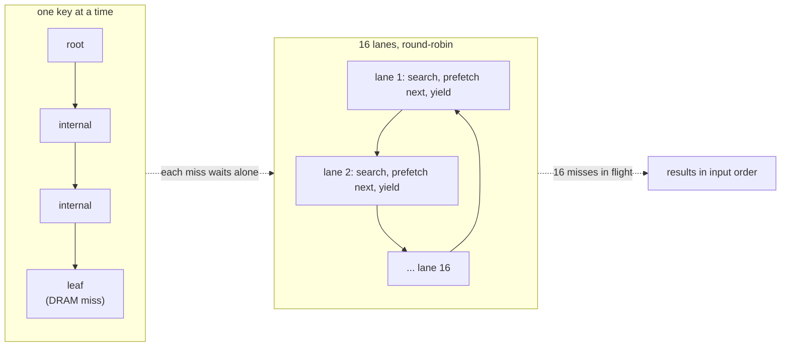
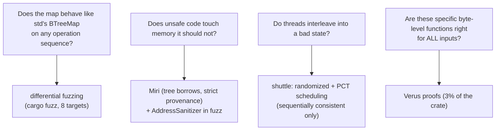
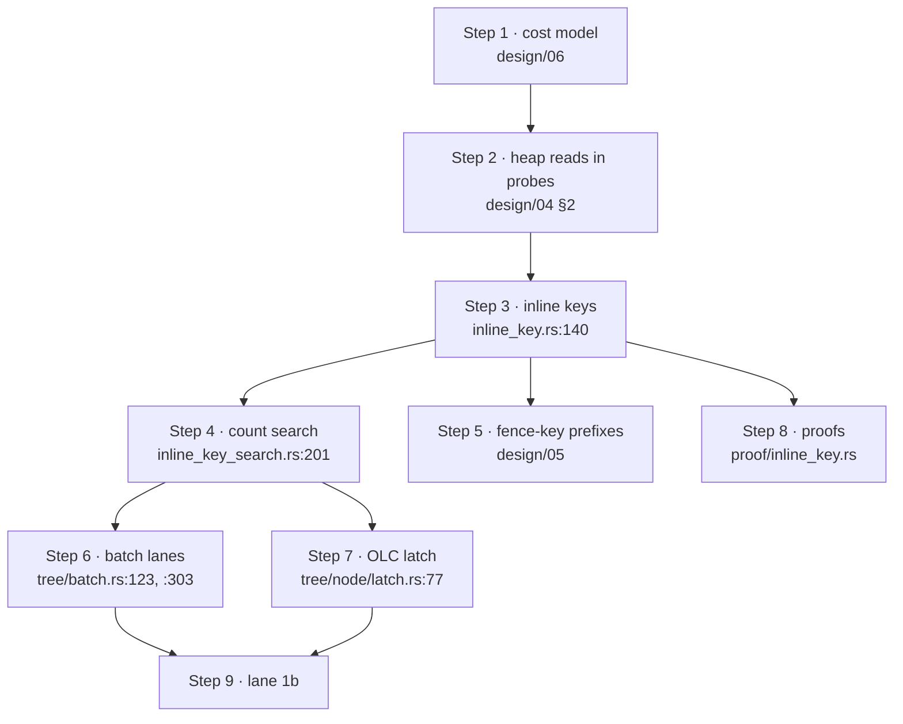

# bbtree: a B+tree designed from its cost model, then argued with by its own benchmarks

Every other chapter in this topic reads a B-tree whose unit is a 4 KiB page on
disk. This one reads a B+tree whose unit is a 1 KiB node in RAM, written in
Rust by Xiangpeng Hao (the author of Bf-Tree, which topic 6 reads next). Its
value for this curriculum is not the speed claim; it is the **numbered design
log** in `design/` (files 00–16 and 99). Each decision is written down with the
experiment that justified it and, unusually, with the experiments that
*failed*: 2 KiB internal nodes that saved a level and made lookups slower,
512-byte leaves that cut DRAM fills but moved hit latency by only 3%, a hand-rolled
"min/max prefix" scheme that made JSON hits 44% slower. The chapter walks the design
in the order the author did — cost model first, benchmark second — and then
checks what survives on a different machine. It covers five mechanisms
(**inline keys**, **prefix stripping from fence keys**, the **batch API** that
overlaps lookups with software prefetch, a **closure-based concurrent API** on
optimistic latches, and a **verification stack**), and ends with this repo's own
measurement, `bbtree_vs_std`, which reproduces most of the headline and not all
of it.

Every anchor below is the `XiangpengHao/bbtree` repository at commit
**`f0a5d36`** (clone: `~/repos/bbtree`; `bbtree` is not in this book's pin
table, so the commit is stated here instead). The workspace's crate version is
**0.1.5**. The measured lane builds the crates.io release `bbtree = "=0.1.5"`;
that release differs from `f0a5d36` in three files on the *remove* path
(`tree/remove.rs`, `tree/latched/remove.rs`, and `tree/node/leaf.rs`, where
`f0a5d36` adds a six-line `keeps_its_minimum` helper after line 268, so every
`leaf.rs` anchor below sits six lines lower in the published crate). Nothing
the lane runs — insert, `get`, `get_many` — touches those hunks. Design-log
files are quoted as `design/NN-name.md`; the author's own measurements are
labelled as his, and anything computed or measured here says so.

## The problem in one sentence

A B-tree lookup in RAM is a short chain of *dependent* cache misses (each
node's address comes out of the node above it), and the standard library's
`BTreeMap` pays for that chain one comparison, one pointer and one operation at
a time — so how much of the chain can a design *delete* (smaller keys to
compare, fewer nodes touched), *shorten* (fewer levels) and *overlap* (more
than one lookup in flight), and how do you know which of those three is
responsible for any speedup you measure?

## The concepts, step by step

### Step 1 — write the cost model before the benchmark

> **In:** the workload (u64 and `String` keys, 1M / 10M / 100M entries) and the
> machine's cache sizes; nothing measured yet.
> **Out:** a formula that predicts tree depth and bytes per entry, and a list of
> the five places the author's later measurements contradicted it.

A **cost model** is arithmetic that predicts a data structure's cost from its
parameters before any code runs. `design/06-cost-model.md` opens with the
author's stance ("I think above metrics can be calculated, not just measured")
and lists what to count: cache-line loads, *chained* versus *parallel* loads,
comparisons, instructions, branches. A **chained** load is one whose address
depends on the previous load's result (a B-tree descent is one); loads are
**parallel** when none needs another's result, so the CPU can have them all in
flight at once. Topic 0's memory ladder gives the price: a cache hit costs
nanoseconds, a DRAM miss on the order of 100 ns, so one chained miss costs as
much as hundreds of instructions.

The model for tree size (`design/06-cost-model.md`, "Memory and depth"). For a
tree of `N` entries, leaf capacity `C_l`, internal capacity `C_i`, and **fill
fractions** `u_l`, `u_i` (the average share of each node's slots in use; a
random-insert B-tree sits near 70%, which is the author's stated assumption):

```text
leaves          L ≈ (N + 1) / (u_l · C_l + 1)
fanout          f = u_i · C_i + 1
internal nodes  ≈ L / (f − 1)
node bytes      ≈ L · S_l + [L / (f − 1)] · S_i       (S = node size in bytes)
```

(The `+ 1` is because a non-root leaf stores one extra value, the "head" of the
separator above it.) **Worked example, computed here** from the doc's own
inputs — `u64 → u64`, 1 KiB leaves and internals, `C_l = C_i = 55`, `u = 0.7`,
`N = 10,000,000`:

```text
L        = 10,000,001 / (0.7 · 55 + 1)  = 10,000,001 / 39.5  = 253,165 leaves
f        = 0.7 · 55 + 1                  = 39.5
internal = 253,165 / (39.5 − 1)          = 6,576 nodes
bytes    = (253,165 + 6,576) · 1024      = 265.97 MB   →  26.60 bytes per entry
depth    : 253,165 leaves → /39.5 = 6,409 → /39.5 = 162 → /39.5 = 4.1 → /39.5 < 1
           = leaf + 4 internal levels = 5   (and 4 at N = 1,000,000)
```

The doc's table says 26.60 bytes/entry and depth 4 / 5 at 1M / 10M for exactly
this row; the arithmetic reproduces both. Two things follow before any timing.
First, the 6,576 internal nodes are 6.7 MB — they fit in the 9900X's 32 MiB L3
(the author's machine, `design/06-cost-model.md`, "Lookup") — while the 259 MB
of leaves do not fit anywhere: **every random lookup is expected to pay about
one DRAM miss, at the leaf**, and the upper levels are warm. Second, the model
predicts *depth*, not cost: the author's own table lists "depth, 1M / 10M" and
"bytes per entry", and then spends the rest of the file correcting it.

The five corrections (`design/06-cost-model.md`, "What the measurements taught
us", lines 136–152) are the chapter's real lesson, and each one has a number:

1. **Charge the summary search at capacity, not fill.** The SIMD search loads
   every slot, live or not, so a bigger node costs more even when half empty.
2. **A saved level is not a saved cache miss.** The author tried 2 KiB
   internal nodes: 10M-entry depth drops 5 → 4, but `u64` hits go **131.0 →
   164.0 ns** and misses **97.4 → 160.7 ns**, DRAM fills per hit unchanged
   (3.87 → 3.90), instructions 260 → 296. The removed level was warm; what it
   saved was a few instructions, and the wider node scan cost more than that.
3. **Code generation can flip a result.** Adding a second caller to a function
   made LLVM stop inlining it, and a 26-instruction population count became 244
   (decision D36).
4. **Fewer cache misses and lower latency do not always go together.** Aligning
   leaf pairs cut DRAM fills per hit 3.86 → 3.68 with identical instructions,
   and latency barely moved (131.5 → 129.6 ns).
5. **Fill varies by level and size.** At 10M `u64` the parents of leaves are 65%
   full, not 70%.

Every number in that list is the author's, measured on his Ryzen 9 9900X
(single runs, `mimalloc` allocator, native code); none is re-measured here. The
habit to keep is the structure: *a model that is allowed to be wrong, with the
wrongness catalogued.* Graefe's *More Modern B-Tree Techniques* (2024) is the
source the doc cites for the borrowed ideas (row versus column leaf layouts,
split-point choice, dense fixed-width codes that keep full keys out of the
comparison stream); the page numbers it quotes (`design/06-cost-model.md`,
lines 32–42) are the author's and were **not** checked here — the monograph was
not obtained. This repo's [`reading-graefe-survey.md`](reading-graefe-survey.md)
reads the 2011 survey, whose §3.4 and §3.6 describe the same two ideas under
the names *normalized key* and *poor man's normalized key*.

### Step 2 — why a generic B-tree is slow on strings: the heap read in every probe

> **In:** the cost model of Step 1, and the doc's `String`-key experiment
> (`design/04-inline-key.md`, §1–2).
> **Out:** the single constraint — *each probe must stop touching the heap* —
> that the rest of the design serves.

A std `BTreeMap<String, V>` node holds `String` values: a 24-byte header (pointer,
capacity, length) whose bytes live somewhere else in memory. Comparing two
strings therefore follows a pointer. In a binary search over a node's keys, the
next probe's index depends on the current comparison, so these heap reads are
**serial** (each must finish before the next can start), and about half of the
probes **mispredict** (the CPU guessed the branch direction wrong and throws
away work). The author measured, on `String` keys, bbtree making a third fewer
comparisons than std (19 versus 29 per `get`) and *still* losing at first,
0.70–0.95× std's speed at 1M entries (`design/04-inline-key.md` §1–2; his
numbers). Giving the binary search an 8-byte inline prefix per key brought the
`get` to parity (192 versus 191 ns). The doc's conclusion is the chapter's
constraint: bigger nodes win only if each probe stops touching the heap.

### Step 3 — inline keys: an order-preserving window, stored in a parallel array

> **In:** the constraint of Step 2; the `InlineKey` trait
> (`bbtree/src/inline_key.rs:140–162`).
> **Out:** the contract an inline key must keep, the zero-padding rule, and the
> layout that makes the search read only inline keys.

An **inline key** is a small fixed-width integer derived from a key, stored in
the node *beside* the key. Its contract (`design/04-inline-key.md` §3): if
`inline(a) ≠ inline(b)`, then `a` and `b` order the same way their inline keys
do; if the inline keys are equal they decide nothing and the search falls back
to comparing the full keys. To make that true for every key type, bbtree does
not define the inline key as a hash or a summary but as a **window** — 8 bytes at
a given offset — of an **order-preserving encoding** of the key: a byte string
such that comparing the byte strings lexicographically gives the same answer as
comparing the original keys. This is the shape of Graefe's *poor man's
normalized key* (topic 3's Graefe chapter, Step 6): not the whole normalized
key, only the first few bytes of it, enough to decide most comparisons.

```rust
// bbtree/src/inline_key.rs:140–143 and 160–162 (@ f0a5d36); 144–159 elided: hash-tag and cmp_from flags
140    pub trait InlineKey: Ord {
141        /// How many bytes of each inline key the nodes keep, where the map uses
142        /// this impl (see [`InlineWidth`]).
143        const WIDTH: InlineWidth = InlineWidth::Eight;
// ... 144–159: HAS_HASH_TAG, HAS_CMP_FROM ...
160        /// This key's inline key at `offset`: bytes `offset..offset + 8` of its
161        /// encoding, big-endian, zero past its end.
162        fn inline_key_at(&self, offset: usize) -> InlineWord;
```

The line to focus on is 162: the *whole* interface is "give me bytes
`offset..offset+8` of your encoding as a big-endian `u64`". **Big-endian** means
the most significant byte first, so comparing the `u64`s as integers compares
the bytes as a lexicographic string. The encodings the crate defines:

| key type | encoding | anchor |
|---|---|---|
| `[u8]`, `str`, `String`, `Vec<u8>` | its bytes, zero-padded past the end | `inline_key.rs:227` |
| `u64` | its 8 big-endian bytes | `inline_key.rs:337` |
| `i64` | big-endian bytes of the bits with the **sign bit flipped** | `inline_key.rs:359`, `proof/inline_key.rs:256` |

**Worked example, computed here** — why the sign flip works. A two's-complement
`i64` has the sign bit set for negatives, so as raw bytes `-1 = 0xFFFF_FFFF_FFFF_FFFF`
would sort *after* `5 = 0x0000_0000_0000_0005`, the wrong way. Flipping bit 63:
`-1 → 0x7FFF_FFFF_FFFF_FFFF`, `0 → 0x8000_0000_0000_0000`, `5 →
0x8000_0000_0000_0005`. Now `-1 < 0 < 5` as unsigned bytes, which is the order
the keys have.

**Zero padding is safe**, and for a subtle reason. `"ab"` and `"ab\0"` have
the same windows (both `61 62 00 00 …`) so they *tie*, and a tie sends the
search to the full-key comparison, which tells them apart by length.
A key shorter than the window start windows to all zeros and, being a prefix of
its neighbours, sorts first, which matches. A **tie** is the only failure mode
of an inline key, and it is a slowdown, never a wrong answer
(`design/04-inline-key.md` §3: "A wrong inline-key implementation gives wrong
answers, never undefined behaviour").

**Layout: a parallel array, not a fat element.** For `String → u64` in a 1 KiB
leaf the doc compares two layouts, both costing 8 bytes per entry
(`design/04-inline-key.md`, "Layout"):

```text
parallel array:  | hdr | i0 i1 … i24 | k0 k1 … k24 | free | … v1 v0 | head |
                       └─ 200 B ─┘└─── 600 B ───┘
fat element:     | hdr | (i0,k0) (i1,k1) … (i24,k24) | free | … v1 v0 | head |
                       └──────────── 800 B ─────────┘
```

The search reads only the dense inline-key array: 4 cache lines instead of 13
while the inline keys decide, a loop over a plain `[u64]` the compiler can
vectorize, and `keys()` stays a contiguous `&[K]`. The cost is one extra cache
line on a tie or for the final equality check. Contrast hashbrown (topic 2's
[`reading-hashbrown.md`](../02-in-memory-structures/reading-hashbrown.md)): there
a one-byte **control byte** per slot is compared 16 at a time before any slot
is touched; bbtree's inline-key array is the *ordered* sibling of that dense
filter, 2–8 bytes per slot instead of 1 and a range answer instead of a
match/no-match. Where bbtree also wants a pure-equality filter it has one,
literally: a **hash tag** byte per key in the leaf, searched with SSE2 byte
compares (`tree/node/vector_count.rs`, `U8EqualitySearch`). The name is
misleading for the keys most users have: for std byte strings the "hash" is the
key's **length** saturated at 255 (`inline_key.rs:236–239`,
`u8::try_from(self.len()).unwrap_or(u8::MAX)`), so it rules out only keys of
different lengths. (The measured lane's `String` keys all have 21 bytes, so
here the tag filters nothing and the 8-byte window does all the work.)

**How a key type gets one.** Stable Rust forbids a blanket "every `Ord` type
defaults to no inline key, `String` overrides it" (two overlapping trait impls
need specialization). So the map has a third type parameter,
`BBTreeMap<K, V, S = Auto, A = Global>`: `Auto` recognizes `String`, `str`,
`Vec<u8>`, byte arrays and the 64- and 128-bit integers *by `TypeId`* and gives
them inline keys with no source change, and `WithInlineKey` opts a newtype in
(`inline_key.rs:451` and `:465`; mechanism in `design/04-inline-key.md` §3). That
is why the measured lane's plain `BBTreeMap<String, u64>` gets inline keys.

**Width.** The window is 8 bytes but each node *keeps* only 2, 4 or 8:
`InlineWidth` (`inline_key.rs:45–52`). Under `Auto`, integers and byte arrays
keep **2** bytes, heap strings keep **8 in leaves and 4 in internal nodes**
(`inline_key.rs:26–42`, `design/04-inline-key.md` Q7). The reason is what a
tie costs against what a byte costs. The doc's measurement of *real* key sets
(Q7, his table): the fraction of sorted neighbours that share their first 8
bytes is 36% for crates.io names, 70% for Wikipedia titles (44% at 1M, 65% at
10M), 24% for JSON keys and **99% for Linux paths**. Synthetic benchmark keys
almost never tie, which is why a benchmark on random hex strings flatters this
design (Step 9 returns to that).

The doc's headline evidence for the whole mechanism (Q3, Wikipedia titles, 10M,
his run, counters reliable and times ±15%):

| build | ns | instructions | DRAM fills |
|---|---:|---:|---:|
| no inline keys | 1073 | 1158 | 83.5 |
| inline keys | 704 | 803 | 42.2 |
| inline keys in internal nodes only | 748 | 997 | 46.2 |

Time falls by 369 ns, 34% of 1073 (computed here), and DRAM fills by 49%. The
split is the interesting part: of the 369 ns saved, about 325 come from the
*internal* nodes and 44 from the leaves. That follows from Step 1's arithmetic:
every lookup crosses four or five internal nodes and one leaf.

### Step 4 — the search is a count over every slot, not a binary search

> **In:** the layout of Step 3: a dense array of inline keys per node, padded to
> capacity with the greatest value.
> **Out:** how a node search turns that array into a range of *candidate* keys
> with no data-dependent branch, and what it hands to the full-key comparison.

It is tempting to picture a binary search that compares the inline keys in
registers. That is not what the code does, and the design log is explicit about why
(`design/04-inline-key.md` Q6, resolved: "a count over every slot, on every
target; never a binary search"). A binary search probes `log₂ n` slots, each
probe's address depending on the previous comparison; if the node's lines come
from DRAM, they arrive one after another. A **count** reads every slot with
loads that do not depend on each other, so the lines of a cold node arrive
together.

```rust
// bbtree/src/tree/node/inline_key_search.rs:200–213 (@ f0a5d36)
200    #[inline(always)]
201    fn equal_range_by_count(self, target: W) -> Range<usize> {
202        // SAFETY: every slot up to the capacity is initialized (type
203        // invariant).
204        let slot = |index| unsafe { self.slots.load(index) };
205        let below = (0..self.slots.capacity())
206            .filter(|&index| slot(index) < target)
207            .count();
208        let equal = (0..self.slots.capacity())
209            .filter(|&index| slot(index) == target)
210            .count();
211        let below = below.min(self.len);
212        below..(below + equal).min(self.len)
213    }
```

The line to focus on is 205–207: the trip count is `capacity()`, a per-map
constant, not `len`, so the compiler unrolls it into a few vector compares and
`count()` becomes mask-popcounts (explicit AVX-512, SSE2 and NEON versions are in
`tree/node/vector_count.rs` for the widths the compiler vectorizes poorly). Slots
from `len` to the capacity hold the *greatest* inline key (invariant 4, see the
doc comment at lines 191–199), so they never count as "below", and the `.min(self.len)`
clamps at line 211–212 keep the range in bounds even if the slots hold garbage —
which matters for the concurrent tree (Step 7) and is why lesson 1 of Step 1
says to charge the search at capacity, not fill.

**Worked example, computed here.** A leaf with five 8-byte inline keys (the
windows of five strings, big-endian hex):

```text
slot  key          inline key (8 bytes)
 0    apple        6170706c65000000
 1    applepie     6170706c65706965
 2    applesauce   6170706c65736175
 3    banana       62616e616e610000
 4    cherry       6368657272790000

search "applesauce":  target = 6170706c65736175
   below = #{slot < target} = 2   (apple, applepie)
   equal = #{slot = target} = 1   (applesauce)          → candidates 2..3
   → one full-key comparison, at slot 2.

search "applz":       target = 6170706c7a000000
   below = 3, equal = 0                                   → candidates 3..3, empty
   → Err(3): the insertion point, with NO full-key comparison and no heap read.
```

Now the same keys in an *internal* node under `Auto`, which keeps 4 bytes: the
first three all window to `6170706c`, so searching for `applesauce` gives
`below = 0, equal = 3`: three candidates, and the search compares full keys
among them — but only *from byte 4 onward*, because the first four bytes are
known equal (`cmp_from`, `inline_key.rs:242`). That is the price of the
narrower window, and the doc's measurement says it is cheap (4-byte internal
summaries raised capacity 25 → 28 and improved JSON hits 343.8 → 320.4 ns,
`design/06-cost-model.md`, decision D43).

```rust
// bbtree/src/tree/node/leaf.rs:531–540 (@ f0a5d36; 523–530 is the signature)
531        if let Some(target) = self.inline_target(key)
532            && let Some(candidates) = self.candidates(target)
533        {
534            // Most keys an insert searches for are absent and have no
535            // candidates: they stop at the inline keys, without a call.
536            if candidates.is_empty() {
537                return Err(candidates.start);
538            }
539            return self.search_candidates(candidates, key, target);
540        }
```

Line 536 is the fast path of the example above: an *absent* key (the common case
for inserts) ends here with no key read. Line 539 is the slow path: only the
candidate range is searched with full keys. The doc also reports what the count
cost against the obvious alternatives (`design/04-inline-key.md` Q6, his
numbers): at 10M entries the count is within ±3% of a branchless binary search on
baseline x86-64 and AVX2, and an early-exit scan (stop at the first inline key
not below the target) was 6–18% *slower* with AVX-512, because it mispredicts
about once per node. At 1M, where the tree sits in L3 and compare work decides,
a branchless binary search *won* on baseline x86-64. The count is a choice for
10M, "which is what bbtree is for", not a universal law.

### Step 5 — fence keys give every node a prefix for free

> **In:** inline keys that tie (Step 3's 99% for paths).
> **Out:** how a node strips the bytes all its keys share, without storing
> any fence key, so the inline-key window lands on the bytes that differ.

**Fence keys** are the pair of separator keys bounding a node's key range: the
nearest separators on its left and right in its ancestors. Every key that can
ever be in the node satisfies `low ≤ k < high`. The **longest common prefix**
(LCP) of two strings is the longest string that starts both. Every key in the
node therefore starts with `LCP(low, high)`, and at least that many bytes long
(a shorter key would be a prefix of `low` and sort before it). A node needs to
store only a `prefix_len: u16`; its inline keys are windows taken *after* the
prefix (`design/05-fence-key.md`, "Idea: the separators are the fences").

**Worked example, computed here.** Suppose a leaf sits between separators
`low = "user:00ab12"` and `high = "user:00ab9f"`:

```text
LCP(low, high) = "user:00ab"            prefix_len = 9
the node's inline keys are windows at offset 9:
   low  → bytes 9.. = "12\0\0\0\0\0\0" = 3132000000000000
   high → bytes 9.. = "9f\0\0\0\0\0\0" = 3966000000000000
```

At offset 0 every key in this node would window to `757365723a303061` (`user:00a`)
and tie completely; at offset 9 the window starts on the bytes that differ. This
is the same idea as Bf-Tree's and Graefe's prefix truncation, and as ART's path
compression in topic 2 ([`reading-art-paper.md`](../02-in-memory-structures/reading-art-paper.md)),
done without storing prefixes: **no fence copy is stored and `K` need not be
`Clone`**, because the bytes are already in every key. Three consequences the
doc spells out: an insert never changes a node's prefix (the key already lies
between the fences); only a separator change does (split, merge, move between
siblings); and a child's prefix is never shorter than its parent's, since for
`a ≤ b ≤ c`, `LCP(a, c) = min(LCP(a, b), LCP(b, c))`.

What bbtree cannot take from the disk-oriented literature is **suffix
truncation** of separators (topic 3's Graefe chapter, Step 3): `iter` and
`get_key_value` return `&K`, so a real `K` must exist in the node, and a
truncated separator would not be one (`design/06-cost-model.md:44–46`).
Prefix stripping is free of that constraint because it removes bytes
that every key still physically holds.

The leftmost and rightmost spines have no fence on one side, so their prefix
is what *every key in the tree* shares, kept once beside the root and checked
once at the top of every search (`design/05-fence-key.md` and D50 in
`design/06-cost-model.md`, "Shared prefix where fences are missing"). The doc's
reason is a measurement: with a per-node prefix kept where fences are missing,
every internal search paid a header field and a branch (16–28 instructions per
lookup on random keys); the per-tree version cost one compare per lookup. The
same section also records a rejected alternative that is worth knowing exists:
storing each node's *min/max* key prefix instead of using fences made JSON hits
**309 → 446 ns** and Wikipedia **423 → 527 ns**, and was dropped.

### Step 6 — the batch API: overlap the misses of independent lookups

> **In:** the measurement from Step 1 that a lookup is a dependent miss chain and
> that "a saved level is not a saved cache miss".
> **Out:** the lane/executor mechanism of `get_many`, the model that says when it
> helps, and the author's measured ceiling on it.

A single `get` cannot overlap its own chain. Consecutive `get`s do not overlap
either: between one lookup's first miss and the next lookup's first load lies
the rest of the first lookup, "far more than the 448-entry reorder buffer of
Zen 5 reaches" (`design/12-batch-api.md`, "Problem"). The **reorder buffer** is
the window of instructions the CPU can have in flight out of order; if the next
independent load is farther away than that window, it cannot start early.

`get_many` makes the independence explicit:

```rust
// bbtree/src/unsync/map/batch.rs:30 (signature, @ f0a5d36)
30    pub fn get_many<Q, const N: usize>(&self, keys: [&Q; N]) -> [Option<&V>; N]
```

It takes an array of `N` keys and returns an array of `N` results in the same
order, as if `get` were called `N` times. Each key descends in its own **lane**:
an `async` block that reads like the single-key search but, *before reading a
line it may not have, prefetches that line and yields* (`design/12-batch-api.md`,
"Lanes"; the lane is `tree/batch.rs:123–200`). A **prefetch** is a hint
instruction that tells the CPU to start loading a cache line into cache without
waiting for the result. **Yielding** hands control back to a private round-robin
executor, which runs the other lanes while the line arrives.

```rust
// bbtree/src/tree/batch.rs:135–148 (@ f0a5d36): the head of one lane's descent
135            if let Some(line) = self.key.window_line(usize::from(self.prefix_len)) {
136                Prefetcher::watched(self.watch, LaneFetch::QueryWindow, line).await;
137            }
138            loop {
139                index = match Internal::at(self.node).search(&self.key) {
140                    Ok(index) => {
141                        let separator = Found::Separator(Internal::at(self.node), index);
142                        *output = Some(separator.key_value().1);
143                        return;
144                    }
145                    Err(edge) => edge as u16,
146                };
147                let edge = Internal::at(self.node).edge_line(usize::from(index));
148                Prefetcher::watched(self.watch, LaneFetch::Edge, edge).await;
```

Line 139 is the ordinary node search of Step 4; line 147–148 is the new part:
having chosen an edge, compute the child's address, prefetch it, and `await`
(yield). Nothing `async` reaches the caller — no future, no runtime — because
the executor is 20 lines:

```rust
// bbtree/src/tree/batch.rs:310–323 (@ f0a5d36): the round-robin executor for up to 64 lanes
310        let mut live = if N == 64 { u64::MAX } else { (1_u64 << N) - 1 };
311        let mut context = Context::from_waker(Waker::noop());
312        while live != 0 {
313            let mut round = live;
314            while round != 0 {
315                let index = round.trailing_zeros() as usize;
316                round &= round - 1;
// ... 317–318: SAFETY comment ...
319                let lane = unsafe { lanes.as_mut().map_unchecked_mut(|lanes| &mut lanes[index]) };
320                if lane.poll(&mut context).is_ready() {
321                    live &= !(1_u64 << index);
322                }
323            }
324        }
```

One bit per live lane in a `u64` (`live`), `trailing_zeros` to pick the next one
(line 315), `round &= round − 1` to clear the lowest set bit (316), and a no-op
waker because a lane only yields right after issuing a prefetch, so every live
lane is simply polled again next round. The "future" that yields is
`Prefetcher`, whose `poll` returns `Pending` once and `Ready` the second time
(`tree/batch.rs:404–410`), and whose `hint` is a single `_mm_prefetch(…,
_MM_HINT_T0)` on x86-64 or `prfm pldl1keep` on AArch64 (`tree/batch.rs:382,
390`). The comment at the top of the module says the rule: *only this module
prefetches*, and only the line a lane reads next; single-key operations never
do (`design/12-batch-api.md`, "Prefetch policy"; decision D46).



**The model and its sanity check.** The doc's model is
`batch ≈ max(miss chain / overlap, search work + lane bookkeeping)`. Its
measurements, his Ryzen 9 9900X, 10M entries, `u64` (`design/12-batch-api.md`,
"Measurements" and "Level by level"): one key a call **130.0 ns**, batched
**74.8 ns** (1.74×), and a hand-written level-by-level scheduler with no
async at all **60.8 ns**. Where the gap goes is measured too: on 10M `u64` hits
the async version spends 416 cycles a key against 339, with **6.3 misses in
flight on average against 8.1**, at the same lines from memory. **Computed here,
a consistency check on the doc's numbers using Little's law** (average requests
in flight = request rate × latency): the author's single-key hit fetches 4.017
lines from memory (`bbtree/vis/data/9900x-20261018/lookups.csv`, `get_hit`, 10M
`u64`; a different run from the batch table, so this is a consistency check,
not an identity). At 74.8 ns per key with 6.3 in flight the implied per-line latency is
`6.3 × 74.8 / 4.017 = 117 ns`; for the level-by-level scheduler,
`8.1 × 60.8 / 4.017 = 123 ns`. Two different schedulers give nearly the
same implied latency, about 120 ns, which is a plausible loaded DRAM latency. The same arithmetic says a *serial* chain of 4.017 misses would cost
about 480 ns, nearly four times the measured 130 ns single-key hit, so even an
unbatched lookup already overlaps most of its own lines (the count search of
Step 4 issues a node's loads together). **Batching removes what remains of
the chain, not all of it.**

**When it does not help.** Below a size cutoff each key goes through the plain
search, because with the tree in cache there are no misses to overlap
(`tree/batch.rs:419–423`): `pages_in_l2 = max(1, 1 MiB / leaf bytes)`, and
batch only if the tree holds at least `pages_in_l2 × (0.7 × capacity + 1)`
entries, 39,936 for `u64 → u64` (the doc's figure). The measured lane in Step 9
shows the effect from the other side at 100K entries.

**The honest accounting** (`design/12-batch-api.md`, "Limits and open
problems"): batched misses stay behind `hashbrown` (a hash miss is usually
rejected by one group of control bytes; a tree miss reaches a leaf; at 10M,
batched `u64` hits 74.8 ns versus hashbrown's 17.1); batching "cannot remove the
tree's levels"; and inserts still pay leaf shifts, splits and allocation
(`insert_many` is 1.45× over single inserts at 10M `u64`). The 14 ns gap
between async lanes and level-by-level is "not a proven floor"; the author
leaves its cause open ("a lane branches on leaf data that hasn't arrived, and
a misprediction there flushes the younger lanes' loads" is a hypothesis, not a
finding). For a graph engine the relevant reading is the join-shaped one the
doc names directly: *a join probing an index* is exactly "many independent
keys"; topic 54 (`topics/54-join-algorithms/`) builds the main-memory join
algorithms where that shape lives.

### Step 7 — concurrency: closures instead of handles, optimistic latches inside

> **In:** the single-threaded tree of Steps 3–6.
> **Out:** the shape of the concurrent API and what a node's 64-bit latch word
> means, with a worked reader/writer interleaving.

`unsync::BBTreeMap` is deliberately single-threaded and a drop-in for std's
`BTreeMap`; the type threads share is a separate `bbtree::BBTreeMap`
(`design/09-concurrency.md`, "Scope"). Its API makes one choice that the rest
follows from: **no reference, guard or handle outlives a call.** An operation
that exposes a key or value runs *your closure* while the entry's leaf is
latched, unlatches, and returns what the closure returned (`bbtree/src/map/mod.rs:115`,
`read<Q, R>(&self, key: &Q, f: impl FnOnce(&K, &V) -> R) -> Option<R>`; likewise
`update` at `:126`, `get_copied` at `:173`, `scan` at `:218`, and the batched
`read_many` at `map/batch.rs:42`). The type system stops a reference from
escaping: `impl FnOnce(&K, &V) -> R` is `for<'a> FnOnce(&'a K, &'a V) -> R`
with `R` fixed outside `'a`, so `map.read(&k, |_, v| v)` does not compile.
The doc rejects DashMap-style handles with a quotation of DashMap's own
documentation: its `Ref` "may deadlock if called when holding any sort of
reference into the map", which breaks the requirement that a single thread
never deadlocks with itself. There is no `len` either, deliberately: a shared
counter would make every insert write one cache line all threads contend on.

Inside, the tree is the single-threaded tree with a latch word added to each
node. **Optimistic lock coupling** (OLC, Leis et al., "The ART of Practical
Synchronization", the protocol topic 9's
[`reading-bwtree.md`](../09-concurrency/reading-bwtree.md) contrasts with
lock-free designs) means readers take *no* lock on internal nodes: they read the
node's **version**, read the node, and re-check the version afterwards; if it
changed, throw the read away and restart. Writers lock a node by
compare-and-swap, change it, and bump the version when they let go.

```rust
// bbtree/src/tree/node/latch.rs:106–113 and 133–138 (@ f0a5d36); 114–132 elided: contended path
106    pub(in crate::tree) fn read_version(&self) -> Version {
107        Interleaving::switch_point();
108        let word = self.0.load(Ordering::Acquire);
109        if word & Self::EXCLUSIVE == 0 {
110            return Version(word & !Self::SHARED_MASK);
111        }
112        self.read_version_contended()
113    }
// ... 114–132 ...
133    #[inline(always)]
134    pub(in crate::tree) fn is_unchanged(&self, version: Version) -> bool {
135        fence(Ordering::Acquire);
136        Interleaving::switch_point();
137        self.0.load(Ordering::Relaxed) & !Self::SHARED_MASK == version.0
138    }
```

The word's layout is at lines 98–101: bit 0 is the **exclusive** bit, bits 1–20
a **count of shared holders** (`SHARED_MASK = ((1 << 20) − 1) << 1`), and bits
21–63 a **43-bit version** (`VERSION_UNIT = 1 << 21`). Both the check (line 137)
and `read_version` (line 110) mask the shared count *out*: a reader that
validates optimistically must not be invalidated by other readers latching the
leaf shared. The `fence(Acquire)` on line 135 keeps the node reads before the
re-check.

**Worked example, computed here.** A reader and a writer meet on one internal
node whose word is `3 << 21 = 6,291,456` (version 3, unlatched):

```text
reader:  read_version()           word = 6,291,456  → Version(6,291,456)
reader:  reads separators, picks child 7 …
writer:  try_lock_at(6,291,456)   CAS 6,291,456 → 6,291,457     (exclusive bit set)
writer:  rewrites the node
writer:  unlock_exclusive(v)      store v + (1<<21) = 8,388,608
reader:  is_unchanged(Version(6,291,456))
            8,388,608 & !SHARED_MASK = 8,388,608 ≠ 6,291,456   → false → restart
```

A reader that read *during* the writer's exclusive window would have seen word
`6,291,457` at `read_version`, taken the contended path (`:112`, spin with
backoff) and never read garbage. To pass the check wrongly a node would have to
change 2⁴³ ≈ 8.8 × 10¹² times between one reader's two reads (`latch.rs:98–101`
comment). Leaves are different: lookups read them optimistically too, but copy a
`Copy` value out and re-check the version (a **seqlock**, a sequence-counter
read); anything that runs user code (`read`'s closure, a `Clone`) takes the leaf
latch shared, because a writer could free memory the closure is reading
(`design/09-concurrency.md`, "Lookups"). A **torn read** (a copy that mixed old
and new bytes) is discarded unused, and the doc says plainly that racing plain
reads are formally data races, "as the internal nodes' are, and crossbeam's
`AtomicCell` sequence lock's", which is why those tests are excluded from Miri
(Step 8).

The author's measured price of sharing, same document: on 10M `u64`, lookups
half of which miss, switching hits from latched to unlatched reads moved
throughput **9.16 → 8.84 M/s on one thread (−3.5%)**, 83.4 → 86.9 at 12 threads
(+4.2%) and 98.0 → 113.6 at 24 (+15.9%, percentages computed here; his
`bbtree-scaling` run). A hit no longer writes the leaf's latch word, a line
every reader of that leaf used to take in turn.
The README's "12× faster than `crossbeam-skiplist` at 96 threads" is on a 96-core
AWS machine this repo cannot reproduce and is not re-measured here.

### Step 8 — the verification stack, and exactly what the proofs cover

> **In:** the README's badge row (miri, sanitizer, DST, fuzzing, verification) and
> `design/08-fuzzing-verification.md`.
> **Out:** a map from each tool to the property it can and cannot establish, read
> from the code rather than the badge.

Five tools are named, and each answers a different question:



**Differential fuzzing** (topic 16): generate a list of operations from the
fuzzer's bytes, run them on bbtree *and* on std, and compare every answer, plus a
`check_invariants` after every operation so a corrupt node is caught when made.
Eight targets (`bbtree/fuzz/fuzz_targets/`): the sync map, heap byte strings,
integers, user-defined inline keys, plain keys, byte arrays, set algebra, and
`user_code_panics`, which feeds `Ord`/`InlineKey`/`Clone`/`Drop` that panic or lie
and checks memory safety of every unsafe path (`design/08-fuzzing-verification.md`,
"Where the fuzzing time goes"). The key space is small and stem-structured so
nodes strip prefixes of every length and inline keys tie. Not covered, by the
doc's own list: keys of 255 bytes or more (hash tags saturate; unit tests cover
them) and `range` with lying keys.

**Miri** interprets the code and reports undefined behaviour. The workflow
runs with `-Zmiri-tree-borrows -Zmiri-strict-provenance`
(`.github/workflows/miri.yml:35`) and only the tests listed in
`.github/miri-nextest.toml`; and the comment at `miri-nextest.toml:9–11` says
what is *excluded*: "The threads tests stay out: optimistic lock coupling reads
nodes writers are changing, which Miri reports as data races." So **Miri covers
the single-threaded unsafe code, and the concurrent protocol is outside it by
design.**

**Shuttle** (topic 16's deterministic-simulation material) runs the concurrent
tests under a scheduler it controls, one thread at a time, exploring
interleavings with a random scheduler and a PCT (probabilistic concurrency
testing) scheduler (`bbtree/src/map/shuttle_tests.rs:56–62`). The switch points
are explicit calls the tree makes before atomic accesses
(`tree/interleaving.rs`, `Interleaving::switch_point`). The module comment is
precise about the limit: "With one thread running at a time, every access is
sequentially consistent: Shuttle finds bad interleavings, not reorderings a
weak memory model allows." The latch's `Acquire`/`Release` fences (`latch.rs:135,
158`) are therefore *reasoned*, not machine-checked, by anything in this
list.

**Verus** (topic 21) is a verifier for Rust: you write specifications
(`requires`/`ensures`) and proofs inside `verus! { … }` blocks and an SMT solver
checks them for *all* inputs. What bbtree proves is narrow, and the code says
so. The proofs live in `bbtree/src/proof/` — 1,523 lines of 48,868 in `src/`
(3.1%, counted here with `wc -l`, tests included in the denominator) — and
cover two things:

1. **Inline keys of the std key types** (`proof/inline_key.rs`): the
   `ProvenInlineKey` trait is implemented for `[u8]` (`:118`), `u64` (`:197`),
   `u128` (`:226`), `i64` (`:256`) and `i128` (`:281`). The trait's central
   obligation (lines 84–87) is

```rust
// bbtree/src/proof/inline_key.rs:84–87 (@ f0a5d36)
84    fn inline_key_at(&self, offset: usize) -> (inline_key: u64)
85        ensures
86            inline_key == inline_key_at(self.encoding(), offset as int),
87    ;
```

   that is, *the Rust function returns exactly bytes `offset..offset+8` of the
   spec-level encoding, zero past the end*; and a lemma that where two
   encodings agree before `offset` and their windows differ, the keys order
   like the windows (`lemma_inline_keys_order_keys`). That is the contract of
   Step 3, proven once for every key and every offset.
2. **`SearchBytes`** (`proof/search_bytes.rs`): the code that windows and
   compares a *searched-for* byte string — `cmp_from`, `cmp_prefix`,
   `cmp_shared` — is proven to order like std's `<[u8]>::cmp`, including the
   overlapping last word and the 32-byte chunks.

**What the proofs trust rather than prove** (`proof/std_specs.rs`): the behaviour
of `first_chunk`, `last_chunk`, `checked_shl`, `from_be_bytes` and `==` on byte
arrays, stated with `assume_specification` or `#[verifier::external_body]`
(e.g. `std_specs.rs:79–86`: `u64_of` is *declared* to return
`spec_u64(bytes@)`, and its body, `u64::from_be_bytes`, is not checked). The doc
gives the reason: writing the loads as byte indexing, which Verus understands,
made LLVM gather bytes with vector ops instead of one `movbe`.

**What is not proven** (`design/08-fuzzing-verification.md`, "What Verus
proves"; confirmed against the file list): that nodes keep only the first 2 or
4 bytes of an inline key (`InlineWidth`) *and every search and node change
built on inline keys* — the count of Step 4, splits, merges, prefix
maintenance, the tree's invariants; `InlineKey::cmp_prefix`'s default (which
integers use); and everything concurrent — the document says in its first
bullets that "Verification applies to single thread bbtree only", and the same
file's opening note shows the author's own calibration of what the badge means
("I'm not sure if it's is genuinely helpful, but think it's cool to add a
verification to the title", `design/08-fuzzing-verification.md:7`). Read the badge
as: *the integer/byte-string window arithmetic and the byte-string comparison
helpers are machine-checked for all inputs; the tree is tested, fuzzed, run under
Miri and explored under shuttle.* That is a real result for the place where a
bug gives wrong answers no sanitizer sees — and a smaller one than "verified
B-tree".

### Step 9 — this repo's measurement: what reproduces and what does not

> **In:** `topics/03-btree-internals/experiments/src/bin/bbtree_vs_std.rs`
> (lane 1b), which builds the crates.io release 0.1.5 with the default (system)
> allocator and runs single-threaded on this machine (Apple M3 Pro).
> **Out:** the ratio of bbtree to `std::collections::BTreeMap` for random
> inserts, random single `get`s and `get_many` batches of 16, against the
> claims of Steps 3–6.

`cargo run --release --bin bbtree_vs_std`. Seeded splitmix64 keys (the same keys
every run; the printed checksums are identical across runs), probes in a
different random order from the inserts, `black_box` on every probe, every probe
must hit, `get` and `get_many` agree with each other and with std (asserted),
best of 3 for the read lanes and a single run for inserts. Two runs, back to
back, on a machine whose load average was about 10 from other jobs, so treat
the second digit as noise:

```text
                        insert ns (std → bb)       get ns (std → bb)         get_many16 ns (bb)
u64    100K   run 1      95.1 →  74.3  1.28×        81.5 →  34.1  2.39×       32.4  (2.51× std)
              run 2     128.0 →  84.7  1.51×        76.9 →  30.2  2.54×       27.9  (2.75×)
u64    1M     run 1     154.0 → 121.9  1.26×       203.8 →  71.8  2.84×       41.0  (4.97×)
              run 2     121.2 →  87.2  1.39×       138.5 →  58.8  2.36×       40.9  (3.38×)
u64    10M    run 1     294.2 → 215.1  1.37×       352.5 → 151.1  2.33×       73.0  (4.83×)
              run 2     294.2 → 190.6  1.54×       568.1 → 175.6  3.24×       65.8  (8.64×)
String 1M     run 1     457.5 → 245.3  1.86×       700.1 → 270.0  2.59×
              run 2     413.7 → 226.3  1.83×       676.3 → 271.8  2.49×
```

What to read from it:

- **Single `get`: 2.3–3.2× faster than std at 10M, 2.4–2.8× at 1M.** The
  README's "5× faster than std's `BTreeMap` at single thread" does **not**
  reproduce for single gets here, and the author's own tables do not show it
  either: his one-thread table on the 9900X at 10M (`design/14-blogpost.md`
  "What the numbers say", lookups half missing) has `u64` get **109 vs 264 ns
  (2.4×)** and, across `u64`/UUID/Wikipedia titles/JSON, "gets 1.7–4.1× std's,
  batched 2.4–6.6×". The `lookups.csv` of 10M hits (`vis/data/9900x-20261018/`)
  gives 136.8 vs 272.8 ns for `u64`, i.e. 1.99×. So the headline "5×" sits
  inside his *batched* range (up to 6.6×), not his single-get range (up to
  4.1×, JSON keys). The README does not say which; the M3 result for single
  `get` is consistent with his table, not with his headline.
- **`get_many` of 16: 4.8–8.6× std at 10M, and 2.1–2.7× its own single `get`.**
  The 8.64× is run 2, where std's own `get` was 568 ns against 353 ns in run 1
  (same keys, same binary): the *std* number moved by 61% under load while
  `get_many` moved by 10%, which is itself a finding about which lane is
  sensitive to a loaded memory system. Use the ratio against bbtree's own `get`
  (2.1–2.7× across both runs) as the more stable figure. The author's equivalent
  on the 9900X is 1.74× (130.0 → 74.8 ns, Step 6); a larger gain on the M3 is
  plausible since the author's note on an M1 Pro is that without the prefetch
  the 10M batched `u64` hit took 283 ns against 200 with it
  (`design/12-batch-api.md`, "Prefetch policy"), but this repo did not run the
  no-prefetch variant, so it does not know that the gain here comes from the
  prefetch.
- **At 100K the batching gain vanishes (32.4 vs 34.1 ns, 27.9 vs 30.2).** That
  is the model of Step 6 seen from the other side: the whole tree fits in cache,
  there are no misses to overlap. (100K is above the 39,936-entry cutoff, so
  `get_many` really ran the lanes; the lanes just have nothing to hide.)
- **Insert: 1.26–1.54×, not 5×.** An insert descends like a get and then pays
  the leaf shift (about half a leaf at random positions), splits and
  allocation, none of which inline keys help. The author's one-thread 10M
  `u64` insert is 155 ns against std's 239 (`design/14-blogpost.md`, "What
  the numbers say"; 1.54×, computed here), the same range.
- **`String`, 1M, inline keys on (`Auto`): get 2.5–2.6×, insert 1.8–1.9×.** This
  is the *favourable* string case: keys are `user:` plus 16 random hex digits
  (21 bytes, all the same length, so the length tag filters nothing), and after
  prefix stripping the 8-byte window lands on random digits, so inline keys
  almost never tie. Step 3's real key sets tie 36–99% of the time at 8 bytes; a
  `String` result on Wikipedia titles or paths would be smaller (the author's own
  10M Wikipedia-title hit is 423.1 ns against std's 783.3, 1.85×,
  `design/06-cost-model.md`, "Wikipedia titles"). The
  exercise in `notes.md` constructs the tied case.
- **What was not measured here:** the memory claim ("30% lower memory usage"),
  tail latency ("5× lower p99"), multi-threaded throughput, the effect of the
  `mimalloc` allocator the author uses (this lane uses the system allocator, and
  the author's own 64-byte-alignment experiment shows glibc `malloc` wasting
  space next to 1 KiB-aligned blocks, `design/06-cost-model.md`, "64-byte node
  alignment"), and any key type besides `u64` and `String`.

## How to read the source (with the concepts in hand)

The repository is a workspace (`bbtree/`, `bbtree-mmap/`, `bbtree-store/`, plus
`bench/` for the author's harness). Reading order for the `bbtree` crate
(`bbtree/src/`), about three hours:

1. `design/06-cost-model.md`, the first 150 lines and the "What the measurements
   taught us" list, then skim the experiment table: this is the best single file
   in the repo.
2. `inline_key.rs` — `InlineKey` (`:140`), the `[u8]` impl (`:227`), `Auto`
   (`:451`). Then `tree/node/inline_key_search.rs:178–213` for the count.
3. `tree/node/leaf.rs:489–600` — `search`, `search_always_inlined` (`:523`),
   `search_candidates` (`:577`).
4. `tree/batch.rs` — `Executor` (`:303`), `Prefetcher` (`:353`), the lane
   (`:123`), `batches()` (`:419`).
5. `tree/node/latch.rs` — the whole latch word (`:77–200`), then
   `design/09-concurrency.md` "Optimistic lock coupling".
6. `proof/inline_key.rs` and `proof/std_specs.rs`, to see where the trust
   boundary is drawn.



## Questions to answer in notes.md

- Run `bbtree_vs_std` twice. Which of the three lanes moved most between
  your runs, and what does that say about which is most sensitive to memory-system
  load? (Step 9 reports std's own `get` moving 61% between two runs.)
- Predict, then compute: for `N = 100,000,000` `u64 → u64` entries with the
  Step 1 parameters, how many leaf-plus-internal levels, and how many bytes per
  entry? Does the tree still have "internal nodes fit in L3"? Use the doc's
  separate-layout row (`C_l = 55`, `C_i = 56`) and say which of the doc's five
  corrections would change your answer.
- The doc says inline-key search is "a count over every slot, never a binary
  search", and also that a branchless binary search *won* at 1M on baseline
  x86-64. Construct the cache-residency argument for why both statements can be
  true, using topic 0's ladder.
- Make the `String` lane's keys tie: replace the random hex with
  `format!("/var/lib/service/{:08}", i)` (every key shares 17 bytes). Predict
  the get ratio before running. Which of Steps 3–5 is now doing the work, and
  which is overhead?
- Read `Prefetcher::poll` (`tree/batch.rs:404–410`). Why is a no-op waker
  correct here, and what would break if a lane could yield *without* having
  issued a prefetch?
- List one property in each of the four rows of Step 8's diagram that the stack
  does **not** establish. For the concurrent protocol: which tool would catch a
  missing `Acquire` fence, and which would not?
- Topic 54 will probe an index with many independent keys. Sketch which of
  `get_many`'s three limits (size cutoff, array-of-N API, ordering of results)
  a hash-join build-probe loop would meet first.

## Takeaway

bbtree is a B+tree built by *deleting* work in a fixed order: keep the heap out
of the probe (inline keys), keep shared bytes out of the window (fence-key
prefixes), keep the CPU's miss queue full (batched lanes), keep readers out of
the way (optimistic versions). Its design log is the lesson: **a cost model that
predicts depth and bytes, then a catalogued list of how reality contradicted
it** — a saved level is not a saved miss, fewer misses is not lower latency, and
the compiler can flip a result. Its verification story is narrower than its
badge, and its speed claim is narrower than its headline: on this machine single
gets are 2.3–3.2× and batches of 16 are 2.1–2.7× faster again at 10M; "5×" is
a batched number.

## Done when

Answer each before unfolding it.

- [ ] You can compute depth and bytes per entry for a tree of `N` `u64` entries
  from the cost model, and say which part of the result the model gets wrong.

  <details><summary>Answer</summary>

  With `u_l = u_i = 0.7` and capacities `C_l`, `C_i`: leaves
  `L = (N+1)/(0.7·C_l + 1)`, fanout `f = 0.7·C_i + 1`, internal nodes
  `L/(f−1)`, depth = leaf level plus the number of divisions by `f` until the
  count reaches 1. For `N = 10⁷`, `C_l = C_i = 55`: `L = 253,165`,
  `f = 39.5`, 6,576 internal nodes, 265.97 MB in total = 26.60 bytes per entry,
  depth 5 (4 at 1M). What it gets wrong is cost: depth counts levels, not
  misses. The author's 2 KiB-internal experiment cut depth 5 → 4 and made `u64`
  hits slower (131.0 → 164.0 ns) with DRAM fills per hit unchanged, because the
  removed level was warm and the wider node scan cost more than it saved. Fill
  also varies by level (65% for leaf parents at 10M, not 70%).

  </details>

- [ ] You can state the inline-key contract, why the key is a window of an
  order-preserving encoding, and what a tie costs.

  <details><summary>Answer</summary>

  If the inline keys of `a` and `b` differ, `a` and `b` order the way their
  inline keys do; if they are equal, nothing is decided and the search compares
  full keys. The inline key is bytes `offset..offset+8` of an encoding whose
  byte-string order equals the key order (big-endian for `u64`, sign bit flipped
  for `i64` so `−1 < 0 < 5` as unsigned bytes, the bytes themselves for
  strings), zero-padded past the end. Windows rather than a hash or a summary
  because a node can then start the window after its shared prefix. A tie only
  sends the search to the full-key comparison (heap read for `String`), so a
  wrong or weak inline key costs time, never correctness. On a tied node
  with 4-byte internal windows the comparison starts at byte 4, not byte 0.

  </details>

- [ ] You can run the count search by hand on a node and say why it is not a
  binary search.

  <details><summary>Answer</summary>

  Count the slots strictly below the target (`below`) and the slots equal to it
  (`equal`); candidates are `below..below+equal`, clamped to `len`. In the
  worked example, `applesauce` against five slots gives `below = 2`, `equal = 1`,
  one full-key comparison; `applz` gives `below = 3`, `equal = 0`, an empty
  range, so it ends with `Err(3)` and no key read. The loop's trip count is the
  node *capacity* (a constant), the loads do not depend on one another and
  there is no branch per slot, so the compiler turns it into vector compares and
  mask popcounts, and the lines of a cold node arrive together; a binary search
  would wait for each probe's cache line before choosing the next. The author's
  measurements: within ±3% of branchless binary search at 10M, and 6–18% faster
  than an early-exit scan with AVX-512, but a branchless binary search won at
  1M on baseline x86-64 where the tree is in L3.

  </details>

- [ ] You can derive a node's prefix from its fences and say why no fence key
  is stored.

  <details><summary>Answer</summary>

  A node's keys all satisfy `low ≤ k < high`, so all start with
  `LCP(low, high)`; for `low = "user:00ab12"` and `high = "user:00ab9f"`, that is
  `"user:00ab"`, `prefix_len = 9`, and the node's inline keys are windows at
  offset 9 (`3132…` and `3966…`). Only the `u16` length is stored in the header;
  the bytes are already in every key, so `K` need not be `Clone`. Inserts never
  change a prefix (the key lies between the fences already), only separator
  changes do; the leftmost and rightmost spines lack a fence and use the
  tree-wide shared prefix kept beside the root and checked once per search.

  </details>

- [ ] You can explain what `get_many` does, why it can beat even a well-overlapped
  single `get`, and when it should not be used.

  <details><summary>Answer</summary>

  Each of the `N` keys descends in its own lane (an `async` block); before
  following an edge or reading a leaf a lane issues a prefetch for that cache
  line and yields, and a 20-line round-robin executor with a no-op waker polls
  the other lanes while the line arrives. Misses of independent keys overlap
  instead of waiting alone. Single `get`s cannot overlap each other because the
  next lookup's first load is beyond the reorder buffer. In the author's data a
  10M `u64` hit goes 130.0 → 74.8 ns, with the average misses in flight 6.3,
  implying a ~117 ns per-line latency by Little's law (`6.3 × 74.8 / 4.017`).
  It does not help when the tree is cache-resident (this repo's 100K lane:
  32.4 ns batched against 34.1 single), and the library falls back to single
  searches below a size cutoff (39,936 entries for `u64 → u64`).
  It does not remove the tree's levels or insert-side shifts and splits.

  </details>

- [ ] You can describe the shared tree's latch word and say what a reader does
  when a writer changes a node under it.

  <details><summary>Answer</summary>

  One 64-bit word per node: bit 0 exclusive, bits 1–20 shared-holder count,
  bits 21–63 a 43-bit version. A reader reads the version (spinning while the
  exclusive bit is set), reads the node in place, then re-checks the version with
  the shared count masked out; if it differs it restarts from the root. A writer
  takes the node with a compare-and-swap from the version its descent read
  (failing at once, never waiting, if the node changed), writes, and releases by
  storing `version + (1 << 21)`. In the worked example a reader holding
  version 6,291,456 fails its check against 8,388,608. User closures and clones
  never run on an unlatched read, because a writer may free what they read;
  only a `Copy` value is copied out and re-validated.

  </details>

- [ ] You can state what the Verus proofs prove, what they trust, and what no tool
  in the stack covers.

  <details><summary>Answer</summary>

  Proved for all inputs: the `inline_key_at` implementations for `[u8]`, `u64`,
  `u128`, `i64`, `i128` return bytes `offset..offset+8` of the specified
  encoding, zero-padded, and keys order like their encodings; and `SearchBytes`
  comparisons (`cmp_from`, `cmp_prefix`, `cmp_shared`) order like std's
  `<[u8]>::cmp`. About 3.1% of the crate (1,523 of 48,868 lines). Trusted, not
  proven: the std functions in `std_specs.rs` (`first_chunk`, `last_chunk`,
  `checked_shl`, `from_be_bytes`, byte-array `==`) via `assume_specification` or
  `external_body`. Not proven: the `InlineWidth` truncation and every search
  and node operation built on inline keys, tree invariants (fuzzed with
  `check_invariants`), and all concurrency (shuttle explores interleavings under
  sequential consistency only; Miri's configuration excludes the threaded tests
  because optimistic reads are formally data races, so the fence placement in
  `latch.rs` is reasoned, not machine-checked).

  </details>

- [ ] You can say which part of bbtree's "5× faster than std" headline this
  repo's measurement supports, with the numbers.

  <details><summary>Answer</summary>

  On this machine (Apple M3 Pro, system allocator, single thread, two runs):
  single `get` 2.3–3.2× faster than std at 10M and 2.4–2.8× at 1M; random insert
  1.3–1.5×; `String` get at 1M 2.5–2.6× (the favourable, rarely-tying key
  shape); `get_many` of 16 at 10M 4.8–8.6× std and 2.1–2.7× bbtree's own `get`.
  The author's own one-thread tables on a 9900X give `u64` get 2.4× and
  "gets 1.7–4.1×, batched 2.4–6.6×" over four key types, so the README's "5×"
  corresponds to the batched range, not to single gets. Not measured here:
  memory, tail latency, threads, `mimalloc`.

  </details>

## References

**Code** — [XiangpengHao/bbtree](https://github.com/XiangpengHao/bbtree) at commit
`f0a5d36` (workspace crate 0.1.5; local clone `~/repos/bbtree`; the measured
lane uses crates.io `bbtree = "=0.1.5"`). Anchors in this chapter:

| File | Lines | What |
|---|---|---|
| `bbtree/src/inline_key.rs` | 26–52, 140–162, 227–250, 337, 359, 451, 465 | `InlineKey`, widths, `[u8]` impl and its length-as-hash-tag, `i64` impl, `Auto`, `WithInlineKey` |
| `bbtree/src/tree/node/inline_key_search.rs` | 178–213 | the count over every slot |
| `bbtree/src/tree/node/leaf.rs` | 489–600 | `search_always_inlined`, candidate search (six lines lower in the crates.io 0.1.5) |
| `bbtree/src/tree/node/vector_count.rs` | 1–60 | explicit vector counts, `U8EqualitySearch` |
| `bbtree/src/tree/batch.rs` | 123–200, 303–325, 353–411, 419–423 | lane, executor, `Prefetcher`, size cutoff |
| `bbtree/src/unsync/map/batch.rs` | 30 | `get_many` |
| `bbtree/src/map/mod.rs` | 115, 126, 173, 218 | `read`, `update`, `get_copied`, `scan` |
| `bbtree/src/tree/node/latch.rs` | 77–200 | the latch word |
| `bbtree/src/tree/interleaving.rs`, `bbtree/src/map/shuttle_tests.rs` | 1–60; 56–76 | shuttle switch points; random and PCT schedulers |
| `bbtree/src/proof/` | `inline_key.rs:84–87, 118, 197, 226, 256, 281`; `std_specs.rs:79–86` | Verus statements and trusted specs |
| `.github/workflows/miri.yml`, `.github/miri-nextest.toml` | 35; 9–11 | Miri flags and the excluded threaded tests |
| `design/06-cost-model.md` | 32–46, 136–152, experiments table | the model, Graefe citations, the five lessons |
| `design/04-inline-key.md`, `05-fence-key.md`, `12-batch-api.md`, `09-concurrency.md`, `08-fuzzing-verification.md` | sections named in the text | |
| `bbtree/vis/data/9900x-20261018/lookups.csv` | `get_hit` rows | the author's 10M per-lookup counters |

**Papers and books** — Graefe, *More Modern B-Tree Techniques*, Foundations and
Trends in Databases (2024), DOI 10.1561/1900000070, **cited by bbtree's design
log; the page and section numbers quoted there were not checked here**.
Leis, Haubenschild, Neumann, "Optimistic Lock Coupling: A Scalable and Efficient
General-Purpose Synchronization Method", IEEE Data Eng. Bull. 42(1), 2019
(topic 9). Hao and Chandramouli, *Bf-Tree*, PVLDB 17(11), 2024 (topic 6,
[`reading-bftree.md`](../06-buffer-pool/reading-bftree.md)).

**This repo** — [`reading-graefe-survey.md`](reading-graefe-survey.md) (normalized
keys, prefix and suffix truncation, fence keys in the 2011 survey);
[`reading-hashbrown.md`](../02-in-memory-structures/reading-hashbrown.md) and
[`reading-art-paper.md`](../02-in-memory-structures/reading-art-paper.md) (dense
filters, path compression); [`reading-bwtree.md`](../09-concurrency/reading-bwtree.md)
(OLC against lock-free); topics 16 and 21 (fuzzing, deterministic simulation,
verification); topic 54 (`topics/54-join-algorithms/`) for the index-probe joins
batching serves.
