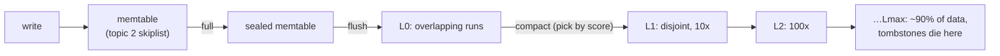

# Topic 4 — LSM-Tree Deep Dive

> You know the memtable (topic 2) and the B-tree alternative (topic 3). This
> topic is the rest of the LSM machine: SST anatomy, bloom filters, and
> compaction — a scheduling problem wearing a storage-engine costume.

## The problem, predicted before it is measured

This is one of two topics whose benchmark measures **only your own code** —
`write_amp` runs your LSM under leveled and tiered compaction, so on a fresh
clone it prints two stub notices and exits, and it has no lane in `./verify.sh`.
That makes the arithmetic below the thing to commit to first:

```
             write amp            read amp              space amp
leveled      ~ T/2 x L   (~20x)   ~ L runs   (~4)       low: L1+ disjoint
tiered       ~ L         (~4x)    ~ K x L    (~16)      high: shadowed
                                                        versions survive
             T = size ratio (10), L = levels (4), K = runs per level (4)
```

**A 5× swing in write amplification and a 4× swing in read amplification, from
one policy decision, in opposite directions.** That is the whole topic: leveled
and tiered are not better and worse, they are two positions on the RUM triangle
that topic 1 priced in bytes and this one prices in rewrites.

Predict both numbers before you implement, then check `describe()`. If your
leveled figure lands near 4× or your tiered figure near 20×, you have wired the
strategies backwards — and the fact that you can tell from the amplification
number alone is why these are the metrics compaction papers argue about.

## Outcomes

By the end you can:
1. Draw an SST from blocks to trailer and explain restart points + prefix truncation.
2. Derive write amplification for leveled vs tiered compaction and check it by
   measurement on your own mini-LSM.
3. Explain Monkey's bloom-bit allocation argument in one paragraph.
4. Say when a write stalls in RocksDB and why stalls are load-shedding, not bugs.

---

## 1. The lifecycle (the map for everything below)



Reads run the same path in reverse: memtable → sealed → L0 (every run!) → one
table per deeper level (disjoint ⇒ binary search by key range). Every skipped
disk probe is a bloom filter earning its bits. ("Table" is the `lsm-tree`
crate's word for what RocksDB calls an SST and what a lot of writing calls a
segment; this topic follows the crate, because the crate is what you will read.)

## 2. Inside an SST

```
 ┌─────────────┬─────────────┬──────┬─────────────┬─────────────┬─────────┐
 │ data block  │ data block  │  …   │ index block │ filter block│ trailer │
 │ (~4KB, LZ4) │             │      │             │ (bloom)     │ /meta   │
 └─────────────┴─────────────┴──────┴─────────────┴─────────────┴─────────┘
   inside a data block (restart interval 16):
   [FULL key ∥ v][shared=5,rest ∥ v][shared=7,rest ∥ v]…[FULL key]…[restart offsets]
    ▲ binary search over restart points, linear decode between them
```

The index comes before the filter because that is the order `Writer::finish`
writes them in — index at `src/table/writer/mod.rs:384`, filter at `:388`. The
trailer is what makes either findable, so the on-disk order is a free choice,
and different engines make it differently; read the writer rather than assuming.

Prefix truncation *inside* blocks (vs topic 3's B-tree pages which stored full
keys) works because blocks are immutable — write once, no in-place updates to
break the delta chain. Immutability is the LSM superpower: checksums per block,
whole-file bloom filters, compression — all trivial when nothing mutates.

## 3. Compaction — the actual design space

| Strategy | Merge trigger | Write amp | Read amp | Space amp |
|---|---|---|---|---|
| **Leveled** | level size > target (10x ratio) | high: ~10 per level ⇒ O(10·L) | low: 1 run/level | low (~1.1) |
| **Tiered** | K runs of similar size | low: ~1 per level | high: K runs/level | high (~K) |
| **FIFO** | size cap | 1 | n/a | 1 | 
| Lazy hybrids (Dostoevsky) | tiered upper, leveled last | between | between | between |

RocksDB's leveled score: `L0: files/trigger; L1+: level_bytes/target_bytes`
(compaction_picker_level.cc:229–233) — highest score compacts first. **Write
stalls** are the back-pressure valve: L0 ≥ 20 files ⇒ slowdown, ≥ 36 ⇒ stop
(column_family.cc:1028–1047, RocksDB `ea3136053`). No stall mechanism ⇒
unbounded compaction debt ⇒ reads degrade forever. Stalls are the honest choice
— but *how* the back-pressure is applied is itself a design decision.
Threshold triggers are stop-and-go: below 20 files writes run at full speed,
past 36 they stop dead, and the system oscillates between the two. **How Much
Can RocksDB Chew? Achieving Near-Zero Write Stalls with Sustainable RocksDB**
(Hojin Shin, Yongmin Lee, Seehwan Yoo, Jongmoo Choi; VLDB 2026, PVLDB 19(11);
[paper](https://www.vldb.org/pvldb/vol19/p3202-shin.pdf) ·
[code](https://github.com/shinhojin/Sustainable-RocksDB)) replaces the valve
with an admission controller that throttles foreground writes to the measured
compaction capacity, learned online with Q-learning and fenced by
SAFE/SEMI-SAFE/UNSAFE guardrails (§4–5). Over a 24-hour `fillrandom` run,
default RocksDB accumulated 64.3M stalled writes; S-RocksDB with RocksDB's
resource settings accumulated 10,206, and with SILK's settings 69 (§6.2). The
price is visible in the same section: S-RocksDB reaches lower peak throughput
and "trades transient throughput peaks for smoother long-run admission" — the
stall is still back-pressure, applied continuously instead of all at once.

A third answer keeps the valve and attacks the pipe it sits on. **DiaLSM:
Towards Write-Stall-Free Performance via Shard-based LSM-tree** (Hongsu Byun,
Safdar Jamil, Honghyeon Yoo, Sungyong Park, Myungcheol Lee, Xubin He, Zhichao
Cao, Youngjae Kim; [arXiv:2609.14370](https://arxiv.org/abs/2609.14370), a
September 2026 preprint; [code](https://github.com/DISCOS-LAB/DiaLSM)) models
the write→flush→compaction path as one M/G/1 queue with "vacations" (§II-A,
Eq. 1–3): a *memtable* stall happens when the arrival rate λ exceeds the flush
rate µ_flush, lasts M/µ_flush (the time to flush one memtable of size M) and
recurs at (λ − µ_flush)/M per second; an *L0* stall happens when flush outruns
L0→L1 compaction (rate µ_cmp0) for long enough to fill the gap ΔN of files
between the compaction trigger and the stop trigger (the 4 and 36 above), lasts
ΔN·S_sst/µ_cmp0 (the time to drain that gap) and recurs at
(µ_flush − µ_cmp0)/(ΔN·S_sst); a *pending-bytes* stall is the same story one
level down.
Against `db_bench` FillRandom runs with 8 KB values the model's predicted
memtable- and L0-stall rates differ from observed by a mean absolute error of
0.03 stalls/s (§II-B, Table I). The model's sharpest consequence is the
"balloon effect": speeding up flush removes memtable stalls and feeds L0 faster;
adding compaction threads removes L0 stalls and pushes pending-bytes pressure
downstream — so tuning ADOC- or sub-compaction-style *moves* stalls between the
three causes without removing them, as long as one pipeline carries all writes
(§II-B). DiaLSM's remedy is structural: hash the keyspace into several internal
shards, each a full RocksDB instance with its own memtables and compactions, and
when a shard is stalled redirect the write to a healthy *fallback* shard, leaving
a small "clue entry" in the primary shard so reads can find it (§III). If one
shard stalls with probability α, all L stall together with probability α^L
(§II-C, Eq. 9). On its testbed (two 24-core EPYC 7352, one NVMe SSD, RocksDB
v8.3.2) the authors report, for `db_bench` FillRandom, 94.3% fewer stalls and up
to 2.4× the throughput of ADOC, with throughput saturating beyond about 8 shards
once software overhead rather than stalls is the limit (§IV-B). Two costs are
stated: at p99.9–p99.99 DiaLSM "incurs extra latency from fallback redirection
and CE insertion", which the authors call bounded (§IV-B), and hash sharding
gives up key order, which the paper spends a design section recovering for range
scans (§III).
This is the preprint's own evidence on one machine, not a replicated result; the
reading to take from it is the model, not the 2.4×.

```
 write amp intuition, leveled, ratio T=10:
 a key is rewritten ~once per level it descends through, but each merge into
 level i drags ~T bytes of level-i data per byte of level-(i-1) data:
 WA ≈ T/2 · levels ≈ 5 · log_T(n/memtable)      ← measure this in your mini-LSM
```

## 4. Filters: paying DRAM to skip IO

- Classic rule of thumb: 10 bits/key ⇒ ~1% false positives, k≈7 hashes.
- **Monkey's insight**: uniform bits/key is suboptimal — a false positive at a
  big bottom level costs the same IO as one at a tiny upper level, but the
  bottom level has ~T× more keys per filter bit. Optimal: **more bits/key at
  smaller levels**, exponentially decreasing down the tree; same total DRAM,
  ~2× fewer false positives.
- RocksDB ships bloom (cache-local, FastLocalBloom) and **ribbon** filters
  (~30% smaller, slower to build — CPU-for-DRAM trade; filter_policy.cc:662).
- The same trade extends past point lookups. **A Multi-tenant Relational OLTP
  Database at Salesforce** (Vaibhav Arora, Subho Chatterjee, Terry Chong, Thomas
  Fanghaenel, Pat Helland, Jamie Martin, Kaushal Mittal, Nat Wyatt; CIDR 2026;
  [paper page](https://vldb.org/cidrdb/2026/a-multi-tenant-relational-oltp-database-at-salesforce.html))
  describes a production Postgres fork on LSM storage whose read-dominated
  workload outgrew the usual blooms, leveling and fence pointers; it adds a
  location cache for index-to-base-record probes, CRaFT range filters for short
  scans, and early tombstone pruning for queue-like tables (Abstract). Measured
  across production clusters, CRaFT filtered 86.45% of 417 billion per-level
  scans with a 4.17% false-positive rate (§6.2), and a location-cache hit
  replaces an index-to-base lookup averaging 13.5 µs with one of a few hundred
  nanoseconds (§6.1) — DRAM spent to skip IO, for scans and tombstones as well
  as point reads.

## 5. Code reading (5–7 h)

- **lsm-tree crate** (the engine under fjall — read it all, it's small).
  → [`reading-lsm-tree.md`](reading-lsm-tree.md) — An LSM you can read whole: the lsm-tree crate
- **RocksDB `db/compaction/` + `table/block_based/`** — the industrial version.
  → [`reading-rocksdb-compaction.md`](reading-rocksdb-compaction.md) — RocksDB compaction: scores, stalls, and the manifest

## 6. Papers (4–6 h)

- "Monkey: Optimal Navigable Key-Value Store" (SIGMOD '17).
  → [`reading-monkey.md`](reading-monkey.md) — Monkey: bloom bits where they pay
- "Dostoevsky: Better Space-Time Trade-Offs for LSM-Tree Based Key-Value Stores
  via Adaptive Removal of Superfluous Merging" (SIGMOD '18).
  → [`reading-dostoevsky.md`](reading-dostoevsky.md) — Dostoevsky: merge lazily, except at the last level
- "RocksDB: Evolution of Development Priorities in a Key-value Store Serving
  Large-scale Applications" (TODS '21).
  → [`reading-rocksdb-tods.md`](reading-rocksdb-tods.md) — RocksDB's decade: write amp → space amp → CPU
- "Constructing and Analyzing the LSM Compaction Design Space" (VLDB '21).
  → [`reading-compaction-design-space.md`](reading-compaction-design-space.md) — Compaction is four axes, not two strategies

## 7. Experiments (in `experiments/`)

Build a **mini-LSM** (scaffold compiles; `todo!()` where the learning is).
Optionally follow skyzh/mini-lsm alongside — but the point here is the *measurement*:

1. `src/memtable.rs` — wrap your topic-2 skiplist (or BTreeMap to start).
2. `src/sst.rs` — block-based SST writer/reader: 4KB blocks, restart points
   every 16, per-block xxhash, whole-file bloom (10 bits/key).
3. `src/lsm.rs` — put/get/scan, flush at 1MB, **pluggable compaction**:
   `Leveled` (ratio 10) and `Tiered` (K=4).
4. **The experiment** (`src/bin/write_amp.rs`): load 10M keys (uniform random
   overwrite, 3 passes), count bytes written to disk / bytes of user data —
   write amp per strategy. Also record: read amp (tables probed per get,
   bloom hits/misses), space amp (dir size / live data). Fill the RUM table
   with MEASURED numbers.

## 8. Capstone milestone M4 (in `../../capstone/`)

- [ ] LSM-backed persistence alternative: graph snapshots/deltas as SSTs behind
      the M1 storage trait.
- [ ] Bench B+tree (M3) vs LSM backends: graph-mutation stream (edge inserts,
      property updates) and bulk-load; report write amp + p99 with tail-latency
      discipline (topic 0 rules).
- [ ] Note where FalkorDB's actual persistence (redis RDB/AOF fork-snapshot)
      sits relative to both — neither B-tree nor LSM; that comparison seeds topic 5.

## Done when

Mini-LSM passes tests; the write-amp table (leveled vs tiered, measured vs
predicted) is in `notes.md`; you can explain Monkey's allocation and the stall
triggers without looking.
