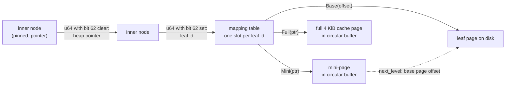
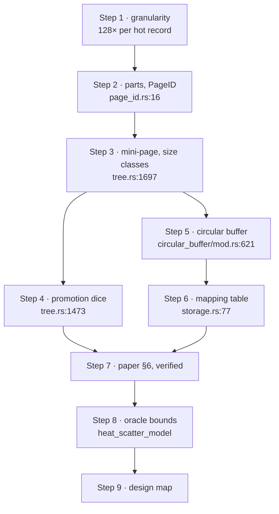

# Bf-Tree: a buffer pool whose frames are the hot records

Every buffer pool this topic has read so far — postgres's CLOCK over 8 KiB
buffers, DuckDB's queue of hints, LeanStore's swizzled pages, vmcache's
page-table frames — shares one assumption: **the unit of caching is the unit of
I/O**, a page. Bf-Tree (Hao and Chandramouli, PVLDB 2024) drops it. A *cache
page* is a variable-size, in-memory subset of one disk page — the hot records,
the recent updates — called a **mini-page**, kept in a circular buffer that
takes its replacement policy from the FASTER hybrid log rather than from LRU
or CLOCK. This chapter builds the design in the order the paper does — the
granularity mismatch, the mini-page, how reads and writes move records in and
out, the circular buffer as the pool, the mapping table as the translation
step — then checks the paper against the source, measures one thing it leaves
open (*where the heat sits*), and ends by placing Bf-Tree on the map of
translation strategies the previous chapters drew
([`reading-leanstore-paper.md`](reading-leanstore-paper.md),
[`reading-predictive-translation.md`](reading-predictive-translation.md)).

Section and figure numbers are Xiangpeng Hao and Badrish Chandramouli,
*"Bf-Tree: A Modern Read-Write-Optimized Concurrent Larger-Than-Memory Range
Index"*, PVLDB 17(11): 3442–3455 (2024), doi 10.14778/3681954.3682012
([PDF](https://www.vldb.org/pvldb/vol17/p3442-hao.pdf), 14 pages, read in full
for this chapter). Source anchors are [`microsoft/bf-tree`](https://github.com/microsoft/bf-tree)
at commit **`ca61307`** (2026-08-19, crate 0.5.5 in its README) — the commit the
sibling chapter on bbtree
([`reading-bbtree.md`](../03-btree-internals/reading-bbtree.md)) cites from its
own design log. The repository is not in this book's pin table, so the commit
is stated here; the clone is `~/repos/bf-tree` and the files were read with
`git archive ca61307`, not from its moving `HEAD`. Every number carries the
section, figure, file and line it came from, or says it was computed here.
**Figure bar heights are not in the PDF's text layer**, so the paper's Figure 6
(the headline throughput comparison) is quoted only through the ratios the
authors print in the prose.

## The problem in one sentence

A page-granularity buffer pool must hold a whole 4 KiB page to serve one hot
32-byte record and must write the whole page back to persist one update, so
cache capacity and write bandwidth are both spent on cold neighbours — and
Bf-Tree's claim is that if the cache's unit is instead a small, growable,
sorted subset of a leaf page allocated from a circular buffer, one structure
serves as a record cache, a write buffer and (when it grows to full size) an
ordinary page cache, at the price of one extra indirection per leaf access and
a tree that must itself know about the cache.

## The concepts, step by step

### Step 1 — the granularity mismatch, in bytes

> **In:** the paper's workload, §6.1 (200 M records of 32 bytes, a 2 GB cache,
> a Zipf-skewed access distribution); nothing else.
> **Out:** the two waste factors a page cache pays — in cache space and in write
> traffic — computed from the record and page sizes.

A **record** is one key plus its value; here 16 + 16 = 32 bytes (§6.1). A
**page** is the fixed unit a disk is read and written in; Bf-Tree uses 4 KiB
(§2.3: "the sweet point on a PCIe 4.0 modern NVMe SSD"). A **buffer pool** is
the in-memory cache of pages the engine manages itself. **Write amplification**
is bytes written to the device per byte the user changed; **cache
amplification**, a term used here, is bytes of cache held per byte of *useful*
data in it.

The paper's §1 states the mismatch as a thought experiment — "if the disk page
size equaled the record size, both problems would disappear" — and the sizes
make it concrete. **Computed here:** one hot record on one page costs
`4096 / 32 = 128` bytes of cache per useful byte, and a single-record update
written as a whole page writes `4096 / 32 = 128` times what changed. Both are
worst cases: the average page holds many records (about 71 at 70% fill, Step
3), so a page cache is wasteful by that factor only when *heat is scattered* —
hot records spread one per page across many pages. Whether that is true of a
workload is not a property of the cache, it is a property of the data; Step 8
measures how much it matters.

The pre-existing remedies, as the paper lists them (§1, §2): LSM-trees avoid
write amplification with log-structured appends but pay on reads and
compaction; delta-record B-trees (Bw-tree, Bε-tree) chain updates to a page, and
the chain makes every read pointer-chase; and a separate **record cache**
(Two-Tree, Anti-Caching, TreeLine) fixes point lookups but does not help range
scans, which need whole pages, and leaves two memory budgets to balance. The
design question Bf-Tree answers: can *one* structure absorb writes, cache
records and cache ranges, with one memory budget?

### Step 2 — four parts, and a parent pointer that is either an address or an id

> **In:** the architecture sketch, §3 and Figure 2.
> **Out:** where each kind of node lives, how a parent finds each, and where
> the one translation step sits.

Bf-Tree has four components (§3, Figure 2): the **inner nodes** (routing keys
and child references), the **mini-pages** in the circular buffer, the on-disk
**leaf pages**, and a **mapping table** from a leaf page id to wherever that
page currently is. A leaf page may have at most one mini-page (§3.1). Mini-pages
exist for leaves only.

The design choice that distinguishes it from the pools of earlier chapters is
in §3.4: inner nodes are **pinned** in memory and referenced by *direct
pointer*, "as inner nodes of practical B-Tree systems usually take less than 1%
of the total B-Tree size" and are accessed much more often than leaves, so
only leaves pay for a mapping table. The source makes it a single tagged word:

```rust
// bf-tree src/nodes/page_id.rs:11–16 and 33–38 (@ ca61307); 17–32 elided: constructors
11   pub(crate) struct PageID {
12       value: u64,
13   }
14
15   /// If it is a ID, it is not heap pointer.
16   const ID_MASK: u64 = 0x4000_0000_0000_0000;
// ... 17–32 ...
33       pub(crate) fn from_id(id: u64) -> Self {
34           Self::new(id | ID_MASK)
35       }
36
37       pub(crate) fn is_id(&self) -> bool {
38           (self.value & ID_MASK) != 0
```

The line to focus on is 16: one bit distinguishes a child that is a **heap
pointer to an inner node** (`from_pointer`, no table, bit clear) from a child
that is a **leaf id** to be looked up (bit set). Compare LeanStore's swip
(topic 6, [`reading-leanstore.md`](reading-leanstore.md) Step 1): there, one
`u64` per child is *either* a pointer (hot) or a page id (evicted), and a page
moves between the two states as it is cooled and evicted. In Bf-Tree the tag
never flips: an inner node is always a pointer, a leaf is always an id. It
buys swizzling's benefit where it is largest (every lookup crosses several
inner nodes) and avoids swizzling's price (the owning parent must be updated on
every eviction) because the things that get evicted — leaves and their
mini-pages — are reached through the table, not through a pointer in the
parent. §3.4 notes pinning is "not a design requirement": with a constrained
budget one can pin only the first levels, in which case the unpinned inner
nodes use page ids too.



### Step 3 — the mini-page: layout, size classes and growth

> **In:** the layout of §3.2 and the size-class code.
> **Out:** the capacity of each mini-page size for the paper's 32-byte records,
> the growth chain from the first record to a merge, and the four record types.

A mini-page is the *same page format* as a leaf page, only variable in length
(§3.2: "they share the same implementation, except that mini-pages can have
varying lengths"), so every optimization is written once. The format: a header,
then an array of fixed-size per-record metadata growing from the front, and the
key/value bytes growing from the back; the page is full when the two meet. That
design — metadata and data apart — means an insert shifts only the small
metadata entries, never the payload, and the same layout is what topic 3 builds
as the slotted page. Each **KV Meta** is 8 bytes: offset, key length with a
2-bit record type, value length with a **reference bit**, and the first two
bytes of the key past the shared prefix, called **look-ahead bytes** (§3.2,
§3.5), so that a binary search compares two bytes before it touches the key
(the same device as bbtree's inline key, see
[`reading-bbtree.md`](../03-btree-internals/reading-bbtree.md) Step 3):

```rust
// bf-tree src/nodes/leaf_node.rs:48 and 73–79 (@ ca61307); lines 49–72 elided
48   const PREVIEW_SIZE: usize = 2;
...
73   #[repr(C)]
74   pub(crate) struct LeafKVMeta {
75       offset: u16,
76       op_type_key_len_in_byte: u16, // Highest 2 bits: op_type, Lower 14 bits: Key length in bytes.
77       ref_value_len_in_byte: std::sync::atomic::AtomicU16, // Highest bit: ref, Lower 15 bits: value length in bytes. ...
78       preview_bytes: [u8; PREVIEW_SIZE],
79   }
```

The four record types of Table 1 are the two-bit `op_type` (`leaf_node.rs:14–46`:
`Insert`, `Delete`, `Cache`, `Phantom`), distinguished by whether they are
**dirty** (must be written to the leaf page on merge: `Insert`, `Delete`) and
whether they say the key **exists** (`Insert`, `Cache`). A **tombstone** is a
delete marker kept so a read finds "not found" without touching the leaf; a
**phantom** record caches the *negative* result of a lookup (a key known not to
exist), which a plain record cache cannot do (§5.6).

A 4096-byte leaf holds `⌊(4096 − 32) / 40⌋ = 101` such cells, about 71 at the 70%
fill the paper assumes for practical leaves (§6.6). Prefix compression from the
fence keys, which the paper credits to ART (§7), is `common_prefix_len`
(`leaf_node.rs:61–71`); it applies to leaves and not to mini-pages, which have no
fences (`leaf_node.rs:1545`).

**Size classes.** A mini-page is allocated from a fixed ladder of sizes derived
from the smallest record, each class a cache-line multiple
(`tree.rs:134–275`, `create_mem_page_size_classes`). The authors' own unit test
pins the default ladder:

```rust
// bf-tree src/tree.rs:1697–1698 (@ ca61307), in test_mini_page_size_classes
1697         size_classes = BfTree::create_mem_page_size_classes(4, 1952, 4096, 32, false);
1698         assert_eq!(size_classes, vec![64, 128, 256, 448, 832, 1600, 2048, 4096]);
```

The arguments are the defaults of `config.rs:27–30` and `:143` (minimum record
4 B, maximum 1952 B, leaf page 4096 B, fence 32 B = twice the 16 B key limit); the top mini-page class is
2048 (`config.rs:24` keeps `DEFAULT_MAX_MINI_PAGE_SIZE = 2048`, marked
"Deprecated"), and 4096 is the full-page mirror. **Worked example, computed
here** for the paper's 32-byte records. A cell (record plus its KV Meta) is
`32 + 8 = 40` bytes (`tree.rs:1600–1603`, `key_value_physical_size`), the
header is 32 bytes (`leaf_node.rs:212–222`: `meta` 6 B, `prefix_len`,
`next_level`, `lsn`, `snapshot_version`, const-asserted to 32), so a class `S`
holds `⌊(S − 32) / 40⌋` records:

```text
class   64    128    256    448    832    1600    2048    4096 (full page)
cells    0      2      5     10     20      39      50      101
```

A class-64 page cannot hold a 32-byte record at all (it exists for records of
the 4-byte minimum). Growth is a read-copy-update: when an insert fails because
the page is full, `new_size_if_upgrade` (`leaf_node.rs:1739–1761`) takes the
current size plus the incoming cell (`request_size = cur_size + incoming`) and
returns the first class strictly larger, allocates a new page, copies, frees the
old one (`mini_page_op.rs:780–807`). For 40-byte cells the chain is
`128 → 256 → 448 → 832 → 1600 → 2048`, and the next insert at 2048 requests
`2048 + 40 = 2088`, which fits no class below the full page, so the function
returns `None` and the mini-page **merges** into its leaf (the paper's "when a
mini-page grows beyond 2 KB it is merged", §5.5). The cumulative bytes
allocated while growing from one record to fifty are
`128 + 256 + 448 + 832 + 1600 + 2048 = 5312`, about 106 bytes of in-memory
copying per record cached — a cost the paper does not price, and which is
*memory* traffic, not I/O. A page created for one 32-byte record is the
128-byte class (`get_chain_size_hint`, `leaf_node.rs:1710–1732`, since
`32 + 8 + 32 = 72 < 128`), plus 8 bytes of circular-buffer header: **136 bytes
to cache one record, against 4,104 bytes for its page.**

Two corrections to the paper's description, from the source: the paper says the
Node Meta is 12 bytes (§3.2); at this commit `NodeMeta` is three `u16`s
(`nodes/node_meta.rs:8–14`, 6 bytes) inside the 32-byte leaf header, which also
carries the pointer to the base page (`next_level`, the paper's "leaf field"),
an LSN and a snapshot version. And the paper's 8-byte metadata in front of every
allocation (§4.3) is `AllocMeta`, `#[repr(C, align(8))]`
(`circular_buffer/mod.rs:218–225`): a `u32` size and a one-byte state, padded to
8 bytes.

### Step 4 — reads and writes: how a record gets in, and why it may not

> **In:** the mini-page of Step 3; the get and insert pseudo-code of §5 and the
> `read_inner` function.
> **Out:** the read path with its probabilistic promotion, the write path, and
> the three different promotion rates that the paper and the code give.

**Read** (§5.1, Listing 1; `tree.rs:1428–1528`): traverse the inner nodes to a
leaf id, look it up in the mapping table, binary-search the mini-page and
return if the key is there; otherwise read the leaf page from disk. Then —
only with some probability — copy the record into the mini-page as a `Cache`
record. The probability exists because every promotion costs memory: caching
every record that is read would flood the mini-page with cold records ("to
avoid flooding the mini-page with cold records", §3.1).

```rust
// bf-tree src/tree.rs:1460–1482 (@ ca61307), the Base arm of read_inner; 1461–1467 elided: counter, cache-only check
1460            ReadResult::Base(r) => {
// ... 1461–1467 ...
1468                let v = match r {
1469                    LeafReadResult::Found(v) => v,
1470                    _ => return Ok(r),
1471                };
1472
1473                if parent.is_none() || !self.should_promote_read() {
1474                    return Ok(r);
1475                }
1476
1477                let mut x_leaf = match leaf.try_upgrade(self.snapshot_mgr.clone(), node) {
1478                    Ok(x) => x,
1479                    Err(_) => {
1480                        return Ok(r);
1481                    }
1482                };
```

Line 1473 is the dice roll (`should_promote_read`, `tree.rs:457–459`:
`random_range(0..100) < read_promotion_rate`); line 1477 is the cost of a
promotion: the read lock held on the leaf entry must be **upgraded** to a write
lock, and `try_upgrade` failing — contention — makes the read give up and
return without caching ("we are doing this very optimistically", comment at
`tree.rs:1505`). So promotion is probabilistic *and* best-effort.

**Which probability?** Three different numbers describe it:

| source | rate | where |
|---|---:|---|
| paper, read path | "defaulting to 1%" | §5.1 (also "e.g., 1%" in §3.1) |
| paper, sensitivity experiment | "a 20% promotion rate" as default | §6.11, Figure 15 |
| code, release build | **30%** (debug build: 50%) | `config.rs:22–23`, `:122–126` |

The paper's own sections disagree (1% versus 20%), and the code at this commit
disagrees with both. **Worked example, computed here:** if a record is promoted
with probability `p` on each base-page read of it, the number of base-page reads
until it is cached is geometric with mean `1/p`: 100 reads at 1%, 5 at 20%, 3.3
at 30%. For a Zipf-skewed workload this decides how fast a *workload change*
repopulates the cache — which is exactly what §6.11 measures: at 1% the system
"responds slowly to workload change but might converge to a higher throughput";
at 100% "it disrupts the cache by promoting cold records". The shape of that
trade-off (recency versus frequency) is the paper's; the specific number you
get depends on which build you run.

**Write** (§5.2, Listing 2): traverse to the leaf, create a minimal mini-page if
none exists (sized to just the new record, "so that we have minimal write
amplification"), insert into the mini-page, and return — **no I/O**. Only a full
mini-page grows (the chain above) or, at the top class, merges into the leaf.
A **delete** is the insertion of a `Delete` record (§5.4); an **update** is an
insertion that shadows the leaf's older value. All three are in memory until the
merge, which is why the write throughput is high and why the **write-ahead
log** (WAL, the sequential log that makes the in-memory state recoverable;
topic 5) is mandatory in a real deployment. The paper's WAL is an ARIES-style
physiological log with a 1 ms default group flush (§5.7); the code appends
after the insert, `tree.rs:1068–1071`, `wal.append_and_wait(...)`.

**Range scans** (§5.3) need the whole leaf, not records, so a frequently
scanned mini-page is allowed to grow to the full page size and become a page
cache ("the buffer pool can also behave as a page-level cache"); that is the
`Full(ptr)` variant of the mapping-table entry in Step 2's diagram, promoted
with its own probability, `scan_promotion_rate` (`config.rs:37–38`).

### Step 5 — the circular buffer is the buffer pool

> **In:** §4 and `src/circular_buffer/mod.rs`.
> **Out:** how allocation, aging and eviction work with no frame array, no
> hash table and no clock hand; and what the one global lock covers.

A **circular buffer** is a fixed-size region used as a ring: allocation
advances a **tail** pointer, and the **head** pointer marks the oldest live
allocation; when the tail would overrun the head, the oldest things are evicted
to advance the head. The design is "inspired by FASTER's hybrid log" (§4): the
buffer is a log in time order, so *position is age*. That is the whole
replacement policy — there is no per-page list and no clock — and what makes it
a *buffer pool* rather than just an allocator is that eviction is a callback
that writes cold data back.

**Capacity** is a power of two (`circular_buffer/mod.rs:416`:
`assert!(capacity.is_power_of_two())`, so the physical address of a logical
position is one mask, `addr & (capacity − 1)`, line 607); the default is 32 MiB
(`config.rs:26`). Each allocation is `AllocMeta` (8 bytes) followed by the
payload; free memory is recycled through **free lists**, one per size class
(`circular_buffer/freelist.rs:15`, `:38–41`); and the live region is
`head..tail`, with a third address, `evicting`, between them for concurrent
eviction (see below).

```rust
// bf-tree src/circular_buffer/mod.rs:429 and 621–636 (@ ca61307); 430–620 elided
429        let copy_on_access_threshold = (capacity as f64 * (1.0 - copy_on_access_percent)) as usize;
// ...
621    pub fn ptr_is_copy_on_access(&self, ptr: *mut u8) -> bool {
622        let distance = self.distance_to_tail(ptr);
623        distance >= self.copy_on_access_threshold
624    }
625
626    fn distance_to_tail(&self, ptr: *mut u8) -> usize {
// ... 627–630 ...
631        if tail_usize >= ptr_usize {
632            tail_usize - ptr_usize
633        } else {
634            self.capacity - (ptr_usize - tail_usize)
635        }
```

**Two regions, one second chance** (§4.1, Figure 4). The buffer is divided by
age: the newest 90% (between the tail and the "second-chance address") is the
**in-place-update region**, where a mini-page can be modified where it sits; the
oldest 10% is the **copy-on-access region**. The code defines "old" as
*distance behind the tail* `≥ capacity × (1 − 0.1)` (lines 429, 623;
`DEFAULT_COPY_ON_ACCESS_RATIO = 0.1`, `config.rs:25`). **Worked example,
computed here:** for the 2 GiB buffer of the paper's setup, `2³¹ × 0.9`,
truncated, is `1,932,735,283`, so the copy-on-access region is the last
`2³¹ − 1,932,735,283 = 214,748,365` bytes before the head, about 205 MiB.

A read or write that touches a mini-page found in that region does the
**second chance**: `cache_page_about_to_evict` (`mini_page_op.rs:156–165`) is
true, and `move_cache_page_to_tail` (`mini_page_op.rs:1117–1147`) allocates a
copy at the tail and tombstones the old one, so a page that is touched at least
once per full revolution of the buffer is never evicted. This is a
**second-chance FIFO**: strict FIFO (evict whatever is at the head) with a
one-bit stay of execution, where the "bit" is *being accessed while in the last
10%*. Figure 14 (§6.10) is the sensitivity analysis: 0% copy-on-access
"acts like a FIFO queue, … low runtime overhead but low caching quality", 100%
"acts like a strict LRU cache … high runtime overhead but high caching
quality", and the default 10% is the compromise. Contrast the previous
designs' answer to the same question: postgres's CLOCK keeps a usage count per
buffer and sweeps; LeanStore keeps no per-access state at all and uses a random
cooling stage; here **the only per-access cost is a distance comparison, and
only a page in the oldest tenth pays a copy**.

The copy is also where *cold records are dropped*. `copy_initialize_to` re-inserts
each record into the new page and skips those that are cache records without
the reference bit set:

```rust
// bf-tree src/nodes/leaf_node.rs:1550–1564 (@ ca61307), the record loop of copy_initialize_to
1550        for meta in self.meta_iter() {
1551            let op = meta.op_type();
1552
1553            // Skip the cold values
1554            // This won't happen in cache-only mode as all records are dirty
1555            // In non cache-only mode, this won't lead to empty mini-page as
1556            // this is invoked after a read-hot or write-hot record.
1557            if discard_cold_cache && op.is_cache() && !meta.is_referenced() {
1558                continue;
1559            }
1560
1561            let value = self.get_value(meta);
1562            let rt = dst_ref.insert(&self.get_full_key(meta), value, op, 0);
1563            assert!(rt);
1564        }
```

Line 1557 is the whole per-record replacement policy: a **reference bit** per
record (set when a search lands on it, `leaf_node.rs:1684–1686`, `mark_as_ref`
at `:156`), and the copy discards `Cache` and `Phantom` records whose bit is
clear. The bit is cleared on the copy (`make_prefixed_meta` starts every
inserted record unreferenced, `leaf_node.rs:100–102`), so a record survives only
by being re-read between two copies. Dirty records (`Insert`, `Delete`) are
never discarded here, however cold: they are written back only by a merge. The
paper's §5.5 describes a stronger rule (for a cold *dirty* record, "merge the
entire mini-page to the leaf page … while retaining the hot records"); in this
copy path the code keeps dirty records and merges only on eviction or growth
beyond the top class (`mini_page_op.rs:1092–1103`). The same copy-and-filter
runs when a mini-page grows (`mini_page_op.rs:803–807` passes `true`).

**Allocation and eviction** (§4.2). `alloc` first takes from the free list of
the requested size — skipping and tombstoning any free-listed block that has
slid into the copy-on-access region (lines 539–550) — and otherwise advances the
tail; if the buffer is full it returns `Full` and the caller must evict.

```rust
// bf-tree src/circular_buffer/mod.rs:537–544 and 576–578 (@ ca61307); 545–575 elided
537        let (lock_guard, states) = self.lock_states();
538
539        while let Some(ptr) = self.free_list.remove(size) {
540            let raw_ptr: *mut u8 = ptr.as_ptr();
541
542            let old_meta = CircularBuffer::get_meta_from_data_ptr(raw_ptr);
543
544            if self.ptr_is_copy_on_access(raw_ptr) {
// ... 545–575 ...
576        if logical_remaining < required {
577            return Err(CircularBufferError::Full);
578        }
```

Line 537 is the lock to remember: `lock_states` takes the buffer's single
`Mutex<()>` (`circular_buffer/mod.rs:368`, `:507–511`), so **every allocation
and every eviction reservation is serialized by one mutex**. The paper's §4
calls the design concurrent and §4.3 says "to parallelize the eviction process,
we allow each thread to start evicting a mini-page concurrently but require all
threads to finish in order"; that is accurate, and it is how the lock is *kept
short*: `evict_one` (`circular_buffer/mod.rs:891–969`)
takes the lock only to reserve a range by advancing `evicting_addr` (lines
895–917), **drops it**, runs the callback — the merge to the leaf page, a long
I/O — outside the lock, then re-takes it to advance `head` over the contiguous
prefix of evicted allocations (`try_bump_head_address_to_evicting_addr`,
lines 834–856). The head can only advance past entries that are `Evicted`, so
a slow eviction at the front holds the head back while later ones finish — the
"finish in order" of §4.3. The paper never isolates what the lock
costs: §6.9 profiles a read-only workload, which allocates nothing, and the only
write-path evidence is §6.4's 19.2× speedup at 31 threads (a mixed workload that
saturates the SSD, so a lock would have to be very hot to show). The eviction itself
is requested in bursts: `evict_from_circular_buffer` (`tree.rs:1079–1100`)
evicts until 1,024 bytes are freed, "so that each alloc does not trigger an
evict", which is four 256-byte mini-pages.

The eviction callback has to find its way back from a memory address at the
head of the buffer to the leaf's mapping-table slot. It does it by key: it reads
a key out of the mini-page and **re-traverses the tree from the root**
(`eviction_callback`, `tree.rs:1606–1650`; `get_key_to_reach_this_node` at line
1614), then re-checks that the page it reached is the same one (lines
1637–1639), restarting if not. The comment at lines 1631–1636 states the
circularity ("in order to lock this node, we need to traverse to this node
first; … in order to read the keys in this node, we need to lock this node").
A pool whose frames are not self-describing needs either a page-id back-pointer
(buffer-pool frames in postgres carry their tag) or a parent pointer
(LeanStore); Bf-Tree stores neither in the mini-page, and pays a tree descent
per eviction.

### Step 6 — the mapping table: one indirection, paid only at the leaf

> **In:** §3.3 and `src/storage.rs`, `utils/mapping_table.rs`, `utils/rw_lock.rs`.
> **Out:** what a leaf access costs in loads, how big a table entry actually is,
> and where it differs from the paper.

The mapping table is "an in-memory container that maps the logical page ID to
the physical location of the page" (§3.3), and the paper lists the other ways to
build it (hash table, indirection array, the OS page table, citing the CIDR
mmap paper and LMDB, or pointer swizzling) and picks an **indirection array** — an array indexed
directly by page id, so there is no hash and no probe — "for its simplicity and
performance". The paper adds one detail on which the source differs: "The
reader-writer lock (16 bits) is co-located with the page address (48 bits);
they are together packed into a 64-bit word."

```rust
// bf-tree src/storage.rs:26–32 and 76–77 (@ ca61307), then src/utils/rw_lock.rs:16–20; 33–75 elided
26   #[derive(Clone, Eq, PartialEq, Debug)]
27   pub(crate) enum PageLocation {
28       Mini(*mut LeafNode),
29       Full(*mut LeafNode), // full pages are in memory
30       Base(usize),
31       Null,
32   }
// ... 33–75 ...
76   pub(crate) struct PageTable {
77       table: MappingTable<RwLock<PageLocation>>,
// --- utils/rw_lock.rs ---
16   pub struct RwLock<T> {
17       val: UnsafeCell<T>,
18       lock_val: AtomicU32,
19       writer_wake_counter: AtomicU32,
20   }
```

Line 77 is the table's element type: `RwLock<PageLocation>`, an enum with a
discriminant and one pointer-or-offset (16 bytes) next to two `AtomicU32`s.
**Computed here** by compiling the three type definitions above in a scratch
program (`size_of`): `PageLocation` is **16 bytes** and `RwLock<PageLocation>`
is **24 bytes**, not the paper's packed 8. At the paper's 4 KiB leaf that is
`24 / 4096 = 0.59%` of the leaf data it indexes — small, but three times the
size the text promises. (The table holds the *current location*, so the
three-way `Mini`/`Full`/`Base` state is exactly what Step 2's diagram shows;
the discriminant is how the table says which.)

The table is a two-level array (`utils/mapping_table.rs:8–9`: "at most 128
batches, which is 128M pages", `:76`: 1 Mi records per batch), so a lookup is
`batches[id / 2²⁰]` then `data[id % 2²⁰]` (`get`, lines 153–160). The
doc comment at line 39 says "exactly one (not O(1)!) memory access"; by the
code it is two dependent loads, the first from a 128-entry table that is always
cached. The cost the paper measures for it in the in-memory read-only profile
is **12.8%** of the time (§6.9, Figure 13: "The mapping table uses only 12.8%
of time, requiring only one memory access for address translation and lock
acquisition"), against 46.4% in inner-node search and 40.8% in leaf search in
the same breakdown. And §6.4 reports the one-sided cost directly: at low thread
counts LeanStore "performs slightly better … as it avoids the mapping table
overhead in Bf-Tree, specifically, for each operation, Leanstore may have one
less cache miss than Bf-Tree."

What the table also does is **lock**: the lock for a leaf and its mini-page is
the table slot's `RwLock`, "as the mini-page and its leaf page share the same
page ID, locking the mini-page will also lock the leaf page" (§3.3). That is why
the read path in Step 4 must *upgrade* a read lock to promote a record. The
**inner** nodes use a different, optimistic protocol: an 8-byte version lock
that readers check before and after reading (`utils/inner_lock.rs:26–44`:
`try_read` samples the version, `check_version` compares it; `upgrade` at
`:50–60` is a compare-and-swap from the sampled version) — the same scheme
bbtree's `NodeLatch` implements with a 64-bit word (compare
[`reading-bbtree.md`](../03-btree-internals/reading-bbtree.md) Step 7), and
LeanStore's hybrid latch (`reading-leanstore.md` Step 4).

### Step 7 — the paper's measurements, verified against its text

> **In:** §6 of the paper (setup 6.1–6.2, results 6.3–6.11).
> **Out:** the numbers the prose states, each with its section, and the
> experimental conditions that bound what they can mean.

**Setup (§6.1).** 200 million initial records of 16 B keys and 16 B values; a
Zipf distribution with skew 0.9 ("80% of requests access 33% of records");
default 50% reads and 50% writes; **2 GB** memory cache; best of five runs
after warm-up. The machine is CloudLab `sm110p`: 32 hyper-threads at 2.4 GHz,
128 GB RAM, a 1 TB NVMe PCIe 4.0 SSD with over 600 k IOPS, Ubuntu 22.04, ext4;
`io_uring` with kernel polling. "Logging/snapshotting/checkpointing are
orthogonal to the core design of Bf-Tree and are disabled for all baselines"
(§6.1). **Baselines** (§6.2): RocksDB (commit `54d6286`); LeanStore (commit
`677126c`); TwoTree; and two B-trees that the authors wrote themselves — a
"conventional B-Tree" that "enjoys all optimizations from Bf-Tree except the
mini-page design … In other words, the conventional B-Tree is Bf-Tree but with
page-level caching", and a Bδ-Tree with delta records, "implemented to be as
close in design as possible to the Bw-Tree". That makes the B-tree comparisons
a clean test of the mini-page *given everything else equal*, and not a
comparison with a production engine's B-tree.

What the prose reports:

| claim | number | section |
|---|---|---|
| scans vs RocksDB | 2.5× faster | abstract, §1, §8 |
| writes vs conventional B-tree | 6× faster | abstract, §1, §8 |
| point lookups vs B-tree and LSM | 2× faster | abstract, §1, §8 |
| scalability to 31 threads | Bf-Tree 19.2×, Bδ-Tree 15.1×, B-Tree 17.0×, RocksDB 17.5× | §6.4 |
| in-memory scalability vs LeanStore | 23.9× versus 14.5× | §6.4, Figure 8 |
| median read latency | Bf-Tree 1.18 µs; Bδ 1.61, RocksDB 1.86, B-Tree 58.7 µs | §6.5, Figure 9 |
| p99 read latency | Bf-Tree 70 µs vs RocksDB 131 µs | §6.5 |
| share of reads served from cache | Bf-Tree "almost 75%", others "around 50%" | §6.5 |
| cache sensitivity, 256 MB→4 GB (16×) | Bf-Tree 4.1×, Bδ 4.7×, B-Tree 3.3×, RocksDB 2.2× | §6.8, Figure 12 |
| mapping-table share of an in-memory read | 12.8% | §6.9, Figure 13 |
| default copy-on-access region | 10% | §6.10, Figure 14 |
| default promotion rate | 20% | §6.11, Figure 15 |

Notice what the cache-sensitivity row says: from 256 MB to 4 GB Bf-Tree's
throughput grows 4.1×, *less* than Bδ-Tree's 4.7×. The paper's reading is that
its advantage "is wider when most data are on disk … the gap becomes narrower
when most data are in memory, as all B-Tree based systems fold to the same
design when data fit in memory" (§6.8). The honest summary is that mini-pages
are a *small-cache* technique. §6.6 makes the same point from the other side:
"All systems perform poorly on uniform distribution", and Bf-Tree's one
advantage there is memory use: practical leaf pages are about 70% full, so a
page cache wastes 30% of its memory on holes, and mini-pages "dynamically grow
and shrink to fit the actual number of records".

The §6.5 pair — "almost 75%" against "around 50%" — is the figure the next
step tests.

### Step 8 — what an oracle says about the 75% and the 50%: the heat has to be scattered

> **In:** the §6.1 workload parameters and the footprints of Step 3 (136 B per
> lone record, 41.1 B per record in a full 2048-byte mini-page, 4,104 B per page).
> **Out:** upper bounds on the hit ratio of record and page caches under the
> paper's skew, and a check of two of its own parameters.

Under a skewed workload a cache's hit ratio is bounded by an **oracle**: one
that always holds the most popular items that fit. If the oracle for a page
cache cannot reach the figure the paper reports for page-caching systems, the
paper's number must come from something else (a worse policy, scattered heat, a
smaller effective cache); if the oracle for a record cache lands near the figure
reported for Bf-Tree, the claim is at least arithmetically possible.
`cargo run --release --bin heat_scatter_model` (this topic's lane 1b) computes
the bounds. It uses the textbook **Zipf** distribution — the probability of the
`r`-th most popular record is proportional to `r^(−s)`, here `s = 0.9`, over
`N = 2 × 10⁸` records — and the footprints of Step 3, and it is seeded, so every
printed figure reproduces exactly (two runs, identical output). Part 1 sums the
pmf exactly at the paper's `N`; Part 2 simulates where the popular records land
on pages at 1/10 scale (`N = 2 × 10⁷`, cache scaled the same), either
**clustered** (popularity order equals key order: the hottest 71 records share a
page) or **scattered** (a seeded random permutation, as hashed keys would be):

```text
Part 1 — Zipf(0.9) over N = 200,000,000 records, exact sums
  80% of requests reach the top 15.1% of records (paper §6.1 parenthetical: 33%)
  raw data 5.96 GiB; a 2 GiB cache is 33.6% of it
  oracle record cache, full mini-pages: holds 26.1% of records, hit ratio 0.854
  oracle record cache, lone-record mini-pages: holds 7.9% of records, hit ratio 0.739

Part 2 — page cache at 1/10 scale: N = 20,000,000, 281,691 pages, cache holds 52,326 pages (18.6% of records)
  oracle PAGE cache, heat CLUSTERED : 0.812
  oracle PAGE cache, heat SCATTERED : 0.566
  oracle RECORD cache, full mini-pages  : 0.848
  oracle RECORD cache, lone-record pages: 0.728
```

Read it as three findings, and one caution.

1. **Scattered heat is what makes a page cache lose.** With clustered heat an
   oracle page cache reaches 0.812, within 0.04 of the best record cache; with
   scattered heat it falls to 0.566. The paper's "around 50%" for page-caching
   systems is consistent only with scattered heat (and a real policy below the
   oracle). The paper does not say how its Zipf ranks map to keys; if they were
   adjacent, the mini-page's advantage would be much smaller than reported.
2. **The record-cache bounds bracket the paper's 75%.** Between 0.73 (every
   mini-page holds one record — the worst case of Step 3's 136-byte footprint)
   and 0.85 (every mini-page full) lies the "almost 75%" of §6.5. A real policy
   sits below the oracle, so a measured value at the low end of the bracket is
   what one would expect; it does not by itself say how large the mini-pages were.
3. **The paper's own parenthetical does not match the textbook distribution.**
   §6.1 says Zipf 0.9 means "80% of requests access 33% of records". Under
   `r^(−0.9)` over `2 × 10⁸` records the exact figure is **15.1%**. Either the
   generator is not the textbook pmf (YCSB's scrambled variants differ) or the
   parenthetical is loose; the cache ratios of §6.5 cannot be reproduced from
   the paper's text alone without knowing which.

**The caution:** these are bounds on a cache's hit ratio, not throughput, and
Part 2 is a 1/10-scale simulation whose absolute values depend on `N` (the Part 1
record-cache ratios at full scale, 0.854 and 0.739, differ from Part 2's
0.848 and 0.728 by 0.006 and 0.011, which is how much the scale-down moves them). Nothing here
measures Bf-Tree. It says *which premise* the 2× point-lookup claim leans on:
heat that is spread across pages and records small enough that a mini-page holds
dozens of them. The practical test for your own data is a histogram of, per
4 KiB page, the fraction of bytes that are hot; the model's Part 2 is that
histogram for a synthetic workload.

### Step 9 — where Bf-Tree sits among the translation designs

> **In:** the translation chapters of this topic and Steps 2–6.
> **Out:** one table placing Bf-Tree against the classic pool, LeanStore,
> vmcache and PrediCache, and what a graph store would and would not take from it.

```text
                    unit of cache   translation on a hit       replacement           writes
 postgres/DuckDB    page            hash lookup + latch + pin  CLOCK / queue         whole page
 LeanStore          page            none (swizzled pointer)    random cooling stage  whole page
 vmcache            page            MMU page-table walk        clock-style, user     whole page
 PrediCache (2026)  page            hash, hidden by a guess    (see that chapter)    whole page
 Bf-Tree            record subset   inner: none (pointer);     second-chance FIFO    records into
                    (mini-page)     leaf: array slot + RwLock  by position in log    the mini-page
```

What is distinctive is not any one cell. **The unit of caching is a record
subset, so the cache is part of the tree** — a mini-page is a *kind of leaf*, it
shares the leaf's format and its fences, and the eviction callback re-descends
the tree. That is the cost of the design as a general component: postgres's
buffer manager knows nothing about what a page contains, Bf-Tree's pool cannot
be separated from its index. The second cost is a scope limit written into the
defaults: keys are limited to 16 bytes (`config.rs:30`, `DEFAULT_MAX_KEY_LEN`;
`tree.rs:1204` returns `InvalidKey` beyond `max_fence_len / 2`) and records to
1,952 bytes (`config.rs:28`) — a secondary-index design for small records, as
the paper's §1 says ("exacerbated when a B-Tree is used as a secondary index
with small keys and values").

For the capstone's M6 decision (a graph engine whose data are matrix tiles and
whose small records are adjacency or property entries): mini-pages help where
the access pattern is *point reads and updates of small records scattered
across a large keyspace* — property lookups by id, a vertex-to-tile index — and
do nothing for a scan of a tile, which wants the whole page (Step 4, range
scans), the case where Bf-Tree falls back to an ordinary page cache. Before
adopting the idea, run Step 8's test on the real access trace.

## How to read the source (with the concepts in hand)

`microsoft/bf-tree` at `ca61307` is about 13,800 lines of Rust under `src/`
(the paper says 13 k, abstract), with `tree.rs` (1,783), `nodes/leaf_node.rs`
(2,200), `mini_page_op.rs` (1,525) and `circular_buffer/mod.rs` (1,196) the core.
Reading order, about three hours:

1. `config.rs:22–30, 120–150` — every default in one place (Step 4's three
   promotion rates; 32 MiB buffer; 10% copy-on-access).
2. `nodes/page_id.rs` (58 lines) — the tagged child word of Step 2.
3. `nodes/leaf_node.rs:48–168` (record metadata, reference bit) and
   `:1527–1565` (`copy_initialize_to`): the per-record policy.
4. `tree.rs:134–275` (size classes) then `:1697–1698` (the test that pins them).
5. `circular_buffer/mod.rs:529–604` (`alloc`), `:621–636` (regions),
   `:891–969` (`evict_one`).
6. `tree.rs:1428–1528` (`read_inner`) and `:1606–1673` (`eviction_callback`).
7. `storage.rs:26–135` and `utils/mapping_table.rs`: the table and its lock.



## Questions to answer in notes.md

- Run `heat_scatter_model` and change `S` to 0.99 (the skew used by this
  topic's `pool_vs_mmap`). Predict first: does the scattered/clustered gap for
  the page cache grow or shrink as the skew rises, and why?
- Step 3 gives the growth chain `128 → 256 → 448 → 832 → 1600 → 2048` for
  40-byte cells. Recompute it for 100-byte values with 16-byte keys
  (cell = 124 B) using `new_size_if_upgrade`'s rule, and find the largest
  mini-page that holds `k` records for `k = 1…10`. Which record size makes a
  mini-page degenerate (no class smaller than the full page fits two records)?
- The paper says the page-table lock is 16 bits and the address 48 bits in one
  64-bit word; the code at `ca61307` uses a 24-byte `RwLock<PageLocation>`.
  For 2.8 M leaf pages (200 M records at 71 per page), how many bytes is each
  version of the table, and is the difference anywhere near the 2 GiB budget?
- `alloc` and eviction reservation take one `Mutex`. With the eviction callback
  outside it, bound the number of allocations per second the lock can sustain if
  its hold time is 100 ns. What does §6.4's 19.2× at 31 threads imply about
  whether the lock is a bottleneck?
- Compare with `reading-predictive-translation.md`: PrediCache *hides* the
  hash-table lookup behind a guessed frame read, Bf-Tree *removes* it for inner
  nodes and keeps one array indexed read for leaves. Which of the two designs'
  hot paths has fewer dependent loads for a leaf hit that is cached as a
  mini-page, counting from the parent's child word?
- The eviction callback re-traverses the tree from the root to find a mapping
  slot. Describe the interleaving in which that traversal reaches a *different*
  mini-page than the one being evicted, and what `tree.rs:1637–1639` does about it.
- §5.5 says a cold dirty record causes the whole mini-page to be merged to the
  leaf; `copy_initialize_to` keeps dirty records. Which write-amplification
  number would you expect to be larger under each rule, and which experiment in
  the paper would show the difference?

## Takeaway

Bf-Tree trades the buffer pool's separation of concerns for a cache whose unit
is the record: a mini-page is a leaf with fewer records, a circular buffer is a
pool whose replacement policy is *position in a log plus one second chance in the
last tenth*, and the only translation step left is an array slot at the leaf.
The arithmetic is simple and checkable — 136 bytes to cache a lone 32-byte record
against 4,104 for its page, an eviction ladder 128 → 2048 — and so is the
condition it needs: scattered heat. Under the paper's own workload an oracle
page cache with scattered heat reaches 0.57 and a record cache 0.73–0.85, which
brackets the 50% and "almost 75%" of §6.5; with clustered heat the page cache
reaches 0.81 and the advantage mostly disappears. The paper's text and its code
disagree on three small things (the promotion rate: 1%, 20% or 30%; the table
entry: 8 or 24 bytes; the node header: 12 or 32 bytes), and the paper's "33% of
records" is 15.1% under the textbook distribution. None of that changes the
design; all of it is why this chapter reads the code.

## Done when

Answer each before unfolding it.

- [ ] You can say what the unit of caching is in Bf-Tree, why it is not the unit
  of I/O, and how many bytes it costs to cache a lone 32-byte record versus its page.

  <details><summary>Answer</summary>

  The unit is a mini-page: a variable-size, sorted, in-memory subset of one
  leaf page (hot records, recent updates, tombstones, phantom records), at most
  one per leaf, in the same format as the leaf. The disk unit stays a 4 KiB
  page. A lone 32-byte record is cached by the 128-byte class
  (`32 + 8 + 32 = 72 < 128`) plus an 8-byte circular-buffer header, 136 bytes,
  against 4,096 + 8 = 4,104 bytes to cache its whole page: 30 times less. The
  page-granularity cost is 128 bytes of cache per useful byte (4096/32), and the
  same factor in write traffic when a one-record update rewrites the page.

  </details>

- [ ] You can derive the mini-page size ladder and the growth chain for a given
  record size, and say when a mini-page is merged.

  <details><summary>Answer</summary>

  Default classes (a unit test at `tree.rs:1697–1698`): 64, 128, 256, 448, 832,
  1600, 2048, 4096; the first seven are mini-pages, 4096 the full-page mirror.
  Capacity of class `S` for a `c`-byte cell is `⌊(S − 32) / c⌋`. When an insert
  fails, the new size is the first class strictly larger than `cur_size + c`;
  for `c = 40` that is `128 → 256 → 448 → 832 → 1600 → 2048`. At 2048 the
  request is 2088, no class below the full page fits, `new_size_if_upgrade`
  returns `None`, and the mini-page is merged into the leaf — the paper's "grows
  beyond 2 KB". Growth copies the page into a new allocation, so reaching 50
  records allocates 5,312 bytes in total.

  </details>

- [ ] You can explain the circular buffer's replacement policy and what a
  second chance costs.

  <details><summary>Answer</summary>

  Position in the buffer is age: allocation advances the tail, the head marks
  the oldest live page, and eviction takes from the head. The oldest 10% of the
  buffer (`distance_to_tail ≥ capacity × 0.9`) is the copy-on-access region: a
  mini-page touched there is copied to the tail (`move_cache_page_to_tail`), so
  anything accessed at least once per revolution survives; the copy also drops
  `Cache` and `Phantom` records whose reference bit is clear and clears all bits.
  The per-access cost is one distance comparison; only a page in the last tenth
  pays a copy. The paper's Figure 14: 0% is FIFO (cheap, poor quality), 100% is
  strict-LRU-like (expensive, good quality), default 10%. For a 2 GiB buffer the
  region is 214,748,365 bytes.

  </details>

- [ ] You can say what is translated, what is not, and what each costs.

  <details><summary>Answer</summary>

  A child reference is a 64-bit word with bit 62 as the tag: clear means a heap
  pointer to a pinned inner node (no table, no lookup), set means a leaf id,
  which is looked up in an indirection array (two dependent loads in the code:
  a 128-entry batch table, then the slot), whose entry — `Mini(ptr)`, `Full(ptr)`,
  `Base(offset)` or `Null` plus a reader-writer lock — also serves as the lock
  for the leaf and its mini-page. The paper measures the table at 12.8% of an
  in-memory read (§6.9) and notes LeanStore may have one fewer cache miss per
  operation at low thread counts (§6.4). The source's entry is 24 bytes against
  the paper's packed 8.

  </details>

- [ ] You can state the three promotion rates and what the choice trades.

  <details><summary>Answer</summary>

  1% in the paper's read-path description (§5.1), 20% as the §6.11 default,
  30% (release) or 50% (debug) in `config.rs:22–23` at `ca61307`. A record read
  from the base page is cached with probability `p` per read, so its expected
  number of base reads before caching is `1/p` (100, 5, 3.3). A low `p` favours
  frequency (only truly hot records enter, slow to adapt to a workload shift,
  possibly higher final throughput); a high `p` favours recency (fast to adapt,
  but cold records pollute the cache; at 100% the paper says it "disrupts the
  cache"). The promotion also requires upgrading a read lock to a write lock and
  is abandoned on contention.

  </details>

- [ ] You can say what this repo's oracle model shows, and what it does not.

  <details><summary>Answer</summary>

  With Zipf 0.9 over 200 M records and a 2 GiB cache, an oracle record cache
  reaches 0.854 hit ratio (full 2048-byte mini-pages, 41.1 B/record) or 0.739
  (lone-record mini-pages, 136 B/record); a page cache at 1/10 scale reaches
  0.812 with clustered heat and 0.566 with scattered heat. So the paper's
  "around 50%" for page caches and "almost 75%" for Bf-Tree are consistent with
  scattered heat, and with clustered heat a page cache would already be near the
  record cache. It also finds that under this distribution 80% of requests go to
  the top 15.1% of records, not the 33% in §6.1. It does not measure Bf-Tree,
  throughput, or any real system, and the paper does not say how ranks map to
  keys.

  </details>

- [ ] You can name two costs of the design that the paper's headline numbers do
  not show.

  <details><summary>Answer</summary>

  First, the pool is not separable from the tree: a mini-page is a leaf variant,
  eviction re-descends the tree by a key to find the mapping slot
  (`eviction_callback`, `tree.rs:1606–1650`), and keys are limited to 16 bytes
  and records to 1,952 bytes by default. Second, the evaluation's baselines are
  the authors' own re-implementations with logging disabled (§6.1–6.2), the
  advantage shrinks as the cache grows (§6.8: Bf-Tree's 4.1× growth against
  Bδ-Tree's 4.7× from 256 MB to 4 GB), and allocation and eviction reservation
  take one global mutex in the circular buffer.

  </details>

## References

**Paper** — Xiangpeng Hao and Badrish Chandramouli, *Bf-Tree: A Modern
Read-Write-Optimized Concurrent Larger-Than-Memory Range Index*, PVLDB 17(11):
3442–3455, 2024, doi 10.14778/3681954.3682012,
[PDF](https://www.vldb.org/pvldb/vol17/p3442-hao.pdf). Section numbers in this
chapter are the paper's: 3.1 Mini-page, 3.2 layout, 3.3 mapping table, 3.4 inner
nodes, 3.5 optimizations; 4.1 memory regions, 4.2 API, 4.3 optimizations; 5.1–5.7
operations; 6.1–6.11 evaluation.

**Code** — [`microsoft/bf-tree`](https://github.com/microsoft/bf-tree) at commit
`ca61307` (clone `~/repos/bf-tree`, read with `git archive`). Anchors:

| File | Lines | What |
|---|---|---|
| `src/nodes/page_id.rs` | 11–58 | pointer-or-id child word |
| `src/nodes/leaf_node.rs` | 14–46, 48, 61–71, 73–79, 156–168, 212–222, 1527–1565, 1710–1761 | record types, look-ahead bytes, reference bit, 32-byte header, copy-and-filter, size selection |
| `src/nodes/node_meta.rs` | 8–14 | `NodeMeta` (three `u16`) |
| `src/tree.rs` | 134–275, 457–459, 1079–1100, 1428–1528, 1606–1673, 1697–1698 | size classes, promotion dice, eviction burst, read path, eviction callback, the pinning test |
| `src/mini_page_op.rs` | 156–165, 780–807, 1092–1147 | about-to-evict test, growth, merge, move to tail |
| `src/circular_buffer/mod.rs` | 22–24, 211–225, 364–376, 416, 429, 507–604, 621–636, 801–969 | the buffer |
| `src/circular_buffer/freelist.rs` | 15, 38–41 | per-class free lists |
| `src/storage.rs`, `src/utils/mapping_table.rs`, `src/utils/rw_lock.rs`, `src/utils/inner_lock.rs` | `storage.rs:26–32, 76–77`; `mapping_table.rs:8–9, 38–44, 153–160`; `rw_lock.rs:16–20`; `inner_lock.rs:26–60` | table, lock, inner version lock |
| `src/config.rs` | 22–30, 120–150 | defaults |

**This repo** — `topics/06-buffer-pool/experiments/src/bin/heat_scatter_model.rs`
(Step 8); [`reading-leanstore-paper.md`](reading-leanstore-paper.md) (swizzling,
vmcache, the design-space map);
[`reading-predictive-translation.md`](reading-predictive-translation.md);
[`reading-postgres-bufmgr.md`](reading-postgres-bufmgr.md) (CLOCK);
[`reading-bbtree.md`](../03-btree-internals/reading-bbtree.md) (the same author's
in-memory B+tree, which borrows the fence-key prefix and look-ahead-byte ideas
and cites this commit in its `design/01-bftree.md`).
