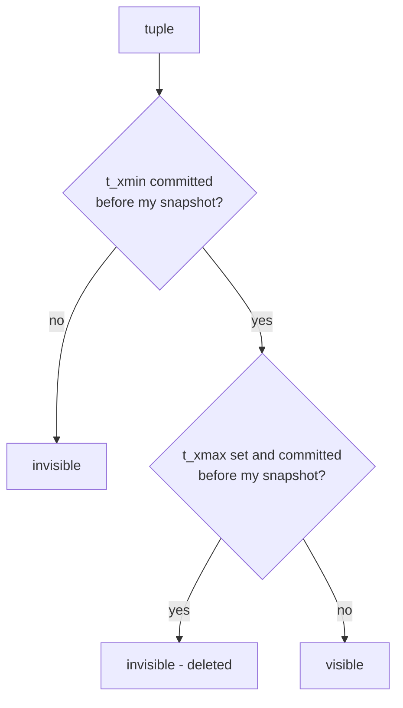

# Topic 8 — Transactions & MVCC

The intellectual core of OLTP. Everything here is one question asked five
ways: *when two transactions touch the same data, who sees what, and who
must die?*

Budget: ~12 h. Order: §1 anomalies → §2 three concurrency schools →
§3 postgres on-disk MVCC → §4 in-memory MVCC → experiments → M8.

## The problem, measured (bench lane 1, provided — runs today)

`cargo run --release --bin txn_bench` — 4 threads × 50 000 transactions × 4
ops, against one global `Mutex<HashMap>`:

```
mix                                 global-lock/s     mvcc txn/s    aborts
read-heavy  95/5, 10K keys                1393945              —         —
write-heavy 50/50, 10K keys                806155              —         —
write-heavy 50/50, 64 keys (HOT)          1092582              —         —
```

(Median of three runs. The lane builds each transaction's keys and draws its
coins *before* taking the lock, so the critical section holds only the four
store operations — the same work the MVCC lane does outside any lock.)

**One mutex, and the throughput is just the price of the critical section.**
None of the read-heavy row's concurrency is used: 95% of its operations could
have run in parallel and none did; it is the fastest row only because a lookup
is cheaper than an insert that allocates. The HOT row beats the 10K-key write
row because a 64-key map stays in cache, not because the lock is less
contended — every row is fully contended.

That gives you a sharp pair of predictions to write down before you implement
MVCC: it should win row 1, since readers never block writers. It may well
*lose* row 3, where first-committer-wins converts key contention into aborted
work the mutex never had to redo. Find the keyspace size where the crossover
happens — that number, not the read-heavy speedup, is what decides whether MVCC
is the right answer for a given workload.

A reference implementation (one `RwLock` over the version map, reads under the
read lock, commit validating under the write lock — the shape `mvcc.rs`
suggests) fills the empty column, median of three runs, same machine:

```
mix                                 global-lock/s     mvcc txn/s    aborts/commit
read-heavy  95/5, 10K keys                1 393 945        1 976 273       0.000
write-heavy 50/50, 10K keys                 806 155        1 320 490       0.001
write-heavy 50/50, 64 keys (HOT)          1 092 582        1 553 817       0.16
```

**MVCC wins every row, by 1.4–1.6×, and the hot row is not where it loses.**
At 0.16 aborts per commit an abort costs four cheap operations, which the
lock's serialization more than pays for. Shrink the keyspace further and the
crossover appears: MVCC loses at 1–2 keys (0.70× and 0.90× of the lock), ties
at 4, and wins from 8 up. That crossover sits near one key per thread, at
1.2–1.7 aborts per commit — where retrying costs more than the lock's
serialization. `notes.md` has the full sweep, including what building the keys
*inside* the lock costs (it halves the lock's throughput, and an earlier
version of this lane did exactly that). The lesson, made quantitative: what
decides MVCC's worth is not the read/write mix but the *abort rate times the
cost of redoing a transaction*.

## 1. Isolation levels are defined by their bugs

Read the levels bottom-up, as "which anomalies are permitted":

| Anomaly | Shape | RC | RR/SI | Serializable |
|---|---|---|---|---|
| dirty read | read uncommitted write | blocked | blocked | blocked |
| non-repeatable read | re-read sees new commit | **allowed** | blocked | blocked |
| phantom | re-scan sees new rows | **allowed** | blocked* | blocked |
| lost update | r-m-w over another's write | **allowed** | blocked | blocked |
| write skew | disjoint writes, overlapping reads | **allowed** | **allowed** | blocked |

\* postgres RR = snapshot isolation, so phantoms don't appear on re-read —
but SI is *not* serializable, which is the whole point of Berenson '95.

Write skew, the one everyone forgets (and your test suite will demonstrate):

```
 invariant: at least one doctor on call        T1              T2
 oncall = {alice: true, bob: true}       read alice,bob   read alice,bob
                                         (both true)      (both true)
                                         set alice=false  set bob=false
                                         commit ✓         commit ✓
 result: oncall = {} — invariant broken, yet no write-write conflict:
 the write SETS are disjoint; the danger is in the read→write overlap.
```

If isolation levels are defined by the anomalies they permit, then checking a
database's isolation is a search for those anomalies in its histories — and
that search is hard. **Fast Verification of Strong Database Isolation**
(VeriStrong; Zhiheng Cai, Si Liu, Hengfeng Wei, Yuxing Chen, Anqun Pan, PVLDB
19(4), 2025; [paper](https://www.vldb.org/pvldb/vol19/p563-wei.pdf) ·
[extended version](https://arxiv.org/abs/2511.14067)) states why: checking a
black-box history for serializability or snapshot isolation means guessing the
hidden version order, which is NP-hard, and prior checkers also assume every
write stores a unique value so each read maps to one writer — false for real
workloads where many transactions write the same value (§1). VeriStrong encodes
certain and uncertain dependencies in one structure ("hyper-polygraphs") and
solves it with an SMT search tailored to database histories (§3, §6). On
histories of up to 100k transactions and 2 million operations, serializability
checking completed in under 5 hours using less than 64 GB of memory (§7.2.3,
Fig. 12), and it reproduced a known MariaDB isolation anomaly in the
then-latest stable release (11.5.2), which the developers confirmed (§7.4).
The write-skew history in the box above is exactly what such a checker must
find, and it is the kind of checker to aim at M8's versioned reads.

## 2. Three schools of concurrency control

| | 2PL (pessimistic) | OCC (optimistic) | MVCC |
|---|---|---|---|
| readers block writers | yes | no | **no** |
| writers block readers | yes | no | **no** |
| conflict handling | wait (deadlock detect) | validate at commit, abort | first-committer-wins abort |
| cost center | lock manager traffic | wasted work on abort | version storage + GC |
| shines when | high contention | low contention | read-heavy mixes |
| code you'll read | RocksDB pessimistic txn | RocksDB optimistic txn | postgres, surrealdb |

MVCC's bargain: writes never overwrite — they append a new version. Readers
pick the version visible to their snapshot. You pay in space (dead versions)
and in a background debt collector (vacuum / GC). Sound familiar? It's the
LSM bargain (topic 4) applied to time instead of keys.

## 3. Postgres: MVCC on disk

Every heap tuple carries its own visibility metadata (htup_details.h:124–161):

```
 HeapTupleHeader
 ┌──────────┬──────────┬──────────┬─────────────────────┐
 │ t_xmin   │ t_xmax   │ t_ctid   │ infomask hint bits  │
 │ creator  │ deleter  │ next ver │ XMIN_COMMITTED etc. │
 │ xact id  │ (0=live) │ (chain)  │ (cached clog lookups)│
 └──────────┴──────────┴──────────┴─────────────────────┘
 UPDATE = insert new version + set old tuple's t_xmax + link t_ctid.
 DELETE = set t_xmax. Nothing is removed until VACUUM.
```

A snapshot is `(xmin, xmax, xip[])` (snapshot.h:138–165): all xids < xmin
visible, ≥ xmax invisible, in-progress list `xip[]` invisible. Visibility =
pure function of (tuple header, snapshot) — `HeapTupleSatisfiesMVCC`.



HOT updates: if no indexed column changed and the new version fits on the
same page, skip the index updates — index points at the chain head, readers
walk t_ctid within the page. (Summarizing indexes such as BRIN are still
maintained; `reading-postgres-heapam.md` Step 7 shows the line.) This is why "UPDATE = INSERT+DELETE" is only
*half* true in postgres.

The debt: vacuum. Dead versions accumulate; `heap_page_prune_opt` does
opportunistic per-page cleanup during reads; `heap_vacuum_rel` does the
full pass. XID wraparound is the failure mode that pages DBAs at 3am.

## 4. In-memory MVCC (Hekaton school)

Hekaton flips the postgres layout: versions live in a chain hanging off a
lock-free index; timestamps (begin_ts, end_ts) replace xmin/xmax; commit
processing validates reads (serializable OCC over versions); GC is
cooperative — every thread cleans as it walks.

Wu/Pavlo VLDB'17 measured the design space (version storage: append-only vs
delta vs time-travel; ordering: newest-to-oldest wins; GC: cooperative wins)
— read it as a menu with benchmark-backed prices.

The same menu applies to an LSM, where the question is where *uncommitted*
versions live. Keeping them in memory makes visibility checks cheap but breaks
on large write transactions; spilling them to disk saves memory but makes every
visibility check consult commit-status structures. **Swan: Hybrid MVCC
Management for Efficient Transaction Processing in LSM-Tree-Based Key-Value
Stores** (Yang Guo, Jin Xue, Zili Shao, PVLDB 19(9), VLDB 2026;
[paper](https://www.vldb.org/pvldb/vol19/p1977-guo.pdf) ·
[code](https://github.com/LAccordeur/swan)) measures RocksDB's update
throughput dropping by up to 20% under concurrency for that reason (§2.3,
Fig. 1b). Swan keeps normal transactions in memory and moves only large write
transactions' uncommitted versions to an on-disk stash that is promoted to L0
on commit or deleted on abort (§1); compared with the in-memory MVCC scheme it
improves insertion throughput by up to 19% (§1). Read it next to
[`reading-rocksdb-transactions.md`](reading-rocksdb-transactions.md): it is the
case M8 would meet if a bulk graph load committed as one transaction.

Two 2026 papers push on the premise rather than the menu. The first asks
whether the primary engine needs versions at all. **The Case for Single-Version
Concurrency Control in the Cloud** (Lam-Duy Nguyen, Gabriel Haas, Muhammad
El-Hindi, Viktor Leis, Philip A. Bernstein; CIDR '27,
[arXiv:2610.15793](https://arxiv.org/abs/2610.15793)) is a position paper. Its
argument (§1, §3.1): cloud OLTP systems such as Aurora, Socrates, Taurus and
PolarDB run one writer and push long-running reads to replicas or a separate
analytics engine, so the job MVCC was adopted for — letting long snapshots read
beside writers inside *one* engine — has moved out of the primary. What is left,
they say, is MVCC's bill: version storage, garbage collection, and 16–32 bytes
or more of visibility metadata per record (§2.2, citing Wu et al. and
Alhomssi–Leis). Their proposal is two-phase locking with Wait-Die in the
primary, with lightweight extensions — an on-demand `BeginSnapshot()` that
captures overwritten tuples into a throwaway auxiliary index, and bounds on
transaction size (§3.4, citing Aurora DSQL's 10 MiB / five-minute and
FoundationDB's 10 MB / five-second limits). The evidence is deliberately thin
and the paper says so: on LeanStore they implement both protocols and report
303 lines of core code against 426 for Hyper-style MVCC, 45 against 265 lines of
modification, and 665 against 1325 lines of tests (Table 1, §3.3); a serializable
TPC-C run with 8 threads gives 127K txn/s for the 2PL prototype against 119K for
MVCC, a gap the authors attribute to both prototypes sitting on the same
concurrent hash tables and to a run too short for garbage collection to matter
(§3.3). They do not re-measure performance — "we do not revisit them in depth
here" — and cite Tanabe et al. (CCBench) for the claim that MVCC beats
single-version schemes only in limited cases such as high contention (§5). Hold
it up against this topic's own sweep (notes.md): the
single-writer / single-version end of the design space is exactly M8's first
step, and the paper's argument is that it is also where cloud OLTP engines are
heading, but the paper's evidence for "cheaper" is lines of code, not txn/s.

The second keeps versions and asks where they live in the *index*. **Multiversion
Concurrency Control for Multiversion B-Trees** (Amir Tonta, Bernhard Seeger,
Eljas Soisalon-Soininen; [arXiv:2606.09133](https://arxiv.org/abs/2606.09133),
June 2026, PVLDB-format preprint) makes the 1996 multiversion B-tree (MVBT)
concurrent. A version-chain B+-tree attaches a list of versions to each key, so
scans slow as the lists grow and deleted keys linger in the tree (§1); a
copy-on-write B+-tree copies a whole root-to-leaf path per write. The MVBT is a
DAG of nodes in which a *version split* copies only the live entries of an
overflowing node into a fresh node, giving space linear in the number of writes (O(1) amortized cost per write)
and range-scan cost matching a B+-tree holding only the target version (§2.1). The
paper's contribution (§3–5) is a node layout split into an immutable *committed*
section that scans read without latches and an *uncommitted* tail, an 8-byte
atomic word per node packing a latch bit with live and dead entry counters, and
proactive splits during a top-down optimistic-latch descent, so scans never
conflict with writers. Read it with two limits in mind, both the authors':
every operation is its own single-row transaction — "support for arbitrary ACID
transactions is beyond the scope of this paper" (§3.1) — and the experiments are
called "a preliminary set" (§8): YCSB-derived mixes on a 64-core EPYC 7742 with
32 writer and 16 reader threads, against a version-chain B+-tree and the
frugal-skip-list `vWeaver` variant, with results given as figures rather than
tables. What they show is qualitative: scan latency independent of the update
percentage (Fig. 8), higher write and scan throughput than both baselines
(Fig. 9–10) — the smallest advantage on update-only workloads, "orders of
magnitude" once insertions and deletions are in the mix (§9) — and nearly all
node allocations served from the garbage list (about 1% from the allocator,
Fig. 13).
For M8 the transferable idea is the version unit: a version split is a local
rewrite of live data into a fresh block, the same move as flushing a delta
matrix into a tile (topic 20); the transactional layer M8 needs on top is the
part the paper leaves to future work.

## 5. Code to read (guides in this dir)

| Guide | What you'll trace |
|---|---|
| reading-postgres-heapam.md | Postgres MVCC: every tuple carries its own visibility |
| reading-rocksdb-transactions.md | OCC and 2PL, same skeleton: RocksDB transactions |
| reading-surrealdb-tx.md | The minimal transactional KV interface: surrealdb's kvs layer |
| reading-ansi-critique.md | Isolation levels, made rigorous: history patterns and write skew |
| reading-ssi-postgres.md | SSI: serializable snapshot isolation without blocking anyone |
| reading-inmemory-mvcc.md | In-memory MVCC: timestamps as locks, and the design-space price list |

Further references: Kung & Robinson "On Optimistic Methods for
Concurrency Control" (TODS 1981) — the OCC school's founding paper
(read/validate/write phases; RocksDB's OptimisticTransaction is this,
verbatim); one of the most-cited DB papers of all time.

## 6. Experiments (`experiments/`)

`src/mvcc.rs` — YOU implement MVCC with snapshot isolation over an in-memory
KV store. The tests fix the contract:
- snapshots are stable; uncommitted writes invisible; read-your-own-writes
- write-write conflict → first-committer-wins abort
- `write_skew_happens_under_si` — a test that PASSES when the anomaly
  occurs (you must be able to produce the bug before you prevent it)
- `Mode::Serializable` prevents it (track read sets; abort on rw-conflict)
- GC drops versions older than the oldest active snapshot

`src/bin/txn_bench.rs` — provided; runs once mvcc.rs compiles: threaded
throughput of your MVCC vs a single `Mutex<HashMap>`, read-heavy (95/5) and
write-heavy (50/50) mixes. Predict the crossover in notes.md first.

## 7. M8 checklist (capstone)

- [ ] Design the MVCC graph: copy-on-write matrices + versioned reads.
      Key question: the version unit — whole matrix? tile? delta? (A graph
      txn touching 1% of a matrix shouldn't copy 100% of it. Delta matrices
      from topic 20 ARE pending versions.)
- [ ] Single-writer/multi-reader first (FalkorDB's actual model) — write
      down what that buys (no write-write conflicts, no validation) and
      what it costs (write throughput ceiling)
- [ ] Then study the reference's `mvcc_graph.rs`/`cow.rs` and diff against
      your design in notes.md
