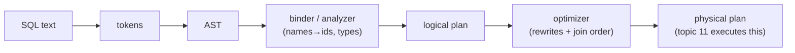

# Topic 10 — Query Engines I: Parsing, Planning, Optimization

The optimizer is the database's brain — and the part that fails most
gracefully-looking while costing 100×. Directly relevant to Cypher
planning in FalkorDB.

Budget: ~12 h. Order: §1 pipeline → §2 rewrites → §3 join ordering →
§4 cardinality (where it all goes wrong) → §5 architectures → code →
experiments → M10.

## The problem, and why this topic has no measured opener

This is the second of two topics whose only binary measures **your** code:
every plan `explain` prints comes out of your `src/planner.rs`, so a fresh clone
prints one stub notice and exits, and there is no lane in `./verify.sh`.

That is not a gap to apologise for — it is what a planner is. The failure mode
of a query optimizer is not being slow, it is being *confidently wrong about row
counts*, and you cannot see that in a timing number. So the oracle here is
external and deliberately not Rust:

```
   load the same 3-table schema into DuckDB
   EXPLAIN the same 3 queries
   diff the join orders against yours
        every disagreement = one cardinality estimate to go find
```

The one number worth committing to before you start is on the third query
(`items ⋈ orders ⋈ users`, two selective filters on `users`): once those filters
are pushed down, does `{users, orders}` become a cheaper first join than
`{orders, items}`? Write the estimate down, then let `estimate()` grade you.
Getting the *direction* right matters more than getting the number right, and a
planner that gets the direction wrong will pick a plan that is orders of
magnitude slow — which is how this topic's mistakes actually show up.

## 1. The pipeline



Logical vs physical, the distinction everything hangs on:
- **logical** = WHAT: `Join(A, B, a.x = b.y)` — algebra, no algorithm
- **physical** = HOW: `HashJoin(build=B, probe=A)` — algorithm + costs

One logical plan → many physical plans. The optimizer's job is a search
problem: rewrite the logical plan (safe, always-good transformations),
then pick among physical alternatives with a cost model.

## 2. Rewrite rules (the always-wins)

- **Predicate pushdown** — filter as close to the scan as possible; every
  row filtered early is a row every later operator never sees.
- **Projection pushdown / unused-column elimination** — don't carry
  columns nobody reads (decisive for columnar engines, topic 12).
- **Constant folding, expression simplification** — `1+1=2` at plan time.
- **Cross-join → inner join** — a filter mentioning both sides of a cross
  product IS a join predicate; recognize it or enumerate disaster.
- **Subquery decorrelation** — turn correlated subqueries into joins
  (DuckDB's deliminator; the hardest rewrite family in the pipeline).

These are heuristic ("always good") — no cost model needed. Join ORDER
is the opposite: nothing is always good.

## 3. Join ordering — the combinatorial core

n tables → Catalan-many trees × orderings: 20-way join ≈ 10¹⁸ plans.

- **Selinger DP (1979, still the answer)**: best plan for a SET of
  relations is composed of best plans for its subsets. DP over subsets,
  sized 1..n. O(3ⁿ) worst case but connected-subgraphs-only in practice.
  Keep "interesting orders" (sorted outputs) as separate DP entries.
- **Fallbacks when n is big**: postgres switches to a genetic algorithm
  at `geqo_threshold` (12); DuckDB goes straight to greedy at 12 relations
  and exits DP for greedy when the pair count reaches 10,000
  (`plan_enumerator.cpp:590` and `:243`). polars only ever searches
  greedily, over left-deep orders of each run of inner equi-joins, and
  keeps the order the user wrote when any input lacks an estimate
  (`reading-rust-planner-stack.md` Step 5).
- Left-deep vs bushy: Selinger searched left-deep only (pipelining +
  smaller space); modern engines (DuckDB) search bushy — graph pattern
  queries especially want bushy plans.

## 4. Cardinality estimation — where it all goes wrong

Cost models rank plans by estimated CARDINALITIES. The estimates rest on
three lies:

| Assumption | Reality | Blowup |
|---|---|---|
| uniformity (1/NDV per value) | skew: one hot value = 50% of rows | 100× |
| independence: sel(a)×sel(b) | correlated columns (city↔country) | 1000× |
| containment for joins | fk distributions vary | 10× per join |

Errors are MULTIPLICATIVE up the plan tree — "How Good Are Query
Optimizers, Really?" (VLDB '15) measured real systems mis-estimating by
10⁴–10⁶ on the (real-data) JOB benchmark, and showed cardinality error
dwarfs cost-model error (JOB's size and structure — 113 queries, 33 structures, 21 tables, a 3.6 GB IMDB snapshot — are in [topic 22](../22-benchmarks/README.md#job-real-data-correlated-on-purpose)). postgres's shrug when it knows nothing:
`DEFAULT_EQ_SEL = 0.005` (selfuncs.h:34) — a constant guess powering
million-dollar plan choices.

Benchmarks can hide the problem in two directions. JOB showed that synthetic
data hides estimation errors; **Survivorship Bias in Industrial Database
Workloads** (Ryan Marcus, Jeffrey Tao, Peizhi Wu, Zijie Zhao, CIDR 2026,
[pdf](https://www.cidrdb.org/cidr2026/papers/p22-marcus.pdf)) shows that real
traces hide the queries nobody dared to send. A vendor's trace contains the
queries that run well on that vendor's system, because users reshape their
workloads around what is fast. Across the OLAP platforms in the authors' data,
query repetition rates range from 58% to 75%, and the higher rates go with
higher per-query startup cost (§2.1); after one platform shipped a rollup
optimization, the share of users issuing rollup queries rose from about 2% to
about 6% (§2.2, Fig. 3). A graph database's own query logs are no exception.

The other response to bad estimates is to make the plan matter less. **Robust
Predicate Transfer with Dynamic Execution** (RPT+; Yiming Qiao, Peter Boncz,
Huanchen Zhang, PVLDB 19(6), VLDB 2026,
[pdf](https://www.vldb.org/pvldb/vol19/p1278-qiao.pdf)) passes Bloom filters
forward and backward over the join tree before any join runs (a
Yannakakis-style semijoin reduction), so every base table is already shrunk and
a bad join order costs less. The original predicate-transfer method paid for
redundant Bloom-filter builds and for tuple-level filters that cannot skip
whole row groups; RPT+ adds asymmetric forward/backward transfer plans,
"cascade filters" that combine min–max block skipping with the Bloom filter,
and pipelines that decide at run time whether a filter is worth building.
Implemented on top of DuckDB v1.3.0 and compared against the unmodified v1.3.0
release, it reports geometric-mean speedups of 1.47× on JOB, 1.28× on
SQLStorm, 1.17× on TPC-H and 1.01× on Appian (§6.2, Fig. 11). A multi-hop
Cypher `MATCH` in the capstone is exactly the chain of joins the transfer phase
prunes.

Graph angle: a 3-hop Cypher pattern is a 3-way self-join on the edge
relation — cardinality = sparse matrix-product size estimation. Same
problem, different clothes (M10/M20 will meet it as nnz estimation).

## 5. Two optimizer architectures

- **Selinger / bottom-up**: rewrite first, then DP join search with one
  cost model. postgres, DuckDB, your experiment. Simple, predictable.
- **Cascades / top-down (Graefe '95)**: everything — rewrites AND
  physical choices — is a RULE firing in a memo of equivalence groups;
  search is goal-driven with pruning. SQL Server, CockroachDB, DataFusion
  aspires. Pay complexity, get extensibility + on-demand exploration.

```
 memo:  G1 = {Join(G2,G3), Join(G3,G2), HashJoin(G2,G3), ...}
        G2 = {Scan(A), IndexScan(A)}     groups = equivalence classes,
        G3 = {Scan(B)}                   members share cardinality
```

The extensibility is not hypothetical. **I Can't Believe It's Not Yannakakis:
Pragmatic Bitmap Filters in Microsoft SQL Server** (Hangdong Zhao, Yuanyuan
Tian, Rana Alotaibi, Bailu Ding, Nicolas Bruno, Jesús Camacho-Rodríguez,
Vassilis Papadimos, Ernesto Cervantes Juárez, Cesar Galindo-Legaria, Carlo
Curino, CIDR 2026, [pdf](https://www.cidrdb.org/cidr2026/papers/p29-zhao.pdf))
describes the predicate-transfer idea of §4 as it already runs in production.
SQL Server's batch-mode hash join builds a bitmap from its build side and pushes
it into the probe subtree; because execution is pull-based, bitmaps cascade
through a chain of joins, and the Cascades optimizer costs each plan with the
bitmaps it would receive, so a bitmap can change the chosen join order — the
bitmap is carried as a context property through the memo. The paper argues
this yields instance-optimal plans for acyclic queries whenever those plans are
also the cheapest by estimate. On TPC-H SF100 with SQL Server 2025, bitmaps
versus no bitmaps gave over 2× speedups on 7 of the 22 queries, and 12 acyclic
queries ran with instance-optimal plans (§5, Table 1). Read it with
[reading-selinger-cascades.md](reading-selinger-cascades.md).

## 6. Code to read (guides in this dir)

| Guide | What you'll trace |
|---|---|
| reading-duckdb-optimizer.md | The readable optimizer: DuckDB's pass pipeline and join-order DP |
| reading-postgres-optimizer.md | Postgres's optimizer: Selinger '79, still in production |
| reading-rust-planner-stack.md | The Rust planner stack: Pratt parsing, rule traits, lazy frames |
| reading-selinger-cascades.md | Selinger and Cascades: the two optimizer architectures |
| reading-how-good-optimizers.md | Cardinality is the whole ballgame: the JOB audit |

Further references:
- "Apache Calcite" (SIGMOD 2018) — the optimizer as a *library*
  (rules + cost model, no storage, no executor); what DataFusion is to
  Rust, Calcite is to the JVM world.
- "Spark SQL: Relational Data Processing in Spark" (SIGMOD 2015) —
  Catalyst: plans as trees, rules as Scala pattern matches; the most
  widely deployed rewrite-rule engine in existence.
- Learned query optimization: "Learned Cardinalities" (Kipf et al.,
  CIDR 2019) attacks §4's problem with a model; "Neo" (VLDB 2019) and
  "Bao" (SIGMOD 2021, Marcus et al.) steer the whole planner — Bao
  picks among hint sets so the classical optimizer stays as the safety
  net. Read after the VLDB'15 paper: they are its direct descendants.

## 7. Experiments (`experiments/`)

Mini planner: sqlparser-rs parses; YOU build the logical plan, pushdown,
join reordering, and cardinality estimation. Tests fix the contract
(filters sink into scans, join order flips when stats flip, estimates
multiply). `explain` binary prints before/after plans — compare with
DuckDB's `EXPLAIN` on the same queries (bench protocol in notes.md).

## 8. M10 checklist (capstone)

- [ ] Cypher-subset grammar: MATCH pattern, WHERE, RETURN — parser +
      binder (var→id, label→matrix)
- [ ] logical plan tree: NodeScan / Expand / Filter / Project — note that
      Expand(direction, label) is your Join
- [ ] rewrite rules: push WHERE into NodeScan; anchor selection (start
      from the most selective label — that's join ordering!)
- [ ] after the fact: diff against the reference's parser/ + planner/ +
      optimizer dirs
