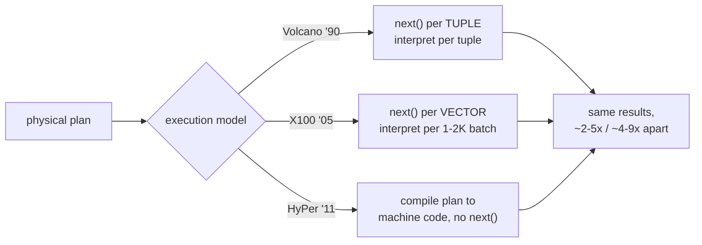

# Topic 11 — Query Engines II: Execution Models

Volcano vs vectorized vs compiled — the defining performance battle of
modern analytics. Topic 10 chose the plan; this topic is about how fast
you can RUN it. The gap between tuple-at-a-time and vectorized execution
is a few-fold for vectorized batches and close to one order of magnitude for a
fused, branch-free kernel (the reference solution measured 1.7-3.1x and 3.7-9.2x
across selectivities, `notes.md`), and you will measure it yourself.



## The problem, measured (bench lane 1, provided — runs today)

`cargo run --release --bin exec_bench` — 50 M rows,
`SELECT k, SUM(v) WHERE f < t GROUP BY k`, best of 3:

```
selectivity      volcano
        5%      0.386 s     129.4 M rows/s
       50%      0.484 s     103.3 M rows/s
       95%      0.669 s      74.7 M rows/s
```

**103 M rows/s is the tuple-at-a-time ceiling on this machine — and notice which
way it moves.** Cost rises monotonically with selectivity, because in a Volcano
pipeline every row that *survives* the filter pays the full per-tuple
interpretation bill on its way to the aggregate: a virtual call per operator per
row. The filter is not the expensive part. Passing it is.

The reference solution for the two exercise lanes (`notes.md`, "Reference
numbers") puts a number on the gap: at 50% selectivity vectorized ran **1.7x**
faster than Volcano and the fused kernel **9.2x**, in one run of all three
back to back; the ratios moved between runs on a loaded machine, the ordering
never did.

Put that next to topic 12's measurement of the same machine — ~50 GB/s of
sequential u64 fold, about 6.2 G values/s — and the gap is 60×. That gap is what
vectorized execution and compiled kernels are competing to close, and the
interesting question is not whether they close it but *what the remainder
consists of* once they do. Predict the split before you implement either lane.

## 1. The Volcano (iterator) model

Every operator implements `open() / next() / close()`; `next()` returns
ONE tuple. Elegant: operators compose arbitrarily, demand-driven, bounded
memory.

```
 Project.next()
   └─ calls Agg.next()
        └─ calls Filter.next()      per-tuple costs, PER TUPLE:
             └─ calls Scan.next()   - virtual call (indirect branch) x depth
                                    - interpretation of the expression tree
                                    - tuple is gone from registers between calls
```

Postgres still runs this (`ExecProcNode` — a function pointer per node),
and for OLTP it's fine: a point query touches 3 rows; who cares about
per-tuple overhead. The disaster is analytics: 100M rows × 5 operators ×
~20 ns of interpretation overhead = minutes spent NOT computing.

## 2. Vectorized execution (MonetDB/X100 → DuckDB)

Same iterator shape, but `next()` returns a BATCH (DuckDB: `DataChunk`,
2048 rows). All the per-call overhead amortizes over the batch, and the
inner loops become tight `for` over columnar arrays — the compiler
auto-vectorizes, the prefetcher streams, branches disappear.

```
 per-TUPLE model:   overhead × N_rows
 per-VECTOR model:  overhead × (N_rows / 2048)  +  tight loops over arrays
```

Two supporting tricks (both in DuckDB, both worth stealing for M11):

- **Selection vectors**: a filter doesn't copy survivors — it produces an
  index array `sel[]` over the same vectors. Downstream kernels take
  `(data, sel, count)`. Zero copies until materialization is forced.
- **Vector type flags**: a vector can be FLAT, CONSTANT (one value —
  arithmetic with a constant never expands it), DICTIONARY (selection
  over a dictionary — compressed data flows through the engine). Kernels
  dispatch on the combination.

Why 1–2K rows? Big enough to amortize call overhead, small enough that a
chunk's working set stays in L1/L2 between operators. It's the cache
ladder of topic 0 turned into an engine design parameter.

## 3. Compiled execution (HyPer)

Skip interpretation entirely: fuse each PIPELINE (chain of operators
between materialization points) into one tight loop and JIT it — the
tuple stays in CPU registers from scan to sink.

```
 for (row in fact_table)              // one compiled loop = whole pipeline
     if (row.f < 50)                  // filter: a branch, not an operator
         ht[row.k] += row.v;          // agg: an add, not a next() chain
```

VLDB'18 ("Everything You Always Wanted to Know…") raced the two champions:
**roughly equal on aggregation-heavy work; compilation wins complex
expressions and tight OLTP; vectorization wins on compile time (its
primitives are precompiled, while LLVM compile time grows with code size),
profiling, and adaptivity.** DuckDB chose vectors partly for
engineering reasons — no LLVM dependency, debuggable C++ kernels. Topic 19
revisits compilation; M11 goes vectorized.

## 4. Morsel-driven parallelism (SIGMOD'14)

How to parallelize pipelines: break the input into MORSELS (~100K rows),
workers PULL morsels dynamically instead of getting static partitions.

- NUMA-aware: a worker prefers morsels on its socket.
- Elastic: skew doesn't strand workers (no "thread 3 got the hot
  partition"); a slow morsel just means that worker pulls fewer.
- DuckDB: source operators hand out row-group-sized work units
  (122880 rows = 60 vectors); `MaxThreads` on the source caps fan-out.
  polars-stream literally names its unit `Morsel` and pairs it with a
  sequence token so order-sensitive sinks can reassemble.

```
        ┌ morsel queue ┐
 scan:  [m0][m1][m2][m3][m4]...
          ▲    ▲         ▲
        w0 pulls, w1 pulls, w2 pulls   (dynamic — no static split)
 each worker runs the WHOLE pipeline on its morsel:
 scan → filter → probe → partial agg (thread-local HT)
 then: combine partial HTs (the sink's Combine/Finalize phase)
```

## 5. Hash joins and aggregation, vectorized

The two operators where analytics time actually goes. The third operator that re-packs vectors into rows is `ORDER BY`: [topic 57](../57-sorting/README.md) measures what encoding the sort key once buys over a comparator, and where a radix sort on that key loses.

- **Hash join** (DuckDB `join_hashtable.cpp`): build side materializes
  into row-format tuple data, partitioned by hash radix; the hash table
  stores 8-byte entries = pointer + SALT bits (topic 2's bit-smuggling:
  compare salt before chasing the pointer — most misses never touch the
  tuple). Probe is vectorized: hash 2048 keys, gather 2048 buckets,
  compare salts, chase survivors via selection vector. Whether to partition by hash radix at all, and what DuckDB's radix bits are used for, is topic 54's question ([reading-duckdb-join-hashtable.md](../54-join-algorithms/reading-duckdb-join-hashtable.md)).
- **Hash aggregation**: same skeleton, plus two-phase: threads build
  thread-local partial HTs (no contention), then radix-partitioned
  merge (`RadixPartitionedHashTable`). DataFusion's
  `GroupedHashAggregateStream` interns group keys → dense group index →
  aggregate states live in flat columnar arrays indexed by group id
  (not per-group heap objects).
- **Many-to-many joins** blow intermediates up far beyond the inputs, and
  a *factorized* representation stores them as a tree of "this parent
  value × these children" instead of the flat cross product. That tree
  fights §2's design: vectorized operators want flat, fixed-size,
  contiguous vectors. **Factorized and Vectorized Execution: Optimizing
  Analytical and Semantic Queries over Relations** (FFX; Sunny Yasser,
  Anas Dorbani, Amine Mhedhbi, Proc. ACM Manag. Data 4(3), Article 178,
  SIGMOD 2026, [arXiv](https://arxiv.org/abs/2609.09002)) reconciles them.
  The list-based approach Kùzu uses binds one parent value at a time,
  which leaves child vectors sparse and limits the tree shapes it can
  express (§4). FFX keeps vectors packed: a child vector holds all matches
  contiguously, an offset array maps parent position `i` to the slice
  `off[i]..off[i+1]`, selection is a bit array, and a "cascade update"
  operator propagates filtering through the hierarchy without leaving the
  vectorized loop (§4.1, §5.2). Single-threaded on LSQB at scale factor
  10, query Q1 takes 1.28 s against 591.10 s for Kùzu and 18.43 s for
  DuckDB, while the cyclic Q2 is a tie with DuckDB (2.71 s vs 2.72 s)
  (Table 5) — with FFX's join orders picked by hand to maximize
  factorization (§7.3.3). Read it against the selection vectors above and
  topic 13's [reading-kuzu.md](../13-graph-engines/reading-kuzu.md) Step 5;
  for the capstone, a Cypher pattern that fans out from one node twice
  (`(a)-->(b), (a)-->(c)`) is exactly the shape where factorized
  intermediates pay.
- **`IN` is a join with a trap.** `x IN (subquery)` looks like a
  semijoin, and is one only while no NULLs are involved: with a nullable
  multi-column key, three-valued logic makes the answer NULL rather than
  FALSE when no row matches exactly but some row matches on its non-NULL
  columns — `(3, 4) IN ((1, 2), (3, NULL))` is NULL. **On the Vexing
  Difficulty of Evaluating IN Predicates** (Altan Birler, Thomas Neumann,
  CIDR 2026, [pdf](https://www.cidrdb.org/cidr2026/papers/p3-birler.pdf))
  works this out (§1): the operator must look for partial matches, not
  just exact ones. The paper reduces the orthogonal-vectors problem to
  this and concludes no subquadratic algorithm exists in general unless
  the strong exponential time hypothesis fails (§5); it then gives
  mark-join algorithms, implemented in Umbra, that run in linear time in
  the common cases (§6). Its survey is the striking part: ClickHouse 25.8,
  Hyper 9.1.0, DuckDB 1.3.0, Snowflake 9.21.0, Redshift and Firebolt Core
  return wrong results for IN/NOT IN over nullable attributes, while
  PostgreSQL 17, Oracle 23c, SQLite 3.46.1 and others are correct but can
  go quadratic on simple inputs (§1). A mark join is a hash join whose
  probe emits TRUE/FALSE/NULL per outer row instead of filtering, and
  Cypher's `IN` over lists that may hold `null` raises the same question
  for the capstone.

## Experiments (`experiments/`)

One query, three engines — `SELECT k, SUM(v) WHERE f < t GROUP BY k`:

1. `volcano.rs` — PROVIDED: tuple-at-a-time iterators, dyn dispatch. The
   honest 1990 baseline.
2. `vectorized.rs` — YOU implement: 1024-row batches, columnar arrays,
   selection vectors, group-by into a flat array (k is dense).
3. `kernels.rs` — YOU implement: branchless/SIMD-friendly single-pass
   fused kernel (what a compiled engine would emit for this pipeline).

`cargo test` checks all three agree with a scalar oracle;
`cargo run --release --bin exec_bench` prints rows/s for each — the gap
IS the lesson. Predict the two ratios in notes.md first.

## Reading guides

| guide | what it walks |
|---|---|
| [reading-duckdb-execution.md](reading-duckdb-execution.md) | DuckDB's execution engine: 2048 rows at a time |
| [reading-postgres-executor.md](reading-postgres-executor.md) | Volcano in production: postgres's executor, warts and wisdom |
| [reading-rust-execution-stack.md](reading-rust-execution-stack.md) | Vectorized in Rust: polars-stream morsels and DataFusion streams |
| [reading-x100.md](reading-x100.md) | X100: the vectorization manifesto |
| [reading-compiled-vs-vectorized.md](reading-compiled-vs-vectorized.md) | Compiled vs vectorized: the fair fight ends in a near-tie |
| [reading-morsel-parallelism.md](reading-morsel-parallelism.md) | Morsel-driven parallelism: workers pull, skew dissolves |

Further references: "Photon" (SIGMOD 2022) — Databricks' vectorized
C++ engine, notable for *why not compilation*: easier to build, debug,
and roll out than codegen at their scale; "Velox" (VLDB 2022) — Meta's
reusable execution library (the executor as a component, like Calcite
for topic 10); "GAMMA" (1986) — where exchange-operator parallelism
came from, if you want the pre-history of §4.

## Capstone M11

Vectorized runtime for the graph engine. The reference is FalkorDB 6's
Rust engine, which lives on the `main` branch of
[FalkorDB/FalkorDB](https://github.com/FalkorDB/FalkorDB); read it at the
v6.0.0 tag (commit `2b26fd767e`): `graph/src/runtime/batch.rs`,
`graph/src/runtime/vectorized.rs`, `graph/src/runtime/vector_expr.rs` and
`graph/src/runtime/eval.rs`. The C engine quoted elsewhere in this course
(FalkorDB 4.x, `master`, the pin table's `ccb449a9a`) has no counterpart to
these files, so cite them with the v6.0.0 tag.

- [ ] batch type: fixed-capacity columnar chunk (node ids, properties) +
      selection vector — pick the batch size by measuring, not by copying
      DuckDB's 2048
- [ ] operator pipeline: source (label scan) → expand → filter → project,
      each `fn next(&mut self, out: &mut Batch)`
- [ ] expression eval over batches (property predicates) — no per-row dyn
      dispatch. The reference answer is `VectorEval`
      (`graph/src/runtime/vector_expr.rs:196` at v6.0.0), which evaluates
      the *whole* expression tree column-at-a-time — one bulk property
      fetch per reference and one pass per operator. Its module comment
      (`vector_expr.rs:1-8`) gives the shape; `vectorized.rs` is the layer
      below it, comparing one materialized column against one constant. A
      node with no columnar arm is evaluated per row into a column and the
      walk stays columnar above it (`:21-26`, "There is no 'this tree is
      not vectorizable' answer to fall back on"), and `A AND B` evaluates
      `B` only over the rows where `A` was not false, preserving
      short-circuit semantics (`:37-39`)
- [ ] the FalkorDB angle: Expand over a sparse matrix IS a vectorized
      kernel already (one GraphBLAS call per batch of source nodes);
      decide where matrix ops end and row-ish batches begin
- [ ] bench: M11 runtime vs M10's naive interpreter on the same plan
