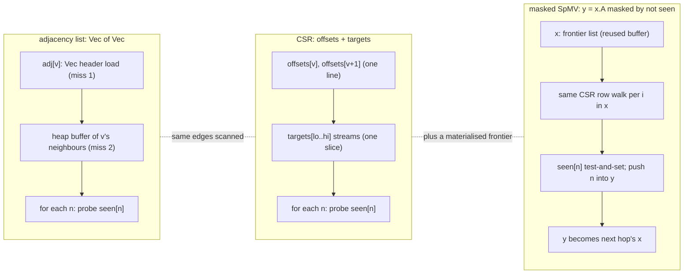

# Topic 13 — Graph Engines (Home Turf, Deeper)

Compare FalkorDB's sparse-matrix approach against the alternatives it
competes with — with line numbers and benchmarks, not marketing. Four
architectures, one question: what does an Expand (get neighbors) cost,
and what does pattern matching (multi-way Expand) cost?

## The problem, measured (bench lane 1, provided — runs today)

`cargo run --release --bin hop_bench` — preferential-attachment graph, 1 M nodes
/ 16.0 M directed edges, two-hop `COUNT(DISTINCT)` from 10 000 random sources and
from the 100 highest-degree nodes. Max degree 6565, p50 degree 11:

```
impl                 source set       ns/query      distinct reached
adj_list (oracle)    random               4914              10220457
adj_list (oracle)    supernodes         495378               7890665
```

**The same query, on the same graph, through the same code: 101× slower
depending on which node you start from.** Nothing before this topic behaves like
that. A B-tree point lookup costs what it costs; a two-hop traversal costs
whatever the degree distribution under your start node says, and on a scale-free
graph that distribution is a power law with no useful mean. The median node has
11 neighbours. The top one has 6565.

Now the last column, carefully — because it is a trap this repo walked into. The
checksums are **sums over unequal query counts**: 10 000 random sources against
100 supernodes. Divide before comparing. Per query, random reaches
10 220 457 / 10 000 = **1022** distinct nodes and a supernode reaches
7 890 665 / 100 = **78 907** — **77× more**, not fewer. The earlier reading of
this table ("the slow case reaches fewer nodes, so the work is redundant") was
an artifact of comparing a sum of 10 000 with a sum of 100.

What the lane does show is cleaner. Cost per distinct node reached is
4914 / 1022 = **4.81 ns** from random sources against 495 378 / 78 907 =
**6.28 ns** from supernodes — only **1.31×** worse. So the 101× is 77× more
work and 1.3× worse cost per unit of it, and *that* is the finding: a two-hop
traversal costs what its reachable neighbourhood costs, and the degree
distribution decides the neighbourhood. The 1.31× residual is the interesting
part, and this lane cannot say whether it is re-walked overlap or the cache
pressure of a 79 000-node frontier — it counts distinct nodes, not edges
traversed. Separating the two is an exercise below. The CSR and masked-SpMV
lanes attack the residual, which is why graph engines are built around set
operations on sorted adjacency rather than pointer chasing. It is also why
"supernode" is a word in this field and not in the others.

## 1. The adjacency representation menu

```
 edge list        [(0,5),(0,9),(1,5)...]        cheap writes, useless reads
 adjacency list   node -> Vec<neighbor>          per-node vectors, pointer-y
 CSR              offsets[n+1] + targets[m]      read-optimal, immutable-ish
 sparse matrix    A[i][j] = edge (GraphBLAS)     CSR + an ALGEBRA on top
 record store     fixed-size records, linked     neo4j: chains of pointers
```

```
 CSR for 0->{5,9}, 1->{5}, 2->{}:
 offsets: [0, 2, 3, 3]
 targets: [5, 9, 5]
 neighbors(i) = targets[offsets[i] .. offsets[i+1]]   one slice, zero chase
```

CSR IS a sparse matrix (it's the standard storage for one). The
GraphBLAS move is to treat the whole graph as a boolean matrix and
traversals as linear algebra: **BFS frontier expansion = SpMV**
(`y<¬visited> = A^T x` — mask does the dedup/visited check), **2-hop =
A², triangles = A ⊙ A²**. One engine (the semiring kernels) serves
every traversal.

The three spellings differ in *memory access*, not in the set of edges they
touch. Expanding one hop from a frontier `x`, with the visited set `seen`:



Per hop all three scan exactly `sum of deg(v) for v in the frontier` edges; what
changes is how many dependent cache misses precede each row's data (two for the
adjacency list, one for CSR) and whether the next frontier is written out as a
vector (masked SpMV) or consumed inline. The supernode blow-up lives in the
frontier size, which no layout changes.

## 2. The four architectures

| | neo4j | memgraph | kuzu | FalkorDB |
|---|---|---|---|---|
| store | fixed-size records on disk, linked lists | in-memory skip lists per vertex | columnar CSR node groups on disk | sparse matrices (SuiteSparse) |
| Expand | chase rel-chain pointers | walk vertex's edge vector | slice CSR + vectorized ops | matrix row extract / SpMV |
| pattern match | one expand at a time | one expand at a time | binary joins + WCOJ intersect | masked matrix multiply |
| MVCC | page-based + txn state | delta chains per object (topic 8's N2O) | MVCC on node groups | single-writer + matrix COW (delta matrices) |
| updates | in-place records | in-memory, GC'd deltas | CSR rebuild per node group, delta buffers | delta matrices merged on sync |

The recurring tension: CSR-shaped structures are READ-optimal but hate
single-edge inserts (shift everything). Every system grows a
delta/buffer mechanism: kuzu's in-mem CSR buffers, FalkorDB's
`Delta_Matrix` (additions/deletions matrices over the main one —
`src/graph/delta_matrix/` in the C engine quoted here, FalkorDB 4.x on `master`
at `ccb449a9a`; FalkorDB 6's Rust engine lives on `main`),
even GraphBLAS's own pending-tuples. It's
the LSM idea (topic 4) applied to adjacency: fast structure + small
mutable overlay + background merge.

## 3. Why pointer chasing loses (and when it doesn't)

neo4j's pitch was "index-free adjacency" — neighbors are pointers, no
index lookup. But topic 0 taught the real cost model: a pointer chase
is a ~110 ns DRAM miss; a CSR slice is a prefetchable stream. Chasing a
34-byte relationship record chain = one miss per edge; scanning a CSR
row = bandwidth. Where records win: single-edge-centric OLTP mutations
and uniform record updates. Where they lose: any traversal wider than a
few edges — which is every interesting query.

The same argument extends from adjacency to properties. Schemaless
property-graph engines store schema per tuple (row records), run
Volcano-style operators that cannot vectorize over mixed schemas, and
plan with thin custom optimizers. TurboLynx (Lee, Ha, Tak, Han,
*TurboLynx: Schemaless Graph Engine Strikes Back for General-Purpose
Analytics*, PVLDB 19(6), VLDB 2026,
[pdf](https://www.vldb.org/pvldb/vol19/p1250-han.pdf)) groups vertices
and edges with similar property sets into cost-based clusters called
graphlets, stores each columnar, lets every operator consume input
spanning several graphlets (with a shared-schema row format so
intermediate schemas do not multiply), and plans with an extended Orca
optimizer that merges graphlets before join enumeration to keep the
search space bounded (§1, §4). With all systems single-threaded, its
geometric-mean end-to-end speedup on LDBC SNB Interactive SF100 is
183.9× over DuckPGQ and 7.74× over Umbra, while on TPC-H SF100 Umbra is
the faster one (0.58×) (§5.3, Table 4). Read the Umbra ratios with care:
Table 4 prints each cell as "ratio — competitor ms / TurboLynx ms", and the
Umbra row does not agree with itself — 2319 / 84 is 27.6, not 7.74, and
113,512 / 12,253 is 9.26, not 0.58 — while the Neo4j row does (880 / 84 =
10.5); topic 46's DuckPGQ guide works through the table. The capstone's attribute storage
faces the same row-vs-columnar choice its adjacency already made.

## 4. Worst-case optimal joins (the kuzu angle)

Binary join plans can be asymptotically wrong for cyclic patterns: the
triangle `(a)-[]->(b)-[]->(c)<-[]-(a)` via pairwise joins materializes
O(m²) intermediates; the AGM bound says the output is at most m^1.5.
WCOJ (Generic Join): intersect one VARIABLE at a time —
for each edge (a,b), intersect N(a) ∩ N(b) for c. Kuzu ships this as an
`Intersect` operator on sorted CSR slices; EmptyHeaded showed the
GraphBLAS-adjacent insight that set intersection is the whole game.
FalkorDB's masked `A ⊙ A²` triangle counting is the matrix spelling of
the same intersection.

The `kuzudb/kuzu` repository is archived (read-only); its last commit,
`89f0263` on 2025-10-10, is the one [reading-kuzu.md](reading-kuzu.md)
reads. The community continuation is
[LadybugDB](https://github.com/LadybugDB/ladybug) ("formerly known as
Kuzu"); its history diverges before that commit, so read the code there,
not in the fork. A second fork, [RyuGraph](https://github.com/predictable-labs/ryugraph)
(Predictable Labs), was created 2025-10-13.

Cyclic patterns are one half of a real query; the other is the
variable-length path. A Cypher/GQL pattern mixes fixed edges (subgraph
matching) with variable-length paths (regular path queries), and engines
plan the two parts separately and glue them in a fixed order. Pang, Zou,
Bonifati, Özsu, Zhou, *A Unified Query Planning Framework for
Conjunctive Regular Path Queries* (PVLDB 19(10), VLDB 2026,
[pdf](https://www.vldb.org/pvldb/vol19/p2686-pang.pdf)) puts both in one
algebra over a hypergraph query model with six operators —
traverse-intersect (TI, which runs as a leapfrog-style intersection when
several edges meet at one vertex), Kleene closure (KC), subgraph join
(SJ, for bushy joins), UNION, inverse (INV) and SCAN — and enumerates
equivalent plans by rewrite rules under a cost model (§1, §4).
Implemented on MillenniumDB and inside Neo4j through its user-defined
procedure API, single-threaded, it reports an average end-to-end speedup
of 2.08× over MillenniumDB on WDBench and 1.68× over Neo4j on LDBC SNB,
with about 68% fewer timeouts on WDBench (§5.1, Table 5). That joins the
intersection above to §6's quantified path patterns: the capstone's
planner will need a single cost-based space for `(a)-[:KNOWS*1..5]->(b)`
inside a larger pattern, not a fixed-order splice.

## 5. LDBC (the referee)

- **SNB Interactive**: OLTP-ish — short reads (2-hop neighborhoods,
  paths) + inserts; scale factors with power-law degree (the
  correlated-data lesson from VLDB'15/topic 10 — uniform synthetic
  graphs hide planner sins).
- **SNB BI**: analytics — global scans, aggregations over the graph.
- **Graphalytics**: pure algorithms (BFS, PageRank, WCC) — topic 24.
- The benchmark's real value: audited implementations + a spec that
  forces update handling (no read-only CSR cheating).

## 6. The query-language landscape

Six languages, three real fault lines — data model, matching semantics,
composability:

| | model | matching | composable? | pushdown-friendly? |
|---|---|---|---|---|
| Cypher/openCypher | property graph | homomorphism, rel-trail for var-length | weak (`CALL {}` bolted on) | good |
| GQL (ISO 39075:2024) | property graph | configurable: ALL/TRAIL/ACYCLIC + quantified path patterns | graph tables | good |
| SQL/PGQ | property graph *inside* SQL | GQL's MATCH in `GRAPH_TABLE(...)` | full SQL | inherits SQL |
| SPARQL | RDF triples | homomorphism (BGP) | subqueries | union-heavy plans |
| Gremlin | property graph | imperative traversal | pipelines | almost none — you ARE the plan |
| Datalog | relations | homomorphism + fixpoint | **total** — rules feed rules | recursion-native |

The trap: **the same pattern returns different answers per language**.
`(a)-[]->(b)-[]->(c)` under homomorphism lets `a=c` (Cypher: yes, nodes
may repeat); isomorphism forbids repeating nodes; trail forbids
repeating *edges* (Cypher's var-length `[*]`). Count 2-paths in a
triangle and you get three different numbers. GQL makes the mode
explicit syntax; Cypher hard-codes a hybrid — a semantics decision
disguised as a default.

RDF's edge-property hole: triples have no place for `since: 2019` on
`:alice :knows :bob` — you reify (a statement-node per edge, 4 triples)
or use RDF-star. Property graphs made the edge a first-class citizen;
that single modeling choice is most of why they won the app market.

GQL is the first new ISO database language since SQL (1987). Its
quantified path patterns (`(a) (-[:KNOWS]->){1,5} (b)`) and path modes
are the parts worth building into an AST *now* — hence M13's rule below.
→ guide: [`reading-query-languages.md`](reading-query-languages.md)

The standard is ahead of most implementations. PostgreSQL 19 does not
ship SQL/PGQ: `CREATE PROPERTY GRAPH` and `GRAPH_TABLE` were committed to
master as `2f094e7ac69` on 2026-03-16 and reverted together with their
follow-up fixes on 2026-09-07 — on master as `b1f106c80cb` and on
`REL_19_STABLE` as `2b9e1aff4d3`; the `REL_19_BETA4` and `REL_19_RC1`
tags contain the revert, and the parser grammar on both branches has no
`GRAPH_TABLE`. Neo4j's Cypher 25 manual keeps a
[GQL conformance appendix](https://neo4j.com/docs/cypher-manual/25/appendix/gql-conformance/)
listing the mandatory GQL features Cypher supports and those it does
not yet.

SQL/PGQ's row of the table can also be approached from the other side —
graph traversal as SQL syntax over declared relationships. Shute, Zheng,
Kudtarkar, *Semantic Data Modeling, Graph Query, and SQL, Together at
Last?* (CIDR 2026,
[pdf](https://www.vldb.org/cidrdb/papers/2026/p11-shute.pdf)), a design
paper from Google with no performance numbers, extends GoogleSQL with
join columns (a foreign-key relationship becomes a column of type
`ROW<Table>`, read with dotted paths such as `c.Nation.Region.r_name`),
horizontal aggregation over arrays and join columns
(`SUM(UNNEST(c.Orders.Lineitems.l_extendedprice))`), and measure columns
that are grain-locked so a join cannot double-count them; tables plus
join columns form a "semantic data graph" (§3, §4). The authors report
these features are used in F1 by multiple teams (§1.1).
[reading-query-languages.md](reading-query-languages.md) is where to
compare it with `GRAPH_TABLE`.

## Experiments (`experiments/`)

2-hop neighborhood (distinct nodes at distance 1 or 2, excluding self)
over three representations, same power-law graph:

1. `adj_list.rs` — PROVIDED: `Vec<Vec<u32>>` walk. The oracle.
2. `csr.rs` — YOU implement: build (counting sort) + two_hop over
   slices with a reusable visited bitmap.
3. `matrix.rs` — YOU implement: boolean SpMV two_hop — frontier vector ×
   CSR with a mask; structurally identical to csr.rs but written as
   y = xA then z = yA (feel where the algebra earns its keep and where
   it's overhead).
4. `hop_bench` — PROVIDED: 1M-node/16M-edge preferential-attachment
   graph, 10K random sources (plus the 100 highest-degree — supernodes
   are the graph-shaped tail), ns/query for all three.
5. Compare externally: same query on FalkorDB
   (`GRAPH.QUERY ... MATCH (a)-[*1..2]->(b) RETURN count(DISTINCT b)`)
   and neo4j if handy — record in notes.md.
6. YOU add: a second counter alongside the distinct-node checksum that
   counts **edges traversed**, and report both normalised per query.
   The provided lane measures 1022 against 78 907 distinct nodes per
   query and 4.81 against 6.28 ns per distinct node — it cannot say
   whether that 1.31× residual is re-walked overlap or the cache cost
   of a 79 000-node frontier. Edges-per-distinct-node separates them:
   if the supernode ratio is much higher, the work really is redundant
   and the visited bitmap is the fix; if it is flat, the residual is
   memory and only layout helps. Predict which before you measure.

## Reading guides

| guide | chapter |
|---|---|
| [reading-graphblas-internals.md](reading-graphblas-internals.md) | GraphBLAS & Delta_Matrix: the graph as matrices |
| [reading-neo4j-record-store.md](reading-neo4j-record-store.md) | Neo4j's record store: the price of index-free adjacency |
| [reading-memgraph-storage.md](reading-memgraph-storage.md) | Memgraph: skip lists, edge vectors, delta MVCC |
| [reading-kuzu.md](reading-kuzu.md) | Kùzu: DuckDB for graphs |
| [reading-wcoj.md](reading-wcoj.md) | Worst-case optimal joins: intersect, don't enumerate |
| [reading-ldbc-snb.md](reading-ldbc-snb.md) | LDBC SNB: the graph benchmark referee |
| [reading-query-languages.md](reading-query-languages.md) | Graph query languages: semantics, not syntax |

## Capstone M13

First graph core — the deliberately-naive baseline M20's sparse-matrix
core will replace (and be measured against):

- [ ] node + edge store over adjacency lists (CSR later — feel the
      update pain first and write it down)
- [ ] labels: node id sets (or bitmaps) per label
- [ ] basic pattern matching: single-directed-path patterns
      `(a:L)-[:R]->(b)` via scan-anchor-then-expand (M10's planner
      chooses the anchor)
- [ ] wire into M11's vectorized runtime: Expand fills batches
- [ ] bench: hop_bench queries through the whole engine vs the raw
      representation — the interpretation overhead is the M11 payoff
      measurement
- [ ] record the update-pain notes: what a CSR/matrix core must solve
      (delta overlay design → M20)
- [ ] language rule: target openCypher now, but keep the AST GQL-shaped —
      quantified path patterns and an explicit path-mode field
      (ALL/TRAIL/ACYCLIC) as first-class — so M10's parser survives GQL
      compatibility without a rewrite
