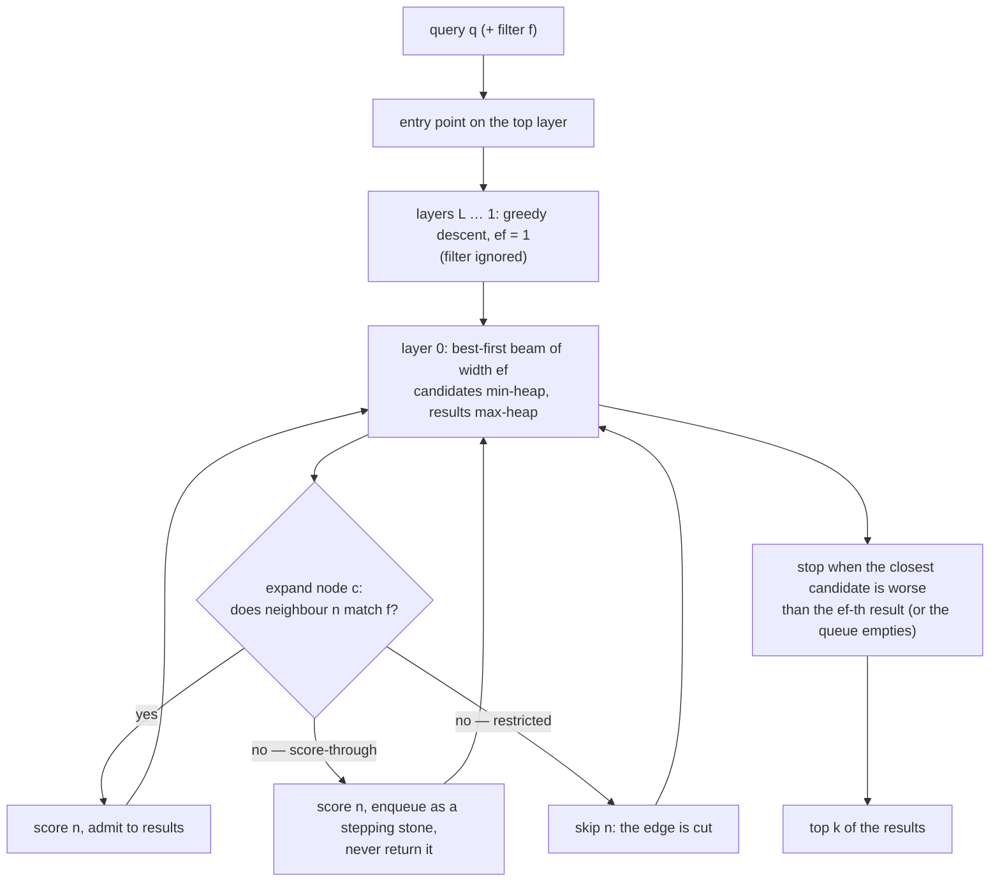

# Topic 14 — Vector Search

qdrant territory, and every DB is adding it. The ANN problem: return
the k nearest vectors WITHOUT scanning everything, trading exactness
for speed. The whole field is one curve — **recall@k vs QPS** — and
every algorithm is a point-generator on it.

## The problem, measured (bench lane 1, provided — runs today)

`cargo run --release --bin ann_bench` — 100 000 × 128-dim f32 (51 MB) in 200
clusters, 500 queries, k=10:

```
brute force: 4.28 s total, 117 QPS — recall 1.000 by definition
```

**117 queries per second, with perfect recall for free.** That single point is
what the entire approximate-nearest-neighbour field exists to beat, and stating
it first changes how you read every ANN result afterwards: a QPS figure quoted
without its recall is not a measurement, because the trivial way to get more QPS
is to return worse answers.

It is worth being precise about *why* it is slow, because it decides which lane
should win. 51 MB of vectors is small — this is a compute problem, not a memory
one: 500 queries × 100 000 candidates × 128 dimensions is 6.4 G multiply-adds.
So brute force here is really a SIMD exercise (topic 17), which means the two
exercise lanes attack different walls. HNSW cuts the *number* of candidates;
scalar quantization shrinks each candidate 4× and rescopes the same scan. Predict
where the two land relative to each other, and to this row, before writing either.

The other side of the ratio, from a reference solution of the two stubs
(full table in [notes.md](notes.md#reference-numbers-for-the-exercise-lanes),
one locked run in which brute force itself ran at 149 QPS): HNSW with
m = 16, ef_construction = 128 reaches recall 0.962 at 22,336 QPS (150× brute
force) at ef = 16, 0.999 at 11,450 QPS (77×) at ef = 64; the u8 scan with
rescore ×2 reaches recall 1.000 at 602 QPS (4×). The graph wins by two
orders of magnitude; quantization alone, still an O(n) scan, does
not. This generator is easy for HNSW (tight Gaussian clusters, queries are
perturbed dataset rows), so treat the recall figures as a ceiling.

## 1. The problem shape

Exact k-NN over n vectors of dimension d = n·d multiply-adds per
query: memory-bound streaming (topic 12's lesson: 100K × 128-d f32 =
51 MB per scan). Indexes buy sublinear queries with three currencies:
RAM, build time, and recall.

```
             recall@10
   1.0 ┤ brute force ●
       │        HNSW ef=256 ●
       │      HNSW ef=64 ●          ← the curve every ANN
       │    HNSW ef=16 ●              paper/bench plots
       │  IVF nprobe=1 ●
   0.5 ┤
       └──────────────────────────► QPS (log)
```

## 2. HNSW anatomy

A skip list generalized to proximity graphs (topic 2's ladder, in
metric space):

```
 L2:  ●────────────────●              sparse "highways"
       \                \
 L1:  ●──●─────●────────●──●          each node: level ~ -ln(U)·1/ln(M)
       \  \     \        \  \
 L0:  ●─●─●─●─●─●─●─●─●─●─●─●─●      dense base layer, M0 = 2M links
```

- **search**: greedy-descend upper layers (ef=1), then best-first
  search on L0 with a candidate heap of size **ef** — ef IS the
  recall/latency knob, per query
- **insert**: draw a level, search down to it, at each level connect
  to M nearest found — but with the **heuristic**: keep a candidate
  only if it's closer to the new point than to any already-kept
  neighbor (prunes clustered edges, keeps "spread" — this is what
  makes HNSW navigable, not just M-NN)
- memory hunger: links = n·(M0 + M·E[levels]) ids + the raw vectors —
  RAM-resident by design

The query path, with the filtered variants of §5 marked on the one
step where they differ (the graph is the same in every case):



Score-through never loses recall but its cost grows as the matching
fraction falls (the beam must walk through non-matching territory to
reach a match); restricted traversal is cheap until the matching nodes
stop being connected, and then recall collapses. §5 measures both.

## 3. The quantization ladder

Compression IS performance again (topic 12), now with a recall knob:

| scheme | bytes/dim (f32=4) | distance on encoded | recall cost |
|---|---|---|---|
| scalar u8 | 1 | integer dot + affine postprocess | tiny |
| PQ (m chunks × 256 centroids) | ~0.06–0.5 | LUT sums — d/m table lookups | real |
| binary | 1 bit | XOR + popcount | big, needs rescore |
| rotate, then quantize (TurboQuant, RaBitQ) | 1–8 bits | rotated codes + a per-vector correction | set by the bit width; RaBitQ's error is bounded |

The standard trick: search quantized with **oversampling** (fetch
3–4× top), then **rescore** the shortlist with full-precision vectors
(qdrant `get_oversampled_top`, `vector_index_search_common.rs:26-44`).
Late materialization, vector edition.

The last row is the rung with a proof attached. Rotate the space at
random first, and every coordinate of every vector looks alike, so
one fixed grid fits them all. RaBitQ (Gao & Long, SIGMOD 2024,
[doi](https://doi.org/10.1145/3654970)) does this at one bit: apply a
random rotation, snap each normalized vector to the nearest rotated
hypercube vertex — one bit per dimension, 32× smaller than f32 — and
estimate distances with an estimator that is unbiased and comes with
an error bound (§2.2 of the extended paper below). One bit is too
coarse to reach high recall without rescoring against the raw
vectors, so **extended RaBitQ** quantizes to B bits per dimension
with a codebook built by shifting, normalizing and rotating a grid of
B-bit integers, and splits each code so its most significant bits are
exactly the 1-bit RaBitQ code: search estimates from those bits first
and reads the remaining bits only for candidates it cannot prune (§1,
§3, §4.2). At more than 6 bits per dimension, LVQ's average relative
distance error is 1.3–3.1× larger than extended RaBitQ's at the same
bit budget (§5.2.1, Fig. 3; arXiv v1 numbering) — Gao, Gou, Xu, Yang,
Long, Wong, *Practical and Asymptotically Optimal Quantization of
High-Dimensional Vectors in Euclidean Space for Approximate Nearest
Neighbor Search*, Proc. ACM Manag. Data 3(3), Article 202 (SIGMOD
2025), [doi](https://doi.org/10.1145/3725413) ·
[arXiv](https://arxiv.org/abs/2409.09913). qdrant's own member of
this family is TurboQuant — a Hadamard rotation, then Lloyd-Max
codebooks at 1–4 bits or a per-vector-scaled grid at 8 — read in
Step 5 of
[reading-qdrant-quantization.md](reading-qdrant-quantization.md).

A code's average distance error is not what decides a graph search,
because the search only ever *compares* two candidates. Xiao and Cao
(*When Does Low-Bit Quantization Preserve the Decisions of Vector
Search?*, [arXiv:2609.09854](https://arxiv.org/abs/2609.09854), Sep
2026) bound the chance a comparison flips by the probability its exact
margin is near zero plus the tail of the quantization noise (§3.1,
Theorem 2), and measure that on 4,960 Cohere two-bit decisions: the
flip rate falls from 48.6 % at standardized margin below 0.25 to 0.14 %
at 3–5 and 0.00 % above 5 (§8.2, Table 6). Across 24 configurations the
margin predicts flip rates with Spearman 0.970 (ranking) and 0.992
(pruning), where global rank fidelity gives 0.739 and 0.053. Their
scope is fixed candidate lists, not end-to-end recall (§1). Step 7 of
[reading-qdrant-quantization.md](reading-qdrant-quantization.md) works
the numbers; the practical reading is to measure flip rate by margin
bin on your own candidate lists before choosing a rung.

## 4. IVF and DiskANN — the other two families

- **IVF**: k-means the space into nlist cells; query probes nprobe
  nearest cells. An index on the DATA distribution, not a graph;
  pairs naturally with PQ (IVF-PQ = Faiss's workhorse). Cheap build,
  worse curve at high recall.
- **DiskANN/Vamana**: one flat graph (no levels), robust-pruned with
  slack α > 1 so greedy search converges in few hops; graph +
  full vectors on SSD, PQ codes in RAM steer the walk — one SSD read
  per hop visits a node's vectors+links together. The B-tree/LSM
  disk-layout lesson (topics 3-4) applied to ANN: layout = access
  pattern.

Two 2026 papers attack DiskANN's two costs, hops and pages per query,
from different sides; Step 6 of [reading-diskann.md](reading-diskann.md)
works both. **RaBitQ-SSD** (Gao et al.,
[arXiv:2610.02652](https://arxiv.org/abs/2610.02652)) goes back to IVF:
it keeps only a *prefix* of each RaBitQ binary code in DRAM, uses the
estimator's error bound to prune candidates inside a probed list, and
reads the survivors page by page through an asynchronous pipeline. When
the SSD is the limit, throughput is page-read rate over pages per query,
and it reads fewer pages — at recall 0.90 the best baseline reads
1.1–3.8× as many (Table 3) — and its on-SSD index for 1 B vectors is
587 GB against DiskANN's 4,096 GB (Table 6). The authors also report
the negative case: at recall 0.98 with the full-length prefix the fastest
graph baseline overtakes it on four of five datasets, because the CPU
scan, not the SSD, becomes the bottleneck (§5.2). **CatapultDB**
(Abuzakuk et al., [arXiv:2603.02164](https://arxiv.org/abs/2603.02164))
leaves the graph alone and learns where to start: a 256-bucket
LSH-keyed table of recent landing nodes (40 KiB) feeds extra starting
points to the unchanged beam search — 2.23× the QPS of DiskANN-style
search at beam width 1 on a Zipfian query stream (27,078.6 vs 12,154.5,
§4.2.1), and 25.4 % *slower* on uniform queries (§4.3.1), compared at
equal beam width rather than equal recall.

The same lesson decides whether a vector index belongs *inside* a
general-purpose engine's storage. pgvector stores its HNSW and IVF
indexes in PostgreSQL pages, so every graph hop goes through the
buffer manager and every update is an in-place page write — a poor
fit for indexes built to live in memory. PostgreSQL-V (Liu, Zhang,
Jin, Gupta, Liu, Wang, *Fast Vector Search in PostgreSQL: A
Decoupled Approach*, CIDR 2026,
[pdf](https://www.cidrdb.org/cidr2026/papers/p2-liu.pdf)) keeps
PostgreSQL's index-access-method interface but implements the index
outside the page structure, using native libraries (Faiss, hnswlib)
inside an LSM-style framework of a mutable memtable plus immutable
indexed segments; crash consistency comes from keeping the index's
existence metadata in PostgreSQL's transactional storage and
recovering the memtable and per-segment delete bitmaps on restart
(§3). On SIFT10M and DEEP10M with pgvector's buffer pool sized to
hold the whole index, search is 6.5–8.9× faster than pgvector with
IVF_FLAT and 2.9–3.5× faster with HNSW (§4.2, Figs. 3–4). For the
capstone's M14 this is the integration question in miniature: whether
the vector index lives in the engine's own storage or beside it with a
consistency protocol.

## 5. Filtered search — the actually hard part

`WHERE category = X AND vec NEAR q` breaks graph indexes: filtering
DURING traversal cuts edges → the graph disconnects below a
selectivity threshold (percolation: a graph with avg degree K falls
apart when ~1/K of nodes survive — qdrant measures this literally at
build time, `hnsw/build/additional_links.rs:123-145`). The menu qdrant
implements (`hnsw/read_view/dispatch.rs:94-249`):

```
 selectivity ~1.0  → HNSW, filter as you score
 selectivity  low  → plain scan of the filtered ids (index useless)
 in between        → ACORN (traverse 2-hop through blocked nodes)
                     or extra category-aware links (payload_m)
```

The planner-shaped decision (topic 10!): estimate filter cardinality
→ pick the algorithm. M14 inherits this: graph query + vector
similarity = the anchor-selection problem again.

The three regimes are not qdrant's invention. The SIGMOD 2026 survey
*Attribute Filtering in Approximate Nearest Neighbor Search: An In-depth
Experimental Study* (Li et al.,
[arXiv:2508.16263](https://arxiv.org/abs/2508.16263)) measured twelve
filtered-search methods at selectivities of 0.1 %, 1 %, 10 % and 50 %
and reports the same ladder (§5.2–5.4): above 50 % plain HNSW with
post-filtering is competitive, in the middle indexes that know the
attribute win, and at 0.1 % HNSW with post-filtering and ACORN "often
fail" while IVF and partition-and-scan still reach 90 % recall — the
authors blame HNSW's monotonic search, which cannot leave a region that
holds no match. [reading-filtered-ann-survey.md](reading-filtered-ann-survey.md)
reads it with the repository's measurements beside it.

Those measurements, on this repository's 100,000 × 128-d generator with
K = 10 (`cargo run --release --bin filter_bench`, exact rankings — no
index involved). The **over-fetch factor** α is the rank of the K-th
matching vector in the exact ordering, i.e. how many candidates a
post-filter must fetch; K/s is what selectivity s alone predicts:

```
filter          s       |Vf|  | mean α   median     p99  α/(K/s) |   K/s
independent    50.0%   50000  |   19.9      19       33     1.00  |    20
independent    10.0%   10000  |   99.1      97      170     0.99  |   100
independent     1.0%    1000  |  958.6     922     1652     0.96  |  1000
independent     0.1%     100  | 8527.0    8153    14641     0.85  | 10000
aligned        50.0%   50000  |   10.2      10       14     0.51  |    20
aligned        10.0%   10000  |   34.3      22      293     0.34  |   100
aligned         1.0%    1000  |  317.5     211     1918     0.32  |  1000
aligned         0.1%     100  | 6779.4    6160    17120     0.68  | 10000
anti-aligned   50.0%   50000  |  337.8     484      747    16.89  |    20
anti-aligned   10.0%   10000  |  852.5     687     2665     8.53  |   100
anti-aligned    1.0%    1000  | 2332.7    1734    13220     2.33  |  1000
anti-aligned    0.1%     100  |11563.0   10532    32584     1.16  | 10000
```

*independent* is a random subset (what most benchmarks draw), *aligned*
is a window of an attribute that is a random projection of the vector,
centred on the query's own value (a filter that tracks the embedding),
and *anti-aligned* is the same window half the range away. With a
filter independent of the vectors, α tracks K/s to within 15 %: a 1 %
filter needs about 1,000 fetched candidates for 10 results. At the same
50 % selectivity the three filters differ 33-fold — α = 10.2, 19.9 and
337.8 — so selectivity alone does not say how hard a filtered query is.
The recall/QPS consequences on a reference HNSW (restricted traversal:
recall 0.999 → 0.566 → 0.018 → 0.002 as s falls 50 % → 0.1 %;
score-through: recall ≥ 0.996 everywhere but 99,880 distance
evaluations per query at 0.1 % against 100 for a scan of the matching
rows) are in [notes.md](notes.md#reference-numbers-for-the-exercise-lanes).

Cardinality is also where the planner is weakest, because selectivity
alone does not order filtered queries by difficulty. A more
restrictive filter makes a vector-first (post-filtering) search
harder, because more candidates must be fetched, but a filter-first
search easier, because less is left to traverse (§3.4.3 of Lim, Kim,
Kim, Do, *Revisiting Filtered ANN Benchmarks: A Hardness-Controlled
Benchmark Generator for Realistic Evaluation*, PVLDB 19(10), VLDB
2026, [arXiv](https://arxiv.org/abs/2606.14193)). The authors define
the over-fetch factor — how many vector-ranked candidates must be
examined before K of them satisfy the filter — and build α-Hardness
on it; across datasets and strategies it tracks measured performance
with Spearman correlation typically ρ ≤ −0.7, while selectivity and
attribute–vector correlation are often near zero or change sign
(§3.2, §3.4.3, Fig. 3). Widely used synthetic filtered-ANN benchmarks
turn out to sample a narrow, easy band of that hardness range. Read it
next to [reading-qdrant-hnsw.md](reading-qdrant-hnsw.md): a planner
that estimates only filter cardinality is estimating the proxy this
paper shows is unreliable.

The ρ ≤ −0.7 is checked against the source: §3.4.3 reports α-Hardness
"typically ρ ≤ −0.7" against search performance across 29 datasets (25
synthetic, 4 semi-real) and seven hybrid strategies (Fig. 3 caption),
where ρ is computed between each batch of queries' average hardness and
that batch's Pareto-optimal recall–QPS score; selectivity is "near zero
or unstable", with opposite signs for vector-first and filter-first
strategies. The paper's practical estimator, Eq. 5, is
α̂ = (|V₀| / |V_f|) · (d(q, K-NN | V_f) / d(q, K-NN | V₀)) · K, where
V₀ is the whole dataset, V_f the filtered subset and d(q, K-NN | V) the
distance from q to its K-th neighbour inside V. Evaluated on the table
above it is an ordering device, not a magnitude: it has K/s as a floor
(the distance ratio is at least 1), and its mean is 3,798 on the 1 %
independent filter where the measured α is 959 (4.0×) and 41,248 against
8,527 at 0.1% (4.8×). The paper validates it only by rank correlation,
which this table does not test.

## Experiments (`experiments/`)

1. `brute.rs` + `data.rs` + `distance.rs` — PROVIDED: exact top-k
   oracle over seeded clustered vectors; the recall referee.
2. `hnsw.rs` — YOU implement: insert (level draw, greedy descent,
   heuristic neighbor selection, M/M0/ef_construction) + search (ef
   knob). Tests pin recall@10 ≥ 0.9 at ef=128 vs the oracle.
3. `quant.rs` — YOU implement: global-min/max scalar u8 quantization +
   integer-dot distance + rescoring pipeline. Tests pin the error
   bound and rescored recall.
4. `ann_bench` — PROVIDED: 100K × 128-d, 500 queries; brute-force
   baseline, then your HNSW recall/QPS across ef ∈ {16..256}, then
   quantized+rescore. Plot the curve, compare qdrant on same data
   (optional, via docker) in notes.md.
5. `filter_bench` — PROVIDED, runs today (exact rankings, no index): the
   over-fetch factor α of a filtered query under three attribute/vector
   correlations at selectivities 50 % / 10 % / 1 % / 0.1 % — the table in §5.
   Extend it by running your `hnsw.rs` under restricted vs score-through
   traversal on the same filters; the reference numbers are in `notes.md`.

## Reading guides

| guide | chapter |
|---|---|
| [reading-hnsw-paper.md](reading-hnsw-paper.md) | HNSW: a skip list in metric space |
| [reading-qdrant-hnsw.md](reading-qdrant-hnsw.md) | Qdrant's HNSW: filtered search is a planner problem |
| [reading-qdrant-quantization.md](reading-qdrant-quantization.md) | The quantization ladder: shrink, search, rescore |
| [reading-usearch.md](reading-usearch.md) | usearch: HNSW with the fat trimmed |
| [reading-pq.md](reading-pq.md) | Product quantization: 2^128 centroids in 16 bytes |
| [reading-diskann.md](reading-diskann.md) | DiskANN: one SSD read per hop — plus RaBitQ-SSD and CatapultDB (Step 6) |
| [reading-filtered-ann-survey.md](reading-filtered-ann-survey.md) | Filtered ANN: which index survives which selectivity |

(helix-db was on the menu but its public repo now ships only
CLI/SDKs — engine source no longer readable; qdrant + usearch cover
the territory.)

## Capstone M14

Vector index on node properties + distance kernels:

- [ ] `vector` property type on nodes; distance kernels (l2, dot,
      cosine) — scalar now, SIMD in M17
- [ ] HNSW index built from experiments/hnsw.rs, wired as an index
      type next to M3's range indexes
- [ ] Cypher surface: `CALL db.idx.vector.query(label, prop, vec, k)`
      (FalkorDB-compatible shape)
- [ ] the filtered-search decision: label+property filters over the
      vector index — start with post-filter + oversampling, record
      the percolation cliff for M22
- [ ] bench: recall/QPS curve inside the engine vs raw index (the
      M11 interpretation-overhead measurement again)
