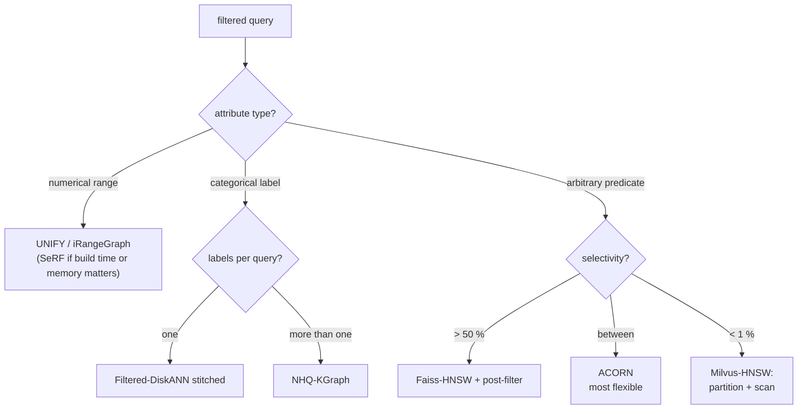

# Filtered ANN: which index survives which selectivity

`WHERE category = X AND vec NEAR q` is the query that decides whether a
vector index belongs inside a database, and it is the one the
unfiltered recall/QPS curve says nothing about. The SIGMOD 2026 survey
*Attribute Filtering in Approximate Nearest Neighbor Search: An In-depth
Experimental Study* (Li, Yan, Lu, Zhang, Cheng, Ma;
[arXiv:2508.16263](https://arxiv.org/abs/2508.16263), v2) put twelve
filtered-search methods behind one interface and measured them at four
selectivities, 0.1 %, 1 %, 10 % and 50 %. This chapter builds the
vocabulary the survey needs, reads its findings in the order a planner
would use them, and then ties them to the two measurements in this
repository: the exact over-fetch factor from `filter_bench` and the
reference HNSW's filtered-traversal numbers in `notes.md`. It assumes
[reading-hnsw-paper.md](reading-hnsw-paper.md) (layers, beam search, ef) and
[reading-qdrant-hnsw.md](reading-qdrant-hnsw.md) (where qdrant picks a
strategy by estimated cardinality).

**Provenance.** Every number below is quoted from the survey's text,
cited by section. The survey's headline results are *plots* (Figures 9–11:
QPS at 90 % recall); this chapter does not read values off those plots and
quotes only what the prose states. The survey ran on 128 physical cores
(Xeon Platinum 8358) but measured queries on one thread (§5.1). Anything
labelled "measured here" comes from code in this repository.

## The problem in one sentence

An unfiltered nearest-neighbour index is a graph whose edges were chosen for
distance alone, so a filter that removes most of the nodes either cuts the
graph into pieces the search cannot cross or forces it to fetch hundreds of
rejected candidates per accepted one — and which of those happens depends on
selectivity, on how the filter correlates with the vectors, and on whether the
index knew about the attribute when it was built.

## The concepts, step by step

### Step 1 — three attribute kinds, three orders of operation

> **In:** nothing beyond the definition of ANN search. **Out:** the
> taxonomy the survey sorts its twelve methods by, and the two words
> (selectivity, joint filtering) every later step leans on.

**Selectivity** is the fraction of the dataset that passes the filter:
50 % selectivity means half the vectors match, 0.1 % means one in a thousand.
(The survey, §1.1, calls high selectivity "many pass" — the opposite of the
colloquial "a very selective filter". This chapter follows the survey.)

The survey's first axis is the *attribute* (§1.1, Table 1):

| attribute | filter | predicate | example method |
|---|---|---|---|
| numerical | **range** | l ≤ a ≤ u | SeRF, iRangeGraph, UNIFY |
| categorical | **label** | f ∈ A (the vector's label set) | Filtered-DiskANN, NHQ |
| arbitrary | **general** | any expression | Faiss, Milvus, ACORN |

The second axis is *when* the filter runs relative to the vector search (§1.1,
Figure 2):

- **Pre-filtering** applies the filter first and searches only the survivors.
  Natural for **IVF** (an *inverted file*: k-means cells, a query scans its
  `nprobe` nearest cells), awkward for graphs, because dropping nodes drops
  edges.
- **Post-filtering** runs the unfiltered ANN search and discards non-matching
  results. It is cheap when most vectors match and expensive when few do,
  because many candidates must be thrown away.
- **Joint filtering** tests the predicate *during* the graph traversal — for
  example refusing edges into non-matching nodes — pruning paths early. The
  survey calls it "especially effective when filter selectivity is moderate".

Worked on one number, to fix the post-filtering cost before the survey's
claims lean on it: with a 1 % filter, a candidate is accepted one time in
a hundred, so returning K = 10 results needs about 10 / 0.01 = 1,000
candidates fetched. Step 5 measures this exactly.

### Step 2 — the experiment: what was measured, and what "fails" means

> **In:** Step 1's taxonomy. **Out:** the protocol the findings in Steps 3–4
> are conditional on.

Setup (§5.1): four datasets — SIFT (128-d, 10 M vectors), SpaceV (100-d, 10 M),
Redcaps (512-d, 1 M) and Youtube-RGB (1024-d, 1 M) — with synthetic or real
labels; L2 distance; 10 algorithms in 12 configurations; graph methods built
with M = 40 and ef_construction = 1000. Synthetic numerical attributes are
integers in 0–100,000 and categorical ones one of 500 values, with
selectivity set by the range bounds or by assigning a label to a fixed
fraction of vectors. Search parameters (`ef_search`, `nprobe`, …) are tuned
for **90 % recall@10** and the metric is the QPS achieved there; "missing
entries indicate failure to meet the target recall under equivalent indexing
configurations" (§5.2). Each experiment is averaged over three runs.

Two consequences for how to read everything that follows. A method that
*fails* at a selectivity did not run slowly: no setting of its search
parameter reached 90 % recall. And the survey's labels are independent of
the vectors for the headline plots (uniformly random attribute values), which
is the easy case for post-filtering and the *neutral* case for correlation —
Step 5 shows what happens when that assumption breaks.

For multi-predicate arbitrary filtering the survey composes selectivities by
multiplication under independence (§5.4): to get 50 % overall it gives
label "1" to 60 % of vectors and uses a range with 83 % selectivity, since
0.60 × 0.83 = 0.498 ≈ 50 %.

### Step 3 — the ladder: what survives each selectivity

> **In:** Step 2's protocol. **Out:** the survey's findings per selectivity,
> as the planner's table (Step 4's flowchart is built from it).

The survey's own observations (§5.2–5.4), in selectivity order:

| selectivity | what the survey reports |
|---|---|
| **50 % and above** | "even traditional methods like Faiss-HNSW achieve competitive performance"; attribute-aware indexing gives little (§5.2 obs. 3). Faiss-HNSW is "best when selectivity exceeds 50 %" for arbitrary filters (§5.4 obs. 1; §6.2). |
| **10 % and 1 %** | Range methods built on **segmented subgraphs** — UNIFY-hybrid, WST-opt, iRangeGraph, SeRF, DSG — "consistently yield the highest QPS in most test scenarios (1 % and 10 % selectivity)" because they precompute edges across all query ranges (§5.2 obs. 4). For labels, Filtered-DiskANN's stitched variant is robust but misses 90 % recall on SIFT (§5.3 obs. 1). |
| **0.1 %** | Graphs break. Faiss-HNSW with post-filtering and ACORN "often fail"; SeRF and DSG "fail at 0.1 % selectivity" (§5.2 obs. 2, 6). IVF-PQ "consistently handles 0.1 % selectivity across all datasets" (obs. 2). Milvus works because it **partitions** by the attribute, so within a partition the local selectivity is far higher, and it effectively scans: varying `ef_search` had no effect on its QPS or recall (§5.2 obs. 1, §5.4 obs. 2). |

Why IVF survives where HNSW fails, in the authors' words (§5.2 obs. 2): the
"monotonic search behavior of HNSW" — a **monotonic** search only ever moves
to closer nodes, so once it has converged on a region with no matching nodes
it cannot leave — "whereas the non-monotonic nature of IVF enables it to
explore a broader search range". An IVF scan visits whole cells whatever the
distances say, so a rare match in a probed cell is found. The trade is
throughput: Faiss-IVFPQ "generally achieves lower QPS than Faiss-HNSW".

### Step 4 — why the graphs break, and the cheap repairs

> **In:** Step 3's failures at 0.1 %. **Out:** the three mechanisms the survey
> isolates (§5.6–5.8), each with the number the text states.

**(a) Pruning that assumes every node survives.** The standard HNSW/Vamana
edge rule is **RNG pruning** (after the *relative neighbourhood graph*):
while choosing a node's neighbours, drop a candidate if it is closer to an
already-chosen neighbour than to the node itself. It makes a sparse, spread-out
graph, and is exactly the "heuristic" of HNSW Algorithm 4. The survey modifies
two methods to connect nearest neighbours directly instead (KGraph-style) and
finds that RNG pruning "preserves graph quality at moderate to high selectivity
but remains less effective in extremely selective cases" (§5.6); in SeRF the
KGraph variant improves results below 5 % selectivity "but it still fails to
perform effectively at 0.1 %". Their reading (§6, insight I2): segmented-edge
methods fail because "the initial search during index construction fails due
to the absence of valid neighbors" — at build time the search for a point's
neighbours inside a tiny attribute range finds nothing to connect to.

**(b) Hierarchy buys little.** Comparing UNIFY with a bottom-layer-only
variant, "the hierarchical structure has little impact on low-selectivity
queries, but plays a more significant role as selectivity increases" (§5.7;
insight I6: only above 50 %).

**(c) More entry points beat a hierarchy.** For single-layer indexes (SeRF,
DSG, bottom-layer UNIFY), 30 or 300 entry points beat 3 at every selectivity.
The one number the text gives: SeRF with 300 entry points gets **5.3 % higher
QPS** than with 3 at 50 % selectivity, with a 3.85 % drop in distance
**comparisons** (the survey's cost proxy, counted per query). The two are
mutually consistent only roughly — a 3.85 % cut in work buying 5.3 % in
throughput — and both are small, which is the honest summary: the gain is
real and modest.

**(d) Checking edges is a cost of its own.** DSG performs fewer comparisons
than SeRF yet has lower QPS, because it spends a large share of query time
choosing valid edges (§5.8, Figures 13–14, SIFT at 10 % selectivity). A filter
predicate evaluated per edge is not free, which is why the cost columns in
Step 5 count distance evaluations *and* predicate checks.

The survey's selection guide (§6.2, Figure 15), as a decision procedure:

### Step 5 — what this repository measures about the same ladder

> **In:** Steps 1–4, and the exact rankings from `filter_bench` (brute force
> only, no index). **Out:** the over-fetch factor per selectivity under
> three attribute/vector correlations, and the reference HNSW's behaviour on
> the same filters.

**The over-fetch factor** α(q; K) is the number of vector-ranked candidates
that must be examined before K of them satisfy the filter (Definition 3.1 of
Lim et al., PVLDB 19(10), VLDB 2026 — see the README's Step 5). It is what
post-filtering must fetch. `filter_bench` reads it directly off the exact
ordering of 100,000 × 128-d vectors, K = 10, 500 queries, with a filter that
is (i) a random subset (independent of the vectors), (ii) a window of an
attribute that is a random projection of the vector, centred on the query's
own value (**aligned** — the filter tracks the embedding, like a price range
that correlates with topic), or (iii) the same window centred half the range
away (**anti-aligned**):

| filter | s = 50 % | 10 % | 1 % | 0.1 % |
|---|---|---|---|---|
| K / s (what selectivity alone predicts) | 20 | 100 | 1,000 | 10,000 |
| independent: mean α | 19.9 | 99.1 | 958.6 | 8,527 |
| aligned: mean α | 10.2 | 34.3 | 317.5 | 6,779 |
| anti-aligned: mean α | 337.8 | 852.5 | 2,332.7 | 11,563 |

At 50 % selectivity the three filters differ by 33× (10.2 vs 337.8) with
identical selectivity, which is the point of the survey's remark that
selectivity alone does not order filtered queries by difficulty — the
README's Step 5 follows Lim et al. on this. The independent row is the
survey's own assumption and it tracks K/s to within 15 %.

The reference HNSW (M = 16, ef_construction = 128; recorded in `notes.md`)
on the independent filter shows the survey's 0.1 % failure as numbers: a
traversal that refuses non-matching nodes drops from recall 0.999 at
50 % to 0.566 at 10 %, 0.018 at 1 % and 0.002 at 0.1 %, while one that
*scores through* non-matching nodes and admits only matches keeps recall
≥ 0.996 at every selectivity but pays in distance evaluations — 592, 3,438,
26,058 and 99,880 per query, against a plain scan of the matching rows at
50,000, 10,000, 1,000 and 100. The crossover where scanning beats
traversal sits between 10 % and 1 %, the zone where the survey's winners
switch from graph methods to partitioned scans.

## How to read the paper (with the concepts in hand)

| paper | step | what to extract |
|---|---|---|
| §1.1, Table 1, Figure 2 | 1 | attribute types; pre / post / joint filtering |
| §3, Figure 4, Table 3 | 1 | the taxonomy of the twelve methods |
| §5.1 | 2 | datasets, M = 40 / ef_construction = 1000, 90 % recall@10, one query thread |
| §5.2 observations 1–6 | 3 | the range-filter ladder, with the monotonic-search explanation |
| §5.3, §5.4 | 3 | label and arbitrary filtering; the 60 % × 83 % construction |
| §5.6 | 4 | RNG vs KGraph pruning, ACORN and SeRF variants |
| §5.7 | 4 | hierarchy vs entry points; the 5.3 % / 3.85 % example |
| §5.8 | 4 | edge-filtering time share |
| §6, Figure 15 | 4 | insights I1–I7 and the selection guide |

## Questions (answer in notes.md)

1. A 1 % independent filter, K = 10: how many candidates must a post-filter
   fetch (use the table in Step 5), and what ef does that imply for HNSW?
2. Why does a monotonic graph search fail at 0.1 % where an IVF scan does not,
   in terms of what each does when the closest region contains no match?
3. The survey tests only attribute values independent of the vectors. Using the
   aligned / anti-aligned rows, say which regime is harder for post-filtering at
   50 % and by how much.
4. Segmented-edge methods fail "because the initial search during index
   construction fails". Describe what that search looks like for a 0.1 % range
   and why the graph ends up with no useful edges for it.
5. Where does your M14 filter planner switch from traversal to scan? Which of
   the two measurements (`filter_bench` α, reference evals) would you use to
   set the threshold, and what does it ignore?

## Done when

Answer each before unfolding it.

- [ ] You can state the three filter strategies and what each costs when selectivity falls.
  

Answer

  Pre-filtering restricts the search to survivors first: cheap when the
  survivor set is small, but on a graph it removes edges and can disconnect
  the search. Post-filtering searches unfiltered and discards non-matches:
  free at high selectivity, but its fetch size grows like K/s, so at 1 %
  and K = 10 it needs about 1,000 candidates (measured mean α = 958.6 on
  independent labels). Joint filtering tests the predicate during traversal,
  pruning paths early: "especially effective when filter selectivity is
  moderate" (§1.1), and it is the family that breaks at 0.1 % (§5.2).

  

- [ ] You can explain why HNSW-style search fails at 0.1 % selectivity and IVF does not.
  

Answer

  §5.2 observation 2 attributes it to monotonic search: HNSW only moves to
  closer nodes, so once it converges on the neighbourhood of the query and no
  matching node lies there, it has no move that leads to one. IVF scans every
  vector in each probed cell regardless of distance order, so a rare matching
  vector in a probed cell is found; it pays in lower QPS. Milvus goes further
  and partitions by the attribute so the local selectivity inside a
  partition is high, which is why varying `ef_search` did not change its
  result (§5.4 observation 2): it is scanning.

  

- [ ] You can say what the survey found about pruning, hierarchy and entry points, with the one number it gives.
  

Answer

  RNG pruning keeps graph quality at moderate-to-high selectivity but
  "remains less effective in extremely selective cases" (§5.6); the
  hierarchy matters only at high selectivity, above 50 % (§5.7, insight I6);
  more bottom-layer entry points help at every selectivity, e.g. SeRF with 300
  entry points has 5.3 % more QPS than with 3 at 50 % selectivity, with 3.85 %
  fewer comparisons (§5.7). The gain is modest; the text states no larger
  figure.

  

- [ ] You can show, from the measured table, that selectivity does not order filtered queries by difficulty.
  

Answer

  At s = 50 % the exact over-fetch factor is 10.2 for the aligned filter,
  19.9 for the independent one and 337.8 for the anti-aligned one — a 33×
  spread at identical selectivity, because α depends on where the matching
  vectors sit relative to the query, not only on how many there are. The
  independent row tracks K/s (19.9 vs 20; 958.6 vs 1,000 at 1 %), which is why
  benchmarks that draw attributes independently of the vectors make
  selectivity look like a sufficient predictor.

  

## References

- Li, Yan, Lu, Zhang, Cheng, Ma. *Attribute Filtering in Approximate Nearest
  Neighbor Search: An In-depth Experimental Study.* SIGMOD 2026.
  [arXiv:2508.16263](https://arxiv.org/abs/2508.16263) (v2, 20 Sep 2025).
  Code: <https://github.com/lmccccc/FANNBench>.
- Lim, Kim, Kim, Do. *Revisiting Filtered ANN Benchmarks: A
  Hardness-Controlled Benchmark Generator for Realistic Evaluation.* PVLDB
  19(10), 2026. [arXiv:2606.14193](https://arxiv.org/abs/2606.14193).
- This repository: `experiments/src/bin/filter_bench.rs` (exact α) and the
  "Reference numbers for the exercise lanes" section of `notes.md`.
