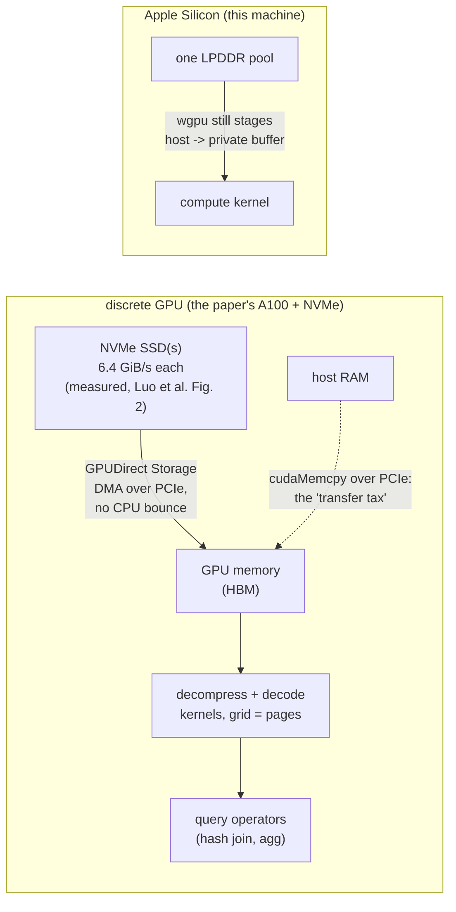

# Topic 18 — GPU Acceleration for Databases

When is the transfer tax worth paying? Topic 17 bought lanes; a GPU
buys thousands of them — behind a bus. On this machine (Apple
Silicon) the "bus" is unified memory, which changes the answer in
ways the experiments measure directly.

## 1. GPU architecture for DB people

```
 CPU core:  wide OoO, ~5 GHz, caches hide latency PER THREAD
 GPU SM:    32-lane warps (SIMT), latency hidden by OVERSUBSCRIPTION
            — thousands of resident threads; when a warp stalls on
            memory, another issues. Occupancy = how many can be
            resident (limited by registers + shared memory per SM).

 branch divergence: both sides of an if execute, lanes masked
   → SIMT is topic 17's predication done by hardware, per warp
 memory coalescing: a warp's 32 loads become ONE transaction iff
   adjacent lanes touch adjacent addresses
   → the GPU word for topic 12's columnar layout argument
 shared memory: ~100 KB/SM software-managed scratchpad
   → the GPU word for topic 13's cache blocking
```

Every GPU-DB trick is one of: coalesce (layout), stay resident
(occupancy), amortize atomics (reduce first), or avoid the bus.

## 2. The bus decides the architecture

```
 discrete GPU:  device HBM  400-3000 GB/s   ← kernels feast
                PCIe 4/5     32-64  GB/s    ← queries starve
                NVLink       ~900   GB/s    ← the expensive fix
 Apple Silicon: unified LPDDR, one pool, ~150-400 GB/s shared
                no copy needed IN PRINCIPLE — but wgpu still
                stages through private buffers (our measured
                "upload" cost is real)
```

Crystal (SIGMOD '20)'s rule of thumb: a discrete GPU beats the CPU
on a scan-heavy query only if the working set LIVES on the device
(the "data resident" assumption); shipping data per query loses to
the CPU at PCIe speeds. Corollary the paper works out: GPU as
accelerator-of-operators fails; GPU as primary-store-with-CPU-fallback
works. Our gpu_bench reproduces the miniature version.

Sirius (Yogatama, Yang, Kristensen, Sarda, Kim, Cockcroft, Teng,
Patterson, Kimball, McKinney, Gong, Yu, *Rethinking Analytical
Processing in the GPU Era*, CIDR 2026,
[pdf](https://www.cidrdb.org/cidr2026/papers/p12-yogatama.pdf)) is
the data-resident assumption stated as a product's operating mode.
The paper argues the old barriers (small device memory, PCIe, cost,
engineering effort) have weakened, and builds a GPU-native engine
that takes a Substrait plan from a host system — DuckDB on one node,
Apache Doris distributed — and executes it with libcudf operators,
leaving parsing and optimization on the CPU (§3). On TPC-H, Sirius on
a GH200 rented at $1.5/hour runs 8.3× faster than DuckDB on a CPU
instance with the same hourly price (§4.2, Fig. 4) — measured on hot
runs with the data already cached in GPU memory, half of which is
reserved as that cache (§4.1). The per-query breakdown shows joins
dominating, which is §4's libcudf hash join doing the work.

Sirius keeps the data in GPU memory; the opposite end of the same bus is a
GPU that must *read the file*. Luo, Chen, Binnig (*Do GPUs Really Need New
Tabular File Formats?*, DaMoN '26, [arXiv:2602.17335](https://arxiv.org/abs/2602.17335))
measure cuDF scanning Parquet from local NVMe SSDs straight into an A100's
memory with GPUDirect Storage, so the PCIe hop above is carrying *file* bytes.
With the file rewritten for the GPU (many pages per column chunk so the decode
kernels fill the grid, multi-million-row row groups so each read is MiB-scale,
per-chunk encoding choice, compression only when it pays) they report 125
GiB/s of **effective** bandwidth on TPC-H SF300 `lineitem` with four SSDs
(Fig. 1) — logical bytes after decode divided by scan time, not a bus rate.
Their own figures bound it: one SSD saturates at 6.4 GiB/s (Fig. 2), four at
25.6 GiB/s, and 25.6 × 5.3 (the compression ratio Fig. 3 annotates) = 135.7
GiB/s, an upper bound the reported 125 sits just under. The storage bus, not the 400-3000 GB/s of
HBM, sets the scan rate, so the lever is *fewer bytes per row*
([topic 12](../12-columnar-analytics/README.md) §4); and the paper's other half
is overlap — decode and the query operator for row group *k* run while row
group *k+1* is read (§4.1, Fig. 4) — the hide-the-transfer rule.

### The transfer path, drawn



The left subgraph is where the bytes are *scarce* (storage and PCIe, tens of
GB/s); the right is where they are not, and the fixed ~1.5 ms dispatch cost of
section 3 dominates instead.

## 3. Measured on this machine (Apple M3 Pro, wgpu/Metal)

```
 sum of n f32 — CPU 8-acc autovec vs GPU workgroup reduction:
 n=16K    CPU     2 µs   GPU 1619 µs    ← ~1.5 ms FIXED dispatch cost
 n=4M     CPU   589 µs   GPU 4555 µs
 n=16M    CPU  2258 µs   GPU 14333 µs   ← no crossover, ever
```

A memory-bound reduction never wins on the GPU here: both processors
see the SAME memory, so the GPU's only edge is FLOPs it doesn't need,
and it pays ~1.5 ms of encode/submit/poll overhead per dispatch.
The lesson is NOT "GPU slow" — it's that arithmetic intensity
(FLOPs/byte) decides: sum is 0.25 FLOP/byte; l2_batch at dim=128 is
~64 FLOP/byte-of-query. The stubs exist to find where the flip
happens.

## 4. GPU joins & aggregation (libcudf)

- Hash join: build with cuco (RAPIDS' cuckoo/open-addressing GPU
  hash tables), probe with COOPERATIVE GROUPS — a warp probes
  together (cudf join/hash_join/, distinct_hash_join.cu) — then a
  two-phase size/retrieve pattern (inner_join_size.cu before
  inner_join_retrieve.cu): count matches first, allocate exactly,
  fill second. GPU code can't `Vec::push` — every output needs its
  size known or an atomic cursor. The CPU counterpart of this hash join, with the shared-table vs partitioned trade-off measured, is [topic 54](../54-join-algorithms/README.md).
- Group-by: shared-memory aggregation per block when cardinality
  fits (groupby/hash/compute_shared_memory_aggs.cu). It does *not*
  spill: `compute_single_pass_aggs.cuh:95-122` sets a device
  `atomic_flag` when a block overflows, copies it to the host,
  synchronizes, and re-runs the **whole** aggregation in global
  memory — all-or-nothing, decided on the host. Topic 11's two-phase
  partial aggregation, forced by the memory hierarchy.

## 5. GPU graph processing (Gunrock) & ANN (CAGRA)

- Gunrock: BFS = frontier ADVANCE (expand neighbors) + FILTER
  (dedupe/validate) operators; the whole research area is load
  balancing ragged adjacency lists across warps (thread_mapped /
  block_mapped / merge_path in operators/advance/).
- The same load-balancing problem governs GPU subgraph matching
  (topic 13's pattern matching), where the ragged unit is a partial
  match instead of a frontier vertex. Depth-first GPU matchers give
  each warp one partial match and pre-allocate a stack of size
  proportional to query size × maximum degree per warp, which runs
  out of memory on skewed graphs, and they leave most of a 32-lane
  warp idle whenever the candidate set is small — which after
  filtering it usually is (§1). gMatch (Chen, Sun, Chen, Hu, Hu, Guo,
  *gMatch: Fine-Grained and Hardware-Efficient Subgraph Matching on
  GPUs*, PVLDB 19(8), VLDB 2026,
  [arXiv](https://arxiv.org/abs/2604.10601)) makes the task
  finer-grained so the execution stack fits in shared memory,
  explores candidates in warp-level batches, and balances load by
  first generating a large pool of partial matches so work stealing
  is rarely needed (§3–4). On an RTX 4090 it averages 36.58× over
  EGSM on the gw dataset and 20.23× on db (§6.2, Fig. 9); it is also
  the only method in the comparison that completes every query on
  every dataset, while the pattern-mining systems BEEP and G2 Miner
  are faster on small datasets (abstract, §6.2).
- cuGraph is Gunrock's production sibling — same RAPIDS/CUDA
  substrate, packaged as a batteries-included algorithm library;
  pygraphistry sits one layer up as a Python client doing GPU ETL
  (cuDF) + a query surface (GFQL) + visualization over cuGraph/graph
  DBs — the "whole pipeline" view this topic's kernels are one stage
  of.
- CAGRA (cuVS): HNSW rebuilt for SIMT — a flat degree-regular graph
  (no levels), searched by MANY parallel greedy walks with a shared
  visited hashmap in shared memory; one CTA per query
  (search_single_cta_kernel.cuh). Graph traversal made regular
  enough for warps.

## 6. Programming models

| model | reach | why it matters here |
|---|---|---|
| CUDA | NVIDIA only | where all the DB literature lives |
| Metal | Apple only | what actually runs on this Mac |
| wgpu/WebGPU | everywhere | our experiments: WGSL → Metal/Vulkan/DX12 |
| Mojo/MLIR | CPU SIMD + GPU | topic 17's parametric width, extended to the device axis |

## Experiments (`experiments/`)

wgpu compute on Metal. PROVIDED: `GpuCtx` + working sum-reduction
kernel (`shaders/sum.wgsl` — coalesced strided loads, shared-memory
tree reduction) with per-phase timings, `gpu_bench` crossover sweep
(runs now, prints the table in §3). YOURS:

1. `filter_count` — WGSL skeleton provided: fold per-thread, reduce
   per-workgroup, ONE `atomicAdd` per group. Test: exact vs CPU.
2. `l2_batch` — one invocation per target; row-major first, then
   transpose and measure the coalescing gap. Test: 1e-3 relative.
3. Fill the crossover table in notes.md — l2_batch at dim 128 ×
   100K targets is where the GPU should finally win. Verify.
4. Stretch (M18/M20 bridge): BFS as SpMV over a bitmap frontier in
   WGSL vs SuiteSparse CPU.

## Reading guides

| guide | chapter |
|---|---|
| [reading-crystal-sigmod20.md](reading-crystal-sigmod20.md) | GPU vs CPU for analytics: two regimes, two verdicts |
| [reading-wgpu-compute.md](reading-wgpu-compute.md) | wgpu compute: the 1.5 ms tax before your first FLOP |
| [reading-libcudf.md](reading-libcudf.md) | libcudf: GPU kernels can't push |
| [reading-gunrock.md](reading-gunrock.md) | Gunrock: advance, filter, and the ragged-frontier problem |
| [reading-cagra.md](reading-cagra.md) | CAGRA: HNSW rebuilt for warps |
| [reading-faiss-gpu.md](reading-faiss-gpu.md) | Faiss GPU: k-select that never leaves registers |

## Capstone M18

- [ ] experimental GPU backend for ONE hot path (vector distance
      scoring is the honest candidate — M14's rescore loop) behind
      a feature flag
- [ ] CPU-vs-GPU crossover bench INCLUDING transfer, per batch size
      — the go/no-go artifact
- [ ] document the verdict: on unified memory, which engine ops
      clear the arithmetic-intensity bar? (expect: almost none —
      record WHY, that's the deliverable)
