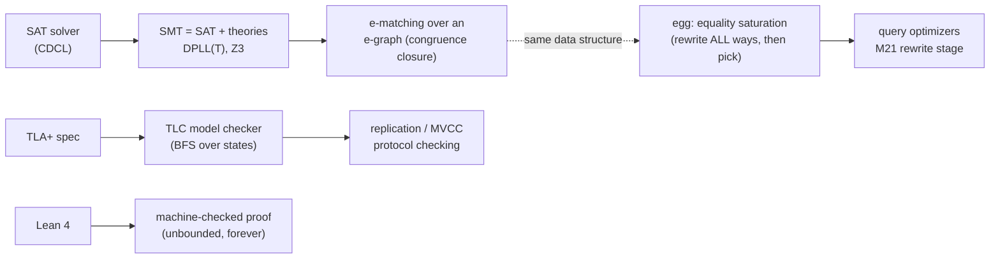
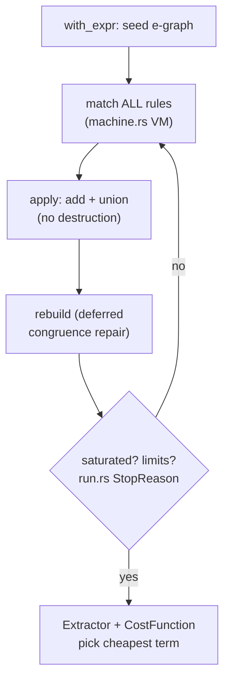

# Topic 21 — Formal Methods & Verification

Testing (topic 16) finds bugs you imagined; formal methods find the
ones you didn't. This topic covers the three tools that actually get
used in databases — TLA+ (model checking protocols), e-graphs
(equality saturation for optimizers), SMT (Z3) — plus Lean 4 for the
proof end of the spectrum.

```
                 what it checks         effort    used by
  fuzz/PBT (16)  behaviors you generate  hours    everyone
  TLA+ / TLC     ALL behaviors of a      days     AWS, MongoDB,
                 finite model                     CockroachDB
  SMT (Z3)       one logical formula     mins     query verifiers
                 (validity/satisfiab.)            (Cosette), symex
  Lean 4 proof   the actual theorem,     weeks    seL4-style kernels,
                 unbounded                        mathlib
```



## The problem, measured (bench lane 1, provided — runs today)

`cargo run --release --bin eqsat_bench` — a hand-ordered rewriter on the
canonical trap expression `(a*2)/2`, then on random trees:

```
-- the ordering trap: (a*2)/2 --
hand: cost 5 (1 firing, 11.9 µs) — Div(Shl(Var("a"), Num(1)), Num(2))

-- random exprs, 20 seeds per depth --
depth   in cost   hand cost   hand µs   firings
    4        31          21       4.3         4
    6       127          90      17.3        15
    8       511         355     102.1        61
   10      2047        1390     420.7       248
```

**The answer to `(a*2)/2` is `a`. The hand-ordered rewriter returns
`(a << 1) / 2`, cost 5, and stops.** It is not buggy and it did not run out of
rules — it applied a locally excellent rewrite (`*2` → `<<1`, a real strength
reduction) which destroyed the syntactic shape that the cancellation rule was
waiting for. One firing, then a local optimum, forever.

That is the entire motivation for equality saturation, and it is why the sweep
matters too: hand rewriting only removes about 32% of the cost at every depth
(2047 → 1390 at depth 10), consistently, because the same class of ordering
accident keeps happening. An e-graph does not choose an order — it keeps *all*
the equivalent forms and extracts the cheapest at the end, which is why the egg
column exists and why "phase ordering" is a compiler problem with a data
structure for an answer rather than a heuristic for one.

### How often does fixed order fail, and what does saturation cost? (lane 1b)

`cargo run --release --bin normalise_bench` — the same hand rewriter against an
e-graph holding the *same* rules unordered (nine rewrites plus a
constant-folding analysis; 12 iterations or 20 000 e-nodes, whichever first),
over 200 seeded random expressions per depth. An expression is **failed to
normalise** when the hand rewriter's fixpoint costs more than the cheapest term
the e-graph reached. It does not call `src/eqsat.rs`, so it runs on a fresh
clone and the exercise stays an exercise.

```
depth      in |      hand hand-R4-1   egg min |  hand fails  swap fails | saturat. max enodes | stop reasons
    2     7.0 |       5.7       5.7       5.6 |     4/200       4/200   |      194         64 | IterationLimit(12)=6 Saturated=194
    3    15.0 |      12.2      12.2      11.8 |     9/200       9/200   |      187        320 | IterationLimit(12)=13 Saturated=187
    4    31.0 |      24.1      24.1      23.1 |    23/200      23/200   |      177       1836 | IterationLimit(12)=23 Saturated=177
    5    63.0 |      48.6      48.6      43.1 |    63/200      63/200   |      144       2569 | IterationLimit(12)=56 Saturated=144
    6   127.0 |      95.1      95.1      73.9 |   118/200     118/200   |       98       4750 | IterationLimit(12)=102 Saturated=98

rule-order control: swapping R4 ahead of R2 changed the rewriter's output on 0 of 1000 expressions
  and on the trap (a*2)/2 it still returns cost 5

-- e-graph growth per iteration (depth 4, mean e-nodes over 20 seeds) --
 iter  seed     1     2     3     4     5     6     7     8     9    10    11    12
 e-nodes 31.0  21.6  36.0  40.9  44.0  47.2  50.1  53.6  58.6  66.8  81.2 107.8 120.2
```

**The failure rate climbs with expression size: 2% at depth 2, 4.5% at depth 3,
11.5% at depth 4, 31.5% at depth 5, 59% at depth 6** (4, 9, 23, 63, 118 of 200).
A larger tree has more places for a locally good rewrite to destroy a shape a
later rule needed, so the chance that *some* node falls into a trap grows with
size — and the hand rewriter leaves 95.1 / 73.9 = 1.29× the cost of the
cheapest reachable form at depth 6. Every count is exact and reproduces
(seeded generator, no hash-order dependence).

Three things the table says that the `(a*2)/2` line does not:

- **Reordering the rules does not rescue a fixed-order rewriter.** The control
  moves division reassociation (R4) ahead of strength reduction (R2) and changes
  the output on **0 of 1000** expressions; the trap still returns cost 5. The
  reason is the traversal, not the list: the rewriter works bottom-up, so the
  `Mul` child is visited and turned into a shift before its `Div` parent is ever
  looked at, whatever order the rules are tried in at each node. The fix has to
  be "keep both forms", not "try a better order".
- **Saturation does not always finish.** With commutativity in the rule set the
  e-graph stops at the 12-iteration cap on 102 of 200 depth-6 expressions
  (Saturated = 98), so "egg min" there is the best form found, an upper bound on
  the true optimum, and the failure counts at depth 5–6 are lower bounds. The
  growth rows show why: depth-4 graphs grow 1.06–1.14× per iteration for eight
  rounds, then accelerate (1.22×, 1.33×) as reassociation and commutativity
  compose. Topic 44 measures what an iteration *costs* (matching work, in the
  same e-node unit); this lane measures how large the graph is allowed to get.
  Note the first step goes *down* (31.0 → 21.6): the seed counts tree nodes, the
  e-graph counts distinct e-nodes after hashconsing, and random trees repeat
  small subterms.
- **The unsound rule shows up.** `x/x → 1` assumes `x ≠ 0` (hand.rs R5 has the
  same assumption), and after `x*0 → 0` the analysis sees a class proved both 0
  and 1 — 1090 times across the 1000 expressions. The lane keeps the first value
  and prints the count; soundness is not what this table measures, but it is the caveat to carry into
  any optimizer rule that divides.

## 1. E-graphs: the data structure

An e-graph = union-find over e-classes + hashcons (memo) + congruence
closure. It stores a **set of terms closed under equivalence**,
compactly: `2*x` and `x<<1` live in the same e-class, and every
parent of that class automatically has both forms.

```
  e-class {a*2, a<<1}          union-find: id → canonical id
       /        \              hashcons:  node → e-class id
   e-class{a}  e-class{2,1<<0?}   (topic 8's hash table, again)
```

Three ops (egg `src/egraph.rs`):
- `add` (:970) — hashcons hit or new singleton class
- `union` (:1147) — union-find merge; repair is DEFERRED
- `rebuild` (:1416) — restore congruence invariant in one batched
  pass (`process_unions` :1346 re-canonicalizes and re-unions until
  fixpoint). Deferring this is egg's headline contribution — the
  same amortize-the-repair move as delta matrices' `wait` (topic 20)
  and LSM compaction (topic 4).

## 2. Equality saturation vs hand-ordered rules

Topic 10's optimizer applies rules in a fixed order, destructively.
Order is a silent correctness-of-outcome bug:

```
        (a*2)/2
  hand (ordered):  strength-reduce FIRST → (a<<1)/2 … stuck, cost 5
  egg (saturate):  keep BOTH forms; (x*y)/z→x*(y/z) still matches
                   → a*(2/2) → a*1 → a, cost 1
```



The catch: the e-graph can blow up (assoc+comm rules alone are
exponential), so `Runner` has node/iter/time limits — saturation is
best-effort, extraction is greedy per-class. This is a *search
budget*, the same shape as topic 10's join-order DP cutoff.

## 3. TLA+ — spec the scary parts

`specs/WalReplication.tla` models topic 15's WAL shipping: sequential
entries, prefix logs (so a log is just a length), quorum commit,
crash, longest-log failover. TLC exhaustively checks every
interleaving of a 3-replica, 3-entry model:

| config | states (distinct) | result |
|---|---|---|
| `SyncCommit = TRUE` | 2583 (1080), depth 14 | **Durability holds** |
| `SyncCommit = FALSE` | 183 (123), depth 5 | **violated at depth 5** |

The counterexample TLC prints is the exact PostgreSQL
`synchronous_commit = off` data-loss story: Append → Commit (no
quorum) → Crash(primary) → Failover(empty log) — committed=1, new
primary has nothing. Five states. No test generator finds this
*guaranteed*; TLC does, in under a second.

Run it: `java -cp ~/repos/tla2tools.jar tlc2.TLC -deadlock
WalReplication.tla` (flip `SyncCommit` in the .cfg to see the trace).

## 4. Z3 — SMT in one paragraph

A SAT core with two-watch literals, lemma learning from conflict
clauses, phase caching and non-chronological backtracking (TACAS'08's
own list) plus theory solvers (linear arithmetic, arrays, uninterpreted
functions); quantifiers via e-matching **over a congruence-closure
e-graph** — the same structure as egg, built for search instead of
rewriting. Note what the paper does *not* say: it names Nelson–Oppen
only as the traditional method Z3 **avoids**, in favour of model-based
theory combination (its ref [5]), and "DPLL(T)" appears exactly once,
under relevancy propagation. Z3's modern e-graph
(`src/ast/euf/euf_egraph.h:22-23`) mentions egg, but carefully: the
worklist "is in reality inherited from the legacy SMT solver. It is
*claimed* to have the same effect as delayed congruence table
reconstruction from egg." Databases meet Z3 in query equivalence
checking (Cosette, topic 16) and symbolic execution of UDFs.

A general solver also leaves performance on the table, and isolation
checking shows how much a domain encoding recovers. **Fast Verification
of Strong Database Isolation** (VeriStrong — Zhiheng Cai, Si Liu,
Hengfeng Wei, Yuxing Chen, Anqun Pan; PVLDB 19(4), 2025, VLDB 2026;
[paper](https://www.vldb.org/pvldb/vol19/p563-wei.pdf) ·
[extended version](https://arxiv.org/abs/2511.14067) ·
[code](https://github.com/CzxingcHen/VeriStrong)) starts from the
reduction of serializability checking to "pick a version order that keeps
the dependency graph acyclic", which the baseline hands to MonoSAT (§4).
VeriStrong, built on MiniSat, adds two database-specific changes: it
pre-encodes the 2-transaction cycles that dominate conflicts in every
benchmark it measured (§5.1, §6.1), and it picks branch polarity from a
pseudo-topological order derived from known session and read-from edges
instead of blindly (§6.2) — the "phase caching" of the SAT core above,
replaced by a domain heuristic. With 16k transactions it reports up to a
4.4x speedup even over GPU-accelerated Cobra (§7.2.2, Fig. 11). Topic 8's
README covers what it checks; here, read it as an SMT encoding to compare
with [`reading-z3-tacas08.md`](reading-z3-tacas08.md).

## 5. Lean 4 — proofs, and a runtime worth reading

Proofs are unbounded (no MaxLog=3), but cost weeks not days. Lean's
own runtime is a systems story: **Counting Immutable Beans** (Ullrich &
de Moura, IFL 2019) reference counting with reuse tokens gives
functional-but-in-place updates — an RC design directly relevant to any
Rust engine tempted by `Arc` everywhere. Perceus is Koka's descendant of
it, and says so: its §5 is "closely based on the reference counting
algorithm in the Lean theorem prover as described by Ullrich and
de Moura".
M21 taste: prove one delta-matrix invariant (`DP ∩ M = ∅` preserved
by set/remove) in Lean, and compare with the same property as a
proptest (topic 16).

## Reading guides

- [reading-aws-cacm15.md](reading-aws-cacm15.md) — Why AWS writes TLA+: exhaustively testable pseudo-code
- [reading-egg-popl21.md](reading-egg-popl21.md) — egg: equality saturation with deferred rebuilding
- [reading-z3-tacas08.md](reading-z3-tacas08.md) — Z3: SAT plus theories, with an e-graph at the core
- [reading-tlaplus-raft.md](reading-tlaplus-raft.md) — A spec is a state machine: TLA+ through raft.tla
- [reading-lean-perceus.md](reading-lean-perceus.md) — Perceus: reference counting precise enough to reuse memory

## Experiments

| file | status | what it shows |
|---|---|---|
| `expr.rs` | provided | tiny expression IR + AstSize cost + random gen |
| `hand.rs` | provided | ordered fixpoint rewriter with the R2-before-R4 trap |
| `eqsat.rs` | **stub** | `egg_optimize` — saturate, extract, beat the trap |
| `bin/eqsat_bench.rs` | provided | trap case + depth sweep, hand vs egg lanes |
| `bin/normalise_bench.rs` | provided | failure rate of the fixed-order rewriter vs an e-graph oracle, rule-order control, e-graph growth per iteration |
| `specs/WalReplication.tla` | provided | quorum-commit WAL replication, TLC-checked |

## M21 checklist

- [ ] TLA+ spec of capstone MVCC visibility (or reuse WalReplication
      for the replication layer) checked by TLC in CI (a `java -cp
      tla2tools.jar` step — seconds at model scale)
- [ ] Lean proof of one delta-matrix invariant
- [ ] optional: egg-based rewrite stage in the planner, budgeted
      (node limit) and gated like topic 19's JIT threshold
