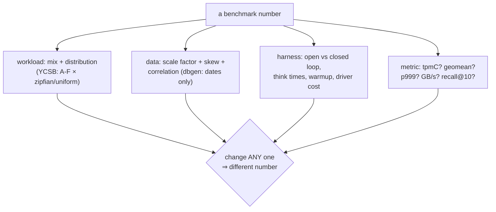

# Topic 22 — Standard Benchmarks: TPC-H, TPC-C, YCSB, LDBC & Friends

Benchmarks are engineering tools only if you know *what each query
actually stresses*. This topic maps the standard suites to their
choke points, builds the two most-copied pieces of benchmark
machinery (the YCSB Zipfian generator, TPC-H Q1/Q6), and sets up
M22's standing regression suite.

## The map

```
            OLTP ◄──────────────────────────► OLAP
  TPC-C  YCSB   TATP  SmallBank │ SSB  TPC-H  TPC-DS  ClickBench
  (txn    (KV                   │ (star (choke (100+q,  (one wide
  contention) mixes×skew)       │ schema) points) skew)   table)
                                │
  graph: LDBC SNB interactive (OLTP-ish) / BI (OLAP) / Graphalytics
  vector: ann-benchmarks (recall vs QPS — topic 14)
  real cardinalities: JOB (topic 10 — built because TPC-H is uniform)
```



## Choke points, one line each

- **TPC-H Q1**: tiny group domain (Boncz's CP1.3, Small Group-By Keys)
  ⇒ hash table free ⇒ pure expression eval + fused agg (our `q1_flat`
  makes it explicit).
- **TPC-H Q6**: 2%-selective scan ⇒ SIMD predicates, the "GB/s"
  headline query (our `q6_branchless`, topic 17's filter shapes).
- **TPC-H Q9**: 6-way join order + LIKE '%green%' + skew — the
  optimizer punisher (topic 10).
- **TPC-C**: the D_NEXT_O_ID hot counter + 1% remote warehouses +
  think times nobody runs — contention by design, not throughput.
- **YCSB**: mix × distribution factoring; θ=0.99 zipfian is the
  whole personality (see the generator math in the reading guide).
- **LDBC SNB**: correlated power-law datagen + choke points for
  graphs (topic 13's guide) — M22's centerpiece.

## How each suite is built to hurt

A benchmark is a set of decisions about *what to make expensive*. The
choke-point list above says which operators each TPC-H query leans on;
this section says what the other suites decided, with every figure read
from the specification or the paper it came from.

### TPC-C: the throughput ceiling is arithmetic, not hardware

TPC-C (Revision 5.11) emulates a wholesale supplier: each **warehouse**
covers 10 districts, each district serves 3,000 customers, and every
warehouse stocks the same 100,000 items (Clause 1). Five transaction types
run against it, driven by **terminals** — emulated users who type an
input (a **keying time**), submit it, read the answer (a **think time**),
and repeat. The spec fixes the waits and the response-time budget per type
(Clause 5.2.5.7):

| transaction | minimum share of the mix | keying time | 90th-percentile response limit | minimum mean think time |
|---|---|---|---|---|
| New-Order | — (the remainder) | 18 s | 5 s | 12 s |
| Payment | 43 % | 3 s | 5 s | 12 s |
| Order-Status | 4 % | 2 s | 5 s | 10 s |
| Delivery | 4 % | 2 s | 5 s | 5 s |
| Stock-Level | 4 % | 2 s | 20 s | 5 s |

The headline metric **tpmC** counts New-Order transactions completed per
minute. Each warehouse has exactly 10 terminals (Clause 4.2.2), so
throughput cannot be raised by driving the same data harder — only by
adding warehouses. Clause 4.1.3 states the resulting ceiling as 12.86
tpmC per warehouse, reached "with infinitely fast transactions". It is
reproducible from the table: if the four small types sit at their minimum
shares, New-Order is 100 − (43 + 4 + 4 + 4) = 45 % of the mix, and one
terminal's average cycle (keying + think, with zero response time) is

0.45·(18+12) + 0.43·(3+12) + 0.04·(2+10) + 0.04·(2+5) + 0.04·(2+5)
= 13.5 + 6.45 + 0.48 + 0.28 + 0.28 = 20.99 s.

That is 60 / 20.99 = 2.859 transactions per terminal per minute, of which
45 % are New-Orders: 1.286 tpmC per terminal, × 10 terminals =
**12.86 tpmC per warehouse**. The same clause forbids reporting fewer
than 9 tpmC per configured warehouse (70 % of that ceiling). The
consequence for engine work: a TPC-C result at 1,000 warehouses is at
most 12,860 New-Orders per minute — about 214 per second — however fast
the engine is, so a "TPC-C" run without the waits is a different
benchmark. What the benchmark *does* stress is contention, by
construction: 1 % of New-Orders roll back on an unused item number
(Clause 2.4.1.4), 1 % of order lines are supplied from a remote warehouse
(2.4.1.5), and 15 % of Payments pay for a customer of a remote warehouse,
60 % of customers being selected by last name rather than id (2.5.1.2).

### JOB: real data, correlated on purpose

The **Join Order Benchmark** (Leis et al., *How Good Are Query
Optimizers, Really?*, PVLDB 9(3), 2015) exists because TPC-H's uniform,
independent columns let any cardinality estimator look good. It runs
113 analytical SQL queries over the real IMDB database — a May 2013
snapshot of 21 tables, 3.6 GB as CSV, the largest being `cast_info` at
36 M rows and `movie_info` at 15 M (§2.1). The 113 queries are 33 query
structures with 2–6 selection variants each, and have between 3 and 16
joins, 8 on average (§2.2). The variants matter: the same join graph with
different base-table predicates has a different optimal plan, "sometimes
by orders of magnitude" in runtime. It is a benchmark of the *optimizer*
(topic 10), not of the executor, and it is the template for a graph
analogue: correlated, skewed real data plus queries that differ only in
selectivity.

### LDBC SNB: a social network, two workloads, one rule about lateness

The **LDBC Social Network Benchmark** (specification v2.2.4) has two
workloads on the same generated social-network graph (abstract). The
**Interactive** workload is transactional: complex reads IC 1–14, short
reads IS 1–7 (chapter 6; v2 revises some, e.g. IC 14v2), and update
operations. The **Business Intelligence**
workload is analytical: BI 1–20. Size is the **scale factor** (SF), the
ASCII size in GiB of the generated CSV: SF1 is 1 GiB, SF100 is 100 GiB
(§3.4.1). Two scoring rules are worth stealing:

- Interactive replays operations on a schedule whose pace is set by a
  **time compression ratio**, and a run is valid only if 95 % of
  operations start on time, meaning within 1 second of their scheduled
  start (§7.4). A closed-loop driver would never notice falling behind; this
  one fails the run. It is the coordinated-omission fix built into the
  rules, and per-operation min / mean / P50 / P90 / P95 / P99 reporting is
  mandatory.
- BI scores a **power** run with a geometric mean, as TPC-H does, so that
  there is "an incentive to improve all queries, no matter their running
  time", and a **throughput** run separately; both also come in a
  price-adjusted form (§9.5.4).

Appendix A of the spec maps every query to its **choke points** — the same
device as Boncz's TPC-H analysis, now including graph-specific ones (for
example CP-7.6, cheapest path-finding). That table is the capstone's
shopping list for M22.

### ClickBench: one flat table, geometric mean with a floor

**ClickBench** (ClickHouse; the repository README is the specification) is
the opposite design: a single flat `hits` table of exactly 99,997,497 rows
derived from real web-analytics traffic, and 43 queries on it
("Realism", "Limitations"). Every query runs three times; the first is the
**cold run**, the better of the second and third is the **hot run**. The
summary rating is built to be hard to game:

1. per query, the baseline is the *fastest* result of any system;
2. each system's ratio is (10 ms + t) / (10 ms + t_best) — the 10 ms
   constant means a 0 ms metadata lookup counts as "only two times" better
   than a 10 ms scan rather than infinitely better;
3. a query that fails is not skipped: it is charged twice the system's
   slowest successful query, with that maximum floored at 300 s;
4. the rating is the geometric mean of the ratios.

Worked on one query where system A takes 0 ms and B takes 10 ms: the
ratios are (10+0)/(10+0) = 1 and (10+10)/(10+0) = 2, not 10/0. The README's
own list of limitations is the instructive part: a flat table
disadvantages star-schema warehouses, queries run sequentially so there is
no concurrency test, and "the goal of the benchmark is to produce numbers.
You need to interpret them by your own."

### Which suite answers which question

| question | suite | what it will not tell you |
|---|---|---|
| does the executor fuse expression evaluation and aggregation? | TPC-H Q1, Q6 | join ordering — dbgen's columns are uniform |
| does the optimizer survive correlated predicates? | JOB | executor speed (read-only SQL joins) |
| how does the engine behave under contention and think-time-paced load? | TPC-C | analytical scans |
| point-op throughput and tails across skew? | YCSB A–F | anything with a join |
| graph traversal and analytics, with scheduling discipline? | LDBC SNB Interactive / BI | vector or text retrieval |
| scan-heavy aggregation on one wide table? | ClickBench | joins, concurrency, load time |
| recall at a QPS, filtered or not? | ann-benchmarks (topic 14) | filter hardness, which sets the cost |

## A methodology case: the benchmark that prices ingest

Almost every suite above measures queries against data that is already
loaded. *Graph Memory for LLM Agents: At What Cost?* (Nguyen, Gill,
Ahmadi, Rossbach; [arXiv:2609.23315](https://arxiv.org/abs/2609.23315), v1,
20 Sep 2026) is a small, vendor-authored study that asks what happens to a
ranking when ingest and update are priced in. Its design is worth copying
and its gaps are worth naming, because both are the checklist this topic
teaches.

**What it does.** Eight engines (their own columnar Corvic AI, LoraDB,
Ladybug, DuckPGQ, Memgraph, Neo4j, HugeGraph, FalkorDB) on one synthetic
graph at three scales (1 K, 10 K and 1.02 M nodes; 5.34 M rows at the
top), twenty query shapes each written in the engine's own query language
(§3). It defines its summary statistic before using it — a per-engine
geometric mean over the twenty shapes, with the correctness rate (how many
of 20 verified against a reference) reported next to it (§4.1, §4.4) — and
reports four quantities jointly: query geomean, bulk-ingest rows/s,
point-update latency, and batch-update rows/s (§3.4). Then it adds the
**total-cost-of-ownership crossover**: for engines A and B,
TCO(q) = T_ingest + q · t̄, crossing at
q\* = (T_ingest,B − T_ingest,A) / (t̄_A − t̄_B) (§4.5, Eq. 5–6).

**What the numbers say** (1.02 M nodes; Table 1 and §5):

| engine | query geomean | correct | ingest rows/s | point update |
|---|---|---|---|---|
| Corvic AI | 2.19 ms | 20/20 | 4,300,000 | 2.47 ms |
| LoraDB | 2.60 ms | 18/20 | 5,000 | 247.00 ms |
| Memgraph | 4.77 ms | 20/20 | 87,000 | 0.90 ms |
| Neo4j | 6.92 ms | 20/20 | 53,000 | 7.23 ms |
| HugeGraph | 61.8 ms | 19/20 | 64,000 | 30.00 ms |
| FalkorDB | 1.81 ms | 18/20 | not reported | 0.85 ms |

(FalkorDB's row is from §5.1, §5.5 and Appendix A.1, which list it outside
Table 1; Ladybug and DuckPGQ are omitted here because Ladybug's row is
internally inconsistent, below.) Ingest throughput spans 4.3 M to 5.0 k
rows/s, about 860×, against query geomeans of 2.19 to 6.92 ms for Corvic
AI, LoraDB, Memgraph and Neo4j (HugeGraph's 61.8 ms is the one query gap of
comparable size) — so ranking by query geomean alone would have hidden the
largest effect. The worked crossover (Corvic AI vs Memgraph, point updates as the
"query", N = 5.34 M rows): ingest 1.24 s vs 61.4 s, per-update 2.47 ms vs
0.90 ms, q\* = 60.16 s / 1.57 ms ≈ 38,318 operations (the paper prints
38,304). Below that count the faster loader wins on wall clock. The
authors' rule of thumb is that ingest dominates for fewer than about 10⁵
queries per refresh.

**What it leaves out, by the fair-benchmarking checklist** (topic 0's
`reading-fair-benchmarking.md`):

1. *No versions, configurations or hardware.* The paper names no engine
   version, build, tuning, machine or thread count; the only statement is
   "identical hardware under a fixed harness" (§3.4). For FalkorDB it does
   not say whether the C module or the Rust rewrite was measured.
2. *Excluded cells.* FalkorDB completed 18 of 20 shapes and PuppyGraph
   none; HugeGraph's batch update is "DNF" (Appendix A.1). A geomean over
   18 shapes next to others' 20 is the standing hazard of dropping cells —
   which shapes failed decides which engines look fast.
3. *Table against appendix.* Ladybug's Table 1 row is labelled copy but
   carries attach-configuration values for ingest (476,000 vs 793,462
   rows/s in A.1) and point update (0.96 vs 1.57 ms), and §5.1's prose
   quotes 3.97 ms where the table says 4.08.
4. *Synthetic data, one harness, a conflict of interest* — disclosed (§7),
   which is the correct response, and checkable only as far as the
   Appendix A table is trusted.

The reusable pieces for M22: report ingest rows/s and update latency beside
every query number, publish the correct/total count with every geomean, and
compute q\* between any two engines in the shootout rather than quoting one
winner. See [topic 38](../38-graphrag-agent-memory/README.md) for why
ingest is the dominant line in agent-memory systems.

## Measured baselines (bench_suite, M3 Pro, single thread)

| lane | result |
|---|---|
| Q1 oracle (row-at-a-time HashMap) | SF 0.25: 10.2 ms, 5.6 GB/s effective |
| Q6 oracle (branchy scalar) | SF 0.25: 2.7 ms, 15.7 GB/s |
| YCSB uniform A/B/C/D/E/F | 2.88 / 4.15 / 3.72 / 4.40 / 1.11 / 2.85 Mops/s |
| YCSB E p50 | 917 ns — scans are 4× a point read, visible instantly |

Q6's oracle at 15.7 GB/s is already half of memory bandwidth with
branches — predict what branchless + autovec adds *at this 2%
selectivity* before implementing (topic 17 says: maybe nothing!).

## Benchmarking sins checklist (see topic 0's reading-fair-benchmarking.md)

1. closed-loop tails quoted as latency (coordinated omission)
2. warm cache vs cold unstated; SF that fits in LLC
3. "TPC-C" without think times ⇒ you measured a latch
4. geomean over arithmetic mean (or vice versa) chosen post hoc
5. comparing your tuned build vs their defaults (Fair Benchmarking's
   core sin)
6. uniform data standing in for skewed reality (dbgen's lie; JOB's
   reason to exist)
7. query latency reported with ingest and update cost left out (the
   crossover q\* above is where that omission flips a ranking)
8. a geomean over fewer shapes than the competitors' — publish the
   correct/total count beside every geomean (ClickBench charges a failed
   query twice the slowest success instead of dropping it)

## Reading guides

- [reading-boncz-tpch.md](reading-boncz-tpch.md) — TPC-H decoded: 22 queries, 28 choke points
- [reading-ycsb.md](reading-ycsb.md) — YCSB: six mixes, five distributions, one Zipfian generator
- [reading-oltpbench-tpcc.md](reading-oltpbench-tpcc.md) — TPC-C: contention by design (and the harness that runs it honestly)
- [reading-duckdb-tpch.md](reading-duckdb-tpch.md) — dbgen as a table function: shipping a benchmark inside the engine
- topic 0: `reading-fair-benchmarking.md` (DBTest '18) — methodology
- topic 13: `reading-ldbc-snb.md` — SNB datagen + interactive driver
- topic 10: `reading-leis-vldb15.md` analogue — JOB, real cardinalities
- topic 38: the ingest-cost case study above, applied to agent memory

## Experiments

| file | status | what it shows |
|---|---|---|
| `lineitem.rs` | provided | dbgen-lite columnar lineitem (SF×6M rows) |
| `tpch.rs` oracles | provided | Q1 HashMap row-at-a-time, Q6 branchy scalar |
| `tpch.rs` `q1_flat`/`q6_branchless` | **stub** | flat group array; mask-multiply scan |
| `zipf.rs` `Zipfian`/`Scrambled` | **stub** | THE YCSB generator, statistical contract tests |
| `ycsb.rs` | provided | A-F mixes, BTreeMap store, ns-percentile driver |
| `bin/bench_suite.rs` | provided | both sections, stub lanes catch_unwind |

## M22 checklist

- [ ] standing suite: LDBC SNB interactive + graph micro-benches +
      ann-benchmarks recall/QPS, one command, results as data files
- [ ] ingest rows/s and point-update latency recorded beside every
      query number, and the crossover q\* computed for each engine pair
- [ ] regression tracking across milestones (M0 baselines are the
      floor; every M* run appends, plots trend)
- [ ] three-way shootout: falkordb-scratch vs FalkorDB 6 (the Rust
      engine, `main`) vs FalkorDB 4.x (the C engine, `master`) — same
      driver, same data, same machine, fair-benchmarking checklist
      applied
