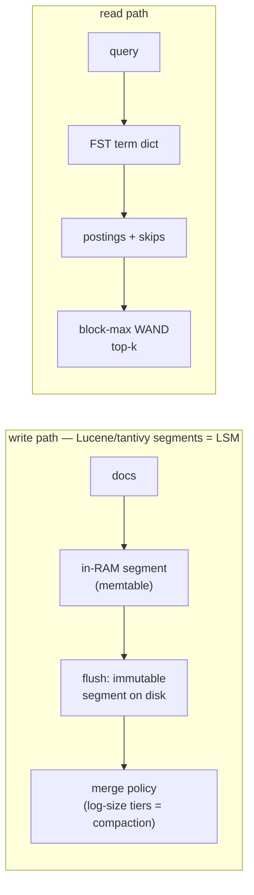

# Topic 23 — Full-Text Search & Inverted Indexes

The third great index family after trees and hash tables: term →
sorted posting list, plus the machinery that makes it fast (compressed
blocks, FST dictionaries, BM25, block-max WAND) and the architecture
that makes it writable (Lucene's LSM-in-disguise segments). Home-turf
bonus: RediSearch — what FalkorDB delegates full-text to — is being
rewritten in Rust, and its inverted index crate is readable tonight.

## Anatomy

```
  query "quick fox"
      │ analyzer: tokenize → lowercase → stem → stopwords
      ▼
  term dictionary                    posting lists (per term, doc-sorted)
  ┌──────────────┐   TermInfo       ┌────────┬────────┬────────┐
  │ FST: bytes → │ {doc_freq,       │block 0 │block 1 │block 2 │ 128 docs/block,
  │ term ordinal │  postings_range} │Δ-packed│Δ-packed│Δ-packed│ delta + bitpack
  └──────────────┘                  └────────┴────────┴────────┘
                                     skip data: per block
                                     {last_doc, max_score}  ← block-max WAND
  + fieldnorms (doc lengths, for BM25's B)
  + fast fields (columnar doc values — topic 12 inside a text index)
```



Same shape as topic 4's LSM: immutable segments, background merges,
deletes as tombstone bitmaps, a reader that unions segments. Lucene
discovered LSM independently because *inverted indexes are cheap to
build and expensive to update in place* — exactly the LSM bet.

## The two speed tricks

1. **Compression that keeps random access**: doc ids stored as deltas,
   128 per block, bit-packed to the block's max width (tantivy
   `postings/compression/mod.rs:3`; RediSearch varint-encodes instead —
   `redisearch_rs/varint`). Blocks give you skip pointers for free.
2. **Score upper bounds**: BM25 saturates at (K1+1)·idf, so every term
   and every *block* has a precomputable max score. WAND uses term
   maxima to find a pivot; block-max WAND (SIGIR'11) refines with
   per-block maxima and skips whole blocks that provably can't beat
   the current top-k threshold.

## Measured baselines (fts_bench, M3 Pro, 100K docs / 10M tokens / 7.9M postings)

| lane | result |
|---|---|
| index build | gen 236 ms + build 335 ms (single thread) |
| oracle top-10, common∧common (272K postings) | 8.75 ms |
| oracle top-10, common∧rare (100K postings) | 6.34 ms |
| oracle top-10, rare∧rare (159 postings) | 8 µs |
| vec AND t0∧t1 (100K∧98K) | 97 µs |
| vec AND t0∧t5000 (100K∧172) | 52 µs — walks the dense list anyway |

The 6.34 ms common∧rare lane is WAND's whole reason to exist: the
rare term's idf ≈ 9 dominates, so almost none of the common term's
100K postings can reach the top-10 — an exhaustive scorer touches
them all anyway. The 52 µs dense∧sparse AND is roaring/galloping's
reason: two-pointer intersection is O(|dense|), not O(|sparse|).

## Posting-list compression, measured (fts_bench, same index)

The "compression that keeps random access" trick is a claim about bytes, so
the lane counts them. `compress.rs` encodes every posting list of the 100K-doc
index two ways and checks both decode back to the original: **varint** (doc id
as the delta from the previous one, 7 bits per byte — RediSearch's shape) and
**128-block bit-packing** (tantivy's shape: per block one width byte, the
deltas minus one packed at the width of the block's largest, then the term
frequencies minus one the same way; the final partial block falls back to
varint, as tantivy's does). A **bit width** here is the number of bits needed
for the largest value in the block — `32 - leading_zeros(max)` — so it is set
by the biggest gap in 128, not the typical one.

| list class (by document frequency) | lists | postings | varint B/posting | bit-packed B/posting | bit-packed vs raw 8 B | vs varint |
|---|---:|---:|---:|---:|---:|---:|
| head, df >= 10,000 | 82 | 2,300,771 | 2.000 | 0.786 | 10.2x | 2.55x |
| mid, 1,000 .. 9,999 | 789 | 2,021,291 | 2.060 | 1.132 | 7.1x | 1.82x |
| low, 128 .. 999 | 6,037 | 1,813,736 | 2.610 | 1.635 | 4.9x | 1.60x |
| tail, < 128 (varint in both) | 43,092 | 1,732,312 | 2.939 | 2.939 | 2.7x | 1.00x |
| **all** | 50,000 | 7,868,110 | 2.363 | **1.544** | 5.2x | 1.53x |

Total: 62.9 MB raw (u32 doc + u32 tf), 18.6 MB varint, 12.2 MB bit-packed. The
byte counts are exact and reproduce on any machine.

Read the head row with the arithmetic. A head list holds about 28,000 of the
100,000 documents (2,300,771 / 82), so the mean gap is about 100,000 / 28,000 =
3.6 and a typical gap needs 2 bits; but a block of 128 gaps has a largest gap
of the order of 3.6 x ln 128 ~ 17, which needs 5 bits. Add the term-frequency
block and the two width bytes (16 bits per 128 postings = 0.125 bits per posting) and
the measured 0.786 B = 6.3 bits per posting is the right size. (An estimate:
the lane does not print the block widths.) Varint cannot do better than one
byte per value and every value here is under 128, so it spends exactly 2.000 B (one for the gap, one for the
tf) on every head posting. The tail rows are identical because a list under
128 postings has no full block, and 43,092 of the 50,000 lists are that short:
**bit-packing buys nothing for most lists and 2.5x for the 82 head lists that
carry 29% of the postings** — a Zipfian vocabulary in one table.

The decode side is a negative result. A scalar decoder over the 82 head lists
reads varint at 1.66 ns/posting and bit-packed at 2.96 ns/posting — the
smaller encoding is *slower* to decode when no SIMD is involved, because
unpacking an arbitrary width costs a shift-and-mask per value where varint on
sub-128 values is a byte copy. tantivy's `bitpacking` crate unpacks 128 values
with SIMD at fixed widths; that is where the speed comes from, and this lane
does not measure it. What the lane does establish is the size side of the
trade and that its speed side is not free.

## Reading guides

- [reading-zobel-moffat.md](reading-zobel-moffat.md) — Inverted indexes: the whole design space in one survey
- [reading-bm25.md](reading-bm25.md) — BM25: a derivation, not folklore
- [reading-blockmax-wand.md](reading-blockmax-wand.md) — Block-max WAND: skip everything that provably can't win
- [reading-roaring.md](reading-roaring.md) — Roaring bitmaps: no single set representation wins
- [reading-tantivy.md](reading-tantivy.md) — tantivy: Lucene's architecture in readable Rust
- [reading-redisearch.md](reading-redisearch.md) — RediSearch in Rust: a mutable inverted index
- topic 4: LSM guides — segment merging is the same design
- topic 14: `reading-hnsw.md` — the other half of M23's hybrid search

## Experiments

| file | status | what it shows |
|---|---|---|
| `corpus.rs` | provided | Zipfian corpus (term id = rank), tokenizer |
| `index.rs` | provided | postings + 128-block metas with per-block max BM25 |
| `bm25.rs` | provided | K1/B, saturating tf, exhaustive term-at-a-time oracle |
| `wand.rs` `wand_topk` | **stub** | block-max WAND: same top-k, fraction of the work |
| `postings.rs` `Roaring` | **stub** | array/bitmap containers, AND/OR vs vec oracle |
| `compress.rs` | provided | varint vs 128-block bit-packing: exact bytes per list class, scalar decode speed |
| `bin/fts_bench.rs` | provided | all lanes, stubs in catch_unwind |

## M23 checklist (capstone)

- [ ] full-text index on node/edge string properties: analyzer +
      segment-per-milestone postings, BM25 top-k procedure
- [ ] hybrid search: RRF fusion of BM25 top-k with M14's HNSW top-k
      (`score = Σ 1/(60 + rank_i)`)
- [ ] posting lists ARE the graph trick: doc ids = node ids, so
      full-text hits feed directly into M20's masked matrix ops
