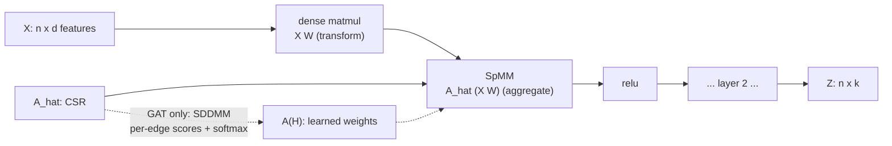
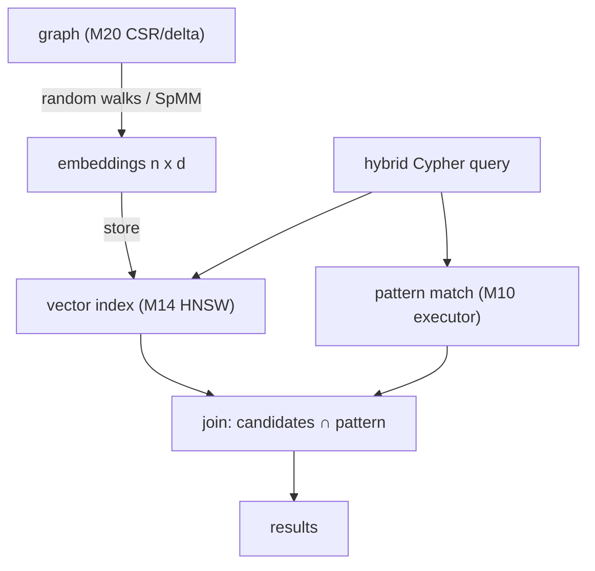

# Topic 25 — Graph Neural Networks & Graph ML for a database engine

**Why this matters for FalkorDB:** message passing *is* SpMM over a
semiring — the M20 sparse core is already a GNN inference engine waiting
for a feature matrix. And GraphRAG (your own GraphRAG-SDK) is pulling graph
databases into the ML serving path: embeddings stored next to nodes, vector
index + pattern match in one Cypher query. This topic is about seeing GNNs
as sparse linear algebra you already own, not as a framework to import.

## The one-slide version

```
  "GNN layer"                          what an engine sees
  ─────────────────────────────────────────────────────────
  H' = sigma( A_hat . H . W )          SpMM  (aggregate, sparse)
        │       │    │  └─ dense matmul (transform, small)
        │       │    └─ n x d feature matrix (dense, FAT rows)
        │       └─ normalized adjacency (CSR — you have this)
        └─ elementwise (free)

  node2vec / DeepWalk                  random walks (you have CSR
    walks -> skip-gram                 traversal) + word2vec SGD

  GraphRAG                             embeddings in a vector index
                                       (topic 14) + Cypher pattern
                                       match — ONE query, two indexes
```

## Message passing = SpMM, with receipts

PyG's `MessagePassing.propagate` (message_passing.py:421) has a fused
fast path: if the layer defines `message_and_aggregate`, the per-edge
`message()` + scatter `aggregate()` pair is replaced by one call.
What do the big three layers put there?

| layer | message_and_aggregate | anchor |
|---|---|---|
| GCNConv | `spmm(adj_t, x, reduce=sum)` | gcn_conv.py:273 |
| SAGEConv | `spmm(adj_t, x[0], reduce=mean)` | sage_conv.py:149-152 |
| GATConv | — (can't fuse: per-edge softmax weights) | gat_conv.py:392-408 |

GCN and SAGE are literally one SpMM per layer. GAT is the exception that
proves the rule: its edge weights depend on the *current* features
(attention), so it needs SDDMM (sampled dense-dense matmul: compute
`leaky_relu(a . [h_u || h_v])` only where A has a nonzero) followed by a
row-softmax, *then* the SpMM. SDDMM+SpMM is the masked-SpGEMM pattern from
topic 24's triangle counting wearing a learning costume.



**Associativity is a query plan.** `A(XW)` costs `2·nnz·hidden` for the
SpMM; `(AX)W` costs `2·nnz·in_dim`. With in_dim=1433 (Cora) and hidden=16,
transform-first is 90x cheaper on the sparse side. Same decision as join
ordering (topic 10) — the frameworks hardcode the good order; an engine
with a cost model could *choose*.

Measured, because "90x cheaper" is a claim about one half of the layer. On the
SBM with Cora's widths (d_in 1433 -> 16): the sparse side is **89.6x** fewer
FLOPs transform-first (0.018 vs 1.624 GFLOP, counted), but the dense product
`XW` (0.751 GFLOP) is paid in *both* orders — `(AX)W` multiplies the same
`n x 1433` by `1433 x 16` after aggregating — so the whole layer is **3.09x**
fewer FLOPs (0.769 vs 2.375 GFLOP), and the measured time is **2.25x** (80.2
vs 180.2 ms, median of 5; 2.23x in a second run; outputs agree to 2e-8). The
order is worth having, but the headline is the whole layer's 2-3x, not the
sparse half's 90x; the wide aggregate-first SpMM also runs at a better
GFLOP/s than the dense kernel, which is why time falls short of the FLOP
ratio.

## Our numbers (Apple M3 Pro, SBM n=16,384, m=566K directed, 2026-07-10)

| lane | result |
|---|---|
| SBM build (64 blocks x 256) | 34.4 ms |
| uniform walks 65,536 x 40 steps | 61.2 ms, 42.8 Msteps/s |
| SpMM (D^-1 A) x X[16384x64] | 3.42 ms/iter, **21.2 GFLOP/s** |
| dense matmul [16384x64]x[64x64] | 5.12 ms/iter, 26.2 GFLOP/s |

The headline: naive scalar SpMM reaches **most of dense matmul's
throughput** on this graph — 81% in the baseline (2·566,564·64 flops in
3.42 ms against 2·16384·64·64 in 5.12 ms), and anywhere from about 70% to
80% from run to run, because both kernels are timed in milliseconds on a
shared machine. Carry the shape, not the percentage.
Sparse's irregular gather is amortized by the
64-float dense rows it drags along — a GNN's SpMM is memory-friendly in
exactly the way topic 20's SpMV (1-wide) is not. Fat right-hand sides
forgive sparsity.

## Neighbour sampling: what it buys and what it does not

A k-layer GNN computing the embedding of a batch needs the batch's k-hop
neighbourhood — its **receptive field**, counted here as distinct vertices
whose features are gathered and edges aggregated over (summed across layers).
GraphSAGE's contribution (Hamilton et al. §3.1, §4.1: K=2, S1=25, S2=10) is to
cap it: keep at most S_h neighbours per vertex at hop h, uniformly. The lane
counts both, exactly (seeded), for a 256-vertex batch on two 262,144-vertex
graphs of about the same average degree: an SBM (max degree 35) and a
preferential-attachment graph with hubs (max degree 2,316).

| graph | receptive field | vertices | % of graph | edges |
|---|---|---:|---:|---:|
| SBM | full 1 layer | 4,154 | 1.58% | 3,931 |
| | full 2 layers | 55,812 | 21.29% | 67,680 |
| | full 3 layers | 248,786 | 94.90% | 910,451 |
| | sampled 2 layers (25,10) | 36,895 | 14.07% | 42,603 |
| | sampled 3 layers (15,10,5) | 125,781 | 47.98% | 187,073 |
| preferential | full 1 layer | 4,165 | 1.59% | 4,004 |
| | full 2 layers | 114,729 | 43.77% | 175,872 |
| | full 3 layers | 262,089 | 99.98% | 2,390,821 |
| | sampled 2 layers (25,10) | 29,451 | 11.23% | 34,977 |
| | sampled 3 layers (15,10,5) | 94,944 | 36.22% | 145,740 |

Three things to read off it. **Explosion is real even at average degree 16:**
256 seeds need 4,154 vertices at one layer, 55,812 at two and 94.9% of the SBM
at three — the batch's cost is the graph's size, not the batch's. **Sampling
helps most where degrees are skewed:** on the hub graph it cuts the 3-layer
edge work 16.4x (2.39 M -> 145,740) and vertices 2.8x; on the SBM, where no
vertex has more than 35 neighbours, a fan-out of 25 or 15 removes little at
the first hop and the cut is 4.9x on edges, 2.0x on vertices. **Sampling bounds
edges more than vertices:** at two layers on the SBM the sampled field still
gathers 36,895 vertices against 55,812 (1.5x), because the cap limits how many
neighbours each vertex contributes, not how many distinct vertices a batch
reaches. A fixed budget `B*S1*S2` per batch (reading-graphsage.md, Step 4) is
an upper bound on *edges* aggregated; the number of distinct vertices
gathered still depends on the graph.

## Random-walk embeddings (DeepWalk -> node2vec)

```
  walk corpus                skip-gram (word2vec, unchanged)
  ┌────────────────────┐     for each center u, context c in window:
  │ 5 12 7 7 3 12 ...  │       maximize  sigma(z_u . c_c)
  │ 9 2 44 2 9 61 ...  │     + for k random "negative" c':
  │ ...                │       maximize  sigma(-z_u . c_c')
  └────────────────────┘     (PyG Node2Vec.loss, node2vec.py:135 —
   vertices are words,        exactly this expression)
   walks are sentences
```

DeepWalk uses uniform walks. node2vec biases them with two knobs evaluated
against the PREVIOUS vertex t (second-order walk): weight 1/p to return to
t, 1 to move to a mutual neighbor of t, 1/q to move away. Low q = outward/
DFS-ish = communities; high q = local/BFS-ish = structural roles. The
implementation trap: per-edge alias tables are O(m·avg_deg) memory —
rejection sampling (bound max(1, 1/p, 1/q)) is O(1) and what our stub
prescribes.

## The stubs (experiments/)

| stub | contract |
|---|---|
| `walks::node2vec_walks` | p=q=1 matches degree-stationary distribution; q orders exploration (ring of cliques); p orders backtrack rate |
| `embed::train_skipgram` | SBM intra-block cosine > inter-block + 0.2 |
| `gcn::gcn_norm` + `gcn_forward` | matches dense definitional oracle to 1e-4; rows sorted; transform-before-aggregate |

Provided: CSR + SBM/ring-of-cliques generators (`graph.rs`), neighbour
sampling and receptive-field counts with a preferential-attachment generator
(`sampling.rs`), dense Mat +
glorot init (`dense.rs`), SpMM + row-normalized adjacency (`spmm.rs`),
uniform walks (`walks.rs`), dense GCN oracle (`gcn.rs`), `gnn_bench`.

## GraphRAG: where this lands in the database

Your GraphRAG-SDK already does the serving half against FalkorDB:
`vector_store.py:344` — `CALL db.idx.vector.queryNodes('Chunk',
'embedding', $top_k, vecf32($vector))`, then Cypher expands from the hits
(`retrieval/strategies/relationship_expansion.py`). What's *missing* is the
production half: embeddings computed OUTSIDE (OpenAI API) and written back
with `SET c.embedding = vecf32($vector)` (:219). M25 closes the loop:
compute node2vec/GCN embeddings with the engine's own SpMM, store into the
M14 vector index, answer hybrid queries without leaving the database.



## Reading guides

- [reading-node2vec.md](reading-node2vec.md) — node2vec: the neighborhood is a query, p and q are its knobs
- [reading-gcn.md](reading-gcn.md) — GCN: the two-line neural network your engine already runs
- [reading-graphsage.md](reading-graphsage.md) — GraphSAGE: sample the neighborhood, learn the function
- [reading-gat.md](reading-gat.md) — GAT: when the edge weights are computed per query
- [reading-pyg-message-passing.md](reading-pyg-message-passing.md) — PyTorch Geometric: one abstraction, the whole GNN literature
- [reading-transe.md](reading-transe.md) — TransE: relations as vector translations
- [reading-graphrag-sdk.md](reading-graphrag-sdk.md) — GraphRAG-SDK: a RAG pipeline read as a workload spec

## Cross-topic links

- Topic 20: SpMM/semirings — the aggregation kernel is M20's `mxm` with a
  dense B; direction switching does NOT apply (always dense frontier, like
  Ligra's PageRank row in topic 24's reading-ligra.md).
- Topic 14: the vector index that stores what this topic computes.
- Topic 10: associativity-as-query-plan; GAT's SDDMM = masked SpGEMM
  (topic 24 TC).
- Topic 27 (ahead): are embeddings incrementally maintainable views over
  the graph? (Spoiler: walks no, GCN partially — see notes.md.)
