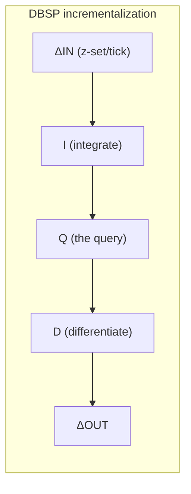

# Topic 27 — Streaming & Incremental View Maintenance

**Why this matters:** recomputing from scratch is the enemy. A standing
query over a changing graph should cost per-*change*, not per-*database*.
Differential dataflow and DBSP made that rigorous — and FalkorDB's delta
matrices (topic 20) are already halfway there conceptually: DP/DM *are*
positive and negative Z-sets waiting for an algebra.

## The problem, measured (bench lane 1, provided — runs today)

`cargo run --release --bin ivm_bench` — 50 000 nodes / 500 000 edges, then 10
batches of +90/−10 edges, recomputing each view from scratch per batch:

```
view                        full recompute per batch
triangles                              100.5 ms
wedge join                             923.5 ms
reachability (re-BFS)                   25.9 ms
```

**One hundred changes to half a million edges, and the wedge join spends 0.9
seconds re-deriving an answer that barely moved.** The batch is 0.02% of the
graph. The recompute is 100% of the work, every time.

That ratio — change size against work size — is the only motivation incremental
view maintenance needs, and stating it in milliseconds first is what keeps the
rest of the topic honest. The three views are deliberately different shapes:
reachability is cheap to redo (26 ms) so incrementalization has little room and
mostly has to avoid regressions; the wedge join is expensive and *local*, so
delta rules should win big, if the state they join against is indexed; triangles sit between them and are where the
bookkeeping cost of maintaining state starts to show against the recompute it
saves.

Predict the speedup for each of the three before implementing, and predict which
one's incremental version is *slower* to initialize than a full recompute — that
one is the interesting result, not the 1000× one.

## Our motivation numbers first (Apple M3 Pro, 50K nodes / 500K edges, batches of 100 changes)

| standing query | full recompute / batch | incremental target |
|---|---|---|
| triangle count | 100.5 ms | per-edge common-neighbour probes — batch·d̄, not m·d̄ (reference: 69.5 µs, 1450x) |
| 2-hop wedge join | 923.5 ms | bilinear delta rule (reference: 41.2 ms, 21x — see below) |
| reachability from src | 25.9 ms (re-BFS) | semi-naive: each edge relaxed O(1) times *ever* (reference: 655 µs, 44x) |

The reference solution (`notes.md`, one run) measured **1-3 orders of
magnitude**, not more: 1450x on triangles, 44x on reachability, and only 21x on
the wedge join. The wedge lane is the instructive one: its delta rule is
correct, but the straightforward state (a sorted `ZSet` re-merged and
re-hashed per batch) is still O(state) per step, so most of the saving is
spent keeping state, not joining deltas — the gap the arrangement (an indexed
spine) is built to close. Refusing to touch data that didn't change is what
buys the factor; how cheaply you can *find* the untouched data decides how
much of it you get.

## The one algebraic idea

Changes are **Z-sets**: collections with i64 weights (+1 insert, −1
delete). Operators split into two classes:

```
  LINEAR (stateless to incrementalize)       NONLINEAR (need state)
  map, filter, flat_map, union               distinct, count, sum, top-k,
    op(ΔA) = Δop(A) — deltas stream through    min/max — deleting the last
                                               copy must RETRACT the output,
  BILINEAR (need arranged inputs)              which requires knowing how
  join:  Δ(A⋈B) = ΔA⋈B + A⋈ΔB + ΔA⋈ΔB          many copies existed: state
```

That table *is* the topic. DBSP's contribution: any query built from
these pieces auto-incrementalizes by circuit rewriting; the state each
nonlinear operator needs is exactly an integral (`z^-1` feedback) of its
input. Differential's contribution: it also works *inside recursion*, with
deltas indexed by (iteration, input-version) lattice timestamps.



The chain I→Q→D is the *specification*; the engineering is pushing I and D
through Q's structure until only nonlinear operators keep integrals —
those integrals are Materialize's **arrangements** (shared, indexed,
compacted update logs).

How far the recursion half carries is measured by **FlowLog: Efficient and
Extensible Datalog via Incrementality** (Hangdong Zhao, Zhenghong Yu, Srinag
Rao, Simon Frisk, Zhiwei Fan, Paraschos Koutris; PVLDB 19(3), VLDB 2026;
[arXiv](https://arxiv.org/abs/2511.00865)), a Datalog engine built on
Differential Dataflow. Each rule is lowered to an explicit relational IR that
separates recursive control (semi-naive iteration) from the rule's join plan,
so the IR can take SQL-style rewrites (logic fusion, subplan reuse), a
structural join planner that avoids worst-case orders, and sideways
information passing, before being lowered to DD operators that support both
batch and incremental evaluation (§1, §3–§7). On 4 threads it is fastest in 21
of 41 program–dataset pairs against Soufflé, RecStep, DDlog, DuckDB and Umbra
— losing, for example, CSPA (httpd) to Soufflé by 1.6× and the
single-expensive-join Reach (twitter) to DuckDB's and Umbra's hash joins — and
on 64 threads it is fastest in 36 of 41 (§10.1). Robustness is the more
transferable result: across 91 rewritten rule orders, FlowLog with its planner
and sideways information passing never times out or runs out of memory, while
FlowLog without them and Soufflé fail on 25 and 23 of them (§10.4, Fig. 9). It
is the arrangement machinery of this topic carrying recursive Datalog — read it
after [reading-differential-dataflow.md](reading-differential-dataflow.md) —
and the `SemiNaiveReach` stub is its smallest instance. Its siblings Soufflé, RecStep, Ascent and CozoDB, and the algebra form of the same loop, are read in [topic 55](../55-datalog-engines/README.md).

## Timestamps, watermarks, and why "when" is half the problem

Timely's insight (Naiad): every message carries a logical timestamp; the
scheduler broadcasts *progress* ("no more messages ≤ t will ever arrive" —
a frontier/watermark, `MutableAntichain` timely frontier.rs:380). Only
when the frontier passes t may a nonlinear operator emit finalized output
for t. That single mechanism subsumes: batch boundaries, out-of-order
data, iteration rounds (timestamps extend to (epoch, round) pairs), and
exactly-once output (emit per closed timestamp).

RisingWave makes the same call with different machinery: barriers flow
through the dataflow (Chandy-Lamport style), every operator checkpoints
its state to S3 at barrier alignment — its `Op` enum
(stream_chunk.rs:45: Insert/Delete/UpdateDelete/UpdateInsert) is a Z-set
weight wearing protocol clothing.

## The systems, placed

| | timely/differential | DBSP/Feldera | Materialize | RisingWave |
|---|---|---|---|---|
| theory | lattice timestamps | abelian-group circuits | differential underneath | ad-hoc deltas + barriers |
| recursion | full (Naiad loops) | nested circuits | WITH RECURSIVE (limited) | no |
| state | arrangements in RAM | batch/trace spine, spillable | arrangements + persist (S3 log) | Hummock LSM on S3 |
| consistency | multi-versioned by design | per-tick | strict serializable reads | barrier-aligned snapshots |

## The stubs (experiments/)

| stub | contract |
|---|---|
| `djoin::delta_join` + `IncrementalJoin` | equals join(A+ΔA, B+ΔB) − join(A,B) exactly, deletes retract output rows, 30-batch drift-free |
| `tri::IncrementalTriangles` | tracks the full-recompute oracle under insert+delete churn; K4-minus-an-edge = −2; batch of 20 costs < 4K probes on a 40K-edge graph |
| `reach::SemiNaiveReach` | matches re-BFS after every batch; ≤ 4 relaxations/edge across ALL batches; intra-component edges cost 0 |

Provided: `zset.rs` (consolidation, merge, the distinct-is-not-linear
test), `graph.rs` (churn generator + all three full-recompute oracles),
`ivm_bench` (prices the enemy even before the stubs exist).

Deliberate scope cut: `SemiNaiveReach` is insert-only. Deleting an edge
from a reachability result is the problem that *needs* differential's
timestamp machinery — see reading-differential-dataflow.md §4 for why.

## Reading guides

- [reading-naiad-timely.md](reading-naiad-timely.md) — Naiad: the clock that unified batch, streaming, and iteration
- [reading-differential-dataflow.md](reading-differential-dataflow.md) — Differential dataflow: retractions that survive recursion
- [reading-dbsp.md](reading-dbsp.md) — DBSP: incremental view maintenance as a calculus
- [reading-materialize-risingwave.md](reading-materialize-risingwave.md) — Materialize vs RisingWave: two production IVM bets
- [reading-kafka-log.md](reading-kafka-log.md) — Kafka: the log is the database

Further references: "MillWheel" (VLDB 2013) — where *watermarks* (low
watermarks over event time) entered production streaming; the
heuristic ancestor of timely's proof-carrying frontiers, and the
lineage behind Google Dataflow/Beam and Flink's model.

## Cross-topic links

- Topic 20: FalkorDB delta matrices — DP=+Δ, DM=−Δ, `wait` = integrate;
  what's missing vs DBSP is *pushing queries through* the deltas instead
  of forcing a merge first. That gap is exactly M27.
- Topic 4: an arrangement's batch/spine/compaction IS an LSM over update
  triples — merging batches consolidates weights like compaction drops
  tombstones.
- Topic 8: retractions are the MVCC intuition inverted — instead of
  versions hiding rows from the past, negative weights erase rows from
  derived futures.
- Topic 24: semi-naive frontier = delta-stepping's bucket discipline;
  both refuse to re-derive settled facts.
- Topic 5/15: Kafka = the WAL promoted to *the* database; Materialize's
  persist and RisingWave's Hummock both re-derive state from a shared log.
