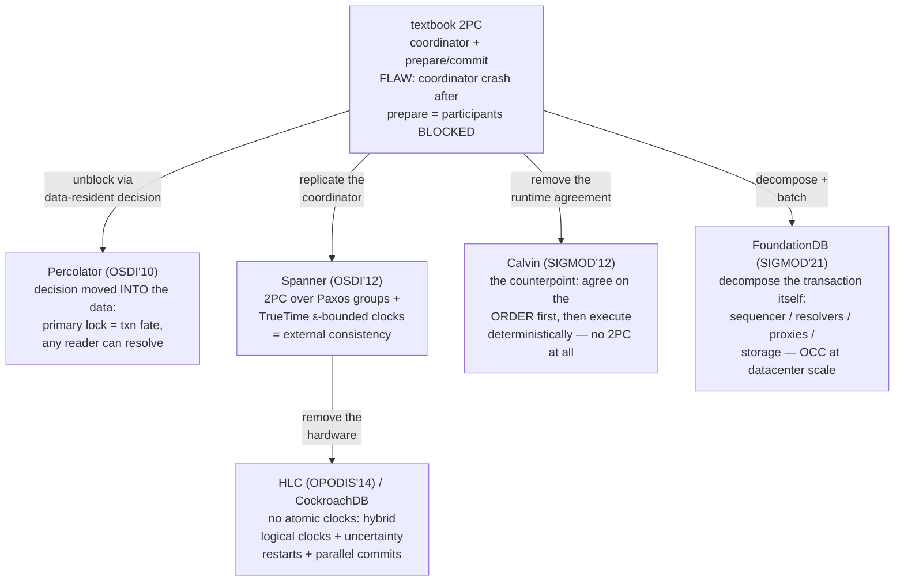

# Topic 29 — Distributed Transactions

The layer above topic 15's Raft: making *transactions* span shards. The gap
between 2PC-in-a-textbook and Spanner/FoundationDB is where the deep
understanding lives.

## 0. The problem, priced (measured here — see notes.md)

Bank transfers, 100K accounts, batches of 8 concurrent txns, Zipfian keys:

| zipf θ | batches with a key collision |
|---|---|
| 0.5 | 0.3% |
| 0.9 | 29.9% |
| 1.1 | 86.2% |
| 1.3 | 99.6% |

Contention isn't an edge case — at real-workload skew (θ≈0.9-1.1) *most*
concurrent batches conflict. Every protocol below is a different answer to
"who aborts, who waits, and who blocks when the coordinator dies."

That table counts collisions, a property of the key generator. The cost the
topic is about is what each collision does to a commit, so the same lane
(`txn_bench`, section "contention priced in round trips") replays those
transfers through a Percolator-shaped model. A batch of 8 prewrites in order;
the first locker of a key wins; a transaction that finds either key already
locked aborts and retries at the head of the next batch. Round trips are
*counted*, with the protocol's fixed costs: a committed attempt pays 4 (start
timestamp from the TSO, prewrite, commit timestamp from the TSO, commit
primary) and an aborted attempt pays 3 (start timestamp, prewrite, rollback).
Worked at θ = 1.1: 100,000 commits and 102,700 aborts would give
(4 × 100,000 + 3 × 102,700) / 100,000 ≈ 7.08 round trips per commit.

```
zipf theta    abort % attempts/txn RTT per commit max attempts vs theta 0.5
0.5            0.03%        1.000          4.001            2      1.00x
0.9            7.74%        1.084          4.252            6      1.06x
1.1           50.67%        2.027          7.082            8      1.77x
1.3           72.90%        3.690         12.070            8      3.02x
```

The jump is at θ = 0.9 → 1.1, as before, but now it has a price: a commit costs
**1.06×** the uncontended 4 round trips at θ = 0.9 and **1.77×** at θ = 1.1,
**3.02×** at θ = 1.3. Multiply by the network round trip to get commit latency
(at a 1 ms cross-zone RTT that is 4.0 ms against 12.1 ms of pure protocol time
at θ = 1.3, before any queueing). Two honest limits. The abort rates (7.74%,
50.67%, 72.90%) are those of this model's first-locker-wins batch with no
backoff, not a measurement of TiKV; the collision percentages above overstate
aborts at low skew because a collision in a batch costs one abort, not eight.
And the round-trip counts are the protocol's, so they say nothing about lock
wait queues or the coordinator-crash blocking window: that is what the 2PC
crash-storm lane (stub) is for.

## 1. The design space



Two points on that diagram sit between its boxes. **Tiga: Accelerating
Geo-Distributed Transactions with Synchronized Clocks** (Jinkun Geng, Shuai
Mu, Anirudh Sivaraman, Balaji Prabhakar; SOSP 2025;
[technical report](https://arxiv.org/abs/2509.05759) ·
[code](https://github.com/New-Consensus-Concurrency-Control/Tiga)) starts from
the cost of layering 2PC-style concurrency control over Paxos replication:
several wide-area round trips per commit. Tiga merges the two: each
transaction is assigned a *future* timestamp from a synchronized clock at
submission, servers hold it until their clocks pass that time and then execute
in timestamp order, so in the common case execution and replication finish in
one wide-area round trip, with a 1.5–2 round-trip slow path when a transaction
arrives late (Abstract). In the microbenchmark at low contention it reports
1.3–7.2× higher throughput and 1.4–4.6× lower median latency than eight
baselines including Calvin+, Janus and Detock (§1). It is Spanner's clocks
([`reading-spanner-hlc.md`](reading-spanner-hlc.md)) used to *pre-agree the
order*, which is Calvin's move ([`reading-calvin.md`](reading-calvin.md)).

**SunStorm: Geographically distributed transactions over Aurora-style
systems** (Cuong D. T. Nguyen, Pooja Nilangekar, Heikki Linnakangas, Daniel
J. Abadi; PVLDB 18(13), 2025;
[paper](https://www.vldb.org/pvldb/vol18/p5555-nilangekar.pdf) ·
[code](https://github.com/umd-dslam/sunstorm)) starts from the other end.
Aurora-style systems (one writer over shared storage) avoid distributed commit
entirely — in the paper's two-region test Aurora processed 1.5× more
transactions than CockroachDB and YugabyteDB with 1/6 of their write-compute
resources — but every write from a far region pays a cross-region trip to the
primary (§1, Fig. 1). SunStorm, built on PostgreSQL with an author from Neon,
geo-partitions the shared storage and gives each region its own writer;
single-region transactions stay local, and multi-region ones talk across
regions only at commit, using a decentralized 2PC that needs one round trip
between the initiator and the validators (§4.4, §7.2.2). It is the topic-28
architecture meeting this topic's 2PC, and a design point for M29's
partitioned graph.

## 2. The one-table summary

| system | concurrency control | clock | cross-shard atomicity | blocking window |
|---|---|---|---|---|
| Percolator/TiKV | optimistic (lock at prewrite) | TSO (central oracle) | primary-key commit point | none — readers resolve |
| Spanner | 2PL + 2PC | TrueTime (ε-bounded GPS/atomic) | 2PC over Paxos groups | Paxos-replicated coordinator |
| CockroachDB | MVCC + timestamp ordering | HLC + max-offset | parallel commits (STAGING) | none — status recoverable |
| Calvin | deterministic execution | sequencer batch order | none needed (order fixed a priori) | none — but no interactive txns |
| FoundationDB | OCC (resolver checks read/write sets) | sequencer versionstamps | proxy makes batch durable | recovery epoch bump |

## 3. Percolator in six lines (the one we build)

```
prewrite(all keys, start_ts):  lock each key (one is PRIMARY), stage data;
                               abort on any lock or any commit > start_ts
commit_primary(commit_ts):     write-record primary, drop its lock  ← THE COMMIT POINT
commit_secondaries:            lazy; crash here is harmless
reader hits stale lock:        look at primary — lock held? roll back.
                               write record? roll forward.  (fate is in the data)
```

TiKV: prewrite = `txn/actions/prewrite.rs:37`, commit = `commit.rs:64`,
resolution = `check_txn_status.rs`/`cleanup.rs` (see reading-percolator-tikv.md).

## 4. Experiments (`experiments/`)

`cargo run --release --bin txn_bench`

| file | what | status |
|---|---|---|
| `kv.rs` | sharded MVCC cluster with Percolator's data/lock/write columns, TSO, Zipf | PROVIDED |
| `tpc.rs` | 2PC coordinator + DST crash points + recovery — the blocking window on display | **STUB** |
| `percolator.rs` | prewrite / commit_primary / commit_secondaries / resolve_lock | **STUB** |
| `hlc.rs` | hybrid logical clock send/recv rules | **STUB** |
| `bin/txn_bench.rs` | conflict probability (provided) + abort rates vs θ + 2PC crash storm | lanes |

Contract highlights: every 2PC crash point must preserve atomicity after
recovery, and a logged decision must roll *forward*; Percolator readers must
roll a crashed txn forward iff the primary committed; HLC must stay
monotonic under backward-jumping physical clocks while `l` never escapes the
max physical time seen (the anti-Lamport-drift bound).

## 5. Reading guides

- [reading-percolator-tikv.md](reading-percolator-tikv.md) — Percolator: 2PC with the coordinator erased
- [reading-spanner-hlc.md](reading-spanner-hlc.md) — Spanner & HLC: timestamps without the oracle
- [reading-calvin.md](reading-calvin.md) — Calvin: agree on inputs, not outcomes
- [reading-foundationdb.md](reading-foundationdb.md) — FoundationDB: the unbundled transaction

## 6. Cross-topic threads

- Topic 15: every serious 2PC participant/coordinator here sits on a Raft/
  Paxos log — Spanner replicates the coordinator, FDB replicates by epoch
  recovery. 2PC and consensus are orthogonal layers, not rivals.
- Topic 16: FDB's simulation (ResolverBug.cpp ships *injectable resolver
  bugs*) is the DST harness our tpc.rs crash points imitate.
- Topic 9 (MVCC): Percolator is postgres's MVCC snapshot rule stretched
  across machines — start_ts/commit_ts are xmin/xmax with a TSO instead of
  a local counter.
- Topic 27: TiKV's resolved-ts / CDC is the changelog of this topic's
  writes — the IVM input stream.
- Topic 24/25: the cross-shard *pattern matching* problem (M29's second
  half) is a distributed join over partitioned adjacency — delta-join
  shapes from topic 27 apply.

## 7. Capstone M29 (FalkorDB)

Cross-shard transactions + cross-shard pattern matching over a partitioned
graph. Design notes in notes.md §M-log.
