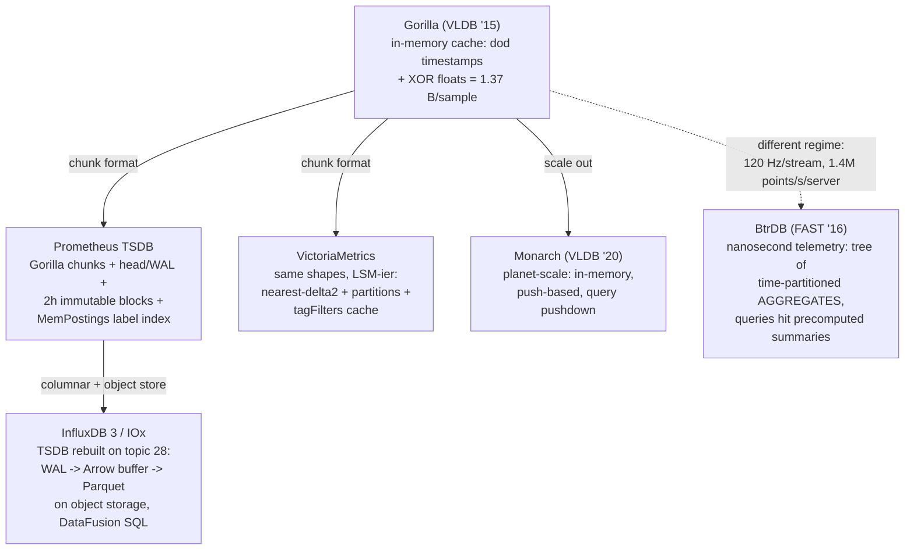

# Topic 30 — Time-Series Engines

Metrics workloads are the most *regular* data any database sees — and
TSDBs are what you get when every design decision exploits that
regularity: append-mostly, time-ordered, compress-by-predicting,
partition-by-time, delete-by-dropping-partitions.

## The problem, measured (bench lane 1, provided — runs today)

`cargo run --release --bin tsdb_bench` — 1 M samples per series shape, 10-second
scrape interval, raw representation = 16.00 B/sample (8 B timestamp + 8 B value).
The provided codecs compress **both** columns: timestamps as zigzag-varint
deltas, values either left raw or XORed with the previous value with the leading
zero *bytes* dropped (one 4-bit tag per value):

```
timestamps (all shapes): delta+varint 3.00 B/sample
 shape     values raw | values xor-bytes | total raw / xor-bytes   decode (xor-bytes)
 constant      8.00   |      0.50 B      |   11.00 /  3.50 B       214 Msamples/s
 gauge         8.00   |      6.80 B      |   11.00 /  9.80 B       132 Msamples/s
 counter       8.00   |      6.07 B      |   11.00 /  9.07 B       124 Msamples/s
 random        8.00   |      7.48 B      |   11.00 / 10.48 B       136 Msamples/s
```

The timestamp column is already done: **3.00 B/sample for every shape** (a
10 s ± 100 ms jittered gap is a 3-byte varint). What is left is the value
column, and there the shapes finally separate: a constant series costs **0.50 B**
per value (one tag nibble, no payload) and uniform random doubles cost **7.48 B**,
a 15× spread. But the spread is *only* as wide as byte-granular XOR can make it,
and two shapes show where it stops. The `gauge` — a bounded random walk
computed in floating point — costs 6.80 B because every sample's low mantissa
bits are noise even though neighbouring values are numerically close; the
`counter` costs 6.07 B because its integer-valued doubles have ~40 trailing zero
*bits* that a byte-aligned codec carries as payload and only Gorilla's bit-level
window can drop.

So the baseline has cut 16 B to 3.50–10.48 B depending on the shape, and the
remaining gap is what Gorilla's XOR-and-leading-zeros trick, with trailing
zeros, is aimed at. Predict the B/sample Gorilla achieves for each of these
four shapes before you implement it, and say which of the four you expect it
to *lose* to the byte-aligned codec on. The reference run in `notes.md` has
the answers and one of them is not what the paper's headline suggests.

Lane F (provided) asks the other question — whether XOR is the right family at
all — and is the subject of [reading-alp-chimp.md](reading-alp-chimp.md):

```
            shape xor-bytes   gorilla       ALP |   exc%  bits raw-vecs modal e,f | xor dec M/s ALP dec M/s
      decimal 2dp      6.79    [stub]      1.50 |   0.1%  11.8    0/977     14,12 |         164         590
      decimal 6dp      6.82    [stub]      3.25 |   1.0%  25.1    0/977      14,8 |         168         589
          counter      6.07    [stub]      1.95 |   0.3%  15.3    0/977     14,14 |         174         647
         constant      0.50    [stub]      0.01 |   0.0%   0.0    0/977     18,18 |         499        1666
 walk (f64 arith)      6.80    [stub]      8.00 |  95.1%  57.9  926/977      16,0 |         171        2614
   random doubles      7.48    [stub]      8.00 | 100.0%   0.0  977/977         - |         206        2405
```

B/value on the value stream alone (raw = 8.00). An ALP-style codec — find the
decimal each double came from, store an integer, frame-of-reference + bit-pack —
takes the decimal-origin series from 6.8 B to 1.5 B and 3.25 B (the 2- and
6-decimal walks), but the *same walk left as raw floating-point arithmetic* is
95% exceptions and falls back to 8.00 B: the win belongs to data that was born
as decimals, not to data that is merely smooth. (The last two decode figures are
raw-vector `memcpy`s.) The Gorilla column fills in when you implement the stub.

## 0. The shape of the problem

```
  write path                              read path
  ~1M samples/s, tiny (ts, f64) points    "cpu > 90 for job=api over 6h"
  99.9% arrive in time order              always a TIME RANGE
  per-series arrival ~10s apart           always a LABEL SELECTOR
                                          usually an AGGREGATION
        │                                        │
        ▼                                        ▼
  amortize:  batch into per-series       index labels, not values:
  compressed chunks (Gorilla),           inverted index (name,value) -> series,
  flush to immutable time-blocks         then min/max-prune time blocks
```

Baseline measured here (see notes.md): delta+varint timestamps cost
**3.00 B/sample** for every shape; the 8-byte values then cost 0.50 B
(constant) to 7.48 B (random) under a byte-aligned XOR, or a flat 8.00 B raw.
The entire point of Gorilla's XOR trick is attacking those value bytes at bit
granularity.

## 1. The design space



## 2. The one-table summary

| system | value codec | time organization | label index | out-of-order |
|---|---|---|---|---|
| Gorilla | XOR floats, dod ts | 2h in-memory blocks | (delegated to HBase layer) | rejected |
| Prometheus | same, xor.go | head + 2h blocks, exponential compaction | MemPostings inverted index | bounded OOO window, separate buffer |
| VictoriaMetrics | nearest-delta2 + optional lossy precisionBits | monthly partitions of LSM parts | index_db + tagFilters cache | buffered in raw-rows shards |
| InfluxDB 3 | Parquet encodings | WAL → buffer → Parquet files by time | catalog + last/distinct caches | absorbed by sort at persist |
| BtrDB | delta tree | time-partitioned octree-ish tree | (few, fat streams) | version-annotated inserts |

## 3. Experiments (`experiments/`)

`cargo run --release --bin tsdb_bench`

| file | what | status |
|---|---|---|
| `gen.rs` | scrape timestamps + gauge/counter/constant/random shapes, OOO arrivals, label sets | PROVIDED |
| `bits.rs` | MSB-first BitWriter/BitReader + sign_extend | PROVIDED |
| `baseline.rs` | zigzag-varint delta timestamps + raw or byte-aligned-XOR values — the thing to beat (3.00 B/sample of timestamps; 0.50-7.48 B of values) | PROVIDED |
| `alp.rs` | ALP-style decimal-to-integer + frame-of-reference + bit-packing float codec (lane F) | PROVIDED |
| `gorilla.rs` | dod timestamp buckets + XOR-float codec | **STUB** |
| `head.rs` | in-order fast path + bounded OOO window + LWW merge flush | **STUB** |
| `index.rs` | MemPostings-style (name,value)→series inverted index + k-way intersect | **STUB** |
| `bin/tsdb_bench.rs` | baselines (provided) + gorilla ratios + OOO tax sweep + selector latency | lanes |

Contract highlights: gorilla roundtrip must be bit-exact for every f64;
constant series ≤ ~2 bits/sample, an integer-valued counter beats raw 3×, while
full-entropy values and an f64-arithmetic gauge must *not* compress far (>6.5
and >7 B/sample — the codec wins on regularity, not magic); head
rejects samples older than the OOO window and flush output is sorted so
it feeds the in-order-only encoder; index intersection matches brute
force and the unique-per-series label demonstrably explodes the postings
map (the cardinality bomb, counted).

## 4. Reading guides

- [reading-gorilla.md](reading-gorilla.md) — Gorilla: compress by predicting
- [reading-alp-chimp.md](reading-alp-chimp.md) — ALP and Chimp: two bets on what a float column is
- [reading-prometheus-tsdb.md](reading-prometheus-tsdb.md) — Prometheus TSDB: an LSM with time as the key
- [reading-victoriametrics-influx.md](reading-victoriametrics-influx.md) — VictoriaMetrics & InfluxDB 3: two rebuttals to Prometheus
- [reading-monarch-btrdb.md](reading-monarch-btrdb.md) — Monarch & BtrDB: the extremes that bracket the middle

## 5. Cross-topic threads

- Topic 4 (LSM): a TSDB is an LSM where the key is time — head=memtable,
  blocks=SSTs, compaction merges by time range, retention = drop the
  oldest level. VictoriaMetrics says "parts" and means it literally.
- Topic 12 (columnar): ALP is DuckDB's float encoding (reading-alp-chimp.md);
  the XOR-vs-decimal fork is the same analyze → score → compress choice as §2
  there. IOx is the thesis that a TSDB is just a columnar
  store with a time-partitioned catalog — Parquet + DataFusion replace
  the custom chunk format.
- Topic 23 (FTS): MemPostings IS an inverted index; label selectors are
  boolean term queries; high cardinality = unbounded vocabulary.
- Topic 28 (cloud-native): InfluxDB 3's WAL→object-store pipeline is
  topic 28's landing-zone lesson applied to metrics.
- Topic 29: the OOO window is a watermark — the same
  bounded-disorder-then-seal move as streaming watermarks (topic 27).

## 6. Capstone M30 (FalkorDB)

Temporal graph: edge/property history as (entity, attribute, ts) series;
`MATCH ... AT TIME t` = snapshot read at t over history chunks. Design
notes in notes.md §M-log.
