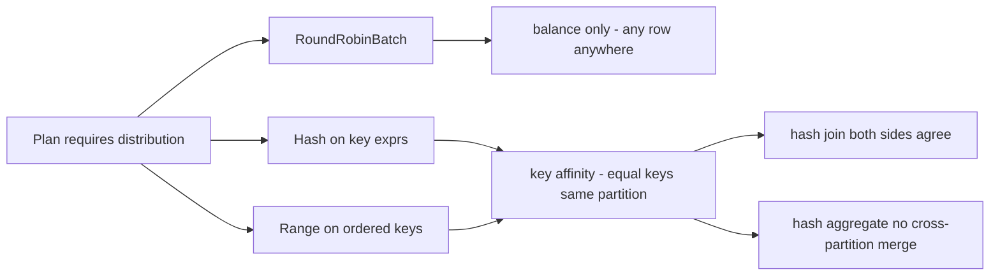
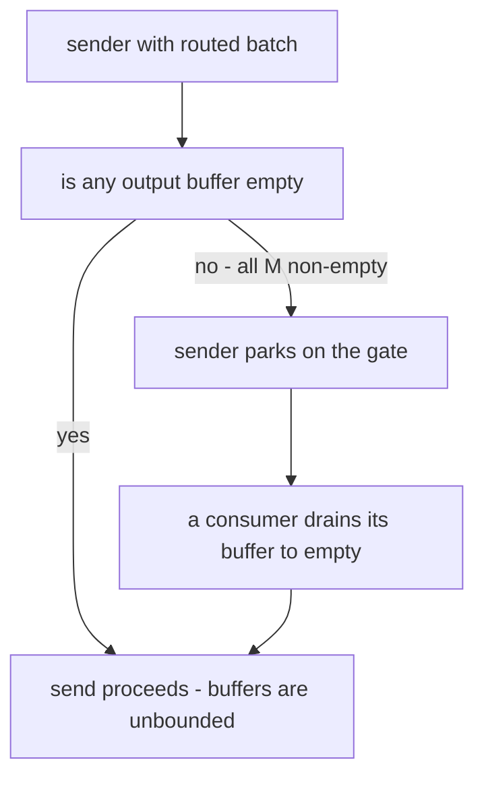

# DataFusion's RepartitionExec: Volcano's Exchange Operator, One Process at a Time

RepartitionExec is DataFusion's in-process exchange operator: it takes N input partitions and redistributes their
batches across M output partitions, using round-robin (for balance), hash (for key affinity) or — when a source declares sorted key ranges — range
routing.
It is the direct descendant of Volcano's exchange — the operator that made parallelism invisible to every other
operator — squeezed into one process with tokio tasks instead of OS processes. This guide walks the routing core,
the deterministic hash contract that joins depend on, and a flow-control design that is deliberately not a bounded queue.
Code is read at `datafusion@350ca7650` (`main`, 2026-10-26); every `file:line` below is checked at that SHA, with
paths under `~/repos/datafusion/datafusion/`.

## The problem in one sentence

**Every other operator in the plan wants to pretend it is single-threaded, so one operator must own all
data movement between partitions — routing, buffering, backpressure, and order preservation.**
Volcano called this "anonymous inputs": a hash join reading partition 3 neither knows nor cares that its rows
came from eight different producers. RepartitionExec is where that pretense is manufactured.

## The concepts, step by step

### Step 1 — The N-to-M fan: what the operator actually is

> **In:** N input partitions of `RecordBatch`es (from the child plan) and a target
> output-partition count M.
> **Out:** M output partitions, each a stream a downstream operator drains as if it
> were the only consumer of a single-threaded child.

`RepartitionExec` (`physical-plan/src/repartition/mod.rs:1526`) maps N input partitions to M output partitions.
`execute` (:1740) is called once per *output* partition; on first call `consume_input_streams` (:446) wires the
channels and spawns one `pull_from_input` task (:2280) per *input* partition. Each task drains its input stream,
routes every batch, and pushes into the channel of the output it was routed to. Consumers just poll their channel.

```text
 input part 0 ──┐                       ┌── output part 0
 input part 1 ──┤   pull_from_input     ├── output part 1
 input part 2 ──┤ ──► BatchPartitioner ─┤       ...
     ...        │   (route each batch)  │
 input part N-1─┘                       └── output part M-1

 N producer tasks        M channels, N senders each        M consumer streams
```

The key structural fact: there is no single shared queue. In the default mode `consume_input_streams` builds one
channel per *output* (`channels(num_output_partitions)`, :495) and clones its sender once per input
(:497–:500), so each output has its own buffer fed by N producers; with `preserve_order` it builds one channel per
(input, output) pair instead (`partition_aware_channels`, :484–:492) — the N×M matrix Step 6 needs. Either way a
producer and a consumer only ever synchronize on their own channel plus one shared gate (Step 5), never on a global
lock over all in-flight batches.

### Step 2 — Routing policy is a plan-time property

> **In:** a plan node's required input distribution (what Step 7's rule computes).
> **Out:** a `Partitioning` enum value — `RoundRobinBatch(M)`, `Hash(exprs, M)` or
> `Range(...)` — that fixes routing before a single batch moves.

The `Partitioning` enum (`physical-expr/src/partitioning.rs:126`) declares the contract: `RoundRobinBatch(usize)`
(:128) says "any batch anywhere, just balance the load"; `Hash(Vec&lt;Arc&lt;dyn PhysicalExpr&gt;&gt;, usize)` (:131)
says "rows with equal key expressions must land in the same output partition." Round-robin is what you use to widen
a single-partition scan to all cores; hash is what a partitioned hash join or hash aggregate demands, because
correctness — not just balance — depends on co-locating keys.

`Range(RangePartitioning)` (:133, "Partition rows by source-declared ranges") is the third routing policy. A
**`RangePartitioning`** (:216) is an ordering — the key expressions and their sort directions — plus a list of
**split points**: key values that mark partition boundaries, so k split points make k + 1 partitions. Its doc
comment (:158–:215) works the single-key case: ordering `date ASC`, split points `2022-01-01` and `2023-01-01`,
gives partition 0 for dates before 2022, partition 1 for 2022, partition 2 for 2023 onward. Like hash it
co-locates equal keys; unlike hash it also keeps partitions ordered relative to each other. It also retains the
caller's full **sample** of boundaries, which is what lets a planner later re-cut the same key space into a
different number of partitions (`scale`, :347 — Step 7). DataFusion does not check that a source which declares
Range actually placed its rows that way (the doc comment says so); the declaration is a promise, like a declared
sort order. `UnknownPartitioning(usize)` (:135) only describes an existing plan's output — "a known number of
partitions", no routing rule — so `BatchPartitioner::try_new` rejects it with "Unsupported repartitioning
scheme" (`repartition/mod.rs:1195`–`:1196`); it is never a target.



### Step 3 — Deterministic hashing: the seeds are zero on purpose

> **In:** the `Hash(exprs, M)` policy from Step 2 and a batch's key columns.
> **Out:** a deterministic per-row partition index — identical across runs,
> operators, and (in a distributed setting) nodes.

`BatchPartitioner` (mod.rs:649) holds one of three routing states (`BatchPartitionerState`, :654: `Hash`,
`RoundRobin`, `Range`). It is built for hash mode by `new_hash_partitioner` (:1024), whose `Hash` state carries a
strength-reduced reducer, `StrengthReducedU64::new(num_partitions as u64)` (:1036), and hashes with
`REPARTITION_RANDOM_STATE` (:677) — not a per-instance `RandomState` but a `SeededRandomState::with_seed(0)`,
i.e. FIXED seeds of 0. This is not laziness; it is a correctness contract. A hash join repartitions *both* inputs
by the join keys: if the build side and the probe side hashed with different per-instance random seeds, key `42`
could go to partition 1 on one side and partition 5 on the other, and the join would silently drop matches. Fixed
seeds make routing deterministic across runs, across operators, and (in a distributed setting) across nodes.

The partition index is `hash % M`, but not computed with a division. **Strength reduction** is replacing an
expensive operation with cheaper ones that give the same answer when one operand is fixed; here M is fixed for the
partitioner's lifetime, so the doc comment at :939–:946 precomputes the divisor's reduced form once: a power-of-two
M becomes a bit mask (`hash & (M − 1)`), and any other M becomes a 128-bit reciprocal whose multiply recovers the
quotient, and from it the remainder (`hash − quotient × M`, :981) — "the same invariant-divisor optimization
compilers use for `%` by a constant". Worked once: with M = 8 the mask is 7, so hash 45 = `0b101101` lands in
`45 & 7 = 5`, the same as `45 % 8 = 5`. The routing loop calls `partition_reducer.partition_indices(hash_buffer,
indices)` (:1273), which applies whichever form was chosen to every row's hash (:968).

The flip side of determinism: adversarial or pathological key sets that collide will collide *every* run — skew is
reproducible, which is good for debugging and bad if your workload hits it.

### Step 4 — Batch economics: whole batches round-robin, per-row scatter for hash

> **In:** one input `RecordBatch` and the routing policy from Step 2.
> **Out:** for round-robin, that whole batch handed to the next output in rotation;
> for hash and range, at most M smaller batches, one per output partition that received rows.

`partition_iter` (mod.rs:1234) is the routing loop, and it treats round-robin and the two key-based policies
asymmetrically:

- **Round-robin** (:1240–:1247) forwards the *entire* RecordBatch to the next output in rotation
  (`*next_idx = (*next_idx + 1) % *num_partitions`, :1245; the whole batch is yielded at :1246). Zero per-row work,
  zero copies — the batch is just a bundle of Arc'd arrays changing queues. Each input starts its rotation at a
  different output (`(input_partition * num_partitions) / num_input_partitions`, :1064) so N inputs do not all
  hit output 0 first.
- **Hash** (:1248–:1282) must look at every row: `create_hashes` (:1263), seeded by
  `REPARTITION_RANDOM_STATE.random_state()` (:1265), computes one hash per row over the key columns; the reducer
  buckets rows into a per-partition index list (`partition_reducer.partition_indices`, :1273); then
  `Self::partition_grouped_take` (:1279) gathers the per-partition batches.
- **Range** (:1283–:1313) has hash's shape with a different bucketing step. With no split points the whole batch
  goes to partition 0 (:1290–:1292). Otherwise it evaluates the ordering expressions (:1294–:1297) and
  `router.route_indices` (:1303) assigns each row by binary search over the split points; the same
  `partition_grouped_take` (:1309) gathers the batches. The router (`RangeRouter`,
  `repartition/range.rs:36`) picks one of two implementations when it is built (:120–:136): for a single
  primitive key column it binary-searches the column's raw Arrow value buffer directly
  (`split_points.partition_point(|&sp| sp <= val)`, :418 — the index of the first split point greater than
  `val`, which is the row's partition), and for anything else it converts the key columns and the split points to
  Arrow's **row format** (each multi-column key encoded as one byte string that compares in the key's sort order,
  via `RowConverter`) and binary-searches those (`partition_point_rows`, :585). Neither path builds a per-row
  `ScalarValue`.

`partition_grouped_take` (:1344) is one gather, not M: its doc comment (:1328–:1343) walks the example. It
concatenates the per-partition index lists — partition 0 `[2, 5]`, partition 2 `[0, 3, 4]` become `[2, 5, 0, 3, 4]` —
runs one `take_arrays` over the batch with that order (:1375), and returns each partition as a zero-copy slice of the
reordered batch (partition 0 = rows 0–1, partition 2 = rows 2–4). When every row went to one partition it skips the
take and forwards the batch itself (:1367–:1369).

This is Volcano's packet-economics lesson restated. Graefe measured 171 s at 1 record per exchange packet versus
13.7 s at 83 records per packet — a 12x swing purely from amortizing per-transfer cost. DataFusion's RecordBatch
*is* the packet; round-robin keeps the packet intact, while hash pays a per-row scatter and hands on M smaller
batches. Those slices can be tiny (an 8192-row batch split 64 ways averages 128 rows), so before a batch enters an
output's channel the producer passes it through a per-output **coalescer** — a buffer that concatenates small
batches until they reach the session batch size (`SharedCoalescer`, set up at mod.rs:547–:558; applied in
`pull_from_input` at :2334). The comment at :547–:551 gives the two cases where it is off: `preserve_order` mode,
whose merge does its own batching, and unbounded inputs, where a half-filled buffer could be withheld forever.
Downstream operators see good packets again.

```text
 round-robin:  [batch 8192 rows] ──────────────► output (i mod M)   no row work

 hash/range:   [batch 8192 rows]
                   │ hash per row (or binary-search the split points)
                   ▼
               indices: p0:[0,5,9...] p1:[2,3...] ... pM-1:[1,4...]
                   │ one grouped take, then slice per partition
                   ▼
               up to M smaller batches ──► per-output coalescer ──► channel
```

### Step 5 — Flow control: unbounded channels behind one global gate

> **In:** routed `(partition, batch)` pairs from the N producer tasks.
> **Out:** M per-output channels plus one shared `Gate` that applies backpressure
> only when *every* output buffer is non-empty.

The channels are built by `channels()` (`repartition/distributor_channels.rs:54`) — M linked per-output buffers
sharing one `Gate` whose `empty_channels` counter starts at M (`AtomicUsize::new(n)`, :61). `DistributionSender`
(:120) and its `send` (:130) implement the unusual semantics: each per-output buffer is individually *unbounded*,
and a sender parks only when *all* M output buffers are non-empty. If any single channel is empty, every send
proceeds. The rule is one branch in `SendFuture::poll` — when the counter of empty channels is zero, the sender
registers a waker and yields:

```rust
// datafusion/physical-plan/src/repartition/distributor_channels.rs — SendFuture::poll
218              // does ANY receiver need data?
219              // if so, allow sender to create another
220              if this.gate.empty_channels.load(Ordering::SeqCst) == 0 {
221                  let mut guard = this.gate.send_wakers.lock();
222                  if let Some(send_wakers) = &mut *guard {
223                      send_wakers.push((cx.waker().clone(), this.channel.id));
224                      return Poll::Pending;
225                  }
226              }
```

The line to focus on is 220: the only condition under which a send waits.

Why not M bounded queues? Deadlock and starvation in join plans. With per-channel bounds, one slow consumer
(say, a join output partition blocked on its other input) would block the producer, which would then stop feeding
the *fast* consumers too — and in cyclic-ish plan shapes that stall can become a distribution deadlock. The global
gate inverts the condition: backpressure engages only when *everyone* has data waiting, so a fast consumer can
never be starved by pressure aimed at a slow one, while total buffering stays bounded in the common case where at
least one consumer keeps draining.

The trade-off is honest: in the worst case (all consumers stalled except one that never fills), buffering can
grow past what a bounded design would allow. DataFusion accepts that memory risk in exchange for liveness — the
same call Volcano made when it favored keeping producers running over strict per-flow limits — and caps the damage
differently: each output's buffered batches are charged to a memory reservation, and a batch whose reservation
cannot grow is spilled to disk instead (`OutputChannel::send`, mod.rs:232–:240; `consume_input_streams` creates a spill channel per output, or per (input, output) pair
under `preserve_order`, at :524–:545).



### Step 6 — preserve_order: the merging exchange

> **In:** N input partitions that are each already sorted, and a plan that needs
> that order kept.
> **Out:** M output streams, each a k-way merge over its N per-input channels —
> Volcano's merging exchange, one process at a time.

When each input partition is already sorted and the plan needs that order, the `preserve_order` flag (mod.rs:1536)
switches RepartitionExec into merge mode — Volcano's MERGING exchange. Records from different producers must be
kept *distinct* per producer and merged by sort key, never dumped into one bag. `consume_input_streams` (:446)
therefore builds a dedicated channel per (input, output) pair (:484–:492) and, for memory pressure, a dedicated
single-producer spill channel per input (:524–:538), so the order the merge relies on survives a round trip through
disk; it also turns the output coalescer off (:480). Each output partition then runs a streaming k-way merge over
its N per-input channels instead of interleaving arrival order. Cost model: you buy a global sort order for the
price of a per-output merge heap and stricter buffering (a merge cannot emit until every input channel has shown
its next head), which is exactly why the flag is opt-in rather than default.

```text
 plain mode:   in0, in1, in2  ──►  one channel per output  ──►  arrival-order interleave
 merge mode:   in0 ─► ch(0,j) ─┐
               in1 ─► ch(1,j) ─┼─►  k-way streaming merge  ──►  output j, globally sorted
               in2 ─► ch(2,j) ─┘    per-input identity preserved
```

### Step 7 — Who inserts RepartitionExec: EnsureRequirements

> **In:** a plan whose nodes declare required input distributions (key partitioning
> on join or group keys, or a single partition).
> **Out:** the same plan with a `RepartitionExec` inserted wherever a child's
> distribution does not already satisfy the requirement — hash for a fresh key
> requirement, a re-cut Range where a child is already range-partitioned on those keys.

You will read blog posts saying "the EnforceDistribution rule inserts RepartitionExec." That rule is retired:
DataFusion's single rule for this is `EnsureRequirements`, a struct at
`physical-optimizer/src/ensure_requirements/mod.rs:175`. Its module doc says why (:31–:35): run as two rules,
`EnforceSorting`'s sort pushdown "can break distribution invariants established by `EnforceDistribution`", so the
two are now resolved together in one bottom-up pass ("Phase 2", the diagram at :46–:60). The old file did not
disappear — it *moved* and became a library of helpers: `physical-optimizer/src/ensure_requirements/enforce_distribution.rs`,
whose module doc (:18–:24) and a comment at :80 record the retirement. `EnsureRequirements::optimize` (mod.rs:185)
runs Phase 2 by calling `ensure_distribution_with_stats` (enforce_distribution.rs:1532) on every node bottom-up
(mod.rs:229–:235). When a node declares a required input distribution that a child does not meet, that pass
inserts the RepartitionExec:

- **Round-robin**, to raise parallelism under an unspecified distribution: `add_roundrobin_on_top` (:862), building
  `RepartitionExec::try_new` at :876.
- **A key requirement** (`should_add_repartition`, :1776): if the child is already Range-partitioned on keys that
  satisfy the requirement, the pass *re-cuts* that Range to `target_partitions` — `range.scale(...)`, which
  down-samples the retained split points — and keeps the rows' range layout (:1781–:1810); if the child is not, or
  the Range's retained sample is too small to cut that many partitions (`scale` returns `None`, :1803–:1808), it
  falls back to `create_partitioning`, which builds a hash partitioning (:1812). The exchange itself is
  `RepartitionExec::try_new` at :1822.
- **Co-partitioned children** (both inputs of a partitioned join): `enforce_distribution_relationships` (:1287)
  takes the input that already satisfies its requirement as the reference and *adapts* that input's partitioning
  for the other one (`adapt`, :1420) — so a Range on one side becomes a matching Range on the other instead of
  both sides hashing — skipping inputs whose Range layout already matches (`has_same_layout`, :1448–:1450).

Before any of that, the pass reorders a multi-key equi-join's key pairs to match an input's existing Range ordering
(doc comment :1518–:1522): for `ON b = b1 AND a = a1` over inputs ranged on `(a, b)`, swapping the pairs to
`(a = a1, b = b1)` changes nothing about the join and lets the Range inputs satisfy the requirement as they are.

## Where each step lives in the code

Paths are relative to `~/repos/datafusion/datafusion/` at `datafusion@350ca7650`.

| Step | What | Anchor |
|------|------|--------|
| 1 | Operator struct, N→M | physical-plan/src/repartition/mod.rs:1526 |
| 1 | Per-output execute | physical-plan/src/repartition/mod.rs:1740 |
| 1 | Channel wiring; plain vs preserve-order channels | physical-plan/src/repartition/mod.rs:446, :484–:503 |
| 1 | Per-input pull task | physical-plan/src/repartition/mod.rs:2280 |
| 2 | Partitioning enum | physical-expr/src/partitioning.rs:126 |
| 2 | RoundRobinBatch / Hash / Range / UnknownPartitioning variants | physical-expr/src/partitioning.rs:128, :131, :133, :135 |
| 2 | RangePartitioning (ordering, samples, split points; doc example) | physical-expr/src/partitioning.rs:216 (doc :158–:215) |
| 2 | Unsupported scheme rejected | physical-plan/src/repartition/mod.rs:1195 |
| 3 | Routing state (`BatchPartitioner`, `BatchPartitionerState`) | physical-plan/src/repartition/mod.rs:649, :654 |
| 3 | Fixed-seed SeededRandomState::with_seed(0) | physical-plan/src/repartition/mod.rs:677 |
| 3 | Strength reduction: doc, enum, `partition_indices` | physical-plan/src/repartition/mod.rs:939, :948, :968 |
| 3 | Hash constructor (`new_hash_partitioner`, reducer at :1036) | physical-plan/src/repartition/mod.rs:1024 |
| 4 | Round-robin constructor (staggered start :1064) | physical-plan/src/repartition/mod.rs:1055 |
| 4 | partition_iter: round-robin :1245, hash :1263–:1279, range :1283–:1313 | physical-plan/src/repartition/mod.rs:1234 |
| 4 | Grouped take (one `take_arrays`, then slices) | physical-plan/src/repartition/mod.rs:1344 |
| 4 | RangeRouter: primitive vs row-format paths | physical-plan/src/repartition/range.rs:36, :120–:136, :418, :585 |
| 4 | Per-output coalescer | physical-plan/src/repartition/mod.rs:547–:558, :2334 |
| 5 | channels constructor | physical-plan/src/repartition/distributor_channels.rs:54 |
| 5 | Gate with empty_channels | physical-plan/src/repartition/distributor_channels.rs:61 |
| 5 | DistributionSender / send | physical-plan/src/repartition/distributor_channels.rs:120, :130 |
| 5 | Gate park branch (`SendFuture::poll`) | physical-plan/src/repartition/distributor_channels.rs:220 |
| 5, 6 | Spill channels (shared vs per-input) | physical-plan/src/repartition/mod.rs:524–:545 |
| 6 | preserve_order flag | physical-plan/src/repartition/mod.rs:1536 |
| 7 | EnsureRequirements struct; why one rule (doc :31–:35) | physical-optimizer/src/ensure_requirements/mod.rs:175 |
| 7 | optimize → ensure_distribution_with_stats | physical-optimizer/src/ensure_requirements/mod.rs:185, :229–:235 |
| 7 | Retirement notes (moved path) | physical-optimizer/src/ensure_requirements/enforce_distribution.rs:18, :80 |
| 7 | Round-robin RepartitionExec inserted | physical-optimizer/src/ensure_requirements/enforce_distribution.rs:876 |
| 7 | Key requirement: re-cut Range or hash, RepartitionExec inserted | physical-optimizer/src/ensure_requirements/enforce_distribution.rs:1776–:1822 |
| 7 | Co-partitioned children adapt the reference partitioning | physical-optimizer/src/ensure_requirements/enforce_distribution.rs:1287, :1420 |
| 7 | Join keys reordered to an input's Range ordering | physical-optimizer/src/ensure_requirements/enforce_distribution.rs:1518 |

## Questions to answer in notes.md

1. Why must `REPARTITION_RANDOM_STATE` use fixed seeds — walk through exactly how a hash join breaks if the
   build-side and probe-side RepartitionExec instances used per-instance random seeds.
2. Round-robin forwards whole batches while hash scatters per row and rebuilds batches with `take`. What are the
   CPU and memory costs of each, and why does the local stub's row-at-a-time model show hash routing *faster*
   (543.0 M rows/s vs 229.6 M rows/s at k=8) while DataFusion's batch model favors round-robin for cheapness?
3. Describe a concrete plan shape where M per-channel *bounded* queues could deadlock or starve a fast consumer,
   and explain how the single Gate with the `empty_channels` counter avoids it. What is the worst-case buffering
   the gate design permits?
4. In preserve_order mode, why does correctness require a channel per (input, output) pair rather than one channel
   per output? What extra latency does the k-way merge introduce before the first row can be emitted?
5. Trace how a hash join's required input distribution causes a `Hash` RepartitionExec to appear — which rule
   sees the requirement, and what does it insert? Then change one premise: the build side is already
   Range-partitioned on the join key. What does the same pass insert now, and when does it fall back to hash?

## Done when

Answer each before unfolding it.

- [ ] You can sketch the N×M channel matrix from memory and explain why it is not one shared MPMC queue.

  <details><summary>Answer</summary>

  `execute` (mod.rs:1740) is called once per *output* partition; its first call
  spawns one `pull_from_input` task (:2280) per *input* partition. So there are N
  producer tasks and M consumer streams. In the default mode they are wired by M
  channels (`channels()`, distributor_channels.rs:54), one per output, each with N
  cloned senders (mod.rs:495–:500); in `preserve_order` mode by N×M channels, one per
  (input, output) pair (:484–:492). It is not one shared MPMC queue for two reasons:
  order preservation (Step 6) needs each (input, output) pair kept distinct so the
  k-way merge can tell producers apart; and a single global lock over all in-flight
  batches would re-serialize every producer and consumer, throwing away the
  parallelism — per-output channels confine contention to one channel plus the
  shared gate.

  </details>

- [ ] You can state the deterministic-hashing contract and name two operators whose correctness depends on it.

  <details><summary>Answer</summary>

  `REPARTITION_RANDOM_STATE` is a `SeededRandomState::with_seed(0)` (mod.rs:677) —
  fixed zero seeds — so `create_hashes` (:1263) followed by the strength-reduced
  `partition_reducer.partition_indices` (:1273) maps a given key to the *same*
  partition on every instance, run, and node. A **hash join** depends on it (build
  and probe sides must send equal join keys to the same partition, or matches are
  silently dropped) and so does a **hash aggregate** (equal group keys must co-locate,
  or one group is split across partitions and never merged).

  </details>

- [ ] You can explain the Gate flow-control rule ("park only when all buffers are non-empty") and its failure mode
      trade-off versus per-channel bounds.

  <details><summary>Answer</summary>

  Each per-output buffer is individually unbounded; `SendFuture::poll` parks the
  sender only when `gate.empty_channels == 0` — every output already has data waiting
  (distributor_channels.rs:220). If any channel is empty the send proceeds, so a fast
  consumer is never starved by backpressure aimed at a slow one. Per-channel bounds
  would let one blocked consumer (say a join output waiting on its other input) stall
  the producer, which then stops feeding the fast consumers too — a distribution
  deadlock. The trade-off is honest: in the worst case (every consumer stalled except
  one that never fills) buffering can grow past what a bounded design would allow;
  DataFusion accepts that memory risk in exchange for liveness.

  </details>

- [ ] You can explain when preserve_order forces merge mode and what it costs relative to interleaving.

  <details><summary>Answer</summary>

  When each input partition is already sorted and the plan requires that order, the
  `preserve_order` flag (mod.rs:1536) switches `consume_input_streams` (:446; the
  preserve-order branch is :484–:492, its per-input spill channels :524–:538) to a
  dedicated channel per (input, output) pair, and each output runs a streaming k-way merge over its N per-input channels
  instead of interleaving in arrival order. The cost: a per-output merge heap plus
  stricter buffering — the merge cannot emit until *every* input channel has shown its
  next head — so first-row latency rises. That is why the flag is opt-in, not default.

  </details>

- [ ] You have run the local exchange stub and compared its routing throughput numbers against your own reasoning
      about DataFusion's batch-level costs.

  <details><summary>Answer</summary>

  The stub (`experiments/src/exchange.rs`) routes row-at-a-time, so at k=8 hash
  (543.0 M rows/s) *beats* round-robin (229.6 M rows/s): hashing is cheap and
  round-robin's per-row bookkeeping dominates when there is no batch to amortize.
  DataFusion inverts this because it works on whole batches — round-robin forwards a
  `RecordBatch` with zero per-row work (Step 4, mod.rs:1245–:1246), while hash pays
  `create_hashes` + `partition_grouped_take` per row before re-materializing batches.
  Same operation, opposite verdict: what looks cheap depends on whether you measure
  per row or per batch — the packet-economics lesson from Volcano's §5.

  </details>

## References

- Repo: `~/repos/datafusion` at `350ca7650` — `datafusion/physical-plan/src/repartition/` (operator, channels,
  range router),
  `datafusion/physical-expr/src/partitioning.rs` (policy enum),
  `datafusion/physical-optimizer/src/ensure_requirements/` (insertion rule).
- Goetz Graefe, *Encapsulation of Parallelism in the Volcano Query Processing System*, TR CS/E 89-007 — the
  exchange operator, anonymous inputs, packet economics (171 s at 1 record/packet vs 13.7 s at 83), and the
  MERGING exchange variant.
- Local stub: `experiments/src/exchange.rs` — reimplements the routing (round-robin + deterministic hash) and
  merge contracts in miniature; reference numbers at k=8: 229.6 M rows/s round-robin, 543.0 M rows/s hash.
