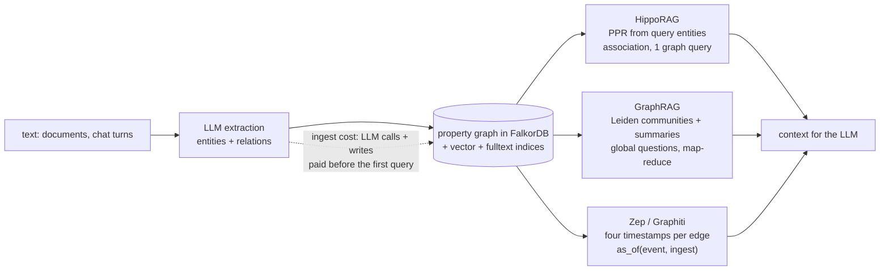

# Topic 38 — GraphRAG & Agent Memory

First of six graph use-case deep dives: what a graph database actually
*does* for LLM retrieval and agent memory — FalkorDB's core market.
Three systems carry the story. **HippoRAG** (NeurIPS'24): multi-hop
retrieval is an *association* problem, and Personalized PageRank over an
OpenIE knowledge graph solves in one graph query what iterative
LLM-retrieval loops do in many. **Microsoft GraphRAG** (arXiv
2404.16130): *global* questions ("what are the themes of this corpus?")
defeat any top-k retriever; hierarchical Leiden communities plus
map-reduce over pre-computed community summaries answer them with 2.6%
of the tokens. **Zep/Graphiti** (arXiv 2501.13956): agent memory is a
*temporal* knowledge graph — facts get four timestamps, contradictions
invalidate without deleting, and any past moment stays answerable.



## The problem, measured (bench lane 1, provided — runs today)

```
   path-finding collapse — mean rank of the true answer
   (17 candidates, 8 distractor chains per seed; chance = 9.0, perfect = 1.0)
   hops   mention-count   bfs-distance
   1          1.00            9.51
   2          9.21            8.95
   3          8.71            9.15
```

This is HippoRAG's Figure 1 in miniature — a *path-finding* question:
"which candidate connects to BOTH query entities?" when no passage ever
mentions both. Mention-count ranking is vector RAG's shape (score each
passage against the query independently): at 1 hop the answer is named
next to both seeds and wins outright; at 2+ hops the evidence chains'
interior passages mention no query entity, every candidate scores zero,
and ranking is chance (mean rank ≈ 9 among 17). BFS distance is chance
at *every* hop count — all candidates sit at the same depth. Coverage
without association. Lane 2's PPR restores rank 1.00 at all hops.

## HippoRAG: association as arithmetic

```
   seed u ──▶ a ──▶ [answer] ◀── b ◀── seed w
      └───▶ ...──▶ dead-end (×8)      (×8 more from w)

   PPR restarts at {u, w}: mass flows down every chain, but only
   the answer node SUMS mass from both seeds → it outranks every
   dead-end that collects from one.
```

The neurobiological framing: neocortex = LLM, hippocampus = the KG +
PPR. Offline, a one-shot OpenIE prompt (NER first, then triples)
builds a schemaless noun-phrase graph, plus *synonymy edges* between
nodes with embedding cosine above τ = 0.8. Online: extract query
entities, map them to graph nodes by cosine, run PPR with restart mass
only on those nodes (damping 0.5), then score each passage by the PPR
mass of the nodes it mentions. **Node specificity** sᵢ = |Pᵢ|⁻¹ (a
local, per-node IDF) scales each query node's restart probability.
Measured (R@2/R@5): MuSiQue 40.9/51.9, 2WikiMultihopQA 70.7/89.1
(+11/+20% over ColBERTv2), HotpotQA 60.5/77.7 — single-step, 10-30×
cheaper and 6-13× faster than the iterative IRCoT loop, and
combinable with it (+18% R@5 on 2Wiki). Ablations: PPR beats
query-nodes-only decisively; synonymy edges matter most on 2Wiki;
swapping OpenIE to a small fine-tuned model (REBEL) collapses recall.

## Microsoft GraphRAG: communities + map-reduce for global questions

```
   chunks ─▶ LLM extract ─▶ entity KG ─▶ hierarchical Leiden
                                             │  C0 root communities
                                             │  C1 ─ C3 finer levels
                                             ▼
                              community summaries (bottom-up)
   query ─▶ map: score every summary's partial answer 0-100
        ─▶ reduce: fuse the helpful ones ─▶ global answer
```

Sensemaking questions have no top-k answer set — the "relevant
passages" are the whole corpus. GraphRAG pre-computes structure:
600-token chunks → LLM entity/relationship/claim extraction (with
"gleaning" re-passes) → exact-string entity dedup, duplicate count =
edge weight → hierarchical Leiden → community summaries written
bottom-up (leaf summaries prioritize element descriptions by node
degree; parents substitute child summaries when the window overflows).
At query time, map-reduce over the summaries of one level. Measured on
two ~1M-token corpora (podcast transcripts: 8,564 nodes / 20,691
edges; news: 15,754 / 19,520): community-level answers win 72-83% on
comprehensiveness and 62-82% on diversity vs vector RAG, and the root
level C0 needs 9-43× fewer query tokens than map-reducing source
texts — 26,657 tokens ≈ 2.6% of the corpus. Indexing cost: 281 min of
gpt-4-turbo on the Podcast dataset, at a 600-token chunk window. The trade is explicit: pay once at index time for
structure so every global query is cheap.

## Zep/Graphiti: the bi-temporal agent memory

```
   event time  T :  t_valid ──────────── t_invalid
   ingest time T':  t_created ─────────── t_expired

   "Alice works at Acme" (valid 100, learned 100)
   "Alice works at Beta" (valid 200, learned 205)
        └─▶ old edge: t_invalid = 200, t_expired = 205 — KEPT
```

Agent memory changes: facts are superseded, corrected, learned late.
Graphiti stores a three-tier graph (episodes → semantic entities →
communities) where every edge carries **four timestamps** — when the
fact was true in the world (t_valid/t_invalid ∈ T) and when the system
knew it (t_created/t_expired ∈ T'). An LLM detects contradictions at
ingest and *invalidates* the old edge (sets both end-timestamps)
without deleting it. Two timestamps per timeline buy two different
questions: `as_of(event=March, ingest=today)` — what *was* true in
March — vs `as_of(event=March, ingest=March)` — what did we *know* in
March. Retrieval is φ (cosine + BM25 + graph BFS) → ρ (rerankers:
RRF, MMR, episode-mentions, node-distance, cross-encoder) → χ
(assembly). Measured: DMR 94.8% vs MemGPT 93.4%; LongMemEval +8.6%
accuracy with latency 28.9 s → 2.58 s (~90% cut) because context
shrinks from 115k to 1.6k tokens; temporal questions +38.4%.

## What a graph-memory benchmark has to report: the ingest bill

All three systems above pay at ingest so that queries are cheap — GraphRAG
spends 281 minutes of gpt-4-turbo on one podcast corpus so that every
global question is cheap. That makes the *engine's* ingest and update
cost part of the memory's price, not a footnote. One 2026 paper puts
numbers on it. Nguyen, Gill, Ahmadi and Rossbach, *Graph Memory for LLM
Agents: At What Cost?* ([arXiv:2609.23315](https://arxiv.org/abs/2609.23315),
v1, 20 Sep 2026; Corvic AI Research), benchmark their own columnar engine
Corvic AI against seven others — LoraDB, Ladybug, DuckPGQ, Memgraph, Neo4j,
HugeGraph and FalkorDB — on a synthetic biomedical-shaped property graph of
1.02 million nodes and 5.34 million node-and-edge rows, with a twenty-query
workload (§3.1–3.2). Two of its results matter here.

**1. Ingest, not query latency, is the largest spread (§5.5, Fig. 3).**
Bulk-ingest throughput runs from 4.3 M rows/s (Corvic AI) down to 5.0 k
rows/s (LoraDB) — roughly 860× — larger than any query-latency gap in the
study. Memgraph ingests at 87,000 rows/s and Neo4j at 53,000 (Table 1).
**The total-cost model** (§4.5, Eq. 5–6) makes the trade explicit: an
engine's cost for q operations is TCO(q) = T_ingest + q · t̄, where t̄ is
its mean per-operation latency, and two engines A and B cross where
q\* = (T_ingest,B − T_ingest,A) / (t̄_A − t̄_B). Worked on the paper's own
inputs (§5.5): N = 5.34 M rows, Corvic AI at 4.3 M rows/s ingests in
5.34 M / 4.3 M = 1.24 s, Memgraph at 87 k rows/s in 5.34 M / 87 k = 61.4 s;
per point update they take 2.47 ms and 0.90 ms. Then
q\* = (61.4 − 1.24) / (0.00247 − 0.00090) = 60.16 / 0.00157 ≈ 38,318
updates — the paper prints 38,304, a 0.04% difference that is input
rounding. Below that many updates the slow-to-update engine that loads in
a second wins on wall clock; above it the in-memory, mutation-oriented
engine does. The authors' conclusion is a rule of thumb, not a ranking:
ingest dominates total cost for any workload with fewer than roughly 10⁵
queries per data refresh (abstract; §6 puts the estimate at that order for
millisecond-class queries against a corpus ingested at 10⁴ rows/s).

**2. What it reports for FalkorDB — and what it does not (§5.1, §5.5,
Appendix A.1).** At the 1.02 M-node scale FalkorDB's query geomean is
**1.81 ms**, lower than Corvic AI's 2.19 ms, but it completed only
**18 of 20** query shapes correctly, so the paper does not rank it among the
engines that answered everything. Its point-update latency is **0.85 ms**,
the fastest in the study (Memgraph 0.90 ms, Corvic AI 2.47 ms). The paper
reports **no FalkorDB ingest throughput, no batch-update throughput, no
per-scale (1 K / 10 K) latencies, and no version, engine variant (the C
module or the Rust rewrite), build flags, hardware, or thread count for any
system** — the only hardware statement is "identical hardware under a fixed
harness" (§3.4). Appendix A.1 lists FalkorDB as "partially or fully
excluded" because it did not complete the full workload "under our
harness"; which two shapes failed is not stated. Read it as one vendor's
harness failing to run 2 of 20 queries on an engine it did not tune, not as
a statement about the engine — and certainly not as a number to put next to
the capstone's own M22 results.

Two checks on the paper itself, because the lesson of this topic is that a
benchmark is only as good as its own consistency. Ladybug's Table 1 row is
labelled "(copy)" and shows 476,000 rows/s ingest, 0.96 ms point update and a
4.08 ms geomean, but Appendix A.1 says the *copy* configuration measured
793,462 rows/s, 4.08 ms and 1.57 ms, and that 476,360 rows/s / 3.97 ms /
0.96 ms belong to *attach* — and §5.1's prose quotes 3.97 ms. The table
mixes two configurations in one row. And the authors disclose that Corvic AI
is both the subject system and their own product (§7); the one workload
where it does not lead (point update) is reported unadjusted.

For M38 the takeaway is a measurement requirement, not a ranking: the
capstone's ingest path (entity resolution, mention edges, index build) must
be timed as rows/s alongside the PPR latency, and the crossover q\* against
the baseline engine computed from both. See [topic 22](../22-benchmarks/README.md)
for the methodology reading of the same paper.

## Production shape: FalkorDB GraphRAG-SDK (cloned under ~/repos)

One process, one database: the KG, the vector indices, and the
fulltext indices all live *inside* FalkorDB — entity discovery, vector
search, and graph expansion are one round trip.

| anchor (`graphrag_sdk/src/graphrag_sdk/`) | what to see |
|---|---|
| `ingestion/pipeline.py:35` | 9 fixed steps: load → chunk → lexical graph (mandatory) → extract → filter `:329` → prune `:282` → resolve → write → mentions ∥ index (`:175` asyncio.gather) |
| `extraction_strategies/graph_extraction.py:89` | 2-step extraction: pluggable NER (default GLiNER, local) then LLM verify+relations; budget guard `:148` |
| `resolution_strategies/llm_verified_resolution.py:75` | Graphiti-style resolution: embedding candidates `:192` then LLM-verified merge |
| `storage/vector_store.py:35` | entity `:104` / relationship `:108` vector indices + fulltext `:485` inside FalkorDB |
| `storage/deduplicator.py:35` | exact `:74` / fuzzy `:115` dedup; `:228` survivor edge-remap |
| `retrieval/router.py:19` | rule-based semantic router, first-match `:84`, default fallback |
| `retrieval/strategies/multi_path.py:48` | 9-step retrieval: keywords → embed once → edge vector search → entity discovery → 1/2-hop expansion → 4-path chunk retrieval → sources → cosine rerank `top_k=15` → assemble |

## Reading guides

1. [reading-hipporag.md](reading-hipporag.md) — HippoRAG: hippocampal indexing, OpenIE graph, PPR + node specificity, path-finding vs path-following.
2. [reading-graphrag-paper.md](reading-graphrag-paper.md) — Microsoft GraphRAG: extraction, Leiden hierarchy, community summaries, map-reduce, token economics.
3. [reading-zep-graphiti.md](reading-zep-graphiti.md) — Zep: bi-temporal model, edge invalidation, three-tier graph, retrieval pipeline.
4. [reading-graphrag-sdk.md](reading-graphrag-sdk.md) — code read: FalkorDB's ingestion pipeline, resolution strategies, multi-path retrieval.

## Experiments

```
cd experiments
cargo test              # 3 provided tests pass; 6 fix the contract for your stubs
cargo run --release --bin graphrag_bench
```

- `kg.rs` (PROVIDED) — synthetic path-finding instances (2 seeds, 8
  distractor chains each, one shared answer, one passage per fact, no
  passage mentions both seeds); mention-count and BFS-distance ranking.
- `ppr.rs` (stub) — Personalized PageRank by power iteration: restart
  at seeds, damping 0.5, dangling mass back to the restart vector.
- `temporal.rs` (stub) — the bi-temporal store: `ingest` with
  contradiction invalidation (never delete), `as_of(t_event, t_ingest)`
  filtering on both timelines, `current()`.

Bench lanes: 1 = the collapse table (provided, above). 2 = mention vs
PPR mean rank at h ∈ {1,2,3}, plus one PPR query on a 100k-node /
~400k-edge graph (reference: ~57 ms, 30 iterations). 3 = 10k entities
× 10 job changes: 100k edges kept, 10k current, as-of scan ~0.09 ms.

## Exercises

1. Implement the stubs until all 9 tests pass and lanes 2-3 print.
2. Work lane 2's arithmetic by hand at h=2, damping 0.5: how much PPR
   mass reaches the answer vs a dead-end candidate? (The answer sums
   from two seeds; the dead-end collects from one — show the 2× gap.)
3. Sweep damping ∈ {0.1, 0.3, 0.5, 0.8, 0.95} in lane 2. Where does
   the answer's rank degrade, and why does very high damping (mass
   wanders far from seeds) hurt this task?
4. Add node specificity to `ppr_rank`: scale each seed's restart mass
   by 1/degree. Construct an instance where one seed is a hub (attach
   50 extra edges) and measure the rank with and without it.
5. Lane 3 stores every version forever. Add a `compact(before_t)` that
   drops edges with `t_expired` before a horizon and measure the as-of
   scan speedup — then write one sentence on what audit question you
   can no longer answer.
6. Sketch M38: which of the three mechanisms (PPR, community
   summaries, bi-temporal edges) maps onto which existing capstone
   piece (topic 18 CSR, topic 31 graph engine), and what is genuinely
   new?

## Cross-topic threads

- **Topic 18 (GPU graph analytics)**: PPR is push-style PageRank with
  a personalized restart vector — the same CSR SpMV loop; HippoRAG
  just changes who gets restart mass. M38 runs it as a graph procedure.
- **Topic 33 (temporal graphs)**: Graphiti's four timestamps are
  topic 33's valid-time/transaction-time bitemporal model applied to
  edges; `as_of` is a time-travel read.
- **Topic 36/37 (sharding, distributed queries)**: a PPR query touches
  a neighborhood, not a key — hash sharding scatters it across every
  shard (topic 37's fan-out tail applies to graph queries too).
- **Topic 32 (HTAP)**: GraphRAG's index-time/query-time split is the
  same pay-once-read-many trade as maintaining analytical replicas.

## Capstone M38 — GraphRAG over the Rust graph engine

- Entity/relation ingest into M31's graph with exact + embedding
  resolution; one passage-mentions-entity edge per chunk.
- PPR as a graph procedure over topic 18's CSR: restart vector from
  query entities, damping 0.5, node-specificity weighting.
- Bi-temporal edge versioning: four timestamps, contradiction
  invalidation at ingest, `as_of` reads in the query layer.
- Deliverable numbers: recall@5 on 2-hop questions for direct-mention
  vs BFS vs PPR retrieval; PPR latency on a 100k-node graph; as-of
  read overhead vs a current-only read.
