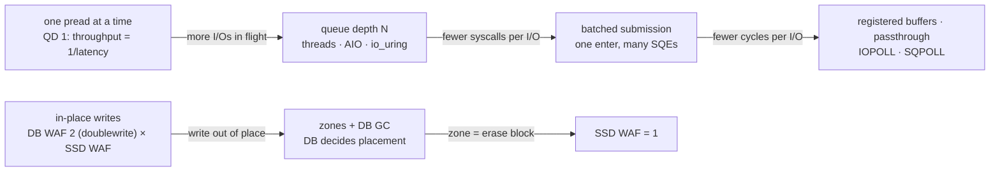

# Topic 45 — Async I/O & Modern SSDs: io_uring, Out-of-Place Writes, and When They Help

io_uring has been name-dropped across this curriculum without ever being
measured: topic 7's C10K guide calls it the async-I/O line "resurrected"
([reading-c10k-thread-per-core.md](../07-networking-protocols/reading-c10k-thread-per-core.md),
Step 4), topic 6's mmap chapter lists it as what a buffer pool can do and
mmap cannot ([reading-mmap-paper.md](../06-buffer-pool/reading-mmap-paper.md),
Step 5), topic 19 borrows its resumability argument, and topic 5's durability
table points `O_DIRECT` at topic 6. This topic is where the claim gets priced.
PostgreSQL 18 shipped an asynchronous I/O subsystem (`io_method`), and two
VLDB'26 papers from the same group give the guidance that was missing: **the
interface is not the win**. Jasny et al. measure io_uring dropped into a buffer
manager at **1.06×** over libaio, and the same buffer manager redesigned around
batching and asynchrony at **2.05×** (§1, Figure 1). Lee, Ziegler & Leis show
that the write side is a separate problem with a separate fix — an in-place
engine's flash writes are **DB WAF × SSD WAF**, and the second factor is one
only an out-of-place engine can control.



The order of the arrows is the order of the payoffs, and it is the order the
io_uring paper's Figure 5 enables features in: architecture first (queue depth,
then batching), tuning last.

## The problem, measured (bench lane 1, provided — runs today)

`cargo run --release --bin io_bench` — a 1 GiB file of seeded bytes, written
around the page cache and read around it again (`F_NOCACHE` and `F_RDAHEAD 0`
on macOS, `O_DIRECT` on Linux), then 20,000 random 4 KiB reads per row with
the queue depth bought the oldest way there is: N threads, each doing a
blocking `pread`. Apple M3 Pro, internal SSD (APPLE SSD AP0512Z), measured
2026-10-26:

```
-- lane 1a: random 4 KiB reads, queue depth bought with threads --
   (each row reads 20000 fresh seeded offsets; prediction = Little's law, QD / mean latency at QD 1)

    QD      IOPS    MiB/s   p50 µs   p99 µs  mean µs   predicted  achieved
     1     13810       54     68.8     80.6     72.2       13843      100%
     2     27155      106     69.5    110.6     73.5       27686       98%
     4     52450      205     72.0    115.9     76.1       55373       95%
     8     96907      379     74.0    155.5     82.4      110746       88%
    16    155741      608     91.5    199.4    102.4      221491       70%
    32    244300      954    112.5    316.5    130.3      442983       55%
    64    248363      970    203.0    583.9    254.3      885965       28%

   sanity: QD-1 p50 68.8 µs ≥ 8 µs floor — device reads, not page-cache hits
   sanity: device ceiling (sequential 1 MiB reads, 8 threads) 5967 MiB/s; best random-4K row 970 MiB/s = 16% of it
   sanity: checksum over 2,000 shared offsets — pread 9786a6be5036cf04, 8 threads 9786a6be5036cf04, lio_listio 9786a6be5036cf04: agree
```

**The same system call, the same 4 KiB, 18× the throughput** — 13,810 IOPS at
queue depth 1 against 248,363 at 64 — and nothing about the interface changed.
At queue depth 1 a thread can only wait: 72.2 µs per read on average means at
most 1 / 72.2 µs = 13,850 reads a second, which is the row. What raised the
number is *how many reads were in flight at once*, and the predicted column is
the one law that says how much it should rise: **Little's law** (Step 1) —
throughput = in-flight ÷ latency. It holds to within 5% up to queue depth 4,
because the SSD's latency barely moves (68.8 → 72.0 µs p50). From 16 on the
device itself starts to queue: p50 climbs to 203 µs at 64, and the extra
in-flight reads buy latency rather than throughput — 244,300 → 248,363 IOPS from
32 to 64 is a 1.7% gain for twice the threads.

That is the io_uring paper's §3.3 result restated on a laptop. Their buffer
manager, synchronous, runs at **16.5 k tx/s through POSIX and 16.5 k tx/s
through io_uring** — the same number, because "throughput is directly tied to
device latency, and using io_uring does not result in performance gains". Their
order-of-magnitude jump (to 183 k tx/s) comes from fibers putting 128 I/Os in
flight on one core (§3.3.2). The interface they used to do it was io_uring; the
reason it worked was queue depth.

The three sanity lines are part of the result, not decoration. CLAUDE.md's rule
is that an implausible number is a bug in the benchmark, so the bench checks
the three ways this one could lie: a QD-1 read under 8 µs would be a page-cache
hit (flash reads are tens of µs); a random-read figure above the device's own
sequential ceiling would be impossible (970 MiB/s is 16% of 5,967 MiB/s); and
the three read paths must return the same bytes for the same offsets, or one of
them is reading the wrong thing.

## What this machine cannot measure, and why

io_uring is a Linux interface. This topic was built on macOS, and the honest
consequence is a list:

| claim | why it is not a number here |
|---|---|
| io_uring vs threads at equal queue depth (lane 2) | macOS has no io_uring. Lane 2 is written against the `io-uring` crate and gated `#[cfg(target_os = "linux")]`; elsewhere it prints a stub note. |
| …in a Linux container on this Mac | tried: Docker Desktop's default seccomp profile refuses `io_uring_setup` with **EPERM** (measured — the bench prints the error). And the container is unrepresentative anyway: its "device ceiling" sanity line read **16,872 MiB/s** — 2.8× the physical SSD's 5,967 — because the VM's virtual disk is served from the host's page cache. Its numbers are recorded in notes.md as an example of the sanity check catching a lie, not as data. |
| registered buffers, IOPOLL, SQPOLL, NVMe passthrough | all Linux-only, and IOPOLL/passthrough need raw block devices. These are the io_uring paper's Figure 5 tuning steps, 216.6 → 237.8 → 300.5 → 376.4 → 546.5 k tx/s (§3.4.1's prose says +11%, +20%, +21%, +32%; the bars give +9.8%, +26.4%, +25.3%, +45.2% as new/old − 1 — see [reading-iouring-vldb26.md](reading-iouring-vldb26.md)); this repo quotes them from the paper and does not reproduce them. |
| SSD write amplification (lane 3) | consumer SSDs do not expose physical-write counters (the paper reads them from the OCP log on enterprise drives, §7.1). Lane 3 is a **simulated** flash translation layer instead, and every figure from it is labelled a model. |

## Step 1 — latency, queue depth, and Little's law

**Latency** is the time one I/O takes from issue to completion. **Queue depth**
(QD) is how many I/Os are outstanding at the device at once. **Throughput**
(IOPS, I/Os per second) is how many complete per second. **Little's law** ties
the three together for any stable queue: *average in-flight = throughput ×
average latency*, so throughput = QD / latency. Worked on lane 1a's QD-8 row:
8 / 72.2 µs = 110,803 predicted (the bench's 110,746 uses the unrounded mean),
96,907 measured — 88%, and the missing 12% is visible in the same row as mean
latency rising from 72.2 to 82.4 µs. Put 82.4 into the law instead and
8 / 82.4 µs = 97,087, within 0.2% of the measurement. The law is exact; what
changes with queue depth is the latency you have to feed it.

The consequence for a database is that **any design that keeps one I/O in
flight per thread is capped at 1/latency per thread**, whatever API it uses. A
buffer manager that faults one page at a time, a B-tree descent, a WAL commit
waiting on `fsync` — all are QD 1 by construction. There are three ways to raise
QD: more threads each blocking (lane 1a, PostgreSQL's `io_method=worker`), an
asynchronous interface that lets one thread keep many I/Os outstanding (POSIX
AIO, io_uring), or both.

## Step 2 — the paper's cost model, on this machine's numbers

Jasny et al. validate every design step with a back-of-the-envelope model, and
the models are worth more than the measurements because they transfer. Two of
them (§3.3):

- **Latency-bound** (synchronous): tx/s = 1 / (fault rate × I/O latency). With
  their YCSB's 70% fault rate and 70 µs read + 12 µs write (Table 1):
  1 / (0.7 × 82 µs) = **17.4 k tx/s** predicted, 16.5 k measured. Batch the
  eviction writes and the write latency leaves the critical path:
  1 / (0.7 × 70 µs) = **20.4 k** predicted, 19 k measured (+BatchEvict).
- **CPU-bound** (asynchronous, enough I/O in flight): tx/s = clock /
  (c_tx + fault rate × c_io). With c_tx = 8,264 cycles and c_io = 10,200 + 5,700
  = 15,900 cycles at 3.7 GHz: 3.7×10⁹ / (8,264 + 0.7 × 15,900) = **190.8 k**
  predicted, 183 k measured. Batch the reads too (c_io = 5,400 + 5,700 = 11,100):
  3.7×10⁹ / 16,034 = **230.8 k**, 216 k measured.

On this laptop the latency-bound model predicts a synchronous buffer manager at
this SSD's QD-1 mean read latency of 72.2 µs, reads only: 1 / (0.7 × 72.2 µs) =
**19,786 tx/s** — the same order as their 17.4 k, which is the point: a
synchronous engine on a 2026 NVMe drive is stuck near 20 k page-faulting
transactions per second per thread no matter which syscall it uses. The
second model is the one that says what to do next: once I/O is overlapped, the
bill is CPU cycles per I/O, and *that* is what io_uring's features cut.

## Step 3 — batching: what a syscall costs, and what a barrier costs

Lane 1c takes the device out entirely — the region is resident in the page
cache — and measures CPU nanoseconds per 4 KiB page as the number of pages per
syscall grows (`pread` for 1, one `preadv` over b contiguous pages otherwise):

```
   pages/call    ns per page    vs 1/call
            1            612        1.00x
            2            435        1.41x
            4            271        2.26x
            8            225        2.72x
           16            217        2.82x
           32            196        3.13x
           64            195        3.14x
```

A cached 4 KiB `pread` costs 612 ns; spread over 64 pages per call it costs
195. Solving the two-term model *per-call + per-page* from the 1 and 64 rows:
per-page ≈ (64 × 195 − 612) / 63 = 188 ns, per-call ≈ 612 − 188 = 424 ns. About
two thirds of a cached read is the system call itself, and the floor is the
copy. The io_uring paper reports "roughly 5–6×" fewer CPU cycles per operation
at a batch of 16 (§2.1); this lane gets 2.82× at 16 and saturates near 3.1×.
The difference is not a contradiction — this lane's operation includes a
4 KiB memcpy that no batching removes, and `preadv` over contiguous pages is
an *upper bound* on what syscall batching alone buys (one file-offset lookup
instead of b). io_uring's batch is b independent operations.

Lane 1b is the cautionary half. POSIX AIO's `lio_listio(LIO_WAIT, …)` really
does submit b independent reads in one system call — but it then waits for all
b, and nothing new is submitted until the slowest one finishes:

```
   batch      IOPS  syscalls/IO   batch p50 µs   pred. batch µs  pred. IOPS
       1     13385        2.000           71.8             72.3       13822
       4     39273        1.250           89.0             85.6       46706
      16     79200        1.062          189.2            124.8      128245
```

At batch 16 it reaches **79,200 IOPS — half of the 155,741 that sixteen
blocking threads get** at the same queue depth, despite making 16× fewer
submission calls. The prediction column says why: if all 16 reads run in
parallel with QD-1 latencies, the batch ends with the slowest of 16 draws,
124.8 µs on average in this run, not 72 µs. (That prediction is the fragile
column — it is decided by the QD-1 sample's tail and ranged 82.9–149.5 µs across
runs, while the measured batch p50 held at 187.7–189.2 µs; see notes.md.) The
measured 189.2 µs is worse than any of them, because 16 concurrent reads raise
every read's latency (lane 1a's QD-16 row: p50 91.5).
Batching amortises the submission; a batch *barrier* converts the tail latency
of one I/O into the latency of all of them. That is the io_uring paper's
Table 2 in miniature — write latency at batch 1, 8, 32, 128 is 11.51, 24.22,
60.62, 200.85 µs — and why its runtime uses **adaptive** batching (§3.3.3).
Note also the 1.062 syscalls/IO: POSIX AIO batches submission but not
completion — every read's result is collected with its own `aio_return`. An
io_uring CQE is read from shared memory with no syscall at all.

## Step 4 — the write side: out of place, and the factor in-place cannot touch

Reads want queue depth. Writes have a second problem, because flash cannot
overwrite: an SSD writes 4–16 KiB **pages** but can only erase whole **erase
blocks** of many pages, so every write goes somewhere new and the device's
**flash translation layer** (FTL) remaps the logical address. Reclaiming a
block that still holds valid pages means copying them first — **write
amplification** (WAF = flash bytes written ÷ bytes asked for). Lee, Ziegler &
Leis's claim is that a database's real cost is the product of two such
factors (§2):

**Total WAF = DB WAF × SSD WAF**

and that an engine which updates pages **in place** (page id = file offset)
pays DB WAF = 2 for its doublewrite buffer and *inherits* the SSD's, with no
lever on it. Lane 3 measures exactly that on a simulated FTL — 1,000 MiB in
1 MiB erase blocks, 10% over-provisioning, greedy GC, one write stream — at the
paper's 90% fill:

```
   uniform updates
                                                   DB WAF  SSD WAF     total
   in-place + doublewrite buffer                     2.00     4.13      8.25

   Zipf(0.8) updates — the paper's YCSB-A skew
   in-place + doublewrite buffer                     2.00     4.46      8.91
```

DB WAF is 2.00 by construction (every page write is a doublewrite copy plus the
home write), the same 2.00 the paper's Table 1 reports for in-place LeanStore;
the SSD factor is the model's, 4.13 uniform and 4.46 skewed, against the
paper's measured 2.36 on a Samsung PM9A3. The rows below them in the bench are
your stub: an out-of-place engine with zones and greedy DB GC. Its reference
numbers are in [notes.md](notes.md) and they contain the topic's second
negative result — out-of-place writes *by themselves* are not the fix. With
zones misaligned to the erase block the SSD sees two lifetimes per block and
total WAF gets **worse** than in-place (21.39 against 8.25 for quarter-block
zones, 4 open), exactly the paper's "even increasing total WAF by 1.66×" when
it first switched LeanStore out of place (§7.2). Align one open zone to one
erase block and SSD WAF drops to **1.00** (§5.3, Figure 6).

## Production shape — PostgreSQL's AIO subsystem

Anchors are `postgres/postgres` at `701f021` (master, 2026-07-10 — after the
18 release that introduced the subsystem), read with `tools/pinned-source.py`.

| piece | where | what to notice |
|---|---|---|
| why AIO at all | `src/backend/storage/aio/README.md:7-15` | the OS "worked surprisingly well" at hiding sync I/O, but not for prefetching, controlled writeback, or `fdatasync` on the WAL |
| the methods | `README.md:241-261`, `src/include/storage/aio.h:41-42` | `sync`, `worker` (every platform, **the default**), `io_uring` (Linux 5.1+) |
| batching | `src/include/storage/aio_internal.h:30`, `aio.c:1060-1096` | at most `PGAIO_SUBMIT_BATCH_SIZE` = 32 staged IOs, and a deadlock argument for why batch mode is opt-in |
| the ring | `method_io_uring.c:367` | `io_uring_queue_init(io_max_concurrency, …, 0)` — **no setup flags**: not DEFER_TASKRUN, not SINGLE_ISSUER, exactly as Jasny et al. §5.2 says the process model forces |
| cross-process completion | `method_io_uring.c:601-613` | any backend may wait in *another* backend's ring — the reason a ring cannot be single-issuer |
| deliberate worker offload | `method_io_uring.c:716-740` | buffered reads go to io-wq with `IOSQE_ASYNC` when more than 4 are in flight or the read is ≥ 4 blocks, to parallelise the page-cache memcpy |
| read-ahead | `read_stream.c:1229-1237`, `:463-470` | look-ahead distance **doubles** on every I/O wait and decays by one on hits |

Guide: [reading-postgres-aio.md](reading-postgres-aio.md).

## Reading guides

1. [reading-iouring-vldb26.md](reading-iouring-vldb26.md) — Jasny, El-Hindi, Ziegler, Leis & Binnig (VLDB'26): when io_uring helps, the cost models, the four guidelines, and the PostgreSQL case study's 11–15%.
2. [reading-how-to-write-to-ssds.md](reading-how-to-write-to-ssds.md) — Lee, Ziegler & Leis (VLDB'26): total WAF, why only an out-of-place engine controls the SSD's factor, and NoWA.
3. [reading-xnvme.md](reading-xnvme.md) — Houlborg, Tietgen et al. (CIDR'26): one API over psync, libaio, io_uring, passthrough and SPDK — and the page cache that hides the difference.
4. [reading-postgres-aio.md](reading-postgres-aio.md) — PostgreSQL's `src/backend/storage/aio/`: handles, methods, batch mode, the ring setup, and the read stream.
5. [reading-io-uring-crate.md](reading-io-uring-crate.md) — `tokio-rs/io-uring`: the two rings as two atomics each, what `push` and `submit_and_wait` really do, and the setup flags the paper recommends.

## Experiments

```
cd experiments
cargo test              # 9 provided tests pass; lane 3's 4 stub tests fail until oop.rs is done;
                        # on Linux, lane 2's 2 tests are its contract (they print a note and
                        # return early where io_uring_setup is refused, e.g. under Docker)
cargo run --release --bin io_bench
DLP_IO_FILE=/mnt/nvme/x.dat cargo run --release --bin io_bench   # measure a specific device
```

- `file.rs` (PROVIDED) — the test file, written and opened around the page
  cache; page-aligned buffers; the cold-read floor the bench checks against.
- `qd.rs` (PROVIDED, lane 1a/1c) — synchronous `pread`, a thread pool at
  queue depth N, and the warm-cache syscall cost.
- `aio.rs` (PROVIDED, lane 1b) — POSIX AIO, `lio_listio` with a barrier.
- `uring.rs` (stub, lane 2, Linux) — the same reads through io_uring with the
  queue depth and the batch size as separate knobs. The tests are the
  contract: same bytes as `pread`; at most `n/batch + qd + 1` enters.
- `ftl.rs`, `inplace.rs` (PROVIDED, lane 3) — a page-mapped FTL with greedy GC
  and over-provisioning; an in-place engine with a doublewrite buffer.
- `oop.rs` (stub, lane 3) — the out-of-place engine: zones, PID→LBA map, greedy
  DB GC. Contract: SSD WAF = 1 for one erase-block-aligned zone; > 1.5 for
  half-block zones; DB WAF = 1/(1−v) for victim valid ratio v; total below
  in-place.

## Exercises

1. Implement both stubs until every test passes, and fill lane 3's rows. Then
   run lane 2 on a Linux machine with a real NVMe drive — not a container, not
   a VM (see notes.md for what the container measured instead).
2. **Threads vs ring at equal queue depth.** With lane 2 done, put lane 1a's
   QD-32 row next to `uring QD 32 batch 1` and `batch 32`. The paper's §3.3
   says the device does not care which API filled its queue; your table should
   say how many CPU cycles each path burned to fill it (`perf stat -e cycles`).
3. **Adaptive batching.** Lane 1b shows a fixed batch barrier halving
   throughput. Implement the paper's §3.3.3 rule — flush early when few I/Os are
   pending, defer when many are — on top of your lane 2 loop, and measure p99
   against fixed batches of 8 and 32.
4. **Deathtime grouping.** Lane 3's skewed rows are worse than the uniform ones
   for out-of-place writes (greedy GC mixes hot and cold pages in a zone).
   Implement the paper's GDT (§4.2): estimate each page's next write time from
   its last few write timestamps and append pages to the open zone whose average
   estimate is closest. Measure DB WAF at Zipf(0.8) against greedy.
5. **NoWA by hand.** With two open zones the SSD sees two interleaved streams
   and SSD WAF climbs to 2.02 (uniform). Implement the paper's first NoWA rule —
   do not open new zones until every open zone is full — and its compensation
   write, and see how close to 1.00 you can get without FDP.
6. **Read the paper's Figure 9 on your own SSD.** Extend lane 1a with block
   sizes 4 KiB to 1 MiB and plot cycles per byte. Where does the curve flatten,
   and does it match the paper's statement that large blocks amortise per-I/O
   cost until a software limit forces a fallback?

## Cross-topic threads

- **Topic 5 (WAL) ↔ 45.** A commit waiting on `fsync` is QD 1 by
  construction. PostgreSQL's AIO README makes the case for `O_DIRECT` +
  `O_DSYNC` WAL writes as a single Force Unit Access write
  (`README.md:204-208`), and the io_uring paper measures why `fsync` through
  io_uring lands on worker threads (§3.6, "The durable write problem").
- **Topic 6 (buffer pool) ↔ 45.** The buffer manager is where reads become
  I/O. The mmap chapter's "page faults are I/O you cannot schedule" is the
  QD-1 problem; LeanStore's `O_DIRECT` and vmcache are the engines Jasny et al.
  and Lee et al. build on.
- **Topic 7 (networking) ↔ 45.** Completion vs readiness notification, and
  who owns the buffer between submission and completion — the same inversion
  for sockets and for disk.
- **Topic 1 / 4 (B-tree vs LSM) ↔ 45.** An LSM tree is an out-of-place engine
  with its own garbage collector (compaction); the "How to Write to SSDs" paper's
  §2 warns that lowering DB WAF by tiering can raise SSD WAF — the RUM
  trade-off one layer down.
- **Topic 28 (cloud-native) ↔ 45.** Disaggregated storage moves the device
  behind a network; xNVMe's NVMe-over-fabrics endpoints and the io_uring
  paper's unified storage-plus-network ring are the same idea from two ends.

## Capstone M45 — an async page-read path for the storage backend

The reference engine, falkordb-rs-next-gen at its pinned commit, is an
in-memory graph (a grep of its source for `pread`, `O_DIRECT` and `io_uring`
finds none), so there is no module to diff against: this milestone extends the
capstone's own M6 buffer pool.

- [ ] An `IoBackend` trait under the M6 buffer pool with three
      implementations: synchronous `pread`, a worker pool (PostgreSQL's
      `io_method=worker` shape), and io_uring on Linux (lane 2's loop) — chosen
      at startup, as `io_method` is.
- [ ] A read stream for scans over the M3/M4 page files: a look-ahead distance
      that doubles on every I/O wait and decays on hits (PostgreSQL's
      `read_stream.c` rule), with reads combined up to a limit. Report scan
      throughput at look-ahead 1, 8, 32 against lane 1a's queue-depth table.
- [ ] Model before measure: predict the backend's page-fault-bound throughput
      with the paper's two models (Step 2) using your SSD's QD-1 latency and your
      measured cycles per I/O, then measure and reconcile.
- [ ] Writes out of place behind the same trait — zones sized to a measured or
      assumed erase-block unit, a PID→offset table persisted with the WAL — and
      a total-WAF counter at both layers, so a regression in placement is a
      number rather than a worn-out drive.
