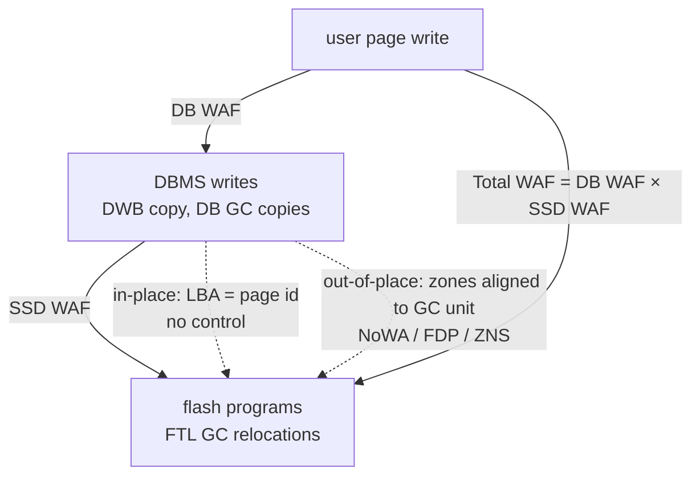

# How to Write to SSDs: total WAF is DB WAF times SSD WAF

Lee, Ziegler & Leis, "How to Write to SSDs" (VLDB'26; arXiv 2603.09927v3,
code at `LeeBohyun/ZLeanStore`), is the write-side half of this topic. The
io_uring paper next door asks how to get many I/Os in flight cheaply; this one
asks a question no amount of queue depth answers: *how many bytes of flash does
the device actually program for each page the database means to write?* Their
opening measurement is that an in-place B-tree engine on a 90%-full enterprise
SSD writes **18.85 KiB of flash per 4 KiB page write** (§1, Figure 1) — 4.7× —
and that the excess comes from two layers that multiply. The paper's argument is
that only the database knows enough to fix both, and that it can only do so if it
stops overwriting pages where they lie.

This chapter builds the flash mechanics from zero, then walks the paper's
optimizations in the order it stacks them in Table 1, and ties each one to lane
3 of this topic's bench — a **simulated** flash translation layer in
`experiments/src/ftl.rs`, whose numbers are a model's and are labelled as such
every time they appear. Section numbers, figures and tables are from the arXiv
v3 text ("Extended version of a paper accepted to PVLDB 2026"), which adds a
§10 FAQ the conference version does not have.

## The problem in one sentence

An SSD can never overwrite a page in place, so every page a database rewrites
is amplified once by the database's own crash-safety copies and again by the
device's garbage collector — and an engine that pins each page to a fixed
address has handed away the only lever on the second factor.

## The concepts, step by step

### Step 1 — flash cannot overwrite

> **In:** nothing yet — this step is the device model every later step uses.
> **Out:** the vocabulary (page, erase block, FTL, out-of-place write) and the
> reason a device must garbage-collect.

NAND flash has two units, and the whole paper lives in the gap between them.
A **flash page** (4–16 KiB, §2) is the unit the device can *program* (write).
An **erase block** is the much larger unit — many pages — the device can
*erase*, and a page can only be programmed again after its whole block has been
erased. Each erase-then-program is one **program/erase (P/E) cycle**, and flash
cells survive only a limited number of them (§2, "Background"), so device
lifetime is a budget of physical writes.

The device therefore never writes a page where it was. A host writes to a
**logical block address (LBA)**; the SSD's firmware, the **flash translation
layer (FTL)**, appends the data to a fresh flash page at some **physical block
address (PBA)**, updates its LBA→PBA map, and marks the old physical copy
invalid. That is an **out-of-place write**, and SSDs do it internally whether
the database asks for it or not (§5, "SSDs also perform out-of-place writes";
Figure 2b).

Real devices group erase blocks across planes and dies into a **superblock**,
the unit the controller appends to (§5.3, "Background"); this matters in Step 7.
The simulator in lane 3 is a page-mapped FTL of exactly this shape: one active
block, an LBA→PPA map, a per-block valid count. Its `program` is the
out-of-place write:

```rust
// experiments/src/ftl.rs:124-137 — Ssd::program, the device's only write path
124    fn program(&mut self, lba: u32) {
125        self.invalidate(lba);                       // the old copy becomes garbage
126        if self.wp == self.cfg.pages_per_block {
127            self.active = self.free.pop_front().expect("device out of erased blocks");
128            self.is_free[self.active as usize] = false;
129            self.wp = 0;
130        }
131        let ppa = self.active * self.cfg.pages_per_block + self.wp;
132        self.wp += 1;
133        self.l2p[lba as usize] = ppa;
134        self.p2l[ppa as usize] = lba;
135        self.valid[self.active as usize] += 1;
136        self.flash_writes += 1;                     // every program is a flash write
137    }
```

The line to focus on is 125: a host rewrite of LBA 7 does not touch the flash
page that held LBA 7. It only decrements that block's valid count. The space is
not free until the whole block is erased.

Why it matters: free space on an SSD is not reclaimed by writing; it is
reclaimed by erasing, and erasing works on blocks that may still hold live data.

### Step 2 — garbage collection, and the 1/(1 − v) law

> **In:** Step 1's blocks of mixed valid and invalid pages.
> **Out:** the write amplification factor and the formula that prices one GC
> cycle — the law every later step tries to bend.

When erased blocks run short, the device runs **garbage collection (GC)**: pick
a victim block, copy its still-valid pages elsewhere, erase it. Those copies are
writes the host never asked for. The **write amplification factor (WAF)** is
physical bytes written ÷ bytes requested. §2's illustration: a victim with two
valid pages means one logical write of page P costs three physical writes.

To keep GC possible at all, a device hides spare capacity the host can never
address: **over-provisioning (OP)**, typically 7–28% of capacity on commodity
SSDs (§5.1). The common victim policy is **greedy victim selection** — erase the
block (or zone) with the fewest valid pages — which §4.1 calls optimal under
uniform random writes.

The **valid ratio** v of a victim is its valid pages ÷ its total pages, and it
alone sets the price of a GC cycle (§4.1, Figure 4): reclaiming the victim frees
(1 − v) of its space and costs v of it in copies, so in steady state

```
WAF_GC = 1 / (1 − v)

§4.1, Figure 4:  6 of 8 pages valid → v = 0.75 → 1 / 0.25 = 4
lane 3 (simulated FTL, notes.md): out-of-place engine, aligned zones, uniform,
  mean victim valid ratio 0.805 → 1 / 0.195 = 5.13, and the measured DB WAF is 5.13
```

The symbols: v is the fraction of the victim still live; WAF_GC counts every
page written per page freed for the host. The simulator's greedy collector is
eight lines:

```rust
// experiments/src/ftl.rs:141-158 — Ssd::gc, greedy victim selection
141    fn gc(&mut self) {
142        let ppb = self.cfg.pages_per_block;
143        let victim = (0..self.valid.len() as u32)
144            .filter(|&b| b != self.active && !self.is_free[b as usize])
145            .min_by_key(|&b| self.valid[b as usize])        // greedy: fewest valid
146            .expect("no GC victim");
147        self.gcs += 1;
148        self.gc_valid += self.valid[victim as usize] as u64;
149        for p in victim * ppb..(victim + 1) * ppb {
150            let lba = self.p2l[p as usize];
151            if lba != NONE {
152                self.program(lba); // a relocation: flash write, no host write
153            }
154        }
        // ... 155–157: assert the victim is empty, return it to the free list ...
158    }
```

The line to focus on is 152: `program` increments `flash_writes` but nothing
increments `host_writes`. That asymmetry *is* write amplification.

Why it matters: every optimization in the paper is a way of making victims
emptier — lower v — or of making the device never need GC at all.

### Step 3 — the database amplifies first: DB WAF and the doublewrite buffer

> **In:** Step 2's WAF, now applied one layer up.
> **Out:** DB WAF, and the reason an in-place engine's DB WAF is 2.

A database page is bigger than what the device writes atomically — NVMe
guarantees atomicity only per sector, typically 512 B or 4 KiB, while pages are
8 KiB (PostgreSQL) or 16 KiB (MySQL) (§10.6). A power cut mid-write leaves a
**torn (partial) page write**: half old, half new, and the WAL cannot repair a
page whose base image is garbage. In-place engines therefore first write each
page to a **doublewrite buffer (DWB)** — a separate area — and only then
overwrite the home location (§2, "DB WAF"). MySQL, PostgreSQL (as full-page
images in the WAL), XtraDB and CedarDB all pay roughly 2× for it (§2, §10.6).

So the paper splits amplification by layer. **DB WAF** = bytes the DBMS writes
to the device ÷ "user writes" (evictions + checkpoints, §7.1). **SSD WAF** =
flash bytes physically programmed ÷ bytes the DBMS wrote — measured from the
device's **OCP log** (an Open Compute Project health log exposing physical write
counters, §1) where the drive supports it. Lane 3's in-place engine is the
textbook version:

```rust
// experiments/src/inplace.rs:44-51 — InPlaceDb::write_page
44    pub fn write_page(&mut self, pid: u32) {
45        let dwb = self.pages + self.dwb_next;          // a slot in the DWB region
46        self.dwb_next = (self.dwb_next + 1) % DWB_SLOTS;
47        self.ssd.write(dwb);                           // copy 1: the doublewrite
48        self.ssd.write(pid);                           // copy 2: home, LBA = page id
49        self.user += 1;
50        self.db += 2;                                  // DB WAF = 2.00 by construction
51    }
```

Line 48 is the in-place decision: LBA = page id, forever.

Why it matters: DB WAF = 2 is the price of torn-page safety in an in-place
design, and it buys nothing at the flash level.

### Step 4 — total WAF multiplies, and in-place forfeits the second factor

> **In:** DB WAF from Step 3 and SSD WAF from Step 2.
> **Out:** the paper's cross-layer metric, worked on Figure 1, and the argument
> that it forces out-of-place writes.

A page write is amplified by the DBMS and then each resulting write is amplified
by the SSD, so (§2):

```
Total WAF = DB WAF × SSD WAF

in-place LeanStore, Samsung PM9A3, 90% full, YCSB-A Zipf 0.8 (§2, Table 1):
   2.00 × 2.36 = 4.72
Figure 1: 18.85 KiB of flash per 4 KiB page write → 18.85 / 4 = 4.71 ("4.7×")
```

The two agree to rounding. **Zipf θ = 0.8** is the skew of the YCSB-A key
distribution: a few hot keys take most updates.

The decisive step of the argument (§2, "Out-of-place writes are essential"): an
in-place engine fixes each page's LBA, so it cannot choose *where* writes land —
the SSD sees whatever scatter of overwrites the eviction order produces, and the
engine "inherits the device's SSD WAF". Switch to out-of-place writes at the
database level (Figure 2c) and two things happen: the old version stays valid
until the new one is durable, so crash recovery can use it and the DWB
disappears; and the database now picks every write's address.

§2 also warns that the two factors trade off: an LSM engine lowering DB WAF by
more size tiering uses more space and can raise SSD WAF — and §10.1 works the
same trap for an out-of-place engine. Plotting fill factor of DB GC against WAF,
letting DB GC use 100% of capacity gives DB WAF ≈ 1.3 but SSD WAF ≈ 4.2, so
1.3 × 4.2 = **5.46** — worse than triggering DB GC earlier, at 85% fill, where
total WAF is **3.3**. Optimizing one layer alone moved the cost to the other.

The lane-3 simulator measures the in-place baseline as follows (notes.md; a
model, 1,000 addressable 1 MiB erase blocks + 100 OP blocks, greedy GC, one
stream, 90% fill):

```
in-place + doublewrite, uniform     DB 2.00  SSD 4.13  total 8.25
in-place + doublewrite, Zipf(0.8)   DB 2.00  SSD 4.46  total 8.91
```

The model's SSD WAF (4.13 / 4.46) is higher than the PM9A3's measured 2.36, and
that is expected of this model rather than evidence about real drives: it has
only 10% OP, one write stream shared by host writes and GC relocations, no
DRAM write buffer, and a greedy collector with no hot/cold awareness. Real
enterprise drives carry more spare area and buffering; the paper's own in-place
SSD WAF ranges from 1.93 to 2.68 across six devices (§7.4).

Why it matters: the product, not either factor, is what wears out the drive
and what the device's bandwidth is spent on.

### Step 5 — what it costs in lifetime: DWPD

> **In:** Step 4's write volumes.
> **Out:** the endurance arithmetic that turns a WAF into months.

Endurance is specified as **DWPD** — drive writes per day: how many times the
full capacity may be written daily over the warranty. §1: the PM9A3 is rated
for 5 years at 1 DWPD, "corresponding to an average write speed of only 11 MB/s",
while LeanStore writes about 400 MB/s, so the SSD "would reach its endurance
limit in about 1.5 months".

```
1 DWPD on 894 GB:   894 × 10⁹ B / 86,400 s = 10.3 MB/s   (paper says 11 MB/s)
lifetime at 400 MB/s: 5 years × 11 / 400 = 0.1375 years = 1.65 months  (paper: "about 1.5")
```

The paper's 11 MB/s does not match 894 GB ÷ one day by our arithmetic (10.3);
it would match a ~950 GB rated capacity, which the text does not state. The
conclusion survives either number — weeks to months, not years.

Why it matters: WAF is not only a throughput tax; at OLTP write rates it decides
whether the drive lasts its warranty.

### Step 6 — reduce DB WAF: compression and page packing

> **In:** the out-of-place engine of Step 4, which can write variable-size pages
> anywhere.
> **Out:** the first DB-side optimization and its read-side constraint.

Out of place, a page no longer needs a fixed 4 KiB slot, so the engine can
compress each page before writing a batch sequentially and record its new
offset and size (§3.1). The **compression ratio** (compressed ÷ original, lower
is better) the paper measured (§3.1):

| dataset | TPC-C | YCSB | Email | URL | Wiki |
|---|---|---|---|---|---|
| LZ4 | 49.0% | 41.2% | 40.1% | 25.0% | 31.3% |
| ZSTD | 36.5% | 34.4% | 27.4% | 14.5% | 17.8% |

— "14% to 49%". LZ4 costs about 2–3 cycles/byte to compress and 0.5–1 to
decompress (§3.1).

The catch is reads. §3.2's FIO run on four enterprise SSDs (Micron 7450 PRO,
Samsung PM9A3, Solidigm D7-P5520, Kioxia CM7-R; 512 B to 8 KiB reads) found
aligned 4 KiB reads give the lowest latency and highest throughput. A 3,000 B
compressed page that straddles a 4 KiB boundary needs two 4 KiB reads; at 512 B
granularity it still spans 7 sectors:

```
two 4 KiB reads:  8,192 / 3,000 = 2.73×  (§3.2, Figure 3a)
seven 512 B reads: 3,584 / 3,000 = 1.19× (Figure 3b)
```

**Page packing** fixes this: bin-pack compressed pages into 4 KiB slots so none
crosses a boundary, and every page is one aligned 4 KiB read (Figure 3c).

Why it matters: in Table 1 compression is the single largest DB WAF reduction
(4.06 → 0.62), partly because it shrinks the data and partly because the space
it frees becomes OP for DB GC (§7.2).

### Step 7 — reduce DB WAF under skew: deathtime grouping

> **In:** Step 2's greedy GC, now run by the database over its own zones.
> **Out:** GDT placement, the EDT estimator, and GDT-aware GC.

The out-of-place engine divides its space into **zones** — the database's GC
unit — and appends to an **active zone**; several zones appended concurrently
form an **active group** (§5.3). Greedy victim selection is optimal for uniform
writes but not under skew, because hot and cold pages share zones and keep
victims' valid ratios high (§4.1).

A page's **deathtime** is when it will next be overwritten (invalidated).
**Grouping by Death Time (GDT)** (§4.2) places pages that will die together in
the same zone, so a zone empties all at once. Figure 5: eight pages with
deathtimes 1, 2, 4, 6, 35, 50, 60, 74; placed randomly, the victim at LSN 10 is
50% valid; grouped, victim zone 0 is 0% valid.

The estimate, **EDT** (expected deathtime), extrapolates each page's recent
write interval from a write history WH of its last n write LSNs stored in the
page header (§4.2; the formula is garbled in the extracted text and is
reconstructed here as the mean interval):

```
EDT = current_lsn + (WH_n − WH_1) / (n − 1)

worked, n = 4, invented history WH = [100, 160, 220, 300], current_lsn = 310:
   (300 − 100) / 3 = 66.7  →  EDT = 310 + 66.7 = 376.7
```

GC writes do not update WH; first writes are grouped by B-tree index id instead.
GDT placement only works with **GDT-aware GC** (§4.2): victims' valid pages are
sorted by descending EDT and rewritten into zones of matching EDT, read-only
pages get the maximum EDT, and after each cycle the newly emptied zone takes the
shortest-lived range.

Lane 3's reference numbers show why this matters for the stub you will write:
under Zipf(0.8), greedy out-of-place DB WAF rises from 5.13 to 6.36 (simulated,
notes.md) — the skew penalty GDT is designed to remove. Table 1's GDT row moves
DB WAF only 0.62 → 0.59 because compression already freed so much space.

Why it matters: the DBMS knows hotness and access patterns that the SSD and the
file system cannot see — this is the paper's case for doing GC at the top.

### Step 8 — reduce SSD WAF: align the database's GC unit with the device's

> **In:** Step 7's zones, and Step 1's superblocks.
> **Out:** why zone size decides SSD WAF, and how to infer the device's unit.

With the database appending sequentially into zones, the SSD receives each zone
as a run of writes. If a zone exactly fills one superblock and only one zone is
open, then when DB GC later rewrites that zone, every page of the old superblock
is invalidated at once — the SSD's victim is empty and its WAF is 1 (§5.3,
Figure 6). If the zone is half a superblock, two zones with different deathtimes
share every superblock, and rewriting one leaves it half valid (Figure 7).

Most SSDs do not publish their GC unit. **Flexible Data Placement (FDP)**, an
NVMe feature, does: it exposes the **reclaim unit (RU)**, the smallest unit the
SSD's GC operates on (§5.3). For others the paper infers an upper bound by
growing the zone until SSD WAF first reaches 1 under a single-active-zone
pattern: on FDP SSD A (RU = 8,496 MB) WAF drops to 1 at 16 GB; on the four
non-FDP enterprise drives the inferred unit "typically falls between 4 GB and
8 GB", and 32 GB is the recommended safe bound without OCP or FDP (§5.3).

This is the configuration lane 3's first stub test pins: one open zone of exactly
one erase block must give SSD WAF = 1.00, and half-block zones must give more
than 1.5. The reference implementation (notes.md, simulated):

```
uniform, zone = erase block, 1 open   DB 5.13  SSD 1.00  total 5.13
uniform, zone = ½ erase block, 1 open DB 5.00  SSD 2.00  total 10.00
```

Why it matters: SSD WAF is not a property of the drive; it is a property of the
write stream, and the database writes the stream.

### Step 9 — many writers: multiplexing, NoWA, FDP and ZNS

> **In:** Step 8's single-zone result.
> **Out:** what breaks with several open zones, and the three ways to restore
> SSD WAF = 1.

With many threads, several zones are appended at once, and a standard SSD
interleaves them into the same superblocks — **multiplexing** (§5.4). It only
hurts if zones in the same active group are invalidated at different rates
(Figure 8 vs Figure 9). Lane 3 shows the shape (simulated, notes.md): two open
erase-block zones raise SSD WAF to 2.02 (uniform) and 2.97 (Zipf 0.8); four
quarter-block zones reach 4.43 and a total of **21.39 against in-place's 8.25** —
out-of-place done carelessly is 2.6× *worse* than in-place.

Three fixes, by device type:

- **NoWA** ("No Write Amplification", §5.4) for commodity drives: (1) do not open
  new zones until all open zones are full; (2) detect frequency imbalance within
  an active group and issue a **compensation write** that recompacts the
  under-represented zone's scattered pages, before the SSD's free-space
  threshold. It shifts a little WA from the SSD to DB GC (Table 1: DB WAF
  0.59 → 0.60, SSD WAF 1.96 → 1.07). Zone sizing is flexible as long as
  max open zones × zone size equals or is a multiple of the inferred GC unit.
  The paper's §5.4 example for FDP SSD A is 16 zones × 513 MB or 8 × 1,026 MB;
  both products are 8,208 MB, which is not equal to the 8,496 MB RU §5.3 gives
  for that drive. The text does not reconcile the two (a MB/MiB mix is one
  possibility), so treat the example as illustrative of the rule, not as a
  checked configuration.
- **FDP placement hints** (§5.5): FDP drives expose **RU handles**, each managing
  disjoint RUs; tagging zone writes with placement id = zone mod handle count
  keeps zones from mixing, so NoWA is unnecessary while open zones ≤ handles.
- **ZNS** (Zoned Namespace) SSDs (§5.1) expose zones directly, require
  sequential writes within each, leave GC entirely to the host and need no OP —
  SSD WAF is 1 by construction, and the returned capacity acts as extra OP for
  DB GC.

A drive with neither is a **CNS** (conventional namespace) SSD. Note one thing
the paper's engine does *not* lean on: **TRIM** (telling the device an LBA is
dead). The evaluation only issues `blkdiscard` before each run (§7.1); the
NoWA and alignment results come from write *placement*, which is why lane 3's
stub specification says not to TRIM either.

Why it matters: multi-threaded engines are the normal case, so alignment alone
is not enough; the database has to manage stream separation too.

### Step 10 — ZLeanStore, and the evidence

> **In:** every optimization from Steps 6–9.
> **Out:** the implementation that carries them, and the numbers.

ZLeanStore (§6) is LeanStore converted to out-of-place writes, using vmcache as
the buffer pool to allow 1:N PID-to-offset mappings. Four components change:
the buffer manager computes EDTs; the I/O interface compresses, page-packs and
picks a backend — an io_uring backend for standard SSDs, zone-append for ZNS,
placement hints for FDP; the space manager keeps `PID2OffsetTable` (PID → offset
and compressed size), `StorageSpace` (the reverse map plus zone metadata) and
`ActiveGroupHistory` (for NoWA); and GC runs greedy, GDT or NoWA-aware victim
selection. Recovery logs `PID2Offset` updates under a write-ahead rule — page
data durable before its mapping update commits — and checkpoints snapshot the
mapping tables (§6.2).

Setup (§7.1): AMD EPYC 9654P (96 cores, 360 GB DRAM, 64 workers) and Intel Xeon
Gold 6342 (64 cores, 500 GB, 32 workers, for FDP drives); `blkdiscard` before
each run; runs until cumulative writes reach 4× device capacity; metrics over
the final hour. Table 1 (YCSB-A Zipf 0.8, 800 GB on the 894 GB PM9A3):

| version | K OPS | DB WAF | SSD WAF | logical B/op | physical B/op | hit ratio |
|---|---|---|---|---|---|---|
| in-place | 229 | 2.00 | 2.36 | 1,858 | 4,378 | 0.932 |
| → out-of-place | 230 | 4.06 | 1.94 | 3,745 | 7,274 | 0.918 |
| + comp. + pagepack | 380 | 0.62 | 1.95 | 566 | 566 | 0.929 |
| + GDT | 458 | 0.59 | 1.96 | 566 | 1,110 | 0.931 |
| + NoWA | 510 | 0.60 | 1.07 | 567 | 606 | 0.931 |
| + aligning GC unit | 535 | 0.60 | 1.00 | 567 | 567 | 0.931 |
| − comp. | 328 | 3.58 | 1.00 | 3,364 | 3,364 | 0.927 |

(Some physical-bytes cells do not equal logical × SSD WAF exactly; the paper
reports them as measured.) Worked:

```
the negative intermediate result:  4.06 × 1.94 = 7.88  vs  2.00 × 2.36 = 4.72
                                   → 7.88 / 4.72 = 1.67  (§7.2: "increasing total WAF by 1.66×")
all optimizations:                 4.72 / (0.60 × 1.00) = 7.87  (§1, §7.2: "7.8×")
throughput:                        535 / 229 = 2.34×
logical writes:                    1,858 / 566 = 3.28 ("3.27×"); without compression 3,364 / 1,858 = 1.81×
```

Across devices (§7.4, Figure 14), total WAF falls 3.85 → 0.62 on the Solidigm
D7-P5520 (6.2×) and 5.37 → 0.55 on the Kioxia CM7-R (9.76×); in-place SSD WAF
spans 1.93–2.68, out-of-place stays near 1 except the Solidigm (1.12). ZNS vs
CNS (Table 2, 800 GB): 156.8 K OPS in-place CNS, 322.2 out-of-place CNS, 330.3
ZNS — 2.1× and 1.03×; at 1,500 GB ZNS beats CNS 328.9 vs 250.7 (31%), and at
equal fill (1,596 GB on ZNS) only ~10% (277.5). FDP (Table 3, 1.6 TB): in-place
2.00 × 1.98 = 3.96 at 437 K; NoWA 0.57/1.00/0.57 at 541 K; FDP hints instead of
NoWA 0.54/1.00/0.54 at 553 K. Dataset sweep (Figure 15): in-place total WAF
2.33 (160 GB) → 4.72 (800 GB); all optimizations 0.53–0.60; without compression
1.08 → 3.58. TPC-C at 15,000 warehouses on FDP SSD A (§7.6): 2.45× more
new-order transactions in the same runtime, and 7.2× more flash writes for
in-place at equal transaction counts.

Why it matters: the order of Table 1's rows is the paper's real lesson — the
first change (going out of place) makes things worse, and only the stack does
better.

### Step 11 — why the DBMS, not the SSD or the file system (§10)

> **In:** Step 10's results.
> **Out:** the paper's defence of the layering choice.

§10.1: SSDs cannot infer workload structure cheaply — the authors' prior study
found enterprise SSDs at WAF 3–4.8 on a simple 90:10 hot/cold workload, tracking
greedy GC — and file systems sit between with neither the workload knowledge nor
control of SSD placement. §10.4 measures in-place LeanStore on three file
systems: ext4 4.87 total WAF at 212 K OPS, F2FS 5.13 at 199 K, XFS 4.83 at 212 K,
against 4.72 / 237 K on the raw device — "the filesystem does not improve WAF".
§10.6 defends the DWB baseline (InnoDB default; PostgreSQL full-page writes;
SQLite rollback journal); §10.7 gives per-system DB WAF formulas for MySQL,
PostgreSQL, WiredTiger and RocksDB.

Why it matters: it is the honest list of the assumptions — raw block device,
single instance, single device (§10.5) — under which the numbers hold.

## How to read the paper

Read §1 and Figure 1, then §2 with Steps 1–4 beside you; the total-WAF equation
is the whole spine. Read §7.2's Table 1 *before* §3–§5: each row names the
section that justifies it, and knowing the row's effect makes each section
shorter. Then §3 (compression, packing), §4 (GC, GDT), §5 (the SSD side —
Figures 6–9 are the core; draw them yourself with four pages per superblock).
§6 is the implementation; skim it unless you are building M45. §7.4–7.6 are
robustness. Read §10 last; §10.1's fill-factor example and §10.4's file-system
table are the two parts worth keeping.

Then open lane 3: `ftl.rs` is Steps 1–2, `inplace.rs` is Step 3, and the
stub `oop.rs` is Steps 7–9 without GDT or NoWA. Its four tests restate §5.3
Figures 6–7, §4.1's 1/(1 − v), and the claim that aligned out-of-place beats
in-place.



## Questions to answer while reading

- Why does Table 1's first out-of-place row have *lower* SSD WAF (1.94) than
  in-place (2.36) but higher total WAF? Which factor moved, and why?
- §10.1 says DB WAF and SSD WAF "contend for OP space". Using Step 2's law,
  explain what happens to each victim's valid ratio as DB GC is allowed more of
  the capacity.
- Lane 3 uses no TRIM. Predict which configurations' SSD WAF would fall if DB GC
  trimmed every zone it freed, and which would not change at all.
- The in-place model in lane 3 shows SSD WAF 4.13 against the paper's measured
  2.36. List every way the model differs from a PM9A3 and say which direction
  each pushes WAF.
- Why does compression help DB WAF more than by its ratio alone? (§7.2:
  compression "expanding OP space to 53% of the SSD and reducing the GC valid
  ratio from 75% to 14%".)

## Done when

Answer each before unfolding it.

- [ ] You can explain why an SSD amplifies writes even when the host writes each page exactly once per update.

  <details><summary>Answer</summary>

  Flash programs pages but erases only whole erase blocks, so every rewrite goes
  to a new physical page and the old one is merely marked invalid (an
  out-of-place write inside the FTL). Reclaiming space means erasing blocks that
  usually still hold valid pages, which must be copied first; those copies are
  physical writes nobody asked for. Under greedy GC each reclaimed block costs
  1/(1 − v) writes per freed page — 4 at v = 0.75 (§4.1).

  </details>

- [ ] You can state the total-WAF equation and verify it on Figure 1.

  <details><summary>Answer</summary>

  Total WAF = DB WAF × SSD WAF (§2). For in-place LeanStore on the PM9A3,
  2.00 (doublewrite) × 2.36 (device GC) = 4.72; Figure 1 reports 18.85 KiB of
  flash per 4 KiB page write, 18.85 / 4 = 4.71. Same number from two
  measurements.

  </details>

- [ ] You can say why an in-place engine cannot reduce SSD WAF, and the two things switching out of place buys.

  <details><summary>Answer</summary>

  In place, a page's LBA is its page id forever, so the write stream the SSD
  sees is dictated by eviction order and the engine inherits whatever WAF the
  device produces from it. Out of place, the old version stays valid until the
  new one is durable — so crash recovery uses it and the doublewrite buffer
  goes, halving DB-issued bytes — and the database chooses every address,
  which is what makes compression, GDT, zone alignment and NoWA possible (§2).

  </details>

- [ ] You can explain why going out of place first made things worse in the paper, and reproduce the shape in lane 3.

  <details><summary>Answer</summary>

  Removing the DWB is not free: an out-of-place engine at 90% fill needs its own
  greedy GC, and DB WAF jumped 2.00 → 4.06; SSD WAF only fell 2.36 → 1.94 because
  16 open 250 MB zones still multiplex inside the drive. 4.06 × 1.94 = 7.88 vs
  4.72, a 1.67× increase (§7.2, Table 1). Lane 3's simulated reference shows the
  same shape: four quarter-block zones open give total WAF 21.39 against
  in-place 8.25, while one erase-block-aligned zone gives SSD WAF 1.00 and total
  5.13 (notes.md — a model, not a drive).

  </details>

- [ ] You can explain why a zone the size of the SSD's GC unit gives SSD WAF = 1, and how the paper finds that size.

  <details><summary>Answer</summary>

  With one open zone filling exactly one superblock, DB GC's later rewrite of the
  zone invalidates every page of that superblock, so the SSD's greedy victim is
  empty and relocates nothing (§5.3, Figure 6). Smaller zones put two lifetimes
  in one superblock (Figure 7). FDP drives report the reclaim-unit size directly
  (FDP SSD A: 8,496 MB, WAF reaches 1 at 16 GB zones); otherwise grow the zone
  under a ZNS-like pattern until WAF first hits 1 — 4–8 GB on the paper's
  non-FDP drives, 32 GB as a safe default.

  </details>

- [ ] You can compute an EDT and say what GDT does with it.

  <details><summary>Answer</summary>

  EDT = current_lsn + (WH_n − WH_1)/(n − 1), the mean interval of the page's
  last n write LSNs extrapolated forward (§4.2; reconstructed from the garbled
  extraction). With WH = [100, 160, 220, 300] and current_lsn = 310:
  200/3 = 66.7, EDT = 376.7. GDT appends each evicted page to the active zone
  with the closest average EDT, and GDT-aware GC rewrites victims' valid pages
  sorted by EDT into matching zones, so zones die whole and victims are nearly
  empty.

  </details>

- [ ] You can name the three ways to keep SSD WAF at 1 with many threads, and which hardware each needs.

  <details><summary>Answer</summary>

  NoWA on any commodity SSD — open no new zone until all open zones are full,
  and correct frequency imbalance with compensation writes before the SSD hits
  its free-space threshold (§5.4); FDP placement hints on FDP drives — map zones
  to RU handles so streams never mix (§5.5); ZNS drives, which have no device GC
  at all (§5.1). Table 3 on FDP SSD A: NoWA 0.57 total WAF at 541 K OPS, FDP
  hints 0.54 at 553 K.

  </details>

- [ ] You can say which abstract figures you verified and which you could not.

  <details><summary>Answer</summary>

  Verified: 6.2–9.8× fewer flash writes per op on YCSB-A — §7.4, Solidigm
  D7-P5520 3.85 → 0.62 (6.2×) to Kioxia CM7-R 5.37 → 0.55 (9.76×); TPC-C 2.45×
  throughput and 7.2× fewer flash writes (§7.6); Figure 1's 18.85 KiB, 7.8× and
  ≈2× (470 vs 238 K OPS, 1.97×). Not verified: the abstract's "1.65–2.24×"
  throughput range. No table or figure in the text read gives it, and Table 1's
  own ratio is 535 / 229 = 2.34×, outside the range; it presumably comes from
  per-device throughput in Figure 14's experiments, which the paper does not
  tabulate. Also inexact: 1 DWPD on 894 GB is 10.3 MB/s by our arithmetic, not
  the stated 11 MB/s.

  </details>

## References

**Paper** — Bohyun Lee, Tobias Ziegler, Viktor Leis, "How to Write to SSDs",
PVLDB 2026; extended version arXiv:2603.09927v3 (18 Mar 2026). Code:
[github.com/LeeBohyun/ZLeanStore](https://github.com/LeeBohyun/ZLeanStore).

| where | what |
|---|---|
| §1, Figure 1 | 18.85 KiB per page write; 7.8× reduction; 238 → 470 K OPS; DWPD arithmetic |
| §2, Figure 2 | flash mechanics; DWB; Total WAF = DB WAF × SSD WAF; 2.0 × 2.36 |
| §3.1–3.2, Figure 3 | compression ratios (14–49%); LZ4 cycles/byte; page packing; 2.73× and 1.19× read amplification |
| §4.1–4.2, Figures 4–5 | greedy GC, 1/(1 − v); GDT, EDT |
| §5.1–5.5, Figures 6–11 | ZNS; superblocks and GC-unit alignment; inferred 4–8 GB; NoWA; FDP hints |
| §6 | ZLeanStore: vmcache, PID2OffsetTable, StorageSpace, ActiveGroupHistory, backends, recovery |
| §7.1–7.6, Tables 1–3, Figures 13–16 | setup; drilldown; devices; ZNS/FDP; dataset sweep; TPC-C |
| §10.1–10.7 | total WAF argument; file systems; DWB necessity; DB WAF per system |

**This topic's code** — `topics/45-async-io/experiments/src/`: `ftl.rs`
(`Ssd::program` :124-137, `Ssd::gc` :141-158, `Waf` :168-188 — `total()` is
flash ÷ user, :185-187), `inplace.rs` (`write_page` :44-51), `oop.rs` (the
stub, `run_out_of_place` :79). Lane-3 numbers are from a simulated FTL and are
recorded in [notes.md](notes.md).
