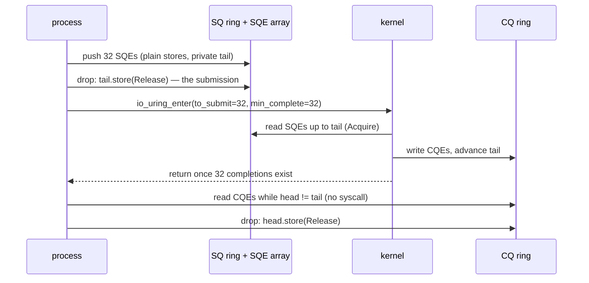

# tokio-rs/io-uring: two rings, four atomics, one syscall

The io_uring paper ([reading-iouring-vldb26.md](reading-iouring-vldb26.md))
describes the interface in one paragraph — two ring buffers shared between the
process and the kernel, requests in one, results in the other, one system call
to hand over a whole batch — and then spends twelve pages on what it costs.
This chapter reads the interface itself, in the Rust crate this topic's lane 2
is written against: `io-uring` (tokio-rs/io-uring), the thinnest safe-ish
wrapper there is over the raw kernel ABI. It is small enough to read whole —
`squeue.rs` is 570 lines, `cqueue.rs` 507, `submit.rs` 915 — and the parts
that matter are about forty lines. By the end you can say exactly which
instruction publishes a request to the kernel, which one consumes a result,
why neither is a system call, and what the one system call that remains
actually carries.



One crossing per batch (the `io_uring_enter` arrow); everything else is loads
and stores to memory both sides can see. Steps 2–6 take each arrow in turn.

Every anchor below is `tokio-rs/io-uring` at commit `a517178` (master; the
crate's `Cargo.toml` there says version 0.7.15, the same version lane 2's
`Cargo.lock` resolves from crates.io), quoted with the line numbers the code
occupies at that commit. The clone is recorded in the pin table in
`resources/codebases.md`.

## The problem in one sentence

A synchronous `pread` makes the CPU cross into the kernel and back once per
I/O — lane 1c measured about 424 ns of that crossing on top of 188 ns of real
work per cached 4 KiB page — so how do you hand the kernel thirty-two reads,
and collect thirty-two results, while crossing once or not at all?

## The concepts, step by step

### Step 1 — what is being removed: the per-I/O system call

> **In:** nothing yet — this step is the motivation, and it uses lane 1c's
> numbers from [notes.md](notes.md).
> **Out:** the quantity every later step attacks: crossings into the kernel
> per I/O.

A **system call** (syscall) is a request from a user program to the operating
system kernel, made by executing a special instruction that switches the CPU
into kernel mode, runs the kernel's handler, and switches back. The switch
itself costs time independent of the work requested: registers are saved,
privilege changes, mitigations for speculative-execution attacks flush or
fence state. Call that the **per-call cost**; the work the call does (find the
page, copy 4 KiB) is the **per-item cost**.

Lane 1c separated the two on this machine by reading cached pages one per
`pread` and then b per `preadv`:

```
   pages/call    ns per page
            1            612
           64            195
```

Model the cost of one call that moves b pages as `call + b × item`. Then
`(call + item) / 1 = 612` and `(call + 64 × item) / 64 = 195`, so
`64 × 195 = 12,480 = call + 64 × item`. Subtracting the first equation:
`63 × item = 12,480 − 612 = 11,868`, item = **188 ns**, call = 612 − 188 =
**424 ns**. Two thirds of a cached read is the crossing.

Why it matters: an engine doing a million 4 KiB reads a second spends 0.42 s of
every CPU second just crossing, before any device latency. Batching b requests
per crossing divides that term by b; a design with *no* crossing on the fast
path removes it. io_uring is built to do both, and the rest of this chapter is
how.

### Step 2 — three shared mappings, created by one setup call

> **In:** the goal from Step 1 — talk to the kernel without a syscall per
> request.
> **Out:** three memory regions mapped into the process, which every later
> step reads and writes: the submission ring, the SQE array, and the completion
> ring.

A **memory mapping** (`mmap`) makes a region of memory addressable from the
process; when the region is backed by a kernel object, the kernel and the
process see the *same bytes*. That is the trick: if both sides can read and
write shared memory, a request can be handed over by writing it there, with no
syscall at all.

`io_uring_setup(entries, &params)` creates the kernel object and returns a file
descriptor; the crate then maps three regions from it at fixed offsets:

```rust
// src/lib.rs:160-185 — IoUring::with_params and setup_queue, at a517178
//   (166-177 are comments and the nested fn's signature, elided)
160      fn with_params(entries: u32, mut p: sys::io_uring_params) -> io::Result<Self> {
161          let fd: OwnedFd = unsafe { OwnedFd::from_raw_fd(sys::io_uring_setup(entries, &mut p)?) };
162          unsafe { Self::with_fd_and_params(fd, p) }
163      }
         // ... 164-177: with_fd_and_params, comments, setup_queue's signature ...
178              let sq_len = p.sq_off.array as usize + p.sq_entries as usize * mem::size_of::<u32>();
179              let cq_len = p.cq_off.cqes as usize + p.cq_entries as usize * mem::size_of::<C>();
180              let sqe_len = p.sq_entries as usize * mem::size_of::<S>();
181              let sqe_mmap = Mmap::new(fd, sys::IORING_OFF_SQES as _, sqe_len)?;
182  
183              if p.features & sys::IORING_FEAT_SINGLE_MMAP != 0 {
184                  let scq_mmap =
185                      Mmap::new(fd, sys::IORING_OFF_SQ_RING as _, cmp::max(sq_len, cq_len))?;
```

The line to focus on is **161**: the only system call in this whole step, and
the one that fails with `EPERM` inside a default Docker container — lane 2's
probe hits exactly this call. Then three regions:

- the **SQE array** (line 181): a plain array of **submission queue entries**
  (SQEs), 64 bytes each (`squeue::Entry` wraps the kernel's `io_uring_sqe`,
  `src/squeue.rs:62-63`). An SQE is one request: opcode, file descriptor,
  buffer address, length, offset, and a 64-bit **user_data** the kernel will
  echo back.
- the **submission ring** (SQ ring): the head and tail counters (Step 3) plus,
  on older kernels, an index array into the SQE array (the `sq_off.array` term
  on line 178).
- the **completion ring** (CQ ring): head and tail counters plus the array of
  **completion queue entries** (CQEs), 16 bytes each — a `user_data`, a
  `result` (bytes read, or `-errno`), and flags.

When the kernel advertises `IORING_FEAT_SINGLE_MMAP` (line 183), the SQ and CQ
rings share one mapping (line 185), sized to the larger of the two.

Why it matters: after line 161 returns, nothing else in the I/O path needs the
kernel's attention to *exchange* data. What remains is telling the kernel to
*look* (Step 5) — and with `SQPOLL`, not even that.

### Step 3 — a ring is a head, a tail and a mask

> **In:** the two rings mapped in Step 2.
> **Out:** the index arithmetic both sides use to find an entry, which Steps 4
> and 6 rely on.

A **ring buffer** is a fixed array used as a queue by two counters that only
ever increase: the **producer** writes at `tail` and then increments it, the
**consumer** reads at `head` and then increments it. The queue holds
`tail − head` entries. Because the counters never wrap back to zero by
themselves, the array slot is `counter mod size`; with the size a power of
two, `mod size` is `counter & mask` where `mask = size − 1`.

The crate's view of each ring is exactly those fields, as raw pointers into the
shared mapping:

```rust
// src/squeue.rs:13-29 — the submission ring's shared state, and the borrowed view
13  pub(crate) struct Inner<E: EntryMarker> {
14      pub(crate) head: *const atomic::AtomicU32,
15      pub(crate) tail: *const atomic::AtomicU32,
16      pub(crate) ring_mask: u32,
17      pub(crate) ring_entries: u32,
18      pub(crate) flags: *const atomic::AtomicU32,
19      dropped: *const atomic::AtomicU32,
20  
21      pub(crate) sqes: *mut E,
22  }
23  
24  /// An io_uring instance's submission queue. This is used to send I/O requests to the kernel.
25  pub struct SubmissionQueue<'a, E: EntryMarker = Entry> {
26      head: u32,
27      tail: u32,
28      queue: &'a Inner<E>,
29  }
```

Lines 14–15 are the shared counters; lines 26–27 are the crate's **private
copies**. That split is the design: the user side mutates its private `tail`
as often as it likes and *publishes* it to the shared one only once (Step 4).

For the SQ ring the process is the producer and the kernel the consumer; for
the CQ ring it is the other way round. So each side writes exactly one counter
per ring and only reads the other — four **atomics** in all (an atomic is a
memory word whose loads and stores are indivisible and carry ordering
guarantees, Step 4), and never two writers on one word, which is why no lock
is needed.

Worked: ring_entries = 8, so mask = 7. The process has pushed 13 SQEs in its
life and the kernel has consumed 10: tail = 13, head = 10, the queue holds
13 − 10 = **3** entries, in slots 10 & 7 = 2, 11 & 7 = 3, 12 & 7 = **4**. The
next push goes to slot 13 & 7 = **5**. Full is `tail − head == 8`. (The
subtraction is `wrapping_sub` in the crate, `src/cqueue.rs:312`, so it stays
right when the u32 counters overflow after 2³² entries.)

Why it matters: a request is "in the SQ" when it sits between head and tail —
not when a syscall says so. Steps 4 and 6 are about who may move each counter,
and when the other side is allowed to look.

### Step 4 — `push` writes the SQE; dropping the queue publishes it

> **In:** the SQ ring and its private tail from Step 3, plus an SQE built by an
> opcode (lane 2 uses `opcode::Read`).
> **Out:** an SQE the kernel is *allowed* to see, published with one release
> store — the input to Step 5.

```rust
// src/squeue.rs:334-379 — push, push_unchecked, and the Drop that publishes
//   (342-363: push_multiple, the same thing in a loop, elided)
334      pub unsafe fn push(&mut self, entry: &E) -> Result<(), PushError> {
335          if !self.is_full() {
336              self.push_unchecked(entry);
337              Ok(())
338          } else {
339              Err(PushError)
340          }
341      }
         // ... 342-363: push_multiple ...
364      #[inline]
365      unsafe fn push_unchecked(&mut self, entry: &E) {
366          *self
367              .queue
368              .sqes
369              .add((self.tail & self.queue.ring_mask) as usize) = entry.clone();
370          self.tail = self.tail.wrapping_add(1);
371      }
372  }
373  
374  impl<E: EntryMarker> Drop for SubmissionQueue<'_, E> {
375      #[inline]
376      fn drop(&mut self) {
377          unsafe { &*self.queue.tail }.store(self.tail, atomic::Ordering::Release);
378      }
379  }
```

Lines 366–369 copy 64 bytes into slot `tail & mask` of the shared SQE array —
Step 3's arithmetic, verbatim. Line 370 bumps the **private** tail. Nothing the
kernel can see has changed yet. The line to focus on is **377**: when the
`SubmissionQueue` view is dropped, the private tail is stored into the shared
one with `Ordering::Release`.

**Release** ordering on a store means: every memory write this thread made
*before* the store becomes visible to any thread that later reads the stored
value with **Acquire** ordering. The kernel reads the SQ tail with acquire
semantics, so the moment it sees tail = 14 it is guaranteed to see the 64 bytes
written into slot 13 & mask. Without release, a CPU or compiler could make the
new tail visible before the SQE bytes, and the kernel would read a
half-written request. That one ordered store *is* the submission; it costs a
few nanoseconds and no crossing.

Notice what this buys a batch: push 32 SQEs and the shared tail is written
once, at drop. Lane 2's reference loop holds the `SubmissionQueue` for exactly
one batch (`ring.submission()`, push b entries, drop), so a batch is b × 64
bytes of copies and one release store.

And notice `push` is `unsafe` (line 334). The doc comment above it
(`src/squeue.rs:329-332`) states the contract: the buffer an SQE points at must
stay valid "for the entire duration of the operation". Between this store and
the matching CQE the kernel owns that buffer. That is topic 7's buffer-ownership
inversion ([reading-c10k-thread-per-core.md](../07-networking-protocols/reading-c10k-thread-per-core.md),
Step 4), and it is why lane 2 keeps a fixed pool of `qd` page-aligned buffers
and only reuses a slot after its CQE has been reaped.

Why it matters: the expensive part of submission is not making the request
visible; Step 5 is about the part that is still expensive.

### Step 5 — `submit_and_wait`: the one syscall, and what it carries

> **In:** SQEs published by Step 4 (shared tail ahead of shared head).
> **Out:** one `io_uring_enter` call that tells the kernel how many SQEs to
> consume *and* how many completions to wait for — or, under SQPOLL, no call
> at all.

Publishing an SQE makes it visible; it does not make the kernel look. Unless a
kernel thread is polling the ring (SQPOLL, below), someone has to tell it,
and that is `io_uring_enter(fd, to_submit, min_complete, flags, …)`:

```rust
// src/submit.rs:171-217 — Submitter::submit_and_wait
//   (175-182: a comment about loading sq_flags twice, elided)
171      pub fn submit_and_wait(&self, want: usize) -> io::Result<usize> {
172          let len = self.sq_len();
173          let mut flags = EnterFlags::empty();
         // ... 174-182: comment ...
183          let sq_flags = self.load_sq_flags();
184          let sq_cq_overflow = sq_flags & sys::IORING_SQ_CQ_OVERFLOW != 0;
185          let sq_taskrun = sq_flags & sys::IORING_SQ_TASKRUN != 0;
         // ... 186-193: comment on NODROP overflow ...
194          let need_syscall = (sq_cq_overflow && self.params.is_feature_nodrop()) || sq_taskrun;
195  
196          // Deferred task work is only run by an enter carrying GETEVENTS.
197          if want > 0 || self.params.is_setup_iopoll() || sq_cq_overflow || sq_taskrun {
198              flags.insert(EnterFlags::GETEVENTS);
199          }
200  
201          if self.params.is_setup_sqpoll() {
202              // See discussion in [`SubmissionQueue::need_wakeup`].
203              atomic::fence(atomic::Ordering::SeqCst);
204              if self.sq_need_wakeup() {
205                  flags.insert(EnterFlags::SQ_WAKEUP);
206              } else if want == 0 && !need_syscall {
                     // ... 207-211: comment ...
212                  return Ok(len);
213              }
214          }
215  
216          unsafe { self.enter::<libc::sigset_t>(len as _, want as _, flags.bits(), None) }
217      }
```

The line to focus on is **216**: one `io_uring_enter` whose `to_submit` is
`len` — **every** SQE between the shared head and tail (line 172), however many
were pushed — and whose `min_complete` is `want`. One crossing therefore does
two jobs: hand over a batch, and sleep until `want` completions exist. That is
why lane 2's specification says `submit_and_wait(min(batch, in_flight))`: in
steady state each crossing submits a batch and returns when enough slots have
freed for the next one, so a run of n reads costs about n / batch crossings.
Worked for the lane's `QD 32, batch 32` row with 20,000 reads: 20,000 / 32 =
**625** enters, against 20,000 `pread` calls in lane 1a — the bound the stub
test checks is n / batch + qd + 1, i.e. 625 + 33 = 658 for that row.

`GETEVENTS` (lines 197–199) is the flag that makes the kernel process and wait
for completions rather than only submit. Line 196's comment names a
subtlety from the paper: with **DEFER_TASKRUN** (Step 7) the kernel posts
completions only during an enter that carries this flag.

Lines 201–213 are **SQPOLL**: with a kernel thread polling the SQ ring, the
process does not need to enter at all to submit — if the thread is awake and
nobody is waiting (line 206), the function returns at line 212 having made
**no syscall**. Only if the poller has gone to sleep (`IORING_SQ_NEED_WAKEUP`,
line 204) must the process enter to wake it. The `SeqCst` fence at line 203
is the documented price of reading that flag correctly (the long comment at
`src/squeue.rs:240-260` explains the pairing with the kernel's `smp_mb`). The
io_uring paper measured waking that thread at roughly 30 µs (§2.2), and
SQPOLL as its biggest single step, 376.4 → 546.5 k tx/s (Figure 5) — paid for
with a whole core spinning.

Why it matters: the syscall did not disappear, it changed meaning. It is no
longer "do this read" but "go look at what I have published, and wake me when
`want` things are done" — a cost per *batch*, not per I/O.

### Step 6 — completions are read from memory, not returned by a call

> **In:** CQEs the kernel has written into the CQ ring after the I/Os from
> Step 5 finished.
> **Out:** results consumed and the slot freed, with one release store and no
> syscall — the end of one I/O's life.

The CQ ring is Step 4 mirrored: the kernel is the producer (it writes CQEs and
advances the shared tail), the process the consumer.

```rust
// src/cqueue.rs:274-301 — pop, the Drop that publishes the head, and next()
274      unsafe fn pop(&mut self) -> E {
275          let entry = &*self
276              .queue
277              .cqes
278              .add((self.head & self.queue.ring_mask) as usize);
279          self.head = self.head.wrapping_add(1);
280          entry.clone()
281      }
282  }
283  
284  impl<E: EntryMarker> Drop for CompletionQueue<'_, E> {
285      #[inline]
286      fn drop(&mut self) {
287          unsafe { &*self.queue.head }.store(self.head, atomic::Ordering::Release);
288      }
289  }
290  
291  impl<E: EntryMarker> Iterator for CompletionQueue<'_, E> {
292      type Item = E;
293  
294      #[inline]
295      fn next(&mut self) -> Option<Self::Item> {
296          if self.head != self.tail {
297              Some(unsafe { self.pop() })
298          } else {
299              None
300          }
301      }
```

`ring.completion()` snapshots the shared tail once with Acquire ordering (the
`borrow` at `src/cqueue.rs:158` loads `tail` with `Ordering::Acquire`), so
every CQE up to that tail is guaranteed fully written. `next()` (line 296)
compares two **private** integers — no atomic, no syscall — and `pop()` copies
16 bytes out of slot `head & mask` (lines 275–278). The line to focus on is
**287**: dropping the iterator publishes the new head with Release, which tells
the kernel those slots may be overwritten. A loop that reaps 32 completions
does 32 copies and one store.

There is one more asymmetry worth seeing. The crate reads its *own* counter —
the CQ head — without an atomic at all:

```rust
// src/util.rs:118-121
118  #[inline(always)]
119  pub(crate) unsafe fn unsync_load(u: *const atomic::AtomicU32) -> u32 {
120      *u.cast::<u32>()
121  }
```

That is sound only because the head is written by nobody but this side
(`src/cqueue.rs:61-65` says so in a safety comment): there is no other writer
to race with, so a plain load sees the value this thread last stored. The
kernel's counter — the tail — is the one that needs Acquire.

Compare POSIX AIO in lane 1b: every result needed its own `aio_return`
syscall, which is why its syscalls per I/O never dropped below 1 + 1/b
(1.062 at b = 16). io_uring's completion path is zero crossings.

Why it matters: Steps 4 and 6 together make the *data path* free of
crossings; only Step 5's enter remains, once per batch. Every remaining cost is
in the kernel's execution of the I/O — which is what the setup flags tune.

### Step 7 — the setup flags the paper recommends, and why PostgreSQL uses none

> **In:** a working ring from Steps 2–6.
> **Out:** what each flag changes about *where* and *when* the kernel runs
> completion work — the knobs the paper's guideline 3 is about.

When an I/O finishes, the kernel must run a little code — **task_work** — to
write its CQE. By default it runs that code at the next point the submitting
thread enters or leaves the kernel, and may send an **inter-processor
interrupt** (IPI: one core interrupting another) to force it, which preempts
whatever the thread was doing. The paper calls this ill-suited to a DBMS and
recommends **DEFER_TASKRUN** (§2.2). The crate's builder exposes each flag
with the kernel's own caveats:

```rust
// src/lib.rs:442-464 — Builder::setup_defer_taskrun and setup_single_issuer
442      /// By default, io_uring will process all outstanding work at the end of any system call or
443      /// thread interrupt. This can delay the application from making other progress. Setting this
444      /// flag will hint to io_uring that it should defer work until an io_uring_enter(2) call with
445      /// the IORING_ENTER_GETEVENTS flag set. This allows the application to request work to run
446      /// just just before it wants to process completions. This flag requires the
447      /// IORING_SETUP_SINGLE_ISSUER flag to be set, and also enforces that the call to
448      /// io_uring_enter(2) is called from the same thread that submitted requests. Note that if this
449      /// flag is set then it is the application's responsibility to periodically trigger work (for
450      /// example via any of the CQE waiting functions) or else completions may not be delivered.
451      /// Available since 6.1.
452      pub fn setup_defer_taskrun(&mut self) -> &mut Self {
453          self.params.flags |= sys::IORING_SETUP_DEFER_TASKRUN;
454          self
455      }
456  
457      /// Hint the kernel that a single task will submit requests. Used for optimizations. This is
458      /// enforced by the kernel, and request that don't respect that will fail with -EEXIST.
459      /// If [`Builder::setup_sqpoll`] is enabled, the polling task is doing the submissions and multiple
460      /// userspace tasks can call [`Submitter::enter`] and higher level APIs. Available since 6.0.
461      pub fn setup_single_issuer(&mut self) -> &mut Self {
462          self.params.flags |= sys::IORING_SETUP_SINGLE_ISSUER;
463          self
464      }
```

The lines to focus on are **446–448**: DEFER_TASKRUN *requires*
**SINGLE_ISSUER** — one thread owns the ring and is the only one that may
enter it — and in exchange completion work runs only when that thread asks
(an enter with GETEVENTS, Step 5's line 196). That is the paper's
"ring-per-thread" guideline 2 turned into a kernel-enforced contract.

The other flags, in the order the paper's Figure 5 enables them:

| flag | builder | effect | constraint |
|---|---|---|---|
| **COOP_TASKRUN** | `src/lib.rs:425-428` | no IPI; completions processed at the next kernel/user transition | doc at `:418-424`: the exception is a waiter that is not the submitter |
| **SQPOLL** | `src/lib.rs:356-360` | kernel thread polls the SQ; no enter to submit (Step 5) | a core spent polling; sleeps after `idle` ms |
| **IOPOLL** | `src/lib.rs:334-337` | completions polled from the device queue, no interrupt | "only usable on file systems that support polling and files opened with `O_DIRECT`" (`:333`) |

Now put PostgreSQL next to that table. Its ring is created with `flags = 0`
(`src/backend/storage/aio/method_io_uring.c:367` at postgres `701f021`), and
its `wait_one` sleeps in the *owner* backend's ring under that ring's lock
(`:601-613`) — any process may complete another's I/O, which is precisely what
SINGLE_ISSUER forbids. So DEFER_TASKRUN is unavailable to PostgreSQL by
construction, and the paper's §5.2 patch reaches for COOP_TASKRUN and a shared
SQPOLL thread instead ([reading-postgres-aio.md](reading-postgres-aio.md)).

Why it matters: the flags do not change the ring protocol of Steps 3–6 at all;
they change which thread pays for completions and when. That is why the paper
puts them last, after the architecture (queue depth, batching) is right.

### Step 8 — registered buffers: paying the pinning once

> **In:** lane 2's `opcode::Read`, which carries a plain buffer pointer.
> **Out:** the fixed-buffer variant and the per-I/O work it removes — the
> paper's +RegBufs step.

For every read into a user buffer the kernel must **pin** the pages (stop them
moving or being swapped while a device DMAs into them) and set up the
**DMA** mapping (direct memory access: the device writes into RAM without the
CPU copying). Doing that per I/O is part of Table 1's 10,200 cycles per read in
the paper. A **registered (fixed) buffer** is pinned once, up front:

```rust
// src/submit.rs:271-278 — Submitter::register_buffers
271      pub unsafe fn register_buffers(&self, bufs: &[libc::iovec]) -> io::Result<()> {
272          self.execute_register(
273              sys::IORING_REGISTER_BUFFERS,
274              bufs.as_ptr().cast(),
275              bufs.len() as _,
276          )
277          .map(drop)
278      }
```

and then named by index rather than by pointer alone:

```rust
// src/opcode.rs:259-273 — ReadFixed's fields (compare Read at :924-938)
259      pub struct ReadFixed {
260          fd: { impl sealed::UseFixed },
261          buf: { *mut u8 },
262          len: { u32 },
263          buf_index: { u16 },
264          ;;
265          ioprio: u16 = 0,
266          /// The offset of the file to read from.
267          offset: u64 = 0,
268          /// Specified for read operations, contains a bitwise OR of per-I/O flags, as described in
269          /// the `preadv2(2)` man page.
270          rw_flags: i32 = 0
271      }
272  
273      pub const CODE = sys::IORING_OP_READ_FIXED;
```

The line to focus on is **263**: `buf_index` says which registered region the
pointer lies in, so the kernel skips the per-I/O pin and map. `opcode::Read`
(`src/opcode.rs:924-938`) has the same `fd`, `buf`, `len`, `offset` and no
index. The paper measures the step at 216.6 → 237.8 k tx/s (Figure 5), and in
PostgreSQL registering the whole buffer pool gave 4–6% (§5.2) — modest,
because PostgreSQL's scan is limited elsewhere.

Why it matters: lane 2's exercise is the unregistered `Read`; switching it to
`ReadFixed` over the same `qd` buffers is a two-line change and the cleanest
place to measure what pinning costs on your machine.

## Where each step lives in the code

| step | file | lines | what to look at |
|---|---|---|---|
| 2 | `src/lib.rs` | 160–209 | `io_uring_setup`, then three `Mmap::new`s, one shared when `SINGLE_MMAP` |
| 3 | `src/squeue.rs`, `src/cqueue.rs` | 13–29; 11–30 | shared counters as `*const AtomicU32`, private copies as `u32` |
| 4 | `src/squeue.rs` | 334–378 | copy into `tail & mask`, private bump, `Release` store on drop |
| 5 | `src/submit.rs` | 171–217, 137–160 | one `io_uring_enter(len, want, flags)`; the SQPOLL early return |
| 6 | `src/cqueue.rs`, `src/util.rs` | 274–301; 118–121 | `head != tail`, copy out, `Release` the head; `unsync_load` |
| 7 | `src/lib.rs` | 325–470 | the setup-flag builders and their documented constraints |
| 8 | `src/submit.rs`, `src/opcode.rs` | 271–278; 253–294, 924–961 | `register_buffers`, `ReadFixed` vs `Read` |

Read in that order. Skip `src/sys/` entirely — it is bindgen output, 4,006
lines per architecture, and contains no logic. `src/opcode.rs` is 2,447 lines
of the same macro instantiated for every operation; read `Read` and
`ReadFixed` and you have read them all. Then read lane 2's specification in
`experiments/src/uring.rs` and write it.

## Questions to answer

1. Step 4's `push` writes into the shared SQE array *before* the release
   store. What would go wrong if `push_unchecked` instead stored the shared
   tail immediately after each copy — correctness or performance?
2. `submit_and_wait(0)` and `submit()` are the same call (`src/submit.rs:165-167`).
   Under SQPOLL with the poller awake, how many syscalls does a loop of
   `push` + `submit()` make per I/O?
3. Lane 1b's `lio_listio` made 1.062 syscalls per I/O at batch 16. Count
   io_uring's for the same batch and queue depth 16 in steady state, and name
   the step that removed each of the missing crossings.
4. Why can the crate read the CQ head with `unsync_load` but must read the CQ
   tail with Acquire? What single fact about who writes each counter decides
   it?
5. PostgreSQL creates its rings with no setup flags. Which of the flags in
   Step 7 could it adopt without changing its process model, and which one
   would require that any backend stop waiting on another backend's ring?
6. The paper reports io-wq fallback (path 2c) adds about 7.3 µs per operation
   (§2.2). Nothing in this crate decides whether an SQE goes to io-wq. Who
   does, and which SQE flag forces it?

## Done when

Answer each before unfolding it.

- [ ] You can name the one system call made when a ring is created and the three regions mapped afterwards.

  <details><summary>Answer</summary>

  `io_uring_setup(entries, &params)` (`src/lib.rs:161`), which returns a file
  descriptor; then `mmap` of the SQE array at `IORING_OFF_SQES` (`:181`) and
  of the SQ and CQ rings at `IORING_OFF_SQ_RING` / `IORING_OFF_CQ_RING` —
  one shared mapping for both rings when the kernel sets
  `IORING_FEAT_SINGLE_MMAP` (`:183-185`). After that, requests and results
  move through shared memory; `io_uring_setup` is also the call Docker's
  default seccomp profile refuses with EPERM, which is what lane 2's probe
  reports there.

  </details>

- [ ] Given ring_entries, head and tail, you can say how many entries a ring holds and which slot the next push uses.

  <details><summary>Answer</summary>

  The ring holds `tail − head` (wrapping subtraction) entries and the next push
  goes to slot `tail & mask`, with `mask = ring_entries − 1` because sizes are
  powers of two. With 8 entries, tail 13 and head 10: 3 entries, in slots 2, 3
  and 4, and the next push lands in slot 13 & 7 = 5. The ring is full when
  `tail − head == ring_entries`.

  </details>

- [ ] You can point at the instruction that submits an I/O to the kernel and explain why it needs Release ordering.

  <details><summary>Answer</summary>

  The shared-tail store in `SubmissionQueue`'s `Drop`,
  `src/squeue.rs:377`: `tail.store(self.tail, Ordering::Release)`. `push` only
  copies the SQE into its slot and bumps a private counter
  (`:366-370`); the kernel cannot see anything until the shared tail moves.
  Release guarantees that the 64-byte SQE writes before the store are visible
  to a reader that acquires the new tail, so the kernel never reads a
  half-written request. One store publishes a whole batch.

  </details>

- [ ] You can say what one `io_uring_enter` carries in `submit_and_wait(want)` and when the crate skips it entirely.

  <details><summary>Answer</summary>

  `to_submit` = every SQE between the shared head and tail (`sq_len()`,
  `src/submit.rs:172`), `min_complete` = `want`, and `GETEVENTS` whenever
  `want > 0` (`:197-199`) — so one crossing submits a batch *and* sleeps until
  `want` completions exist (`:216`). Under SQPOLL, if the kernel poller is
  awake and the caller is not waiting (`want == 0`, no overflow or pending
  task work), the function returns at `:212` with no syscall at all. With
  batch 32 and 20,000 reads that is about 625 enters against 20,000 `pread`s.

  </details>

- [ ] You can explain why reaping completions costs no syscall, and why the crate reads one CQ counter non-atomically.

  <details><summary>Answer</summary>

  The kernel writes CQEs into shared memory and advances the CQ tail; the
  process snapshots that tail with Acquire, iterates while its private head
  differs (`src/cqueue.rs:296`), copies each 16-byte CQE out (`:274-280`), and
  publishes its head with one Release store on drop (`:287`). Nothing enters
  the kernel. The head is read with `unsync_load` (`src/util.rs:118-121`)
  because only the process ever writes it, so there is no concurrent writer to
  order against; the tail is written by the kernel and needs Acquire. POSIX
  AIO, by contrast, needs one `aio_return` syscall per result — lane 1b's
  1.062 syscalls/IO at batch 16.

  </details>

- [ ] You can state what DEFER_TASKRUN requires, what it buys, and why PostgreSQL cannot have it.

  <details><summary>Answer</summary>

  It requires SINGLE_ISSUER: one thread owns the ring and is the only one that
  enters it (`src/lib.rs:446-448`, kernel-enforced with `-EEXIST`, `:458`). In
  return the kernel runs completion task_work only when that thread enters with
  GETEVENTS, so no IPI preempts it mid-join — the paper's recommended mode
  (§2.2). PostgreSQL creates rings with no flags
  (`method_io_uring.c:367`) because any backend may wait in, and drain, another
  backend's ring (`:601-613`), which a single-issuer ring forbids. The paper's
  §5.2 patch therefore used COOP_TASKRUN and a shared SQPOLL thread.

  </details>

- [ ] You can say what a registered buffer saves and how an SQE refers to one.

  <details><summary>Answer</summary>

  Registration (`register_buffers`, `src/submit.rs:271-278`) pins the memory
  and sets up its DMA mapping once, instead of on every I/O. A `ReadFixed` SQE
  carries a `buf_index` naming the registered region (`src/opcode.rs:263`) in
  addition to the pointer; plain `Read` (`:924-938`) has no index, so the kernel
  pins and maps per request. The paper measured the step at 216.6 → 237.8 k
  tx/s in its buffer manager (Figure 5) and 4–6% in PostgreSQL (§5.2).

  </details>

## References

**Code** — [tokio-rs/io-uring](https://github.com/tokio-rs/io-uring) at
`a517178` (crate version 0.7.15 in its `Cargo.toml`; lane 2 links 0.7.15 from
crates.io). Every line number in this chapter is from that commit:

| File | Lines | What |
|------|-------|------|
| `src/lib.rs` | 160–209 | `io_uring_setup` and the three mappings |
| `src/lib.rs` | 334–337, 356–360, 418–428, 442–464 | IOPOLL, SQPOLL, COOP_TASKRUN, DEFER_TASKRUN, SINGLE_ISSUER |
| `src/squeue.rs` | 13–29, 62–63, 329–378 | ring state, the 64-byte `Entry`, `push`, publish-on-drop |
| `src/submit.rs` | 137–160, 165–217, 271–278 | `enter`, `submit_and_wait`, `register_buffers` |
| `src/cqueue.rs` | 11–30, 61–66, 158, 274–314 | ring state, the staleness note, acquire of tail, `pop`/`next`/`len` |
| `src/util.rs` | 118–121 | `unsync_load` |
| `src/opcode.rs` | 253–294, 924–961 | `ReadFixed`, `Read` |

**PostgreSQL** — `src/backend/storage/aio/method_io_uring.c:367`, `:601-613` at
`701f021`; see [reading-postgres-aio.md](reading-postgres-aio.md).

**Papers** — Jasny, El-Hindi, Ziegler, Leis & Binnig, "High-Performance DBMSs
with io_uring: When and How to Use It", PVLDB 19(9), 2026 — §2.1 (interface),
§2.2 (execution paths, task_work, SQPoll ~30 µs, io-wq +7.3 µs), Figure 5 (the
feature ladder), §5.2 (PostgreSQL); see
[reading-iouring-vldb26.md](reading-iouring-vldb26.md). Jens Axboe, "Efficient
I/O with io_uring" (2019), the interface's original description, cited by the
paper as [4].
