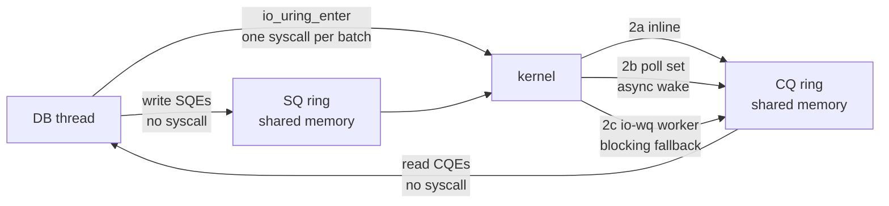

# io_uring in a DBMS: the interface is not the win

Jasny, El-Hindi, Ziegler, Leis and Binnig ("High-Performance DBMSs with
io_uring: When and How to Use It", PVLDB 19(9), VLDB'26) set out to answer
the question every storage engineer has asked since 2019: should my database
switch to io_uring? Their answer is in the first figure and it is not the one
the hype predicts. Drop io_uring into a buffer manager in place of libaio and
it gets **1.06×** faster; drop it into a network shuffle in place of epoll and
it gets **1.10×** faster (§1, Figure 1). Redesign the same two systems *around*
what io_uring makes cheap — many I/Os in flight from one thread, many I/Os per
system call, fewer CPU cycles per I/O — and they get **2.05×** and **2.31×**.

This chapter builds the vocabulary the paper assumes (system calls, rings,
queue depth, task work, polling), then walks the paper's buffer-manager case
study as what it really is: a sequence of back-of-the-envelope cost models,
each predicting the next measurement, each telling the authors which knob to
turn next. Those models transfer to any engine — including this topic's lane 1,
which reproduces the paper's first lesson on a laptop with no io_uring at all.
It ends with the PostgreSQL case study and a verdict on two claims that
circulate about this paper, one of which holds and one of which is half right.

Every number below is quoted from the section, table or figure cited next to
it, or from this topic's own measured lanes ([README.md](README.md),
[notes.md](notes.md)). Arithmetic was computed, not estimated.

## The problem in one sentence

A modern NVMe SSD array can serve millions of 4 KiB reads a second, but a
database thread that issues one blocking read at a time gets one read per
device latency (≈70 µs on the paper's drives, ≈72 µs on this laptop) — so
which part of "use io_uring" actually removes that limit, and which parts
only shave CPU cycles once it is gone?

## The concepts, step by step

### Step 1 — what a system call costs, and why a database makes so many

> **In:** nothing yet — this step defines the units every later step prices.
> **Out:** the two costs of an I/O — device latency and CPU cycles — and the
> observation that the second is paid per system call. Steps 2, 4 and 6 consume
> both.

A **system call** (syscall) is a request from a user program to the operating
system kernel: the CPU switches from user mode to kernel mode, runs kernel
code on the program's behalf, and switches back. `pread(fd, buf, n, off)` —
"read n bytes at offset off of file fd into buf" — is one. The switch itself
costs hundreds of nanoseconds of CPU, independent of how much work the call
does: this topic's lane 1c measured a 4 KiB `pread` of data already in memory
at **612 ns**, and fitted about 424 ns of that to the call and 188 ns to the
page ([notes.md](notes.md), lane 1c).

An I/O therefore has two costs that must not be confused:

- **Device latency** — wall-clock time from the request reaching the SSD to the
  data being in memory. The paper's Table 1 gives **70 µs** for a single read
  and **12 µs** for a single write on its Kioxia CM7-R drives. A thread that
  waits for the device spends this time idle.
- **CPU cost** — cycles the core spends preparing, submitting and completing
  the I/O. Table 1 gives **10,200 cycles** for a single read and **5,400** for a
  read submitted as part of a batch.

The paper's thesis (§1) is that on PCIe 5.0 hardware — SSDs like the
CM7-R at 2.45 M IOPS, NICs like the ConnectX-7 at 400 Gbit/s — conventional
kernel interfaces burn so much CPU per I/O that the CPU, not the device,
becomes the limit, and "consum[e] a significant fraction of CPU cycles without
saturating these devices". Note the order the paper attacks them in, because
it is the whole lesson: latency first (by overlapping it), cycles second.

### Step 2 — queue depth, and the law that prices it

> **In:** device latency from Step 1.
> **Out:** Little's law and the queue-depth ceiling: throughput ≤ QD /
> latency. Step 5's latency model is this law with one I/O in flight; Step 6
> is what happens when there are many.

**Queue depth** (QD) is the number of I/Os outstanding at the device at one
moment. **IOPS** is I/O operations completed per second. **Little's law**, true
of any stable queue, says

```
in_flight = throughput × latency      ⇒      throughput = QD / latency
```

where `in_flight` is the average number of requests in the system (the queue
depth), `throughput` is completions per second, and `latency` is the average
time one request spends in the system. Worked on this topic's lane 1a: at
QD 1 the mean read latency was 72.2 µs, so throughput ≤ 1 / 72.2 µs =
**13,850 IOPS**, and the measured row is 13,810. At QD 8 the law with the
QD-1 latency predicts 8 / 72.2 µs ≈ 110,800, but the measured mean latency
at QD 8 had risen to 82.4 µs, and 8 / 82.4 µs = 97,087 — within 0.2% of the
measured 96,907 ([notes.md](notes.md), lane 1a).

The consequence is the ceiling the paper's first experiment hits: **a thread
that keeps one I/O in flight can never exceed 1 / latency, whatever interface
it uses.** Raising QD is the only way through it, and there are exactly three:
more threads each blocking (lane 1a raised QD to 64 with 64 threads and got
248,363 IOPS, 18× QD 1); an **asynchronous interface** that lets one thread
leave many I/Os outstanding; or both.

### Step 3 — the interfaces: readiness, completion, and the ring

> **In:** the need from Step 2 to keep many I/Os in flight per thread.
> **Out:** the vocabulary of io_uring — SQ, CQ, SQE, CQE, `io_uring_enter` —
> and what it replaces. Step 4 uses this vocabulary to describe where a
> request actually runs.

Before io_uring, Linux offered two partial answers (§2.1):

- **epoll** — a **readiness** interface: you register many sockets and one call
  tells you which are *ready* to read without blocking. You then still issue one
  `read` syscall per ready socket. It works for network sockets, not for files.
- **libaio** — Linux's native asynchronous file I/O (`io_submit` /
  `io_getevents`): you submit reads and later collect their completions. The
  paper notes it "in practice was mostly restricted to direct block I/O and
  often lacked true asynchronous execution". **Direct I/O** (`O_DIRECT`) means
  reads and writes bypass the kernel's **page cache** — its in-memory copy of
  file data — and move straight between the device and your buffer.

A database that does both storage and networking ends up combining epoll and
libaio, "leading to duplicated code paths" (§2.1).

**io_uring** (Linux 2019) is a **completion** interface: you are told when the
operation is *done*, not when it could start. It is built from two ring
buffers in memory shared by the process and the kernel (§2.1, Figure 2):

- the **submission queue (SQ)**, into which the program writes **submission
  queue entries (SQEs)** — "read 4 KiB at offset X of fd 7 into this buffer";
- the **completion queue (CQ)**, into which the kernel writes **completion
  queue entries (CQEs)** — "request with tag T finished, result R".

Each request carries a user-chosen tag (`user_data`) because completions may
arrive out of order. One syscall, **`io_uring_enter`**, tells the kernel to
consume whatever SQEs are in the SQ, and can optionally block until some
number of CQEs are available. Because CQEs live in shared memory, reading a
completion is a memory load, not a syscall.

That gives the three properties the paper names (§1): a **unified** interface
(storage, sockets and other syscalls through the same ring), **asynchronous**
execution (submit and keep computing), and **batching** — many SQEs, one
`io_uring_enter`. §2.1 quantifies the last one: "Even modest batch sizes (e.g.,
16 operations) reduce the CPU cycles per operation by roughly 5–6× compared
to single-operation submission." The inline plot behind that sentence does not
say which operation was measured, so treat 5–6× as the paper's figure for its
setup, not as a constant.



### Step 4 — where a request runs: inline, poll set, or worker thread

> **In:** the SQ/CQ model from Step 3.
> **Out:** the three execution paths and their costs, the task-work and
> preemption problem, and the two flags (CoopTR, DeferTR) that tame it.
> Step 7's tuning ladder and Step 9's PostgreSQL configuration both depend on
> which of these paths a request takes.

§2.2 and Figure 3 describe what happens to an SQE once `io_uring_enter`
hands it over:

- **(2a) inline** — the kernel tries the operation immediately, in the calling
  thread's context; if the data is already there (a socket with bytes waiting)
  the CQE is posted before the syscall returns.
- **(2b) non-blocking** — for pollable operations (sockets) the kernel installs
  a wake-up handler and completes the request later, when the socket becomes
  ready.
- **(2c) blocking fallback** — operations that cannot run asynchronously
  ("blocking filesystem calls, such as fsync, or large storage reads") are
  handed to **io-wq**, a pool of kernel worker threads (**io_worker**s), each
  of which performs the operation synchronously. The flag `IOSQE_ASYNC` forces
  this path. Measured cost: NOPs routed through io_workers added **7.3 µs** on
  average over inline execution (§2.2). The paper's advice: "Frequent fallback
  or a large number of active io_worker threads typically indicates suboptimal
  I/O patterns".

Two submission modes (§2.2): by default the application thread enters the
kernel itself; with **SQPoll** a dedicated kernel thread polls the SQ and
submits on the application's behalf, so submissions need no syscall — at the
cost of a core, and of a wake-up latency of "roughly 30 microseconds" when the
idle polling thread has gone to sleep.

Completion has its own cost. When an asynchronous request finishes, the kernel
must run **task_work** — deferred kernel work — in the submitting task's
context to place the CQE. By default it runs at the next user-to-kernel
transition, and if the thread is busy computing (a join, a scan) the kernel
may send an **IPI** (inter-processor interrupt) to force it, which "effectively
preempts the application, disrupts cache locality, increases jitter, and
reduces batching efficiency" (§2.2). Two setup flags change this:

- **COOP_TASKRUN (CoopTR)** — fewer IPIs; task_work runs at the next kernel
  entry of any kind, including unrelated syscalls like `mmap`.
- **DEFER_TASKRUN (DeferTR)** — task_work runs *only* inside `io_uring_enter`,
  so the application decides when completions are processed. The paper calls it
  "the recommended mode" and uses it everywhere unless stated (§2.2). It needs
  the ring to be used by a single submitting thread (**single issuer**) —
  a requirement that becomes decisive in Step 9.

### Step 5 — the synchronous baseline, and the latency model that explains it

> **In:** Step 2's ceiling (one I/O in flight → 1 / latency) and Table 1's
> latencies from Step 1.
> **Out:** the paper's first model, tx/s = 1 / (fault rate × latency), its
> validation against 16.5 k tx/s, and the first verdict: interface swap = no
> gain. Step 6 starts from this baseline.

The test bed (§3.2): one AMD EPYC 9654P (96 cores, SMT off), 768 GiB DRAM,
Linux 6.15, eight PCIe 5.0 Kioxia CM7-R SSDs. The engine is a **buffer
manager** — a fixed pool of in-memory page frames with a page table; `fix(pid)`
loads a page on a miss (a **page fault** in the buffer manager's sense, not the
OS's) and evicts a victim chosen by clock-sweep, writing it back first if dirty
(§3.1). The workload is YCSB-like: 10 million tuples with 8-byte keys and
128-byte values, uniform updates, a deliberately small **1 GB** buffer pool,
giving "roughly 70% page fault probability" with 4 KiB pages (§3.2). One
thread does everything, to isolate I/O from concurrency effects.

The baseline issues one request and waits — implemented *on io_uring*, one SQE
per `io_uring_enter`, "for consistency with later variants" (§3.3). Result:
**16.5 k tx/s with POSIX `pread`/`pwrite` and 16.5 k tx/s with io_uring**
(Figure 5, first two bars). Identical.

The model that explains it (§3.3):

```
tx/s = 1 / (r_pf × (L_read + L_write))
```

where `r_pf` is the page-fault rate (0.7 — a fault happens on 70% of
transactions), `L_read` is one read's latency (70 µs, Table 1) and `L_write`
is one dirty-page writeback's latency (12 µs) — each fault in this synchronous
design waits for an eviction write *then* a read. Worked:
0.7 × (70 + 12) µs = 57.4 µs per transaction on average, and 1 / 57.4 µs =
**17,422 tx/s**, which the paper rounds to 17.4 k against 16.5 k measured. The
model says the CPU is idle almost all the time; "I/O latency rather than CPU
or software overhead limits synchronous performance". No syscall interface can
change a latency-bound number — which is the first half of this chapter's
title.

The same model on this laptop: lane 1a's QD-1 mean read latency is 72.2 µs,
so a synchronous buffer manager at a 70% fault rate, reads only, tops out at
1 / (0.7 × 72.2 µs) = **19,786 tx/s** — the same ballpark, on a consumer drive,
for the same reason ([README.md](README.md), Step 2).

### Step 6 — the architecture ladder: batch, overlap, batch again

> **In:** the 16.5 k tx/s latency-bound baseline from Step 5.
> **Out:** three architectural changes, the switch from a latency model to a
> cycle model, and both models validated within ~8% (Figure 5: 19.1 k →
> 183.5 k → 216.6 k). Step 7 starts from the 216.6 k design.

**+BatchEvict (§3.3.1).** Collect several eviction victims and write them with
one `io_uring_enter`. Execution is still synchronous, but the write latency is
paid once per batch rather than once per fault, so it drops out of the model:
1 / (0.7 × 70 µs) = 1 / 49 µs = **20,408 tx/s** predicted, "about 14%" more,
19 k measured (the bar reads 19.1 k). Hold on to that 14%: it is a different
14% from the PostgreSQL one in Step 9.

**+Fibers (§3.3.2).** A **fiber** is a user-space thread: a stack plus saved
registers, switched cooperatively by the program in "only tens of CPU cycles"
instead of by the kernel. Each transaction runs as a fiber; on a page fault it
submits its read and yields, and other fibers run until the completion arrives.
Up to 128 fibers means up to 128 reads in flight from one OS thread — Step 2's
queue depth, bought without threads. Throughput: **183.5 k tx/s**, "nearly an
order of magnitude" (183.5 / 19.1 = 9.6×). libaio under the same fiber design
reaches **173.0 k**; 183.5 / 173.0 = 1.06, which is Figure 1's "naive" bar —
note that it compares two *already asynchronous* designs. The cooperative
scheduling also removes locks: a fiber that resumes after an I/O and finds the
B-tree changed simply restarts its traversal.

Now the CPU is the limit, so the paper switches models (§3.3.2):

```
tx/s = f_clk / (c_tx + r_pf × c_io)
```

where `f_clk` is the core clock (3.7 GHz), `c_tx` is the cycles of transaction
logic measured from an in-memory run (8,264, Table 1), `r_pf` is the fault
rate (0.7), and `c_io` is the cycles to submit and complete the I/O a fault
causes. With single reads and batched writes, `c_io` = 10,200 + 5,700 =
15,900 cycles (Table 1). Worked: 8,264 + 0.7 × 15,900 = 19,394 cycles per
transaction, and 3.7×10⁹ / 19,394 = **190,781 tx/s** — 190.8 k predicted,
183 k measured.

**+BatchSubmit (§3.3.3).** Batch the reads too: collect read SQEs from several
fibers before one `io_uring_enter`. Table 1's batched read costs 5,400 cycles,
so `c_io` = 5,400 + 5,700 = 11,100 and 3.7×10⁹ / (8,264 + 0.7 × 11,100) =
3.7×10⁹ / 16,034 = **230,760 tx/s** predicted, 216 k measured (+18%, the bar
reads 216.6 k). The batch size is **adaptive**: "When many I/Os are in flight,
additional submissions are deferred to increase amortization; when few are
pending, batches are flushed earlier to keep the CPU busy." A fixed batch would
either waste the amortisation or stall the scheduler.

Two models, four predictions, all within 8% of measurement. That is the
paper's real method, and its Guideline 1 (Step 9) tells you to copy it.

### Step 7 — the tuning ladder: fewer cycles per I/O

> **In:** the CPU-bound 216.6 k tx/s design from Step 6, whose cost is
> `c_io` cycles per I/O; the execution paths from Step 4.
> **Out:** four io_uring features and what each removes (Figure 5: 237.8 k →
> 300.5 k → 376.4 k → 546.5 k), and the condition under which they pay. Step 8
> stress-tests them; Step 9 applies the subset PostgreSQL can use.

Once the architecture is CPU-bound, each feature removes a slice of `c_io`
(§3.4.1, Figure 5):

| step | removes | Figure 5 bar | paper's text |
|---|---|---|---|
| **registered buffers** (`+RegBufs`) — buffers registered once at setup, so the kernel skips per-I/O pinning and DMA mapping | data-movement setup | 237.8 k | "about 11%" |
| **NVMe passthrough** (`+Passthru`) — `IORING_OP_URING_CMD` sends native NVMe commands, skipping the generic block layer | storage-stack layers | 300.5 k | "an additional 20%" |
| **IOPoll** (`+IOPoll`) — completions polled from the device queue instead of interrupts; requires `O_DIRECT` and (with a filesystem) explicit support | interrupts | 376.4 k | "an additional 21%" |
| **SQPoll** (`+SQPoll`) — a kernel thread polls the SQ; no submission syscalls | syscalls | 546.5 k | "about 32%" |

A note on reading that table: computed from the bars as new/old − 1, the steps
are +9.8%, +26.4%, +25.3% and +45.2%; computed as 1 − old/new (the share of
per-transaction time removed) they are 8.9%, 20.9%, 20.2% and 31.1%. The
paper's last three in-text percentages match the second form within a point;
the 11% for RegBufs matches neither exactly. Quote the bars, not the
percentages.

Figure 1's "io_uring (Opt.)" bar is **376.4 k** — the ladder through IOPoll,
not SQPoll — and 376.4 / 183.5 = **2.05×** is measured against io_uring with
fibers, not against the synchronous baseline. Against 16.5 k the full ladder is
546.5 / 16.5 = 33×; almost all of that came from Step 6's architecture (183.5
/ 19.1 = 9.6× in one step), not from Step 7's features.

The condition (§3.4.2): on TPC-C, the io_uring buffer manager beats vmcache —
a state-of-the-art buffer manager that uses blocking reads — by "up to 12.5×",
for architectural reasons again. But with 1 warehouse (mostly in memory),
"+IOPoll performs slightly worse than the interrupt-driven baseline because
polling wastes CPU cycles when I/O operations are sporadic", and +SQPoll gives
nothing. With 100 warehouses (mostly out of memory) the features pay. With 32
worker threads (§3.4.3, Figure 7) the relative gains carry over. The paper's
take-away (§3.5): io_uring "must be integrated as part of an end-to-end
architectural design rather than as a drop-in replacement", and tuning "depend[s]
strongly on the workload".

### Step 8 — where batching and big I/Os backfire

> **In:** batching (Steps 3 and 6) and the execution paths (Step 4).
> **Out:** the latency price of large batches (Table 2), the scaling headroom
> (Figure 8), the block-size limits that silently trigger worker fallback
> (Figure 9), and why durable writes are awkward. Step 9's guidelines are the
> rules distilled from these.

**Batching raises latency.** Table 2 fixes write throughput at 1.5 MIOPS on one
SSD (8 workers) and varies the batch size:

| batch size | 1 | 8 | 32 | 64 | 128 | 256 |
|---|---|---|---|---|---|---|
| mean latency (µs) | 11.51 | 24.22 | 60.62 | 116.40 | 200.85 | 317.51 |
| σ (µs) | 0.95 | 1.71 | 3.91 | 12.17 | 7.47 | 33.88 |

A batch of 128 averages 200.85 / 11.51 = 17.5× the single-request latency,
even below saturation, because bursts "temporarily overload the SSD queue".
"For latency-sensitive DBMSs, overly aggressive batching is counterproductive."
This topic's lane 1b shows the same mechanism without io_uring: POSIX AIO's
`lio_listio(LIO_WAIT)` submits 16 reads in one syscall and then waits for all
16, so the batch lasts as long as its slowest read — 189.2 µs at batch 16
against 71.8 µs at batch 1 — and reaches 79,200 IOPS, about half of sixteen
blocking threads' 155,741 ([notes.md](notes.md), lane 1b).

**Scaling.** With one ring per thread and no buffer manager (Figure 8), io_uring
beats libaio at every thread count for 4 KiB random reads and writes, and the
optimisations "deliver substantial throughput improvements of 3.4–3.5×,
saturating the SSD array with 18 and 6 cores" (§3.6).

**Block size (Figure 9).** Larger blocks cut CPU per byte; a single core reaches
"up to 90 GiB/s for reads and 50 GiB/s for writes", at 256 KiB reads and
128 KiB writes with passthrough and IOPoll. But three thresholds silently send
requests to io_workers (§3.6): a block larger than `max_hw_sectors_kb` (the
largest single DMA transfer; "can be 128 KiB if the IOMMU were enabled"); more
batched `O_DIRECT` requests than `nr_requests` ("1023 on bare metal, 127 in
our cloud VM"); and blocks above 512 KiB (`max_segments`). Each fallback costs
Step 4's 7.3 µs path.

**Durable writes (§3.6, Figure 10).** `fsync` is blocking in io_uring and so
runs on io_workers; it cannot be issued on an IOPoll ring at all. `O_SYNC`
writes were "more than twice as slow as explicit writes followed by fsync";
linking a write and an fsync in the ring "offers no improvement over issuing
them sequentially"; NVMe passthrough flush is truly asynchronous but needs a raw
device. Enterprise SSDs with power-loss protection make flushes cheap; consumer
SSDs stay "dominated by intrinsic millisecond-scale fsync cost".

**Networking (§4), briefly.** For a six-node shuffle on 400 Gbit/s links, plain
io_uring is only marginally faster than epoll because both move tuples in
1 MiB chunks, which already amortise syscalls (§4.5). The win is **zero-copy**
send and receive, which roughly halve memory bandwidth per byte transferred
(§4.4, Figure 13; "≈ 2×" in §4.6) and give "up to a 2.5× speedup" (§4.5).
Same lesson as storage: the gain comes from what the design stops doing.

### Step 9 — the guidelines, and PostgreSQL as the test

> **In:** Steps 5–8's measurements.
> **Out:** the four guidelines (§5.1), their application to PostgreSQL 18's
> io_uring backend (§5.2, Figure 18), and the 11–15% they buy. The verdict
> section below rests on this step.

§5.1's guidelines:

1. **Determine if I/O is a system bottleneck** — and model it (Steps 5–6). If
   I/O is a small fraction of time, io_uring cannot help much.
2. **Align the architecture with io_uring's capabilities** — overlap I/O with
   computation, batch, one ring per thread.
3. **Choose and tune the execution mode deliberately** — DeferTR with single
   issuer by default; SQPoll only when a dedicated core is justified; avoid
   io_worker fallback (fsync, large I/Os).
4. **Use io_uring optimisations** — registered FDs and fixed buffers are
   harmless for 4 KiB page-aligned storage I/O; zero-copy and multishot only pay
   above payload thresholds; passthrough and IOPoll need no filesystem or a
   compatible one.

PostgreSQL 18 added an io_uring backend for data and WAL I/O. The experiment
(§5.2, Figure 18) is a cold scan of a 32 GiB table via direct I/O with 1–8
backend workers, on ext4:

- **GL(1)** — PostgreSQL's own release announcement (the paper's reference
  [19]) reports up to 3× over the previous synchronous design with OS
  read-ahead, which the paper takes as evidence I/O is the bottleneck. That 3×
  is PostgreSQL's claim, cited, not measured in this paper.
- **GL(2)** — PostgreSQL is multi-process, and "allows backends to wait on I/O
  submitted through rings owned by other processes, so rings are not used by a
  single issuer and DeferTR cannot be applied directly."
- **GL(3)** — so they configure CoopTR as "the next-best alternative", and add
  SQPoll with one kernel polling thread shared by all backends' rings. WAL
  `fsync` stays outside the ring, avoiding io_workers.
- **GL(4)** — register the whole buffer pool as fixed buffers ("4–6%
  improvement"), add IOPoll (ext4 supports it; "up to 7.5%"), then SQPoll:
  "total throughput improves by 11–15% over upstream PostgreSQL".

Figure 18's scan times, baseline → all three optimisations, and the speedups
computed from them (the figure's own labels, from unrounded times, are in
brackets):

| backend workers | baseline (s) | +RegBufs +IOPoll +SQPoll (s) | speedup |
|---|---|---|---|
| 1 | 28.35 | 24.81 | 14.3% [14.29%] |
| 2 | 14.87 | 13.00 | 14.4% [14.36%] |
| 4 | 7.79 | 6.96 | 11.9% [11.86%] |
| 8 | 3.97 | 3.57 | 11.2% [11.46%] |

The paper's summary: improvements "remain limited by the filesystem and
PostgreSQL's multi-process architecture" (Figure 18 caption).

### Step 10 — the verdict on two claims about this paper

> **In:** Step 5 (the synchronous comparison), Step 6 (Figure 1's naive bar),
> Step 9 (the PostgreSQL numbers).
> **Out:** which popular summaries of the paper survive contact with it.

**"Swapping in io_uring alone doesn't speed things up" — checks out.** Two
independent measurements support it: the synchronous buffer manager runs at
16.5 k tx/s on POSIX and on io_uring (§3.3, Figure 5), and the asynchronous
one gains 1.06× over libaio (Figure 1); the shuffle gains 1.10× over epoll.
The abstract says it directly: naive replacement "does not necessarily yield
performance benefits".

**"The guidelines gave ~14% in PostgreSQL" — partly right.** The abstract does
say "a performance improvement of 14%". The body says **11–15%** (§5.2) and
the conclusion "11–15%" (§7); Figure 18's labels run from 11.46% (8 workers)
to 14.36% (2 workers). 14% is the top of the range at low worker counts, not
the result.

**One claim that cannot be reconciled with the pinned PostgreSQL.** §5.2 says
registering the buffer pool eliminates "PostgreSQL's heuristic of enabling
IO_ASYNC after four outstanding I/Os". That heuristic is
`pgaio_uring_should_use_async` (`src/backend/storage/aio/method_io_uring.c:716-740`
at `701f021`). At that commit its first test (`:722-723`) returns false for any
I/O without the buffered flag, *before* the in-flight > 4 check at `:729` — so
for the direct-I/O scan the paper ran, the heuristic would never fire at this
pin. The paper does not say which PostgreSQL commit it modified, so whether the
code changed or the description is loose cannot be decided from the text.
[reading-postgres-aio.md](reading-postgres-aio.md) reads the function line by
line.

## How to read the paper (with the concepts in hand)

1. **§1 and Figure 1 first** — then reread Figure 1 knowing (Step 7) that the
   naive bar compares two asynchronous designs and the optimised bar stops at
   IOPoll.
2. **§2.1–2.2** with Step 3's diagram beside you. Figure 3's labels 2a/2b/2c are
   Step 4's paths.
3. **§3.3 is the core of the paper.** Read it with a calculator: redo each
   model's prediction from Table 1 before reading the measured number.
4. **Figure 5** — read the bars, not the in-text percentages (Step 7's note).
5. **§3.6 Table 2 and Figure 9** — the failure modes; skim Figure 8.
6. **§4** — read §4.5's epoll comparison and §4.6's summary; the rest is
   network-specific.
7. **§5** — the guidelines, then Figure 18's absolute seconds.

## Where each step lives in this topic

| step | lane / file | what to run or read |
|---|---|---|
| 2 (Little's law) | `io_bench` lane 1a, `experiments/src/qd.rs` | the predicted vs achieved columns |
| 5 (latency model) | lane 1a's QD-1 row | 1 / (0.7 × 72.2 µs) = 19,786 tx/s |
| 6 (batch submission) | lane 1c, `qd.rs::warm_syscall_cost` | 612 ns per page at 1 per call, 217 at 16: 2.82× (the paper's 5–6× is for io_uring submissions; this lane's operation includes a 4 KiB copy that no batching removes, and `preadv` over contiguous pages also saves file-offset lookups) |
| 8 (batch latency) | lane 1b, `experiments/src/aio.rs` | the `lio_listio` barrier: Table 2 in miniature |
| 3, 6, 7 (the ring) | lane 2, `experiments/src/uring.rs` | a stub: macOS has no io_uring, and a Linux container on this Mac refused `io_uring_setup` with EPERM under Docker's default seccomp profile ([notes.md](notes.md)) |
| 9 (PostgreSQL) | [reading-postgres-aio.md](reading-postgres-aio.md) | the ring setup with flags 0, cross-process waiting, the async heuristic |

## Questions (answer in notes.md)

1. Step 5's model charges a write *and* a read per fault. Why does a buffer
   manager that writes back dirty victims synchronously pay the write latency
   on the critical path, and why does +BatchEvict remove it entirely rather than
   dividing it by the batch size?
2. The cycle model's prediction is 190.8 k and the measurement 183 k. Name two
   costs the model leaves out that would account for the 4% gap (Step 6
   mentions one in passing).
3. Figure 1 calls 183.5 k vs 173.0 k "naive use". Both are fiber-based
   asynchronous designs. What would the bar look like if "naive" meant
   synchronous libaio vs synchronous io_uring?
4. Why does IOPoll make the in-memory TPC-C configuration *slower* (§3.4.2),
   and what does that say about enabling it by default?
5. Table 2's σ at batch 128 (7.47 µs) is lower than at batch 64 (12.17 µs).
   Does that undermine the claim that larger batches raise variance? Look at
   batch 256.
6. Under DeferTR, completions are only processed inside `io_uring_enter`.
   Describe a PostgreSQL scenario where that would deadlock or stall given
   that backends wait on other backends' rings.
7. Lane 1b's batch-16 throughput is half of sixteen threads'. Design the
   adaptive policy of §3.3.3 for `lio_listio`: what would you change, and which
   part of the barrier cost can no policy remove?

## Done when

Answer each before unfolding it.

- [ ] You can explain why the synchronous POSIX and synchronous io_uring buffer managers run at the same 16.5 k tx/s.

  <details><summary>Answer</summary>

  Both keep exactly one I/O in flight, so by Little's law throughput is bounded
  by 1 / latency regardless of interface. The paper's latency model makes it
  numeric: each transaction faults with probability 0.7 and each fault waits a
  12 µs writeback plus a 70 µs read (Table 1), so 1 / (0.7 × 82 µs) =
  17.4 k tx/s predicted against 16.5 k measured (§3.3). The CPU is mostly idle;
  a cheaper syscall saves cycles nobody was short of.

  </details>

- [ ] You can state Little's law, name its terms, and use it to predict a queue-depth-8 throughput from a QD-1 latency — and say why the prediction overshoots.

  <details><summary>Answer</summary>

  In-flight = throughput × latency, so throughput = QD / latency, with QD the
  average number of outstanding I/Os and latency the average time each spends
  in the system. With this laptop's QD-1 mean of 72.2 µs, QD 8 predicts
  8 / 72.2 µs ≈ 110,800 IOPS; lane 1a measured 96,907. The law did not fail —
  the latency did not stay at 72.2 µs. At QD 8 the measured mean was 82.4 µs,
  and 8 / 82.4 µs = 97,087, within 0.2%. More in-flight requests make the device
  queue internally, which raises latency.

  </details>

- [ ] You can name the three architectural steps of §3.3 in order, with the throughput after each and the model that predicted it.

  <details><summary>Answer</summary>

  +BatchEvict: eviction writes in one `io_uring_enter`, write latency off the
  critical path, 1 / (0.7 × 70 µs) = 20.4 k predicted, 19.1 k measured.
  +Fibers: 128 cooperative fibers keep up to 128 reads in flight from one
  thread; now CPU-bound, so the cycle model f_clk / (c_tx + r_pf × c_io) =
  3.7×10⁹ / (8,264 + 0.7 × 15,900) = 190.8 k predicted, 183.5 k measured.
  +BatchSubmit: reads batched too, c_io = 5,400 + 5,700 = 11,100, so 230.8 k
  predicted, 216.6 k measured. The model switch is the lesson: once latency is
  overlapped, cycles per I/O are the bill.

  </details>

- [ ] You can explain what Figure 1's 1.06× and 2.05× compare, and why neither is "io_uring vs POSIX".

  <details><summary>Answer</summary>

  1.06× = 183.5 / 173.0: io_uring vs libaio, both in the asynchronous fiber
  design. 2.05× = 376.4 / 183.5: the io_uring design after +BatchSubmit,
  +RegBufs, +Passthru and +IOPoll, against io_uring with fibers — SQPoll's
  546.5 k is not in that bar. The synchronous baselines (16.5 k each) are not in
  Figure 1 at all; against them the full ladder is 546.5 / 16.5 = 33×, most of
  it from the move to fibers (9.6× in one step).

  </details>

- [ ] You can name the three execution paths of a request and say what forces the slow one.

  <details><summary>Answer</summary>

  (2a) inline, completed during submission if possible; (2b) non-blocking, a
  wake-up handler on the poll set for pollable operations like sockets; (2c)
  io-wq, kernel worker threads doing the operation synchronously, costing about
  7.3 µs more than inline for NOPs (§2.2). Forced by operations that cannot run
  asynchronously (fsync, blocking filesystem calls), by `IOSQE_ASYNC`, and per
  §3.6 by blocks above `max_hw_sectors_kb` or 512 KiB, or by more batched
  `O_DIRECT` requests than `nr_requests` (1023 on bare metal).

  </details>

- [ ] You can say what DeferTR does, why the paper recommends it, and why PostgreSQL cannot use it.

  <details><summary>Answer</summary>

  DeferTR makes the kernel run completion task_work only inside
  `io_uring_enter`, so a busy thread is never preempted by an IPI to post CQEs —
  the application chooses when completions are processed, which protects cache
  locality and batching (§2.2). It requires a single issuer. PostgreSQL backends
  wait on I/O submitted through other processes' rings, so its rings are not
  single-issuer; the paper fell back to CoopTR, which reduces IPIs but still runs
  task_work at any kernel entry (§5.2).

  </details>

- [ ] You can explain why batching can make an I/O slower, with the paper's number and this topic's.

  <details><summary>Answer</summary>

  A batch delivers many requests at once; they queue behind each other at the
  device, and if completions are awaited as a group the batch lasts as long as
  its slowest member. Table 2 at a fixed 1.5 MIOPS: mean write latency 11.51 µs
  at batch 1, 200.85 µs at 128 — 17.5× — with no change in throughput. Lane 1b:
  `lio_listio` batch 16 waits 189.2 µs per batch against 71.8 µs at batch 1,
  and reaches about half the IOPS of sixteen blocking threads. Hence §3.3.3's
  adaptive batching.

  </details>

- [ ] You can give the verdict on "io_uring alone doesn't help" and on "~14% in PostgreSQL", with sources.

  <details><summary>Answer</summary>

  The first holds: synchronous POSIX and io_uring are both 16.5 k tx/s (§3.3,
  Figure 5); the drop-in swaps are 1.06× and 1.10× (Figure 1); the abstract
  says naive replacement "does not necessarily yield performance benefits". The
  second is half right: the abstract says 14%, but §5.2 and §7 say 11–15%, and
  Figure 18 runs from 11.46% at 8 workers to 14.36% at 2 — 14% is the top of a
  range. Separately, the paper's description of PostgreSQL's IO_ASYNC heuristic
  does not match `method_io_uring.c:722-723` (PostgreSQL `701f021`) for direct
  I/O, and the paper does not name its PostgreSQL version.

  </details>

## References

**Paper** — Matthias Jasny, Muhammad El-Hindi, Tobias Ziegler, Viktor Leis,
Carsten Binnig. "High-Performance DBMSs with io_uring: When and How to Use
It." PVLDB 19(9): 2317–2330, 2026. doi:10.14778/3819518.3819553;
[arXiv:2512.04859](https://arxiv.org/abs/2512.04859). Artifact:
[github.com/mjasny/vldb26-iouring](https://github.com/mjasny/vldb26-iouring).

| where | what this chapter takes from it |
|---|---|
| Abstract, §1, Figure 1 | 1.06× / 1.10× naive, 2.05× / 2.31× redesigned; "14%" for PostgreSQL |
| §2.1 | unified / asynchronous / batched; "roughly 5–6×" fewer cycles at batch 16 |
| §2.2, Figure 3 | paths 2a/2b/2c; SQPoll wake ~30 µs; io-wq NOP +7.3 µs; CoopTR, DeferTR |
| §3.2 | EPYC 9654P, 8× Kioxia CM7-R, Linux 6.15; YCSB 10 M tuples, 1 GB pool, ~70% faults |
| §3.3, Table 1, Figure 5 | 16.5 k = 16.5 k; the latency and cycle models; 19.1 / 183.5 / 216.6 k; libaio 173.0 k |
| §3.4, Figure 5, Figure 6, Figure 7 | RegBufs 237.8 k, Passthru 300.5 k, IOPoll 376.4 k, SQPoll 546.5 k; vmcache up to 12.5× |
| §3.6, Table 2, Figures 8–10 | batch latency; 3.4–3.5×; 90 / 50 GiB/s; fallback thresholds; durable writes |
| §4.4–4.6 | zero-copy, ≈2× memory bandwidth, up to 2.5× |
| §5.1, §5.2, Figure 18, §7 | the four guidelines; CoopTR, shared SQPoll, 4–6%, up to 7.5%, 11–15% |

**Code** — `postgres/postgres` at `701f021` (pinned in
[resources/codebases.md](../../resources/codebases.md)):
`src/backend/storage/aio/method_io_uring.c:716-740`
(`pgaio_uring_should_use_async`), read in
[reading-postgres-aio.md](reading-postgres-aio.md).

**This topic** — [README.md](README.md) (lanes and Step 2's model on this
laptop), [notes.md](notes.md) (lanes 1a–1c, lane 2's missing reference),
[reading-io-uring-crate.md](reading-io-uring-crate.md) (the SQ/CQ as Rust).
