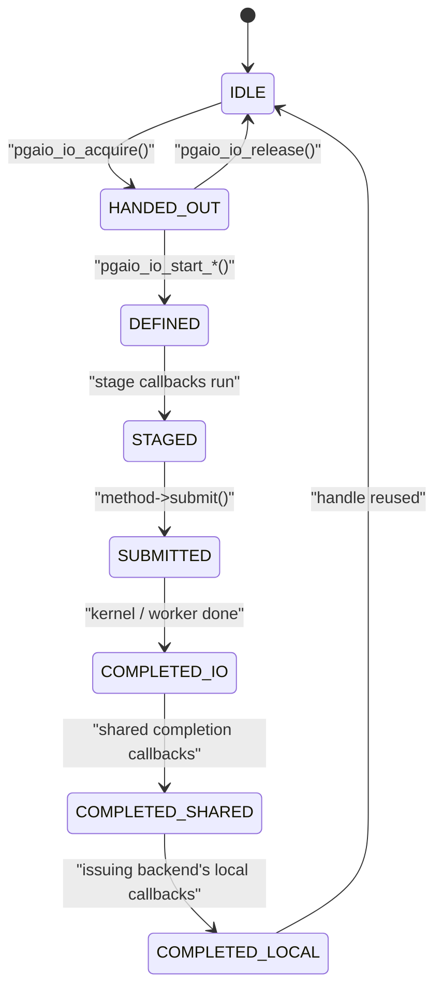

# PostgreSQL's AIO: handles, methods, and a read-ahead that doubles

PostgreSQL ran for thirty years on synchronous `pread` and `pwrite` and let the
operating system hide the waiting. Release 18 added an asynchronous I/O
subsystem under `src/backend/storage/aio/`, selected by one setting,
`io_method`. This chapter reads it the way the io_uring paper's §5.2 reads it —
as a production engine fitting asynchrony into an architecture that was never
designed for it — and it finds three things a summary would miss: the io_uring
ring is created with **no setup flags at all**, the io_uring backend
**deliberately** pushes some reads onto the kernel's worker threads (the thing
the paper tells you to avoid), and the read-ahead that feeds it all is a
multiplicative-increase, additive-decrease controller.

Every anchor is `postgres/postgres` at **`701f021`** (master, 2026-07-10 — after
the 18 release), read with `tools/pinned-source.py`; the line numbers below
belong to that commit and no other. The topic's measured lane is quoted from
[README.md](README.md) and [notes.md](notes.md).

## The problem in one sentence

A buffer pool that reads one 8 KiB page at a time can never have more than one
I/O in flight per process — 13,810 reads a second on this topic's laptop SSD,
against 244,300 at 32 in flight — so how do you let a multi-process database
keep many reads outstanding without rewriting every caller, without
deadlocking two processes that wait on each other's I/O, and on every
operating system PostgreSQL supports?

## The concepts, step by step

### Step 1 — why asynchronous, and why direct

> **In:** nothing yet — this step is the motivation.
> **Out:** the two separate goals the subsystem serves (asynchrony, and the
> option of direct I/O), and the reason the second needs the first. Steps 2–7
> are the machinery.

**Synchronous I/O** means the calling process issues a read and sleeps until
the data is in its buffer; **asynchronous I/O** means it issues the read, keeps
working, and collects the result later. Until 18, PostgreSQL did only the
first, and relied on the operating system's **page cache** — the kernel's own
in-memory cache of file pages — to make most reads hit memory and to read ahead
on sequential access. The README opens by saying how well that worked and
where it stopped working (`src/backend/storage/aio/README.md:7-15`):

> Until the introduction of asynchronous IO postgres relied on the operating
> system to hide the cost of synchronous IO from postgres. While this worked
> surprisingly well in a lot of workloads, it does not do as good a job on
> prefetching and controlled writeback as we would like.
>
> There are important expensive operations like `fdatasync()` where the
> operating system cannot hide the storage latency.

Reads through the page cache are **buffered I/O**. The alternative is **direct
I/O** (`O_DIRECT` on Linux): the device moves data straight into the
process's memory by **DMA** (direct memory access — the device writes RAM
without the CPU copying it), bypassing the page cache. The README's reasons for
wanting it (`README.md:20-33`) are lower CPU (no kernel-to-user copy), lower
latency, better writeback control, and avoiding **double buffering** — the
same page held twice, once in `shared_buffers` and once in the page cache. Its
first reason *against* is the one that links the two goals
(`README.md:38`): "Without AIO, Direct IO is unusably slow for most purposes."
Take away the page cache and you take away the kernel's read-ahead; something
has to put many reads in flight instead, and that something is AIO.

Lane 1a puts a number on "unusably slow". At queue depth 1 — one read
outstanding — the laptop SSD returns a random 4 KiB read in 72.2 µs on
average, so one process is capped at 1 / 72.2 µs = 13,850 reads a second
(measured 13,810). With 32 reads in flight it does 244,300. The whole subsystem
exists to turn the first row into something like the second.

Why it matters: asynchrony is not a feature PostgreSQL adds for speed on top of
buffered I/O; it is the precondition for ever turning the page cache off.

### Step 2 — the AIO handle and its life

> **In:** Step 1's goal — keep reads outstanding while the process works.
> **Out:** the object that represents one outstanding I/O (a handle), the
> states it moves through, and how a caller waits on one that may already have
> been recycled. Steps 3–4 explain why it lives where it lives.

An **AIO handle** (`PgAioHandle`) is a fixed slot describing one I/O: the
operation, the file, the offset, the buffers, and who to notify. Code acquires
a handle, "defines" the I/O on it, and from then on the subsystem owns it. The
handle's lifecycle is an explicit state machine
(`src/include/storage/aio_internal.h:45-92`); its eight states are:



Handles are recycled the moment they complete (Step 4 says why the pool is
small), so "wait for handle 17" is ambiguous — handle 17 may already describe
someone else's read. The fix is a **handle generation**: a counter bumped every
time the handle is reused. A **wait reference** (`PgAioWaitRef`) is the pair
*(handle, generation)*, so a waiter can tell "my I/O finished and the handle was
reused" apart from "my I/O is still running" (`README.md:367-375`). The
`wait_one` method in Step 6 checks exactly this with `pgaio_io_was_recycled`.

The two halves of the lifecycle meet in `pgaio_io_stage`. The line to focus on
is **471**, where an I/O that has just been staged is submitted *immediately*
unless the caller opted into batching (Step 5):

```c
// src/backend/storage/aio/aio.c:442–477, pgaio_io_stage (blank lines 443, 446, 448 elided)
442  	pgaio_io_update_state(ioh, PGAIO_HS_DEFINED);
444  	/* allow a new IO to be staged */
445  	pgaio_my_backend->handed_out_io = NULL;
447  	pgaio_io_call_stage(ioh);
449  	pgaio_io_update_state(ioh, PGAIO_HS_STAGED);
        // ... 450–454: comment — synchronous execution is checked first ...
455  	needs_synchronous = pgaio_io_needs_synchronous_execution(ioh);
        // ... 456–460: debug output and a blank line ...
461  	if (!needs_synchronous)
462  	{
463  		pgaio_my_backend->staged_ios[pgaio_my_backend->num_staged_ios++] = ioh;
464  		Assert(pgaio_my_backend->num_staged_ios <= PGAIO_SUBMIT_BATCH_SIZE);
       // ... 465–469: comment ...
470  		if (!pgaio_my_backend->in_batchmode)
471  			pgaio_submit_staged();
472  	}
473  	else
474  	{
475  		pgaio_io_prepare_submit(ioh);
476  		pgaio_io_perform_synchronously(ioh);
477  	}
```

Line 476 is the escape hatch every method shares: an I/O the method cannot run
asynchronously is simply run right here, synchronously, by the issuing process.

Why it matters: the state machine is what lets a *different* process finish
your I/O (Step 3) without either of you holding a pointer the other cannot use.

### Step 3 — shared memory, and callbacks that are numbers

> **In:** Step 2's handle.
> **Out:** where handles live (shared memory), why their callbacks are small
> integer IDs rather than function pointers, and what a completion callback may
> and may not do. Step 6 relies on "any backend may complete any I/O".

PostgreSQL is a multi-process server: each client connection is served by a
separate operating-system process called a **backend**. Processes do not share
an address space; they communicate through **shared memory** — a region every
process maps — where `shared_buffers` itself lives. The README's design
criterion is that an I/O issued by one backend must be completable by *another*
(`README.md:181-194`), because the issuer may be blocked or slow and a
completion that waits for it can stall everyone waiting on that buffer. So the
handle has to live in shared memory (`README.md:222-224`).

That has an awkward consequence (`README.md:226-229`):

> In an `EXEC_BACKEND` build, a backend's executable code and other process
> local state is not necessarily mapped to the same addresses in each process
> due to ASLR. This means that the shared memory cannot contain pointers to
> callbacks.

**ASLR** (address-space layout randomisation) loads code at a different address
in each process; **`EXEC_BACKEND`** is the build mode (used on Windows, and
available for testing elsewhere) where backends are started by `exec` rather
than `fork`, so they do not inherit the postmaster's layout. A function pointer
written by backend A may point at garbage in backend B. So a callback is an
**ID**, `PgAioHandleCallbackID` — "a single byte currently"
(`README.md:332-337`) — and each process looks it up in its own table.

Two kinds of callback hang off a handle. A **stage callback** runs before
submission, e.g. to take an extra pin on the target buffers so they survive the
issuer erroring out (`README.md:339-343`). A **completion callback** runs when
the I/O finishes, in whichever backend happens to process the completion, and
may be several layers deep — `md.c` checks the read was not short, `bufmgr.c`
verifies the page and updates the buffer descriptor (`README.md:307-310`). Each
handle also has exactly one **target**, which says how to describe and reopen
the file (a relation block, or later a WAL segment) — the worker method needs
that, because a worker process has to open the file itself (`README.md:353-357`).

Completion callbacks run in a **critical section** — a region where any error
is promoted to a PANIC that restarts the server — because Step 7's WAL writes
must be completable there (`README.md:210-217`). So a completion callback can
never raise an ordinary error. It encodes the result into a compact
`PgAioResult` and the *issuing* backend raises the error later, from its own
`PgAioReturn` (`README.md:380-392`).

Why it matters: every odd restriction in this subsystem — byte-sized callback
IDs, no `ERROR` in completion, results delivered by value — falls out of "any
process may finish your I/O".

### Step 4 — a bounded pool, one handle in hand, and a batch of 32

> **In:** Step 3's shared-memory handles, of which there are a fixed number.
> **Out:** the three limits that keep a backend from deadlocking itself:
> `io_max_concurrency` handles, at most one handed out but undefined, at most
> 32 staged. Step 5 adds the deadlock *between* backends.

Shared memory is sized at startup, so the number of handles per backend is
fixed: `io_max_concurrency`. Its default is `-1`
(`src/backend/utils/misc/guc_parameters.dat:1391-1398`), which means "choose for
me", and the choice is `AioChooseMaxConcurrency` — the line to focus on is 117:

```c
// src/backend/storage/aio/aio_init.c:105–118, AioChooseMaxConcurrency
105  AioChooseMaxConcurrency(void)
106  {
107  	uint32		max_backends;
108  	int			max_proportional_pins;
109  
110  	/* Similar logic to LimitAdditionalPins() */
111  	max_backends = MaxBackends + NUM_AUXILIARY_PROCS;
112  	max_proportional_pins = NBuffers / max_backends;
113  
114  	max_proportional_pins = Max(max_proportional_pins, 1);
115  
116  	/* apply upper limit */
117  	return Min(max_proportional_pins, 64);
118  }
```

Worked on assumed round numbers (not defaults read from the code): 16,384
buffers (128 MiB of 8 KiB pages) shared by 128 processes gives 16,384 / 128 =
128, capped at **64**; 4,096 buffers over 128 processes gives 32. So a backend
can have at most a few dozen I/Os in flight — the comment's reasoning
(`aio_init.c:98-99`) is that it could not pin more buffers than that anyway.

With a fixed pool, acquisition can run out. `pgaio_io_acquire` simply waits
for one of its own I/Os to finish (`aio.c:166-178`). That is safe only if every
handle the backend holds is *going* to finish — i.e. has been defined and
submitted. A handle that has been acquired but not yet defined is not going
anywhere. Hence the rule (`README.md:292-298`): only **one** handle may be
handed out and undefined at a time, "otherwise a backend could trivially
self-deadlock by using up all AIO Handles without the ability to wait for some
of the IOs to complete." It is enforced, not advised — the line to focus on is
199:

```c
// src/backend/storage/aio/aio.c:188–199, pgaio_io_acquire_nb
188  pgaio_io_acquire_nb(struct ResourceOwnerData *resowner, PgAioReturn *ret)
189  {
190  	PgAioHandle *ioh = NULL;
191  
192  	if (pgaio_my_backend->num_staged_ios >= PGAIO_SUBMIT_BATCH_SIZE)
193  	{
194  		Assert(pgaio_my_backend->num_staged_ios == PGAIO_SUBMIT_BATCH_SIZE);
195  		pgaio_submit_staged();
196  	}
197  
198  	if (pgaio_my_backend->handed_out_io)
199  		elog(ERROR, "API violation: Only one IO can be handed out");
```

Lines 192–195 are the third limit: staged-but-unsubmitted I/Os are capped at
`PGAIO_SUBMIT_BATCH_SIZE`, which is **32**
(`src/include/storage/aio_internal.h:30`), and acquiring a 33rd forces the 32
out first.

Why it matters: these are the same three numbers lane 2 of this topic has —
ring size, in-flight limit, batch size — chosen here so that a process that can
be interrupted, error out, or be waited on by others can never wedge itself.

### Step 5 — batch mode, and the deadlock it invites

> **In:** Step 4's staged list, and Step 3's "other backends wait on my
> buffers".
> **Out:** why submitting in batches is opt-in, and the rule a batching caller
> must follow. Step 6 is what a batch costs at the io_uring method.

**Batch mode** means staging several I/Os and submitting them with one call to
the method — for io_uring, one `io_uring_enter` system call — instead of one
call each. The io_uring paper's §2.1 measures roughly 5–6× fewer CPU cycles per
operation at a batch of 16 (see [reading-iouring-vldb26.md](reading-iouring-vldb26.md));
this topic's lane 1c measures a cached `pread` at 612 ns against 217 ns per page
at 16 pages per `preadv`. So why is it not the default? Because of a
**deadlock** — two processes each waiting for something only the other can
provide — that the comment spells out (`aio.c:1060-1089`); the lines to focus on
are 1067–1071:

```c
// src/backend/storage/aio/aio.c:1060–1080, comment above pgaio_enter_batchmode
1060  /*
1061   * Submit IOs in batches going forward.
1062   *
1063   * Submitting multiple IOs at once can be substantially faster than doing so
1064   * one-by-one. At the same time, submitting multiple IOs at once requires more
1065   * care to avoid deadlocks.
1066   *
1067   * Consider backend A staging an IO for buffer 1 and then trying to start IO
1068   * on buffer 2, while backend B does the inverse. If A submitted the IO before
1069   * moving on to buffer 2, this works just fine, B will wait for the IO to
1070   * complete. But if batching were used, each backend will wait for IO that has
1071   * not yet been submitted to complete, i.e. forever.
1072   *
1073   * End batch submission mode with pgaio_exit_batchmode().  (Throwing errors is
1074   * allowed; error recovery will end the batch.)
1075   *
1076   * To avoid deadlocks, code needs to ensure that it will not wait for another
1077   * backend while there is unsubmitted IO. E.g. by using conditional lock
1078   * acquisition when acquiring buffer locks. To check if there currently are
1079   * staged IOs, call pgaio_have_staged() and to submit all staged IOs call
1080   * pgaio_submit_staged().
```

A staged-but-unsubmitted I/O is a promise nobody is working on. In a
single-process engine that is harmless; in PostgreSQL another backend can be
blocked on the buffer that promise is for. So a batching caller must submit
everything before it waits on anyone (line 1076). `pgaio_exit_batchmode` ends
with exactly that: `pgaio_submit_staged()` (`aio.c:1106`).

Why it matters: the paper treats batching as a tuning knob; in a multi-process
engine it is a correctness hazard, and the API makes callers opt in to it.

### Step 6 — three methods, and the ring PostgreSQL could build

> **In:** staged handles from Steps 4–5, ready for a method's `submit`.
> **Out:** what `sync`, `worker` and `io_uring` each do with them; why
> `worker` is the default; and the precise reason the io_uring ring is created
> without the setup flags the paper recommends.

`io_method` is the setting that chooses the executor
(`guc_parameters.dat:1408-1414`, a `PGC_POSTMASTER` setting, so it needs a
restart). There are three (`src/include/storage/aio.h:25-42`):

```c
// src/include/storage/aio.h:25–42
25  /* io_uring is incompatible with EXEC_BACKEND */
26  #if defined(USE_LIBURING) && !defined(EXEC_BACKEND)
27  #define IOMETHOD_IO_URING_ENABLED
28  #endif
29  
30  
31  /* Enum for io_method GUC. */
32  typedef enum IoMethod
33  {
34  	IOMETHOD_SYNC = 0,
35  	IOMETHOD_WORKER,
36  #ifdef IOMETHOD_IO_URING_ENABLED
37  	IOMETHOD_IO_URING,
38  #endif
39  }			IoMethod;
40  
41  /* We'll default to worker based execution. */
42  #define DEFAULT_IO_METHOD IOMETHOD_WORKER
```

The line to focus on is 42: **the default is `worker`**, on Linux too.

**`sync`** keeps the API and does the I/O inline: its
`needs_synchronous_execution` returns `true` unconditionally
(`method_sync.c:35-39`), so every I/O takes Step 2's line-476 path. It exists
"mainly to check if AIO use causes regressions" (`method_sync.c:6-8`).

**`worker`** hands I/Os to a pool of **worker processes** — background
processes that pull requests from a queue in shared memory and run ordinary
blocking `pread`/`pwrite` (`method_worker.c:6-18`): "available in all builds on
all operating systems, and is the default". The pool grows between
`io_min_workers` = 2 and `io_max_workers` = 8 (`method_worker.c:131-132`), never
beyond `MAX_IO_WORKERS` = 32 (`src/include/storage/proc.h:534`). From the
issuing backend's view the I/O is asynchronous; from the kernel's it is lane 1a —
blocking reads, one per worker, queue depth bought with processes. Its submit
function shows the cost and a fallback (the line to focus on is 493):

```c
// src/backend/storage/aio/method_worker.c:490–524, pgaio_worker_submit (comments elided)
490  	for (int i = 0; i < num_staged_ios; i++)
491  		pgaio_io_prepare_submit(staged_ios[i]);
492  
493  	if (LWLockConditionalAcquire(AioWorkerSubmissionQueueLock, LW_EXCLUSIVE))
494  	{
495  		for (int i = 0; i < num_staged_ios; ++i)
496  		{
497  			Assert(!pgaio_worker_needs_synchronous_execution(staged_ios[i]));
498  			if (!pgaio_worker_submission_queue_insert(staged_ios[i]))
499  			{
            // ... 500–504: comment — queue full, do the rest synchronously ...
505  				synchronous_ios = &staged_ios[i];
506  				nsync = (num_staged_ios - i);
507  
508  				break;
509  			}
510  		}
511  		/* Choose one worker to wake for this batch. */
512  		worker = pgaio_worker_choose_idle(-1);
513  		LWLockRelease(AioWorkerSubmissionQueueLock);
514  
515  		/* Wake up chosen worker.  It will wake peers if necessary. */
516  		if (worker != -1)
517  			pgaio_worker_wake(worker);
518  	}
519  	else
520  	{
521  		/* do everything synchronously, no wakeup needed */
522  		synchronous_ios = staged_ios;
523  		nsync = num_staged_ios;
524  	}
```

Line 493 is a *conditional* acquire of one queue-wide lock: if another backend
holds it, this backend does not wait — it runs the whole batch itself,
synchronously (521–523). A full queue does the same for the remainder
(505–506). Each successful handoff wakes one worker by setting its **latch** —
PostgreSQL's process-wakeup primitive (`method_worker.c:398`, `SetLatch`) —
which is a context switch per handoff; the chosen worker wakes peers itself, and
each worker keeps a decaying wakeups-to-I/Os ratio so a worker that is woken for
nothing stops waking more (`method_worker.c:54-66`).

**`io_uring`** is the Linux interface Jasny et al. study: two ring buffers in
memory shared between process and kernel, a submission queue of **SQEs**
(submission-queue entries, one per requested operation) and a completion queue
of **CQEs** (one per finished operation); one `io_uring_enter` system call
submits any number of SQEs ([reading-io-uring-crate.md](reading-io-uring-crate.md)
reads the mechanics). PostgreSQL gives every backend its own ring, created at
startup; the line to focus on is 367, and its last argument:

```c
// src/backend/storage/aio/method_io_uring.c:354–368, ring creation in pgaio_uring_shmem_init
354  #if defined(HAVE_IO_URING_QUEUE_INIT_MEM) && defined(IORING_SETUP_NO_MMAP)
355  		if (pgaio_uring_caps.mem_init_size > 0)
356  		{
357  			struct io_uring_params p = {0};
358  
359  			ret = io_uring_queue_init_mem(io_max_concurrency, &context->io_uring_ring, &p, ring_mem_next, ring_mem_remain);
360  
361  			ring_mem_remain -= ret;
362  			ring_mem_next += ret;
363  		}
364  		else
365  #endif
366  		{
367  			ret = io_uring_queue_init(io_max_concurrency, &context->io_uring_ring, 0);
368  		}
```

Flags `0` on line 367, and an all-zero `io_uring_params` on 357. **Setup
flags** are options fixed when a ring is created. The io_uring paper's guideline
(3) recommends two of them: **`SINGLE_ISSUER`** (a promise that only one thread
ever submits to this ring, enforced by the kernel) and **`DEFER_TASKRUN`**
(completion work runs only when the owner calls `io_uring_enter`, never by
interrupting it — and it *requires* `SINGLE_ISSUER`). A third,
**`COOP_TASKRUN`**, avoids the interrupt but still runs completion work on any
transition into the kernel. PostgreSQL can use none of the first two, and
`wait_one` shows why — the line to focus on is 585:

```c
// src/backend/storage/aio/method_io_uring.c:571–585, pgaio_uring_wait_one
571  static void
572  pgaio_uring_wait_one(PgAioHandle *ioh, uint64 ref_generation)
573  {
574  	PgAioHandleState state;
575  	ProcNumber	owner_procno = ioh->owner_procno;
576  	PgAioUringContext *owner_context = &pgaio_uring_contexts[owner_procno];
577  	bool		expect_cqe;
578  	int			waited = 0;
579  
580  	/*
581  	 * XXX: It would be nice to have a smarter locking scheme, nearly all the
582  	 * time the backend owning the ring will consume the completions, making
583  	 * the locking unnecessarily expensive.
584  	 */
585  	LWLockAcquire(&owner_context->completion_lock, LW_EXCLUSIVE);
```

The waiter looks up the **owner's** ring (576) and takes the owner's
completion lock (585); a few lines later it calls `io_uring_wait_cqes` on that
ring (`method_io_uring.c:613`) and drains it. A backend waiting on someone
else's read enters someone else's ring. That is Step 3's "any backend may
complete any I/O", and it is exactly what `SINGLE_ISSUER`/`DEFER_TASKRUN` forbid.
The paper reaches the same conclusion from the outside (§5.2): "its
multi-process design allows backends to wait on I/O submitted through rings
owned by other processes, so rings are not used by a single issuer and DeferTR
cannot be applied directly." Its authors patched in `COOP_TASKRUN`, a shared
`SQPOLL` thread and registered buffers, and report **11–15%** on a 32 GiB cold
scan — fixed buffers alone 4–6%, adding IOPOLL up to 7.5% (§5.2, Figure 18).

Two more lines from the io_uring method complete the picture. Submission treats
a partial submit as unrecoverable: `elog(PANIC, "io_uring submit submitted only
%d of %d", …)` (`method_io_uring.c:473-477`), because the caller may hold
critical locks and cannot wait (`:458-466`). And ring creation failure with
EPERM prints a hint to check `/proc/sys/kernel/io_uring_disabled`
(`method_io_uring.c:376-379`) — the error this topic's lane 2 hit inside
Docker, where the default seccomp profile refuses `io_uring_setup`.

Why it matters: the paper's guidelines assume a thread per ring. PostgreSQL's
answer to "can I use DeferTR?" is in its process model, not its I/O code.

### Step 7 — sending reads to the kernel's workers on purpose

> **In:** Step 6's io_uring method, about to turn a handle into an SQE.
> **Out:** the one place PostgreSQL chooses io_uring's slow path, the
> argument for it, and an unresolved disagreement with the paper about when it
> fires.

When io_uring cannot finish an operation without blocking — a buffered read of
a page not in the page cache, `fsync` — it hands the operation to **io-wq**, a
pool of kernel worker threads. An application can force that path for a given
SQE with the **`IOSQE_ASYNC`** flag. The paper measures the handoff at 7.3 µs
over inline execution for a no-op and calls frequent fallback a sign of a
suboptimal design (§2.2). PostgreSQL sets `IOSQE_ASYNC` deliberately
(`method_io_uring.c:774-775`), and the function that decides is the best-argued
comment in the directory; the line to focus on is 722, its first test:

```c
// src/backend/storage/aio/method_io_uring.c:715–740, pgaio_uring_should_use_async
715  static bool
716  pgaio_uring_should_use_async(PgAioHandle *ioh, size_t io_size)
717  {
718  	/*
719  	 * With DIO there's no benefit from forcing asynchronous processing, as
720  	 * io_uring will never execute direct IO synchronously during submission.
721  	 */
722  	if (!(ioh->flags & PGAIO_HF_BUFFERED))
723  		return false;
724  
725  	/*
726  	 * Once the IO queue depth is not that shallow anymore, the overhead of
727  	 * dispatching to the background is a less significant factor.
728  	 */
729  	if (dclist_count(&pgaio_my_backend->in_flight_ios) > 4)
730  		return true;
731  
732  	/*
733  	 * If the IO is larger, the gains from parallelizing the memory copy are
734  	 * larger and typically the impact of the latency is smaller.
735  	 */
736  	if (io_size >= (BLCKSZ * 4))
737  		return true;
738  
739  	return false;
740  }
```

The argument (`method_io_uring.c:688-714`): io_uring executes a buffered read
in the submitting process when it can, so a buffered read that hits the page
cache does its memcpy *in the foreground, one at a time*, while the worker
method's several processes copy in parallel — which made io_uring slower than
worker mode on cached data. Forcing io-wq parallelises the copy. With 8 KiB
blocks, line 736's threshold is 4 × 8,192 = 32 KiB; line 729 fires from the
fifth concurrent I/O. Neither applies to direct I/O (722–723): no copy to
parallelise, and io_uring never runs direct I/O synchronously at submission.

Here the paper and the code disagree, and this chapter cannot settle it. The
paper's §5.2 says registering the buffer pool as fixed buffers meant
"eliminating PostgreSQL's heuristic of enabling IO_ASYNC after four outstanding
I/Os", and its experiment is a 32 GiB cold scan "via direct I/O". In the code
read here the heuristic is never reached for direct I/O — line 722 returns first.
Either the paper describes a different version of this function, or its scan was not
purely direct, or "eliminating" means something other than what it reads as.
The paper does not state the PostgreSQL commit it patched. Recorded as an open
question in [notes.md](notes.md), not resolved here.

Why it matters: "avoid the worker fallback" is a guideline for direct I/O on
a dedicated thread. For a buffered engine whose competitor is a pool of copying
processes, the slow path is the parallel one — and the code says so.

### Step 8 — the read stream: look-ahead that doubles on a wait

> **In:** everything above — a way to keep up to `io_max_concurrency` reads in
> flight per backend.
> **Out:** the component that decides *how many* to keep in flight for a scan,
> its control rule worked on numbers, and what it needs on this topic's SSD.

The low-level API is too sharp to use everywhere, so most callers use a
**read stream** (`read_stream.c`): the caller supplies a callback that returns
the next block number it will want, and the stream reads ahead of the consumer
(`read_stream.c:1-27`). Two distances control it. The **look-ahead distance**
(`readahead_distance`) is how many blocks ahead of the consumer the stream may
start reads. **I/O combining** merges adjacent block numbers into one larger
read, up to `combine_distance`, itself capped by **`io_combine_limit`** — whose
default is `Min(PG_IOV_MAX, 128 KiB / BLCKSZ)` (`src/include/storage/bufmgr.h:176`),
i.e. 16 blocks of 8 KiB. The number of I/Os the stream may have outstanding,
`max_ios`, comes from `effective_io_concurrency` (default 16,
`bufmgr.h:170`) or its per-tablespace override (`read_stream.c:803-808`), and
the buffer budget is `max_pinned_buffers = (max_ios + 1) × io_combine_limit`
(`read_stream.c:834`) before strategy and pin limits clamp it.

A stream not told it will read the whole relation starts at distance 1
(`read_stream.c:947-949`). It grows only when it had to wait — the line to focus
on is 1234:

```c
// src/backend/storage/aio/read_stream.c:1229–1237, after a read completes
1229  		if (stream->readahead_distance > 0 && needed_wait)
1230  		{
1231  			/* wider temporary value, due to overflow risk */
1232  			int32		readahead_distance;
1233  
1234  			readahead_distance = stream->readahead_distance * 2;
1235  			readahead_distance = Min(readahead_distance, stream->max_pinned_buffers);
1236  			stream->readahead_distance = readahead_distance;
1237  		}
```

and shrinks by one per buffer hit, but only after a **holdoff** of
`max_pinned_buffers` hits since the last I/O and only while nothing is in flight
(`read_stream.c:463-470`; the holdoff is reset at `:1251`).

Worked on the defaults: `max_ios` = 16, `io_combine_limit` = 16, so
`max_pinned_buffers` = (16 + 1) × 16 = **272**. From distance 1, waits double it:
1 → 2 → 4 → 8 → 16 → 32 → **64 after 6 waits**, 128 after 7, 256 after 8, and
the 9th wait caps it at 272. Going back down from 64 to 1 takes the 272-hit
holdoff and then 63 more hits — **335 consecutive cache hits** with no I/O in
flight. That is **multiplicative increase, additive decrease** — the mirror image
of TCP congestion control's AIMD (additive increase, multiplicative decrease).
TCP is cautious about going up because overshooting drops packets; the read
stream is cautious about coming down because undershooting stalls the scan.
Combining distance doubles separately whenever an I/O was needed at all
(`read_stream.c:1265-1275`), because combining saves syscalls even when the data
is in the page cache (`:1254-1263`).

Now the topic's numbers. Little's law says in-flight = throughput × latency.
Lane 1a's QD-32 row is 244,300 reads/s at a mean of 130.3 µs:
244,300 × 130.3 µs = **31.8 reads in flight**. For random access — a bitmap heap
scan, where nothing combines — each block is its own I/O, so the stream must be
allowed 32 outstanding reads. The default `max_ios` of 16 caps it at lane 1a's
QD-16 row: **155,741** reads/s, 64% of the QD-32 figure. The distance would
reach 32 blocks after 5 waits; the `effective_io_concurrency` limit, not the
ramp, is what binds on this SSD. (Lane 1a reads 4 KiB, PostgreSQL 8 KiB; the
in-flight count, not the block size, is what the law constrains.)

Why it matters: an asynchronous interface only helps if something decides to
keep enough I/Os outstanding — and on a fast SSD that something is a setting
whose default was chosen for slower disks.

### Step 9 — the WAL argument: one write instead of two

> **In:** Step 3's "I/O can be started in critical sections".
> **Out:** why the subsystem was designed to serve WAL writes, though the read
> path is what ships first.

A commit must wait until its WAL record is durable. With buffered writes, or
direct writes without `O_DSYNC`, durability is a write followed by a separate
cache flush (`fdatasync`) — two device round trips. **`O_DSYNC`** makes each
write return only when the data is durable; combined with `O_DIRECT`, many
devices implement it as a single **FUA** (Force Unit Access) write — a write
the device commits to stable media before acknowledging, with no separate
flush (`README.md:204-208`). AIO lets those writes start eagerly and lets
several WAL flushes be in progress at once (`README.md:201-203`). That is why
completion must be possible inside a critical section (Step 3), and why the
whole subsystem is built around never raising an error from a completion.

Why it matters: the read path is the visible win; the design constraints come
from the write path a commit waits on — topic 5's fsync ladder.

## Where each step lives in the code

Read in this order; each file assumes the previous.

| Step | File | Lines (701f021) | What to read |
|---|---|---|---|
| 1 | `src/backend/storage/aio/README.md` | 3–43 | motivation: why AIO, why and why not direct I/O |
| 2 | `src/include/storage/aio_internal.h` | 34–92 | `PgAioHandleState` |
| 2 | `src/backend/storage/aio/aio.c` | 423–480 | `pgaio_io_stage` |
| 3 | `README.md` | 177–230, 305–408 | shared memory, callbacks as IDs, results and errors |
| 4 | `src/backend/storage/aio/aio_init.c` | 95–118 | `AioChooseMaxConcurrency` |
| 4 | `aio.c` | 161–225 | `pgaio_io_acquire`, `pgaio_io_acquire_nb` |
| 5 | `aio.c` | 1060–1158 | batch mode, `pgaio_submit_staged` |
| 6 | `src/include/storage/aio.h` | 25–42 | the method enum and default |
| 6 | `src/include/storage/aio_internal.h` | 260–340 | `IoMethodOps` — the method interface |
| 6 | `src/backend/storage/aio/method_sync.c` | 1–47 | the whole file |
| 6 | `src/backend/storage/aio/method_worker.c` | 1–135, 472–536 | header, queue, GUCs, submit |
| 6 | `src/backend/storage/aio/method_io_uring.c` | 47–80, 349–380, 414–489, 571–686 | ops, ring creation, submit, wait/check |
| 7 | `method_io_uring.c` | 688–810 | `should_use_async`, `sq_from_io` |
| 8 | `src/backend/storage/aio/read_stream.c` | 1–64, 789–852, 936–952, 455–480, 1213–1275 | header, budgets, initial distance, decay, ramp |

Open `IoMethodOps` (`aio_internal.h:260-340`) before any method file: each
method is a struct of function pointers — `needs_synchronous_execution`,
`submit` (always called in a critical section, `:296`), `wait_one`, `check_one`
— and comparing which ones each method fills in is the fastest way to see what
it can and cannot do. `sync` fills two; `worker` fills two and relies on its
workers to complete I/O; `io_uring` fills `wait_one` and `check_one` because
completions sit in a kernel ring someone has to drain.

## Questions to answer while reading

1. `pgaio_worker_submit` gives up and runs a whole batch synchronously when the
   queue lock is merely *contended* (`method_worker.c:493`, `:519-523`). Under
   what load does that happen, and what does it do to the queue depth the
   device sees?
2. Every waiter takes the owner's `completion_lock` even when it *is* the owner
   (`method_io_uring.c:580-585`, the XXX). Estimate what that lock costs per
   I/O at lane 1a's QD-32 rate.
3. `PGAIO_SUBMIT_BATCH_SIZE` is 32 and `io_max_concurrency` is at most 64.
   With lane 1b's barrier result in mind, what is lost if a caller fills a
   batch of 32 and then waits for its first read?
4. Why is io_uring incompatible with `EXEC_BACKEND` (`aio.h:25-28`)? Use Step 3
   and the fact that rings are created in the postmaster before backends exist.
5. Reconcile, if you can, the paper's "eliminating PostgreSQL's heuristic of
   enabling IO_ASYNC after four outstanding I/Os" with `method_io_uring.c:722`.
   Which commit of PostgreSQL would you need to read?
6. Rewrite the read stream's ramp as AIMD (add 1 per wait, halve after the
   holdoff). How many waits to reach 32 from 1, and what would that cost on the
   first 32 blocks of a cold scan at 72.2 µs per wait?

## Done when

Answer each before unfolding it.

- [ ] You can say why the subsystem needed to exist even for an engine happy with buffered I/O, and why direct I/O depends on it.

  <details><summary>Answer</summary>

  Buffered I/O let the kernel's page cache and read-ahead hide synchronous
  reads, which "worked surprisingly well" but not for prefetching, controlled
  writeback, or `fdatasync` on the WAL (`README.md:7-15`). Direct I/O removes
  the page cache and with it the kernel's read-ahead, so without something else
  keeping many reads in flight every miss is a QD-1 wait — the README's
  "Without AIO, Direct IO is unusably slow" (`:38`). On this topic's SSD that is
  13,810 reads/s at QD 1 against 244,300 at QD 32 (lane 1a).

  </details>

- [ ] You can trace a handle through its eight states and explain what a wait reference adds to a handle pointer.

  <details><summary>Answer</summary>

  IDLE → HANDED_OUT (`pgaio_io_acquire`) → DEFINED (`pgaio_io_start_*`) →
  STAGED (stage callbacks) → SUBMITTED (method `submit`) → COMPLETED_IO →
  COMPLETED_SHARED (shared callbacks) → COMPLETED_LOCAL (issuer's local
  callbacks) → IDLE (`aio_internal.h:45-92`). Handles are reused immediately
  after completion, so a pointer alone cannot tell "my I/O is still running"
  from "my I/O finished and this slot now holds someone else's". The wait
  reference carries the handle's generation, bumped on reuse, and the wait
  path checks it (`pgaio_io_was_recycled`, used at `method_io_uring.c:595`).

  </details>

- [ ] You can explain why callbacks are byte-sized IDs and why a completion callback may not raise an error.

  <details><summary>Answer</summary>

  Handles live in shared memory because any backend may complete any I/O
  (`README.md:181-194`, `:222-224`). In an `EXEC_BACKEND` build ASLR maps code
  at different addresses per process, so a function pointer stored by one
  backend is meaningless in another (`:226-229`); callbacks are therefore
  `PgAioHandleCallbackID`s, one byte each (`:332-337`). Completions can run
  inside critical sections — needed for WAL writes — where an error becomes a
  PANIC, and in a backend other than the issuer, which must not see the
  issuer's error. So completion encodes a compact `PgAioResult` and the
  issuing backend raises it from its own `PgAioReturn` (`:380-392`).

  </details>

- [ ] You can state the three per-backend limits that prevent self-deadlock, with their values or how they are chosen.

  <details><summary>Answer</summary>

  `io_max_concurrency` handles — default `-1`, resolved by
  `AioChooseMaxConcurrency` to `NBuffers / (MaxBackends + aux procs)`, at least
  1 and at most 64 (`aio_init.c:105-118`); e.g. 16,384 buffers over 128
  processes → 128 → capped to 64. At most **one** handle handed out but not yet
  defined, enforced with an `elog(ERROR)` (`aio.c:198-199`), because acquisition
  waits for the backend's own I/Os to finish and an undefined handle never
  will. At most `PGAIO_SUBMIT_BATCH_SIZE` = 32 staged I/Os
  (`aio_internal.h:30`), forced out on the next acquire (`aio.c:192-196`).

  </details>

- [ ] You can give the batch-mode deadlock in two sentences and the rule that avoids it.

  <details><summary>Answer</summary>

  Backend A stages an I/O for buffer 1 and then needs buffer 2; backend B has
  staged buffer 2 and needs buffer 1. If neither has submitted, each waits for
  an I/O nobody is executing — forever (`aio.c:1067-1071`). The rule: never
  wait for another backend while you hold unsubmitted I/O — use conditional
  lock acquisition, or call `pgaio_submit_staged()` first (`aio.c:1076-1080`) —
  which is why batch mode is opt-in.

  </details>

- [ ] You can name the three `io_method`s, the default, and what the worker method costs and falls back to.

  <details><summary>Answer</summary>

  `sync` (the AIO API over inline synchronous I/O — `needs_synchronous_execution`
  always true, `method_sync.c:35-39`), `worker` (the default,
  `aio.h:41-42`, on every platform), and `io_uring` (Linux, not with
  `EXEC_BACKEND`, `aio.h:25-28`). Worker hands each batch to a shared queue and
  wakes one worker process via its latch — a context switch per handoff — and
  the workers do blocking `pread`/`pwrite`, between 2 and 8 of them by default
  (`method_worker.c:131-132`), at most 32 (`proc.h:534`). If the queue lock is
  contended or the queue is full, the submitting backend runs the I/Os itself,
  synchronously (`method_worker.c:493`, `:505-506`, `:519-523`).

  </details>

- [ ] You can explain why PostgreSQL's io_uring ring has no setup flags, citing the line that makes `SINGLE_ISSUER` impossible.

  <details><summary>Answer</summary>

  The ring is created with `io_uring_queue_init(io_max_concurrency, …, 0)`
  (`method_io_uring.c:367`). `DEFER_TASKRUN` requires `SINGLE_ISSUER`, which
  promises only one task ever enters the ring. But `pgaio_uring_wait_one` looks
  up the *owner's* ring and takes the owner's completion lock
  (`method_io_uring.c:575-585`) and then waits in it (`:613`): any backend may
  enter any backend's ring to complete I/O it is waiting on. The io_uring paper
  says the same (§5.2), substitutes `COOP_TASKRUN` and a shared `SQPOLL`
  thread, adds registered buffers and IOPOLL, and reports 11–15% on a cold scan.

  </details>

- [ ] You can explain when PostgreSQL forces `IOSQE_ASYNC`, why that contradicts the paper's guideline only on the surface, and what remains unresolved.

  <details><summary>Answer</summary>

  For buffered I/O only (`method_io_uring.c:722-723` returns false for direct
  I/O): when more than 4 I/Os are in flight (`:729`) or the I/O is at least 4
  blocks, 32 KiB with 8 KiB blocks (`:736`). io_uring runs a buffered read in
  the submitter when it can, so cached reads copy one at a time in the
  foreground, slower than worker mode's parallel copies; io-wq parallelises the
  memcpy (`:688-714`). The paper's "avoid io_worker fallback" is about direct
  I/O on a dedicated thread, where there is no copy to parallelise. Unresolved:
  the paper says registered buffers eliminated "the heuristic of enabling
  IO_ASYNC after four outstanding I/Os" in a direct-I/O scan, but at 701f021
  that heuristic is unreachable for direct I/O; the paper does not name the
  commit it patched.

  </details>

- [ ] You can work the read stream's ramp from distance 1 and say what binds it on this topic's SSD.

  <details><summary>Answer</summary>

  The distance doubles on every read that had to wait, capped at
  `max_pinned_buffers` (`read_stream.c:1229-1237`), and decays by one per hit
  only after `max_pinned_buffers` hits with nothing in flight (`:463-470`,
  holdoff reset at `:1251`). With defaults, `max_pinned_buffers` =
  (16 + 1) × 16 = 272 (`:834`), so 1 → 64 takes 6 waits and 64 → 1 takes
  272 + 63 = 335 hits: multiplicative increase, additive decrease. Little's law
  on lane 1a's QD-32 row: 244,300/s × 130.3 µs = 31.8 reads in flight needed;
  the default `effective_io_concurrency` = 16 (`bufmgr.h:170`) caps `max_ios`
  at 16, i.e. lane 1a's 155,741/s — the setting binds, not the ramp.

  </details>

## References

**Code** — `postgres/postgres` at **`701f021`** (2026-07-10), read with
`python3 tools/pinned-source.py show postgres <file> -r A:B`:

| File | Lines | What |
|---|---|---|
| `src/backend/storage/aio/README.md` | 7–15, 20–43, 181–229, 241–261, 292–298, 305–392 | motivation, direct I/O, deadlock and critical-section criteria, methods, handle limit, callbacks, targets, results |
| `src/include/storage/aio.h` | 25–42 | method enum; `DEFAULT_IO_METHOD` = worker |
| `src/include/storage/aio_internal.h` | 30, 45–92, 260–340 | batch size 32; handle states; `IoMethodOps` |
| `src/backend/storage/aio/aio.c` | 162–179, 188–199, 424–480, 1060–1108, 1133–1158 | acquire; one-handed-out rule; stage; batch mode; submit |
| `src/backend/storage/aio/aio_init.c` | 105–118, 134–144 | `AioChooseMaxConcurrency`; resolving `io_max_concurrency = -1` |
| `src/backend/storage/aio/method_sync.c` | 6–8, 35–39 | sync method |
| `src/backend/storage/aio/method_worker.c` | 6–18, 54–77, 131–132, 398, 472–536 | header; wakeup ratio; submission queue; pool GUCs; latch wake; submit and fallback |
| `src/backend/storage/aio/method_io_uring.c` | 47–48, 63–80, 354–379, 414–489, 571–645, 688–740, 742–810 | ops; ring creation with flags 0 and EPERM hint; submit and PANIC; wait in owner's ring; `should_use_async`; SQE preparation |
| `src/backend/storage/aio/read_stream.c` | 1–64, 803–808, 834, 947–949, 463–470, 1229–1251, 1254–1275 | design comment; `max_ios`; pin budget; initial distance; decay; doubling; combining |
| `src/include/storage/bufmgr.h` | 170, 176 | `effective_io_concurrency` default 16; `io_combine_limit` default |
| `src/include/storage/proc.h` | 534 | `MAX_IO_WORKERS` 32 |
| `src/backend/utils/misc/guc_parameters.dat` | 847–855, 1371–1414 | GUC definitions: `effective_io_concurrency`, `io_combine_limit`, `io_max_concurrency` (default −1), `io_max_workers` (8), `io_method` |

**Papers** — Jasny, El-Hindi, Ziegler, Leis & Binnig, "High-Performance DBMSs
with io_uring: When and How to Use It", PVLDB 19(9), 2026 (§2.2 execution paths
and the 7.3 µs io-worker handoff; §5.1 guidelines; §5.2 and Figure 18, the
PostgreSQL case study) — see [reading-iouring-vldb26.md](reading-iouring-vldb26.md).

**This topic** — lane 1a/1b/1c figures from [README.md](README.md) and
[notes.md](notes.md); the io_uring ring mechanics in
[reading-io-uring-crate.md](reading-io-uring-crate.md); topic 6's
[reading-postgres-bufmgr.md](../06-buffer-pool/reading-postgres-bufmgr.md) for
the buffer descriptor the completion callbacks update.
