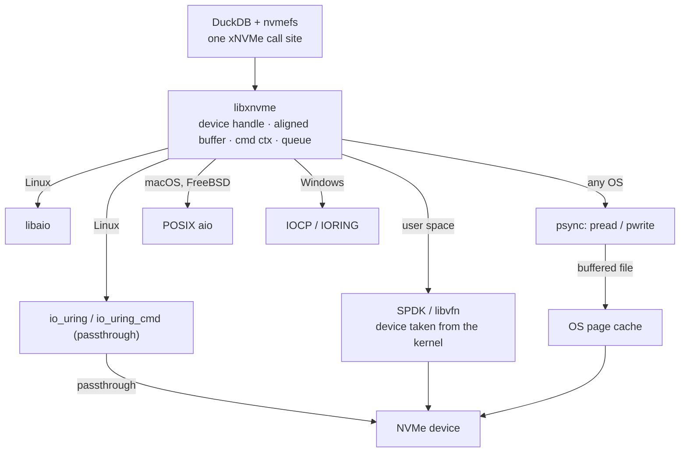

# xNVMe: one API over every I/O path, and the page cache it bypasses

The other two papers in this topic ask *how* to use a fast I/O path. This one
asks a more practical question first: why do almost no databases use one?
Houlborg, Tietgen, Lund, Weisgut, Rabl, González, Shah and Tözün (CIDR'26)
answer that the Linux and NVMe I/O landscape has fractured into half a dozen
incompatible interfaces, each with its own API, semantics and failure modes,
so "most real-world deployments still, conservatively, rely on pread and
pwrite" (§1). Their proposal is xNVMe, a Samsung library that puts one
command-centric API over all of them, and their evidence is a DuckDB
filesystem extension, `nvmefs`, that switches DuckDB from synchronous POSIX
reads to NVMe passthrough, SPDK or FDP placement without touching DuckDB's
core.

The result is worth reading for its *honest* half. On the I/O-heavy queries
the new paths cut query time sharply. On most of TPC-H they change almost
nothing — "within a ∼10% variance of the baseline" (§5.1) — and the authors
name the reason: the OS page cache was already doing the work, and the fast
paths bypass it. That is this topic's lane 1c in one sentence, measured at
DuckDB scale.

This chapter builds the vocabulary from zero, walks the paper's model and its
integration, then puts its evaluation next to this topic's own numbers.

## The problem in one sentence

A database that wants asynchronous, low-overhead NVMe access today must
choose between POSIX, libaio, io_uring, io_uring passthrough and SPDK — five
APIs with different semantics, OS support and deployment demands — so how do
you write the I/O layer once, pick the path at runtime, and know when picking
the fast one will actually pay?

## The concepts, step by step

### Step 1 — the POSIX contract, and why it fractured

> **In:** nothing yet — this step defines the baseline every later step departs from.
> **Out:** the list of I/O paths the paper names (§1, §3.1), each with the reason it exists. Step 2 puts one API over all of them.

**POSIX I/O** is the file interface every Unix offers: `pread(fd, buf, n,
off)` copies `n` bytes at offset `off` of a file into `buf`, and `pwrite`
does the reverse. Both are **synchronous**: the calling thread is blocked
until the bytes have moved. An **asynchronous** interface separates the two
halves — you *submit* a request and later *collect* its completion, and the
thread is free in between, so one thread can keep many requests outstanding.

POSIX's file abstraction rests on the **page cache**: the kernel's in-memory
copy of recently read or written file pages. A `pread` of a cached page is a
memory copy; only a miss goes to the device. Hold that thought — it decides
the evaluation in Step 5.

§3.1 gives three reasons the single POSIX contract fractured:

- **Fast hardware.** NVMe SSDs made the kernel's per-call software cost
  visible, so performance-seeking systems moved to other stacks.
- **The need for asynchrony.** `epoll`/`select` gave "only partial
  asynchronicity" (they report readiness, not completion), and **POSIX aio**
  — the standard `aio_read`/`lio_listio` family — "never achieved [its] goals
  of portability and widespread adoption" (§3.1).
- **New device features.** ZNS, FDP, KV and computational-storage SSDs offer
  commands that are not reads and writes at all, and "wrapping these
  capabilities within a POSIX abstraction ... inevitably sacrifices their
  benefits" (§3.1).

The resulting zoo, in the paper's own list (§1, §2 "I/O Path Support"):

- **libaio** — Linux's older native asynchronous interface for direct block
  I/O.
- **io_uring** — Linux's shared-ring asynchronous interface (the other two
  guides in this topic read it in depth).
- **io_uring_cmd**, also called **I/O Passthru** — an io_uring opcode that
  carries a raw NVMe command through the kernel to the device, skipping the
  file system and block layer while staying inside the kernel.
- **SPDK** — a **user-space NVMe driver**: the application takes the device
  away from the kernel and talks to it directly over PCIe. **libvfn** is a
  second user-space NVMe driver library xNVMe supports.
- **psync** — plain `pread`/`pwrite` — plus Windows IOCP/IORING, block-layer
  and NVMe-driver ioctls.

To read any of these you need three NVMe terms. An **NVMe command** is the
fixed-size request a host places on the device; its **opcode** says what to
do (read, write, flush, zone append…). A **namespace** is a logically separate
range of storage the device exposes, like a partition the drive itself
manages. An **LBA** (logical block address) is the index of a block inside a
namespace — the device's unit of addressing, 4 KiB on the paper's SSD
(Table 1: "Capacity & Block Size 3.76 TB & 4 KiB").

Why it matters: each path in the list above is faster than POSIX for some
workload and unavailable or awkward for another. A database that targets one
of them directly inherits its OS and deployment constraints forever.

### Step 2 — xNVMe's model: commands, queues, and a backend chosen at runtime

> **In:** the zoo of paths from Step 1.
> **Out:** xNVMe's four-part programming model (§2) and the rule for which path runs. Step 3 builds a DuckDB filesystem on it.

xNVMe is "an open-source framework providing a C API and a cross-platform
user-space library (libxnvme)" built around a **message-passing**, or
**command-centric**, API: instead of "read these bytes from this file", you
build an NVMe command and send it (§2). The paper says it was introduced
"nearly six years ago" (§3.2), in 2019 by §3's opening ("the reasons that
prompted the birth of xNVMe in 2019"). The model has four parts, one per
listing in §2:

1. **A device handle** (Listing 1), opened from an OS path such as
   `/dev/nvme0n1`, a PCIe address, or an NVMe-over-fabrics endpoint, with
   options in `xnvme_opts`.
2. **A payload buffer** (Listing 2) from `xnvme_buf_alloc`, which returns
   memory aligned to the device's and the backend's constraints, "such as
   direct memory access (DMA) capability". **DMA** is the device copying data
   to or from RAM itself, without the CPU; a **DMA-able buffer** is memory the
   device is allowed to target, which usually means aligned and pinned.
3. **A command context** (Listing 3), `xnvme_cmd_ctx`, holding the command, its
   completion status, the device and the queue — "the most significant
   command-field is the opcode".
4. **Synchronous or asynchronous submission** (Listings 3–4). Synchronous mode
   blocks the caller. Asynchronous mode needs a **queue** — here, a pair of
   rings like NVMe's own: a **submission queue** the host fills and a
   **completion queue** the device fills, together a **queue pair** — plus a
   callback that runs on each completion. Listing 4 creates one with depth 32.

The four parts are the same four this topic's lane-1 code needs. Here is
Listing 3's shape, re-typed:

```c
// ILLUSTRATION — not quoted from a pinned clone; the shape of the paper's Listing 3 (xNVMe sync read)
// The real code to read for the same four steps is this topic's experiments:
//   device handle  -> file.rs:162   open_cold (F_NOCACHE / O_DIRECT)
//   aligned buffer -> file.rs:39    AlignedBuf::new (page-aligned, as O_DIRECT requires)
//   sync command   -> file.rs:199   pread, the psync path
//   async + queue  -> aio.rs:56     lio_listio, the POSIX aio path
struct xnvme_cmd_ctx ctx = { .dev = dev, .mode = XNVME_CMD_SYNC,
                             .cmd.opcode = XNVME_SPEC_NVM_OPC_READ };
err = xnvme_cmd_pass(&ctx, buf, nbytes, 0x0 /* slba */, 0 /* nlb */);
```

The rule that makes it a single API is the **backend**: the concrete I/O path
libxnvme uses underneath. It "decides based on the capabilities of the I/O
storage paths available to the library at runtime", and the caller can force
one — `opts.be.async = "io_uring"`, in which case the open fails if io_uring
is absent (§2). Two more properties close the gap with POSIX:

- **A fallback shim**: "in case the API is invoked on a non-NVMe device, then a
  fallback shim layer maps the NVMe commands to appropriate OS managed I/O
  operations" (§2). An NVMe read on a regular file becomes a `pread`.
- **Portability**: the paths are "supported on compatible OSes, such as Linux,
  FreeBSD, Windows, and MacOS" (§2).

That last item is this topic's situation exactly. On macOS there is no
io_uring, no passthrough and no SPDK; what xNVMe can offer there is psync and
POSIX aio — and those are the two read paths lane 1 measures. Lane 1a is psync
at queue depth N (threads each calling `pread`, `qd.rs:29` and `file.rs:199`);
lane 1b is POSIX aio (`lio_listio` at `aio.rs:56`, one `aio_return` per read at
`aio.rs:67`). A portable API does not make a missing path appear; it makes the
code that uses the best available one the same code.



The diagram's two lower arrows are the paper's evaluation in advance: only
the psync path through a file system passes through the page cache.

Why it matters: the design choice is to standardise on the *device's* command
set rather than on the file abstraction. That is what lets new commands (zone
append, FDP placement) reach the application without a new kernel interface
per feature.

### Step 3 — nvmefs: DuckDB files as LBA ranges

> **In:** xNVMe's model from Step 2, and DuckDB's I/O as it ships.
> **Out:** how `nvmefs` maps DuckDB's three file types onto raw LBAs, one queue per worker. Step 4 adds FDP on top; Step 5 measures it.

DuckDB keeps three kinds of file (§4.1): the database file, the write-ahead
log, and **temporary files** — where query intermediates are written when they
do not fit in the buffer pool, which is called **spilling**. Each file is a
sequence of **blocks**, DuckDB's I/O unit: 256 KiB by default, with temporary
files using sizes "ranging from 32 KiB to 256 KiB", one file per block size
(§4.1). A 256 KiB block is 256 × 1024 / 4096 = 64 of the SSD's 4 KiB LBAs.

DuckDB reaches storage through its **FileSystem abstraction**, a class every
storage backend implements; the default `LocalFileSystem` "uses OS filesystem
abstractions and synchronous I/O" (§4.1). A **community extension** is a
dynamically linked library that adds such a backend without changing DuckDB's
core (§4, footnote 1). `nvmefs` is one: a path prefixed `nvmefs://` routes to
it, and the backend and device path come from a configuration persisted with
DuckDB's secrets manager (§4.2).

Because passthrough and SPDK bypass the file system, `nvmefs` must be its own
allocator of LBAs (§4.2, Figure 2):

- the database and the WAL each get one contiguous LBA range — "keeping the
  start LBA and the current LBA for writes is sufficient";
- temporary files share a range in which different files' blocks interleave,
  so a `TemporaryFileMetadataManager` maps each temporary file name to a list
  of (not necessarily consecutive) LBA ranges, and a `TemporaryBlockManager`
  tracks free blocks.

And for concurrency: "nvmefs creates a separate xnvme_queue for each DuckDB
worker thread. This eliminates the need for synchronization when multiple
threads access the same queue" (§4.2). That is the same rule the io_uring paper
states as a guideline — one ring per thread, never shared — and the rule
PostgreSQL cannot follow because its completions may be reaped by another
process ([reading-postgres-aio.md](reading-postgres-aio.md)).

Why it matters: the integration is small *because* the database already had a
FileSystem seam. The cost of bypassing the OS is that the database becomes a
tiny file system — it owns the LBA map and its free list.

### Step 4 — FDP: telling the drive which data dies together

> **In:** nvmefs's LBA layout from Step 3, and Step 1's device vocabulary.
> **Out:** what an FDP placement identifier is, how nvmefs uses it, and the condition under which it can help. Step 5 checks that condition.

Flash is written in pages but erased in larger blocks, so the drive writes
every update to a new location and later garbage-collects blocks that still
hold some valid pages, copying those pages first. **Write amplification** is
the ratio of bytes the device physically writes to bytes the host asked it to
write — "the ratio between the amount of data actually written to the device vs
the data intended to be written by the application" (§4.2). It is 1 when
nothing is copied.

Two NVMe features let the host reduce it. **ZNS** (Zoned Namespaces) exposes
zones that must be written sequentially and reset by the host, so the device
does no garbage collection of its own. **FDP** (Flexible Data Placement) is
gentler: the host keeps ordinary random writes but attaches a **placement
identifier** to each write, and the device keeps data with different
identifiers in different erase units, so data "with similar lifetimes" lands
together (§4.2). A **KV SSD** is a third variant that stores key–value pairs
rather than blocks (§1).

nvmefs uses FDP for the one lifetime split DuckDB has for free: temporary data
"has the lifetime of a query, while the database data is stored long term", so
at open time it checks via xNVMe's get-feature API whether FDP is enabled and,
if so, writes temporary and database data with different placement
identifiers (§4.2). It reaches the passthrough path through xNVMe rather than
coding `io_uring_cmd` directly, which the authors call "more cumbersome and
error-prone" (§4.2).

Why it matters: placement hints only pay when there is write amplification to
remove — when the device would otherwise mix short- and long-lived data in one
erase unit and copy the survivors. Step 5 finds that DuckDB's analytical
writes do not create that condition.

### Step 5 — the evaluation: fast paths win where the page cache cannot hide the I/O

> **In:** nvmefs from Steps 3–4; DuckDB 1.2.0, xNVMe 0.7.5, SPDK 22.09 on the Table 1 server (2× Xeon Gold 6342, 24 cores / 48 threads, 500 GB RAM, Linux 6.13.0, one 3.76 TB FDP SSD with 4 KiB blocks), against DuckDB's `LocalFileSystem` on ext4.
> **Out:** three findings — where the new paths win, where they do not and why, and what FDP did. Step 6 sets them next to this topic's measurements.

Three experiments (§5):

**TPC-H (§5.1, Figure 3).** Scale factors 100 and 1000, stored by DuckDB in
26 GB and 265 GB; buffer pool 20 GB; 16 threads. Queries 9 and 13 "benefit
from the I/O Passthru backend and FDP", and query 12's time "gets halved with
FDP" (not shown in the figure). "For the other queries, nvmefs performs within
a ∼10% variance of the baseline." At scale factors 1 and 10, which fit in the
20 GB pool, there were no significant differences.

The authors' explanation is the important sentence: the close results "can be
explained by the impact of the OS page cache ... While I/O Passthru bypasses
the OS layers and provides a more direct I/O path through the kernel, it also
bypasses the OS filesystem's data buffering in memory." The baseline was not
paying device latency on most reads; the 500 GB machine's page cache held
them.

**Aggregation benchmark (§5.2, Figure 4).** Kuiper et al.'s aggregation queries
over `lineitem` at scale factor 128 (22 GB), 20 GB pool, 16 threads; each query
in a *thin* variant (only the grouped columns) and a *wide* one (all columns,
more spilling). Thin variants do not benefit — "the OS page cache can likely
handle most of it". Wide variants show "∼20% reduction in query execution times
on average". SF 32 behaved like SF 128; SF 8 and SF 2 created too little I/O
pressure to show a difference.

**SPDK (§5.3, Figure 5).** Scale factor 32 (5.3 GB), wide variants, a 2 GB
pool to force I/O, one thread. The SPDK backend "delivers 4–30% improvement";
the `io_uring_cmd` backend "almost halves the query times for most queries".
The authors caution that their SPDK setup is unoptimised — "a more optimized
spdk setup in nvmefs is possible (e.g., pre-allocating buffers to pass I/O
results)" — so this is not evidence that passthrough beats SPDK in general.

**FDP.** "All the experiments exhibit a write-amplification of ∼1, stemming
from the mostly sequential data writing behavior of the analytical workloads",
so `xnvme-fdp` "performs on-par with the others in most queries" (§5.1), and FDP
results are omitted from Figure 4 for the same reason (§5.2). Step 4's
condition is absent.

Why it matters: the abstract's two claims are both supported, but with
different strength. "Comparable performance for non-I/O-intensive cases" is
stated directly by §5.1 (SF 1, 10) and §5.2 (SF 8, 2, thin variants). "Up to
50% lower query times" is supported by prose about bar charts — query 12
"halved", passthrough "almost halves" — and not by any table of numbers in the
paper; this guide could not check it more precisely than that.

### Step 6 — the same finding, measured in this topic

> **In:** Step 5's page-cache explanation; this topic's lane 1a/1c numbers from [notes.md](notes.md) (Apple M3 Pro, measured 2026-10-26); PostgreSQL's AIO README at `701f021`.
> **Out:** the ratio that explains §5.1, and the rule for when a cache-bypassing path is worth it.

This topic's `io_bench` measures both sides of §5.1's sentence on one
machine. Lane 1c reads 4 KiB pages that are already in the page cache: **612
ns** per `pread`. Lane 1a reads 4 KiB pages around the cache: **72.2 µs** mean
at queue depth 1. The ratio:

```
72.2 µs / 612 ns = 72,200 ns / 612 ns ≈ 118
```

A page-cache hit is about **118× cheaper** than the device read a
cache-bypassing path performs instead. A passthrough read is faster than a
*buffered miss* — it skips the file system and block layer — but it can never
be faster than a *buffered hit*, because it always goes to the device. So a
bypassing path pays only when the working set does not fit in the page cache
or the workload's own buffer pool: the 2 GB-pool SPDK run, the wide aggregation
variants that spill, the 265 GB scale factor. Everywhere else the OS was
already giving DuckDB the 612 ns path.

PostgreSQL's AIO design document draws the same line from the other side, in
its list of reasons *not* to use direct I/O (`src/backend/storage/aio/README.md`
at `postgres` `701f021`, lines 36–43): without AIO, direct I/O "is unusably
slow"; even with it, "many parts of postgres need to be modified to perform
explicit prefetching"; and where `shared_buffers` "cannot be set appropriately
large ... performance will often be worse than when using buffered IO". All
three are the page cache's value restated: it is a free, OS-managed cache and
prefetcher, and giving it up means rebuilding both.

And the FDP null result is this topic's lane 3 premise inverted. DuckDB's
writes are large and sequential, so the drive's write amplification is already
∼1 and there is nothing for placement hints to remove. OLTP engines rewrite
small pages at random, which is where the "How to Write to SSDs" paper finds an
in-place engine's SSD WAF at 2.36 and where FDP or zone alignment brings it to
1 ([reading-how-to-write-to-ssds.md](reading-how-to-write-to-ssds.md)). The
xNVMe authors predict exactly this in §6: OLTP workloads "tend to exhibit a
higher write amplification ... [and] would benefit more from FDP SSDs".

Why it matters: "use the fast path" is not a rule. "Use the fast path when the
I/O actually reaches the device, and replace what the page cache was doing"
is.

### Step 7 — the road ahead (§6)

> **In:** the integration and evaluation from Steps 3–5.
> **Out:** the four directions the authors list, and which of them this curriculum touches.

- **Optimising the integration** — synchronisation points that could use atomics
  instead of mutexes; tuning knobs per backend; pre-allocated SPDK buffers;
  other FDP placement options.
- **Other database systems** — PostgreSQL, CockroachDB, LeanStore; the authors
  know of LeanStore work on xNVMe but "are not aware of the results or a public
  codebase".
- **Other workloads** — OLTP, where higher write amplification should make FDP
  matter (Step 6).
- **Accelerator-centric I/O** — GPU-direct storage access, where today's APIs
  "echo the fragmentation seen with POSIX storage APIs" (§6).

Why it matters: the CIDR paper is a position plus a prototype. Its measured
claims are modest and stated carefully; its argument — standardise on the
device's command set and pick the path at runtime — is the part to carry into
the capstone's `IoBackend` trait (README, Capstone M45).

## How to read the paper

It is a six-page CIDR paper; read it in one sitting, in this order:

1. **Abstract and §1** for the two headline claims (comparable when not
   I/O-bound; up to 50% lower when I/O-bound). Write them down; Step 5 checks
   them.
2. **§3 before §2.** §3.1 is the motivation (Step 1); §2's listings make sense
   once you know what they unify.
3. **§2's four listings** with Step 2's four-part model beside them. Note the
   queue depth of 32 in Listing 4 and the `opts.be.async` override.
4. **§4.2 and Figure 2** for the LBA map — ask what happens to the
   TemporaryFileMetadataManager after a crash (it is not discussed).
5. **§5 slowly**, reading the prose, not the bars. Every quantitative claim in
   §5 is a sentence; the figures have no data labels to check against.
6. **§6** last, for what is admitted to be unfinished.

## Questions to answer

1. The fallback shim turns an NVMe read on a regular file into OS file I/O.
   On macOS, which of this topic's lanes is that path, and what queue depth
   does it get by default?
2. nvmefs gives each DuckDB worker its own `xnvme_queue`. What would sharing one
   queue across 16 threads cost, and which io_uring setup flag (from
   [reading-io-uring-crate.md](reading-io-uring-crate.md)) assumes you did not?
3. §5.1 says passthrough also bypasses the file system's buffering. Construct a
   TPC-H configuration from the paper's own numbers in which you would expect
   passthrough to be *slower* than the baseline, and say why.
4. FDP showed write amplification ∼1 for every experiment. Which DuckDB file
   type would you expect to break that first, and under what query shape?
5. The SPDK backend gained 4–30% where passthrough almost halved query time.
   List three explanations the paper offers or permits, and design one
   experiment that would separate them.
6. Is "up to 50% lower query times" a fair abstract for §5? Argue both sides
   using only sentences from §5.

## Done when

Answer each before unfolding it.

- [ ] You can name the I/O paths xNVMe unifies and say which of them exist on macOS.

  <details><summary>Answer</summary>

  §2 lists POSIX aio, libaio, Windows IOCP and IORING, io_uring, io_uring
  command (passthrough), psync (`pread`/`pwrite`), block-layer and NVMe-driver
  ioctls, and the user-space drivers SPDK and libvfn. Only the OS-independent
  ones are available on macOS: psync and POSIX aio. Those are exactly this
  topic's lanes 1a (threads calling `pread`) and 1b (`lio_listio` +
  `aio_return`); io_uring, passthrough and SPDK are Linux-side paths, which is
  why lane 2 is Linux-gated.

  </details>

- [ ] You can describe xNVMe's programming model in four parts and say how the backend is chosen.

  <details><summary>Answer</summary>

  A device handle (opened from an OS path, PCIe address or fabrics endpoint
  with `xnvme_opts`); a payload buffer from `xnvme_buf_alloc`, aligned for the
  device and backend, including DMA capability; a command context carrying the
  opcode, completion status, device and queue; and submission either
  synchronously or asynchronously through a queue with a completion callback
  (Listing 4 uses depth 32). libxnvme picks the backend at runtime from what is
  available, unless the caller forces one (`opts.be.async = "io_uring"`), in
  which case opening fails if it is absent. A fallback shim maps NVMe commands
  to OS file I/O on non-NVMe devices.

  </details>

- [ ] You can explain why nvmefs has to keep its own LBA map, and what it keeps for each file type.

  <details><summary>Answer</summary>

  Passthrough and SPDK bypass the file system, so nothing else knows where a
  DuckDB "file" lives on the device. The database file and the WAL are single
  contiguous LBA ranges, so a start LBA and a current write LBA suffice. The
  temporary files share a range in which their blocks interleave, so a
  TemporaryFileMetadataManager maps each temporary file name to a list of LBA
  ranges (not necessarily consecutive) and a TemporaryBlockManager tracks free
  blocks (§4.2, Figure 2). In effect the extension is a small file system.

  </details>

- [ ] You can state the paper's explanation for why most TPC-H queries did not speed up, and quantify it with this topic's numbers.

  <details><summary>Answer</summary>

  §5.1: the baseline's reads were served by the OS page cache, and passthrough
  "also bypasses the OS filesystem's data buffering in memory". A bypassing
  path always goes to the device. This topic measures both sides on one
  machine: a cached 4 KiB `pread` costs 612 ns (lane 1c) and an uncached one
  72.2 µs mean (lane 1a, QD 1), so 72,200 / 612 ≈ 118× — a fast path can beat
  a buffered *miss* but never a buffered *hit*. It pays only when the working
  set exceeds the caches, which is why the 2 GB-pool and wide-spilling runs
  are where the gains appear.

  </details>

- [ ] You can say why FDP made no difference here and when it would.

  <details><summary>Answer</summary>

  FDP lets the host tag writes with placement identifiers so data with
  different lifetimes is not mixed in one erase unit, which reduces the
  device's garbage-collection copying. That only helps when there is write
  amplification to remove. DuckDB's analytical writes are mostly sequential,
  and every experiment measured write amplification ∼1 (§5.1, §5.2), so FDP
  performed on par. OLTP's small random page rewrites do create amplification
  — the "How to Write to SSDs" paper measures an in-place engine at SSD WAF
  2.36 — and §6 predicts OLTP "would benefit more from FDP SSDs".

  </details>

- [ ] You can grade each of the abstract's two performance claims against §5.

  <details><summary>Answer</summary>

  "Comparable performance for non-I/O-intensive cases": directly stated — no
  significant difference at TPC-H SF 1 and 10 (§5.1), none at aggregation SF 8
  and 2 and none for the thin variants (§5.2), most TPC-H queries within ∼10%.
  "Up to 50% lower query times on I/O-intensive queries": supported by prose
  about bar charts — query 12 "gets halved with FDP" (§5.1), `io_uring_cmd`
  "almost halves the query times for most queries" in the 2 GB-pool,
  one-thread run (§5.3) — but by no table of numbers, so it cannot be checked
  more precisely than "about half, on some queries". The SPDK result (4–30%)
  comes with the authors' own caveat that the SPDK setup was unoptimised.

  </details>

- [ ] You can connect nvmefs's per-thread queues to the other two systems in this topic.

  <details><summary>Answer</summary>

  nvmefs gives every DuckDB worker its own `xnvme_queue` so no two threads
  synchronise on one queue (§4.2). The io_uring paper makes the same rule a
  guideline (ring per thread; single issuer + DEFER_TASKRUN as the recommended
  configuration). PostgreSQL is the counter-example: any backend may wait on,
  and reap completions from, another backend's ring, so its rings are created
  with no setup flags and cannot be single-issuer
  ([reading-postgres-aio.md](reading-postgres-aio.md)).

  </details>

## References

**Paper** — Emil Houlborg, Andreas Nicolaj Tietgen, Simon A. F. Lund, Marcel
Weisgut, Tilmann Rabl, Javier González, Vivek Shah, Pınar Tözün, "Flexible I/O
for Database Management Systems with xNVMe", CIDR 2026,
[p6-houlborg.pdf](https://www.vldb.org/cidrdb/papers/2026/p6-houlborg.pdf).
Code: [itu-rad/nvmefs](https://github.com/itu-rad/nvmefs) (§4, footnote 2).

| Where | What this guide takes from it |
|---|---|
| Abstract, §1 | the two headline claims; POSIX as what deployments still use |
| §2, Listings 1–4 | the four-part model; runtime backend choice; fallback shim; supported OSes; queue depth 32 |
| §3.1–3.3 | why POSIX fractured; xNVMe's three design principles; "nearly six years ago", 2019 |
| §4.1–4.2, Figure 2 | DuckDB's three file types and block sizes; nvmefs's LBA map; per-thread queues; FDP integration |
| §5, Table 1, Figures 3–5 | hardware and versions; TPC-H, aggregation and SPDK results; write amplification ∼1 |
| §6 | road ahead, including the OLTP/FDP prediction |

**This topic's code** — `topics/45-async-io/experiments/src/`: `file.rs:39`
(`AlignedBuf::new`), `file.rs:162` (`open_cold`), `file.rs:199` (`pread`),
`qd.rs:29` (`sync_reads`), `aio.rs:56` (`lio_listio`), `aio.rs:67`
(`aio_return`). Measurements: [notes.md](notes.md), lanes 1a and 1c.

**PostgreSQL** — `src/backend/storage/aio/README.md:36-43` at `postgres`
`701f021` (the pin in `resources/codebases.md`): the reasons not to use direct
I/O.
