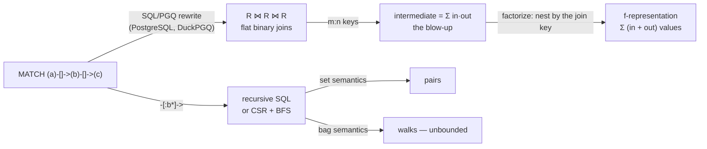

# Topic 46 — Graph Queries on Relational Engines: SQL/PGQ, Factorized Execution & Path-Query Planning

The most direct competition to a property-graph engine is not another graph
database; it is a relational engine that learned to read `MATCH`. SQL:2023
added SQL/PGQ, DuckDB has it as an extension (DuckPGQ), PostgreSQL committed it
in March 2026 and reverted it in September, and three 2026 papers attack the
two things a relational engine does badly on graph patterns — the
**many-to-many blow-up** of flat joins (Lehner & Neumann, VLDB'26; Yasser,
Dorbani & Mhedhbi's FFX, SIGMOD'26) and the **planning of variable-length
paths** inside a larger pattern (Pang et al., VLDB'26). Topic 13 treated
SQL/PGQ as a language question, and
[topic 11's §5](../11-execution-models/README.md) (FFX) and
[topic 13's §3, §4 and §6](../13-graph-engines/README.md) (TurboLynx, CRPQ
planning, and the SQL/PGQ status) carry one-paragraph notes on these papers. This topic is the deep version: it
measures the blow-up, reads the papers to the table, and reads the two
implementations to the line.



## The problem, measured (bench lane 1, provided — runs today)

`cargo run --release --bin pgq_bench` — a seeded, integer-only power-law graph
generator (both endpoints of each edge copied from earlier endpoints 70% of the
time, so hubs are hubs both ways), the 2-hop and 3-hop path patterns evaluated
three ways: as left-deep **hash joins** over the edge table (what a SQL/PGQ
rewriter produces), as nested **CSR expansion** (what a graph engine does), and
as a **factorized** representation sized from vertex degrees. Apple M3 Pro,
measured 2026-10-26; counts reproduce exactly on any machine:

```
-- lane 1a: the paper's own example (Yasser, Dorbani & Mhedhbi, SIGMOD'26, Fig. 1a, §2.2.1) --
   R has 10 edges; query R(a1,a2) ⋈ R(a2,a3)
                                            here     paper
   flat tuples (hash join output)             13        13
   flat values (3 per tuple)                  39        39
   f-tree a1 → a2 → a3 (T1), values           22        22
   f-tree a2 → {a1, a3} (T2), values          15        15
   sanity: all four reproduce the paper — yes

-- lane 1b: path patterns on seeded power-law graphs (avg out-degree 8, 70% preferential, seed 46) --
      |V|      |E| maxout  maxin  hops       flat tuples      flat values  f-rep values   flat/f
    10000    77164   1463   1396  2-hop        6,665,086       19,995,258       161,624     124x
    10000    77164   1463   1396  3-hop      241,301,569      958,541,190     6,738,545     142x
    20000   155727   2363   2304  2-hop       17,759,290       53,277,870       326,298     163x
    20000   155727   2363   2304  3-hop      739,497,555    2,940,230,930    17,875,125     164x
    40000   313512   3884   3897  2-hop       47,900,847      143,702,541       656,622     219x
    40000   313512   3884   3897  3-hop    2,272,724,241    9,042,996,117    47,997,149     188x
    40000   319962     20     22  2-hop        2,560,772        7,682,316       679,805      11x   <- control: uniform (0% preferential)
    40000   319962     20     22  3-hop       23,058,939       89,674,984     3,240,016      28x
```

**A 3-hop pattern over 313,512 edges makes a flat join plan build
2,272,724,241 tuples — 9.04 billion values — to represent a result whose
factorized form holds 47,997,149 values: 188× less.** Every join engine that
evaluates the pattern flat, including PostgreSQL's reverted SQL/PGQ rewriter
and DuckPGQ's `MATCH` translation, produces those tuples; a pipelined plan
need not store them, but it has to build each one and push it into the next
operator. The ratio grows with the graph (124× → 219× for 2-hop as |V| doubles
twice) because it is set by the hubs: the flat 2-hop count is
`Σ_b in(b)·out(b)`, the factorized size `Σ_b (1 + in(b) + out(b))` — a product
against a sum. The control row says the same thing from the other side: with
no preferential attachment the largest out-degree is 20, and the gap shrinks to
11× for 2-hop. Factorization is a skew optimization; Lehner & Neumann's
microbenchmarks put the break-even at 10–12 duplicates per key (§6.1).

Two more readings of the table. Factorizing the 3-hop pattern removes one
level of blow-up, not all of them: its f-representation stores the `d` level
once per `(b, c)` edge, which costs `Σ_c in(c)·out(c)` — the 2-hop count again
(47,997,149 against 47,900,847). And lane 1a is the paper check: this crate
recomputes Yasser et al.'s running example — 13 tuples, 39 values, 22 over the
deep f-tree, 15 over the branching one — from the ten edges, and all four
match §2.2.1.

The timing half (load average recorded by the bench; other agents were running
benchmarks on this machine, so treat ms as indicative):

```
   time to COUNT the result, ms (best of 3; load { 4.28 4.07 4.32 })
      |V|  hops        hash join     CSR expand     factorized  ns/tuple (hash) counts agree
    10000  2-hop             2.3            1.7           0.01             0.35         yes
    10000  3-hop            70.0           53.6           0.07             0.29         yes
    20000  2-hop             4.7            3.5           0.02             0.27         yes
    20000  3-hop           202.0          155.1           0.22             0.27         yes
    40000  2-hop            10.1            7.5           0.04             0.21         yes
    40000  3-hop           624.2          464.3           0.45             0.27         yes
   sanity: hash join, CSR expansion and the degree formula give the same count in every row — yes
   sanity: fastest hash-join row is 0.21 ns per produced tuple — plausible (a per-tuple cost under ~0.1 ns would mean the work was optimised away)
```

CSR expansion beats the hash join by 1.30–1.35× in every row (624.2 vs 464.3 ms at
the largest 3-hop) — and that is all adjacency buys: **the CSR enumerates
exactly the same 2,272,724,241 tuples**. The representation decides how many
tuples exist; the access path only decides what each costs. Counting from the
factorized form takes 0.45 ms — but it is a count, computed as a degree product
(the rewrite DuckPGQ's `FactorizedJoinOptimizer` applies to `count(*)`). The
0.21–0.35 ns per tuple is a *lower bound* on flat enumeration: this flat plan
writes nothing, it only adds each final value into a sink, which the compiler
vectorises; a real engine materialises every tuple into an output vector. Re-run
on a loaded machine (load 12.5), the same rows took up to 2.3× longer while
every count stayed identical — see [notes.md](notes.md).

## Step 1 — a graph pattern is a join, and the join is many-to-many

**SQL/PGQ** declares a property graph as a view over tables and queries it with
`GRAPH_TABLE (g MATCH … COLUMNS …)`. Both implementations read in this topic
translate each element pattern into a table reference and each edge into two
key equalities (DuckPGQ `match.cpp:486–495`; PostgreSQL
`rewriteGraphTable.c:406–562` at the reverted commit). A **many-to-many (m:n)
join** has repeated keys on both sides, and its output for one key is the
Cartesian product of the matches. In a graph every vertex is a join key with
`in(b)` matches on one side and `out(b)` on the other, so a 2-hop path pattern
produces `Σ_b in(b)·out(b)` rows. Worked on lane 1a's example: middle vertex 2
has in-neighbours {0, 1, 3} and out-neighbours {5, 6, 7} → 3 × 3 = 9 paths;
vertex 3 gives 1 × 2 = 2, vertex 4 gives 2 × 1 = 2; total 13.

## Step 2 — factorized representations: store the product, not its expansion

An **f-representation** writes a join result as nested unions under products;
its **f-tree** says which attribute is stored under which; its size is the
number of values stored (Lehner & Neumann §2, Yasser et al. §2.2.1). Grouping
the 2-hop result under its middle vertex `b` stores `b` once, its in-list once
and its out-list once — `1 + in(b) + out(b)` values instead of `3·in(b)·out(b)`:
for vertex 2 of the example, 7 values instead of 27. Which f-tree you get is
decided by the order the plan binds variables: binding the middle first gives
the branching tree (15 values for the example), binding a path end first gives
the deep one (22 values). Counting needs no expansion: siblings multiply,
children add (Lehner & Neumann §4.5).
→ [reading-lehner-neumann-factorized.md](reading-lehner-neumann-factorized.md),
[reading-ffx-factorized-vectorized.md](reading-ffx-factorized-vectorized.md)

## Step 3 — two engine families, two ways to keep it factorized

A **compiling** engine (Umbra) generates code per query; Lehner & Neumann fix
the f-tree at compile time, generate one struct per f-tree node, inline the
first child so the foreign-key case is flat, and add a **bottom insert** — the
mirror of an ordinary hash join, putting the build side on top — so join order
and f-tree shape decouple (`L ⋈_TI R ≡ R ⋈_BI L`, §4.2.3). A **vectorized**
engine (DuckDB) passes fixed-size vectors; FFX keeps every f-tree node in one
packed vector and records grouping as an offset array, and adds a **cascade
update** operator so a filter on a leaf correctly removes emptied parents and
their sibling subtrees (§4.1, §5.2). Neither is free: Lehner & Neumann's engine
is 15% slower than its own flat baseline on all acyclic CE-benchmark queries and
32% slower on cyclic ones, winning on long-running m:n queries (§6.2); FFX's
headline end-to-end numbers use hand-picked join orders (§7.3.3). Lane 2 builds
FFX's layout with a bottom-insert extension.

## Step 4 — variable-length paths: pairs, walks, and where the closure goes in the plan

A **regular path query** (RPQ) returns the vertex pairs joined by a path whose
labels match a regular expression; a **CRPQ** is a join whose atoms may be RPQs
— a Cypher pattern with `*` in it. Lane 3 evaluates `a·b*` from 257 sources on
the 40,000-vertex graph two ways and finds they do the *same number of steps*:
semi-naive `WITH RECURSIVE … UNION` derives 40,832,336 tuples and the
product-automaton BFS scans 40,832,336 adjacency entries (reference
implementation; the BFS is your stub), because under set semantics each pair
is new exactly once. What explodes is bag semantics: within four `b`-steps
there are 5,845,226 pairs and 6,679,113,406 walks. Pang et al. plan the closure
as an operand of a multi-way intersection rather than a separate stage, and
report 2.08× (a ratio of average times) over MillenniumDB on WDBench (Table 5).
→ [reading-crpq-unified-planning.md](reading-crpq-unified-planning.md)

## Step 5 — what the two SQL/PGQ implementations actually do

PostgreSQL's rewriter at `2f094e7ac69` (reverted; in no release) enumerates one
join query per combination of element tables — a product over the pattern's
factors, which on a graph with hundreds of tables needed two follow-up fixes
for stack depth and interruptibility — and refuses quantifiers outright, so it
has no variable-length paths at all. DuckPGQ builds a CSR per query in scalar
UDFs and runs a 512-lane bitset BFS; a bounded quantifier `{l,u}` compiles to
`iterativelength(...) BETWEEN l AND u`, a filter on the *shortest* distance
between endpoint pairs, not an enumeration of walks. In October 2026 it gained
a factorized-join optimizer pass that rewrites `count(*)` over m:n joins into
degree products. TurboLynx's VLDB'26 Table 4 measured DuckPGQ (commit
`947eb8d`) at 15,905 ms geometric mean on LDBC SNB SF100 against 3,467 ms for
DuckDB's hand-written SQL on the same queries — and the same table's Umbra row
has ratios that do not match its own milliseconds.
→ [reading-duckpgq.md](reading-duckpgq.md),
[reading-postgres-sqlpgq.md](reading-postgres-sqlpgq.md)

## Production shape

| piece | where | what to notice |
|---|---|---|
| `MATCH` → joins | `duckpgq-extension` `src/core/functions/table/match.cpp:486–495`, `:449–473` | an edge is two key equalities; an undirected edge a `UNION ALL` |
| vertex-join elimination | `match.cpp:1088–1103` | a vertex used only by key is not joined |
| quantifier → shortest-distance filter | `match.cpp:730–744`, `:930–934` | `iterativelength(...) BETWEEN l AND u` |
| CSR on the fly | `src/core/functions/scalar/csr_creation.cpp:57–59`, `:141–147` | counting sort with an atomic slot claim |
| 512-lane BFS | `src/core/functions/scalar/iterativelength.cpp:12–32` | one bitset OR advances every search at a vertex |
| factorized count | `src/core/optimizer/factorized_join_optimizer.cpp:629–642`, `docs/FACTORIZED_JOINS.md:36` | fires only if both sides have ≥ 2 rows per key |
| PostgreSQL rewriter | `postgres` @ `2f094e7ac69` `src/backend/rewrite/rewriteGraphTable.c:351–383`, `:726–733` | one query per element combination; `UNION ALL` |
| PostgreSQL limits | `src/backend/parser/parse_graphtable.c:233–236`, `:279–282` | no quantifiers, one path pattern |

`duckpgq-extension` anchors are at `29ca668` (pin table in
[resources/codebases.md](../../resources/codebases.md)); PostgreSQL anchors at
`2f094e7ac69`, read with `tools/pinned-source.py --ref 2f094e7ac69`.

## Reading guides

1. [reading-lehner-neumann-factorized.md](reading-lehner-neumann-factorized.md) — Lehner & Neumann (VLDB'26): f-trees in a compiling engine, top and bottom inserts, parallel IDs; the CE-benchmark losses; two abstract numbers that §6 does not reconstruct.
2. [reading-ffx-factorized-vectorized.md](reading-ffx-factorized-vectorized.md) — Yasser, Dorbani & Mhedhbi (SIGMOD'26): packed factorized vectors, cascade update, LBP's limits; Table 4's prose/row mismatches.
3. [reading-crpq-unified-planning.md](reading-crpq-unified-planning.md) — Pang, Zou, Bonifati, Özsu & Zhou (VLDB'26): RPQs and CRPQs, six operators, the cost model worked; Table 5's "average speedup" is a ratio of averages.
4. [reading-duckpgq.md](reading-duckpgq.md) — DuckPGQ (CIDR'23) and `cwida/duckpgq-extension` at `29ca668`, with TurboLynx's measurement of it.
5. [reading-postgres-sqlpgq.md](reading-postgres-sqlpgq.md) — PostgreSQL's SQL/PGQ rewriter at the reverted commit `2f094e7ac69`.

## Experiments

```
cd experiments
cargo test              # 8 provided tests pass; 5 stub tests (lanes 2 and 3) fail until implemented
cargo run --release --bin pgq_bench
```

- `gen.rs` (PROVIDED) — SplitMix64 and an integer-only power-law generator
  (sorted, deduplicated edge list), the ten-edge relation of FFX Fig. 1a, and a
  hash-based edge labelling for lane 3.
- `graph.rs` (PROVIDED) — out- and in-CSR built by counting sort.
- `flat.rs` (PROVIDED, lane 1) — left-deep pipelined hash joins over the edge
  table, counting tuples per operator. Hash tables are probed, never iterated.
- `expand.rs` (PROVIDED, lane 1) — the same pattern by CSR expansion.
- `fsize.rs` (PROVIDED, lane 1) — f-representation sizes and counts from
  degrees, checked against a brute-force trie count in its tests.
- `factorized.rs` (lane 2) — PROVIDED: the packed `Level { vals, off }` layout
  and the 2-hop representation built from hash tables. STUB: `extend` (bottom
  insert of a third edge relation under `c`), `values`, `count`, `flatten`, and
  `retain_d` with cascade. The tests are the contract: size = lane 1's closed
  form, count = the flat join, no empty group after a filter.
- `rpq.rs` (lane 3) — PROVIDED: `semi_naive` (`WITH RECURSIVE … UNION`) and
  `walks_up_to` (the bag-semantics row count). STUB: `product_bfs`. Contract:
  same pairs; states = sources + pairs; edges scanned = tuples derived.

## Exercises

1. Implement both stubs until every test passes. Reference numbers for both
   lanes are in [notes.md](notes.md).
2. **Materialize the intermediate.** Make lane 1's hash-join plan write each
   2-hop tuple into a `Vec<[u32; 3]>` before the third join (a pipeline breaker),
   and measure time and peak memory at |V| = 40,000. Predict the memory from the
   table first (47,900,847 × 12 bytes).
3. **Pick the f-tree.** Add the deep f-tree `a → b → c → d` for 3-hop to
   `fsize.rs` and a brute-force test. How much larger than the `b`-rooted one is
   it on the 40,000-vertex graph?
4. **Multi-source BFS.** Rewrite lane 3's BFS DuckPGQ-style: 64 sources per
   pass, one `u64` bitmask per vertex, frontier OR-ed along edges. Compare
   adjacency entries scanned and time against `product_bfs`.
5. **Bounded walks vs pairs.** Implement `{2,3}`-bounded `b`-reachability both
   ways — DuckPGQ's shortest-distance filter and WALK semantics (one row per
   walk) — on lane 3's graph and report both row counts.
6. **A factorized filter that pays.** Use `retain_d` with selectivities 1/2,
   1/8, 1/64 and measure how values and count shrink. At what selectivity does
   flattening after the filter cost less than keeping the representation?

## Cross-topic threads

- **Topic 10 (planning) ↔ 46.** Join ordering decides the f-tree as well as the
  cost; the CRPQ planner's DP over connected edge subsets is topic 10's
  dynamic programming with a closure operator added. Predicate transfer (topic
  10 §4 and topic 47) shrinks inputs; factorization shrinks outputs — FFX §1.1
  calls them complementary.
- **Topic 11 (execution) ↔ 46.** Compiled vs vectorized is exactly the split
  between Lehner & Neumann and FFX; FFX's selection bitmap is topic 11's
  selection vector made hierarchical.
- **Topic 13 (graph engines) ↔ 46.** Kùzu's list-based processing is FFX's
  baseline; worst-case-optimal joins (topic 13's reading-wcoj) are the TI
  operator's leapfrog intersection; the language chapter covers SQL/PGQ syntax.
- **Topic 24 (graph algorithms) ↔ 46.** DuckPGQ's 512-lane BFS is the batched
  multi-source BFS family; lane 3's product BFS is BFS on a product graph.
- **Topic 27 (incremental views) ↔ 46.** Semi-naive recursion is the delta
  rule; lane 3 shows that under set semantics it already does BFS's work.

## Capstone M46 — factorized expansion and closures as join operands

The reference engine, falkordb-rs-next-gen, evaluates patterns over CSR-style
adjacency matrices; this milestone keeps that access path and changes the
representation of intermediates.

- [ ] A factorized intermediate for `Expand` chains: when a plan binds a middle
      vertex, its in- and out-neighbour lists are kept as `Level { vals, off }`
      siblings rather than expanded, with flattening deferred to the first
      operator that needs a flat row. Report lane 1's 2-hop and 3-hop counts
      and sizes from the engine itself.
- [ ] `count(*)`, `count(x)`, `sum(x)` over a factorized intermediate computed
      as products of multiplicities (DuckPGQ's rewrite table), with `DISTINCT`
      and `avg` falling back to flattening.
- [ ] Cascade-correct filters on factorized levels (lane 2's `retain_d`),
      property-tested against the flat plan.
- [ ] Variable-length relationships as join operands: plan
      `(a)-[:R*1..k]->(b)` as a closure that can be intersected with other edges
      at `b` (Pang et al.'s TI-with-KC), under explicit set or bag semantics,
      and measure lane 3's pairs-vs-walks gap through Cypher.
