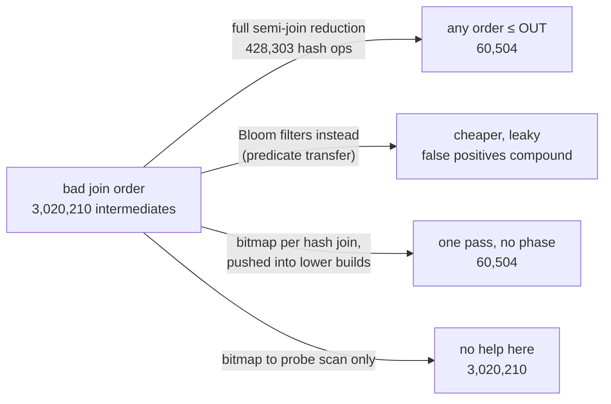

# Topic 47 — Semi-join Reduction in Practice: Yannakakis, Predicate Transfer & Bitmap Filters

Topic 10 spent a chapter showing that cardinality estimates are routinely
wrong by orders of magnitude, and a planner that trusts them picks join
orders that are wrong by the same factor. Its §4 (cardinality
estimation) covers RPT+ and its §5 (two optimizer architectures) SQL
Server's bitmap filters — 2026 papers with a different answer: make the join
order matter less — and topic 44 met the theory behind them (Yannakakis' algorithm, as
the acyclic half of Free Join) in the e-graph setting. This topic goes deep
on that answer, because it is a *general* fix: it helps every query engine
whose estimates are poor, and a Cypher planner choosing where to anchor a
multi-hop `MATCH` is exactly such an engine.

The idea is forty-five years old. Before joining, pass **semi-joins** —
"keep only the rows that have a partner over there" — up and down a join
tree; afterwards every join order of an acyclic query emits at most as many
tuples as the final answer. Engines ignored it because the semi-join phase
costs hash-table work on every input row. The 2024–2026 work makes it
cheap: Bloom filters instead of semi-joins (**predicate transfer**, CIDR'24),
schedules and run-time checks that stop it from slowing good plans down
(**RPT+**, VLDB'26), and the discovery that SQL Server's hash joins had been
doing half of it for a decade with **bitmap filters** (CIDR'26). One more
CIDR'26 paper marks the boundary: `IN` is a semi-join only until a NULL
shows up.



## The problem, measured (bench lane 1, provided — runs today)

`cargo run --release --bin semijoin_bench` — the Cypher pattern
`MATCH (a)-[:KNOWS]->(b)-[:LIKES]->(m)-[:HAS_TAG]->(t:Tag) WHERE t.class =
'rare' RETURN count(*)` as a chain of four relations over a seeded graph:
20,000 persons with 10 KNOWS each, 5 LIKES each into 50,000 posts, 2 tags per
post out of 1,000, and 10 rare tags. The only selective predicate sits three
joins away from the largest relation. Each left-deep hash-join plan is run
as-is and again after a full Yannakakis reduction. Apple M3 Pro, measured
2026-10-26, load average 4.39 at the start of the run (other benchmarks
were running on the machine; counts are exact, timings are one best-of-3
run):

```
-- lane 1: one bad join order, before and after a full Yannakakis reduction --
   knows 200000 · likes 100000 · has_tag 100000 · rare_tag 10 (1% of 1000 tags)   N = 400010 input rows
   join tree rooted at knows (the largest relation)

   OUT = 20210 output rows

   left-deep plan                            join 1    join 2    join 3  intermediates    × OUT  build rows        ms
   good  rare_tag→has_tag→likes→knows          1000      2036     20210          23246     1.15      400000      6.94
   bad   knows→likes→has_tag→rare_tag       1000000   2000000     20210        3020210   149.44      200010     37.94
   good, after full reduction                   868      2036     20210          23114     1.14       22233      0.54
   bad,  after full reduction                 20084     20210     20210          60504     2.99        2903      0.52

   reduction (6 semi-joins): forward 3035 inserts + 400000 probes, backward 22233 + 3035; total 428303 hash ops = 1.07 × N, 1.50 ms

   relation         base      after fwd     after both
   knows          200000          19340          19340
   likes          100000           2025           2025
   has_tag        100000           1000            868
   rare_tag           10             10             10

   bad ÷ good intermediates: 129.9× before the reduction, 2.62× after
   bad order + reduction: 428303 hash ops + 60504 intermediates = 488807 — vs 3020210 for the bad order alone (6.2× less)

   sanity: four plans, one answer — OUT 20210 and checksum a77191f1c5106d95 in all four: agree
   sanity: after reduction every join emits ≤ OUT (20210): holds
   sanity: bad plan materialised 80 M tuples/s — below 1,000 M/s, so the timer saw real work: ok
```

**The same query, the same 20,210 rows, 130× apart in intermediate tuples**
— 23,246 in the good order, 3,020,210 in the bad one. After the six
semi-joins of a full reduction the bad order emits **60,504**, and every one
of its joins is at most OUT (20,084, 20,210, 20,210): the gap between orders
falls from **129.9× to 2.62×**. The reduction itself is linear — 428,303
hash operations, 1.07× the input — and the bad order plus the reduction is
6.2× less work than the bad order alone.

The counts are the headline because they reproduce exactly. The timings say
the same thing with noise: the bad order takes 37.94 ms; reduction plus the
bad order 1.50 + 0.52 = 2.02 ms. And they say one thing the counts hide: the
"good" order took 6.94 ms, *slower* than reduce-then-bad, because its
left-deep shape puts knows and likes on the build side — 400,000 rows into
hash tables (the `build rows` column) for 23,246 intermediates.

The honest reading has a negative half. Against the good order the
reduction is not a speed-up: 428,303 hash operations to save nothing in
intermediates (23,246 → 23,114). Semi-join reduction is insurance against a
bad plan, and the whole 2024–2026 literature is about lowering its premium.

The three sanity lines are part of the result. Four plans must give the same
count *and* the same order-independent checksum; after the reduction every
join must be ≤ OUT — the guarantee itself, asserted on every run; and the
bad plan's 80 M tuples/s is far below anything implausible (topic 12's
19,047,619 GB/s lesson) — 3 M tuples of 16 bytes in 38 ms is real work.

### Lane 1b — the filter itself (provided)

Predicate transfer replaces semi-joins with Bloom filters. How leaky they are
depends on the layout, so lane 1b measures two at equal bit budgets on one
million absent keys: a classic Bloom filter, and the **register-blocked**
layout DuckDB v2.0.0 (`d54cbbe3df`) uses (4 bits in one 64-bit word, sized at
≥ 12 bits per key rounded to a power of two, before the filter is folded at
seal time):

```
      keys filter                                 bits  bits/key   k  measured FPR    formula
      1000 classic Bloom                         16384     16.38  11       0.00045    0.00038
      1000 register-blocked (DuckDB layout)      16384     16.38   4       0.00548          —
     10000 classic Bloom                        131072     13.11   9       0.00181    0.00184
     10000 register-blocked (DuckDB layout)     131072     13.11   4       0.00901          —
    100000 classic Bloom                       2097152     20.97  15       0.00006    0.00004
    100000 register-blocked (DuckDB layout)    2097152     20.97   4       0.00249          —
```

Same memory, **5–40× more false positives** for one memory access per probe.
The classic filter at 21 bits per key lands on the 6.1 × 10⁻⁵ RPT+ reports for
its cache-sectorized filter at 20 bits per key (§5.4).

## Step 1 — semi-joins, and why the bad order is so bad

A **semi-join** R ⋉ S keeps the rows of R that have a partner in S and adds
nothing from S, so it can only shrink R. A **join** can multiply. In lane 1's
bad order every person likes exactly 5 posts and every post has exactly 2
tags, so knows ⋈ likes is exactly 200,000 × 5 = 1,000,000 and the next join
exactly 2,000,000 — the predicate that would have cut them to 1% arrives
last. In the good order the predicate comes first: 10 rare tags × ~100 posts
each = 1,000; × ~2 likers = 2,036; × ~10 knowers = 20,210.

## Step 2 — the reduction, worked

The query is **acyclic**: its relations fit in a **join tree** — here the
chain itself — in which every variable sits on a connected set of nodes.
Root it at the largest relation (knows) and run two passes
([reading-yannakakis-predicate-transfer.md](reading-yannakakis-predicate-transfer.md)):

- **Forward (leaves to root):** has_tag ⋉ rare_tag = 1,000; likes ⋉ has_tag′ =
  2,025; knows ⋉ likes′ = 19,340. Predicted for the last: a post is
  rare-tagged with probability 1 − 0.99² = 0.0199, a person with 5 liked posts
  escapes with (1 − 0.0199)⁵ = 0.9045, so 9.55% survive and 200,000 × 0.0955
  ≈ 19,100.
- **Backward (root to leaves):** has_tag drops to **868** — rare-tagged posts
  nobody likes. Predicted: P(no likes) = (1 − 1/50,000)^100,000 ≈ e⁻² = 0.135,
  so 1,000 × 0.865 ≈ 865.

After both, every remaining row is in at least one output tuple, so every
probe in any tree-following order hits, intermediates never shrink, and none
can exceed OUT: **O(N + OUT)**, instance-optimal.

## Step 3 — Bloom filters instead: cheaper, and leaky in a compounding way

Predicate transfer runs the same two passes with Bloom filters (lane 2, your
stub). Reference numbers (from an implementation written and run before the
lane was stubbed; [notes.md](notes.md)):

| bits/key | survivors (exact 22,243) | own false positives | inherited | bad-order intermediates |
|---|---|---|---|---|
| 2 | 264,558 | 42,144 | 200,171 | 839,862 |
| 4 | 198,190 | 24,189 | 151,758 | 436,532 |
| 8 | 58,087 | 6,004 | 29,840 | 106,100 |
| 16 | 22,851 | 159 | 449 | 60,960 |

The column to read is *inherited*: rows that passed every filter honestly,
because an upstream filter's false positive got their key inserted. At 8
bits per key it is **5×** the filters' own false positives. Every filter's
per-key rate matches the textbook (1 − e^(−kn/m))^k — 0.0226 measured vs
0.0215 — yet knows keeps 51,328 rows where the exact answer is 19,340. The PT
paper's cost model (§3.5) prices each table's errors independently and misses
this term; RPT+ §4.2 names it ("multi-hop transfer can accumulate the
filters' one-sided errors").

## Step 4 — no phase at all: bitmaps through hash joins

SQL Server's hash join builds a bitmap from its build side and pushes it into
its probe subtree; in a pull-based executor the top join builds first, so a
lower build side is scanned *after* the bitmaps above it exist and builds its
own bitmap from already-filtered rows — the forward pass of Yannakakis, as a
side effect ([reading-sqlserver-bitmaps.md](reading-sqlserver-bitmaps.md)).
Lane 3 (your stub) runs it two ways. Reference:

| plan | bitmaps may reach | rows built | intermediates |
|---|---|---|---|
| bad (knows probes) | lower build sides — SQL Server | 3,035 | **60,504** |
| bad (knows probes) | the probe scan only — DuckDB's walk | 200,010 | 3,020,210 |
| good (rare_tag probes) | lower build sides | 386,439 | 23,114 |
| good (rare_tag probes) | the probe scan only | 400,000 | 23,246 |

One pass equals the full two-pass reduction (60,504), because §3.3's argument
needs only that every probe hits. Confine bitmaps to the probe scan, as
DuckDB's pushdown walk does (v2.0.0), and the bad order gets
nothing: the rare_tag bitmap is on a column only a build side has. And under
bitmaps the textbook "bad" order is the cheapest plan of the four — the
reason SQL Server costs bitmaps inside its optimizer (§4).

## Step 5 — when it does not pay

Three negative results, each from a paper's own data or this lane:

- **Good plans pay the premium.** Lane 1: 428,303 hash operations to save 132
  intermediates on the good order. RPT made ≥ 28% of SQLStorm's 13,308
  queries more than 10% slower (RPT+ §6.1, Table 1); RPT+'s run-time checks
  bring that to 2.1% (Table 2).
- **No selective predicate, no benefit.** RPT+ on Appian: **1.01×** (§6.2); a
  filter built from an unfiltered primary-key side passes every foreign-key
  row (§3.6). DuckDB encodes the same rule as two constants
  ([reading-duckdb-join-filters.md](reading-duckdb-join-filters.md) Step 4).
- **Cyclic queries void the guarantee.** On TPC-H Q5 the exact algorithm,
  forced onto a spanning tree, pre-filtered *less* than Bloom-filter transfer
  over the full graph — PT's join inputs were 64% smaller (CIDR'24 §4.3).

## Step 6 — where a semi-join is not one

`x IN (SELECT …)` is planned as a semi-join, and is one only while no NULLs are
involved: `(3, 4) IN ((1, 2), (3, NULL))` is NULL, not FALSE (CIDR'26 Birler &
Neumann §1). With several nullable columns no subquadratic algorithm is
expected (§5, by reduction from orthogonal vectors). Every filter in this
topic is a semi-join in disguise, so every engine here refuses to push one
where NULL semantics apply: DuckDB skips MARK and ANTI joins; DataFusion skips
null-aware joins whose build keys can be NULL and, for null-equal joins, widens
the filter with `key IS NULL` ([reading-in-predicates.md](reading-in-predicates.md)).

## Production shape — DuckDB and DataFusion

| piece | where | what to notice |
|---|---|---|
| DuckDB: which joins, which scans | `duckdb` `src/optimizer/join_filter_pushdown_optimizer.cpp:317-414`, `:161-293` | targets searched from the **probe child only** (`:360`, `:178-180`); passes through projections and group keys; bail-out at a scan without the column (`:237-240`) |
| DuckDB: filter choice at build end | `src/execution/operator/join/physical_hash_join.cpp:1837-1967` | IN-list (2–50 rows, statistics-only), bitmap over the key range (span < 2²⁶), else min-max + Bloom |
| DuckDB: Bloom policy | `physical_hash_join.cpp:1439-1484` | build ≤ estimated probe; unfiltered builds > 4,194,304 rows at ratio > 0.1 refused (the bitmap obeys the same rule, `:1486-1502`) |
| DuckDB: the filter | `src/planner/filter/table_filter_bloom_function.cpp:27-150`, `Seal` `:91-131` | register-blocked, 4 bits per key, sized at ≥ 12 bits/key, power of two, then folded while the false-positive estimate stays within 0.646% |
| DuckDB: run-time pause | `table_filter_functions.cpp:36-62`, `table_filter_selectivity_optional_function.cpp:25-46` | 6 vectors sampled, Bloom paused at ≥ 50% pass rate; the pause grows 4, 14, 24, … vectors and then re-checks |
| DataFusion: the filter object | `datafusion` `datafusion/physical-expr/src/expressions/dynamic_filters/mod.rs:317-345` | `lit(true)` placeholder, `update` bumps a generation |
| DataFusion: routing | `datafusion/physical-plan/src/joins/hash_join/exec.rs:1918-2015` | parent filters go to the child owning the column — **including the build side** — and filters on join keys transfer to the other side of an inner or semi join |
| DataFusion: membership | `exec.rs:3356-3406`, `shared_bounds.rs:90-216` | IN-list ≤ 150 keys / 128 KiB, else the **hash table itself** (plus a pruning-only key-range bitmap); bounds ANDed first |

Anchors are `duckdb` at v2.0.0 (`d54cbbe3df`) and `datafusion` at `350ca7650`, read with
`tools/pinned-source.py`. Guides: [reading-duckdb-join-filters.md](reading-duckdb-join-filters.md),
[reading-datafusion-dynamic-filters.md](reading-datafusion-dynamic-filters.md).

## Reading guides

1. [reading-yannakakis-predicate-transfer.md](reading-yannakakis-predicate-transfer.md) — Yannakakis' two passes (via its 2024–2026 restatements; the 1981 PDF could not be obtained) and Yang et al.'s predicate transfer (CIDR'24): the reduction worked on lane 1, the §3.5 cost model, and the inherited false positives it misses.
2. [reading-rpt-plus.md](reading-rpt-plus.md) — Qiao, Boncz & Zhang (VLDB'26): asymmetric transfer plans, cascade filters, dynamic pipelines, and the regressions they remove.
3. [reading-sqlserver-bitmaps.md](reading-sqlserver-bitmaps.md) — Zhao et al. (CIDR'26): bitmap-building hash joins, the one-pass instance-optimality proof, bitmaps in Cascades.
4. [reading-in-predicates.md](reading-in-predicates.md) — Birler & Neumann (CIDR'26): three-valued IN, mark joins, the orthogonal-vectors hardness, and linear mark joins for one nullable column.
5. [reading-duckdb-join-filters.md](reading-duckdb-join-filters.md) — DuckDB v2.0.0 (`d54cbbe3df`): the pushdown walk, the four filter kinds, the register-blocked Bloom filter, and the pause rule.
6. [reading-datafusion-dynamic-filters.md](reading-datafusion-dynamic-filters.md) — DataFusion at `350ca7650`: dynamic filters, column-ownership and key-transfer routing, and the hash table as the filter.

## Experiments

```
cd experiments
cargo test              # 6 provided tests pass; lanes 2 and 3's 9 stub tests fail until implemented
cargo run --release --bin semijoin_bench
```

- `gen.rs` (PROVIDED) — the seeded social graph and the GOOD/BAD orders.
- `rel.rs`, `hash.rs` (PROVIDED) — column-major relations carrying base row
  ids; a fixed hash so every count and filter bit reproduces.
- `join.rs` (PROVIDED) — left-deep hash joins with per-join output counts and
  an order-independent checksum.
- `yannakakis.rs` (PROVIDED, lane 1) — the join tree (LargestRoot), the
  semi-join, the two passes, and tests against a brute-force participation
  check.
- `bloom.rs` (PROVIDED, lane 1b) — a classic Bloom filter and the DuckDB-layout
  register-blocked one.
- `transfer.rs` (stub, lane 2) — Bloom-filter predicate transfer with
  false-positive accounting. Contract: no false negatives; survivors − exact
  = filter FP + inherited; six filters in Yannakakis order; per-key FPR within
  2× of the formula.
- `bitmap.rs` (stub, lane 3) — bitmap pushdown in a left-deep plan, two modes.
  Contract: same answer; into-lower-builds makes the bad order ≤ OUT at every
  join; probe-spine-only leaves it ≥ 90% of plain; the good order's top build
  is unfiltered.

## Exercises

1. Implement both stubs until every test passes, then check lanes 2 and 3
   against the reference tables in [notes.md](notes.md) — the counts must
   match to the row.
2. **Swap the filter.** Make lane 2 take the filter type as a parameter and
   run it with `RegisterBlocked` at DuckDB's sizing. Predict from lane 1b how
   much the inherited column grows, then measure.
3. **ATP on lane 1.** Implement RPT+'s asymmetric plan for a *star* variant of
   the generator (every relation joined to knows on its own key) and count
   filter builds and probes against the symmetric plan.
4. **A dynamic pipeline.** Add RPT+'s Algorithm 2 to lane 2: measure each
   filter's pass rate on its first 10% of probe rows and abandon it above
   τ_sel = 0.35. On lane 1, which filters go, and what happens to the
   good-order case where all the reduction is wasted?
5. **The negative case, constructed.** Change the generator so the predicate
   is not selective (rare_every = 1). Predict lane 1's rows before running:
   the reduction should cost ~N and save nothing.
6. **A cyclic query.** Add a closing edge (a)-[:LIKES]->(m) to make a cycle.
   The crate's `JoinTree` will refuse or drop an edge; measure what the
   reduction keeps against a brute-force participation count — PT's Q5 result
   on your own data.

## Cross-topic threads

- **Topic 10 (query planning) ↔ 47.** Its estimation-error chapter is the
  problem; its §4 (RPT+) and §5 (SQL Server's bitmaps) introduce these papers, and
  its Cascades chapter is where SQL Server costs the bitmaps (CIDR'26 §4).
- **Topic 44 (e-graphs) ↔ 47.** [reading-free-join.md](../44-egraphs-egglog/reading-free-join.md)
  Step 1 places Yannakakis as the acyclic half of the join story, and
  egglog's planner aims its decomposition at a Yannakakis-style semi-join
  program ([reading-egglog-source.md](../44-egraphs-egglog/reading-egglog-source.md)).
  Cyclic patterns are where generic join takes over.
- **Topic 11 (execution models) ↔ 47.** Pull-based execution is what makes
  SQL Server's bitmaps cascade; the mark join is topic 11's IN-predicate
  paper.
- **Topic 12 (columnar analytics) ↔ 47.** Min–max filters skip row groups;
  RPT+'s cascade filter puts them in front of the Bloom filter, and its §4.2
  shows Bloom false positives destroying them.
- **Topic 13 (graph engines) ↔ 47.** Every `Expand` in a Cypher plan is a
  join; lane 1 is a three-hop `MATCH`, and anchoring it at the wrong end is
  the bad order.

## Capstone M47 — a semi-join pass for the Cypher planner

The capstone's planner (M10) picks an anchor and an expansion order from
estimates; M47 makes a bad pick cheap instead of trying to make it rare.

- [ ] A pre-pass for acyclic `MATCH` patterns: build the pattern's join tree,
      run a forward and a backward semi-join pass over the label/relationship
      matrices before expansion, and assert the instance-optimal bound
      (every expansion ≤ final row count) in debug builds.
- [ ] Replace the exact semi-joins with filters behind one trait — exact
      bitmap when the node-id range is compact, Bloom filter otherwise — and
      report filter false positives and inherited rows per hop, as lane 2
      does.
- [ ] Dynamic abandon: sample each filter's pass rate on its first rows and
      drop it above a threshold (RPT+'s τ_sel = 0.35 as the starting value);
      measure on a pattern with no selective predicate that the pass costs
      ≤ 5% (Appian's 1.01× is the bar).
- [ ] Leave `IN` over lists that may hold `null` out of the filter path, with a
      test that `3 IN [1, null]` returns `null`.
- [ ] Benchmark: lane 1's query as Cypher on the capstone, anchored at
      `Person` and at `Tag`, with and without the pass — the same four rows,
      and the p99 against C FalkorDB on the same graph.
