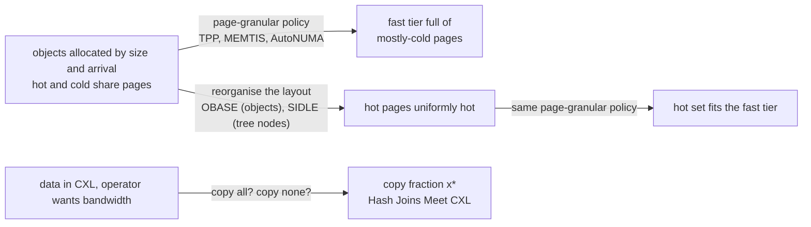

# Topic 48 — Memory Tiering: CXL, Disaggregated Memory & Placement

An in-memory graph database hits the DRAM wall before anything else: the
adjacency, the properties and the indexes all have to be resident, and DRAM
is the most expensive component of a server — "often accounting for 50% of
server capital expenses" (OBASE, §1). **CXL** memory — DRAM on a PCIe card,
addressed with ordinary loads — adds capacity at a cost of latency (2.49× on
SIDLE's platform) and bandwidth (65.6%), and disaggregated memory pools push
the far tier further, to microseconds over RDMA. No topic in this curriculum
priced that tier. This one does, with an honest constraint: **this machine has
no CXL and no NUMA**, so nothing here measures CXL. What it measures is the
mechanism every tiering policy in the papers depends on — a dependent load
costs whatever its tier costs, and a policy can only move the *units* it
manages, so what matters is whether the hot objects share them — at the one
tier boundary this machine does have: on-chip cache in front of DRAM.



Two questions run through the topic: *what* to put in the fast tier (layout
and granularity — lanes 1 and 2, OBASE, SIDLE, TPP), and *how much to move*
when the data starts in the slow one (the hash-join paper's model, lane 3).

## The problem, measured (bench lane 1, provided — runs today)

`cargo run --release --bin tier_bench` — 1 GiB of 64-byte objects (2²⁴ of
them), one seeded access stream in which 90% of accesses go to a hot set (the
"Hotspot" shape of SIDLE §6.1), each access's address computed from the value
the previous access loaded so no two misses overlap. The *same ids in the same
order* run over two layouts: **packed** (hot objects in the first slots) and
**scattered** (slot = id × odd constant mod 2²⁴, so every hot object shares its
cache line and page with cold ones — OBASE's "hotness fragmentation"). Apple
M3 Pro, measured 2026-10-26, load average 7.2 (other benchmarks were running —
see notes.md for the spread):

```
   loop floor (all objects in one 16 KiB page):        7.96 ns/access
   all cold (every access uniform over the 1 GiB):   129.28 ns/access

   hot set              layout      ns/access   hot lines   hot pages   pages for 90%   hot-page util
   0.1% (1.0 MiB)       packed          26.98        8389          66              66           99.3%
                        scattered       37.03       16777        8218            7964            3.2%
                        scattered/packed: 1.37x time
   0.5% (5.1 MiB)       packed          37.19       41943         328             328           99.9%
                        scattered       86.12       83886       35218           31670            3.3%
                        scattered/packed: 2.35x time
   1.0% (10.2 MiB)      packed          60.79       83886         656             655          100.0%
                        scattered      110.73      167772       65536           55806            3.4%
                        scattered/packed: 1.76x time
   5.0% (51.2 MiB)      packed         114.96      419431        3277            3257           98.7%
                        scattered      126.76      838861       65536           57116            7.3%
                        scattered/packed: 1.07x time

   sanity: slowest row 126.8 ns ≤ 1.1 × all-cold 129.3 ns — no hot set costs more than no hot set
   sanity: all-cold 129.3 ns vs lane 1a's 512 MiB rung 116.3 ns — same tier
   checksums agree on every row: both layouts loaded the same objects in the same order
```

**The same accesses, a different layout, up to 2.35× the time** — and the
counted columns say why, exactly and on any machine. With a 1% hot set, 90% of
accesses land on **655 16 KiB pages (10.2 MiB) when the hot set is packed and
55,806 pages (872 MiB) when it is scattered** — an 85× larger fast tier for the
same hit rate, with 3.4% of each of those pages' bytes ever touched. At 4 KiB
pages, the unit Linux tiering migrates, it is 2,619 pages (10.2 MiB) against
149,206 (582.8 MiB). Those counts are what a page-granular tiering policy
(TPP, MEMTIS) is given to work with; no promotion rule recovers them.

The timed column shows the *tier boundary*. Packing pays most when the packed
hot set fits the fast tier and the scattered one does not: at 0.5%, 5.1 MiB
of packed lines sit in the 16 MiB L2 while the scattered set drags 10.2 MiB of
lines across 35,218 pages; at 5%, neither 51 MiB nor 102 MiB fits, both
layouts pay DRAM on most accesses, and the gap shrinks to 1.07×. That is the
shape every CXL paper here argues about, one tier up: on a CXL machine the
fast tier is DRAM and the slow tier is CXL, and the hot set must fit the
DRAM *after* layout.

The two sanity lines are part of the result. The all-cold row is the same loop
with no hot set; a hot set can only make it cheaper, so any row above it
means the machine changed under the run, not the placement (an earlier run at
load 11 printed a 5% scattered row at 223.6 ns against a 111.3 ns DRAM rung,
and the check flagged it; see notes.md). The loop floor — 8 ns of multiplies and
shifts that sit on the dependency chain to pick the next object — is in every
row.

## What this machine cannot measure, and why

| claim | why it is not a number here |
|---|---|
| CXL load latency and bandwidth | No CXL device. Apple silicon has one unified memory pool on the SoC package; `sysctl` shows one memory size and no NUMA topology. The table below quotes the papers' measurements, each with its section. |
| a latency-injected "far tier" | Rejected on purpose: spinning N ns per access measures the spin, not a memory device, and hides exactly what a real CXL link changes (bandwidth sharing, queueing at the controller, prefetcher behaviour — Weisgut et al. §4.4 found sequential CXL reads at 65 ns vs 45 ns because the prefetcher hides latency). |
| TPP / MEMTIS / weighted interleave | Linux kernel features (`numa_balancing = 2`, `demotion_enabled`, `MPOL_WEIGHTED_INTERLEAVE`). macOS has none of them. Lane 3 is a **simulation** of a TPP-like policy over lane 1's page trace, priced with published latencies, and every figure from it is labelled MODEL. |
| the hash-join paper's partial move | Needs a CXL node and Linux ≥ 6.9; and its released code does not contain the partial-move strategy ([reading-hashjoins-cxl-code.md](reading-hashjoins-cxl-code.md), Step 5). Lane 3 recomputes the paper's model from its Table 1 instead — and one row does not reproduce. |
| RDMA disaggregated memory | No RDMA NIC. SHARD's numbers are quoted, not reproduced. |

### What the extra tier would add — the papers' numbers

| source | platform | fast (local DRAM) | slow (CXL / remote) |
|---|---|---|---|
| this machine, lane 1a | M3 Pro unified memory, dependent loads | 116.3 ns (512 MiB rung) | — |
| TPP (ASPLOS'23) Figure 2, §2 | survey ranges | 80–140 ns | 170–250 ns; "50–100 ns of extra latency" |
| SIDLE (VLDB'26) Figure 1(c) | Xeon 8468V, CXL 1.1, Intel MLC | 111.2 ns, 33,095.3 MB/s | 276.9 ns (2.49×), 21,724.3 MB/s (65.6%) |
| Hash Joins Meet CXL (CIDR'26) §4.1 | DDR5 + Montage CXL 1.1 card | 30.01 GB/s | 20.95 GB/s; DRAM+CXL interleaved 3 : 2 → 47.50 GB/s |
| Weisgut et al. (VLDB'25) §4.4 | Xeon 6542Y + FPGA CXL 1.1 prototypes | sequential read 45 ns avg | random read **520 ns** avg; sequential 65 ns |
| MAC (OSDI'26) §1 | CXL DRAM | — | "approximately 2.4× higher access latency than DDR DRAM" |
| SHARD (VLDB'26) §1 | RDMA disaggregated memory | — | 2–3 µs per round trip, 100–400 Gbps |

The spread is the lesson: about 2.4–2.5× DRAM latency for CXL expansion
cards (MAC's figure; SIDLE's 276.9 / 111.2), 520 ns random reads on an FPGA
prototype, and 2–3 µs — roughly 20× this machine's DRAM rung — over RDMA. Lane 3 prices its model at SIDLE's 111.2 / 276.9 ns
because that is a measured pair from one CXL machine. Applied to lane 1's 1%
hot set with a 20% fast tier and no migration (first-touch placement), the
MODEL gives **122.6 ns/access packed and 226.4 ns scattered** — the layout
difference is worth more than the choice of tiering policy.

## Step 1 — the tier boundary this machine has

Lane 1a is topic 0's `cache_ladder` rebuilt as a seeded `main`: a random
cyclic permutation (Sattolo's algorithm, so the chase visits every slot
before repeating), followed for 2 M dependent loads per working-set size:

```
   working set     ns/load
        16 KiB        1.18
       256 KiB        4.34
         1 MiB        6.39
         4 MiB        8.85
         8 MiB       14.95
        16 MiB       44.02
        32 MiB       90.03
       512 MiB      116.29
```

About 1 ns in L1, 4–9 ns in the 16 MiB L2, and ~116 ns once the working set
is far past the L2 and the system-level cache — topic 0's ladder
([../00-performance-toolbox/README.md](../00-performance-toolbox/README.md),
§2) to within noise. A **tier**, for this topic, is a range of working-set
sizes over which a dependent load costs about the same; a **tier boundary** is
where it jumps. The boundary here sits between 8 and 32 MiB, and it *moves*:
under load from other processes the 16 MiB rung read 105–113 ns in some runs
(notes.md) — the cache is shared, so the fast tier's effective capacity is
whatever the neighbours leave. The same is true of a DRAM tier shared by many
tenants in front of a CXL pool.

## Step 2 — placement is a statement about units

A policy moves units: cache lines (hardware), pages (the OS — 16 KiB here,
4 KiB on Linux x86), objects (OBASE), tree nodes (SIDLE). Whatever the unit,
it is hot if *anything* in it is hot. Lane 1b's counted columns measure the
consequence for each layout:

- **hot lines**: 8,389 vs 16,777 at 0.1% — packed hot objects share 128-byte
  lines with each other (two per line), scattered ones each drag a cold
  neighbour in;
- **hot pages**: 66 vs 8,218 — the scattered hot set touches 125× more pages;
- **pages for 90%** and **hot-page util**: the fast-tier capacity a
  perfectly informed page-granular placer needs, and the share of it doing
  useful work — OBASE's page-utilization metric (§2.1) on this trace.

Google's fleet shows the same at production scale: workload Bravo touches
3.2% of its bytes and 91.8% of its pages (OBASE §1); SIDLE finds the hottest
node on each hot page carrying 82–85% of that page's accesses (§2.3). Lane 1b
is the controlled version: the extreme layout, the counts exact.

## Step 3 — learning the layout, and losing it

Lane 2 (exercise) asks for OBASE's frontend in its simplest form: count
accesses per object over one window, pack in count order, score on the next
window. The reference implementation matches the oracle (655 pages for 90%,
100% hot-page utilization). Then the working set drifts — half the hot set is
replaced by objects scattered through the id space, as in the Meta and Twitter
traces of OBASE §2.3 — and every static layout collapses alike: scattered
47,467 pages, oracle-packed 47,561, learned 46,506. A layout is a
prediction; it has to be re-learned on the timescale the workload changes.

## Step 4 — how much to move: the hash-join model

When data starts in CXL, moving it costs bandwidth that the query could have
used. Huang, Lu & Tan model the trade with two measured numbers, k (copy
throughput over in-CXL throughput) and m (bandwidth gain per unit of data in
DRAM), and get x\* = (√(mk) − 1)/m and a best gain mk/(2√(mk) − 1). Lane 3
recomputes their Table 1: the PHJ row reproduces x\* (0.5532 vs 0.5528) but
not quite the gain (1.1665 vs 1.1703); the NPHJ row reproduces neither (x\*
0.4789 vs 0.5104). The measured end-to-end gains (22.20% and 3.59% runtime
reductions, i.e. 1.285× and 1.037×) exceed what the paper calls its model's
upper bound. The direction holds — move part of the data to DRAM, not all of
it, and never into the interleaved tier — the bound does not
([reading-hashjoins-meet-cxl.md](reading-hashjoins-meet-cxl.md)).

## Step 5 — the far tiers: disaggregated memory and metadata

Two OSDI'26/VLDB'26 papers mark the edges of the design space, quoted not
reproduced:

- **SHARD** (Zha et al., VLDB'26) is a hash index on RDMA-disaggregated
  memory, where the far tier is 2–3 µs away and "less RTT always achieves
  higher throughput, even if the total data size read is greater" (§1). The
  unit of cost is the round trip, which is lane 1a's dependent-load chain at
  20× the latency: the same argument for layouts that need one access per
  lookup. It reports 6.7× / 3.6× / 1.8× over RACE / SepHash / Outback on YCSB
  (abstract).
- **MAC** (Lee et al., OSDI'26) finds that with DDR : CXL capacity at 1 : 4
  the kernel's own memory-management metadata reaches 24% of DDR (40% at 1 : 8),
  spills into CXL, and slows reclaim: a 2.4× metadata latency raised p99.99
  tail latency about 2.7× through 6.5× more direct reclaims (§1). Its fix
  processes the metadata near memory and cuts tail latency "by up to 98%"
  (abstract). The placer's own data is a placement problem.

"Declarative Memory Services" (Castrillon et al., CIDR'26) is the vision paper
for where this goes — developers declare properties, a runtime picks devices —
and has no measurements to check.

## Production shape — what placement looks like in code

Anchors are `fukien/hashjoins-meet-cxl` at `0aeea0d`, read with
`tools/pinned-source.py`.

| piece | where | what to notice |
|---|---|---|
| bind a range to one node | `src/inc/utils.c:371-386` | `mmap` + `mbind(MPOL_BIND)`; the policy applies at first touch |
| weighted interleave | `src/inc/utils.c:722-746` | `MPOL_WEIGHTED_INTERLEAVE` (Linux 6.9); the ratio is a system-wide sysfs weight |
| the ratio actually used | `scripts/20250805-scripts/test_ratio.sh:1-2` | "10:7" — the bandwidth ratio, not the paper's 3 : 2 |
| silent fallback | `src/inc/utils.c:760-761` | before 6.9, "weighted" memory is unbound memory |
| every strategy copies | `src/algo/nphj.c:55-64` | the in-CXL run still times a CXL→CXL copy |
| the missing strategy | `src/algo/phj.h:362`, `src/inc/common.c:5`, `CMakeLists.txt:253-263` | partial movement is commented out; `hc_join` is called by the scripts and never built |

Guide: [reading-hashjoins-cxl-code.md](reading-hashjoins-cxl-code.md). On
Linux the kernel side is `kernel.numa_balancing = 2`
(`NUMA_BALANCING_MEMORY_TIERING`) and `/sys/kernel/mm/numa/demotion_enabled`
([reading-tpp.md](reading-tpp.md), Steps 3 and 5).

## Reading guides

1. [reading-hashjoins-meet-cxl.md](reading-hashjoins-meet-cxl.md) — Huang, Lu & Tan (CIDR'26): interleaving, the lopsided copy, the k/m model, and the Table 1 row that does not reproduce.
2. [reading-hashjoins-cxl-code.md](reading-hashjoins-cxl-code.md) — the paper's code at `0aeea0d`: `mbind`, weighted interleave, the copy every strategy pays, and the strategy that is not there.
3. [reading-tpp.md](reading-tpp.md) — Maruf et al. (ASPLOS'23): demotion, headroom, hint-fault promotion with hysteresis; Table 1 read as percentage points on a CXL stand-in.
4. [reading-sidle.md](reading-sidle.md) — Zhao et al. (VLDB'26): node-grained placement for tree indexes — layer and path principles, single boundary, leaf-centric tracking.
5. [reading-obase.md](reading-obase.md) — Banakar et al. (OSDI'26): hotness fragmentation, page utilization, address-space engineering, and why graphs are out of its scope.

## Experiments

```
cd experiments
cargo test              # 10 provided tests pass; 8 stub tests (lanes 2 and 3) are the specification
cargo run --release --bin tier_bench
```

- `gen.rs` (PROVIDED) — the seeded Hotspot generator; the chain that makes
  each access depend on the previous load; identical id streams for every
  layout.
- `layout.rs` (PROVIDED) — packed and scattered layouts as arithmetic
  bijections; exact counts: pages touched, pages for 90% coverage, page
  utilization, hot-set footprint.
- `chase.rs` (PROVIDED, lane 1) — the latency ladder and the timed placement
  loop, layouts timed in alternation.
- `reorg.rs` (stub, lane 2) — `learn_layout`: count, order, pack. Contract:
  a permutation; deterministic; ≥ 95% of hot objects in the first hot-set-sized
  pages; ≤ 1.25× the oracle's pages for 90% on a held-out window; ≥ 2× the
  scattered layout's hot-page utilization.
- `tier.rs` (PROVIDED cost models, LRU, three baselines and the hash-join
  model; stub `tpp`, lane 3 — MODEL) — contract: no migrations when everything
  fits; ≥ 85% fast hits packed at a 20% fast tier; scattered ≥ 25 points
  worse; at most half of promote-on-touch's promotions.

## Exercises

1. Implement both stubs until every test passes, and check lanes 2 and 3
   against the reference rows in [notes.md](notes.md).
2. **OBASE's classifier, not counts.** Replace frequency packing with one
   accessed bit per object per window and a consecutive-inactive-window
   counter (OBASE §3.4). Re-learn every window over a drifting trace and plot
   pages-for-90% over time against "learn once".
3. **Time the learned layout.** Lane 1's loop needs arithmetic layouts to avoid
   a table lookup per access. Renumber the arena's objects by your learned
   permutation (store objects at their learned slots and give the chain the
   learned slot directly) and measure it against packed and scattered.
4. **Find the boundary.** Sweep the hot fraction from 0.1% to 5% in finer
   steps and plot scattered/packed time. Predict from lane 1a where the peak
   is — the hot fraction at which packed lines still fit the L2 and scattered
   ones do not — then measure.
5. **Migration cost sensitivity.** Lane 3 charges 189 ns per 4 KiB page moved
   — a copy at full CXL bandwidth, no unmap or TLB shootdown. Add a fixed
   per-migration cost and find the value at which your TPP stops beating first
   touch on the packed layout.
6. **On real hardware.** On a Linux machine with a CXL node, run lane 1b's loop
   with the arena `mbind`-ed to the CXL node, to DRAM, and weighted-interleaved,
   and fill the published-numbers table with your own row.

## Cross-topic threads

- **Topic 0 (performance toolbox) ↔ 48.** Lane 1a is topic 0's latency ladder
  as a seeded main; topic 0's lesson that a benchmark can measure its own cache
  residency is why both loops here carry their position across repetitions.
- **Topic 3 (B-trees) ↔ 48.** SIDLE's layer principle is the inner-nodes-fit-in-
  cache argument one tier down.
- **Topic 6 (buffer pool) ↔ 48.** A buffer pool is a two-tier placement policy
  (RAM over SSD) with the same questions — what unit, what hotness signal,
  what hysteresis. TPP's active/inactive LRU is the kernel's version; CLOCK is
  the buffer pool's.
- **Topic 13 / 20 (graph engines, GraphBLAS) ↔ 48.** A sparse-matrix
  adjacency has no pointers to fix up, so renumbering vertices *is* moving them
  — the layout lane 2 learns is a vertex permutation. OBASE's guides exclude
  graphs (§3.2) for exactly the reason CSR avoids.
- **Topic 28 (cloud-native) ↔ 48.** Disaggregated storage put the disk behind
  a network; disaggregated memory does the same to DRAM, and SHARD's one-RTT
  goal is the same economics.
- **Topic 45 (async I/O) ↔ 48.** Little's law again: a dependent chain is
  queue depth 1, so its throughput is 1/latency whatever the tier.

## Capstone M48 — tier-aware placement for the graph store

The reference engine, falkordb-rs-next-gen at its pinned commit, keeps the
whole graph in one memory pool; this milestone adds the placement layer.

- [ ] A `MemoryTier` abstraction over the M-series storage (adjacency matrices,
      property columns): `fast` and `slow` arenas, `mbind`-backed on Linux
      with a CXL node, a single arena elsewhere — and a per-structure placement
      decision recorded so a benchmark can report it.
- [ ] Vertex renumbering by access frequency (lane 2's `learn_layout` applied
      to matrix rows), with page utilization and pages-for-90% reported before
      and after on a skewed traversal workload — the counted columns of lane
      1b, for the engine's own data.
- [ ] Before a bulk traversal over a slow-tier adjacency, the Huang et al.
      decision: measure k and m once, copy x\* of the rows to the fast tier, and
      report the end-to-end time against copy-nothing and copy-all.
- [ ] Engine metadata (row pointers, indexes, the placement map itself) pinned
      to the fast tier, with a test that fails if it spills — MAC's lesson.
