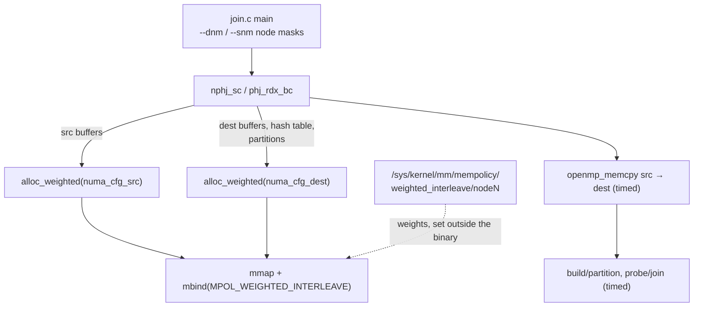

# Reading hashjoins-meet-cxl: placement is two system calls and a sysfs file

The CIDR'26 paper ([reading-hashjoins-meet-cxl.md](reading-hashjoins-meet-cxl.md))
describes four ways to run a hash join whose input lives in CXL memory. Its
released code is small — about 3,600 lines of C, of which the placement
machinery is perhaps sixty — and reading it answers a question the paper
cannot: *what does it physically take* to put a buffer on DRAM, on CXL, or
across both at a ratio? The answer is two Linux calls (`mmap`, `mbind`) and a
per-node weight in sysfs. It also shows what the release does not contain:
the paper's own proposed strategy, partial movement, is referenced by the
scripts and absent from the source.



Every anchor below is `fukien/hashjoins-meet-cxl` at commit `0aeea0d`
(2026-01-30, the repository's HEAD when this topic was written; the README
there still says "🚧 Update in Progress"), recorded in the pin table in
`resources/codebases.md`. The code builds only on Linux ≥ 6.9 with libnuma,
on one of three hard-coded hostnames — none of which this topic could run;
every claim below is from reading, not executing.

## The problem in one sentence

An operator that wants some bytes in DRAM and others in CXL has to say so to
the kernel — what is the exact interface, which choices does it fix
system-wide rather than per buffer, and which of the paper's four strategies
can that interface express in this code?

## The concepts, step by step

### Step 1 — a NUMA policy is attached to a virtual range, not to bytes

> **In:** the paper's tiers (DRAM node, CXL node) from
> [reading-hashjoins-meet-cxl.md](reading-hashjoins-meet-cxl.md), Step 1.
> **Out:** the two-call recipe the code uses for every buffer: reserve a
> virtual range with `mmap`, then bind it to nodes with `mbind`.

`mmap(NULL, size, …, MAP_ANONYMOUS, …)` reserves a range of **virtual
addresses** (the addresses a program uses, translated per page to physical
memory) with no physical pages behind it yet. Physical pages are allocated
lazily, on the first touch of each page — a **page fault**. `mbind(addr,
len, mode, nodemask, …)` attaches a **memory policy** to the range: a rule
the kernel consults *at fault time* to choose which NUMA node supplies the
page. `MPOL_BIND` means "only these nodes"; `MPOL_WEIGHTED_INTERLEAVE`
(Linux 6.9) means "spread pages over these nodes in proportion to per-node
weights". The policy decides *future* faults; pages already present stay
where they are.

```c
// src/inc/utils.c:371-386 — alloc_dram, at 0aeea0d
//   (387-403: madvise for huge pages, free the mask, return — elided)
371  void * alloc_dram(const size_t buffer_size, const int numa_node_idx) { 
372  	struct bitmask *local_numa_mask = numa_bitmask_alloc(numa_cfg.nr_nodes);
373  	numa_bitmask_clearall(local_numa_mask);
374  	numa_bitmask_setbit(local_numa_mask, numa_node_idx);
375  	void *addr = mmap(NULL, buffer_size, PROT_READ | PROT_WRITE, MAP_PRIVATE | MAP_ANONYMOUS, -1, 0);
376  	if (addr == MAP_FAILED) {
         // ... 377-381: error exit ...
382  	int rv = mbind(addr, buffer_size, MPOL_BIND, local_numa_mask->maskp, local_numa_mask->size+1, 0);
```

The line to focus on is **382**: one node in the mask, `MPOL_BIND` — this
buffer's pages can come only from that node. Placement is decided before a
single byte exists, which is why the join code pre-faults its buffers with
`memset` (Step 3): the first write is when the policy takes effect.

Why it matters: every strategy in the paper is a choice of policy per buffer.
Once you see that the unit is a virtual range and the decision happens at
fault time, "move fraction x to DRAM" reads as "give that fraction of the
range a different policy and copy into it" — nothing more exotic.

### Step 2 — weighted interleave: the ratio lives outside the program

> **In:** Step 1's `mbind`; the paper's 3 : 2 interleaving (Step 2 of the
> paper guide).
> **Out:** where the ratio is set (sysfs, system-wide) and the fact that this
> code reads it rather than sets it.

```c
// src/inc/utils.c:722-746 — alloc_weighted, at 0aeea0d
722  void * alloc_weighted(const size_t buffer_size, numa_cfg_t *numa_cfg) {
723  
724  #if LINUX_VERSION_CODE >= KERNEL_VERSION(6, 9, 0)
725  	numa_cfg_t local_numa_cfg = *numa_cfg;
726  
727  	void *addr = mmap(NULL, buffer_size, PROT_READ | PROT_WRITE, MAP_PRIVATE | MAP_ANONYMOUS, -1, 0);
         // ... 728-734: error exit ...
735  	int rv = mbind(
736  		addr, 
737  		buffer_size, 
738  		MPOL_WEIGHTED_INTERLEAVE, 
739  		local_numa_cfg.numa_mask->maskp, 
740  		local_numa_cfg.numa_mask->size+1, 
741  		0
742  	);
         // ... 743-746: error exit ...
```

Line **738** is the policy. The mask picks *which* nodes; the *weights* are
per node in `/sys/kernel/mm/mempolicy/weighted_interleave/nodeN`, global to
the machine — exactly the paper's §2.1 remark that the ratio "can only be
configured at the operating system level … fixed and shared across all user
space applications". The repo has a writer for those files,
`set_node_interleaving_weight` (`utils.c:656-710`, building the path on line
675), but nothing calls it: `set_interleaving_weight` (`utils.c:713-719`) has
no caller in `src/`, and the commented-out loop that would have reset the
weights is at `utils.c:631-636`. The weights are set by hand before a run.
The scripts record which ones: both open with

```
# mxc
## weighted interleaving ratio: 10:7
```

(`scripts/20250805-scripts/test_ratio.sh:1-2`, and the same two lines in
`test_hc_join.sh`). **10 : 7 is not the paper's 3 : 2.** It is, to three
digits, the bandwidth ratio the paper reports: 30.01 / 20.95 = 1.432 against
10/7 = 1.429 (3 : 2 = 1.5). Either the published runs used 10 : 7 and §4.1's
"3 : 2" is a rounding, or the scripts are from a different configuration;
the repository does not say which.

Why it matters: a per-machine knob that every process shares cannot express
"this operator wants x = 0.55 and that one 0.48". The paper's strategy 4 has
to work *around* it — by binding separate buffers to separate nodes — which is
Step 5's subject.

### Step 3 — the timed copy, and what each strategy is in node masks

> **In:** Steps 1–2's allocators.
> **Out:** the four strategies expressed as (source mask, destination mask)
> pairs, and the observation that the released join always copies.

`join.c` takes two node masks — bit *i* = node *i* (`common.c:54-61`) —
`--snm` for where the input starts and `--dnm` for where the working copy
goes, defaulting to dest 6 and src 4 (`join.c:34-35`). Both NPHJ and PHJ then
follow one shape:

```c
// src/algo/nphj.c:29-64 — nphj_sc, load and move, at 0aeea0d
//   (35-43: copy the on-disk relations into src, unmap the files — elided)
29  	tuple_t *r_src_tuples = (tuple_t *) alloc_weighted(
30  		datameta->r_tuple_num * TUPLE_T_SIZE, &numa_cfg_src
31  	);
    // ... 32-43: s_src_tuples likewise; fill both from the dataset files ...
44  	tuple_t *r_dest_tuples = (tuple_t *) alloc_weighted(
45  		datameta->r_tuple_num * TUPLE_T_SIZE, &numa_cfg_dest
46  	);
    // ... 47-49: s_dest_tuples likewise ...
50  #ifdef PREFAULT
51  	memset(r_dest_tuples, 0, datameta->r_tuple_num * TUPLE_T_SIZE);
52  	memset(s_dest_tuples, 0, datameta->s_tuple_num * TUPLE_T_SIZE);
53  #endif	/* PREFAULT */
54  
55  	/**************** MEMCPY DATA FROM SRC TO DEST ****************/
56  	clock_gettime(CLOCK_REALTIME, &time_start);
57  	double __attribute__((unused)) r_memcpy_time = openmp_memcpy(
58  		r_dest_tuples, r_src_tuples, 
59  		datameta->r_tuple_num * TUPLE_T_SIZE
60  	);
    // ... 61-63: the same for S ...
64  
```

The line to focus on is **57**: the whole of R (and S, line 61) is copied
from the source buffer to the destination buffer, and the time is recorded as
`memcpy` (line 74). Reading the README's quick start with the mask encoding:
`--dnm=2 --snm=4` copies from node 2 to node 1, and `--dnm=4 --snm=4` copies
from node 2 to node 2. Assuming node 2 is the CXL node and node 1 local DRAM
(the repository has no topology file — `config/` is absent at the pin — so
this is an inference from the masks), the strategies are:

| paper strategy (§4.1) | `--snm` | `--dnm` |
|---|---|---|
| 1. in-CXL execution | 4 (CXL) | 4 (CXL) |
| 2. full move to DRAM | 4 | 2 (DRAM) |
| 3. full move to interleaved tier | 4 | 6 (DRAM + CXL, weighted) |
| 4. partial move to DRAM | — | — (not in the release) |

Strategy 1 still executes line 57: a CXL-to-CXL copy, timed. The paper's
Figure 4 draws in-CXL bars with no movement segment ("memory movement (if
applicable)"), so its numbers must come from the build/probe times, not
`total_time`, which `nphj.c:295-296` defines as memcpy + build + probe.

Why it matters: the strategies differ only in two integers, which is the
code-level version of the paper's argument — placement is a policy choice, and
the cost of a choice includes the copy it implies.

### Step 4 — where the intermediates go

> **In:** Step 3's masks.
> **Out:** the hash table and partitions always on the destination policy,
> as §4.1's footnote 4 says.

```c
// src/algo/nphj.c:80-84 — hash table allocation, at 0aeea0d
80  	hashtable_t hashtable;
81  	hashtable.num_buckets = datameta->r_tuple_num / BUCKET_CAPACITY;
82  	hashtable.buckets = (bucket_t *) alloc_weighted(
83  		hashtable.num_buckets * sizeof(bucket_t), &numa_cfg_dest
84  	);
```

Line **83**: the hash table takes the destination policy. With
`BUCKET_CAPACITY` 2 (`nphj.h:11-13`) and a 64-byte-aligned bucket holding a
latch, a count, two 16-byte tuples and an overflow pointer (`nphj.h:16-21`),
every probe is one cache line in whatever tier the bucket landed in. PHJ's
partition buffers and histograms are likewise `numa_cfg_dest`
(`phj.c:45-65`, `:89-96`). Under strategy 3, then, the table is interleaved
10 : 7 (or 3 : 2) — which is why the paper finds the probe input's source
barely matters for NPHJ: the random accesses that dominate the probe go to
the table, not to the input (§4.2).

Why it matters: for a graph engine the analogue is unambiguous — the
structure probed at random (the adjacency, the hash index) is the one whose
placement decides latency; the streamed input is the bandwidth question.

### Step 5 — strategy 4 is not in the release

> **In:** the strategy table from Step 3.
> **Out:** the evidence that partial movement exists only as residue, and
> the size of what is missing.

The scripts call a binary that the build does not produce:

```
./bin/hc_join --algo=hc_phj_rdx_bc --workload=uniform --subtype=pkfk --param=$param --bpdr=0.45 >> $HC_PHJ_RDX_BC_LOG
./bin/hc_join --algo=hc_nphj_sc --workload=uniform --subtype=pkfk --param=$param --pjdr=0.51 >> $HC_NPHJ_SC_LOG
```

(`scripts/20250805-scripts/test_hc_join.sh:44-45`.) `CMakeLists.txt:253-263`
builds three executables — `memcpy_tps`, `gen`, `join` — and no `hc_join`.
`join.c:21-24` registers only `nphj_sc` and `phj_rdx_bc`; the declaration
`hc_phj_rdx_bc` is commented out at `phj.h:362`; and `common.c:5` defines
`buildpart_dram_ratio` and `probejoin_dram_ratio` — the `--bpdr`/`--pjdr`
fractions — which nothing in `src/` reads. Partial movement, the paper's
contribution, is the part of the artifact that is not there.

The scripts do record the fractions the authors ran with: **0.45** for PHJ's
build/partition and **0.51** for NPHJ's probe (`test_hc_join.sh:44-45`), and
`test_ratio.sh:45-53` sweeps 0.05–0.95 for Figure 5. Compare Table 1: 0.5528
(PHJ) and 0.5104 (NPHJ). The NPHJ value matches the table; the PHJ value is
not the model's x\* but sits near §4.3's *empirical* optimum, 0.4972.

Why it matters: a reader who wants to reproduce Figure 4's fourth bar must
write it. The design is clear from the rest of the code — allocate a DRAM
buffer of x·|R| with `alloc_dram`, copy that prefix into it, and have the
build or partition loop read the prefix from DRAM and the suffix from the
CXL source — and that is M48's first checkbox.

### Step 6 — the bandwidth microbenchmark, and two small traps

> **In:** Steps 1–3.
> **Out:** how Figure 2(b) is measured, and two things in the measuring code
> a reader should not copy.

`memcpy_tps.c` is Figure 2(b)'s instrument: allocate a source and a
destination with `alloc_weighted` under two masks, fill the source, then time
`RUN_NUM` parallel copies and report the mean of all but the first.

```c
// src/memcpy_tps.c:11 and 157-161 — memcpy_tps, at 0aeea0d
11  #define WORKING_MEM_SIZE_UL  (8UL * 1024UL * 1024UL * 1024UL)  // 4 GB as unsigned long
    // ... 12-156: allocate, fill, time RUN_NUM copies ...
157  #if RUN_NUM > 1
158  	printf("thread-%d-agg_run:\t%.9fs\t%.9fGB/s\n", 
159  		THREAD_NUM, total_runtime/(RUN_NUM-1),
160  		(double) WORKING_MEM_SIZE_UL/(total_runtime/(RUN_NUM-1))/1024/1024/1024
161  	);
```

Two traps. Line **11** copies 8 GiB, not the "4 GB" its comment says. Line
**160** divides by 1024³, so the "GB/s" printed is GiB/s — 7.4% smaller than
GB/s (10⁹), the unit §4.1 quotes. Whether the paper's 30.01 / 20.95 / 47.50
are MLC figures or this program's, the repo does not say. And one trap in
`join.c`: `algos[]` (lines 21-24) has no sentinel, but the lookup loop
`while (algos[i].joinalgo)` (line 76) walks until it finds a null pointer — an
unknown `--algo` name reads past the array.

Why it matters: "measure, don't claim" applies to measuring code too. A
GB/GiB mix-up is a 7% error in a paper whose headline NPHJ gain is 3.59%.

### Step 7 — the fallback that silently stops interleaving

> **In:** Step 2's `alloc_weighted`.
> **Out:** what happens on a kernel older than 6.9, and why that matters for
> anyone re-running the experiment.

```c
// src/inc/utils.c:760-763 — alloc_weighted's else branch, at 0aeea0d
760  #else	/* LINUX_VERSION_CODE >= KERNEL_VERSION(6, 9, 0) */
761  	return alloc_triv_dram(buffer_size);
762  #endif	/* LINUX_VERSION_CODE >= KERNEL_VERSION(6, 9, 0) */
763  }
```

Line **761**: on an older kernel every "weighted" allocation becomes a plain
`mmap` with no policy (`alloc_triv_dram`, `utils.c:773-781`), so pages land
wherever the default first-touch policy puts them — usually the faulting
CPU's local DRAM. Strategies 1–3 then all run in DRAM, with no error. (The
same function body sits inside the `#if` that also guards the declaration, at
`utils.c:654` and `:770`, so in practice the build needs ≥ 6.9 headers; the
point stands for any port.)

Why it matters: a tiering experiment whose placement silently degrades to
"all local" produces plausible, wrong numbers — exactly what this repo's
sanity-check rule exists to catch. Before trusting a CXL run, read
`/proc/<pid>/numa_maps` and confirm the pages are where the mask says.

## How to read the source

Start at `src/join.c` (184 lines) for the masks and the timing, then
`src/algo/nphj.c` top to bottom (310 lines — it is the whole NPHJ), then
`alloc_weighted`/`alloc_dram` in `src/inc/utils.c:371-403` and `:713-795`, and
`openmp_memcpy` in `src/inc/common.c:159-195`. `phj.c` repeats the same
allocation pattern with radix partitioning; read `phj.c:1-120` for the
buffers. Finish with the two scripts. Use `tools/pinned-source.py show
hashjoins-meet-cxl <file> -r A:B` to read at the pin.

## Questions to answer while reading

- `openmp_memcpy` pins thread *i* to a core chosen relative to the *source*
  config (`common.c:172`). Would pinning relative to the destination change
  anything on a single-socket CXL machine? On a two-socket one?
- With weights 10 : 7 and a 1 GiB destination, how many 4 KiB pages land on
  each node? What does `mbind` do with the remainder?
- Design `hc_nphj_sc`: which buffers does it allocate, with which policies,
  and what does it copy? Where does the probe loop need to change, if at all?
- Why does the code `memset` destination buffers *before* the timed copy
  (`nphj.c:50-53`)? What would the timed copy measure otherwise?

## Done when

Answer each before unfolding it.

- [ ] You can say exactly how this code puts a buffer on a given memory node.

  <details><summary>Answer</summary>

  `mmap` an anonymous range, then `mbind` it with a node mask — `MPOL_BIND`
  for one node (`utils.c:382`), `MPOL_WEIGHTED_INTERLEAVE` for several
  (`utils.c:735-742`). The policy applies when each page is first touched, so
  the code pre-faults with `memset` before timing anything.

  </details>

- [ ] You can explain where the interleaving ratio comes from, and why it is not the paper's.

  <details><summary>Answer</summary>

  From per-node weights in `/sys/kernel/mm/mempolicy/weighted_interleave/`,
  which are system-wide and set outside the binary — the writer at
  `utils.c:656-710` is never called. The scripts' header says 10 : 7, which is
  the measured bandwidth ratio (30.01/20.95 = 1.432 ≈ 1.429), not §4.1's 3 : 2
  (1.5).

  </details>

- [ ] You can map the paper's strategies to the code's arguments, and name the one that is missing.

  <details><summary>Answer</summary>

  Source and destination node masks: in-CXL = CXL→CXL, full move to DRAM =
  CXL→DRAM, full move to interleave = CXL→DRAM+CXL weighted (mask 6). Every
  run copies all of the input (`nphj.c:57-63`). Partial movement — strategy 4,
  the paper's contribution — needs `hc_join`, which the scripts call
  (`test_hc_join.sh:44-45`) and the build does not produce
  (`CMakeLists.txt:253-263`); its fraction globals at `common.c:5` are unused.

  </details>

- [ ] You can list the measurement traps in the released code.

  <details><summary>Answer</summary>

  `memcpy_tps.c:11` copies 8 GiB under a "4 GB" comment and reports GiB/s as
  "GB/s" (line 160, a 7.4% unit gap); `join.c:76` walks `algos[]` looking for a
  sentinel it does not have; `total_time` includes a copy even for in-CXL runs
  (`nphj.c:295-296`); and on kernels before 6.9 `alloc_weighted` silently
  falls back to unbound memory (`utils.c:761`).

  </details>

## References

- `github.com/fukien/hashjoins-meet-cxl` at `0aeea0d`: `src/join.c`,
  `src/algo/nphj.c`, `src/algo/phj.c`, `src/algo/phj.h:360-362`,
  `src/inc/utils.c`, `src/inc/common.c`, `src/memcpy_tps.c`,
  `CMakeLists.txt`, `scripts/20250805-scripts/`.
- Huang, Lu & Tan, "Hash Joins Meet CXL: A Fresh Look", CIDR'26 — §2.1, §4.1,
  Table 1, §4.3.
- Linux `mbind(2)`, `set_mempolicy(2)`; `MPOL_WEIGHTED_INTERLEAVE` (Linux 6.9)
  and `Documentation/ABI/testing/sysfs-kernel-mm-mempolicy-weighted-interleave`.
- This topic: [reading-hashjoins-meet-cxl.md](reading-hashjoins-meet-cxl.md),
  [notes.md](notes.md).
