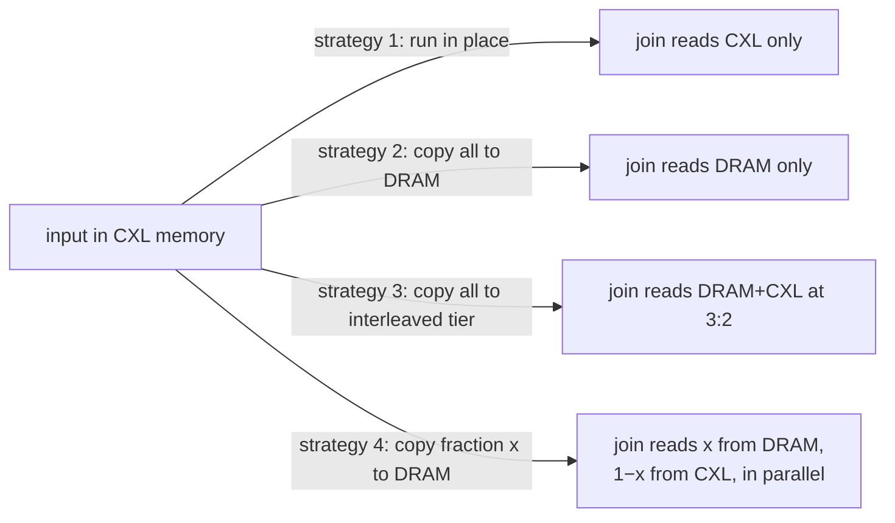

# Hash Joins Meet CXL: move part of the data, not all of it

Huang, Lu & Tan's CIDR'26 paper is four pages long and makes one argument:
when a bandwidth-hungry operator's input lives in CXL memory, the popular
recipe — build an *interleaved* DRAM+CXL tier at the bandwidth-optimal
ratio, copy everything into it, run there — forgets to charge for the copy.
Charge for it, and the best plan is to copy only *part* of the input into
plain DRAM and read the rest from CXL in place, so both memories serve the
query at once. The paper gives a two-parameter model of that trade, fits it on
a real CXL 1.1 machine, and measures it on the two textbook main-memory hash
joins. This chapter builds the vocabulary from zero, works every equation on
the paper's own numbers, and reports where the paper's arithmetic does not
close — lane 3 of `tier_bench` recomputes Table 1 from its own inputs, and one
row does not come back.

Read it with lane 1 of this topic in mind: lane 1 measures, on a machine
with no CXL, the mechanism under every one of these strategies — what a load
costs depends on which tier it lands in, and a placement decision is a
decision about which tier each byte's loads land in.

## The problem in one sentence

If a join's input sits in slow-but-big CXL memory and DRAM plus CXL together
have more bandwidth than either alone, how much of the input should be copied
into DRAM before the join runs, once the copy's own cost is counted?

## The concepts, step by step

### Step 1 — CXL memory, and why it is a second tier

> **In:** nothing yet — this step defines the hardware the paper runs on.
> **Out:** the two numbers that make CXL memory a *tier*: higher latency and
> lower bandwidth than DRAM, on the paper's machine 30.01 vs 20.95 GB/s.

**DRAM** (dynamic RAM) is the main memory attached directly to the CPU's
memory controller through **DDR** channels — the wide, short parallel buses
DIMMs plug into. **PCIe** is the serial expansion bus that GPUs and SSDs use.
**CXL** (Compute Express Link) is a protocol layered on the PCIe physical link
that lets the CPU issue ordinary loads and stores to memory on a PCIe card,
with the hardware keeping caches **coherent** (every core sees the latest
value of a cache line without software help). A **type-3 device** is the CXL
device class for pure memory expansion (§2.1). To the operating system a CXL
memory card appears as a **CPU-less NUMA node**: a **NUMA node** (non-uniform
memory access) is a region of physical memory with its own latency and
bandwidth, and "CPU-less" means no cores are attached to it.

Two properties make that card a second **memory tier** — a class of memory
with distinct speed — rather than more DRAM: higher **latency** (time for one
load to return) and lower **bandwidth** (bytes per second the memory can
deliver). The paper's machine (§4.1): 32 GB of DDR5 at a peak of
**30.01 GB/s**, and a 64 GB CXL type-3 card (a Montage controller, CXL 1.1,
PCIe 5.0) at **20.95 GB/s**. CXL bandwidth is 20.95 / 30.01 = **69.8%** of
DRAM's on this machine. The paper does not report a latency figure; SIDLE
(VLDB'26) reports one for a similar platform — 111.2 ns DRAM vs 276.9 ns CXL
([reading-sidle.md](reading-sidle.md), Step 1).

Why it matters: everything below follows from CXL being *capacity* that is
cheaper than DRAM (§1) but slower than it. Data lands in CXL because DRAM is
scarce; the question is what to do when a query wants that data fast.

### Step 2 — interleaving: two tiers read as one

> **In:** the two bandwidths from Step 1.
> **Out:** the interleaved tier and its optimal ratio α : β (the paper's
> 3 : 2, 47.50 GB/s), which Steps 3 and 4 argue against using naively.

DRAM and CXL are separate devices on separate links, so a program that reads
both at once can draw on **both** bandwidths. **Page interleaving** places
consecutive virtual pages on alternating nodes; **weighted interleaving**
(Linux 6.9's `MPOL_WEIGHTED_INTERLEAVE`, the paper's [20]) places them in a
ratio, say 3 pages on DRAM for every 2 on CXL (Figure 1). Call the DRAM share
α and the CXL share β (α + β = 100%). A scan over an interleaved buffer pulls
α of its bytes from DRAM and β from CXL in parallel.

The ratio that maximises aggregate bandwidth is roughly the ratio of the two
bandwidths (§2.1): DRAM's share of total bandwidth is 30.01 / (30.01 + 20.95)
= **58.9%**. The authors swept ratios and found **3 : 2** (α = 60%, β = 40%)
best, at **47.50 GB/s** (§4.1) — 1.58× DRAM alone and 93.2% of the naïve sum
50.96 GB/s. Interleaving is configured at the OS level and "shared across all
user space applications" (§2.1): the weights live in
`/sys/kernel/mm/mempolicy/weighted_interleave/node*`, one setting per machine.

Why it matters: prior work ([8, 13, 24, 26] in the paper) recommends
relocating a bandwidth-bound workload into this interleaved tier before
running it. That recommendation is what the paper tests.

### Step 3 — the copy into an interleaved tier is lopsided

> **In:** the interleaved tier from Step 2; input that starts in CXL.
> **Out:** Eq. 1, T(x) = 200/x − 1, and the conclusion that copying into
> any interleaved tier is slower than copying into DRAM.

Moving data is a read from the source plus a write to the destination, so
both sides see the same number of bytes. Suppose the destination tier
interleaves x% of its pages on DRAM and y% on CXL (x + y = 100), and the
source is entirely CXL. Then for every 100 pages moved, CXL serves all 100
reads plus y writes, and DRAM serves x writes. The paper's **traffic ratio**
(§3.1, Eq. 1) is CXL accesses over DRAM accesses:

T(x) = (x + 2y) / x = (x + 2(100 − x)) / x = 200/x − 1

where the paper writes the CXL side as x + 2y — the source reads (100 = x + y)
plus the y destination writes. Worked at the optimal α: T(60) = 200/60 − 1 =
**2.33** CXL accesses per DRAM access. The system's bandwidth-optimal traffic
ratio is β/α = 40/60 = **0.67** (Figure 2(a)'s red line). Even copying into
pure DRAM, T(100) = 200/100 − 1 = **1.0** — above 0.67. So during the copy,
CXL is always over-subscribed relative to the optimum, and the closer the
destination is to pure DRAM, the less so. Figure 2(b) measures exactly that:
copy throughput rises monotonically with the DRAM share of the destination,
and "moving pages to an interleaved tier at the optimal system-level ratio
… yields only moderate throughput" (§3.1).

Why it matters: the first half of the paper's argument is that strategy 3
pays for its fast join with a slow copy. If the copy is unavoidable, copy to
DRAM — not to the interleaved tier.

### Step 4 — the end-to-end cost model

> **In:** Step 3's conclusion (copy to DRAM); the in-CXL throughput r.
> **Out:** Eq. 3–4, the cost of moving fraction x and the gain g(x) over
> not moving at all, in two system parameters k and m.

Let the query phase run at **r** tuples per second entirely in CXL; its
**normalised cost** (time per tuple) is cost₁ = 1/r (Eq. 2). Now move a
fraction **x** of the input to DRAM first, at copy throughput **p**, then run
the phase reading x from DRAM and 1 − x from CXL at throughput **q**:
cost₂ = x/p + 1/q. Two modelling choices make this tractable (§3.2):

- p = **k**·r: copy throughput as a multiple k of in-CXL query throughput (k
  is a property of the machine and the operator, not of x);
- q = f(x)·r with **f(x) = m·x + 1**: query throughput grows *linearly* in
  the DRAM share, slope **m**, and only up to x = α (beyond α the mix gets
  worse, so x is capped there).

Substituting (Eq. 3): cost₂ = x/(k r) + 1/((m x + 1) r). The gain of moving
over not moving is **g(x) = cost₁ / cost₂** (Eq. 4):

g(x) = (k m x + k) / (m x² + x + k)

Every symbol: k = copy-throughput multiple, m = bandwidth slope, x = fraction
moved. Worked on Table 1's PHJ row (k = 2.3534, m = 1.0977) at x = 0.5:
numerator 2.3534 × 1.0977 × 0.5 + 2.3534 = 1.2917 + 2.3534 = 3.6451;
denominator 1.0977 × 0.25 + 0.5 + 2.3534 = 3.1278; g(0.5) = **1.1654** —
move half the input and the phase runs 16.5% faster than in place. At x = 0
the formula gives exactly 1 (no move, no change), as it must.

Why it matters: the model has exactly two numbers to measure per machine and
operator, and it prices both sides — the copy (x/k) and the speedup (m x).

### Step 5 — the optimum, and the bound it implies

> **In:** g(x) from Step 4.
> **Out:** x* = (√(mk) − 1)/m and φ = mk / (2√(mk) − 1), and the rule
> "if mk < 1, do not move anything".

Setting g′(x) = 0 (Eq. 5): the numerator of the derivative is
k(−m²x² − 2mx + mk − 1), zero when (mx + 1)² = mk, so

**x\* = (√(mk) − 1) / m**, valid while 0 ≤ x\* ≤ α.

Substituting back gives the best achievable gain (Eq. 6):
**φ(m, k) = mk / (2√(mk) − 1)** for mk ≥ 1, and 1 otherwise — if mk < 1, x\*
is negative, and the right plan is to run in CXL and move nothing (§3.2). The
product **λ = mk** is the one number that decides it; Figure 6 plots φ
against λ and marks the paper's machine at λ = 2.5353.

Worked on PHJ: mk = 1.0977 × 2.3534 = 2.5833, √ = 1.6073, x\* = 0.6073 /
1.0977 = **0.5532**, φ = 2.5833 / (2 × 1.6073 − 1) = 2.5833 / 2.2146 =
**1.1665**. Table 1 prints x\* = 0.5528 (agrees to three decimals — rounding
of k and m) and g(x\*) = **1.1703** (does not: 0.3% higher than the formula
gives from the same row's k and m). Note that x\* = 0.553 < α = 0.6: the
model recommends moving *less* than the interleaving ratio, which is the
paper's headline.

Why it matters: this is the decision rule a CXL-aware operator would ship —
measure k and m once per machine, compute x\*, copy that much.

### Step 6 — the two hash joins, phase by phase

> **In:** the model from Steps 4–5.
> **Out:** where the model applies in each join (PHJ: partition phase only;
> NPHJ: build and probe), and why NPHJ gains less.

A **hash join** matches tuples of a smaller **build** relation R and a larger
**probe** relation S on a key by building a hash table on R and looking up
each S tuple. Two main-memory designs dominate (§2.2):

- **PHJ**, partitioned hash join: first **radix-partition** both inputs into
  cache-sized chunks by the low bits of the key, then join each pair of
  chunks inside the cache. The partition pass streams the inputs once and
  scatters them — bandwidth-bound and the dominant phase.
- **NPHJ**, non-partitioned hash join: build one shared hash table, probe it
  directly; cache misses are hidden by simultaneous multithreading and
  out-of-order execution rather than avoided. The probe phase dominates.

The model is a "move, then execute" procedure, so it applies to PHJ's
partition phase (the join phase works on partitions already in the
interleaved tier and moves nothing), and to both of NPHJ's phases (§3.3). In
all strategies the paper places intermediate results — PHJ's partitions and
NPHJ's hash table — in the interleaved tier (§4.1, footnote 4).

Why it matters for NPHJ: its probe phase is dominated by random reads of the
hash table, which is *already* in the interleaved tier, so where the probe
input comes from barely matters — Table 1's m = 0.3641 for NPHJ against 1.0977
for PHJ, and a gain of only 1.0214 (§4.2).

### Step 7 — the measurement, and what does and does not match

> **In:** the four strategies (in-CXL, full move to DRAM, full move to the
> interleaved tier, partial move to DRAM) on 16M/64M/256M ⋈ 256M tuples of
> 16 bytes, input starting in CXL (§4.1).
> **Out:** the paper's measured gains, checked against its own model.

The paper's results (§4.2, Figure 4): partial movement is best for every
algorithm and build size; **22.20%** (PHJ) and **3.59%** (NPHJ) runtime
reduction over the second-best strategy, which is running in CXL; and both
full-move strategies lose to running in place — copying everything costs
more than the bandwidth it buys. Copying to DRAM beats copying to the
interleaved tier, as Step 3 predicted.

Two checks the paper does not make:

- **Runtime reduction is not throughput gain.** A gain g in throughput is a
  runtime reduction of 1 − 1/g. The model's PHJ gain 1.1703 is a 14.55%
  reduction; the measured 22.20% reduction is a 1/(1 − 0.2220) = **1.285×**
  gain. For NPHJ: model 1.0214 (2.10%), measured 3.59% (1.037×). The paper
  says the improvements "closely match the expected gains reported in Table
  1"; in both cases the measurement *exceeds* what §3.2 calls "the upper bound
  of the achievable performance gain under our model". The model is a useful
  direction-finder; as a bound it does not hold.
- **The NPHJ row of Table 1 does not reproduce.** From its own k = 3.7879 and
  m = 0.3641, mk = 1.3792, x\* = (1.1744 − 1) / 0.3641 = **0.4789** and φ =
  **1.0225**; Table 1 prints x\* = 0.5104 and g = 1.0214, and g(0.5104) =
  1.0225 too. No rounding of k and m to four decimals moves x\* by 0.03.
  (`tier_bench` lane 3 prints this recomputation; see
  [notes.md](notes.md).)

The sensitivity study (§4.3, Figure 5) is internally consistent with the
table: on the partition phase alone the model's optimum is 0.5528 against an
empirical 0.4972, and its predicted gain 17.03% against an observed maximum
24.20% — again the measurement beats the "bound".

Why it matters: the qualitative result — move less than everything, to DRAM
not to the interleaved tier — is supported by Figure 4 on every row. The
quantitative model under-predicts the gain and has one row that does not
follow from its own inputs, so treat x\* as a starting point to sweep around,
which is what the authors' released script does
([reading-hashjoins-cxl-code.md](reading-hashjoins-cxl-code.md), Step 6).

### Step 8 — what transfers to a graph engine

> **In:** the model and its verified/unverified parts.
> **Out:** the general shape — copy cost against bandwidth gain — applied to
> an operator this curriculum's capstone actually has.

§4.4 argues the model applies to any interconnect that adds bandwidth
independent of the DDR channels (NVLink, NUMA links). The same holds for any
operator with a "load, then stream" shape. In the capstone's graph engine
the analogue is a sparse-matrix multiply (topic 9's mxm, the core of every
traversal): the adjacency matrix is large and read-mostly (a CXL candidate),
the frontier vector is small and hot (DRAM). The paper's lesson: before a
bulk traversal, copying *part* of the adjacency into DRAM can beat both
reading it all from CXL and copying it all — and k and m are measurable once
per machine.

Why it matters: this machine cannot measure any of it (no CXL, one memory
controller); lane 3 can only recompute the model. The questions below and
M48's checklist say what to measure on hardware that has the tier.

## How to read the paper

Read §1 and Figure 1 for the setting, then §3.1 with Step 3 beside you and
check Eq. 1 at x = 60 and x = 100 yourself. §3.2 is the core: derive Eq. 5
from Eq. 4 on paper before reading the derivative the paper prints (the
PDF's typesetting of Eq. 5–6 is hard to read; the forms in Steps 4–5 are the
ones that reproduce Table 1's PHJ row). Then Table 1 — recompute both rows,
which is what lane 3 does — and Figure 4. §4.3–4.4 are short. The code is at
`github.com/fukien/hashjoins-meet-cxl`, read in
[reading-hashjoins-cxl-code.md](reading-hashjoins-cxl-code.md); it contains
strategies 1–3 but not the paper's strategy 4.

## Questions to answer while reading

- Why is T(x) never below 1 even when the destination is pure DRAM, and what
  would have to change in the copy (not the tiers) to get it below 0.67?
- The model is linear in x up to α. Figure 5 shows the real optimum *below*
  the model's. Using the sentence in §4.3 about "sublinear bandwidth
  improvement near α", sketch f(x) and say which way the optimum moves.
- PHJ's join phase is excluded from the model. Does that make the 22.20%
  end-to-end figure more or less surprising, given the model's 17.03% for the
  partition phase alone?
- If the input already sat in DRAM (no copy needed), what would the model
  recommend? Express it with k → ∞.

## Done when

Answer each before unfolding it.

- [ ] You can explain why copying from CXL into the optimally interleaved tier is slower than copying into DRAM.

  

Answer

  A copy reads the source and writes the destination, equal bytes each. With
  the source all in CXL and the destination x% DRAM, CXL serves x + 2y of
  every 100 page-accesses' worth and DRAM only x: T(x) = 200/x − 1 (§3.1,
  Eq. 1). At the 60% optimum that is 2.33 CXL accesses per DRAM access, far
  from the bandwidth-optimal 0.67; even pure DRAM gives 1.0, the closest any
  destination gets. So the copy is CXL-bound, least so when the destination
  is all DRAM — which Figure 2(b) measures as throughput rising with x.

  

- [ ] You can write g(x) from the model's assumptions and evaluate it on Table 1's PHJ row.

  

Answer

  cost₁ = 1/r in CXL; moving x at p = k r then running at q = (m x + 1) r
  costs x/(k r) + 1/((m x + 1) r); the ratio is g(x) = (k m x + k) /
  (m x² + x + k) (Eq. 4). With k = 2.3534, m = 1.0977: g(0.5) = 3.6451 /
  3.1278 = 1.1654, and the optimum x* = (√2.5833 − 1)/1.0977 = 0.5532 gives
  1.1665.

  

- [ ] You can say which part of Table 1 does not follow from its own inputs, and by how much.

  

Answer

  PHJ's x* reproduces (0.5532 vs 0.5528) but its g is 1.1665 from the formula
  against 1.1703 printed. NPHJ's does not reproduce at all: k = 3.7879 and
  m = 0.3641 give x* = 0.4789 and φ = 1.0225, but the table prints 0.5104 and
  1.0214. `tier_bench` lane 3 prints both recomputations.

  

- [ ] You can convert the paper's measured runtime reductions into throughput gains and compare them with the model.

  

Answer

  Gain = 1/(1 − reduction). PHJ's 22.20% is 1.285×, against the model's
  1.1703 (a 14.55% reduction); NPHJ's 3.59% is 1.037×, against 1.0214. Both
  measurements exceed what §3.2 calls the model's upper bound, so "closely
  match" (§4.2) is generous: the direction holds, the bound does not.

  

- [ ] You can state the decision rule the paper proposes and when it says to move nothing.

  

Answer

  Profile the machine once for k (copy throughput over in-CXL throughput) and
  m (bandwidth slope); if mk ≥ 1 move x* = (√(mk) − 1)/m of the input to DRAM,
  capped at α, and run reading DRAM and CXL in parallel; if mk < 1, x* is
  negative and the operator should run entirely in CXL (§3.2, Eq. 6).

  

## References

- Wentao Huang, Mian Lu, Kian-Lee Tan. "Hash Joins Meet CXL: A Fresh Look."
  CIDR 2026. §2.1 (interleaving), §3.1 (Eq. 1, Figure 2), §3.2 (Eq. 2–6),
  §4.1 (platform: 30.01 / 20.95 / 47.50 GB/s, 3 : 2), Table 1, §4.2
  (22.20%, 3.59%), §4.3 (0.5528 vs 0.4972; 17.03% vs 24.20%), §4.4 (Figure 6,
  λ = 2.5353). Code: `github.com/fukien/hashjoins-meet-cxl` at `0aeea0d`.
- Gregory Price. `MPOL_WEIGHTED_INTERLEAVE` patch, cited as [20] — Linux 6.9's
  weighted interleave policy.
- Balkesen et al., ICDE'13, and Bandle, Giceva & Neumann, SIGMOD'21 — the
  PHJ/NPHJ designs (the paper's [2], [3]).
- This topic: [README.md](README.md), [notes.md](notes.md), lane 3 of
  `experiments/src/bin/tier_bench.rs`.
