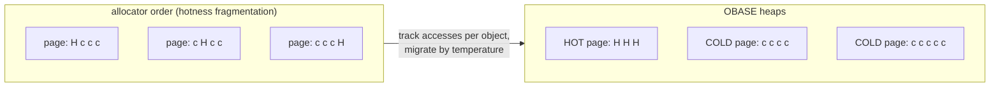

# OBASE: tiering fails at the layout, not at the policy

TPP ([reading-tpp.md](reading-tpp.md)) and its successors argue about *which
pages* to move. OBASE (Banakar, Yang, Wu, Arpaci-Dusseau, Arpaci-Dusseau &
Keeton, OSDI'26) argues that the pages are the problem: allocators place
objects by size and arrival, so hot and cold objects share pages, a single hot
object keeps its whole page "active", and no page-granular policy can then
free the cold bytes around it. The fix it proposes is upstream of every
tiering policy — reorganise the *virtual address space* so hot objects sit on
hot pages and cold objects on cold pages, and let the unmodified kernel do the
rest. This is the paper lane 1b of this topic is built around: the same
access stream, the hot set packed or scattered, and nothing else changed.

Three pages all "hot" to the OS on the left; one hot page and two
reclaimable ones on the right — same objects, same accesses.

## The problem in one sentence

When only a few percent of a program's bytes are hot but nearly all of its
pages are touched, how do you make page-based tiering work without changing
the kernel's policy or the program's semantics?

## The concepts, step by step

### Step 1 — page utilization, the metric

> **In:** nothing yet — this step defines the measurement every later step
> uses.
> **Out:** the page-utilization formula, worked on numbers.

The OS marks a page **active** if any byte of it is accessed within a time
window T. **Per-page utilization** is the fraction of an active page's bytes
actually accessed. Over all pages P(T) touched in T, with U(p, T) the unique
bytes accessed in page p (§2.1):

Page Utilization(T) = Σ_{p ∈ P(T)} U(p, T) / Σ_{p ∈ P(T)} Size(p)

OBASE counts accessed bytes in 64-byte units (one cache line, §2.2). Worked:
three 4 KiB pages are touched; in the first, 64 distinct lines' worth of
64 B units are accessed (the whole page), in the second 4 units, in the third
1. Utilization = (64 + 4 + 1) × 64 B / (3 × 4096 B) = 4,416 / 12,288 =
**35.9%** — but two of the three pages are almost entirely cold, which an
average hides; hence OBASE also plots the per-page CDF (Figure 2).

Why it matters: a page-granular tier holds what is *active*, so utilization is
the fraction of fast memory doing useful work. Lane 1b reports it over the
pages that serve 90% of accesses ("hot-page util").

### Step 2 — how fragmented real memory is

> **In:** Step 1's metric.
> **Out:** the measured premise — on Google's workloads most bytes in active
> pages are cold — and the size of the gap it leaves.

From DynamoRIO traces of six Google workloads (≈30 s of steady state each,
§2.2): only **1.7%–21.3%** of bytes are accessed during a trace, four of six
below 3% (§1, Figure 1). Yet pages are touched broadly: in workload Bravo,
**3.2%** of bytes but **91.8%** of pages are accessed (§1). Median page
utilization is about 3% for Yankee and Tahoe; for 2 MiB huge pages, 85–90% of
Tahoe's, Bravo's and Yankee's use under 10% of the page (§2.2). Finding 1:
"70–90% of bytes in pages the OS considers hot receive no accesses"; the
abstract's figure is "up to 97%". Deployed tiering reflects it: Google
reported offloading only 20% of memory to a compressed tier, Meta 20–32% (§1).

Worked: Bravo's numbers bound what page-granular tiering could free. If 91.8%
of pages are active, at most 8.2% of memory is reclaimable by page; if only
3.2% of bytes are hot, an object-granular placer could in principle free up to
96.8%.

Why it matters: this is the gap between "most memory is idle" (TPP's §2
premise, 55–80% idle) and "tiering saves 20–30%" — the idle memory is idle
*bytes* on busy *pages*.

### Step 3 — hotness moves

> **In:** the fragmentation of Step 2.
> **Out:** Finding 2 — placement at allocation time cannot fix it — and the
> number behind it.

One response would be to separate hot and cold objects when they are
allocated. Two facts rule it out (§2.3). First, one code path allocates objects
of every future heat: a cache's SET handler allocates both the session token
read every millisecond and the profile never read again. Second, heat
changes: in Meta and Twitter key-value traces (10 M operations per bucket,
Figure 3), keys go through bursts and long idle phases. For mid-sized objects
(64 B–4 KiB, 94% of Meta's keys and 98.2% of Twitter's), the **reuse-distance
spread** — 75th over 25th percentile of the operations between two accesses
to the same key — exceeds 5× for 75% of keys and 30× for 65%.

Why it matters: the layout must be *re-learned* continuously. Lane 2 of this
topic shows the failure mode in counts: a layout learned on one window serves
90% of the next window's accesses from 655 pages, but after half the hot set
is replaced by other objects it needs 46,506 — no better than never
reorganising (notes.md).

### Step 4 — making objects movable in C++: guides

> **In:** the need to move live objects (Step 3).
> **Out:** the indirection OBASE adds, and the restriction it imposes.

In a garbage-collected language the runtime can move objects and fix
references. In C/C++ an object's address *is* its identity and anything may
hold a raw pointer to it (§2.4). OBASE routes access to relocatable objects
through a **guide**: a pointer-sized handle the data structure stores in place
of a raw pointer; dereferencing it yields the object's current address, and
moving the object means updating that one word (§3.2). Developers annotate
which pointer fields are guides — one to three fields per type in the ten
evaluated structures — and compiler passes rewrite their dereferences, insert
tracking, and reject pointer arithmetic over managed objects.

The restriction that matters for this curriculum: a guide carries **unique
ownership** of its object, "so structures that share a node through multiple
pointers (e.g., graphs, doubly-linked lists) are out of scope" (§3.2).

Why it matters: a pointer-based graph store is exactly what OBASE cannot
manage. A matrix-based one (the capstone's CSR adjacency, topic 9) has no
pointers to fix: renumbering vertices *is* moving them, which is why lane 2's
learned layout is a permutation of ids.

### Step 5 — tracking at object granularity for the cost of a cache hit

> **In:** guides from Step 4.
> **Out:** where the per-object metadata lives and what a dereference costs.

x86-64 user pointers use 48 bits; OBASE keeps metadata in the upper 16 bits
of each guide: 7 bits of active-thread count, 5 bits of consecutive inactive
windows (CIW), 2 bits of heap identity and 2 flag bits, including the
accessed bit (§4.1). A dereference sets the accessed bit with one atomic
read-modify-write, skipped if it is already set so hot objects do not bounce
the cache line between cores (§3.3) — "comparable to a cache hit". A
**SODA** bitmap over the heap records where guides live, so the background
collector can find every managed object without understanding the data
structure (§3.3, §4.3).

Why it matters: hardware page-table accessed bits are free but page-granular;
PEBS sampling is cheap but statistical (§3.3). This is per-object and
precise, paid on every access — the overhead Step 8 measures.

### Step 6 — three heaps and an adaptive threshold

> **In:** per-object accessed bits (Step 5).
> **Out:** how OBASE decides temperature and lays it out, with the formula
> for its control signal.

A background **Object Collector** scans every window (default 120 s) and
places each object in one of three heaps, each a contiguous virtual range so
an object's address encodes its temperature (§3.4): **NEW** (just allocated,
heat unknown), **HOT**, **COLD**. An object untouched for more than *C_t*
consecutive windows (its CIW counter) moves to COLD; a COLD object that is
accessed rejoins HOT. *C_t* adapts to hold the **promotion rate** near a
target:

PR = (unique COLD pages accessed / working-set size) × (60 / scan interval in s)

— the share of the working set pulled back out of COLD, per minute. If PR is
above target (default 1%), *C_t* grows by one window (be slower to call
things cold); below, it shrinks (§3.4, §5.1). Worked: with 120 s windows, a
working set of 100,000 pages and 3,000 COLD pages accessed in a window,
PR = 0.03 × 60/120 = **1.5% per minute** — above a 1% target, so *C_t*
increases.

Optionally OBASE marks COLD with `MADV_COLD`/`MADV_PAGEOUT` and HOT with
`MADV_HUGEPAGE` (§3.4).

Why it matters: OBASE never decides *where* pages live — that stays with
kswapd, TPP or MEMTIS. It only guarantees that a page is uniformly hot or
cold, so whatever the backend decides is right for every byte on it.

### Step 7 — moving objects under concurrency

> **In:** the decision to migrate (Step 6).
> **Out:** the active-thread-count protocol that makes migration safe without
> stopping the world.

Each public data-structure operation registers a thread-local scope guard;
during a migration epoch every guide it dereferences increments that object's
**active thread count** (ATC), decremented when the operation exits. An object
may move only when its ATC is zero. Outside migration epochs the counting is
off and dereferences only set accessed bits (§3.5, §4.2). A raw pointer
obtained from a guide is valid until the enclosing operation returns.

Why it matters: this is the expensive, delicate part of the system, and it
exists only because C++ objects have stable addresses. An engine that owns
its storage layout (columns, matrices, slotted pages) can migrate at a
quiescent point it already has — a checkpoint, a compaction.

### Step 8 — the evaluation, and what its "CXL" was

> **In:** the whole system.
> **Out:** the measured gains, and the platform they were measured on.

Platform (§5.1): Intel Xeon Gold 5218, 2×16 GB DDR4 as the fast tier and
4×128 GB **Intel Optane persistent memory** in Memory Mode, exposed as a
separate NUMA node, as the slow tier — "approximately 2.5× higher access
latency than local DRAM … consistent with first-generation CXL memory". No CXL
device. Workloads: CrestDB, the authors' key-value store over ten concurrent
data structures; YCSB with Zipfian keys; Meta and Twitter traces.

- **Utilization** (§5.2, Figure 8): 18–20% before; after convergence 2× for
  YCSB-A (50% writes), ~3× for B, up to 4× for C — absolute 40% to 80%. RSS
  shrinks **65–72%** once COLD is paged out (12.4 GiB → 3.5–4.0 GiB for
  workload B).
- **Reclaim backends** (§5.3.1, Figure 9; 13 GiB footprint, ~4 GiB working
  set): without OBASE kswapd reaches 7 GiB, TMO 6.5 GiB, a 4 GiB cgroup limit
  loses 38% throughput; with OBASE all reach 4 GiB without loss.
- **Tiering backends** (§5.3.2, Figure 10; 67 GiB dataset, DRAM:slow 1:4,
  1:8, 1:16; speedup over all-slow): TPP 1.65× → **1.85×** at 1:4 and 1.25× →
  **1.45×** at 1:16; MEMTIS 1.8× → 1.95× and 1.55× → 1.7×. The mechanism: the
  hot working set spans **16.3 GiB of pages at 21% utilization** without OBASE
  — more than the 14.8 GiB of DRAM at 1:4 — and **6.33 GiB at 57%** with it.
- **Overhead** (§5.4, Figure 11): 1.5–5% throughput and p90 depending on the
  structure; 1–8% across 2–32 threads.

Worked consistency check on the tiering numbers: bytes actually used are
16.3 × 0.21 = **3.42 GiB** before and 6.33 × 0.57 = **3.61 GiB** after — the
same logical working set within 6%, so the 2.6× smaller page footprint
(16.3 / 6.33 = 2.58; the paper says "2.5×") is pure layout. "OBASE + TPP at
1:16 reaches 1.45×, within ∼6% of TPP alone at 1:8 (1.55×)": 1.45 / 1.55 =
0.935, a 6.5% gap — hence "half the DRAM for the same performance".

Why it matters: the claim is about layout, and the evidence supports it on an
Optane stand-in for CXL; the speedups would scale with the real CXL/DRAM gap
(2.49× on SIDLE's platform, Step 1 of [reading-sidle.md](reading-sidle.md)),
but that is an inference, not a measurement in this paper.

## How to read the paper

Read §1 and Figure 1 with Step 2's arithmetic, then §2.1–2.3 (the metric and
the two findings) slowly. §3.2–3.4 are the design; §3.5 and §4.2 are the
concurrency protocol, safe to skim on a first pass. In §5 read the setup
paragraph first, then Figure 10's paragraph with the 16.3/6.33 GiB numbers —
that one paragraph is the paper's thesis measured. The code is at
`github.com/WiscADSL/obase` (not read for this topic). Then run lane 1b and
compare its hot-page utilization column with Figure 8.

## Questions to answer while reading

- Lane 1b's scattered layout is the worst case (every hot object on its own
  line and nearly its own page). Real allocators are somewhere between. What
  property of a size-class allocator puts objects of one size class on the
  same pages, and when does it accidentally pack hot objects?
- Why does OBASE skip the atomic when the accessed bit is already set? What
  would the cost be on a hot object shared by 32 threads?
- The promotion-rate target is 1%. On a faster slow tier (CXL at 2× latency
  vs swap at 10⁴×), should it be higher or lower? §5.1 says hardware-aware
  tuning is future work — propose the rule.
- Graphs are out of scope because of shared pointers. What does a CSR
  representation give up to avoid that problem, and what does renumbering
  vertices cost in it?

## Done when

Answer each before unfolding it.

- [ ] You can define page utilization and compute it for a set of pages.

  

Answer

  Unique bytes accessed in the window divided by the total size of the pages
  touched in the window (§2.1), counted in 64 B units. Three 4 KiB pages with
  64, 4 and 1 accessed units: (69 × 64) / (3 × 4096) = 35.9%.

  

- [ ] You can state the evidence that real memory is fragmented by hotness, with numbers.

  

Answer

  Google traces: 1.7–21.3% of bytes accessed per trace; Bravo touches 3.2% of
  bytes but 91.8% of pages (§1, Figure 1). Finding 1: 70–90% of bytes in pages
  the OS considers hot receive no accesses ("up to 97%" in the abstract).
  Deployed tiering frees only 20% (Google) to 20–32% (Meta).

  

- [ ] You can explain why allocation-time placement cannot fix it.

  

Answer

  The same allocation site produces objects of every future heat, and heat
  changes over time: for 75% of mid-sized keys in the Meta and Twitter traces
  the reuse-distance spread exceeds 5×, for 65% it exceeds 30× (§2.3). Lane 2
  shows a learned layout losing its advantage when half the hot set drifts
  (655 → 46,506 pages for 90% of accesses).

  

- [ ] You can describe how OBASE tracks and moves objects, and its limitation for graphs.

  

Answer

  Annotated pointer fields become guides; a dereference sets an accessed bit
  kept in the guide's upper 16 bits; a collector scans every 120 s and moves
  objects among contiguous NEW/HOT/COLD heaps, with an adaptive
  consecutive-inactive-window threshold; moves wait for a zero active-thread
  count. Guides own their object uniquely, so graphs and doubly linked lists
  are out of scope (§3.2).

  

- [ ] You can state the tiering result and check it for consistency.

  

Answer

  With OBASE the hot working set's page footprint falls from 16.3 GiB at 21%
  utilization to 6.33 GiB at 57% (3.42 vs 3.61 GiB of used bytes — the same
  data); TPP's speedup over all-slow rises 1.65× → 1.85× at 1:4 and 1.25× →
  1.45× at 1:16 (§5.3.2). Measured on Optane PMem as the slow tier, not CXL.

  

## References

- Vinay Banakar, Suli Yang, Kan Wu, Andrea C. Arpaci-Dusseau, Remzi H.
  Arpaci-Dusseau, Kimberly Keeton. "OBASE: Object-Based Address-Space
  Engineering to Improve Memory Tiering." OSDI 2026 (arXiv:2603.00378v2) —
  abstract, §1 and Figure 1, §2.1–2.4, §3.2–3.5, §4.1, §5.1–5.4 and Figures
  8–11.
- Maruf et al., TPP (ASPLOS'23) — the backend in Figure 10; this topic's
  [reading-tpp.md](reading-tpp.md).
- This topic: [README.md](README.md) lane 1b, [notes.md](notes.md),
  `experiments/src/layout.rs` and `experiments/src/reorg.rs`.
