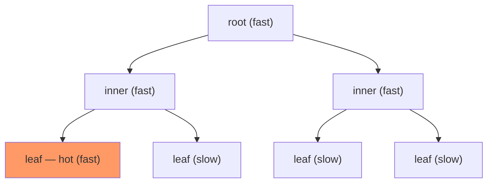

# SIDLE: place tree nodes, not pages

TPP ([reading-tpp.md](reading-tpp.md)) moves 4 KiB pages because pages are
all the kernel can see. A B+ tree on CXL memory is made of nodes that are
smaller than a page, accessed root-to-leaf, with a hotness that is mostly
predictable from the node's *depth*. SIDLE (Zhao, Dong, Wu & Chen, VLDB'26)
is a node-grained placement scheme built on those three facts: keep upper
levels in DRAM, track only leaves, and promote or demote whole root-to-leaf
paths so that every lookup crosses from fast to slow memory at most once. It
is the closest published design to what the capstone's graph engine would
need — a structure-aware placer living inside the engine rather than the
kernel. This chapter builds it step by step, works its two structural
arguments on a concrete tree, and checks the hardware numbers it quotes.

The **single-boundary** picture: on every root-to-leaf path the nodes in
fast memory form an unbroken prefix, so a lookup switches tiers at most once.

## The problem in one sentence

A tree index that does not fit in DRAM spills onto CXL memory, and page-level
tiering cannot tell its hot nodes from the cold nodes sharing their pages —
how should the index itself decide which nodes live in DRAM, cheaply enough
to do it on every lookup?

## The concepts, step by step

### Step 1 — CXL heterogeneous memory, and the numbers SIDLE quotes

> **In:** nothing yet — this step defines the hardware.
> **Out:** the measured fast/slow gap on SIDLE's machine, checked against the
> paper's own rounding.

**Heterogeneous memory** (HM) is any machine with a fast and a slow memory in
one address space; **CXL-HM** is the case where the slow one is CXL-attached
DRAM, reached with ordinary cache-coherent loads (§2.1). SIDLE measured its
CXL 1.1 platform with Intel's Memory Latency Checker (MLC) — Figure 1(c):

| | bandwidth (MB/s) | latency (ns) |
|---|---|---|
| fast (local DRAM) | 33,095.3 | 111.2 |
| slow (CXL) | 21,724.3 | 276.9 |

The text summarises this as "latency ~2×, bandwidth ~60%" (§1, §2.2). From the
table: 276.9 / 111.2 = **2.49×** and 21,724.3 / 33,095.3 = **65.6%**. The
direction is right; "~2×" understates the latency gap by a quarter. Lane 3 of
`tier_bench` uses the table's numbers, not the rounded ones.

Why it matters: a 2.49× latency ratio means a lookup that touches four
nodes costs between 4 × 111 = 445 ns and 4 × 277 = 1,108 ns depending only on
placement — the stakes for every step below.

### Step 2 — the naïve answer, measured: interleave and lose 70%

> **In:** Step 1's gap.
> **Out:** the baseline every SIDLE figure compares against: weighted
> interleaving at a fixed DRAM share.

The default policy SIDLE starts from is **weighted interleaving**: give the
index's memory to fast and slow nodes in a fixed N : M ratio of pages
([reading-hashjoins-meet-cxl.md](reading-hashjoins-meet-cxl.md), Step 2).
Figure 2 runs Masstree and ART — two in-memory trees — under YCSB at 100%,
75%, 50%, 25% and 0% of memory in DRAM: at 25% DRAM, throughput drops "by ~70%
… compared to 100% fast memory across all workloads" (§2.2).

Why it matters: interleaving is placement by *address*, blind to which nodes
are hot. With three quarters of the tree on CXL, three quarters of the
upper-level nodes are too — and every lookup passes through them.

### Step 3 — why the indexes built for other slow memories do not fit

> **In:** prior HM-index designs for NUMA, RDMA and persistent memory (PM).
> **Out:** the measured reasons each fails on CXL, which become SIDLE's
> design constraints.

Three families (§2.3):

- **NUMA indexes** replicate, partition, or delegate work to a node's own
  cores. A CXL node has no cores, so delegation has nowhere to run.
- **RDMA indexes** keep a DRAM cache of remote inner nodes because a remote
  read costs microseconds. On CXL the gap is 2.49×, not 20×, and the cache's
  own bookkeeping dominates: SMART reaches only **50–74%** of plain ART's
  throughput, with "~50%" of its time in the local cache (Figures 3(a), 4(a)).
- **PM indexes** use fat unordered leaves and asynchronous structure changes
  to cope with PM's slow writes; CXL DRAM has no such asymmetry. PACTree runs
  at **90%** of ART's throughput with **1.3–1.9×** its tail latency; "~61%" of
  the overhead is the fat leaf and async SMO (Figure 4(b)). PM indexes also
  pin all inner nodes in DRAM, which ignores capacity: PAC-L drops "~17%" once
  fast memory is full (§2.3).

Why it matters: the constraints that survive are *no caching layer* (place,
don't copy), *no static rule* (capacity changes), *cheap tracking*.

### Step 4 — the page is the wrong unit

> **In:** the CXL-HM page-placement schemes (TPP, MEMTIS) from
> [reading-tpp.md](reading-tpp.md).
> **Out:** SIDLE's measurement of hotness *inside* hot pages — the same
> quantity lane 1b of this topic counts.

Tree nodes are smaller than 4 KiB pages, and an allocator puts nodes of
different heat side by side. Figure 5 counts node accesses within pages
ranked by heat: even within the **hottest 1%** of pages, "the upper quartile
of nodes' access count is just 16 and 4 for Masstree and ART", and "the
hottest node on each page contributes **82%** and **85%** of total accesses"
(§2.3). A page-granular policy promoting such a page moves 4 KiB to speed up
one node.

Worked: an ART node can be as small as a Node4 (a few dozen bytes); call it
64 B. One hot 64-byte node in a 4 KiB page means 64 / 4096 = **1.6%** of the
promoted bytes are the ones being accessed — and Figure 5 says this is
typical of hot pages, not the exception. Lane 1b measures the same ratio on
this machine as *hot-page utilization*: 3.4% of the bytes in the 16 KiB pages
that serve 90% of accesses are ever touched when a 1% hot set is scattered,
100% when it is packed (notes.md).

Why it matters: this is the paper's motivation for moving the decision from
the kernel to the index — the index knows node boundaries.

### Step 5 — the layer principle: depth predicts heat

> **In:** a tree's shape.
> **Out:** why upper levels are hot by construction, worked on a concrete
> tree, and SIDLE's first rule.

Every lookup visits exactly one node per level. If a tree has fan-out *f*,
level *d* (root = 1) has about f^(d−1) nodes, and every level receives the
same total number of visits — one per lookup — so a node at level *d* is
visited f^(d−1) times less often than the root.

Worked on a complete tree of fan-out 16 and six levels: 1 + 16 + 256 + 4,096 +
65,536 + 1,048,576 = 1,118,481 nodes. The upper three levels hold 273 nodes —
**0.024%** of the tree. With N lookups, the upper three levels share 3N
visits over 273 nodes (11.0×10⁻³ N per node); the lower three share 3N over
1,118,208 nodes (2.68×10⁻⁶ N per node). Ratio: 1,118,208 / 273 = **4,096**.
SIDLE measured the same on real trees: with 50 million keys, nodes in the
upper half of the levels are "less than 1% of total nodes but have average
access frequency three orders of magnitude higher" (§3.1.1). Figure 6
confirms it as placement: upper nodes in fast memory (Fast-Slow) beats the
reverse and beats interleaving levels.

The **layer principle** (§3.1.1): store upper nodes in fast memory first.

Why it matters: a rule that needs no tracking at all captures most of the
benefit — and it is exactly what topic 3's B-tree chapter says about inner
nodes fitting in cache, one tier down.

### Step 6 — single boundary and the path principle

> **In:** Step 5's layer principle.
> **Out:** two structural rules — ancestors of a fast node are fast; hot
> root-to-leaf paths go to fast memory whole.

A **path** is the nodes a lookup visits, root to leaf. If a node is in fast
memory but its parent is not, a lookup through it switches tiers twice. The
**single-boundary structure** (§3.1.1, Figure 7) requires that all ancestors
of any fast node are fast, so each path is a fast prefix followed by a slow
suffix. Figure 7's example: in a 4-level path, breaking the rule by putting
node E in fast memory but its parent B in slow drops the fast share of the
paths A→G and A→H from **2/4 to 1/4**.

Skewed workloads concentrate on some leaves; the paths to them are **hot
paths**. Figure 8 runs a B+ tree and a radix tree with 90% of requests to 10%
of the data and moves an increasing share of the hot paths to fast memory:
throughput rises with it. The **path principle** (§3.1.2): identify hot paths
and place as many as possible in fast memory.

Why it matters: in a graph engine the "path" is a traversal's chain of
pointer-dependent loads; lane 1a's ladder says each one costs the latency of
its tier, and a chain that alternates tiers pays the slow one every other hop.

### Step 7 — tracking leaves only, and moving paths

> **In:** Step 6's principles.
> **Out:** the runtime: layer-aware allocation, leaf-centric counters,
> histogram thresholds, path promotion and parent-deferred demotion.

Per-node access counting on the lookup path costs too much — prior work's
per-object tracking showed "over a 50% performance drop" (§3.2). SIDLE's
frontend (§4.1) does two cheap things on the critical path:

- **Layer-aware allocation:** a new node goes to fast memory iff its level is
  above a threshold *L_fast* and its parent is fast — which preserves the
  single boundary for free.
- **Leaf-centric tracking:** only the leaf's access counter is incremented;
  every path ends at a leaf, so leaf heat identifies hot paths.

The background (§4.2) builds a **histogram** of leaf counts in logarithmic
bins (bin 2 holds counts in [2, 4)), and a **cooler** periodically halves all
counts — on a log-scale histogram that is a shift of every bin left by one.
Thresholds *T_hot* and *T_cold* are read off the histogram so that target
fractions *P_hot*, *P_cold* of leaves fall above and below them. A hot leaf in
slow memory is promoted *with every slow ancestor*. A cold leaf in fast memory
is demoted, and its parent is queued; the parent is demoted only after all
its cold children have been processed and only if none of its children is
still fast (Algorithm 1) — demotion never breaks the single boundary.

Why it matters: the cost on the lookup path is one counter increment; the
structural knowledge is used only in the background.

### Step 8 — the hyper watermark, and the evaluation

> **In:** Step 7's mechanism and its parameters (L_fast, L_demote, P_hot,
> P_cold).
> **Out:** how SIDLE tunes them from two numbers, and what it measured.

Instead of exposing four knobs, SIDLE takes a high and low **watermark** on
fast-memory usage, *U_high* and *U_low* (defaults 95% and 85%), and adjusts
the four parameters asymmetrically: aggressively when usage exceeds U_high
(halt promotions, demote until below), conservatively when below U_low
(§4.3). The migration trigger, cooler and watermark maintainer wake every
500 ms, 2,000 ms and 100 ms (§6.1, "Configuration").

Evaluation platform (§6.1): Intel Xeon Platinum 8468V (48 cores), 32 GiB DRAM
plus 32 GiB CXL-attached DRAM through a CXL 1.1 expansion card, one socket;
20 million records; fast memory capped at **20%** of the index's footprint;
28 threads; 8-byte keys and values; a Hotspot workload with 90% of requests on
5% of contiguous keys, plus YCSB, TPC-C and Alibaba block traces. Results:
against page-level placement (MEMTIS, TPP, Caption) **42.6–133.5%** higher
throughput on the microbenchmark (§6.2); "up to **71%** higher throughput and
up to **81%** lower P99 latency" against state-of-the-art schemes on YCSB and
real workloads (abstract). Unlike TPP's evaluation, this is genuine CXL
hardware.

Why it matters: the numbers support the core claim — node granularity beats
page granularity — on the hardware the claim is about.

## How to read the paper

Read §1 and Figure 1(c) (recompute the two ratios yourself), Figure 2, and
§2.3's two case studies with Step 3. Figure 5 is the most important figure for
this topic — read it next to lane 1b. §3.1 is Steps 5–6; work Figure 7's
fractions. §4 is mechanism: Algorithm 1 and Figure 10 are worth tracing on
paper with a four-level tree. In §6 read the setup (§6.1) before any result.
The source is `github.com/sidle-project/sidle` (not read for this topic).

## Questions to answer while reading

- Why does a CXL node's lack of cores rule out the NUMA-index techniques but
  not TPP's NUMA-balancing machinery?
- Step 5's ratio assumed every lookup reaches a leaf. How does a range scan
  (YCSB-E) change the per-level visit counts?
- What would SIDLE's leaf-centric tracking measure in a CSR adjacency
  structure, where there is no tree? What is the analogue of a "path"?
- Figure 5's "82% from the hottest node" is per page. What allocator change
  would make that number fall without SIDLE, and what does OBASE call it?

## Done when

Answer each before unfolding it.

- [ ] You can state SIDLE's measured fast/slow gap and correct the paper's rounding.

  

Answer

  Figure 1(c), MLC on CXL 1.1: fast 111.2 ns / 33,095.3 MB/s, CXL 276.9 ns /
  21,724.3 MB/s. The ratios are 2.49× latency and 65.6% bandwidth; the text's
  "~2×" and "~60%" round the first down by a quarter.

  

- [ ] You can explain why page-level tiering misplaces tree nodes, with the paper's numbers.

  

Answer

  Nodes are smaller than pages and hot and cold nodes share pages. Even in the
  hottest 1% of pages the upper-quartile node access count is 16 (Masstree) and
  4 (ART), while the hottest node on each page takes 82% / 85% of its
  accesses (§2.3, Figure 5). Promoting the page moves mostly cold bytes.

  

- [ ] You can derive why upper tree levels are orders of magnitude hotter than lower ones.

  

Answer

  Each lookup visits one node per level, so each level gets equal total
  visits while node counts grow by the fan-out per level. For fan-out 16 and
  six levels, the top three levels are 273 of 1,118,481 nodes (0.024%) and
  each is visited 4,096× more than an average node of the bottom three;
  SIDLE measures "three orders of magnitude" on 50M-key trees (§3.1.1).

  

- [ ] You can state the single-boundary rule and why demotion must defer to children.

  

Answer

  Every ancestor of a fast node must be fast, so each lookup path is one fast
  prefix and one slow suffix — in Figure 7, violating it cuts a path's fast
  share from 2/4 to 1/4. Demoting a parent with a fast child would break it,
  so Algorithm 1 queues the parent and demotes it only once all children are
  slow.

  

- [ ] You can say what SIDLE tracks on the critical path, and what it measured on which hardware.

  

Answer

  One counter per leaf, incremented on access; allocation uses the node's
  level and its parent's tier. Everything else runs in background threads.
  On a Xeon 8468V with 32 GiB DRAM + 32 GiB CXL 1.1 memory and a 20% fast
  cap, it beats page-level placement by 42.6–133.5% on the Hotspot
  microbenchmark and reports up to 71% throughput and 81% P99 gains overall.

  

## References

- Haoru Zhao, Mingkai Dong, Fangnuo Wu, Haibo Chen. "SIDLE: Tree-structure
  Aware Indexes for CXL-based Heterogeneous Memory." PVLDB 19(7):1499–1515,
  2026 — abstract, §1, Figure 1(c), Figure 2, §2.3 and Figures 3–5, §3.1 and
  Figures 6–8, §3.2, §4.1–4.3 and Algorithm 1, §6.1–6.2. Preprint as
  "SINLK", arXiv:2507.18559.
- Topic 3 ([../03-btree-internals/README.md](../03-btree-internals/README.md))
  for B-tree node layout; this topic's [reading-tpp.md](reading-tpp.md) and
  [reading-obase.md](reading-obase.md).
