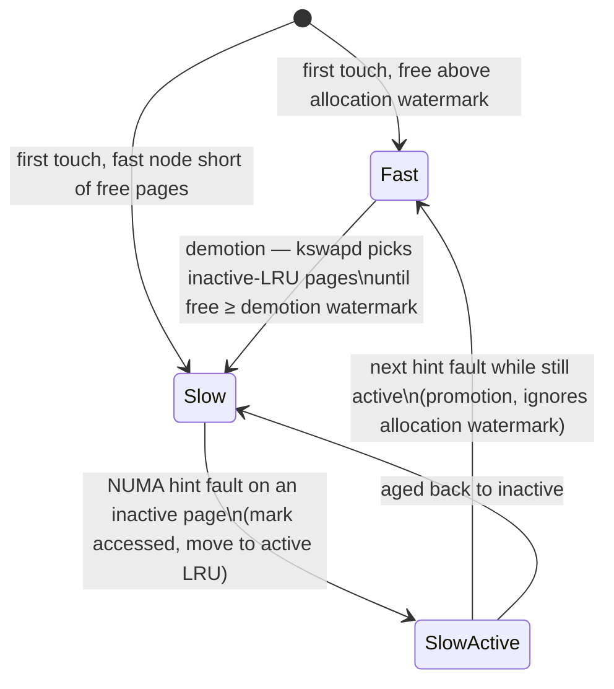

# TPP: the kernel's tiering policy, and what its numbers measured

TPP — Transparent Page Placement, Maruf et al., ASPLOS'23 — is the paper
behind Linux's memory-tiering mode. Meta found that most of a server's
memory sits idle for minutes at a time, proposed an OS policy that keeps the
fast tier's *hot* pages there and pushes the rest to CXL memory without
the application's knowledge, and merged most of it into Linux 5.18. Every
later tiering paper in this topic — SIDLE, OBASE, MAC, the hash-join paper —
uses TPP as a baseline or a backend. This chapter builds the kernel
vocabulary the paper assumes (watermarks, reclaim, LRU lists, NUMA hint
faults), works the policy's two knobs on numbers, and reads the evaluation
for what it actually measured: most of it ran on a two-socket server
configured to *look like* a CXL machine, and its headline percentages are
percentage points.

Lane 3 of `tier_bench` is this diagram as a simulation: its `tpp()` stub is
the five rules in the module docs of `experiments/src/tier.rs`, priced with
published latencies and labelled a model.

## The problem in one sentence

With a small fast tier and a large slow one behind the same address space,
how does an operating system — which sees pages, not objects, and cannot ask
the program — keep the pages that matter in the fast tier without spending
more on moving pages than it saves?

## The concepts, step by step

### Step 1 — the tier as the kernel sees it: a CPU-less NUMA node

> **In:** nothing yet — this step sets up the hardware model.
> **Out:** two NUMA nodes with a latency gap, and the paper's latency
> figures for that gap.

A **NUMA node** is a region of physical memory with its own access cost; a
two-socket server has two, each local to one socket's cores and remote to the
other's. CXL memory appears to Linux as a **CPU-less NUMA node** — memory
with no cores of its own (§1). That is why the whole kernel machinery for
NUMA applies to it unchanged, and why the paper could evaluate on a
two-socket machine with one socket's cores switched off (Step 7).

The latency gap TPP assumes (Figure 2): main memory **80–140 ns**, CXL memory
**170–250 ns**; the text puts it as "around 50–100 nanoseconds of extra
latency over normal DRAM access", similar to remote-socket access (§2).
(Figure 2's ranges allow anywhere from 30 to 170 ns of difference; the
prose's 50–100 is the middle of that.) Figure 5 adds bandwidth per channel —
38.4 GB/s for a DDR channel — and 64 GB/s for an x16 PCIe 5.0 link.

Why it matters: a policy is worth running only if the gap is large relative
to the cost of acting on it. With 100 ns at stake per access, moving a 4 KiB
page (Step 5) has to be repaid by many accesses.

### Step 2 — temperature: how much memory is idle, and for how long

> **In:** the tiered machine of Step 1.
> **Out:** the empirical premise — most memory is cold, hotness is stable
> for minutes — and the tool that measured it.

A page's **temperature** is how recently and often it is accessed: **hot**
(accessed in the last interval), **warm**, **cold** (idle for several
intervals). Meta measured it with **Chameleon**, a user-space profiler that
samples memory loads and stores with Intel **PEBS** (Precise Event-Based
Sampling: the CPU records the address of every Nth event of a chosen type)
and keeps per-page bitmaps per minute (§3, CPU overhead "within 3–5%").
Findings (§1, §2): **55–80%** of an application's allocated memory "remains
idle within any two minutes interval"; anonymous memory (heap, stack) tends
to be hotter than file-backed page cache; page access patterns stay stable
for minutes to hours; and newly allocated memory is often short-lived and hot.

Why it matters: if 55–80% is idle, a fast tier of 20–45% of the footprint
could in principle hold everything hot. That premise is about *pages*: a page
is hot if *any* byte of it is. OBASE ([reading-obase.md](reading-obase.md))
measures how badly that premise breaks when hot and cold objects share pages,
and lane 1b of this topic counts it.

### Step 3 — reclaim, watermarks, and demotion instead of swap

> **In:** Step 2's cold pages.
> **Out:** the kernel's reclaim trigger (three watermarks) and TPP's change:
> reclaimed pages migrate to the CXL node instead of going to swap.

**Reclaim** is the kernel freeing pages when memory runs low. Each zone has
three **watermarks** — thresholds on free pages: below *low*, the background
reclaimer `kswapd` wakes up; it works until free pages reach *high*; below
*min*, an allocating process must reclaim synchronously itself (**direct
reclaim**, on the critical path) (§5.2). Reclaim picks victims from the
**LRU lists**: per-type (anonymous, file) *active* and *inactive* lists,
where pages that were not referenced recently drift from active to inactive
and are reclaimed from the inactive tail.

Classic reclaim writes victims to swap (or drops clean file pages). TPP's
first change (§5.1): on a tiered machine, put reclaim candidates on a
separate demotion list and **migrate** them to the CXL node asynchronously —
"orders of magnitude faster than swapping" — falling back to normal reclaim
only if the migration fails. This is upstream as the
`/sys/kernel/mm/numa/demotion_enabled` switch ("Enable/disable demoting pages
during reclaim … migrate pages from fast tiers to slow tiers when the fast
tier is under pressure", `Documentation/ABI/testing/sysfs-kernel-mm-numa`).

Why it matters: demotion turns the existing reclaim path into a tiering
policy for free — the coldest pages by the kernel's existing LRU are the ones
that move.

### Step 4 — decoupling allocation from reclaim: headroom

> **In:** Step 3's watermarks.
> **Out:** TPP's demotion and allocation watermarks and the
> `demote_scale_factor` knob, worked on a node size.

The problem (§5.2): reclaim stops at the *high* watermark, so under a burst of
allocations the fast node runs out again, new pages spill to the CXL node,
and those pages — new, and per Step 2 often hot — start life in slow memory.
TPP separates the two decisions: keep reclaiming until free pages reach a
**demotion watermark**, but allow allocation as long as free pages exceed a
lower **allocation watermark**. The gap between them is **headroom**: free
fast memory kept in reserve for allocation bursts and for promotions. Its size
is `/proc/sys/vm/demote_scale_factor`, default **2%** of the node (§5.2).

Worked: a fast node of 64 GiB at 2% keeps 64 × 0.02 = **1.28 GiB** free; with
4 KiB pages that is 1.28 × 2³⁰ / 4096 = **335,544 pages** of headroom. In lane
3's model the fast tier is 52,428 pages, so `headroom()` reserves 52,428 / 50 =
**1,048** pages.

Why it matters: headroom is paid for in demotions — every page that keeps
the reserve free was evicted early. Lane 3's reference shows the bill: on the
packed layout TPP raises fast hits from first touch's 93.1% to 96.9% but
performs 158,119 demotions to keep the headroom, and in the model its cost
per access comes out *above* first touch's (124.0 vs 122.6 ns) because each
migration is charged. Whether headroom pays depends on how often a page moves
relative to how often it is read.

### Step 5 — promotion: NUMA hint faults and hysteresis

> **In:** pages stranded on the slow node (Steps 3–4 put them there).
> **Out:** how the kernel *finds* hot slow pages, and TPP's two-touch rule
> that stops ping-pong.

The kernel cannot see loads, so it makes some visible. **NUMA balancing**
periodically unmaps a sample of a process's pages (256 MB per scan by
default, §5.3); the next access to one raises a cheap **NUMA hint fault**,
which tells the kernel "this CPU touched this page now". Classic NUMA
balancing then migrates the page to the touching CPU's node. TPP restricts
sampling to the CXL node (local pages are local already) and treats the fault
as a promotion candidate. Upstream this is `kernel.numa_balancing = 2`,
`NUMA_BALANCING_MEMORY_TIERING`: "optimize page placement among different
types of memory … to place the hot pages in the fast memory"
(`Documentation/admin-guide/sysctl/kernel.rst`).

Promoting on every hint fault causes **ping-pong**: a page touched once is
promoted, evicts a page, and is itself demoted soon after (§5.3). TPP's fix
is **hysteresis** — requiring evidence twice before acting: a faulting page on
the inactive LRU is only marked accessed and moved to the active list;
promotion happens if it faults again while still active. Promotion also
ignores the allocation watermark, so it can eat into headroom and trigger
demotion of colder pages.

Why it matters: the rule is cheap and needs no new metadata. Lane 3 prices
the difference on the scattered layout: promote-on-touch performs 2,569,245
promotions in a 4M-access window; the reference two-touch policy 681,004 —
3.8× fewer (notes.md).

### Step 6 — page-type-aware allocation

> **In:** Step 2's finding that file pages are colder than anonymous ones.
> **Out:** TPP's optional policy: page cache starts on the CXL node.

Production services read many files during warm-up and rarely again; that
page cache fills the fast node and forces later (hot) anonymous allocations
onto CXL. With the optional policy, file and tmpfs pages are allocated on the
CXL node from the start and promoted only if they turn hot (§5.4).

Why it matters: the application-blind policy still benefits from one bit of
type information. OBASE (object temperature) and SIDLE (tree level) are the
same idea taken much further — give the placer knowledge the page table lacks.

### Step 7 — the evaluation: what was measured, on what

> **In:** the policy of Steps 3–6.
> **Out:** Table 1's numbers, what hardware produced them, and what the
> abstract's "18%" and "5–17%" are.

The setup (§6): "pre-production x86 CPUs with FPGA-based CXL-Memory expansion
card" — but those cards "have around 250ns higher latency than our eventual
target" and were used "for the functional validation". For performance, "we
primarily use dual-socket systems and configure them to mimic our target
CXL-enabled system's characteristics (one memory node with all active CPU
cores and one CPU-less memory node)". The tiering numbers below are from a
remote-socket stand-in for CXL, not from CXL. Configurations: local : CXL
capacity **2 : 1** (production-like) and **1 : 4** (stress).

Table 1, throughput normalised to an all-local baseline (%):

| workload | default Linux | TPP | NUMA balancing | AutoTiering |
|---|---|---|---|---|
| Web1 (2:1) | 83.5 | 99.5 | 82.8 | 87.0 |
| Cache1 (2:1) | 97.0 | 99.9 | 93.7 | 92.5 |
| Cache1 (1:4) | 86.0 | 99.5 | 90.0 | fails |
| Cache2 (2:1) | 98.0 | 99.6 | 94.2 | 94.6 |
| Cache2 (1:4) | 82.0 | 95.0 | 78.0 | fails |
| Data Warehouse (2:1) | 99.3 | 99.5 | – | – |

Worked: the abstract's "18% better than today's Linux". As a ratio the
largest gain is Web1, 99.5 / 83.5 = **1.192** (+19.2%); Cache2 1:4 gives
95.0 / 82.0 = 1.159. As a difference, the largest is Cache2 1:4's 95.0 − 82.0
= 13.0 points, while default Linux's largest *loss* is 100 − 82.0 = **18.0**
points. The "18%" matches that loss, not a TPP-over-Linux ratio in the table.
"5–17% better than … NUMA Balancing and AutoTiering": as points, Web1 vs NUMA
balancing is 99.5 − 82.8 = **16.7**, Cache2 1:4 vs NUMA balancing 95.0 − 78.0 =
**17.0**, Cache2 2:1 vs AutoTiering 99.6 − 94.6 = **5.0** — so the range is
percentage points of the baseline (as ratios it would run up to 95.0/78.0 =
1.218, +21.8%). And "<1% gap" to all-local holds for five of six rows; Cache2
1:4 is 5.0 points short.

Why it matters: read tiering papers' percentages with the table open. Here
the claims are honest about direction but mix ratios and points, and the
platform is an emulation the paper itself describes.

### Step 8 — what TPP cannot see

> **In:** the page-granular policy of Steps 3–5.
> **Out:** the premise lane 1 tests: a policy that moves pages can only be as
> good as the pages it is given.

Every decision above is per page. If one hot object shares a 4 KiB page with
63 cold ones, the page is hot, and the fast tier spends 4 KiB on 64 bytes of
heat. Lane 1b counts it on this machine: with a 1% hot set over 1 GiB of
64-byte objects, the fewest 4 KiB pages that serve 90% of accesses are 2,619
(10.2 MiB) when hot objects are packed and **149,206 (582.8 MiB)** when they
are scattered. No promotion rule fixes that; it needs a change of layout
(OBASE) or of granularity (SIDLE). Lane 3's model shows it as hit rate: the
same TPP policy, the same 20% fast tier, 96.9% fast hits packed and 34.4%
scattered.

Why it matters: for the capstone's graph engine, the page is the unit the OS
moves; the vertex and its adjacency row are the units the query touches.
Whether those align is a layout decision the engine makes, not the kernel.

## How to read the paper

Read §1–§2 for the premise (Figure 2's latency ladder; the 55–80% idle
figure), skim §3–§4 (Chameleon and its characterisation figures) and then
read §5 slowly with Steps 3–6 — Figures 12 and 13 are the two state machines.
In §6 read the experimental-setup paragraph *before* Table 1, then recompute
the abstract's percentages from the table. The kernel side is documented in
`Documentation/admin-guide/sysctl/kernel.rst` (`numa_balancing`) and
`Documentation/ABI/testing/sysfs-kernel-mm-numa` (`demotion_enabled`).

## Questions to answer while reading

- Hint faults cost a minor fault each. With 256 MB sampled per scan, how many
  faults does one scan cause at 4 KiB pages? At 2 MiB?
- Why does TPP promote ignoring the allocation watermark, and what does that
  do to the demotion rate when the hot set is larger than the fast node?
- Table 1's Cache2 1:4 row is the only one where TPP stays 5 points below
  all-local. Using Step 8, what property of the workload would explain that?
- Lane 3's model charges 189 ns per page moved (a lower bound). How large must
  the true per-page cost be before TPP's packed row is worse than leaving
  pages where first touch put them?

## Done when

Answer each before unfolding it.

- [ ] You can describe how TPP demotes, and what Linux switch enables it.

  

Answer

  When the fast node's free pages fall below the low watermark, kswapd picks
  reclaim candidates from the inactive LRU lists as usual, but instead of
  swapping them TPP migrates them to the CXL node asynchronously, falling back
  to normal reclaim only on failure (§5.1). Upstream, demotion during reclaim
  is `/sys/kernel/mm/numa/demotion_enabled`.

  

- [ ] You can explain headroom and size it for a given node.

  

Answer

  TPP reclaims until free pages reach a demotion watermark above the
  allocation watermark, so a reserve stays free for allocation bursts and
  promotions (§5.2). `demote_scale_factor` defaults to 2%: 1.28 GiB, or
  335,544 4 KiB pages, on a 64 GiB node.

  

- [ ] You can explain how the kernel finds hot pages on the CXL node and how TPP avoids ping-pong.

  

Answer

  NUMA balancing unmaps sampled pages so the next access raises a hint fault
  revealing the touch; TPP samples only the CXL node and promotes on the
  fault (`numa_balancing = 2`). To avoid promoting pages touched once, a fault
  on an inactive page only moves it to the active LRU; a second fault while
  active promotes it (§5.3).

  

- [ ] You can say what platform Table 1 was measured on, and what the abstract's percentages are.

  

Answer

  Mostly on dual-socket servers configured to mimic one CPU node plus one
  CPU-less node; the FPGA CXL cards (≈250 ns slower than target) were for
  functional validation (§6). "18%" equals default Linux's largest loss (Cache2
  1:4, 82.0% of baseline); "5–17%" is percentage points over NUMA balancing
  and AutoTiering (5.0 to 17.0), not ratios.

  

- [ ] You can explain why a page-granular policy fails when hot objects are scattered, with this topic's numbers.

  

Answer

  A page is hot if any object on it is. Lane 1b: 90% of accesses need 2,619
  4 KiB pages packed but 149,206 scattered (1% hot set, 1 GiB); in lane 3's
  model the same TPP policy and 20% fast tier give 96.9% fast hits packed and
  34.4% scattered. Promotion rules cannot recover what layout lost.

  

## References

- Hasan Al Maruf, Hao Wang, Abhishek Dhanotia, Johannes Weiner, Niket Agarwal,
  Pallab Bhattacharya, Chris Petersen, Mosharaf Chowdhury, Shobhit Kanaujia,
  Prakash Chauhan. "TPP: Transparent Page Placement for CXL-Enabled
  Tiered-Memory." ASPLOS 2023 (arXiv:2206.02878v2) — abstract, §1, §2 and
  Figures 2 and 5, §3 (Chameleon), §5.1–5.4 and Figures 12–13, §6 setup,
  Table 1.
- Linux: `Documentation/admin-guide/sysctl/kernel.rst` (`numa_balancing`,
  `NUMA_BALANCING_MEMORY_TIERING`); `Documentation/ABI/testing/sysfs-kernel-mm-numa`
  (`demotion_enabled`).
- This topic: [reading-obase.md](reading-obase.md),
  [reading-sidle.md](reading-sidle.md), [notes.md](notes.md),
  `experiments/src/tier.rs`.
