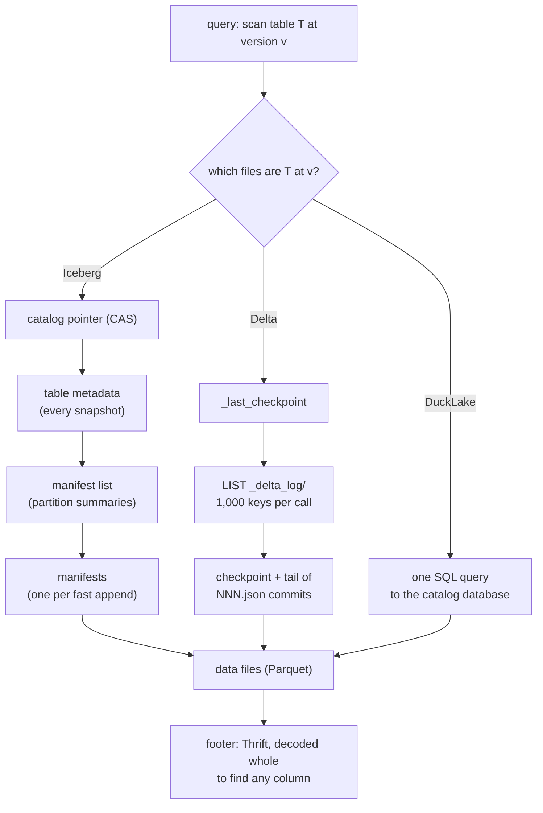

# Topic 49 — Open File & Table Formats: Parquet's Successors, Iceberg/Delta/DuckLake, and Transactions on Object Storage

Topic 12 taught the column encodings inside a file, and topic 28 taught the
object store under it. Both carry a note that points here:
topic 12's §4 on **F3**, a file format that embeds its own WebAssembly decoders
([topic 12](../12-columnar-analytics/README.md)), and topic 28's §3 on
**LakeVilla**, multi-table ACID transactions built from nothing but conditional
writes ([topic 28](../28-cloud-native/README.md)). Between those two sits the
layer the whole lakehouse direction rests on and this curriculum had not
covered: the **table format** — the metadata that says *which* immutable files
are the table at a given version, how a writer installs a new version on a
store that has no transactions, and how a reader finds the files without
listing a bucket.

Iceberg answers with a tree (table metadata → manifest list → manifests),
Delta with a log (one action file per commit, periodic checkpoints), and
DuckLake by putting the metadata in a SQL database. All three keep the data in
Parquet, whose footer is one more piece of metadata a reader must parse before
the first data byte. This topic measures what each shape costs — in objects,
bytes and dependent round trips — on the workload that hurts them most: many
small commits.



## The problem, measured (bench lane 1, provided — runs today)

`cargo run --release --bin table_bench` (or `./verify.sh 49`). A seeded
append-only table receives **1,000 commits of one data file each**, 100
commits per day partition, written into an Iceberg-shaped tree and a
Delta-shaped log on a metered in-memory object store
([experiments/src/store.rs](experiments/src/store.rs)). Every count below is a
deterministic function of the seed; Apple M3 Pro, 2026-10-26.

**Lane 1a — what a planner reads to list the files of the latest snapshot:**

| after 1,000 commits | GETs | bytes read | LISTs | dependent rounds |
|---|---:|---:|---:|---:|
| Iceberg, fast append (iceberg-rust's only append) | **1,003** | 1,373,885 | 0 | 4 |
| Iceberg, merge append (Java's default `newAppend()`) | 13 | 889,448 | 0 | 4 |
| Delta, no checkpoints | 1,001 | 522,593 | 1 | 3 |
| Delta, checkpoint every 10 (the paper's default) | **11** | 399,735 | 1 | 3 |

**Lane 1b — what the 1,000 commits wrote to get there:**

| metadata written by the commits | PUTs | bytes | largest single commit |
|---|---:|---:|---:|
| Iceberg, fast append | 4,000 | **398,749,323** | 786,993 |
| Iceberg, merge append | 4,010 | 219,263,669 | 877,726 |
| Delta, no checkpoints | 1,000 | **522,593** | 1,094 |
| Delta, checkpoint every 10 | 1,198 | 20,307,084 | 395,541 |

One thousand files, each described by about 400 bytes of statistics, and the
Iceberg commits wrote **399 MB** of metadata: **763×** the Delta log and
**19.6×** the log with its checkpoints. The bench's breakdown says where:
195,826,990 bytes of table-metadata files and 202,285,853 bytes of manifest
lists, against 587,480 bytes of manifests. Every commit rewrites a table
metadata file that names *every* snapshot and a manifest list that names
*every* manifest, so commit i writes i entries of each, and 1 + 2 + … + 1,000 =
500,500 entries per kind — ≈ 391 bytes per snapshot entry and ≈ 404 per
manifest-list entry. Delta's checkpoints are quadratic too, at a tenth of the
rate (a checkpoint every 10 commits rewrites every live `add`). Nothing in
either format runs expiry or log cleanup by itself; maintenance is a job
somebody schedules.

Three more rows from the same run say what the planner rows mean:

- **A one-day query** (100 of the 1,000 files): Iceberg fast append prunes
  900 manifests from the manifest list's partition summaries and reads 103
  objects; Delta reads exactly what a full scan reads — 11 objects, 399,735
  bytes — because a log has no index over partition values until it has been
  replayed.
- **After maintenance**: Iceberg after rewriting manifests reads 4 objects
  (514,082 bytes once snapshots are expired to one), Delta after a fresh
  checkpoint reads 2 plus one LIST. And once expired, Iceberg's time travel to
  version 500 is **gone**: retention is the price of the small root file.
- **Round trips do not grow with the table.** Iceberg needs 4 dependent rounds
  (pointer → metadata → manifest list → manifests in parallel), Delta 3
  (`_last_checkpoint` → LIST → checkpoint and tail in parallel). At the 5 ms per
  GET that Delta VLDB'20 §2.3 gives as the low end of a request's base latency,
  that is a floor of 20 ms and 15 ms before the first data byte — and the 1,003
  manifest GETs in Iceberg's last round are parallel, but they are still 1,003
  requests.

**Lane 1c — the Parquet footer a reader decodes to find 10 of C columns** (one
row group, 1,024 rows of `float`, `parquet` crate 59.1.0; local CPU with the
footer already in memory, median of 9, load average 7.7–14.5 during the run —
read the timings as indicative):

| columns | footer bytes | bytes/column | full decode µs | skip stats µs | + cached schema µs |
|---:|---:|---:|---:|---:|---:|
| 10 (the control) | 1,119 | 111.9 | 4 | 4 | 3 |
| 100 | 10,843 | 108.4 | 36 | 41 | 23 |
| 1,000 | 113,461 | 113.5 | 353 | 355 | 231 |
| 10,000 | 1,157,462 | 115.7 | 3,828 | 3,868 | 2,436 |
| 50,000 | 6,027,910 | 120.6 | 19,484 | 20,037 | 12,768 |

The 10-column row is the control: the footer of a file that holds only the
columns the query projects. Against it, the 50,000-column file's 6,027,910-byte
footer is **5,387×** larger — the ratio of the column counts (5,000×) times a
per-column cost 8% higher (120.6 against 111.9 bytes, wider varints for the
larger offsets). The 6 MB is not a Parquet inefficiency per column; it is what
49,990 columns the query never reads cost every reader of the file.

The footer is linear in total columns, and so is decoding it, whatever the
query projects: at 50,000 columns, 10 projected columns are 0.02% of the
column-chunk entries and the reader still walks 6 MB of Thrift. Telling the
crate to skip statistics for the other 49,990 columns is **not faster** — the
skipped fields are still walked byte by byte
([reading-parquet-footer.md](reading-parquet-footer.md) explains why from the
code). Supplying a cached schema saves about a third. This is F3's §4 argument
reproduced; F3's own claim that its metadata path is "an order of magnitude
faster than Parquet" is not what its Figure 9 shows
([reading-f3.md](reading-f3.md), Step 7).

## Step 1 — a table is a set of immutable files at a version

An object store gives four things: whole-object PUT, GET (with byte ranges),
lexicographic LIST (at most 1,000 keys per call on S3, Delta VLDB'20 §2.1), and
— the one everything here depends on — a **conditional put**: create-only
("put if absent") or compare-and-swap on a version tag. It gives no
multi-object atomicity. So every table format makes the same two moves: data
files are **immutable** and uniquely named, and the table's state at a
version is *metadata naming a set of those files*. A commit writes new files
first (invisible, because nothing names them), then makes them visible with
**one** conditional write of a small root object. Readers who hold the old
root keep reading the old version — snapshot isolation for free.

What differs is the shape of the metadata between that root and the data
files, and that shape decides what a commit writes and what a reader reads.
[reading-table-specs.md](reading-table-specs.md) walks the three
specifications; this README follows the measurements.

## Step 2 — a tree or a log, and the quadratic term in both

**Iceberg** (spec, "Overview"): the root is a catalog pointer to a
**table-metadata** JSON file listing every retained **snapshot**; each
snapshot names a **manifest list**, which lists **manifests** with per-manifest
partition summaries; each manifest lists data files with column statistics.
A **fast append** writes one new manifest for the new files, then a new
manifest list (all manifests), a new table-metadata file (all snapshots), and
swaps the pointer. The spec's goal is "O(1) remote calls to plan the files for
a scan" (spec, "Goals") — and lane 1a shows a fast-append table missing it by
three orders of magnitude (1,003 GETs) until manifests are merged. Java's
default `newAppend()` merges once 100 manifests accumulate
(`TableProperties.java:119`), which caps planning at ≤ 102 manifest reads;
iceberg-rust implements fast append only
([reading-iceberg-rust.md](reading-iceberg-rust.md)).

**Delta** (PROTOCOL.md, "Delta Log Entries"): the root *is* the newest
`NNNNNNNNNNNNNNNNNNNN.json` in `_delta_log/`, a newline-delimited list of
actions (`add`, `remove`, `metaData`, `protocol`, `commitInfo`, `txn`). A commit
writes exactly one new object — the log grows by one entry and nothing is
rewritten — so the 1,000 commits wrote 522,593 bytes. A reader must replay the
log from the newest **checkpoint** (a snapshot of all live actions), found via
`_last_checkpoint` and a LIST.

The worked arithmetic that produces lane 1b's 399 MB:

```text
commit i rewrites:  i snapshot entries  (≈ 391 B each)   table metadata
                    i manifest entries  (≈ 404 B each)   manifest list
total over N:       (391 + 404) · N(N+1)/2
N = 1,000:          795 · 500,500 = 397.9 MB   (bench: 398.1 MB in those two kinds)
```

Delta's checkpoints at interval 10 rewrite every live `add` (≈ 399 B) every
tenth commit: Σ over 99 checkpoints of (10j + 1) adds = 49,599 adds ≈ 19.8 MB —
which is the 20,307,084 − 522,593 the bench reports, to 0.1%.

## Step 3 — the commit: one conditional write, and what to do when you lose

Optimistic concurrency on a store is: read version v, do the work, try to
create version v+1. Losing the race is normal; what matters is what the loser
does next. Iceberg's spec states the rules ("Commit Conflict Resolution and
Retry"): an append "can always be applied" to the new version, while a replace
or delete must verify the files it removes are still live. Delta's per-table
log serialises all writers on one key, so throughput stops growing past one
writer — LakeVilla's Figure 1 shows it stagnating "already with two concurrent
transactions", and its Table 4 has Delta and Nessie committing 0.00 TPC-C
transactions per minute at a 100% abort rate
([reading-lakevilla.md](reading-lakevilla.md)).

Lane 2 is that race, on the lane-1 Delta log: appenders, compactors (Iceberg's
`replace`) and deleters interleaved by a seeded scheduler, committing with
put-if-absent. The reference implementation's numbers (in
[notes.md](notes.md)) show conflicts per committed append climbing from 0.52
at 2 writers to 3.29 at 16 with **zero** aborts — rebase is free when nothing
you depend on changed — while two compactors racing for the same input files
abort 4 of their 14 attempts that found work. The provided audit
(`occ::audit_log`) rejects the corruption a careless validator produces: a
file removed twice.

## Step 4 — maintenance is part of the format

Every number in lane 1a improves only after somebody runs maintenance:
rewrite manifests, expire snapshots, write a checkpoint. When to do it is a
cost trade the protocols leave open — PROTOCOL.md only says writers "are
encouraged to checkpoint reasonably frequently"; the Delta paper's clients use
every 10 commits (§3.1.3) and delta-rs (`26ea54f`) defaults to 100
([reading-delta-rs.md](reading-delta-rs.md)). Lane 3 prices the choice in one
unit — bytes moved plus 250,000 byte-equivalents per request (5 ms × 50 MB/s,
the low ends of Delta VLDB'20 §2.3) — on a 600-commit table read at a seeded
random rate:

| reads per commit | never | every 10 | best fixed interval | ski rental (provided) |
|---|---:|---:|---:|---:|
| 0.02 | 1,358.8 | 219.3 | 215.7 (k = 20) | 305.3 |
| 0.2 | 9,811.6 | 434.7 | 393.4 (k = 5) | 448.6 |
| 2 | 91,089.0 | 2,577.8 | 1,530.0 (k = 2) | 1,617.5 |

(millions of byte-equivalents). Every-10 is near-optimal on a rarely read
table and 1.68× the best interval on a busy one. The textbook ski-rental rule —
checkpoint once readers have paid as much as a checkpoint costs — is the
**negative result**: it is 1.42× the best fixed interval at 0.02 reads per
commit, because its 2-competitive guarantee assumes rent arrives in small
daily amounts, and a rare reader facing a long tail pays it in one lump. The
exercise is the inventory-theory rule that does adapt (EOQ).

## Step 5 — the file under the table

The table format names files; the file format decides what reading one costs.
Parquet's footer is a single Thrift structure, and Thrift compact has no
random access, so lane 1c's reader decodes 6 MB to locate 10 columns. F3
(Zeng et al.) moves each column's metadata into its own FlatBuffer behind a
directory footer, decouples the physical I/O unit (8 MB for S3, §5.1) from the
row group, lets dictionary scope vary per column (§5.2), and ships the decoders
as WebAssembly inside the file (§6). Its measured costs are honest in the
figures and rounder in the prose: [reading-f3.md](reading-f3.md) finds three
places where the text and the figures disagree (Fig. 9, Fig. 13, Fig. 15).

## Production shape

| concern | where it lives (pinned in [resources/codebases.md](../../resources/codebases.md)) |
|---|---|
| Iceberg spec: goals, fast append, manifest lists, conflict rules | `iceberg` `format/spec.md` — "Goals", "Snapshots", "Manifest Lists", "Commit Conflict Resolution and Retry" |
| Java's merge append defaults | `iceberg` `core/src/main/java/org/apache/iceberg/TableProperties.java:115-122`, `BaseTable.java:209-216`, `ManifestMergeManager.java:175` |
| iceberg-rust commit and retry | `iceberg-rust` `crates/iceberg/src/transaction/mod.rs:177-252`, `transaction/append.rs`, `transaction/snapshot.rs` |
| metadata log capped at 100, snapshot list not | `iceberg-rust` `crates/iceberg/src/spec/table_properties.rs:377`, `spec/table_metadata_builder.rs:1126-1143` |
| Delta protocol: log, checkpoints, reconciliation | `delta` `PROTOCOL.md` — "Delta Log Entries", "Checkpoints", "Last Checkpoint File", "Action Reconciliation", "Commit Protocol" |
| delta-rs commit, conflicts, checkpoint interval | `delta-rs` `crates/core/src/kernel/transaction/mod.rs:860-1014`, `conflict_checker.rs:504-672`, `crates/core/src/table/config.rs:269-274` |
| DuckLake: metadata as SQL tables | `ducklake-web` `docs/stable/specification/queries.md` (spec v1.1); extension in `ducklake` `src/storage/` |
| Parquet footer decode | `arrow-rs` `parquet/src/file/metadata/reader.rs:783-796`, `parquet/src/file/metadata/thrift/mod.rs:660-675` |
| F3 footer and Wasm decode | `f3` `format/File.fbs`, `fff-poc/src/reader/builder.rs`, `fff-ude-wasm/src/lib.rs` |

## Reading guides

- [Iceberg, Delta and DuckLake: three ways to name the files that are a table](reading-table-specs.md) — the three specifications (`iceberg` `format/spec.md`, `delta` `PROTOCOL.md`, DuckLake 1.1 in `ducklake-web`), with Delta VLDB'20 and Lakehouse CIDR'21 as background.
- [iceberg-rust: a fast append is four writes and a compare-and-swap](reading-iceberg-rust.md) — the commit path, retries, and why the manifest list is quadratic.
- [delta-rs: a log you list, replay and race for](reading-delta-rs.md) — put-if-absent, the conflict checker, checkpoints.
- [LakeVilla: multi-table transactions with nothing but conditional writes](reading-lakevilla.md) — markers, sublogs, a global version log.
- [F3: a file format that ships its own decoders](reading-f3.md) — the file layer's successor to Parquet.
- [The Parquet footer: why finding 10 columns means walking all of them](reading-parquet-footer.md) — lane 1c, from the bytes up.

## Experiments

`experiments/` — `cargo run --release --bin table_bench`; `cargo test` (the
provided tests pass; the stub tests are the specification and fail until the
stubs are done).

| file | what | status |
|---|---|---|
| `store.rs` | object store: PUT, put-if-absent, compare-and-swap, GET, paged LIST, metered | PROVIDED |
| `gen.rs` | seeded append-only workload with per-file column statistics | PROVIDED |
| `iceberg.rs` | Iceberg-shaped tree: fast/merge append, rewrite manifests, expiry, planner | PROVIDED |
| `delta.rs` | Delta-shaped log: put-if-absent commits, checkpoints, replay planner | PROVIDED |
| `footer.rs` | wide Parquet files and footer decode modes (lane 1c) | PROVIDED |
| `occ.rs` | `run_occ`: concurrent writers, conflict validation, rebase/abort; `audit_log` provided | **STUB** (lane 2) |
| `policy.rs` | checkpoint policies and the cost simulator; `Fixed`, `Never`, `SkiRental` provided | **STUB**: `Eoq` (lane 3) |

Both formats here write JSON (Iceberg's manifests are Avro, Delta's
checkpoints Parquet), so both pay the same per-file entry encoding and the
byte columns differ only by structure; object, request and round counts do not
depend on the encoding at all.

## Exercises

1. **Lane 2** — implement `occ::run_occ`. Before you do, predict the
   conflicts-per-commit column for 2 and 16 appenders (notes.md worksheet).
2. **Lane 3** — implement `policy::Eoq`, the economic-order-quantity rule
   `k* = sqrt(2 · price / (λ · c))`, and explain why it tracks the best fixed
   interval where ski rental does not.
3. Add a third Iceberg variant that expires snapshots every 100 commits keeping
   100, and predict lane 1b's bytes before running it.
4. Model DuckLake: a `Catalog` that answers the planner with one request, and
   charge it at the 5 ms floor. What does lane 1a's "rounds" column become, and
   what moved where?
5. Extend lane 1c with a Parquet page index and measure what reading one
   column chunk's offsets costs against decoding the whole footer.

## Cross-topic threads

- [Topic 12](../12-columnar-analytics/README.md) — the encodings inside the
  data files; F3 is its §4 note, taken apart here.
- [Topic 28](../28-cloud-native/README.md) — object-store latency and tiering;
  LakeVilla is its §3 note, and conditional PUT is the same
  primitive SlateDB fences writers with.
- [Topic 8](../08-transactions-mvcc/README.md) and
  [topic 29](../29-distributed-txn/README.md) — optimistic concurrency and
  multi-object commit, here with one conditional write as the only atomic step.
- [Topic 33](../33-temporal-graphs/README.md) — time travel as a snapshot
  list; lane 1b prices keeping that list in the root file.
- [Topic 5](../05-durability-wal/README.md) — Delta's log is a write-ahead
  log whose checkpoint is the database; lane 3 is the checkpoint-interval
  question of every WAL.

## Capstone M49 — graph snapshots and branches on object storage

Topic 28's M28 gives the capstone a tiered backend and graph branching. M49
makes the branch durable and shareable with a table-format layout:

- store a graph version as immutable segment files (node table, edge CSR
  blocks per label, property columns) plus one **manifest** naming them with
  per-segment statistics (label, id range, edge count);
- commit a version with a conditional put on the branch's root — Iceberg's
  pointer swap; a **branch** or **tag** is a named reference to a version,
  exactly the spec's "Snapshot References";
- give the reader a planner that touches O(1) metadata objects for "nodes of
  label L" by pruning segments from the manifest's statistics, and measure it
  with lane 1a's meter;
- run lane 2's validation rules for concurrent writers to one branch (an
  edge-append rebases; a compaction of segments another writer deleted aborts);
- choose a checkpoint/manifest-merge interval with lane 3's EOQ rule against
  the graph's own read rate.
