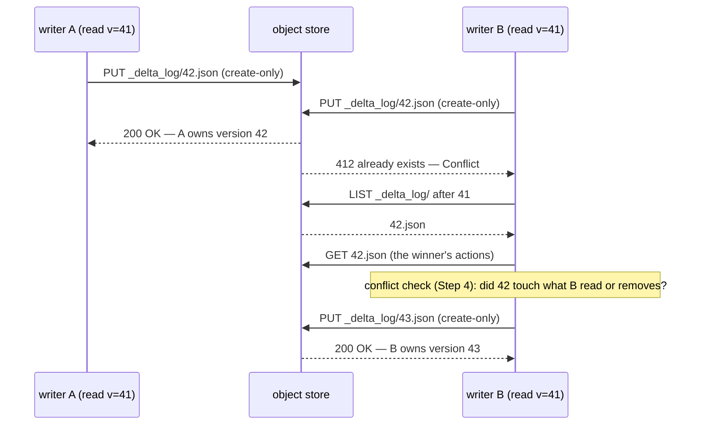

# delta-rs: a log you list, replay and race for

delta-rs is the Rust implementation of the Delta Lake protocol — the library
behind the `deltalake` Python package and the Delta support in several Rust
query engines. Reading it next to the protocol is the fastest way to see what
"a table is a log in an object store" costs in practice: every commit is a
race for one object name, every reader lists and replays, and every
maintenance decision (when to checkpoint, when to delete old log entries) is a
trade between those two bills.

This chapter reads delta-rs at commit `26ea54f` (pinned in
[resources/codebases.md](../../resources/codebases.md)) against the protocol it
implements (`delta-io/delta` `PROTOCOL.md` at `a7d0822`) and the paper that
introduced it (Armbrust et al., "Delta Lake: High-Performance ACID Table
Storage over Cloud Object Stores", PVLDB 13(12), VLDB'20). It builds the
vocabulary step by step, quotes the code that implements each step, and ties
each step to this topic's lane 1 model (`experiments/src/delta.rs`) and its
lane 2 and lane 3 exercises. Three things in the pinned code are worth knowing
before you use it, and none of them is in the paper: the default checkpoint
interval is **100**, not the paper's 10; the S3 DynamoDB lock is **gone** —
S3 commits now rely on the store's own create-only write; and the conflict
checker lets **two compactions remove the same file** and both commit, which
the Scala reference implementation at its own pin does not.

Every number below is quoted from the section cited next to it or from this
topic's measured lanes ([README.md](README.md), [notes.md](notes.md)).
Arithmetic was computed, not estimated.

## The problem in one sentence

An object store gives you whole-object writes, one conditional write, and a
lexicographic LIST that returns 1,000 keys a call — so how do you build a
table that many writers can change atomically and many readers can see
consistently, and what does each reader and writer pay for it as the table's
history grows?

## The concepts, step by step

### Step 1 — the log is the root of the table

> **In:** nothing yet — this step defines the vocabulary.
> **Out:** object store, log entry, version, action, snapshot, replay. Step 2
> uses "version" to define a commit; Steps 5 and 6 use "replay" to price a
> reader.

An **object store** (S3, GCS, Azure Blob) is a key-value store of immutable
blobs: you can PUT a whole object, GET it or a byte range of it, and LIST keys
in lexicographic order from a start key. Delta VLDB'20 §2.1 lists the three
properties every later step depends on: objects are replaced whole, never
patched; there is no atomic operation across several keys; and "S3's LIST
only returns up to 1000 keys per call, and each call takes tens to hundreds of
milliseconds".

Delta's answer is to make one directory the table's single source of truth.
A **log entry** (a "Delta file") is a JSON object `_delta_log/<v>.json`, where
`v` is the **version**, zero-padded to 20 digits so that lexicographic LIST
order is version order (PROTOCOL.md "Delta Log Entries"). Each entry holds an
atomic set of **actions** — newline-delimited JSON records such as `add` (this
data file is now part of the table, with its statistics), `remove` (it no
longer is), `metaData` (schema, partitioning), `protocol` (which reader and
writer features are required) and `commitInfo` (provenance). The **snapshot**
at version `v` is the table state you get by **replaying** — applying in order
— every action in entries `0..=v`. The paper's own phrase is that the log
record object "is the 'root' data structure that a client needs to know to
read a specific version of the table" (§3.2).

```text
mytable/
  part-0000-<uuid>.parquet              data files: immutable, named by GUID
  _delta_log/00000000000000000000.json  protocol, metaData, add ...
  _delta_log/00000000000000000001.json  commitInfo, add ...
  _delta_log/00000000000000000010.checkpoint.parquet   (Step 5)
  _delta_log/_last_checkpoint                          (Step 5)
```

This topic's lane 1 builds exactly this layout on a metered in-memory store
(`experiments/src/store.rs`), with one stated simplification: checkpoints are
written as newline-delimited JSON instead of Parquet, so a checkpoint's bytes
use the same per-file `add` encoding as the commits' bytes.

### Step 2 — a commit is one create-only write

> **In:** versions and log entries from Step 1.
> **Out:** the commit primitive (put-if-absent), the two ways delta-rs
> realises it, and what happened to S3 locking. Step 3's retry loop calls
> this primitive; Step 4 decides what to do when it fails.

A **conditional write** is a PUT that the store applies only if a condition
holds. **Put-if-absent** (also "create-only", `If-None-Match: *`) succeeds only
if the key does not exist yet. With it, committing is trivial to state: to
write version `v+1`, create `_delta_log/<v+1>.json`; exactly one writer can
win the name. This is option 3 of PROTOCOL.md's "Commit Protocol" ("Catalog
implementations that use PUT-if-absent ... can ratify and publish all-in-one
by atomically writing a published commit file") and step 4 of the paper's
write protocol (§3.2.2: "Attempt to write the transaction's log record into
the r + 1 .json log object, if no other client has written this object").

delta-rs states the contract as a trait and implements it once for every
non-catalog store:

```rust
// crates/core/src/logstore/committer.rs:42-63 — the Committer contract, at 26ea54f
42  /// Ratifies commit versions for a Delta table.
43  ///
44  /// Implementations must be atomic per version: exactly one caller can commit a given version,
45  /// every other caller receives [`CommitResponse::Conflict`]. Implementations must not retry.
46  #[async_trait::async_trait]
47  pub trait Committer: Send + Sync {
    // ... 48-49: doc comment ...
50      async fn commit(
51          &self,
52          version: Version,
53          payload: CommitOrBytes,
54      ) -> Result<CommitResponse, TransactionError>;
    // ... 55-63: abort() and payload_kind() ...
```

```rust
// crates/core/src/logstore/committer.rs:85-93 and 126-151 — the conditional put
85  fn put_options() -> &'static PutOptions {
86      static PUT_OPTS: OnceLock<PutOptions> = OnceLock::new();
87      PUT_OPTS.get_or_init(|| PutOptions {
88          mode: object_store::PutMode::Create,
    // ... 89-93: empty tags/attributes/extensions ...
    // ... 94-125: FileSystemCommitter struct, constructor, payload_mismatch ...
126  #[async_trait::async_trait]
127  impl Committer for FileSystemCommitter {
128      async fn commit(
129          &self,
130          version: Version,
131          payload: CommitOrBytes,
132      ) -> Result<CommitResponse, TransactionError> {
133          match (self.strategy, payload) {
134              (CommitStrategy::ConditionalPut, CommitOrBytes::LogBytes(bytes)) => {
135                  match self
136                      .store
137                      .put_opts(
138                          &commit_uri_from_version(Some(version)),
139                          bytes.into(),
140                          put_options().clone(),
141                      )
142                      .await
143                  {
144                      Ok(_) => Ok(CommitResponse::Committed),
145                      Err(ObjectStoreError::AlreadyExists { .. }) => {
146                          warn!(version, "commit entry already exists");
147                          Ok(CommitResponse::Conflict { version })
148                      }
149                      Err(err) => Err(TransactionError::from(err)),
150                  }
151              }
```

The line to focus on is **88**: `PutMode::Create` is the `object_store`
crate's name for put-if-absent, and **145** turns the store's "already exists"
into a `Conflict` — not an error — so the caller (Step 3) can decide whether
to retry. The second strategy, `TmpCommit` (`committer.rs:152-160`), writes
the entry under a temporary name and moves it with `rename_if_not_exists`
(`crates/core/src/logstore/mod.rs:913-937`) — the HDFS/ADLS route the paper
describes in §3.2.2. `DefaultLogStore::committer` picks `ConditionalPut`
(`crates/core/src/logstore/default_logstore.rs:66-72`).

**The S3 story changed.** The paper says plainly that "Amazon S3 does not have
atomic 'put if absent' or rename operations", and that Databricks used "a
separate lightweight coordination service" to give out log IDs (§3.2.2).
delta-rs long shipped a DynamoDB-based lock for the same reason. At the pin,
the S3 factory still parses the option and then refuses it:

```rust
// crates/aws/src/lib.rs:36-50 — S3LogStoreFactory::with_options, at 26ea54f
36          let s3_options = self.with_env_s3(&options.raw.clone());
37          let s3_options = S3StorageOptions::from_map(&s3_options)?;
38  
39          if s3_options.locking_provider.as_deref() == Some("dynamodb") {
40              error!(
41                  "delta-rs **no longer** supports S3DynamoDBLogStores, see <https://github.com/delta-io/delta-rs/discussions/4482> for more"
42              );
43          }
44  
45          Ok(default_logstore(
46              prefixed_store,
47              root_store,
48              location,
49              options,
50          ))
```

Line **45** is the point: every S3 table now gets the `DefaultLogStore`, i.e.
the `ConditionalPut` committer of lines 134-151 — the store's own create-only
write replaced the lock service. LakeVilla (VLDB'26, §8.1) states the premise
this rests on: AWS S3 and MinIO "provide strict consistency [4, 76] and
conditional writes [6]". Two comments in the pinned tree have not caught up —
`crates/aws/src/logstore/mod.rs:3` still lists an `S3DynamoDBLogStore`, and
`crates/core/src/kernel/transaction/mod.rs:11-13` still says "an atomic
rename is attempted" — so read the code, not the module docs.



### Step 3 — the retry loop: list, check every winner, try the next version

> **In:** the commit primitive of Step 2.
> **Out:** delta-rs's retry loop, its default retry budget, and what one lost
> race costs in requests. Step 4 fills in the "check" box; lane 2 is this
> loop as an exercise.

**Optimistic concurrency control (OCC)** means: do the work without locks,
then validate at commit time that nobody changed what you depended on, and
retry or abort if they did. In delta-rs the loop lives in
`PreparedCommit::into_future`:

```rust
// crates/core/src/kernel/transaction/mod.rs:860-941 and 965-998 — the commit loop, at 26ea54f
860                  async {
861                      let total_retries = max_retries + 1;
862                      while attempt_number <= total_retries {
863                          Span::current().record("attempt", attempt_number);
864                          let latest_version = log_store
865                              .get_latest_version(read_snapshot.version())
866                              .await?;
867  
868                          if latest_version > read_snapshot.version() {
    // ... 869-887: fail fast when max_retries == 0; log the gap ...
888                              let mut steps = latest_version - read_snapshot.version();
889                              let mut conflicts_checked = 0;
    // ... 890-892: comment ...
893                              while steps != 0 {
894                                  conflicts_checked += 1;
895                                  let summary = WinningCommitSummary::try_new(
896                                      log_store.as_ref(),
897                                      latest_version - steps,
898                                      (latest_version - steps) + 1,
899                                  )
900                                  .await?;
    // ... 901-917: build TransactionInfo and a ConflictChecker ...
918                                  match conflict_checker.check_conflicts() {
919                                      Ok(_) => {}
920                                      Err(err) => {
    // ... 921-925: log ...
926                                          return Err(TransactionError::CommitConflict(err).into());
927                                      }
928                                  }
929                                  steps -= 1;
930                              }
    // ... 931-935: record metrics ...
936                              // Update snapshot to latest version after successful conflict check
937                              read_snapshot
938                                  .update(&log_store, Some(latest_version))
939                                  .await?;
940                          }
941                          let version: Version = latest_version + 1;
    // ... 942-964: retry count into commitInfo bytes ...
965                          match committer.commit(version, updated_commit_or_bytes).await {
    // ... 966-987: Committed => return PostCommit ...
988                              Ok(CommitResponse::Conflict { .. })
989                              | Err(TransactionError::VersionAlreadyExists(_)) => {
    // ... 990-996: log ...
997                                  attempt_number += 1;
998                              }
```

The lines that carry the argument are **864** and **893–900**. Line 864 asks
for the latest version *before every attempt*, including the first — so even
an uncontended commit pays a LIST (Step 6 shows `get_latest_version` is a log
listing). Lines 893–900 then fetch every winning commit between the
transaction's read version and the latest, one at a time, and check each
(Step 4). Only if every check passes does line 941 target `latest + 1`. A lost
race at line 988 just loops: list again, check the new winners, try again.

The budget is `DEFAULT_RETRIES = 15` (`mod.rs:120`), so `total_retries`
at line 861 allows 16 attempts; exhausting them returns `MaxCommitAttempts`
(`mod.rs:1010-1014`).

**What contention costs, measured.** Lane 2 is this loop on a Delta-shaped log
with seeded writers ([`experiments/src/occ.rs`](experiments/src/occ.rs), a
stub; its reference run is in [notes.md](notes.md)). With only blind appenders
(25 operations each), the reference implementation measured these conflicts
per committed operation and winner commits fetched to validate:

| appenders | committed | conflicts | conflicts / commit | validation reads |
|---|---|---|---|---|
| 1 | 25 | 0 | 0.00 | 0 |
| 2 | 50 | 26 | 0.52 | 34 |
| 4 | 100 | 107 | 1.07 | 196 |
| 8 | 200 | 408 | 2.04 | 1,000 |
| 16 | 400 | 1,318 | 3.29 | 4,424 |

From 8 to 16 appenders the commits double (200 → 400) but the validation reads
grow 4.4× (1,000 → 4,424): each loser must fetch every winner it missed, and
there are more losers and more winners. Every one of those reads is a GET at
the per-request latency of Step 6 — this is LakeVilla Figure 1's "throughput
stagnates" in miniature ([reading-lakevilla.md](reading-lakevilla.md)).

### Step 4 — what conflicts with what

> **In:** the winning-commit summaries Step 3 fetches.
> **Out:** delta-rs's six checks, the three isolation levels, why blind
> appends never conflict, and the one rule where the pinned delta-rs and the
> pinned Spark reference disagree. Lane 2's validation is a subset of this.

An **isolation level** names which anomalies a database allows.
**Serializable**: the result equals some serial order of the transactions.
**Write-serializable** (the level the pinned code treats as the normal case
for data-changing writes; this chapter did not trace where its default is
set): writes are serializable, but a
reader may see a snapshot that does not include a concurrent blind append.
**Snapshot isolation**: each transaction sees one consistent snapshot, and
only write–write conflicts are prevented. A **blind append** is a commit that
only adds files and read nothing it depends on (`commitInfo.isBlindAppend`).

```rust
// crates/core/src/kernel/transaction/conflict_checker.rs:421-429 — the six checks
421      pub fn check_conflicts(&self) -> Result<(), CommitConflictError> {
422          self.check_protocol_compatibility()?;
423          self.check_no_metadata_updates()?;
424          self.check_for_added_files_that_should_have_been_read_by_current_txn()?;
425          self.check_for_deleted_files_against_current_txn_read_files()?;
426          self.check_for_deleted_files_against_current_txn_deleted_files()?;
427          self.check_for_updated_application_transaction_ids_that_current_txn_depends_on()?;
428          Ok(())
429      }
```

Read against a winner `W` and the current transaction `T`:

| check (line) | fails when | error |
|---|---|---|
| 422 | `W` changed the protocol `T` must obey | `ProtocolChanged` |
| 423 | `W` changed metadata (schema, partitioning) — `:504-511` | `MetadataChanged` |
| 424 | `W` added files `T` should have read — `:515-582` | `ConcurrentAppend` |
| 425 | `W` removed (with `dataChange`) a file `T` read — `:586-618` | `ConcurrentDeleteRead` |
| 426 | `W` removed (with `dataChange`) a file `T` also removes — `:622-652` | `ConcurrentDeleteDelete` |
| 427 | `W` advanced an application transaction id `T` read — `:656-672` | `ConcurrentTransaction` |

Line 424 is why appends do not fight under write-serializable:

```rust
// crates/core/src/kernel/transaction/conflict_checker.rs:524-535
524          let added_files_to_check = match self.isolation_level {
525              IsolationLevel::WriteSerializable if !self.txn_info.metadata_changed() => {
526                  // don't conflict with blind appends
527                  self.winning_commit_summary.changed_data_added_files()
528              }
529              IsolationLevel::Serializable | IsolationLevel::WriteSerializable => {
530                  let mut files = self.winning_commit_summary.changed_data_added_files();
531                  files.extend(self.winning_commit_summary.blind_append_added_files());
532                  files
533              }
534              IsolationLevel::SnapshotIsolation => vec![],
535          };
```

Line **527**: under write-serializable a winner's blind-append files are left
out of the set `T` is checked against. Two appenders therefore only ever lose
the *name* race of Step 2, never the *validation* — which is lane 2's first
spec test (`concurrent_appends_conflict_but_never_abort`) and the Iceberg
spec's "Append operations have no requirements and can always be applied"
("Commit Conflict Resolution and Retry").

**The rule where delta-rs and Spark disagree.** Check 426 is the one that
stops two compactions from both replacing the same input. delta-rs filters
the winner's removes by `dataChange` first:

```rust
// crates/core/src/kernel/transaction/conflict_checker.rs:636-650
636          let winning_deleted_files: HashSet<String> = self
637              .winning_commit_summary
638              .removed_files()
639              .iter()
640              .filter(|r| r.data_change)
641              .map(|r| r.path.clone())
642              .collect();
643          let intersection: HashSet<&String> = txn_deleted_files
644              .intersection(&winning_deleted_files)
645              .collect();
646  
647          if !intersection.is_empty() {
648              Err(CommitConflictError::ConcurrentDeleteDelete)
```

Line **640** drops every remove written with `dataChange: false` — which is
exactly how compaction writes its removes (`crates/core/src/operations/optimize.rs:522`
sets `data_change: false`). The pinned test suite asserts the consequence:
`test_concurrent_compaction_double_delete_still_conflicts`
(`conflict_checker.rs:1275-1302`) has two transactions remove the same file
with `dataChange: false` and asserts `result.is_ok()`, with a comment calling
this "matching the Spark reference implementation". The Spark reference at
the `delta` pin does not filter:

```scala
// spark/src/main/scala/org/apache/spark/sql/delta/ConflictChecker.scala:1246-1261 — delta-io/delta at a7d0822
1246    protected def checkForDeletedFilesAgainstCurrentTxnDeletedFiles(): Unit = {
1247      recordTime("checked-2x-deletes") {
1248        // Fail if a file is deleted twice.
1249        val deletedFilePaths = currentTransactionInfo.actions
1250          .collect { case r: RemoveFile => r.path -> r.partitionValues }
1251          .toMap
1252        val deleteOverlap = winningCommitSummary.removedFiles
1253          .find(r => deletedFilePaths.contains(r.path))
1254        if (deleteOverlap.nonEmpty) {
    // ... 1255-1260: throw concurrentDeleteDeleteException ...
1261        }
```

Line **1252** uses every removed file. The consequence in delta-rs, reasoning
from the code rather than a run: if two `OPTIMIZE`s pick the same input file
`F`, the first commits `remove F` + `add F₁`; the second passes check 426
(the winner's remove of `F` was filtered out) and commits `remove F` +
`add F₂`; both `F₁` and `F₂` now hold `F`'s rows. This chapter did not run
that scenario against delta-rs — it is what the conditions at lines 640 and
1275-1302 permit. In this topic's lane 2, the provided `audit_log` rejects the
same history as "remove of non-live" (`experiments/src/occ.rs:149-153`), and
the spec test `competing_compactors_abort_instead_of_double_removing` requires
the loser to abort. delta-rs's optimizer does narrow the window — each
compaction bin commits with `with_read_files` (`optimize.rs:977-986`) — but
check 425 filters `dataChange` the same way (`conflict_checker.rs:600-605`).

### Step 5 — checkpoints: buying a short replay with a quadratic write bill

> **In:** replay from Step 1; the commit path of Steps 2–3.
> **Out:** what a checkpoint and `_last_checkpoint` are, delta-rs's default
> interval and trigger, and the measured cost of checkpointing every 10
> commits. Step 6 prices the reader they save; lane 3 asks when to write one.

A **checkpoint** is a single object holding the reconciled state at version
`v` — every live `add`, the current `protocol` and `metaData`, and unexpired
`remove` tombstones — so a reader can start at `v` instead of `0`
(PROTOCOL.md "Checkpoints"; paper §3.1.3). `_last_checkpoint` is a tiny object
naming the newest checkpoint's version, so readers need not LIST the whole log
to find it (PROTOCOL.md "Last Checkpoint File": "The Delta transaction log
will often contain many (e.g. 10,000+) files. Listing such a large directory
can be prohibitively expensive").

How often? The paper: "By default, our clients write checkpoints every 10
transactions" (§3.1.3), and Spark's `DeltaConfig` at the pin still defaults
`checkpointInterval` to `"10"` (`spark/src/main/scala/org/apache/spark/sql/delta/DeltaConfig.scala:480-482`).
delta-rs does not:

```rust
// crates/core/src/table/config.rs:269-274 — default checkpoint interval, at 26ea54f
269      fn checkpoint_interval(&self) -> NonZero<u64> {
270          static DEFAULT_INTERVAL: LazyLock<NonZero<u64>> =
271              LazyLock::new(|| NonZero::new(100).unwrap());
272          self.checkpoint_interval
273              .unwrap_or(DEFAULT_INTERVAL.to_owned())
274      }
```

```rust
// crates/core/src/kernel/transaction/mod.rs:1128-1139 — the post-commit trigger
1128  async fn maybe_create_checkpoint(
1129      checkpoint_interval: u64,
1130      version: Version,
1131      log_store: &LogStoreRef,
1132  ) -> DeltaResult<bool> {
1133      if (version + 1).is_multiple_of(checkpoint_interval) {
1134          create_checkpoint_for(version, log_store.as_ref()).await?;
1135          Ok(true)
1136      } else {
1137          Ok(false)
1138      }
1139  }
```

Line **271** makes 100 the default; line **1133** checkpoints when `version+1`
is a multiple of it, i.e. at versions 99, 199, 299, … A delta-rs reader of an
untuned table can therefore replay up to 99 commit files after the checkpoint,
where the paper's clients replay at most 9. The checkpoint itself is written
by the kernel: `create_checkpoint_for` builds a kernel `Snapshot` at the
version and calls `snapshot.checkpoint(engine, None)`
(`crates/core/src/protocol/checkpoints.rs:28-57`, line 55).

This topic's model checkpoints with the paper's interval and the paper's
order of operations — commit first, then checkpoint (§3.2.2 step 5):

```rust
// topics/49-table-formats/experiments/src/delta.rs:141-161 — commit, then maybe checkpoint
141          store
142              .put_if_absent(&commit_key(v), ndjson(&actions))
143              .expect("single writer: version cannot be taken");
144          self.next_version += 1;
145          if self.checkpoint_interval > 0 && v > 0 && v % self.checkpoint_interval == 0 {
146              self.checkpoint(store);
147          }
148          v
149      }
    // ... 150-153: doc comment ...
154      pub fn checkpoint(&mut self, store: &mut Store) {
155          let v = self.version().expect("nothing to checkpoint");
156          let mut actions: Vec<Value> = protocol_and_metadata().to_vec();
157          actions.extend(self.live.values().cloned());
158          let n = actions.len();
159          store.put(&checkpoint_key(v), ndjson(&actions));
160          store.put(LAST_CP, serde_json::to_vec(&json!({"version": v, "size": n})).unwrap());
161      }
```

Line **157** is the whole cost story: a checkpoint rewrites *every* live
`add`. On an append-only table the live set grows by one file per commit, so
the checkpoint written at version `v` holds `v + 1` adds. With interval `k`
and `N` commits the checkpoints together write

  Σ_{j=1}^{⌊(N−1)/k⌋} (k·j + 1) adds ≈ N² / (2k),

where `N` is the number of commits, `k` the checkpoint interval and `j`
counts checkpoints. Worked for lane 1 (`N = 1,000`, `k = 10`, one file per
commit): `j` runs 1..99, so the sum is 10·(99·100/2) + 99 = 49,500 + 99 =
**49,599 adds**. Lane 1b measured 20,307,084 bytes written by the
checkpointing table against 522,593 by the same commits without checkpoints;
the difference, 19,784,491 bytes, divided by 49,599 adds is **398.9 bytes per
add** — the same as the final checkpoint's own 399,735 bytes / 1,000 files
(399.7, which also carries `protocol` and `metaData`). So the formula, not
noise, accounts for the bill: checkpointing every 10 commits multiplied the
log's write volume by 20,307,084 / 522,593 = **38.9×**. It is cheaper than
Iceberg's fast append in the same lane (398.7 MB), but it is quadratic too.

### Step 6 — reading: one hint, a paged LIST, a parallel replay

> **In:** the log of Step 1 and the checkpoints of Step 5.
> **Out:** the read protocol, its dependent round trips, its measured cost
> with and without checkpoints, and which parts delta-rs now delegates to the
> kernel. Lane 3 trades this step's cost against Step 5's.

The paper's read protocol (§3.2.1) is five steps: (1) read `_last_checkpoint`;
(2) LIST the log from that checkpoint's ID; (3) reconstruct the state from the
checkpoint plus the later entries; (4) use statistics to choose data files;
(5) read them. Steps 1–3 are planning, and each depends on the previous one's
answer, so they are sequential **round trips** (a request that cannot start
until an earlier response arrives). LIST is itself sequential across pages:
page two's start key is page one's last key, 1,000 keys a page (§2.1).

**Replay** applies PROTOCOL.md "Action Reconciliation": "The latest protocol
action seen wins", the latest `metaData` wins, and for files "scan all file
actions and keep only the newest reference for each logical file". The
model's planner is that protocol, metered:

```rust
// topics/49-table-formats/experiments/src/delta.rs:178-224 — plan(): hint, LIST, replay
178          if at.is_none() {
179              store.round();
180              if let Some((_, b)) = store.get(LAST_CP) {
181                  let lc: Value = serde_json::from_slice(&b).unwrap();
182                  let c = lc["version"].as_u64().unwrap();
183                  // list from just before "<c>.checkpoint.json"
184                  start_after = Some(format!("{LOG}{c:020}"));
185              }
186          }
187          let limit = at.unwrap_or(u64::MAX);
188          let keys = store.list(LOG, start_after.as_deref(), |k| {
189              matches!(parse_log_key(k), Some((v, _)) if v > limit)
190          });
    // ... 191-217: split keys into checkpoint / commits; build the replay closure ...
218          if let Some(c) = checkpoint {
219              replay(store.get(&checkpoint_key(c)).expect("checkpoint").1);
220          }
221          for v in commits {
222              if checkpoint.map_or(true, |c| v > c) && v <= target {
223                  replay(store.get(&commit_key(v)).expect("commit").1);
224              }
225          }
```

Line **188** is where table history becomes reader cost: with no checkpoint
the LIST starts at version 0 and every key it returns becomes a GET at
line 223. Lane 1a, at 1,000 commits:

| table | GETs | bytes read | LISTs | rounds |
|---|---|---|---|---|
| Delta, no checkpoints | 1,001 | 522,593 | 1 | 3 |
| Delta, checkpoint every 10 | 11 | 399,735 | 1 | 3 |
| time travel to v499, every 10 | 10 | 200,508 | 1 | 2 |

The 1,001 is the `_last_checkpoint` GET that misses plus 1,000 commit files;
the 11 is `_last_checkpoint`, checkpoint 990 and commits 991–999. Checkpoints
cut the *requests* 91× but the *bytes* only 1.3×, because a checkpoint holds
the same adds the commits did. Time travel skips the hint (it may point past
the target) and saves a round. The rounds are flat at 3 whatever the history
length; multiplied by the paper's "at least 5–10 ms of base latency" per read
(§2.3) that is a 15 ms floor before the first data byte.

**What delta-rs runs at the pin.** Snapshot construction is the kernel's:
`Snapshot::try_new_with_engine_and_catalog` hands the table root to
`KernelSnapshot::builder_for(table_root)…build(engine)`
(`crates/core/src/kernel/snapshot/mod.rs:224-260`, line 231), and the kernel
dependency is the `buoyant_kernel` package at `0.28.x` (`Cargo.toml:21`), not
upstream `delta_kernel` — so the LIST-from-checkpoint and replay code is
outside this repository. Two pieces remain in delta-rs: it reads the
`_last_checkpoint` hint itself to notice a checkpoint at the current version
(`snapshot/mod.rs:1292-1312`), and `get_latest_version` — the LIST that
Step 3's commit loop issues every attempt — is a kernel log segment listing:

```rust
// crates/core/src/logstore/mod.rs:806-828 — "what is the newest version?" is a log listing
806  pub async fn get_latest_version(
807      log_store: &dyn LogStore,
808      current_version: Version,
809  ) -> DeltaResult<Version> {
810      let storage = log_store.engine().storage_handler();
811      let log_root = log_store.log_root_url();
812  
813      let segment = spawn_blocking_with_span(move || {
814          LogSegment::for_table_changes(storage.as_ref(), log_root, current_version, None)
815      })
    // ... 816-826: error mapping ...
827  
828      Ok(segment.end_version)
```

Line **814** lists the log from `current_version` forward; line 828 keeps only
the end. For a writer whose snapshot is current the listing is short, but it
is still a round trip on every commit attempt.

### Step 7 — cleanup: the log is not allowed to grow forever

> **In:** checkpoints (Step 5) and the LIST cost (Step 6).
> **Out:** when delta-rs deletes old log entries, the retention defaults,
> and what cleanup costs time travel.

Checkpoints shorten a reader's replay but not the directory: commit files
accumulate, and every unbounded LIST pays for them. PROTOCOL.md allows
**metadata cleanup** — deleting log entries older than a checkpoint — as long
as a checkpoint covers the oldest kept version. delta-rs runs it after a
commit when `enableExpiredLogCleanup` is set, which it is by default
(`crates/core/src/table/config.rs:265-267`), with a **30-day** default
`logRetentionDuration` (`config.rs:258-263`); the post-commit hook computes
the cutoff at `crates/core/src/kernel/transaction/mod.rs:1073-1074`.

```rust
// crates/core/src/protocol/checkpoints.rs:146-148 and 178-190 — cleanup lists everything, then picks a safe checkpoint
146      // List all log entries under _delta_log
147      let log_entries: Vec<Result<crate::ObjectMeta, _>> =
148          object_store.list(Some(log_path)).collect().await;
    // ... 149-177: find the oldest version still inside the retention window ...
178      // Step 3: Find safe checkpoint with checkpoint_version <= keep_version (no ts restriction)
179      let safe_checkpoint_version_opt = log_entries
180          .iter()
181          .filter_map(|m| m.as_ref().ok())
182          .filter_map(|m| {
183              let path = m.location.as_ref();
184              CHECKPOINT_REGEX
185                  .captures(path)
186                  .and_then(|caps| caps.get(1))
187                  .and_then(|v| v.as_str().parse::<Version>().ok())
188          })
189          .filter(|ver| *ver <= keep_version)
190          .max();
```

Line **148** lists the *whole* `_delta_log` — ⌈keys / 1,000⌉ sequential LIST
pages — and only then, at lines 179-190, chooses the newest checkpoint at or
below the retention boundary; entries older than that checkpoint *and* older
than the cutoff are deleted (`checkpoints.rs:220`). The price of cleanup is
time travel: a version whose commits were deleted can only be reconstructed
if a checkpoint at or before it survives. The same trade appears in Iceberg
as snapshot expiry; lane 1b shows Iceberg's version-500 snapshot "gone" after
expiry ([reading-table-specs.md](reading-table-specs.md)).

## How to read the source (with the concepts in hand)

1. **`crates/core/src/logstore/committer.rs` entire** (319 lines) with Step 2:
   the trait, the two strategies, and the tests at the bottom
   (`conditional_put_reports_conflicts` at line 192).
2. **`crates/aws/src/lib.rs:28-52`** — the DynamoDB refusal; then
   `crates/core/src/logstore/default_logstore.rs` (77 lines).
3. **`crates/core/src/kernel/transaction/mod.rs:796-1034`** — the commit loop
   of Step 3, then **`:1036-1139`** — the post-commit hook (checkpoint,
   cleanup).
4. **`crates/core/src/kernel/transaction/conflict_checker.rs:381-672`** for
   Step 4, then its tests from line 742; read `:1275-1334` next to Spark's
   `ConflictChecker.scala:1217-1263` at the `delta` pin.
5. **`crates/core/src/protocol/checkpoints.rs:20-236`** for Steps 5 and 7.
6. **`crates/core/src/table/config.rs:222-275`** — every default named here.
7. Skip `crates/core/src/kernel/snapshot/mod.rs` beyond `:210-262` and
   `:1287-1312` on a first read; the replay you want to understand is the
   kernel's, and Step 6's model is the protocol in 60 lines.

## Where each step lives in this topic

| step | lane / file | what to run or read |
|---|---|---|
| 1, 6 (log, replay) | lane 1a, `experiments/src/delta.rs:175-237` | the "Delta, no checkpoints" rows: 1,001 GETs at 1,000 commits |
| 2, 3 (commit, retry) | lane 2, `experiments/src/occ.rs` (stub) | conflicts per commit 0.52 → 3.29 from 2 to 16 appenders (reference, [notes.md](notes.md)) |
| 4 (conflict rules) | lane 2's `audit_log`, `occ.rs:136-164` | the double-remove a validator must refuse |
| 5 (checkpoint bill) | lane 1b, `delta.rs:141-161` | 20,307,084 vs 522,593 bytes written; 49,599 adds |
| 5, 6 (when to checkpoint) | lane 3, `experiments/src/policy.rs` | every 10: 2,577.8 MB-eq at 2 reads/commit vs 1,530.0 for the best interval (k = 2) |
| 7 (cleanup) | lane 1b's maintenance rows | Iceberg's expired snapshot as the analogue |

## Questions (answer in notes.md)

1. delta-rs's commit loop LISTs before its *first* attempt (Step 3, line
   864); this topic's lane 2 tries `base + 1` first and lists only after a
   conflict. For a single uncontended writer, how many requests does each
   pay per commit, and which design is right when contention is rare?
2. Lane 3 found that the best fixed interval is k = 2 at 2 reads per commit
   and k = 20 at 0.02. Where would delta-rs's default of 100 land in lane 3's
   table, and for what kind of table is 100 the better default than 10?
3. Write the history Step 4 describes — two `OPTIMIZE`s of the same file —
   as two lane-2 commits and say which line of `audit_log` rejects it. What
   would delta-rs's check 426 need to compare instead of `data_change` to
   refuse it without refusing the case in `:1306-1334`?
4. Step 6's table shows checkpoints cutting requests 91× but bytes 1.3×. On
   an object store with the paper's 5–10 ms per request and 50–100 MB/s per
   request (§2.3), which of the two matters for planning at 1,000 commits?
   Compute both components.
5. Cleanup lists the whole log (Step 7). At 30 days of retention and one
   commit a minute, how many keys and LIST pages is that, before any
   checkpoint files?

## Done when

Answer each before unfolding it.

- [ ] You can say what object a Delta commit creates, with which store primitive, and what delta-rs does on S3 at the pin.

  <details><summary>Answer</summary>

  A commit creates `_delta_log/<v+1>.json` (20-digit zero-padded version) with
  a create-only write — `object_store::PutMode::Create` in
  `FileSystemCommitter::commit` (`committer.rs:88`, `:134-151`); "already
  exists" becomes `CommitResponse::Conflict` (`:145-147`). On S3, delta-rs at
  `26ea54f` no longer supports the DynamoDB lock: the factory logs an error if
  it is requested and returns the `DefaultLogStore` anyway
  (`crates/aws/src/lib.rs:39-50`), whose committer is the conditional put
  (`default_logstore.rs:66-72`). The paper's §3.2.2 workaround — a
  coordination service because S3 had no put-if-absent — is no longer needed
  because the store now provides the conditional write.

  </details>

- [ ] You can explain why two blind appenders collide but never abort, and what a collision costs.

  <details><summary>Answer</summary>

  Both target the same next version name, so one PUT fails (Step 2). The loser
  lists, fetches each winning commit, and runs the six checks; under
  write-serializable, check 424 ignores the winner's blind-append files
  (`conflict_checker.rs:525-528`), no file was removed, metadata did not
  change, so every check passes and it retries at `latest + 1`. The cost is
  one LIST plus one GET per missed winner per lost race: lane 2's reference
  measured 1,000 validation reads for 200 commits at 8 appenders and 4,424 for
  400 at 16.

  </details>

- [ ] You can state delta-rs's default checkpoint interval, where it is set, and how it differs from the paper and from Spark.

  <details><summary>Answer</summary>

  100 commits (`crates/core/src/table/config.rs:269-274`), triggered when
  `(version + 1)` is a multiple of the interval (`transaction/mod.rs:1133`),
  so at versions 99, 199, …. The paper says its clients checkpoint "every 10
  transactions" (§3.1.3) and Spark's `DeltaConfig` at the `delta` pin still
  defaults to 10 (`DeltaConfig.scala:480-482`). A delta-rs reader of an
  untuned table may replay up to 99 commit files after the last checkpoint
  instead of 9.

  </details>

- [ ] You can derive the checkpoint write volume for N commits at interval k and check it against lane 1b.

  <details><summary>Answer</summary>

  The checkpoint at version `v` of an append-only, one-file-per-commit table
  holds `v + 1` adds; checkpoints at `v = k, 2k, …` give Σ (k·j + 1) ≈ N²/(2k)
  adds. For N = 1,000, k = 10: j = 1..99, 10 × 4,950 + 99 = 49,599 adds.
  Lane 1b: 20,307,084 − 522,593 = 19,784,491 checkpoint bytes, / 49,599 =
  398.9 bytes per add, matching the final checkpoint's 399.7 bytes per file.
  The log alone is 522,593 bytes, so checkpointing multiplied write volume by
  38.9×.

  </details>

- [ ] You can describe the one conflict rule where the pinned delta-rs and the pinned Spark reference disagree, and what it permits.

  <details><summary>Answer</summary>

  The double-delete check. delta-rs keeps only winning removes with
  `data_change` set (`conflict_checker.rs:640`), and compaction writes its
  removes with `data_change: false` (`optimize.rs:522`), so two compactions
  removing the same file both pass; the pinned test at `:1275-1302` asserts
  exactly that and calls it Spark-compatible. Spark's
  `checkForDeletedFilesAgainstCurrentTxnDeletedFiles` at `a7d0822` compares
  every removed file (`ConflictChecker.scala:1252`). From the code, the
  permitted history leaves both compactions' outputs live, each holding the
  input's rows; this chapter did not execute it. Lane 2's `audit_log` rejects
  such a history (`occ.rs:151-153`).

  </details>

- [ ] You can count the requests and round trips a reader pays at 1,000 commits with and without checkpoints, and say which part delta-rs delegates to the kernel.

  <details><summary>Answer</summary>

  Without checkpoints: 1 `_last_checkpoint` GET (a miss), 1 LIST page, 1,000
  commit GETs — 1,001 GETs, 522,593 bytes, 3 rounds. With a checkpoint every
  10: `_last_checkpoint`, 1 LIST, checkpoint 990 and commits 991–999 — 11 GETs,
  399,735 bytes, 3 rounds (lane 1a). At ≥ 5 ms per round (§2.3) that is a
  15 ms floor either way; the difference is 990 parallel GETs. In delta-rs the
  listing and replay are inside the kernel (`buoyant_kernel` 0.28.x,
  `Cargo.toml:21`; `KernelSnapshot::builder_for` at `snapshot/mod.rs:231`;
  `LogSegment::for_table_changes` at `logstore/mod.rs:814`).

  </details>

## References

**Code** — `delta-io/delta-rs` at `26ea54f` (pinned in
[resources/codebases.md](../../resources/codebases.md)):

| file:lines | what this chapter takes from it |
|---|---|
| `crates/core/src/logstore/committer.rs:42-63, 85-93, 126-163` | the `Committer` contract; `PutMode::Create`; `TmpCommit` |
| `crates/core/src/logstore/default_logstore.rs:66-72` | the default store commits by conditional put |
| `crates/core/src/logstore/mod.rs:806-828, 913-937` | `get_latest_version` via a kernel log segment; `rename_if_not_exists` |
| `crates/aws/src/lib.rs:36-50`; `crates/aws/src/logstore/mod.rs:1-3` | DynamoDB no longer supported; stale module doc |
| `crates/core/src/kernel/transaction/mod.rs:11-13, 120, 860-1014, 1036-1139` | stale rename doc; 15 retries; the commit loop; post-commit checkpoint and cleanup |
| `crates/core/src/kernel/transaction/conflict_checker.rs:421-429, 504-672, 1275-1334` | the six checks; the `data_change` filters; the double-compaction test |
| `crates/core/src/operations/optimize.rs:522, 977-986` | compaction removes with `data_change: false`; per-bin commit with read files |
| `crates/core/src/protocol/checkpoints.rs:28-57, 137-236` | checkpoint written by the kernel; metadata cleanup |
| `crates/core/src/table/config.rs:258-274` | 30-day log retention, cleanup on, checkpoint interval 100 |
| `crates/core/src/kernel/snapshot/mod.rs:224-260, 1292-1312`; `Cargo.toml:21` | snapshot building delegated to `buoyant_kernel` 0.28.x; `_last_checkpoint` hint |

`delta-io/delta` at `a7d0822`: `PROTOCOL.md` ("Delta Log Entries",
"Checkpoints", "Last Checkpoint File", "Action Reconciliation", "Commit
Protocol"); `spark/src/main/scala/org/apache/spark/sql/delta/ConflictChecker.scala:1217-1263`;
`spark/src/main/scala/org/apache/spark/sql/delta/DeltaConfig.scala:480-482`.

**Paper** — Michael Armbrust et al. "Delta Lake: High-Performance ACID Table
Storage over Cloud Object Stores." PVLDB 13(12): 3411–3424, 2020.

| where | what this chapter takes from it |
|---|---|
| §2.1 | whole-object updates; LIST returns ≤ 1,000 keys per call, tens to hundreds of ms |
| §2.3 | ≥ 5–10 ms base latency per read, 50–100 MB/s |
| §3.1.2–3.1.3 | log records and actions; checkpoints "every 10 transactions" |
| §3.2.1 | the five-step read protocol |
| §3.2.2 | the write protocol; put-if-absent; S3 lacked it, so a coordination service |

**Also** — Götz, Ritter, El-Hindi, Giceva, "Interoperable ACID Transactions
for Open Table Formats" (PVLDB 19(11), VLDB'26), §8.1 (S3 and MinIO provide
conditional writes), read in [reading-lakevilla.md](reading-lakevilla.md).

**This topic** — [README.md](README.md), [notes.md](notes.md),
[reading-table-specs.md](reading-table-specs.md),
[reading-lakevilla.md](reading-lakevilla.md).
