# F3: a file format that ships its own decoders

Zeng, Meng, Prammer, McKinney, Patel, Pavlo and Zhang ("F3: The Open-Source
Data File Format for the Future", Proc. ACM Manag. Data 3(4), Article 245,
SIGMOD, September 2025) start from an observation about the files that sit
under every table format in this topic: Parquet and ORC were designed in the
early 2010s, and most Parquet files written today still use only the 2013
feature set. Of the nearly 300 Parquet files they collected from public
object-store buckets, written by software released after 2020, most use only
Parquet v1 features (§2.2, Figure 1) — not because v2 is worse, but because a
writer cannot know which version of which reader will open the file. F3's
answer has two halves. The *layout* half fixes what a decade of hardware and
workload change broke: a footer that has to be decoded whole, an I/O unit
welded to the row group, a dictionary welded to the column chunk. The
*interoperability* half is the headline: every F3 file carries, next to its
data, a WebAssembly binary that can decode it, so a reader that has never
heard of an encoding can still read the column.

This chapter builds the vocabulary the paper assumes — row groups, footers,
Thrift, FlatBuffers, dictionary scope, WebAssembly sandboxes — then walks
the design against the prototype's code at `bd92506`, and ends with
three places where the paper's prose and its own figures disagree. The
footer half is the one this topic measures: lane 1c times the Parquet
footer the paper's Figure 9 complains about, with the `parquet` crate,
on this laptop. The table-format layer above these files is the subject of
the topic's other guides; topic 12's [README](../12-columnar-analytics/README.md)
§4 (the formats) carries the short note on F3 that this chapter expands.

Every number below is quoted from the section, table or figure cited next to
it, or from this topic's measured lane ([README.md](README.md),
[notes.md](notes.md)). Arithmetic was computed, not estimated. Values read
off a log-scale plot are labelled as such.

## The problem in one sentence

A reader that wants 10 columns out of 10,000 in a Parquet file must first
decode metadata for all 10,000, a writer must buffer an entire row group
before it may flush one column of it, and a file that uses a newer encoding
than the reader knows is simply unreadable — so can one format fix the layout
*and* guarantee that any reader, of any version, can decode any file?

## The concepts, step by step

### Step 1 — what a columnar file is made of

> **In:** nothing yet — this step defines the units every later step uses.
> **Out:** row group, column chunk, page, footer, dictionary encoding and
> projection. Step 2 prices the footer; Steps 4 and 5 unpick the row
> group's three jobs.

A **columnar file** stores a table column by column rather than row by row,
so a query that reads 3 of 50 columns reads roughly 3/50 of the bytes. Pure
column layout makes reassembling a row expensive (its values are spread over
the whole file), so Parquet and ORC use the **PAX** layout (Partition
Attributes Across): cut the table horizontally into **row groups** of, say, a
million rows, and store each row group column by column (§2.1). The slice of
one column inside one row group is a **column chunk**; a column chunk is
further cut into **pages**, the unit of encoding, compression and skipping.

Each file ends with a **footer**: the metadata a reader needs before it can
read anything — the schema, and for every row group and every column chunk
its byte offset, size, encodings, and **statistics** (min, max, null count)
used to skip chunks that cannot match a predicate. The footer is serialised
with **Thrift** (Parquet) or **Protocol Buffers** (ORC), both of which are
compact binary encodings of nested structs (§2.1).

**Dictionary encoding** replaces each value with a small integer **code**
pointing into a **dictionary** of the distinct values; the codes are then
bit-packed or run-length encoded. In Parquet the first page of a column chunk
holds the dictionary, so there is exactly one dictionary per column chunk
(§5.2).

**Projection** is reading a subset of the columns. A **wide table** — the
paper's ML case, with feature tables of thousands to tens of thousands of
columns (§4) — is where projection matters most: a training job reads a few
features out of thousands.

```mermaid
flowchart TB
    subgraph PQ["Parquet file (PAX)"]
        RG0["row group 0<br/>col0 chunk | col1 chunk | col2 chunk"]
        RG1["row group 1<br/>col0 chunk | col1 chunk | col2 chunk"]
        FT["footer (one Thrift struct)<br/>schema + every chunk's offset, size, stats"]
        TL["4-byte footer length + PAR1"]
        RG0 --> RG1 --> FT --> TL
    end
    subgraph F3F["F3 file"]
        D["row groups of IOUnits<br/>(each IOUnit holds EncUnits)"]
        W["OptData: Wasm decoders"]
        CM["ColMetadata: one FlatBuffer per column per row group"]
        FF["Footer FlatBuffer: schema + pointers to ColMetadata"]
        PS["32-byte Postscript"]
        D --> W --> CM --> FF --> PS
    end
```



### Step 2 — a footer with no index costs every column, every time

> **In:** the footer from Step 1.
> **Out:** why a Thrift footer must be walked end to end, the linear cost
> that follows, and lane 1c's measurement of it. Step 3 is F3's fix.

Thrift's compact protocol writes a struct as a sequence of fields, each a
small header (field id delta and type) followed by the value; lists are a
length followed by the elements; nothing records where element *i* begins.
To reach column chunk 9,000 a decoder must parse chunks 0 to 8,999, because
only parsing one tells it where the next starts. The paper's phrasing (§4):
Thrift and Protocol Buffers "do not support random access. Consequently, the
file reader must deserialize the entire metadata segment to access a specific
column, a process whose cost can be comparable to reading the actual data
columns."

That makes footer cost **linear in the total number of columns**, not in the
number projected. Lane 1c measures it ([README.md](README.md), lane 1c). It
writes a one-row-group file of 1,024 rows of `required float` columns with
the `parquet` crate 59.1.0 and decodes the footer from memory three ways:

| columns | footer bytes | bytes per column | full decode | skip stats except 10 | skip + cached schema |
|---:|---:|---:|---:|---:|---:|
| 100 | 10,843 | 108.4 | 36 µs | 37 µs | 24 µs |
| 1,000 | 113,461 | 113.5 | 365 µs | 521 µs | 336 µs |
| 10,000 | 1,157,462 | 115.7 | 4,056 µs | 4,316 µs | 3,033 µs |
| 50,000 | 6,027,910 | 120.6 | 21,153 µs | 21,861 µs | 13,301 µs |

The byte column is a count, deterministic for the seeded data; the
microseconds are local CPU, median of 9, measured while other benchmarks
loaded the machine (load average 10–16 during that run, [notes.md](notes.md)),
so read them as shape, not as a figure to quote. Worked once at 10,000
columns: a 10-column projection needs the entries of 10 column chunks, about
10 × 115.7 ≈ 1,157 bytes, and the decoder walks all 1,157,462 — a factor of
1,000, which is exactly the column ratio 10,000 / 10. Doubling the columns
from 10,000 to 50,000 multiplies the full decode by 21,153 / 4,056 = 5.2 for
5× the columns: linear.

Two results in that table are the honest version of "the crate can skip
things". The `ParquetMetaDataOptions` policy that skips statistics for all
but the projected columns is **not faster** here (4,316 vs 4,056 µs at
10,000 columns): the statistics are still in the byte stream and still have
to be stepped over. Supplying the schema so the footer's schema list is
skipped *is* cheaper — 3,033 / 4,056 = 0.75 at 10,000 columns, 13,301 /
21,153 = 0.63 at 50,000 — but it remains linear. The walk is the cost;
[reading-parquet-footer.md](reading-parquet-footer.md) reads the decoder
that does it.

### Step 3 — F3's metadata: one FlatBuffer per column, and a 32-byte map

> **In:** Step 2's linear walk.
> **Out:** F3's four metadata parts, why a **FlatBuffer** lets a reader
> touch only the columns it projects, what **verification** costs, and the
> prototype's switch between one read and many. Step 7 checks the claimed
> speedup against Figure 9.

A **FlatBuffer** is a serialisation format laid out like the in-memory struct
it encodes: tables carry a table of offsets to their fields, so a reader can
jump straight to field *k* or list element *i* without parsing anything
before it — **zero-copy deserialisation**. F3 uses one FlatBuffer per column
per row group, plus one for the footer (§4, Figure 3):

- **OptData** (optional data) — key-value sections; today the Wasm binaries
  (Step 6), reserved for indexes and filters.
- **ColMetadata** — for each column in each row group, the offset and size of
  each of its IOUnits (Step 4), their dictionary type (Step 5), and each
  EncUnit's size and encoding.
- **Footer** — the schema and a directory of pointers into ColMetadata.
- **Postscript** — fixed-size, at the very end: the sizes of ColMetadata and
  Footer, checksums, version.

The schema at `bd92506` says the same thing in its own vocabulary — the footer
holds pointers, and column metadata is "stored out-of-band":

```text
// format/File.fbs:205-218 and 251-275 — ColumnMetadata, RowGroups, Footer, at bd92506
//   (219-250: logical tree, shared-dictionary table, encoding versions — elided)
205  table ColumnMetadata {
206    column_chunks: [Chunk];
207  }
208
209  table RowGroups {
210    row_counts: [uint32];
211    offsets: [uint64];
212    sizes: [uint32];
213    row_group_metadatas: [RowGroupMetadata];
214  }
215
216  table RowGroupMetadata {
217    col_metadatas: [MetadataSection];     // Point to the ColumnMetadata
218  }
     // ... 219-250: LogicalTree, SharedDictionaryTable, EncodingVersion ...
251  table Footer {
     // ... 252-263: schema bytes (Arrow IPC), logical tree ...
264    row_groups: RowGroups; // Only trivial metadata is stored in-band. Column metadata is stored out-of-band.
     // ... 265-274: optional_sections, encoding_versions, shared_dictionary_table ...
275  }
```

The line to focus on is 217: a row group's metadata is a list of
`MetadataSection`s — each an `(offset, size, compression)` triple
(`File.fbs:91-95`) — so finding column *i*'s metadata is one indexed lookup,
and reading it is one byte-range read of exactly `size` bytes.

The **Postscript** is the map that makes the first read possible. Its
layout is written out in the schema's header comment (`File.fbs:69-78`):
u32 metadata size, u32 footer size, u8 footer compression, u8 checksum type,
u64 data checksum, u64 schema checksum, u16 major, u16 minor, and the magic
"F3". Worked: 4 + 4 + 1 + 1 + 8 + 8 + 2 + 2 + 2 = 32 bytes, which is exactly
`POSTSCRIPT_SIZE` (`fff-format/src/lib.rs:8`). A reader fetches the last 32
bytes, learns both sizes, and §4's rule follows: "If the ColMetadata is
small, we can read both Metadata and Footer in a single I/O request. If the
ColMetadata is large … read the Footer first and then load the Metadata
selectively."

The prototype implements that rule with a concrete threshold:

```rust
// fff-poc/src/reader/builder.rs:185-211 and 232-241 — choosing one read or many, at bd92506
185          let ratio = match &self.projections {
186              Projection::All => 1.0,
187              Projection::LeafColumnIndexes(projections) => {
188                  projections.len() as f64 / total_columns as f64
189              }
190          };
191          // let all_metadata_buffer = if false {
192          let all_metadata_buffer = if ratio > 0.6 || total_columns <= 100 {
193              let mut res: Vec<u8> =
194                  vec![0; post_script.metadata_size as usize - post_script.footer_size as usize];
         // ... 195-211: read the whole ColMetadata region in one read, else None ...
         // ... 212-231: collect the MetadataSection pointers for the projected columns ...
232              for column_meta_pointer in column_meta_ptrs {
233                  match all_metadata_buffer {
234                      None => {
235                          // read each column meta one by one
236                          let column_meta_size = column_meta_pointer.size_() as usize;
237                          let mut column_meta_buffer: Vec<u8> = vec![0; column_meta_size];
238                          self.reader
239                              .read_exact_at(&mut column_meta_buffer, column_meta_pointer.offset())?;
240                          column_metadata_buffers.push(column_meta_buffer.into());
241                      }
```

Line 192 is the decision: read all column metadata in one I/O if more than
60% of columns are projected or the file has at most 100 columns; otherwise
read each projected column's FlatBuffer separately (lines 236–240). For 10 of
10,000 columns the ratio is 10 / 10,000 = 0.001, so the reader issues one
small read per projected column per row group and never touches the other
9,990.

**Verification** is the price of random access into untrusted bytes. A
FlatBuffer accessor follows offsets stored in the buffer; a corrupt or
malicious file could point them outside it. The FlatBuffers library's
*verifier* walks the buffer once and checks every offset before handing out
accessors. §7.2 reports that formats using FlatBuffers "require a
verification … by default, resulting in slower performance than Nimble", and
that "when disabling this verification, F3 has lower metadata overhead than
Nimble on all the data points." The prototype keeps it on: the footer is
opened with the generated `root_as_footer` (`builder.rs:139`, `:151`) and
each column's metadata with `flatbuffers::root` (`file/footer.rs:672`), both
verifying entry points. Verification is per buffer, so it scales with the
bytes actually opened — the projected columns — not with the file.

### Step 4 — the I/O unit, unwelded from the row group

> **In:** the row group of Step 1.
> **Out:** the **IOUnit** and **EncUnit**, the writer-memory and
> read-size problems they fix, and Table 2's chunk sizes. Step 5 does the
> same unwelding for dictionaries.

In Parquet the row group does three jobs at once (§5.1): it is the logical
horizontal partition, the I/O unit (readers fetch a column chunk at a time),
and the write-buffering unit — a writer "is not allowed to flush a partial
column chunk", so it holds the whole row group in memory. Column chunks then
come out whatever size the column's compressibility makes them, "50KB vs.
50MB", and readers need "another I/O coalescing layer" to get good request
sizes from object storage.

F3 splits the jobs. A row group is only a logical partition. Each column's
data inside it is a sequence of **IOUnits** — the physical I/O unit, flushed
as soon as one column has buffered enough data, default 8 MB "for S3 — an
optimal configuration for cloud object storage" (§5.1, citing Durner et al.).
The prototype's constant is `DEFAULT_IOUNIT_SIZE = 8 * 1024 * 1024`
(`fff-poc/src/options.rs:12`). Each IOUnit holds one or more **EncUnits**,
"the minimal units for encoding and decoding" — an opaque byte buffer in one
encoding (§5.1); an EncUnit defaults to 64K values
(`File.fbs:180`). The IOUnit's metadata lives centrally in ColMetadata, not
in a page header in-line, so metadata-only work never touches data bytes
(§4).

Two measurements carry the argument. Writer memory (§7.5, Figure 11): on the
Laion dataset, which has 768-dimension embedding columns, Parquet at its
default 1M-row row group uses "as large as 2GB" of memory while writing,
because it buffers the whole row group; F3 and Lance flush per IOUnit and
stay low. Read sizes (§7.5, Table 2, average column-chunk size on Laion):

| column | F3 | Parquet | ORC | Lance | Nimble |
|---|---:|---:|---:|---:|---:|
| `url` | 8.8 MB | 75 MB | 1.0 MB | 11.2 MB | 1.0 MB |
| `similarity` | 8.2 MB | 6.0 MB | 81 KB | 4.1 MB | 92 KB |

ORC and Nimble bound memory by capping a row group's *byte* size, which
produces small chunks for wide or large-valued data; projecting
`similarity` with Nimble is "40% slower than F3" (§7.5). Worked: Parquet's
75 MB `url` chunk is 75 / 8 = 9.4 of F3's 8 MB IOUnits in one request,
and ORC's 81 KB `similarity` chunk is 8.2 MB / 81 KB ≈ 101 times smaller
than F3's (8,200 / 81 = 101.2) — at the 5–10 ms per-request base latency
Delta's VLDB'20 paper reports for object stores (§2.3), small requests are
paid in latency, large ones in buffer memory.

### Step 5 — dictionary scope as a knob

> **In:** dictionary encoding from Step 1; the IOUnit from Step 4.
> **Out:** **dictionary scope**, the trade it controls (dictionary bytes vs
> code width), a worked example of each side, and §5.2 / §7.6's
> measurements. Step 6 is the last decoupling: encoding from reader.

The **dictionary scope** is how many rows share one dictionary. Parquet fixes
it to the column chunk. Two forces pull in opposite directions (§5.2):

- a *larger* scope stores each distinct value once instead of once per
  chunk — good for long values with few distinct values;
- a *smaller* scope sees fewer distinct values per dictionary, so each code
  needs fewer bits — good for short values with many distinct values that
  cluster.

```text
// ILLUSTRATION — not quoted from the paper; uncompressed dictionaries and
// fixed-width codes, 1,048,576 rows split into 16 local scopes of 65,536.
Case A — 1,000 distinct 40-byte values, every scope sees all of them
  code width = ceil(log2 1000) = 10 bits
  codes      = 1,048,576 × 10 / 8           = 1,310,720 B (either scope)
  global     = 1 × 1,000 × 40 = 40,000  + 1,310,720 = 1,350,720 B
  local      = 16 × 40,000    = 640,000 + 1,310,720 = 1,950,720 B   -> global wins
Case B — 16 disjoint clusters of 4,000 distinct 8-byte values (64,000 overall)
  global: dict 64,000 × 8 = 512,000; width ceil(log2 64,000) = 16 bits
          codes 1,048,576 × 16 / 8 = 2,097,152;  total 2,609,152 B
  local:  dict 16 × 4,000 × 8 = 512,000; width ceil(log2 4,000) = 12 bits
          codes 1,048,576 × 12 / 8 = 1,572,864;  total 2,084,864 B  -> local wins
```

Case A is the paper's Column 22 shape (dictionaries dominate, global wins);
case B is Column 17 (codes dominate, local wins) (§5.2, Figure 5). Figure 5
varies the scope from 2¹¹ to 2²³ rows on three Public BI columns, with
dictionary and codes compressed by BtrBlocks; the paper's own sizing example
is a 1M-row column at a 128K (2¹⁷) scope, which "is divided into 8
partitions" — 2²⁰ / 2¹⁷ = 8.

Across all Public BI columns (§5.2): 13% compress best with local
dictionaries (64K-row blocks), 35% with a global one, and 52% with a scope in
between. Counting "near-best" (within 5% of the optimum's compression
ratio), global is near-best for 67% of columns, local for 48%, and the better
of the two for 88%.

F3 therefore records, per IOUnit, an enum: no dictionary, a **local**
dictionary stored in the IOUnit, or a **shared** dictionary identified by a
`dict_id` that the footer's SharedDictTable maps to the IOUnits holding it —
and shared dictionaries may span columns (§5.2, Figure 6; the union at
`File.fbs:174-178`). §7.6 tests three selection strategies on 2,080 columns
(the first file of each Public BI table), reporting compression ratio and
encoding time relative to Local (Table 3):

| strategy | avg relative CR | relative encoding time |
|---|---:|---:|
| Global | 92.2% | 137% |
| GLBest, 1% sample | 90.4% | 225% |
| GLBest, 100% sample | 89.7% | 252% |

**Compression ratio (CR)** in this paper is file size over in-memory Arrow
size (Figure 10a's axis), so lower is better: Global's files average 7.8%
smaller than Local's, and trying both on every column (GLBest at 100%) buys
another 2.5 points for 252 / 137 = 1.84× Global's encoding time. GLBest picks
per column whichever of Local or Global encodes a sample smaller.

### Step 6 — a decoding API, and the decoder inside the file

> **In:** the EncUnit from Step 4.
> **Out:** F3's three-function decoding API, **WebAssembly** and its
> sandbox, how the prototype passes data in and out, and the rule for
> choosing native or Wasm. Step 7 prices the Wasm path.

F3 does not fix a set of encodings. It fixes an **API** every encoding
implements (§6.1, Listing 1): `check(metadata)` returns the features an
EncUnit supports (e.g. decoding row ranges, a batch size), `init(encunit,
kwargs)` builds a decoder, and `decode(decoder)` returns the next
**Arrow** array — Arrow being the standard in-memory columnar format most
engines can consume (near) zero-copy — or `None` when the EncUnit is
exhausted. Optional features travel in `kwargs`; a reader that does not
understand a feature falls back to plain decoding.

**WebAssembly (Wasm)** is a portable binary instruction format for a
stack-based virtual machine (§6.2). Three properties make it fit (§6.2):

- **safety** — a running Wasm program (an **instance**) can touch only its
  own **linear memory**; with 32-bit addresses that is at most 4 GB, and an
  out-of-bounds access terminates the instance, so a malicious decoder can
  damage at most its own 4 GB;
- **near-native speed** — SIMD and atomics are available, compilation to
  native code is fast;
- **small binaries** — the stack-machine encoding is compact.

The writer compiles each encoding's decoder to Wasm and stores it in OptData;
each EncUnit's metadata carries the encoding id and a Wasm id (§6.4). Data
crosses the sandbox boundary twice (§6.3, Figure 8). *In*: the EncUnit's
bytes are copied from host memory into guest memory — unavoidable without
weakening the sandbox. *Out*: the decoder returns the guest addresses of the
Arrow buffers it produced, and the host wraps them as "BufferViews" whose
deallocator is a call back into Wasm — zero-copy. Because those views pin
their instance, and because instance creation costs an `mmap` per instance
in Wasmtime's default configuration, the prototype keeps a pool of instances
per binary with static memory so base addresses never move (§6.3).

The pool is visible in the code:

```rust
// fff-ude-wasm/src/lib.rs:340-354 — take an instance from the pool, call, put it back, at bd92506
340          let mut instance = if let Some(instance) = self.instances.lock().unwrap().pop_front() {
341              instance
342          } else {
343              // dbg!("new instance1");
344              Arc::new(Mutex::new(Instance::new(self)?))
345          };
346          // call the function
347          let mut guard = instance.lock().unwrap();
348          // dbg!(guard.memory_size());
349          let mut output = guard.call_generic_function(name, input, instance.clone());
350
351          // put the instance back to the pool
352          if output.is_ok() {
353              self.instances.lock().unwrap().push_back(instance.clone());
354          } else {
```

The line to focus on is 340: a call reuses a pooled instance and only line
344 pays for a new one.

§6.4 states the native-or-Wasm decision in three cases: a known encoding id
with a compatible native version decodes natively; a known id with an
incompatible native version decodes with the file's Wasm; an unknown id
(a user-provided encoding, `CUSTOM_WASM`) always decodes with Wasm. The
prototype's version of the rule:

```rust
// fff-poc/src/decoder/encunit.rs:266-292 — native or Wasm, per EncUnit, at bd92506
266      Ok(match encoding.type_() {
267          fb::EncodingType::CASCADE => {
         // ... 268-275: look up the file's version for this encoding, and the reader's ...
276              let reader_version = DEFAULT_ENCODING_VERSIONS.get(&encoding.type_()).unwrap();
277              // if reader has less version than the file, and major version is different or major version is 0, then it is incompatible
278              if reader_version.cmp_precedence(encoding_version).is_lt()
279                  && (reader_version.major != encoding_version.major || reader_version.major == 0)
280              {
281                  return_wasm_decoder(data, output_type, wasm_context, num_rows)?
282              } else {
283                  Box::new(VortexEncUnitDecoder::new(data, output_type))
284              }
285          }
286          fb::EncodingType::CUSTOM_WASM => {
287              if let Some(wasm_context) = wasm_context {
288                  return_wasm_decoder(data, output_type, wasm_context, num_rows)?
289              } else {
290                  return Err(general_error!("WASM context required for custom encoding"));
291              }
292          }
```

Lines 278–279 are the compatibility test, which is **semantic versioning**
(major.minor.patch, where a major bump signals an incompatible change): fall
back to Wasm only if the reader's version is *older* than the file's and
either the majors differ or the reader is still on a 0.x major, where any
bump may break. A reader newer than the file always decodes natively. The
built-in encodings are Vortex's (`VortexEncUnitDecoder`, line 283),
as §5.1 says ("Our prototype uses the encoding implementation in Vortex …
more than 15 state-of-the-art encoding methods").

### Step 7 — what the evaluation shows, and three places it overstates

> **In:** the metadata design of Step 3, the layout of Steps 4–5, the Wasm
> path of Step 6.
> **Out:** the evaluation's results, and three claims checked against the
> paper's own figures: two overstated, one understated.

The setup is two Xeon Platinum 8474C, 1 TB DRAM, an Intel P5620 NVMe SSD,
Debian 12, against Parquet-rs 53.2.0, ORC C++ 2.1.1, Lance 0.20.0, Vortex
0.21.1 and a Nimble commit; scans clear the page cache, and each number is
the mean of five runs (§7.1). The results the paper reports:

- **Compression and scan speed** (§7.3, Figure 10): F3's decompression
  throughput is "comparable or superior" to Parquet's "albeit with a slightly
  worse compression ratio", which the authors attribute to F3 using no block
  compression on top of its lightweight encodings.
- **Random access** (§7.4, Figure 10c): Lance is fastest, F3 second;
  Parquet slowest "as it requires decoding the entire row group to access a
  single row".
- **Wasm size** (§7.7, Figure 14): the three extension encodings' binaries
  are small; the built-in (Vortex) binary is large but "applying Zstd
  compression reduces the binary size to approximately 1 MB"; the two custom
  encodings of Figure 16 add "approximately 150 KB".
- **Checksums** (§7.8, Figure 17): per-IOUnit checksums cost little.

Three claims do not match the figures they summarise.

**(a) Metadata: "an order of magnitude faster than Parquet".** §7.2 projects
10 columns from a 64K-row table of floats while the total column count grows,
and closes: "Even with thousands of columns, the metadata parsing overhead is
still around 10ms in F3, an order of magnitude faster than Parquet." Figure 9
is a log-log plot; reading its points off the gridlines (approximate, as any
log-axis reading is): at 10³ columns F3 ≈ 0.9 ms and Parquet ≈ 3 ms; at 10⁴,
F3 ≈ 7 ms and Parquet ≈ 30 ms; at 10⁵, F3 ≈ 48 ms and Parquet ≈ 280 ms. The
ratios are about 3×, 4× and 6× — F3 is consistently and substantially
faster, but the figure shows roughly 3–6× across 10³–10⁵ columns, not an
order of magnitude. Both lines are also linear in total columns, which §7.2
explains: some footer content, the schema at least, is proportional to the
column count regardless of format — the same residue lane 1c's cached-schema
row removes from Parquet's side.

**(b) End-to-end Wasm slowdown.** §7.7's prose says the Wasm path introduces
"a 9.6% slowdown on the core dataset and up to a 25% slowdown on the classic
dataset". Figure 15 annotates each dataset's slowdown on its bar:
clickbench 14.5%, lineitem 17.0%, core 10.0%, bi 24.6%, classic 26.8%, geo
27.5%, log 29.2%, ml 18.7%. Core is 10.0%, not 9.6%; classic is 26.8%, not
"up to 25%"; and the largest slowdown is log's 29.2%, not classic's. The
introduction's "10–30%" (§1) matches the figure; the §7.7 sentence does not.

**(c) Microbenchmark slowdown.** §7.7 says the Wasm kernels "experience a
slowdown of up to 46% when decoding strings using F3's built-in encoding" and
15–35% for integers and floats. Figure 13's annotations are 15.7% (built-in
int), 17.9% (FastLanes bit-packing), 46.6% (built-in strings), 52.0% (Zstd
strings), 18.2% (built-in float) and 34.8% (Pco). The sentence is accurate for
the built-in string encoding, but the figure's largest slowdown is Zstd's
52.0%, which the prose does not mention, and which is above the "minimal
(10–30%)" the introduction promises for decoding. The understated case is the
one that matters to a reader choosing an extension encoding for strings.

None of the three changes the paper's direction — per-column FlatBuffer
metadata *is* several times cheaper than a Thrift footer for narrow
projections of wide tables, and Wasm decoding *is* within tens of percent of
native — but they are the numbers a summary would quote, and the figures say
something smaller and messier.

## How to read the paper (with the concepts in hand)

1. **§1 and §2.2 with Figure 1** — the motivation; note the ~300-file survey
   is of files *found on public buckets*, not a random sample of all
   Parquet.
2. **§3 Figure 2, then §4 with Figure 3** beside Step 3's schema excerpt;
   check the Postscript fields against `File.fbs:69-78`.
3. **§5.1–5.2** — Steps 4 and 5; redo the 2²⁰ / 2¹⁷ = 8 example.
4. **§6** — Listing 1, then Figure 8 for the copy-in / zero-copy-out
   boundary; §6.4's three cases against `encunit.rs:266-292`.
5. **§7.2 with Figure 9 open** — read the plot yourself before reading the
   last sentence of the section (Step 7a).
6. **§7.5–7.6** — Table 2 and Table 3, the two tables this chapter quotes.
7. **§7.7 Figures 13 and 15** — read the annotations, then the prose
   (Steps 7b, 7c).

## Where each step lives in this topic

| step | lane / file | what to run or read |
|---|---|---|
| 1–2 (Thrift footer, linear walk) | `table_bench` lane 1c, `experiments/src/footer.rs` | footer bytes per column (108.4–120.6) and the three decode columns |
| 2 (the decoder itself) | [reading-parquet-footer.md](reading-parquet-footer.md) | where arrow-rs walks every column chunk even when told to skip statistics |
| 3 (FlatBuffer metadata) | `f3` at `bd92506`: `format/File.fbs`, `fff-poc/src/reader/builder.rs` | the 60% / 100-column read rule |
| 4 (IOUnit) | `fff-poc/src/options.rs:12` | the 8 MB default |
| 6 (Wasm) | `fff-poc/src/decoder/encunit.rs`, `fff-ude-wasm/src/lib.rs` | the version test and the instance pool |
| context | [README.md](README.md), [notes.md](notes.md) | the table-format layer that indexes these files |

## Questions (answer in notes.md)

1. Lane 1c's skip-statistics option is slightly *slower* than a full decode.
   Name two things the skipping decoder might still do per column that the
   full decoder also does, and one it might add.
2. The prototype reads all ColMetadata at once when more than 60% of columns
   are projected. With 8 MB IOUnits and 5–10 ms per request, at what number
   of projected columns does one-request-per-column stop paying for itself
   on a 10,000-column file? State what you assumed about each column's
   metadata size.
3. Step 5's case B has the same dictionary bytes under both scopes. Construct
   a case C where an *intermediate* scope (neither 64K nor global) wins, as
   52% of Public BI columns do.
4. §6.3 copies each EncUnit into guest memory. Why is the copy proportionally
   worse for strings (Figure 13), and which F3 knob from Step 4 changes its
   size?
5. The version test at `encunit.rs:278-279` treats every 0.x bump as
   breaking. What would a reader on 0.2.0 do with a file written by 0.1.5?
   By 0.3.0?
6. A table format (Iceberg, Delta) stores per-file column statistics in its
   own metadata. If the table layer already has min/max per column per
   file, what is left for the file footer to do on a selective scan?

## Done when

Answer each before unfolding it.

- [ ] You can explain why decoding a Parquet footer costs time proportional to the total column count even when you project 10 columns.

  <details><summary>Answer</summary>

  The footer is one Thrift-compact struct; lists are a length followed by
  elements with no offset table, so the only way to find column chunk *i*'s
  entry is to parse every entry before it (§4: the reader "must deserialize
  the entire metadata segment"). Lane 1c shows it: footer bytes grow at
  108–121 bytes per column, and full decode goes from 4,056 µs at 10,000
  columns to 21,153 µs at 50,000 — 5.2× for 5× the columns — while a
  10-column projection needs about 0.1% of those bytes at 10,000 columns.

  </details>

- [ ] You can describe F3's four metadata parts and say how a reader finds one column's metadata without touching the others.

  <details><summary>Answer</summary>

  OptData (Wasm binaries; room for indexes), ColMetadata (one FlatBuffer per
  column per row group: IOUnit offsets and sizes, dictionary type, EncUnit
  encodings), the Footer (a FlatBuffer: schema plus `MetadataSection`
  pointers to each ColMetadata), and a 32-byte Postscript (4 + 4 + 1 + 1 +
  8 + 8 + 2 + 2 + 2 bytes: both sizes, compression, checksums, versions,
  magic). The reader reads the Postscript, then the Footer, indexes
  `row_group_metadatas[r].col_metadatas[i]` (`File.fbs:217`) to get an
  (offset, size), and reads exactly that range; the prototype does so per
  column when at most 60% of more than 100 columns are projected
  (`builder.rs:192`).

  </details>

- [ ] You can say what an IOUnit decouples from what, and give one measurement that shows why.

  <details><summary>Answer</summary>

  It separates the physical I/O and flush unit from the logical row group.
  Parquet must buffer a whole row group before flushing any column chunk, and
  its chunks are as large or small as compressibility makes them; F3 flushes
  each column's data in IOUnits of a chosen size (8 MB default for S3,
  §5.1). On Laion, Parquet at its default 1M-row row group uses up to about
  2 GB of writer memory (§7.5), and average chunk sizes range from 75 MB
  (Parquet `url`) to 81 KB (ORC `similarity`) while F3's stay at 8.2–8.8 MB
  (Table 2); projecting `similarity` with Nimble is 40% slower than F3.

  </details>

- [ ] You can work out, for a given column, whether a local or a global dictionary is smaller, and quote what F3's evaluation found.

  <details><summary>Answer</summary>

  Total = (number of dictionaries × dictionary bytes) + (rows × code width).
  A larger scope stores each value once; a smaller scope narrows the codes.
  Long values with few distinct values favour global (1,000 × 40-byte values:
  1,350,720 B global vs 1,950,720 B with 16 local dictionaries); short,
  clustered values favour local (2,084,864 vs 2,609,152 B). On Public BI,
  13% of columns are best local, 35% global, 52% in between (§5.2); on 2,080
  columns Global averages 92.2% of Local's compression ratio at 137% of its
  encoding time, GLBest at a 100% sample 89.7% at 252% (Table 3).

  </details>

- [ ] You can explain how an F3 reader decides between native and Wasm decoding, and what the sandbox does and does not protect.

  <details><summary>Answer</summary>

  Known encoding id and a compatible native version → native; known id but
  the reader's version is older and differs in major (or is 0.x) → the
  file's embedded Wasm; unknown or `CUSTOM_WASM` id → Wasm always (§6.4,
  `encunit.rs:266-292`). The sandbox confines a decoder to its own linear
  memory, at most 4 GB with 32-bit addresses, and kills it on an
  out-of-bounds access (§6.2); it does not stop side channels such as timing
  or cache attacks, which §6.5 lists as an open concern.

  </details>

- [ ] You can state the three places where the paper's prose disagrees with its figures.

  <details><summary>Answer</summary>

  (a) §7.2 says F3's metadata is "an order of magnitude faster than Parquet"
  with thousands of columns; Figure 9, read approximately off its log axes,
  shows about 3× at 10³, 4× at 10⁴ and 6× at 10⁵ columns. (b) §7.7 says
  end-to-end Wasm costs 9.6% on core and "up to 25%" on classic; Figure 15
  annotates core 10.0%, classic 26.8%, and a maximum of 29.2% on log — the
  introduction's "10–30%" matches the figure. (c) §7.7 says the
  microbenchmark slowdown is up to 46% for strings; that is the built-in
  string encoding (46.6%), but Figure 13 also shows 52.0% for Zstd strings,
  above the introduction's "10–30%".

  </details>

## References

**Paper** — Xinyu Zeng, Ruijun Meng, Martin Prammer, Wes McKinney, Jignesh
M. Patel, Andrew Pavlo, Huanchen Zhang. "F3: The Open-Source Data File Format
for the Future." Proc. ACM Manag. Data 3(4) (SIGMOD), Article 245, September
2025. doi:10.1145/3749163; readable copy at
[people.iiis.tsinghua.edu.cn/~huanchen/publications/f3-sigmod26.pdf](https://people.iiis.tsinghua.edu.cn/~huanchen/publications/f3-sigmod26.pdf).
Code: [github.com/future-file-format/f3](https://github.com/future-file-format/f3).

| where | what this chapter takes from it |
|---|---|
| §1 | "minimal (10–30%)" Wasm slowdown; kilobytes of Wasm per file |
| §2.1, §2.2, Figure 1 | PAX, row group, column chunk, page, footer; ~300 public Parquet files mostly on v1 features |
| §3, Figure 2; §4, Figure 3 | OptData / ColMetadata / Footer / Postscript; per-column FlatBuffers; "must deserialize the entire metadata segment" |
| §5.1, Figure 4 | IOUnit vs row group; 8 MB default for S3; EncUnit; Vortex built-ins, "more than 15" encodings |
| §5.2, Figures 5–6 | dictionary scope; 2²⁰ / 2¹⁷ = 8 partitions; 13% / 35% / 52%; near-best 67% / 48% / 88%; local / shared / none |
| §6.1, Listing 1 | `check` / `init` / `decode` to Arrow |
| §6.2–6.4, Figures 7–8 | Wasm safety (4 GB linear memory), copy-in and zero-copy-out, instance pool, native-or-Wasm rule |
| §6.5 | side-channel concerns |
| §7.1 | hardware and baselines (Parquet-rs 53.2.0, ORC 2.1.1, Lance 0.20.0, Vortex 0.21.1), five-run means |
| §7.2, Figure 9 | metadata time vs total columns, 64K rows, 10 projected; FlatBuffer verification; "order of magnitude" (Step 7a) |
| §7.3–7.4, Figure 10 | slightly worse compression ratio, comparable or better throughput; random access ranking |
| §7.5, Figure 11, Table 2 | ~2 GB Parquet writer memory on Laion; chunk sizes; Nimble 40% slower on `similarity` |
| §7.6, Table 3, Figure 12 | 2,080 columns; 92.2% / 137%, 90.4% / 225%, 89.7% / 252% |
| §7.7, Figures 13–16 | 15.7–52.0% microbenchmark slowdowns; ~1 MB compressed built-in Wasm; ~150 KB custom; 10.0–29.2% end to end (Steps 7b, 7c) |
| §7.8, Figure 17 | checksum overhead small |

**Code** — `future-file-format/f3` at `bd92506` (pinned in
[resources/codebases.md](../../resources/codebases.md)):
`format/File.fbs:69-78` (Postscript layout), `:91-95` (`MetadataSection`),
`:174-178` (dictionary union), `:180` (64K-value EncUnit), `:205-218`,
`:251-275` (column metadata, row groups, footer);
`fff-format/src/lib.rs:8` (`POSTSCRIPT_SIZE = 32`);
`fff-poc/src/options.rs:12` (8 MB IOUnit);
`fff-poc/src/reader/builder.rs:139`, `:151`, `:185-241` (verified footer,
the 60% / 100-column rule, per-column reads);
`fff-poc/src/file/footer.rs:672` (verified column metadata);
`fff-poc/src/decoder/encunit.rs:266-292` (native or Wasm);
`fff-ude-wasm/src/lib.rs:40-52`, `:340-354` (instance pool).

**This topic** — [README.md](README.md) and [notes.md](notes.md) (lane 1c's
measurement and the load it was taken under),
[reading-parquet-footer.md](reading-parquet-footer.md) (the arrow-rs decoder
lane 1c times). Topic 12's [README](../12-columnar-analytics/README.md)
(encodings, and its §4 note on F3).
