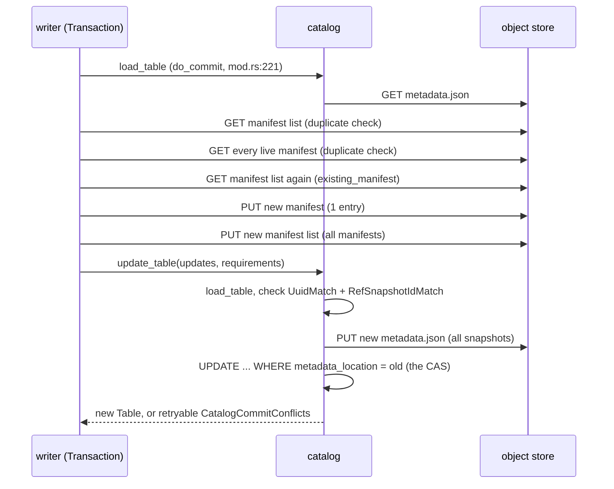

# iceberg-rust: a fast append is four writes and a compare-and-swap

[apache/iceberg-rust](https://github.com/apache/iceberg-rust) is the Rust
implementation of the Iceberg table format, and the one a Rust engine — the
capstone included — would link against. This chapter reads its write path and
its scan planner at the pinned commit `26356f5` (2026-10-26; recorded in
[resources/codebases.md](../../resources/codebases.md)) with one question in
mind: **what does a single small commit cost, in objects written and read,
and how does that cost grow with the number of commits already made?**

The answer the code gives is sharper than the one the spec suggests. A fast
append writes four objects — the data file, one new manifest, a *complete*
new manifest list, a *complete* new table-metadata file — and then asks the
catalog for one compare-and-swap. Two of those four objects grow with the
table's history, so the bytes a stream of small commits writes grow with the
square of their number: this topic's lane 1 measured **398.7 MB of metadata
for 1,000 one-file commits** on the same object layout. And at the pin, the
default commit also *reads* every live manifest to check for duplicate
files — a quadratic cost in reads that the lane's model deliberately does not
charge, and that this chapter finds in the code.

Java Iceberg's default append is different (it merges manifests), and
iceberg-rust has no equivalent at the pin; the chapter reads Java's merge
logic from the `iceberg` clone at `47677ab` to say exactly what the Rust
library is missing. The spec-level picture — what Iceberg, Delta and DuckLake
each store — is in [reading-table-specs.md](reading-table-specs.md); the
Delta-side counterpart of this chapter is
[reading-delta-rs.md](reading-delta-rs.md). Measured numbers are quoted from
[README.md](README.md) and [notes.md](notes.md), produced by
`cargo run --release --bin table_bench` in `experiments/`.

## The problem in one sentence

An Iceberg table is a tree of immutable files hung from one mutable pointer,
so every commit must write a new root for the tree — and the question is how
much of the tree a commit rewrites, how much a reader must fetch to plan a
scan, and which of those costs grow with history rather than with the size of
the change.

## The concepts, step by step

### Step 1 — the four objects, as Rust types

> **In:** nothing yet — this step names the objects every later step counts.
> **Out:** the catalog pointer, table-metadata file, snapshot, manifest list
> and manifest as they exist in iceberg-rust's types, and the one field of
> each that grows with history. Step 2 writes all of them; Step 4 prices the
> growth; Step 6 reads them back.

An **object store** (S3, GCS, a local directory) stores immutable **objects**
— byte strings under a key — and offers whole-object PUT and GET. Iceberg
builds a table out of five kinds of object, from the top down:

- the **catalog pointer** — a record in some external service (a SQL row, a
  REST catalog, AWS Glue) holding the location of the current table-metadata
  file. It is the only mutable thing in the design.
- the **table-metadata file** (`NNNNN-<uuid>.metadata.json`) — schema,
  partition spec, properties, and **every retained snapshot**;
- a **snapshot** — one version of the table: an id, its parent's id, a
  sequence number, a summary, and the location of one manifest list;
- the **manifest list** (`snap-<id>-<attempt>-<uuid>.avro`) — one row per
  manifest that makes up the snapshot, with per-manifest counts and a
  **partition summary** (the lower and upper bound of each partition field
  over the files the manifest tracks);
- the **manifest** (`<uuid>-m<n>.avro`) — one row per data file: path,
  partition value, record count, column statistics, and a **status** of
  ADDED, EXISTING or DELETED.

In iceberg-rust the snapshot collection is a field of `TableMetadata`, and
the line to focus on is 106: snapshots live *inside* the metadata file, so
the metadata file is as long as the table's retained history.

```rust
// crates/iceberg/src/spec/table_metadata.rs:100-121 — TableMetadata's history fields, at 26356f5
100      /// ID of the main branch in refs.
101      pub(crate) current_snapshot_id: Option<i64>,
102      ///A list of valid snapshots. Valid snapshots are snapshots for which all
103      /// data files exist in the file system. A data file must not be deleted
104      /// from the file system until the last snapshot in which it was listed is
105      /// garbage collected.
106      pub(crate) snapshots: HashMap<i64, SnapshotRef>,
         // ... 107-112: doc comment for snapshot_log ...
113      pub(crate) snapshot_log: Vec<SnapshotLog>,
         // ... 114-120: doc comment for metadata_log ...
121      pub(crate) metadata_log: Vec<MetadataLog>,
```

Three lists grow per commit. `metadata_log` (previous metadata-file
locations) is capped: the builder drains it to
`write.metadata.previous-versions-max`, default **100**
(`crates/iceberg/src/spec/table_properties.rs:377`), at
`crates/iceberg/src/spec/table_metadata_builder.rs:1126-1143`. `snapshots`
and `snapshot_log` are *not* capped by the builder; only snapshot expiry
(Step 7) shrinks them. That asymmetry is the first thing lane 1 measures.

```text
catalog row ──► 00042-…metadata.json ──► snapshot 42 ──► snap-42-0-….avro ──► 7f…-m0.avro ──► data files
                 (all snapshots)          (1 manifest      (1 row per live       (1 row per
                                           list each)       manifest)              data file)
```

### Step 2 — the commit path, end to end

> **In:** the five objects from Step 1.
> **Out:** the exact sequence of reads and writes one `fast_append` commit
> issues at the pin, and where the atomicity comes from. Step 3 adds what
> happens when the compare-and-swap fails; Step 4 prices the writes.

A **fast append** is Iceberg's cheapest way to add data files: write one new
manifest holding only the new files, and keep every existing manifest as it
is. It is the only append iceberg-rust implements — `Transaction` exposes
`fast_append()` at `crates/iceberg/src/transaction/mod.rs:148-151`, and a
grep of the whole `crates/` tree at the pin finds no merge append and no
manifest rewrite (Step 5).

`FastAppendAction::commit` builds a `SnapshotProducer` and, with
`check_duplicate` defaulting to `true` (`append.rs:45`), runs the duplicate
check before producing the snapshot. The line to focus on is 111:

```rust
// crates/iceberg/src/transaction/append.rs:97-117 — FastAppendAction::commit
 97      async fn commit(&self, _state: &mut (), table: &Table) -> Result<ActionCommit> {
 98          let snapshot_producer = SnapshotProducer::new(
 99              table,
100              self.commit_uuid.unwrap_or_else(Uuid::now_v7),
101              self.snapshot_properties.clone(),
102              self.dedupe_added_files(),
103              vec![],
104          );
105  
106          // validate added files
107          snapshot_producer.validate_added_data_files()?;
108  
109          // Checks duplicate files
110          if self.check_duplicate {
111              snapshot_producer.validate_duplicate_files().await?;
112          }
113  
114          snapshot_producer
115              .commit(FastAppendOperation, DefaultManifestProcess)
116              .await
117      }
```

`validate_duplicate_files` loads the current manifest list and then **every
manifest it names**, concurrently, looking for any new path that is already
live. Line 194 is the per-manifest read:

```rust
// crates/iceberg/src/transaction/snapshot.rs:170-207 — SnapshotProducer::validate_duplicate_files
170      pub(crate) async fn validate_duplicate_files(&self) -> Result<()> {
171          let Some(current_snapshot) = self.table.metadata().current_snapshot() else {
172              return Ok(());
173          };
         // ... 174-180: collect the new paths into a HashSet ...
181          let runtime = self.table.runtime();
182          let manifest_list = self
183              .table
184              .manifest_list_reader(current_snapshot)
185              .load()
186              .await?;
187  
188          let new_files_ref = &new_files;
189          let referenced_files: Vec<String> = manifest_list
190              .consume_entries()
191              .into_iter()
192              .map(|entry| {
193                  let reader = self.table.manifest_reader();
194                  runtime.io().spawn(async move { reader.read(&entry).await })
195              })
196              .collect::<FuturesUnordered<_>>()
         // ... 197-207: fold the live matches, error if any ...
```

Then `SnapshotProducer::commit` (snapshot.rs:477-603) does the writes. The
lines that matter, in order:

- 482: the manifest-list path, `generate_manifest_list_file_path(0)` — the
  attempt number is always 0;
- 526-528 → `produce_manifests` (349-395) → `existing_manifest`
  (`append.rs:139-164`), which **loads the current manifest list again** and
  keeps every entry with added, existing or deleted files (line 160), then
  `write_added_manifest` (313-345) writes the one new manifest — **write 1**
  of metadata (the data file itself, written by the caller beforehand, is the
  other write the H1 counts);
- 530-532: `add_manifests` with *all* of them, then `close()` — the whole
  manifest list rewritten — **write 2**;
- 578-600: the result is not a file but two `TableUpdate`s (`AddSnapshot`,
  `SetSnapshotRef` on `main`) and two `TableRequirement`s.

The requirements are the commit's preconditions. The line to focus on is 596:

```rust
// crates/iceberg/src/transaction/snapshot.rs:592-602 — the preconditions a fast append ships
592          let requirements = vec![
593              TableRequirement::UuidMatch {
594                  uuid: self.table.metadata().uuid(),
595              },
596              TableRequirement::RefSnapshotIdMatch {
597                  r#ref: MAIN_BRANCH.to_string(),
598                  snapshot_id: self.table.metadata().current_snapshot_id(),
599              },
600          ];
601  
602          Ok(ActionCommit::new(updates, requirements))
```

`RefSnapshotIdMatch` says "`main` must still point at the snapshot I read".
The catalog checks it and writes the metadata file. In the SQL catalog the
whole commit is one conditional `UPDATE`; line 1196 is the
**compare-and-swap** (an update that succeeds only if the stored value still
equals the one the writer read), and line 1211 turns "0 rows" into a
retryable conflict:

```rust
// crates/catalog/sql/src/catalog.rs:1172-1217 — SqlCatalog::update_table
1172      async fn update_table(&self, commit: TableCommit) -> Result<Table> {
1173          let table_ident = commit.identifier().clone();
1174          let current_table = self.load_table(&table_ident).await?;
1175          let current_metadata_location = current_table.metadata_location_result()?.to_string();
1176  
1177          let staged_table = commit.apply(current_table)?;
         // ... 1178-1180: compute the next metadata location ...
1181          staged_table
1182              .metadata()
1183              .write_to(staged_table.file_io(), &staged_metadata_location)
1184              .await?;
         // ... 1185-1189: build the statement ...
1190                      "UPDATE {CATALOG_TABLE_NAME}
1191                       SET {CATALOG_FIELD_METADATA_LOCATION_PROP} = ?, {CATALOG_FIELD_PREVIOUS_METADATA_LOCATION_PROP} = ?
1192                       WHERE {CATALOG_FIELD_CATALOG_NAME} = ?
1193                        AND {CATALOG_FIELD_TABLE_NAME} = ?
1194                        AND {CATALOG_FIELD_TABLE_NAMESPACE} = ?
1195                        {}
1196                        AND {CATALOG_FIELD_METADATA_LOCATION_PROP} = ?",
         // ... 1197-1210: bind values, execute ...
1211          if update_result.rows_affected() == 0 {
1212              return Err(Error::new(
1213                  ErrorKind::CatalogCommitConflicts,
1214                  format!("Commit conflicted for table: {table_ident}"),
1215              )
1216              .with_retryable(true));
1217          }
```

`commit.apply` (`crates/iceberg/src/catalog/mod.rs:406-435`) checks the
requirements against the freshly loaded metadata (408-410) and builds the
new metadata; `write_to` (`table_metadata.rs:503-508`) serialises the
**entire** `TableMetadata` with `serde_json::to_vec` — **write 3**, the new
metadata file. Then the swap. The in-memory catalog does the same under a
mutex instead of a `WHERE` clause
(`crates/iceberg/src/catalog/memory/catalog.rs:403-425`).



### Step 3 — when the swap fails: backoff, and redo rather than rebase

> **In:** the commit path from Step 2 and its two requirements.
> **Out:** what a retry re-validates and re-writes, and the default retry
> budget worked through. Step 4's byte counts are per *attempt*; this step
> says how many attempts a commit can take.

A **retryable** error is one the library tags as safe to try again
(`.with_retryable(true)`). Every `TableRequirement` failure is tagged so —
the `RefSnapshotIdMatch` branch at `catalog/mod.rs:754-775` returns
`CatalogCommitConflicts` with `.with_retryable(true)` when `main` has moved
(764-773). `Transaction::commit` wraps the whole attempt in a retry loop; the
line to focus on is 203, the filter:

```rust
// crates/iceberg/src/transaction/mod.rs:191-218 — Transaction::commit and its backoff
191          let table_props = self.table.metadata().table_properties();
192  
193          let backoff = Self::build_backoff(table_props)?;
194          let tx = self;
195  
196          (|mut tx: Transaction| async {
197              let result = tx.do_commit(catalog).await;
198              (tx, result)
199          })
200          .retry(backoff)
201          .sleep(tokio::time::sleep)
202          .context(tx)
203          .when(|e| e.retryable())
204          .await
205          .1
206      }
207  
208      fn build_backoff(props: TableProperties<'_>) -> Result<ExponentialBackoff> {
209          Ok(ExponentialBuilder::new()
210              .with_min_delay(Duration::from_millis(props.commit_min_retry_wait_ms()?))
211              .with_max_delay(Duration::from_millis(props.commit_max_retry_wait_ms()?))
212              .with_total_delay(Some(Duration::from_millis(
213                  props.commit_total_retry_timeout_ms()?,
214              )))
215              .with_max_times(props.commit_num_retries()?)
216              .with_factor(2.0)
217              .build())
218      }
```

**Exponential backoff** waits a delay that multiplies by a factor after each
failure. The defaults are in `table_properties.rs`: 4 retries (404), minimum
wait 100 ms (409), maximum 60 s (414), total budget 30 min (419); the factor
is the literal 2.0 at line 216, and no jitter is requested in this builder.
Worked through: waits of 100, 200, 400 and 800 ms — a total of
100 + 200 + 400 + 800 = **1,500 ms** of sleeping across **5 attempts**
before the commit gives up; the 60 s cap and 30 min budget never bind at the
defaults.

What each attempt does is in `do_commit`. Line 221 reloads the table and line
227 replaces the base if it moved; then every action's `commit` runs again
from scratch (234-243):

```rust
// crates/iceberg/src/transaction/mod.rs:220-252 — Transaction::do_commit
220      async fn do_commit(&mut self, catalog: &dyn Catalog) -> Result<Table> {
221          let refreshed = catalog.load_table(self.table.identifier()).await?;
222  
223          if self.table.metadata() != refreshed.metadata()
224              || self.table.metadata_location() != refreshed.metadata_location()
225          {
226              // current base is stale, use refreshed as base and re-apply transaction actions
227              self.table = refreshed.clone();
228          }
229  
230          let mut current_table = self.table.clone();
231          let mut existing_updates: Vec<TableUpdate> = vec![];
232          let mut existing_requirements: Vec<TableRequirement> = vec![];
233  
234          for entry in self.actions.iter_mut() {
235              let action_commit = entry.commit(&current_table).await?;
         // ... 236-243: apply it to current_table, collecting updates and requirements ...
245          let table_commit = TableCommit::builder()
246              .ident(self.table.identifier().to_owned())
247              .updates(existing_updates)
248              .requirements(existing_requirements)
249              .build();
250  
251          catalog.update_table(table_commit).await
252      }
```

So a retry is a **redo**, not a **rebase**. The Iceberg spec allows an
append to be re-applied cheaply — "Append operations have no requirements
and can always be applied" (spec, "Commit Conflict Resolution and Retry"),
and sequence-number inheritance exists so that "only the manifest list must
be rewritten" on retry (spec, "Sequence Numbers"). iceberg-rust does not use
that: `FastAppendAction::commit` constructs a fresh `SnapshotProducer`
(new random snapshot id, `snapshot.rs:219-239`; a fresh `Uuid::now_v7` commit
id unless one was set, `append.rs:100`), re-runs the duplicate check over
every manifest, writes a **new** manifest for the same files, and a new
manifest list. A failed attempt's manifest and manifest list are left behind:
`cleanup` is a no-op at the pin (`append.rs:119-122`, "generated manifests
are not yet tracked for terminal cleanup").

And because `RefSnapshotIdMatch` pins `main` to the exact snapshot read, two
appends that touch disjoint data still conflict: whichever swaps second
fails and redoes. Lane 2 of this topic ([notes.md](notes.md)) measures what
that costs on a log with the same "one winner per version" rule: the
reference implementation recorded 3.29 conflicts per committed append at 16
concurrent appenders.

### Step 4 — why the bytes grow with the square of the commit count

> **In:** the writes of Step 2, per attempt.
> **Out:** the arithmetic of cumulative metadata bytes, checked against lane
> 1b's measurement, and the read-side counterpart hidden in the duplicate
> check. Step 5 shows the merge that bounds one of the two terms; Step 7 the
> expiry that bounds the other.

Let N be the number of commits so far, each a one-file fast append, and no
expiry run. Commit i writes:

- one manifest with one entry — constant size, call it m;
- one manifest list with i entries (all previous manifests plus the new one)
  — size ≈ i · e, with e the bytes of one manifest-list row;
- one metadata file holding i snapshots and i snapshot-log entries — size
  ≈ c + i · s, with s the bytes of one snapshot plus its log entry and c the
  constant header (schema, specs, properties, and the ≤100-entry metadata
  log).

Summing over i = 1..N, the two growing terms are
e · (1 + 2 + … + N) = e · N(N+1)/2 and s · N(N+1)/2: **quadratic in N**.
At N = 1,000, N(N+1)/2 = 1,000 · 1,001 / 2 = **500,500**.

This topic's lane 1 writes the same objects (as JSON with the spec's field
names, not Avro — see `experiments/src/iceberg.rs`), with the commit order
mirrored from iceberg-rust. Its `append` is the model of Step 2; the line to
focus on is 342, the rewrite of the full manifest list:

```rust
// topics/49-table-formats/experiments/src/iceberg.rs:310-345 — the lane's fast append
310      pub fn append(&mut self, store: &mut Store, files: &[DataFile]) -> i64 {
311          let seq = self.seq + 1;
312          let id = snapshot_id(seq);
         // ... 313-315: record the files as live ...
316          let mpath = format!("{PREFIX}metadata/{id}-m0.manifest");
317          let entries: Vec<_> = files.iter().map(|f| (f.clone(), id, seq, 1u8)).collect();
318          let length = self.write_manifest(store, &mpath, &entries);
         // ... 319-335: push the new ManifestRef; merge if merge append (Step 5) ...
336          let snap = self.new_snapshot(
337              "append",
338              files.len() as u64,
339              files.iter().map(|f| f.records).sum(),
340          );
341          debug_assert_eq!(snap.id, id);
342          self.write_manifest_list(store, &snap.manifest_list.clone());
343          self.snapshots.push(snap);
344          self.write_metadata_and_swap(store);
345          id
```

(Line 342 writes the manifest list; 344 writes the metadata file and swaps
the pointer with `put_if_match` at line 279.) Lane 1b's measured totals after
1,000 commits (seed 49, [notes.md](notes.md)):

| object kind | bytes written | ÷ 500,500 |
|---|---:|---:|
| manifest lists | 202,285,853 | ≈ 404 B per manifest-list row |
| metadata files | 195,826,990 | ≈ 391 B per snapshot (+ log entry, + header amortised) |
| manifests | 587,480 | — (linear: 1,000 × ≈ 587 B) |
| catalog pointer | 49,000 | — (1,000 × 49 B) |
| **total** | **398,749,323** | |

The four rows sum to the total exactly
(202,285,853 + 195,826,990 + 587,480 + 49,000 = 398,749,323). The largest
single commit wrote **786,993 bytes** of metadata — to record one data file
whose own manifest entry is ≈ 587 bytes. A Delta-shaped log of the same
1,000 commits wrote **522,593 bytes** with no checkpoints and **20,307,084**
with a checkpoint every 10 commits ([reading-delta-rs.md](reading-delta-rs.md)).
Avro would shrink e, s and m; it would not change the N(N+1)/2.

The read side has the same shape, and the lane does **not** charge it: the
lane's single writer keeps its state in memory and issues only writes. At the
pin, iceberg-rust's default `check_duplicate = true` makes commit i GET the
manifest list and all i − 1 existing manifests (Step 2), plus the manifest
list a second time in `existing_manifest`. Over 1,000 commits that is
0 + 1 + … + 999 = 499,500 manifest GETs for the duplicate check alone —
arithmetic from the code path, not a measurement; turning it off is
`with_check_duplicate(false)` (`append.rs:53-56`).

### Step 5 — the merge iceberg-rust does not have

> **In:** the manifest-list growth of Step 4.
> **Out:** Java's MergeAppend bin-packing rule, what it bounds, what it does
> not, and lane 1's numbers for both appends. Step 6 shows what merging does
> to scan planning.

Java Iceberg's `Table.newAppend()` — the default append — is **not** a fast
append. Line 210 is the one to focus on:

```java
// core/src/main/java/org/apache/iceberg/BaseTable.java:208-216 — apache/iceberg at 47677ab
208    @Override
209    public AppendFiles newAppend() {
210      return new MergeAppend(name, ops).reportWith(reporter);
211    }
212  
213    @Override
214    public AppendFiles newFastAppend() {
215      return new FastAppend(name, ops).reportWith(reporter);
216    }
```

A **MergeAppend** packs the manifests into **bins** — groups whose total
size stays under a target — and rewrites a bin into one manifest when it is
big enough to be worth it. The knobs (`TableProperties.java:115-122`): target
8 MB per merged manifest (116), merge only when a bin holds at least **100**
manifests (119), merging enabled by default (122). The rule itself is
`ManifestMergeManager.mergeGroup`; line 175 is the one to focus on:

```java
// core/src/main/java/org/apache/iceberg/ManifestMergeManager.java:140-185 — mergeGroup
140    private Iterable<ManifestFile> mergeGroup(
141        ManifestFile first, int specId, List<ManifestFile> group) {
         // ... 142-144: comment on packing from the end ...
145      ListPacker<ManifestFile> packer = new ListPacker<>(targetSizeBytes, 1, false);
146      List<List<ManifestFile>> bins = packer.packEnd(group, ManifestFile::length);
         // ... 147-163: run each bin in parallel, results kept in bin order ...
164                if (bin.size() == 1) {
165                  // no need to rewrite
166                  outputManifests.add(bin.get(0));
167                  return;
168                }
         // ... 169-174: comment ...
175                if (bin.contains(first) && bin.size() < minCountToMerge) {
176                  // not enough to merge, add all manifest files to the output list
177                  outputManifests.addAll(bin);
178                } else {
179                  // merge the bin into a single manifest
180                  outputManifests.add(createManifest(specId, bin));
181                }
```

With small manifests (≈ 587 B each here, far under 8 MB) every manifest lands
in one bin, so the rule reduces to: when the count reaches 100, fold them all
into one. Lane 1 models exactly that (`Iceberg::with_merge_append(100)`,
`experiments/src/iceberg.rs:148-150`; the merge at 331-334). Measured at
1,000 commits (seed 49):

| | GETs to plan the latest scan | bytes read | metadata bytes written by the commits |
|---|---:|---:|---:|
| fast append (iceberg-rust's only append) | 1,003 | 1,373,885 | 398,749,323 |
| merge append, min 100 (Java's default) | 13 | 889,448 | 219,263,669 |

Merging bounds the manifest-list term — manifest lists fell from 202.3 MB to
20.1 MB of the total — and caps the manifests a planner fetches at ≤ 100.
It does nothing for the metadata file: 195.8 MB in both rows, because the
snapshot list is not a manifest. And it moves cost into some commits: the
largest merge-append commit wrote 877,726 bytes, more than any fast append's
786,993, because it rewrote every live entry into one manifest.

iceberg-rust has the hook for this — `produce_manifests` passes the manifest
list through a `ManifestProcess` (`snapshot.rs:393`) — but the only
implementation at the pin, `DefaultManifestProcess`, returns its input
unchanged (`snapshot.rs:97-107`). The grep for `MergeAppend`,
`merge_append`, `min-count-to-merge`, `manifest-merge`, `rewrite_manifests`
and `RewriteManifest` over `crates/` at `26356f5` finds nothing. A Rust
writer committing every few seconds through iceberg-rust gets the 1,003-GET
row until some other engine compacts the manifests for it.

### Step 6 — planning a scan, and what the partition summary buys

> **In:** the objects of Step 1 as Step 4 or 5 left them.
> **Out:** the read path's dependent rounds, the manifest-level pruning rule,
> and lane 1a's numbers for a full and a one-day scan.

**Scan planning** is turning "rows matching predicate P at snapshot S" into a
list of data files to read. In iceberg-rust it is `TableScan::plan_files`
(`crates/iceberg/src/scan/mod.rs:463-464`) → `plan_data_files` (474-…): load
the manifest list (501), filter it (506-511), then fetch the surviving
manifests concurrently (520-525) with a concurrency limit that defaults to
the number of CPUs (`scan/mod.rs:159` and 170). Before the manifest list, the
catalog and the metadata file had to be read to find the snapshot. That is
four **dependent rounds** — requests that cannot start until the previous
response arrives: catalog → metadata file → manifest list → manifests (the
last round in parallel). Lane 1a counts the same four.

The filter is the **partition summary** of Step 1. For each manifest-list
row, `build_manifest_file_contexts` evaluates the scan's predicate, projected
onto partition values, against the row's bounds and skips the manifest if it
cannot match (`scan/context.rs:331-345`; the `continue` at 344). For an
equality predicate the test is the obvious one; lines 290 and 300 are the
two exits:

```rust
// crates/iceberg/src/expr/visitors/manifest_evaluator.rs:273-306 — ManifestFilterVisitor::eq
273      fn eq(
274          &mut self,
275          reference: &BoundReference,
276          datum: &Datum,
277          _predicate: &BoundPredicate,
278      ) -> Result<bool> {
279          let field = self.field_summary_for_reference(reference);
280  
281          if field.lower_bound.is_none() || field.upper_bound.is_none() {
282              return ROWS_CANNOT_MATCH;
283          }
         // ... 284-289: decode the lower bound ...
290              if &lower_bound > datum {
291                  return ROWS_CANNOT_MATCH;
292              }
         // ... 293-299: decode the upper bound ...
300              if &upper_bound < datum {
301                  return ROWS_CANNOT_MATCH;
302              }
303          }
304  
305          ROWS_MIGHT_MATCH
306      }
```

Pruning works per *manifest*, so it is only as good as the manifests are
narrow. Lane 1a's one-day query (day 3 of 10) at 1,000 commits:

| | GETs | bytes read | files |
|---|---:|---:|---:|
| fast append (each manifest = one commit = one day) | 103 | 845,154 | 100 |
| merge append (pruned) | 4 | 884,139 | 100 |
| Delta, checkpoint every 10 (no pruning before replay) | 11 | 399,735 | 100 |

The fast-append table prunes 900 of 1,000 manifests and still makes 103
requests; the merged table makes 4 — but one of them is the merged manifest
holding all 1,000 entries, so it reads *more* bytes than the fast-append
table did. In both, the largest single read is the metadata file with 1,000
snapshots, which no predicate prunes.

### Step 7 — expiry: what shrinks, what is left behind, what is lost

> **In:** the history-sized metadata file of Steps 1 and 4.
> **Out:** what `ExpireSnapshotsAction` changes, its defaults, and lane 1b's
> before/after.

**Snapshot expiry** removes old snapshots from the metadata file so that
their files may later be deleted. At the pin it is metadata-only — the doc
comment says so at line 33:

```rust
// crates/iceberg/src/transaction/expire_snapshots.rs:31-36 — the action's contract
31  /// A transaction action that removes snapshots from table metadata.
32  ///
33  /// This only rewrites metadata; the now-unreferenced data and metadata files are left untouched.
34  /// Physical file cleanup is the responsibility of a higher-level maintenance operation built on
35  /// top of this action.
36  ///
```

Its `commit` (300-360) emits `RemoveSnapshotRef` and `RemoveSnapshots`
updates with the same two requirements as an append (351-358, "The ref
assertion closes the race where a concurrent writer advances `main`"), so an
expiry racing an append conflicts and redoes like Step 3. Its defaults, when
neither knob is set, are the table's `history.expire.*` properties
(110-121): keep at least **1** snapshot (`table_properties.rs:468`) and
expire anything older than **5 days** (`table_properties.rs:464`). Nothing
calls it automatically; a writer that never runs it gets Step 4's quadratic
term for as long as the table lives.

Lane 1b runs the lane's expiry with keep = 1 after a manifest rewrite (the
rewrite is Java's `RewriteManifests`; iceberg-rust has none, Step 5): planning
the latest scan stays at 4 GETs but bytes read fall from 885,412 to 514,082,
because the metadata file no longer carries 1,001 snapshots. The price is the
table's past: time travel to version 500 then fails ("gone (the snapshot was
expired)" in the bench output). Expiry trades history for metadata size;
there is no setting that keeps both.

## How to read the source (with the concepts in hand)

1. `crates/iceberg/src/transaction/mod.rs:173-252` first — `commit` and
   `do_commit` are the whole control flow (Steps 2–3).
2. `transaction/append.rs:89-165` — the action and `FastAppendOperation`;
   note line 160's filter and the no-op `cleanup` at 119-122.
3. `transaction/snapshot.rs:170-217` (duplicate check), then 313-395
   (manifests), then 477-603 (`commit`) — read 592-600 twice.
4. `catalog/mod.rs:406-435` (`TableCommit::apply`) and 700-780
   (`TableRequirement::check`), then one real catalog:
   `crates/catalog/sql/src/catalog.rs:1172-1220`.
5. `spec/manifest_list/writer.rs:175-231` — `add_manifests` and the
   sequence-number inheritance rule at 209-231.
6. `scan/mod.rs:463-530`, `scan/context.rs:303-363`,
   `expr/visitors/manifest_evaluator.rs:83-91` and 273-306 (Step 6).
7. `transaction/expire_snapshots.rs:31-54`, 100-125, 300-360 (Step 7).
8. For contrast, Java: `BaseTable.java:208-216`, `TableProperties.java:115-122`,
   `ManifestMergeManager.java:140-185` in the `iceberg` clone.

## Where each step lives in this topic

| step | lane / file | what to run or read |
|---|---|---|
| 1, 2 | `experiments/src/iceberg.rs` | the object layout in the module docs; `append` at 310-345 |
| 3 | lane 2, `experiments/src/occ.rs` | conflicts per commit vs writers (a Delta-shaped log with the same one-winner rule) |
| 4 | lane 1b | metadata written, max commit, and the by-kind breakdown |
| 5 | lane 1a/1b | the "merge append (min 100)" rows |
| 6 | lane 1a | full and one-day scans; `Iceberg::plan` at 440-… |
| 7 | lane 1b | "after maintenance" rows and the time-travel line |

## Questions (answer in notes.md)

1. Step 3 says a retry rewrites the manifest. Using the spec's
   sequence-number inheritance (null sequence numbers in new manifests,
   assigned from the manifest list at read time — `writer.rs:209-231`), what
   is the minimum an append retry has to rewrite, and which iceberg-rust
   lines would change?
2. With `check_duplicate` on, how many manifest GETs does the 1,000th commit
   issue in the fast-append table, and in the merge-append table just after a
   merge? Which of the two writers would you rather run at 1 commit/s?
3. Why does `RefSnapshotIdMatch` make two appends conflict, when the spec
   says appends "can always be applied"? Write the requirement an append
   would need instead.
4. Step 6's merged manifest is read whole for a one-day query. What would a
   merge policy that bins by partition (one merged manifest per day) do to
   the 4-GET / 884 KB row?
5. The metadata file's snapshot list is the term merging cannot touch. Iceberg
   v4's "adaptive metadata tree" (spec, "Version 4") moves the snapshot root
   into a manifest. Which of Step 4's three terms does that address?
6. For the capstone (M49): if each graph mutation batch were an append, after
   how many batches would the metadata file pass 1 MB at ≈ 391 B per
   snapshot, and what expiry policy would you pick for a graph that needs
   time travel?

## Done when

Answer each before unfolding it.

- [ ] You can name the four writes of a fast append and say which two grow with history.

  <details><summary>Answer</summary>

  The data file (written by the caller), one new manifest with only the new
  files (`write_added_manifest`, `snapshot.rs:313-345`), a complete new
  manifest list naming every live manifest (`snapshot.rs:530-532`), and a
  complete new metadata file serialised by `write_to` (`table_metadata.rs:508`)
  — then the catalog's compare-and-swap (`catalog.rs:1190-1196` in the SQL
  catalog). The manifest list grows with the number of live manifests and the
  metadata file with the number of retained snapshots (`snapshots` at
  `table_metadata.rs:106` is uncapped; only `metadata_log` is capped at 100).

  </details>

- [ ] You can compute the cumulative metadata bytes of N one-file fast appends and check it against lane 1b.

  <details><summary>Answer</summary>

  Commit i writes ≈ m + i·e + (c + i·s) bytes, so N commits write
  ≈ N(m + c) + (e + s) · N(N+1)/2. At N = 1,000, N(N+1)/2 = 500,500. Lane 1b
  measured 202,285,853 bytes of manifest lists (≈ 404 B per row once divided
  by 500,500) and 195,826,990 of metadata files (≈ 391 B per snapshot,
  header amortised), plus 587,480 of manifests and 49,000 of pointer — total
  398,749,323. The quadratic terms are 99.84% of it.

  </details>

- [ ] You can explain what a retry re-does in iceberg-rust and why that differs from the spec's cheapest retry.

  <details><summary>Answer</summary>

  `do_commit` reloads the table (`mod.rs:221-228`) and re-runs every action's
  `commit` (234-243). For a fast append that means a new `SnapshotProducer`
  with a new random snapshot id, the duplicate check over every manifest
  again, a new manifest for the same files, and a new manifest list; the
  abandoned objects are not cleaned up (`append.rs:119-122`). The spec lets an
  append be re-applied by rewriting only the manifest list, since new
  manifests carry null sequence numbers inherited at read time. Defaults
  allow 5 attempts with 100 + 200 + 400 + 800 = 1,500 ms of backoff between
  them.

  </details>

- [ ] You can state Java's merge rule and what lane 1 shows it does and does not fix.

  <details><summary>Answer</summary>

  `newAppend()` is `MergeAppend` (`BaseTable.java:210`). Manifests are
  bin-packed to 8 MB, and the bin holding the new manifest is merged only once
  it holds at least 100 manifests (`ManifestMergeManager.java:175`;
  `TableProperties.java:119`). Lane 1: planning reads 13 objects instead of
  1,003 at 1,000 commits, and manifest-list bytes drop from 202.3 MB to
  20.1 MB — but the metadata file's 195.8 MB is untouched, and the merging
  commit is the most expensive one (877,726 bytes). iceberg-rust has only the
  identity `DefaultManifestProcess` (`snapshot.rs:97-107`) and no merge
  append.

  </details>

- [ ] You can trace a one-day scan through the planner and say why the merged table reads more bytes with fewer requests.

  <details><summary>Answer</summary>

  Catalog → metadata file → manifest list → manifests, four dependent rounds;
  `build_manifest_file_contexts` drops any manifest whose partition summary
  cannot contain the day (`scan/context.rs:331-345`, the bound tests at
  `manifest_evaluator.rs:290` and 300). Fast-append manifests are one commit
  each, so 900 of 1,000 are pruned and 103 GETs remain. The merged manifest
  spans every day, so it cannot be pruned and is read whole: 4 GETs but
  884,139 bytes against 845,154.

  </details>

- [ ] You can say what expiry changes at the pin and what it costs.

  <details><summary>Answer</summary>

  `ExpireSnapshotsAction` only removes snapshots and refs from the metadata
  (`expire_snapshots.rs:33`; updates at 318-347) and leaves files for a
  separate cleanup. Defaults keep 1 snapshot and expire past 5 days
  (`table_properties.rs:468`, 464); nothing runs it automatically. In lane 1b
  it cut the bytes read to plan the latest scan from 885,412 to 514,082 and
  made time travel to version 500 impossible.

  </details>

## References

**Code** — `apache/iceberg-rust` at `26356f5`, pinned in
[resources/codebases.md](../../resources/codebases.md):

| where | what this chapter takes from it |
|---|---|
| `crates/iceberg/src/transaction/mod.rs:148-151`, 173-252 | `fast_append`; `commit` with backoff; `do_commit` reload-and-redo |
| `crates/iceberg/src/transaction/append.rs:32-165` | `FastAppendAction` (`check_duplicate` default at 45; `existing_manifest` at 139-164; no-op `cleanup` at 119-122) |
| `crates/iceberg/src/transaction/snapshot.rs:97-107`, 170-239, 313-395, 465-603 | identity `ManifestProcess`; duplicate check; random snapshot id; manifest and manifest-list writing; requirements at 592-600 |
| `crates/iceberg/src/spec/manifest_list/writer.rs:175-231` | `add_manifests`, sequence-number assignment |
| `crates/iceberg/src/spec/table_metadata.rs:100-121`, 503-508 | snapshot/log fields; whole-file `serde_json::to_vec` |
| `crates/iceberg/src/spec/table_metadata_builder.rs:1126-1143` | metadata-log cap |
| `crates/iceberg/src/spec/table_properties.rs:377`, 404-419, 464, 468 | 100 previous versions; retry defaults; expiry defaults |
| `crates/iceberg/src/catalog/mod.rs:374-435`, 441-461, 700-780 | `TableCommit`, `TableRequirement`, `check` |
| `crates/iceberg/src/catalog/memory/catalog.rs:403-425`; `crates/catalog/sql/src/catalog.rs:1172-1220` | two catalogs' compare-and-swap |
| `crates/iceberg/src/scan/mod.rs:159-170`, 463-530; `scan/context.rs:303-363`; `expr/visitors/manifest_evaluator.rs:83-91`, 273-306 | planning and manifest pruning |
| `crates/iceberg/src/transaction/expire_snapshots.rs:31-54`, 100-125, 300-360 | expiry |

`apache/iceberg` (Java) at `47677ab`: `core/src/main/java/org/apache/iceberg/BaseTable.java:208-216`,
`TableProperties.java:115-122`, `ManifestMergeManager.java:140-185`.

**Spec** — Apache Iceberg table spec, `format/spec.md` at `47677ab`
("Optimistic Concurrency", "Sequence Numbers", "Manifest Lists", "Scan
Planning", "Commit Conflict Resolution and Retry", "Version 4"); read in
[reading-table-specs.md](reading-table-specs.md).

**This topic** — [README.md](README.md), [notes.md](notes.md) (lanes 1a–1b,
lane 2's conflict counts), `experiments/src/iceberg.rs`,
[reading-delta-rs.md](reading-delta-rs.md).
