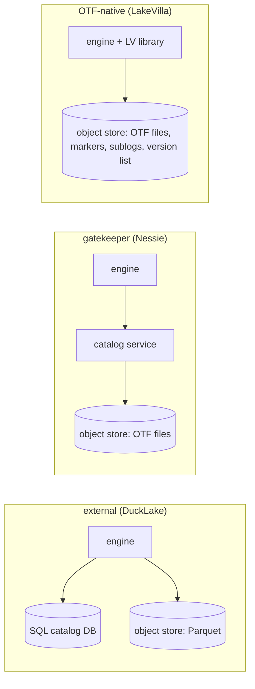
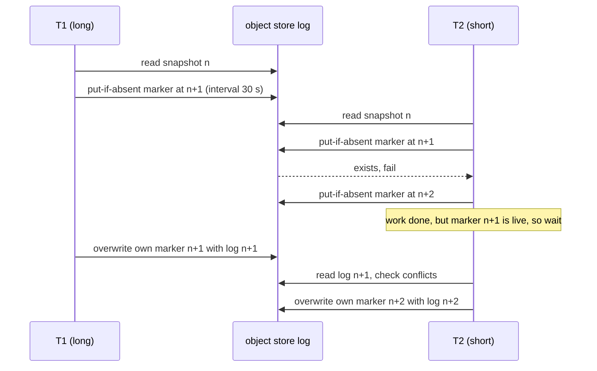

# LakeVilla: multi-table transactions with nothing but conditional writes

Götz, Ritter, El-Hindi and Giceva ("Interoperable ACID Transactions for Open
Table Formats", PVLDB 19(11), VLDB'26) take the commit protocol this topic's
lane 1 measured — one table, one log, one conditional write per version — and
ask what it would take to run *transactions* on it: many writers on one
table without starving each other, one transaction updating several tables
atomically, and a reader that sees several tables at one consistent moment.
Every existing answer adds a server (DuckLake puts the metadata in a SQL
database; Project Nessie puts a catalog service in front of the files). The
paper's claim is that the server is unnecessary: the object store's
conditional write is enough, provided the protocol borrows four classic
database mechanisms — leases, a waits-for graph, a saga-style log, and
multi-version validation — and stores each of them as files.

This chapter builds the vocabulary in order — the store's primitives, the
per-table optimistic commit and why it stops scaling at two writers, then
each of LakeVilla's four mechanisms with a worked example — and then reads
the evaluation, including one place where the prose and the table disagree.
It ends where this topic's lane 2 begins: the same put-if-absent race,
measured on a laptop.

Every number below is quoted from the section, table or figure cited next to
it, or from this topic's own lanes ([README.md](README.md),
[notes.md](notes.md)). Arithmetic was computed, not estimated.

## The problem in one sentence

An open table format commits by winning one conditional write on one table's
log, so two writers on the same table make one of them redo its work, a
transaction over two tables can land half-committed, and a reader of two
tables can see a combination that never existed — how do you fix all three
without adding a coordinator that every engine must talk to?

## The concepts, step by step

### Step 1 — the two object-store primitives everything rests on

> **In:** nothing yet — this step defines the storage operations every later
> step uses.
> **Out:** strict consistency and the conditional write, and the fact that
> there is no multi-object atomicity. Step 2's commit protocol is one
> conditional write; Steps 4–7 store all of LakeVilla's state with the same
> operation.

An **object store** (S3, MinIO, GCS, Azure Blob) is a key–value store whose
values are whole files: you can PUT an object, GET it, LIST keys by prefix,
and DELETE it, but you cannot modify part of an object in place. Two
properties matter here.

**Strict (read-after-write) consistency** means that once a PUT returns,
every later GET or LIST from any client sees the new object. LakeVilla
requires it, and §8.1 notes that both stores it runs on — AWS S3 and MinIO —
"provide strict consistency [4, 76] and conditional writes [6]". (The Delta
Lake paper of 2020 had to work around S3's then-eventual LIST; that is
history now, and this paper assumes it away.)

A **conditional write** is a PUT that succeeds only if a stated condition
holds at the moment of the write — most usefully **put-if-absent** ("create
this key only if it does not exist"). Two clients racing to create the same
key cannot both succeed: exactly one gets 200, the other an error. That is
the only synchronisation primitive the paper uses (§3: LakeVilla needs "only
object-store consistency [4] and conditional/atomic writes [6, 58]").

What the store does *not* give you is **multi-object atomicity**: there is no
way to make two PUTs, to two keys, visible together or not at all (§1: "object
stores lack multi-object atomicity"). Every mechanism below is a way of
building multi-object effects out of single-object conditional writes.

In this topic's crate the store is `experiments/src/store.rs`: `put_if_absent`
is the create-only write, `put_if_match` is compare-and-swap on a version tag.

### Step 2 — the per-table log, the optimistic commit, and why two writers is already too many

> **In:** put-if-absent from Step 1.
> **Out:** the Delta-style commit — snapshot, stage, conditional write of
> log N+1 — and the reason Figure 1's throughput stops growing at two
> concurrent transactions. Step 3 names the three limitations this causes.

An **open table format** (OTF — Delta Lake, Iceberg, Hudi) stores a table as
immutable data files (usually Parquet) plus metadata that says which files
make up each version. The paper uses Delta Lake as the representative (§2,
Figure 2): each table has an ordered **transaction log**, one object per
committed version (`000…03.json`), each holding actions such as "add file",
"remove file". A **snapshot** is the table as of a version: "snapshot 2 …
corresponds to the state after applying Logs 0–2" (§2).

A write transaction runs **optimistic concurrency control** (OCC): it does its
work without locks and checks for conflicts only at the end. Concretely (§2):

1. read the latest snapshot, say version 2;
2. write any new data files and prepare the next log object;
3. commit by writing `log 3` with put-if-absent.

If another transaction created `log 3` first, the put fails, "the prepared
changes do not become part of the table state", and the transaction must
re-read and retry or abort. Validation happens *only* at step 3 — the paper
stresses this ("OTFs only validate a Txn at commit time", §4.1).

Two consequences fall out immediately. First, the log is a **single serial
chain per table**: whatever the workload, only one writer can win each
version, so writers to the same table are serialised. Second, a long
transaction is exposed for its whole duration: any short commit in between
moves the log past the version it planned to write.

Figure 1 (YCSB A, 50% reads; YCSB B, 95% reads; Spark with Delta Lake and
Iceberg) shows the result: "Already with two concurrent transactions,
throughput stagnates for both Iceberg and Delta Lake" (§1). The dashed
"ideal" line in Figure 1 is `x · DL(1)` — the single-client Delta throughput
times the number of clients, i.e. what perfect scaling would give. The gap
between the flat lines and that diagonal is what the paper calls "unused
performance potential".

Lane 1 of this topic priced the single-writer version of this protocol;
lane 2 is the multi-writer version (Step 9).

### Step 3 — the three limitations, and the three ways people work around them

> **In:** the table-local, commit-time-validated log from Step 2.
> **Out:** the three limitations (contention/starvation, no cross-table
> writes, no cross-table snapshots) and the three design paradigms that
> address them. Steps 4–7 are LakeVilla's answer within the third paradigm.

Because "current OTFs use a table as the unit of storage organization and
transactional coordination" (§2), three things break:

- **Write contention and starvation.** Concurrent writers to one table race
  for the next version; the losers abort and retry, and a long transaction
  can lose every race — **starvation**, meaning it never commits however
  often it retries.
- **No coordinated cross-table writes.** Each table has its own log, so a
  transaction updating tables A and B makes two independent commits; if the
  second fails, A is updated and B is not — a **partial commit**.
- **No cross-table snapshot consistency.** A reader of A and B may read A at
  one moment and B at another and see a state "that was never committed
  atomically" (§5) — for example a foreign key in B pointing at a row of A
  that is not visible yet.

Section 3 and Figure 3 sort the fixes into three **design paradigms**:

| paradigm | example | where transaction state lives | cost |
|---|---|---|---|
| **external** | DuckLake | all metadata in a SQL database | every engine must speak to that database |
| **gatekeeper** | Project Nessie | a catalog service in front of the OTF | a service on the critical path |
| **OTF-native** | LakeVilla | files in the object store, beside the table | object-store latency on every coordination step |

Table 1 scores them on multi-write consistency, cross-table transactions and
OTF interoperability; only LakeVilla claims all three. The argument against
the first two is that "their reliance on a centralized service contradicts
the engine-agnostic interoperability that was the fundamental motivation for
OTFs" and can become "a performance bottleneck and a single point of
failure" (§3). The price of the third is the subject of §8.

### Step 4 — markers: a lease on the next version

> **In:** the starvation scenario from Step 3 and put-if-absent from Step 1.
> **Out:** markers (file-based shared write leases), the marker time
> interval, and the clock-drift buffer T_buffer, with a worked example.
> Step 5 extends markers to several tables; Step 7 makes writers publish
> through the global version log as well.

A **lease** is a lock that expires on its own after a fixed time, so a holder
that crashes cannot block others forever. LakeVilla's **marker** is a lease
stored as an object: a placeholder log entry, written with put-if-absent at
the version a transaction intends to commit, holding the transaction ID, a
**marker time interval** (the creator's estimate of how long it needs), and
bookkeeping (§4.1). Because the OTF commit protocol "check[s] for file
existence and disallow[s] overwriting most metadata files", a marker at
version n+1 stops anyone else from claiming n+1. Only the creator may
overwrite it within the interval; after the interval plus a safety buffer,
others may invalidate it. To legacy readers a marker looks like an empty log
entry, so reads are unaffected (§4.1, "markers must appear as empty log
entries").

**Worked example (Figure 5, with illustrative durations).** T1 is a
long transaction (say 30 s) starting at snapshot n; T2 is short (say 2 s).

- Without markers (Figure 5a): T2 commits log n+1 at second 2; T1 finishes at
  second 30, tries to write log n+1, fails, and must restart. If a short
  transaction lands in every 30-second window, T1 never commits.
- With markers (Figure 5b): T1 immediately writes a marker at n+1 with a
  30 s interval. T2 tries n+1, fails, and places its own marker at n+2
  instead. When T2 finishes it checks whether every earlier marker has been
  overwritten or expired; T1's has not, so T2 *waits*. T1 commits by
  replacing its marker with the real log n+1; T2 then reads log n+1, checks
  for conflicts with its own changes, and commits n+2 or aborts.

The trade is explicit: the long transaction can no longer starve, and the
short one is blocked for at most T1's interval (plus the buffer) — bounded,
because the lease expires.

**Clocks.** "Expired" is judged by another machine's clock. The creator only
needs a local monotonic timer for its own interval; the danger is a *second*
system invalidating a live marker because its clock runs ahead. LakeVilla
adds a buffer **T_buffer** and lets others invalidate a marker only after
interval + T_buffer, which is safe whenever T_buffer exceeds the bounded
clock drift d between machines (§4.1). The paper's example bound: "AWS Time
Sync ensures 40–100 ms accuracy". Note what that implies for d: if each of
two clocks may be off by up to 100 ms from true time in opposite directions,
they can disagree by up to 2 × 100 = 200 ms, so T_buffer must exceed 200 ms,
not 100 ms. (That doubling is this chapter's arithmetic; the paper states
only the per-clock figure and the condition T_buffer > d.) Where no bound is
guaranteed, the paper falls back to "mechanisms already required by OTFs
(e. g., ZooKeeper for Delta Lake)".

### Step 5 — dependency tracking and marker shifts: deadlock without a lock manager

> **In:** markers from Step 4, now placed in every table a transaction
> touches.
> **Out:** the waits-for relation encoded in markers, cycle detection by
> intersecting dependency sets, and the marker shift that breaks a cycle,
> with a worked example. Step 6 repairs the transaction that shifted.

A marker is a lock in all but name, and locks across several tables can
**deadlock**: two transactions each waiting for the other. A database
detects this with a **waits-for graph** — a directed graph with an edge
T → U when T waits for U; a cycle is a deadlock. LakeVilla has no central
place to keep that graph, so each transaction keeps its piece of it and
publishes it in its markers (§4.2):

- a transaction records its **transitive dependency set** — every
  transaction it waits for, directly or through others — and writes it into
  all of its markers, overwriting them whenever it changes;
- when a transaction meets an earlier marker in a table it is entering, it
  reads that marker's dependency set and **intersects** it with its own set
  plus itself. A non-empty intersection means the marker's owner already
  (transitively) waits for us, so waiting for it would close a cycle.

**Worked example (Figure 6).** Tables A and B; T3 holds a marker in A, T4 a
marker in B. Write D(T) for T's dependency set.

1. T3 enters B and meets T4's marker. D(T4) = {} and T3's set plus itself is
   {T3}. Intersection {} ∩ {T3} = ∅: no cycle. T3 now waits for T4, so
   D(T3) = {T4}, and T3 rewrites its markers in A and B to say so
   (Figure 6b (4)).
2. T4 enters A and meets T3's marker. D(T3) = {T4}; T4's set plus itself is
   {T4}. Intersection {T4} ∩ {T4} = {T4} ≠ ∅: waiting would close the cycle
   T4 → T3 → T4 (Figure 6b (5)).

The detecting transaction cannot tell the other one to back off — that would
need more object-store round trips and cross-vendor messaging — so it backs
off itself with a **marker shift** (§4.2, Figure 6c): T4 invalidates its own
conflicting marker in B by overwriting it with an empty entry ("in Delta
Lake: empty delta"), then places a new marker at the latest snapshot of B,
*after* T3's. The edge T3 → T4 is gone; only T4 → T3 remains; no cycle. To
stop two transactions shifting in lockstep forever, each waits "an internal,
random timeout" before it may shift again — the same randomised back-off
Ethernet and Raft use to break symmetric retries.

### Step 6 — sublogs: repairing a transaction instead of restarting it

> **In:** a transaction that just performed a marker shift (Step 5) and
> whose earlier reads of a table may now be stale.
> **Out:** physical and logical sublogs and the UNDO/REDO self-healing
> procedure. Step 8 shows what it buys under contention.

After T4's shift, T3 will commit to B *before* T4, so whatever T4 read from
B earlier may be stale. The safe answer is to abort and restart T4 "similar
to strict two-phase locking" (§4.3) — expensive if T4 is long. Instead each
transaction keeps a **sublog**: a log of its own steps, stored in a private
directory on the object store (created with a conditional write, its key
recorded in every marker, removed after commit), inspired by **sagas** — a
long transaction written as a sequence of steps, each with a compensating
action that undoes it (Garcia-Molina & Salem, ref. [27]).

There are two kinds of entry, after write-ahead logging and ARIES (§4.3):

- a **physical sublog** entry names concrete changes to the data layer, such
  as "added file `new`, replacing `old.csv`" — used when no shift can
  invalidate it (single-table transactions without earlier markers, blind
  appends);
- a **logical sublog** entry records the *operation* — "read B", "add
  `B.x + 1`" — so it can be replayed against new data.

**Self-healing (Figure 7).** T4 walks its sublog *backwards* applying UNDO
entries — swap file `new` back to `old.csv` (physical), skip a NOOP that
compensates a read — until it reaches its first access to B. Then it walks
*forwards* applying REDO: re-read B (now including T3's changes) and replay
the logical step `B.x + 1`. If it reaches the newest entry it has repaired
itself; if any UNDO or REDO fails it aborts or restarts (§4.3).

### Step 7 — the global version log: MVCC across tables, as two files

> **In:** the cross-table snapshot problem from Step 3; put-if-absent from
> Step 1.
> **Out:** version assignment, staging through the synchronisation file,
> and validation rules R1–R3, with worked numbers. Step 8 combines this with
> Steps 4–6.

**Multi-version concurrency control** (MVCC) lets readers see a consistent
old version while writers make new ones; a transaction picks its versions at
start and validates at the end. LakeVilla's **global version log** does that
across tables with two objects (§5):

- the **version list**: every known table, its latest *globally visible*
  snapshot, and the key of the synchronisation file;
- the **synchronisation file**: a shared key that a committing transaction
  must create (with a non-overwrite / conditional write) to gain temporary
  exclusive ownership of the commit step.

The protocol: at begin, read the version list once (**version assignment**)
and read every table only up to its assigned version. A writer performs its
normal table-local OTF commit — invisible to others, because their
assignments cap them at the old versions — then **stages** by writing its
proposed version list into the synchronisation file (retrying if the key
exists), **validates**, and commits by replacing the version list with the
staged one, which "atomically advances the globally visible snapshots for
all tables" in a single PUT; finally it deletes the synchronisation file.

Validation uses a **read set** (tables read but not written) and a **write
set** (tables it created snapshots in), with `global(t)` the version list's
entry for table t and `local(t)` the snapshot the transaction itself sees or
produced (§5):

- **R1** writeset = ∅ ⇒ skip R2 and R3 (read-only transactions commit at
  once);
- **R2** for every r in the read set, global(r) = local(r) (nobody published
  a newer version of what I read);
- **R3** for every w in the write set, global(w) + #writes = local(w) (the
  only snapshots between the published one and mine are my own).

**Worked example (Figure 8b, numbers chosen for illustration).** The
version list says A = 5, B = 8. T6 reads A at 5 and writes B once,
table-locally producing B = 9.

- R2 for A: global 5 = local 5 ✓.
- R3 for B: 8 + 1 = 9 = local 9 ✓. T6 commits; the list becomes A = 5,
  B = 9.

Now suppose T7, assigned the same A = 5, B = 8, had made its own
table-local commit to B *first* (B = 9) and not yet published it, so T6's
table-local commit lands at B = 10. At T6's validation the list still says
B = 8: R3 gives 8 + 1 = 9 ≠ 10 ✗, so T6 must not publish — publishing B = 10
would expose T7's unvalidated version 9 as well. And a read-only T5 that
read A = 5 and B = 8 satisfies R1 and commits immediately without ever
taking the synchronisation file (Figure 8b (6)).

The cost is visible in the design: every write commit serialises through one
object key for the whole lake, and every write commit pays at least three
object-store writes on its critical path (stage, publish, delete) beyond its
table-local commit.

### Step 8 — LakeVilla as a whole, and the guarantees it claims

> **In:** the write mechanisms (Steps 4–6) and the read mechanism (Step 7).
> **Out:** the three configurations, Table 2's guarantees, and Table 3's
> empirical anomaly tests. Step 9 reads the measurements.

LakeVilla ships as a C++ library with C, C++, Rust and Java (JNI) bindings
(§7.1) in three configurations (§6): **LV[Write]** (Steps 4–6 only),
**LV[Read]** (Step 7 only), and **LV**, which routes read-only transactions
through the global version log and write transactions through markers *and*
the version log (to publish). A read-only transaction that decides to write
scans for markers and, if it finds one, restarts on the write path (§6).
Conflicts are detected at **table granularity** by design, to stay
compatible with existing OTFs; users who want finer conflicts split a
logical table into several physical ones (§6).

Table 2's claims (the base OTF in brackets): atomicity global for LV[Read]
and LV [table-level]; distributed consistency causal for LV[Write],
linearizable for LV[Read] and LV [limited]; isolation serializable for all
three [limited]; durability "by design" throughout. **Serializable** means
every execution is equivalent to some one-at-a-time order;
**linearizable** means each operation appears to take effect at a single
instant between its call and its return, consistent with real time.

Table 3 runs the **Hermitage** suite — a catalogue of tests, one per known
isolation anomaly (lost update, read skew, write skew, …) — plus an "Atomic
Commit" test for cross-table atomicity. The text's summary (§7.1): Delta Lake
and Iceberg "fail most Hermitage tests because they do not support
multi-table transactions"; LV "prevents all tested anomalies across its
variants"; DuckLake "only fails the G2 anomaly test", because G2
(anti-dependency cycles, the write-skew family) is exactly what snapshot
isolation permits; in the Atomic Commit test LV and DuckLake succeed while
the base OTFs "expose intermediate table-level states". The paper adds a
TLA+ model and proofs in its artifact repository (footnote 1).

### Step 9 — what it costs: the evaluation

> **In:** the full system from Step 8.
> **Out:** the measured throughput, abort rates, latencies and freshness
> delays, and one disagreement between prose and table. The verdict section
> and lane 2 consume these.

**Setup (§8.1).** LakeVilla on a two-socket Xeon Platinum 8260 server
(1048 GB RAM, up to 8 cores per transaction); Spark 3.5.3 on 8 machines;
Delta Lake 3.0.0 with checkpoint interval 10, Iceberg 1.5.0, Project Nessie
0.107.1; DuckLake on DuckDB with a PostgreSQL catalog on a separate server;
AWS S3 and MinIO as object stores. The workloads are YCSB, TPC-C, TPC-DS
(SF 1000) and LSTBench.

**YCSB concurrency (§8.2, Figure 9).** LV keeps aborts "consistently low
(< 1%)" and scales "close to Delta Lake's ideal throughput" until conflict
resolution and object-store latency dominate; p50 latency is 7672 ms for
multi-op transactions and p99 commit latency reaches 9411 ms. DuckLake is
faster under low contention — its commits are database transactions, not
object-store writes — and falls below LV as contention rises.

**TPC-C, one warehouse, four clients, one hour on MinIO (§8.2, Table 4).**

| system | txns/min | abort rate |
|---|---|---|
| Delta Lake (Spark) | 0.00 | 100.00% |
| Nessie (Spark, Iceberg) | 0.00 | 100.00% |
| DuckLake (Postgres) | 0.20 | 99.98% |
| LakeVilla | 2.81 | 21.92% |
| LakeVilla[Write] | 2.79 | 29.42% |
| LakeVilla[Read] | 0.62 | 78.10% |

*A discrepancy to note.* The text says LV[Write] and LV "occasionally hit a
timeout or retry limit, which lowers throughput and raises their abort rate
to ca. 20%". Table 4 gives 21.92% for LV — fair to call "ca. 20%" — but
29.42% for LV[Write], which is nearer 30%. Quote the table, not the prose.
Also note the scale: 2.81 transactions per *minute* is one transaction every
60 / 2.81 ≈ 21.4 s, on a deliberately pathological single-warehouse setup.
The result is about who commits at all under maximal contention, not about
OLTP speed.

**Workload sensitivity (§8.3).** Under table contention with 32 MinIO
clients, LV and LV[Write] keep abort rates at 0.0%–0.8% (Figure 11), while
LV[Read], DuckLake and Spark abort more as contention rises. Scaling the
tables a transaction touches from 1 to 64 (Figure 12), commit latency grows
linearly with the table count, and multi-table write transactions pay "a
flat penalty of ∼100 ms" for LV and LV[Write].

**Freshness (§8.3, Figure 13).** With global consistency, a new write
becomes visible to a concurrent reader after 117 ms on average, about
600 ms at most, which "corresponds to two to three S3 write latencies [24]".
Run the arithmetic backwards: 117 / 3 = 39 ms and 117 / 2 = 58.5 ms, so the
paper is implicitly assuming roughly 40–60 ms per S3 write — consistent with
Step 7's count of writes on the commit path, and an order of magnitude above
the 5–10 ms GET floor this topic's lane 1 uses.

**TPC-DS (§8.2, Figure 10).** Data-loading latency at SF 1000 on MinIO is
similar across systems for the data-intensive Q67; LV suffers on the
cache-friendly Q68 for lack of a cache; LV and DuckLake are comparable on
the metadata-intensive Q90.

## How to read the paper (with the concepts in hand)

1. **§1 and Figure 1** — read the dashed "ideal" line as Step 2's
   `x · DL(1)`.
2. **§2 and Figure 2** — Delta's log as Step 2 describes it; the three
   bullets are Step 3.
3. **§3, Figure 3, Table 1** — the paradigms. Note the industrial workload
   numbers (SAP: 15% writes, 30% reads, 55% hybrid; 10³–10⁶ events per hour;
   up to 10³ concurrent users) as the paper's motivation, not a benchmark.
4. **§4.1 with Figure 5** — markers; read "Handling clock drifts" with Step
   4's doubling in mind.
5. **§4.2 with Figure 6** — redo the intersections yourself.
6. **§4.3 with Figure 7** — UNDO backwards, REDO forwards.
7. **§5 with Figure 8** — write R1–R3 next to Step 7's numbers.
8. **§6–7, Tables 2 and 3** — what is claimed; the TLA+ model is in the
   artifact repository.
9. **§8** — read Table 4's numbers, not the prose summary of them.

## Where each step lives in this topic

| step | lane / file | what to run or read |
|---|---|---|
| 1 (conditional writes) | `experiments/src/store.rs` | `put_if_absent`, `put_if_match`, and their tests |
| 2 (per-table OCC) | lane 2, `experiments/src/occ.rs` (exercise) | a seeded race for `_delta_log/<N+1>.json`; the reference implementation (notes.md) recorded 0.52 conflicts per commit with 2 appenders and 3.29 with 16, and **zero aborts** for blind appends at any count — the Iceberg spec's "append operations … can always be applied" |
| 3 (table/file-level conflicts) | lane 2's compactors and deleters | validation by intersecting removed-file sets, the same shape as Step 5's set intersection; reference: 2 competing compactors → 4 aborts out of 14 attempts that found work, mixed 4/2/2 → 26 aborts |
| 4–6 (markers, shifts, sublogs) | not modelled | lane 2 has no leases: a compactor whose inputs another writer removed simply aborts; adding markers is Question 6 |
| 7 (global version log) | not modelled | lane 2 is one table; the capstone milestone extends it to many |
| 9 (latencies) | lane 1's `floor ms` column | lane 1 converts rounds with the Delta paper's 5 ms GET floor; this paper's freshness implies ~40–60 ms per S3 write |

The capstone tie: a graph database on object storage with one table per
label or per relationship type (topic 28's M28 layout) needs exactly Step 7
for a consistent multi-graph snapshot and Steps 4–6 for a transaction that
writes nodes and edges in different tables. Cross-table edges are the
foreign keys whose violation §5 uses as its example.

## Questions (answer in notes.md)

1. Figure 1's flat lines are for single-operation YCSB transactions on one
   table. Using Step 2, explain why adding a second client cannot raise
   committed throughput for a table whose every commit is one put-if-absent
   on the next version, however fast each client is.
2. Step 4 doubled AWS Time Sync's 100 ms to get the drift bound. What
   happens to correctness if T_buffer is set to 150 ms and two clocks are
   180 ms apart? To liveness if it is set to 10 s?
3. In Step 5's example, why must T4 also rewrite its markers' dependency sets
   after the shift, and what could go wrong if a third transaction read T4's
   stale marker in between?
4. Step 7's second example had T7's unpublished table-local commit make R3
   fail for T6. Construct the case where T7 has *already published* B = 9
   before T6 validates. Does R3 still catch the conflict, or must something
   else (the OTF's own commit check, a marker) have caught it earlier?
5. Every LV write commit goes through one synchronisation-file key for the
   whole lake. At the ~40–60 ms per write implied by §8.3, what is the
   maximum global commit rate, and how does that compare with DuckLake's
   "thousands of transactions per second" claim for a PostgreSQL catalog?
6. Lane 2's compactor reads a snapshot, then commits `remove × 4 + add`.
   Design a marker for it: what would the marker time interval be, and
   which of lane 2's measured aborts would it turn into waits?
7. Table 4 reports LV[Read] at 78.10% aborts. Which of Steps 4–7 does
   LV[Read] lack, and why does that matter most for TPC-C's multi-table
   writes?

## Done when

Answer each before unfolding it.

- [ ] You can explain why OTF throughput stops growing at two concurrent writers on one table.

  

Answer

  Each table has a single serial log and a commit is one put-if-absent on
  the next version (§2). Only one writer can win each version, and
  validation happens only at commit time, so concurrent writers either
  queue behind each other's versions or lose the race and redo their work.
  Committed throughput is therefore bounded by the rate of successful
  conditional writes on one key sequence, not by the number of clients.
  Figure 1 shows the plateau "already with two concurrent transactions"
  (§1) against an ideal of `x · DL(1)`.

  

- [ ] You can describe a marker, its time interval and T_buffer, and say what each protects against.

  

Answer

  A marker is a placeholder log entry written with put-if-absent at the
  version a transaction will commit, carrying its ID and an estimated
  duration, the marker time interval (§4.1). It reserves the version so a
  long transaction cannot be starved by short ones. The interval makes it a
  lease, so a crashed holder blocks others for a bounded time. T_buffer is
  extra waiting before *another* machine may invalidate the marker, so clock
  drift cannot make a live marker look expired; it must exceed the drift
  bound d. With AWS Time Sync's 40–100 ms per-clock accuracy, two clocks can
  differ by up to 200 ms.

  

- [ ] You can run the dependency-set intersection on Figure 6's example and say who shifts.

  

Answer

  T3, entering B, intersects T4's set {} with {T3}: empty, so it waits and
  sets D(T3) = {T4}. T4, entering A, intersects D(T3) = {T4} with {T4}:
  {T4}, non-empty, so waiting would close a cycle (§4.2). T4 cannot tell T3
  to back off, so T4 shifts itself: it overwrites its marker in B with an
  empty entry and places a new one after T3's, after a random timeout that
  prevents endless mutual shifting.

  

- [ ] You can explain what a sublog lets a shifted transaction do instead of restarting.

  

Answer

  The sublog records the transaction's steps in a private object-store
  directory: physical entries name concrete file changes, logical entries
  name operations such as "read B" or "B.x + 1" (§4.3). After a shift, the
  transaction applies UNDO entries backwards to its first access of the
  affected table, then REDO entries forwards — re-reading B, now including
  the other transaction's changes, and replaying the logical steps. It
  repairs itself without restarting from scratch, and aborts only if an
  UNDO or REDO fails.

  

- [ ] You can state R1–R3 and apply them to a version list.

  

Answer

  R1: an empty write set skips validation. R2: every table read but not
  written must still be at its assigned version, global(r) = local(r).
  R3: every written table must satisfy global(w) + #writes = local(w) (§5).
  With list A = 5, B = 8, a transaction that read A at 5 and wrote B once to
  9 passes R2 (5 = 5) and R3 (8 + 1 = 9) and publishes A = 5, B = 9. If
  another writer's unpublished commit had pushed its table-local B to 10,
  then R3 gives 8 + 1 = 9 ≠ 10 and it must not publish.

  

- [ ] You can quote Table 4 and say where the paper's prose misstates it.

  

Answer

  TPC-C, 1 warehouse, 4 clients, 1 h on MinIO: Delta Lake 0.00 txns/min at
  100% aborts; Nessie 0.00 at 100%; DuckLake 0.20 at 99.98%; LV 2.81 at
  21.92%; LV[Write] 2.79 at 29.42%; LV[Read] 0.62 at 78.10%. The prose says
  LV and LV[Write] reach an abort rate "of ca. 20%". That fits LV's 21.92%
  but not LV[Write]'s 29.42%, which is nearer 30%. Even the best result is
  one commit per ≈21.4 s.

  

- [ ] You can connect the paper's commit path to lane 2 of this topic.

  

Answer

  Lane 2 races writers for `_delta_log/<N+1>.json` with put-if-absent, the
  Step 2 commit with no markers. On a conflict the writer reads the winning
  commits and validates at file granularity, following the Iceberg spec's
  rules: appends always rebase, while removes must still be live.
  The reference implementation recorded 3.29 conflicts per commit at 16
  appenders but zero aborts, because appends never conflict. Aborts appear
  only when compactions or deletes compete for the same files: 4 with two
  compactors, 26 in the 4/2/2 mix. Markers, the version log and sublogs are
  what LakeVilla adds on top.

  

## References

**Paper** — Tobias Götz, Daniel Ritter, Muhammad El-Hindi, Jana Giceva.
"Interoperable ACID Transactions for Open Table Formats." PVLDB 19(11):
3216–3230, 2026. doi:10.14778/3836663.3836684;
[PDF](https://www.vldb.org/pvldb/vol19/p3216-goetz.pdf). Artifact, TLA+ model
and proofs: [github.com/goetztj/LakeVilla](https://github.com/goetztj/LakeVilla).

| where | what this chapter takes from it |
|---|---|
| §1, Figure 1 | throughput stagnates at two concurrent transactions; ideal = x · DL(1) |
| §2, Figure 2 | Delta's per-table log, snapshot = log replay, commit-time validation; the three limitations |
| §3, Figure 3, Table 1 | external / gatekeeper / OTF-native; requirement of consistency + conditional writes; SAP workload mix |
| §4.1, Figure 5 | markers, marker time interval, T_buffer, AWS Time Sync 40–100 ms |
| §4.2, Figure 6 | dependency sets, intersection test, marker shift, random timeout |
| §4.3, Figure 7 | physical and logical sublogs; UNDO/REDO self-healing |
| §5, Figure 8 | version list, synchronisation file, R1–R3 |
| §6, Table 2 | LV / LV[Write] / LV[Read]; table-level conflict granularity; guarantees |
| §7.1, Table 3 | Hermitage results; DuckLake fails only G2; Atomic Commit test |
| §8.1 | hardware; Delta 3.0.0 (checkpoint interval 10), Iceberg 1.5.0, Nessie 0.107.1; S3 and MinIO |
| §8.2, Figure 9, Table 4, Figure 10 | abort < 1%, p50 7672 ms, p99 up to 9411 ms; TPC-C table; TPC-DS loading |
| §8.3, Figures 11–13 | aborts 0.0–0.8%; ~100 ms multi-table penalty; freshness 117 ms avg, ~600 ms max |

**Background** — Armbrust et al., "Delta Lake" (VLDB'20) for the log
protocol, read in [reading-table-specs.md](reading-table-specs.md); the
delta-rs implementation of the same commit race in
[reading-delta-rs.md](reading-delta-rs.md).

**This topic** — [README.md](README.md), [notes.md](notes.md) (lane 2
reference numbers). Related topics:
[topic 28](../28-cloud-native/README.md) (object storage; its §3 note on
LakeVilla), [topic 29](../29-distributed-txn/README.md) (distributed
transactions, OCC and validation).
