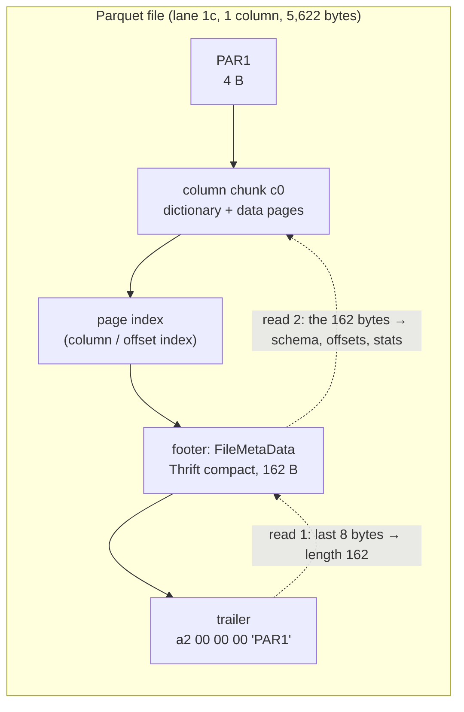

# The Parquet footer: why finding 10 columns means walking all of them

A Parquet reader cannot read a single data byte until it knows where the
bytes are, and everything it needs to know — the schema, every row group,
every column chunk's offset, size and statistics — lives in one block at the
end of the file called the **footer**. For a table with ten columns the
footer is a rounding error. For the wide feature tables of machine-learning
pipelines, with tens of thousands of columns, it is not: this topic's lane 1c
writes a one-row-group file of 50,000 float columns and gets a **6,027,910-byte
footer** — 120.6 bytes per column — which the `parquet` crate needs about
**21 ms** of CPU to decode even though the query wanted 10 columns, i.e.
**0.02%** of the entries in it.

F3 (Zeng et al., §4; [reading-f3.md](reading-f3.md)) makes this the first
complaint against Parquet: its metadata is serialised with Thrift, Thrift
"do[es] not support random access", and "the file reader must deserialize the
entire metadata segment to access a specific column". This chapter reads the
decoder that claim is about — the arrow-rs `parquet` crate — byte by byte. It
builds the Thrift compact protocol from a real 162-byte footer, finds the
loop where every column chunk is walked, and then tests the obvious fix the
crate already offers: options that **skip** decoding statistics for every
column but the projected ones. Lane 1c measured that fix and found it does
not help — skip-stats decoding is no faster than a full decode — and Step 5
explains why from the code. The one option that does help, supplying a cached
schema, cuts the time by roughly a third and leaves it exactly as linear.

Every anchor is into `apache/arrow-rs` at the pinned commit `fed7862`
([resources/codebases.md](../../resources/codebases.md)), whose
`parquet/Cargo.toml` declares version 59.1.0. Lane 1c builds against the
crates.io `parquet` 59.1.0, and the five files quoted below
(`footer_tail.rs`, `reader.rs`, `thrift/mod.rs`, `options.rs`,
`parquet_thrift.rs`) were diffed against the published crate's sources: they
are byte-identical, so the line numbers are those of the code the lane runs.
Lane numbers come from [README.md](README.md) and [notes.md](notes.md); the
timings quoted here were taken with a load average of 10–16 (other benchmarks
were running) and are indicative — the byte counts are exact.

## The problem in one sentence

To project 10 columns out of a 50,000-column Parquet file the reader must
first decode a 6 MB Thrift footer whose encoding gives no way to jump to
column 31,337's entry — so what, exactly, forces the walk, which parts of it
can a decoder skip, and does skipping make it any cheaper?

## The concepts, step by step

### Step 1 — the file's tail: footer, length, magic

> **In:** a Parquet file as a byte array (lane 1c writes it into memory with
> `footer::write_wide_file`).
> **Out:** the footer bytes — the slice every later step decodes — and the
> fact that a reader needs two reads (tail, then footer) before it can plan
> anything.

A Parquet file is data first and description last. The writer streams column
chunks out as it encodes them and only at `close` knows every offset, so it
appends the description — the **footer**, a serialised `FileMetaData` struct
— after the data, followed by an 8-byte **trailer**: the footer's length as a
4-byte little-endian integer, then the 4-byte **magic** `PAR1` that marks the
file as Parquet (`PARE` if the footer is encrypted).



The crate's reader does exactly that. The line to focus on is 558: only after
reading the last `FOOTER_SIZE` (8) bytes and the `metadata_len` bytes in
front of them does it hand anything to the decoder.

```rust
// parquet/src/file/metadata/reader.rs:535-559 — ParquetMetaDataReader::parse_metadata, at fed7862
535      fn parse_metadata<R: ChunkReader>(&mut self, chunk_reader: &R) -> Result<ParquetMetaData> {
536          // check file is large enough to hold footer
537          let file_size = chunk_reader.len();
538          if file_size < (FOOTER_SIZE as u64) {
539              return Err(ParquetError::NeedMoreData(FOOTER_SIZE));
540          }
541  
542          let mut footer = [0_u8; FOOTER_SIZE];
543          chunk_reader
544              .get_read(file_size - FOOTER_SIZE as u64)?
545              .read_exact(&mut footer)?;
546  
547          let footer = FooterTail::try_new(&footer)?;
548          let metadata_len = footer.metadata_length();
549          let footer_metadata_len = FOOTER_SIZE + metadata_len;
550          self.metadata_size = Some(footer_metadata_len);
551  
552          if footer_metadata_len as u64 > file_size {
553              return Err(ParquetError::NeedMoreData(footer_metadata_len));
554          }
555  
556          let start = file_size - footer_metadata_len as u64;
557          let bytes = chunk_reader.get_bytes(start, metadata_len)?;
558          self.decode_footer_metadata(bytes, file_size, footer)
559      }
```

`FooterTail::try_new` is the trailer check; line 70 is the length:

```rust
// parquet/src/file/metadata/footer_tail.rs:60-77 — FooterTail::try_new, at fed7862
60      pub fn try_new(slice: &[u8; FOOTER_SIZE]) -> Result<FooterTail> {
61          let magic = &slice[4..];
62          let encrypted_footer = if magic == PARQUET_MAGIC_ENCR_FOOTER {
63              true
64          } else if magic == PARQUET_MAGIC {
65              false
66          } else {
67              return Err(general_err!("Invalid Parquet file. Corrupt footer"));
68          };
69          // get the metadata length from the footer
70          let metadata_len = u32::from_le_bytes(slice[..4].try_into().unwrap());
71  
72          Ok(FooterTail {
73              // u32 won't be larger than usize in most cases
74              metadata_length: metadata_len.try_into()?,
75              encrypted_footer,
76          })
77      }
```

Lane 1c does the same arithmetic itself so it can time the decode alone,
with the footer already in memory (line 76 is the slice):

```rust
// topics/49-table-formats/experiments/src/footer.rs:72-77 — footer_bytes
72  pub fn footer_bytes(file: &[u8]) -> &[u8] {
73      let n = file.len();
74      assert_eq!(&file[n - 4..], b"PAR1");
75      let len = u32::from_le_bytes(file[n - 8..n - 4].try_into().unwrap()) as usize;
76      &file[n - 8 - len..n - 8]
77  }
```

Worked example. For the one-column file the last 8 bytes are
`a2 00 00 00 50 41 52 31`. `50 41 52 31` is ASCII `PAR1`; the length is
`0xa2` = 162. The file is 5,622 bytes, so the footer occupies bytes
5,622 − 8 − 162 = 5,452 through 5,613. On an object store each of the two
reads is a request; the crate's `with_prefetch_hint` (reader.rs:155) lets a
caller fetch a guessed suffix in one request and only pay the second when the
guess was short.

### Step 2 — the Thrift compact protocol, decoded by hand

> **In:** the footer bytes from Step 1.
> **Out:** the encoding rules — field headers with id deltas, varints,
> zigzag — and the observation Step 4 depends on: a struct carries no
> length, so its end is found only by reading to its stop byte.

**Thrift** is a cross-language serialisation framework: a schema (the
`parquet.thrift` file in the Parquet spec) declares structs whose fields
each have a small integer **field id** and a type, and a *protocol* turns a
struct instance into bytes. Parquet uses the **compact protocol**, which
spends as few bytes as it can:

- A **field header** is one byte: the high 4 bits are the **field-id delta**
  — this field's id minus the previous field's id in the same struct — and
  the low 4 bits are the field's type (5 = i32, 6 = i64, 8 = binary,
  9 = list, 12 = struct, 1/2 = boolean true/false, the enum at
  `parquet_thrift.rs:150-160`). A delta of 0 means the full id follows. Byte
  `0x00` is the **stop** field: the struct ends here.
- Integers are **varints** (unsigned LEB128): 7 bits of value per byte, low
  bits first, high bit set on every byte but the last.
- Signed integers are first **zigzag**-mapped so that small negative numbers
  stay small: 0→0, −1→1, 1→2, −2→3, 2→4…; decoding is `(v >> 1) ^ -(v & 1)`.
- Binary/strings are a varint length then the bytes; a list is one header
  byte (size in the high nibble if < 15, element type in the low) then the
  elements back to back.

The decoder's primitives are short. The line to focus on in `read_field_begin`
is 383: the id is the previous id plus the delta, so a field's identity
depends on the field before it.

```rust
// parquet/src/parquet_thrift.rs:301-323 and 367-394 — varint, zigzag, field header, at fed7862
301      fn read_vlq(&mut self) -> ThriftProtocolResult<u64> {
302          // try the happy path first
303          let byte = self.read_byte()?;
304          if byte & 0x80 == 0 {
305              return Ok(byte as u64);
306          }
307          let mut in_progress = (byte & 0x7f) as u64;
308          let mut shift = 7;
309          loop {
310              let byte = self.read_byte()?;
311              in_progress |= ((byte & 0x7F) as u64).wrapping_shl(shift);
312              if byte & 0x80 == 0 {
313                  return Ok(in_progress);
314              }
315              shift += 7;
316          }
317      }
         // ... 318-319: doc comment ...
320      fn read_zig_zag(&mut self) -> ThriftProtocolResult<i64> {
321          let val = self.read_vlq()?;
322          Ok((val >> 1) as i64 ^ -((val & 1) as i64))
323      }
         // ... 324-366: read_list_begin, read_full_field_id ...
367      fn read_field_begin(&mut self, last_field_id: i16) -> ThriftProtocolResult<FieldIdentifier> {
368          // we can read at least one byte, which is:
369          // - the type
370          // - the field delta and the type
371          let field_type = self.read_byte()?;
372          if field_type & 0xf == 0 {
373              return Ok(FieldIdentifier {
374                  field_type: FieldType::Stop,
375                  id: 0,
376              });
377          }
378  
379          let field_delta = (field_type & 0xf0) >> 4;
380          let field_type = FieldType::try_from(field_type & 0xf)?;
381  
382          let id = if field_delta != 0 {
383              last_field_id.checked_add(field_delta as i16).ok_or(
384                  ThriftProtocolError::FieldDeltaOverflow {
385                      field_delta,
386                      last_field_id,
387                  },
388              )?
389          } else {
390              self.read_full_field_id()?
391          };
392  
393          Ok(FieldIdentifier { field_type, id })
394      }
```

Worked example: the first 34 bytes of the one-column footer, produced by
lane 1c's writer (dumped from `footer::write_wide_file(1, 1024, 49)`).

```text
15 02          header 0x15: delta 1, type 5 (i32)  → field 1 version;   zigzag 2 → 1
19 2c          header 0x19: delta 1, type 9 (list) → field 2 schema;    list 0x2c: 2 elements, type 12 (struct)
  48 01 6d       element 0, root:  header 0x48: delta 4, binary → field 4 name, len 1, "m"
  15 02 00       field 5 num_children = zigzag 2 → 1;  00 = stop
  15 08          element 1, c0:   field 1 type = zigzag 8 → 4 (FLOAT)
  25 00          header 0x25: delta 2 → field 3 repetition_type = 0 (REQUIRED)
  18 02 63 30    field 4 name, len 2, "c0"
  00             stop
16 80 10       header 0x16: delta 1, i64 → field 3 num_rows; varint 80 10 = 0 + 0x10·128 = 2048, zigzag → 1024
19 1c          field 4 row_groups: list of 1 struct ...
```

Two worked varints from further in: `ca 54` is (0x54 = 84) · 128 + (0xca & 0x7f
= 74) = 10,752 + 74 = 10,826, zigzag-decoded 10,826 / 2 = **5,413** — the
column chunk's `total_compressed_size`. `a2 40` is 64 · 128 + 34 = 8,226 →
**4,113**, its `data_page_offset`. And the header `26` that precedes
`a2 40` has delta 2 after field 7, so it is field 9: field 8
(`key_value_metadata`) is absent, which costs nothing at all. That is the
compact protocol's bargain — optional fields are free, small ids are one
byte — and its price: nothing in the bytes says how long a struct is.

### Step 3 — what one column costs in the footer

> **In:** the encoding rules from Step 2 and footers dumped from lane 1c's
> writer at 1, 2 and 100 columns.
> **Out:** the per-column byte budget (≈103 bytes, growing with varint
> widths to 108–121) and its parts — the input to Step 4's walk and Step 5's
> skip.

A `FileMetaData` (thrift/mod.rs:771-781 lists its fields) mentions every
column three times:

| where | bytes per float column, lane 1c's writer | what |
|---|---:|---|
| field 2, `schema` | 9 (`15 08 25 00 18 02 63 30 00`) | a `SchemaElement`: type, repetition, name |
| field 4, `row_groups[0].columns[i]` | 91 | a `ColumnChunk` wrapping a `ColumnMetaData` |
| field 7, `column_orders` | 3 (`1c 00 00`) | one `ColumnOrder` per column |

Inside the 91-byte column chunk, the **statistics** struct (field 12 of
`ColumnMetaData`) is 30 bytes: the deprecated `max`/`min` and the current
`max_value`/`min_value`, each a 4-byte float as binary, a null count, and two
`is_*_exact` booleans — the same min and max written twice. The
**encoding stats** list (field 13; which encodings each page used) is 16
bytes. The column's name appears a second time as `path_in_schema` (field 3),
which the crate does not even keep (`// 3: path_in_schema is redundant`,
thrift/mod.rs:468).

Worked arithmetic: 9 + 91 + 3 = 103 bytes for a column whose offsets are
small. The measured footers: 162 bytes at 1 column, 271 at 2 (a difference
of 109), 377 at 3 (106), and lane 1c's table:

| columns | footer bytes | bytes / column |
|---:|---:|---:|
| 100 | 10,843 | 108.4 |
| 1,000 | 113,461 | 113.5 |
| 10,000 | 1,157,462 | 115.7 |
| 50,000 | 6,027,910 | 120.6 |

The slow growth past 103 is varints widening: column 40,000's
`data_page_offset` is a file offset in the hundreds of megabytes, which needs
4–5 varint bytes where column 0's needed 2, and the name `c40000` is 6 bytes
where `c0` was 2. Per column the footer is close to constant; in total it is
linear in the column count, and nothing in it depends on how many columns a
query wants.

### Step 4 — the walk: why there is no jumping to column i

> **In:** the footer layout from Step 3 and the fact from Step 2 that a
> struct has no length prefix.
> **Out:** the loop that visits every column chunk in order, and a precise
> statement of what "no random access" means here — the input to Step 5's
> question of what a skip can save.

**Random access** into a serialised structure means reaching element i
without touching elements 0…i−1, which needs either fixed-size elements or an
offset table. Thrift compact has neither: column chunk i starts wherever
chunk i−1's stop byte ended, and the only way to find that byte is to parse
chunk i−1's fields. The crate's top-level decoder makes this concrete. The
line to focus on is 825: a loop over every row group, each of which…

```rust
// parquet/src/file/metadata/thrift/mod.rs:745-829 — parquet_metadata_from_bytes, at fed7862
745  pub(crate) fn parquet_metadata_from_bytes(
746      buf: &[u8],
747      options: Option<&ParquetMetaDataOptions>,
748  ) -> Result<ParquetMetaData> {
749      let mut prot = ThriftSliceInputProtocol::new(buf);
         // ... 750-765: Option<> slots for each FileMetaData field ...
766      // see if we already have a schema.
767      if let Some(options) = options {
768          schema_descr = options.schema().cloned();
769      }
         // ... 770-781: the FileMetaData field list, as a comment ...
782      let mut last_field_id = 0i16;
783      loop {
784          let field_ident = prot.read_field_begin(last_field_id)?;
785          if field_ident.field_type == FieldType::Stop {
786              break;
787          }
788          match field_ident.id {
789              1 => {
790                  version = Some(i32::read_thrift(&mut prot)?);
791              }
792              2 => {
793                  // If schema was passed in, skip parsing it
794                  if schema_descr.is_some() {
795                      prot.skip(field_ident.field_type)?;
796                  } else {
797                      // read schema and convert to SchemaDescriptor for use when reading row groups
798                      let val =
799                          read_thrift_vec::<SchemaElement, ThriftSliceInputProtocol>(&mut prot)?;
800                      let val = parquet_schema_from_array(val)?;
801                      schema_descr = Some(Arc::new(SchemaDescriptor::new(val)));
802                  }
803              }
             // ... 804-811: num_rows; the schema must already be known ...
812                  let list_ident = prot.read_list_begin()?;
             // ... 813-818: list-type check, Vec::with_capacity, ordinal assigner ...
819                  for ordinal in 0..list_ident.size {
             // ... 820-824: i16 conversion of the ordinal ...
825                      let rg = read_row_group(&mut prot, schema_descr, options)?;
826                      rg_vec.push(assigner.ensure(ordinal, rg)?);
827                  }
828                  row_groups = Some(rg_vec);
829              }
```

…visits every column chunk; line 672 runs once per column:

```rust
// parquet/src/file/metadata/thrift/mod.rs:660-675 — read_row_group, field 1 (columns), at fed7862
660              1 => {
661                  let list_ident = prot.read_list_begin()?;
662                  // check for list of struct
663                  validate_list_type(ElementType::Struct, &list_ident)?;
664                  if schema_descr.num_columns() != list_ident.size as usize {
665                      return Err(general_err!(
666                          "Column count mismatch. Schema has {} columns while Row Group has {}",
667                          schema_descr.num_columns(),
668                          list_ident.size
669                      ));
670                  }
671                  for i in 0..list_ident.size as usize {
672                      let col = read_column_chunk(prot, &schema_descr.columns()[i], i, options)?;
673                      row_group.columns.push(col);
674                  }
675                  mask |= RG_COLUMNS;
676              }
```

There is no projection argument anywhere in this path: `decode_metadata`
(reader.rs:783) and `decode_metadata_with_options` (reader.rs:791) both end
in `parquet_metadata_from_bytes(buf, options)` (parser.rs:229-234), and the
result always has one `ColumnChunkMetaData` per column. Lane 1c checks this
on every row of its table — `decode` returns `rg.num_columns()`, and the
bench asserts it equals the full column count even in skip mode.

Contrast the two designs that do have random access. The **page index** — the
per-page **column index** (min/max per page) and **offset index** (page
locations) that Parquet stores outside the footer — is reached through
`column_index_offset`/`_length` and `offset_index_offset`/`_length` in each
`ColumnChunk` (fields 4–7, thrift/mod.rs:583-594; in the dump they are
`16 80 55 15 18 16 d2 54 15 2e`). Those are offsets plus lengths, so a reader
that already has the footer can fetch one column's page index without the
others. F3 applies the same idea to the footer itself: each column's metadata
is its own FlatBuffer — a format whose fields are reached through an offset
table, not by parsing what precedes them — and a small footer FlatBuffer acts
as the directory (F3 §4, Figure 3).

### Step 5 — the skip options, and why skipping stats is not faster

> **In:** the per-column walk from Step 4 and the byte budget from Step 3
> (statistics 30 + encoding stats 16 of ≈103 bytes).
> **Out:** what `ParquetMetaDataOptions` can skip, the measured effect of
> each in lane 1c, and the code-level reason the statistics skip saves
> nothing.

The crate's answer to wide footers is `ParquetMetaDataOptions`: per-column
**statistics policies** (`KeepAll`, `SkipAll`, or `SkipExcept(set)`) for
three kinds of statistics, and an optional pre-parsed schema. Lane 1c builds
exactly the "keep only the projected 10" configuration; the lines to focus on
are 91–93 (three policies) and 95 (the cached schema):

```rust
// topics/49-table-formats/experiments/src/footer.rs:89-98 — options
89  pub fn options(keep: &[usize], schema: Option<Arc<SchemaDescriptor>>) -> ParquetMetaDataOptions {
90      let mut o = ParquetMetaDataOptions::new()
91          .with_column_stats_policy(ParquetStatisticsPolicy::skip_except(keep))
92          .with_encoding_stats_policy(ParquetStatisticsPolicy::skip_except(keep))
93          .with_size_stats_policy(ParquetStatisticsPolicy::skip_except(keep));
94      if let Some(s) = schema {
95          o = o.with_schema(s);
96      }
97      o
98  }
```

`skip_except` builds a `HashSet` (options.rs:63-71), and the per-column
question is answered by a set lookup (line 78):

```rust
// parquet/src/file/metadata/options.rs:74-80 — ParquetStatisticsPolicy::is_skip, at fed7862
74      pub(crate) fn is_skip(&self, col_index: usize) -> bool {
75          match self {
76              Self::KeepAll => false,
77              Self::SkipAll => true,
78              Self::SkipExcept(keep) => !keep.contains(&col_index),
79          }
80      }
```

Where the policies are consulted is `read_column_metadata`, once per column.
The lines to focus on are 424–427 (three set lookups per column, whatever the
outcome) and 496: the statistics arm is guarded, and when the guard is false
the field falls through to the catch-all at 528–530 — `prot.skip`.

```rust
// parquet/src/file/metadata/thrift/mod.rs:409-530 — read_column_metadata, at fed7862
409  fn read_column_metadata<'a>(
410      prot: &mut ThriftSliceInputProtocol<'a>,
411      column: &mut ColumnChunkMetaData,
412      col_index: usize,
413      options: Option<&ParquetMetaDataOptions>,
414  ) -> Result<u16> {
         // ... 415-422: seen-field mask and default flags ...
423      if let Some(opts) = options {
424          skip_pes = opts.skip_encoding_stats(col_index);
425          pes_mask = opts.encoding_stats_as_mask();
426          skip_col_stats = opts.skip_column_stats(col_index);
427          skip_size_stats = opts.skip_size_stats(col_index);
428      }
         // ... 429-495: the field list, and arms 1-11 (type, encodings, codec, sizes, offsets) ...
496          12 if !skip_col_stats => {
497              column.statistics =
498                  convert_stats(column_descr, Some(Statistics::read_thrift(&mut *prot)?))?;
499          }
500          13 if !skip_pes => {
             // ... 501-509: encoding stats as a bitmask or a full list ...
516          16 if !skip_size_stats => {
             // ... 517-523: size statistics ...
528          _ => {
529              prot.skip(field_ident.field_type)?;
530          }
```

And `skip` on a struct is not a jump — it cannot be, by Step 2. It is a
recursive walk that reads every field header and every varint or length,
discarding the values (line 511 reads each header; 515 recurses):

```rust
// parquet/src/parquet_thrift.rs:493-518 — skip_till_depth, at fed7862
493      fn skip_till_depth(&mut self, field_type: FieldType, depth: i8) -> ThriftProtocolResult<()> {
494          if depth == 0 {
495              return Err(ThriftProtocolError::SkipDepth(field_type));
496          }
497  
498          match field_type {
499              // boolean field has no data
500              FieldType::BooleanFalse | FieldType::BooleanTrue => Ok(()),
501              FieldType::Byte => self.read_i8().map(|_| ()),
502              FieldType::I16 => self.skip_vlq().map(|_| ()),
503              FieldType::I32 => self.skip_vlq().map(|_| ()),
504              FieldType::I64 => self.skip_vlq().map(|_| ()),
505              FieldType::Double => self.skip_bytes(8).map(|_| ()),
506              FieldType::Binary => self.skip_binary().map(|_| ()),
507              // see https://github.com/apache/thrift/blob/master/doc/specs/thrift-compact-protocol.md#struct
508              FieldType::Struct => {
509                  loop {
510                      // we don't need field id for skipping, so always pass 0 for last id
511                      let field_ident = self.read_field_begin(0)?;
512                      if field_ident.field_type == FieldType::Stop {
513                          break;
514                      }
515                      self.skip_till_depth(field_ident.field_type, depth - 1)?;
516                  }
517                  Ok(())
518              }
```

Now the measurement (lane 1c, local CPU, footer in memory, median of 9;
[README.md](README.md) has the reference run):

| columns | full µs | skip stats µs | skip stats + cached schema µs |
|---:|---:|---:|---:|
| 100 | 36 | 37 | 24 |
| 1,000 | 365 | 521 | 336 |
| 10,000 | 4,056 | 4,316 | 3,033 |
| 50,000 | 21,153 | 21,861 | 13,301 |

**The negative result:** skipping statistics for 49,990 of 50,000 columns is
slightly *slower* than decoding them all (21,861 µs against 21,153; the
1,000-column row's 521 is the noisiest number in the run — the load average
was above 10 — but no row shows a saving). The code says why, on three
counts:

1. **The skipped bytes are still read.** Of a column's ≈103 bytes, the
   statistics (30) and encoding stats (16) are what the policies cover — and
   `skip_till_depth` walks those 46 bytes header by header, exactly as a
   decode would. What is saved is only the *work done with* the values:
   `convert_stats` (thrift/mod.rs:188-246), which for a float is a length
   check and copying two 4-byte values into an enum — almost nothing.
2. **Asking costs more than skipping saves.** Every column now pays three
   `HashSet::contains` calls (lines 424, 426, 427), each hashing the column
   index with the standard library's default hasher, in exchange for the
   tiny saving in (1). At 50,000 columns that is 150,000 lookups.
3. **The skipped part is a minority anyway.** The other ≈57 bytes per column
   — schema element, type, encodings, path, codec, sizes, offsets, page-index
   locations, column order — are decoded in every mode.

The arithmetic of the run: full decode costs 21,153 µs / 50,000 = 423 ns per
column (and 36 µs / 100 = 360 ns at 100 columns — linear, with a slowly
rising per-column cost as varints widen). Decoding speed is
6,027,910 B / 21,153 µs ≈ 285 bytes per microsecond, about 0.28 GB/s — a
byte-at-a-time state machine, not a memory-bandwidth-bound scan
(compare [topic 12](../12-columnar-analytics/README.md)'s scan floor).

**The option that does help** is the cached schema. With a schema supplied,
field 2 is skipped (line 795) and — more importantly — line 800–801 never
run: `parquet_schema_from_array` and `SchemaDescriptor::new` build a type
tree and a `ColumnDescriptor` with an owned column path for every column,
which is allocation-heavy work for 9 bytes of input per column. Lane 1c
measures 30–39% off (4,316 → 3,033 at 10,000 columns, 21,861 → 13,301 at
50,000). It is still linear: 13,301 µs / 50,000 = 266 ns per column. A reader
that caches schemas across the files of a table (they share one) gets this
for free; no option makes the walk itself shorter.

### Step 6 — the measured line against F3's Figure 9

> **In:** Step 5's per-column cost and F3's §4 and §7.2 claims (read in
> [reading-f3.md](reading-f3.md)).
> **Out:** which of F3's statements about Parquet metadata this lane
> reproduces, and which it cannot speak to.

F3 §7.2 builds "a table of 64K rows with a varying number of float
attributes", projects 10 random columns, and plots "time spent on metadata"
against the total column count (Figure 9) for F3, Vortex, Parquet (parquet-rs
v53.2.0, §7.1), ORC, Lance and Nimble. Three claims, checked against this
lane:

- **"the metadata parsing overhead increases linearly for all the formats"**
  — reproduced for Parquet: footer bytes are linear in columns (108–121 B
  each) and decode time is linear (360–423 ns per column across a 500×
  range of widths). The F3 paper attributes even its own linear term to
  "some overhead in the footer (e.g., schema) whose size is proportional to
  the number of columns"; Step 5's cached-schema row shows how big that term
  is for Parquet — about a third.
- **"the file reader must deserialize the entire metadata segment to access
  a specific column"** (§4) — reproduced in the strong form: even with every
  skip option the crate offers in 59.1.0, every column chunk is walked
  (Step 4), and skipping the statistics buys nothing (Step 5).
- **"Even with thousands of columns, the metadata parsing overhead is still
  around 10ms in F3, an order of magnitude faster than Parquet"** (§7.2) —
  not checkable here (no F3 reader in this lane), and the paper's own plot
  is weaker than its prose: read off Figure 9's log-scale gridlines, the gap
  between the F3 and Parquet lines at 10⁴ columns is roughly 4–5×, not 10×
  (approximate, from the plot). Nor are the absolute numbers comparable:
  this lane times decode only, with the footer already in memory, on a
  different CPU and a newer crate (59.1.0 against 53.2.0); F3's figure
  includes whatever its harness counts as metadata time.

What this lane adds that the paper does not show is the *mechanism*: the
cost is not "deserialization" in the sense of building objects one does not
need — skipping those is possible and saves nothing — it is the walk, which
the format makes unavoidable.

## How to read the source (with the concepts in hand)

1. `parquet/src/file/metadata/footer_tail.rs` (111 lines) — Step 1 in full.
2. `parquet/src/file/metadata/reader.rs:535-559` and `:783-796` — the two
   entry points; follow `decode_metadata` to `parser.rs:229-234`.
3. `parquet/src/parquet_thrift.rs:150-160`, `:301-394`, `:455-547` — the
   compact protocol: types, varints, field headers, skip. Decode a dumped
   footer by hand alongside it (Step 2's table) until the bytes stop being
   opaque.
4. `parquet/src/file/metadata/thrift/mod.rs:745-829` (FileMetaData),
   `:628-716` (RowGroup), `:540-626` (ColumnChunk), `:409-536`
   (ColumnMetaData) — read top-down; each is the same loop-and-match shape
   with the Thrift field list in a comment above it.
5. `parquet/src/file/metadata/options.rs:47-81` and `:176-230` — the
   policies, then look back at where `read_column_metadata` consults them.
6. Last, `topics/49-table-formats/experiments/src/footer.rs` and lane 1c in
   `src/bin/table_bench.rs` — the measurement of all of the above.

## Where each step lives in this topic

| step | lane / file | what to run or read |
|---|---|---|
| 1 (trailer) | `experiments/src/footer.rs:72-77` | `footer_bytes`, the same arithmetic as `FooterTail` |
| 2–3 (encoding, byte budget) | `footer::write_wide_file(1, 1024, 49)` | dump the 162 footer bytes and decode them with Step 2's table |
| 3 (linear size) | lane 1c, "footer bytes" and "B/column" | 10,843 → 6,027,910 bytes; `footer_grows_linearly_with_columns` test |
| 4 (the walk) | lane 1c, `footer::decode` | returns all `cols` column chunks in every mode |
| 5 (skip options) | lane 1c, "skip-stats" and "+cached schema" | `footer_round_trips_and_skip_keeps_only_projected_stats` test: 10 of 50 columns keep statistics |
| 6 (F3) | [reading-f3.md](reading-f3.md) | §4, §7.2, Figure 9 |

## Questions (answer in notes.md)

1. Step 3 found the minimum and maximum written twice in every statistics
   struct (deprecated `min`/`max` and `min_value`/`max_value`). How many of
   the 6,027,910 bytes at 50,000 columns would a writer save by dropping the
   deprecated pair, and why might it not be allowed to?
2. Replace `SkipExcept`'s `HashSet` with a bitmap indexed by column
   (`Vec<bool>` of length `cols`) in a local copy of the crate. Predict the
   skip-stats time at 50,000 columns before measuring. Which of Step 5's
   three reasons does this remove, and which remain?
3. A table has 10,000 files with identical schemas. Using lane 1c's
   cached-schema row, estimate the CPU saved by parsing the schema once
   instead of 10,000 times, at 10,000 columns per file.
4. Parquet's page index is random-access per column (Step 4). Sketch a
   footer layout that gives column chunks the same property while staying
   Thrift: what would you have to add, and what would every reader have to
   read first?
5. With 10 row groups instead of 1, how does the footer size change? Which
   of the three per-column entries (schema, column chunk, column order) is
   multiplied and which is not?
6. On an object store, Step 1's two reads are two round trips. With a
   prefetch hint of 64 KiB, at which column count does lane 1c's file stop
   fitting its footer in the first request?

## Done when

Answer each before unfolding it.

- [ ] You can find the footer of a Parquet file given only its bytes, and say how many reads that takes.

  <details><summary>Answer</summary>

  Read the last 8 bytes: the first 4 are the footer length, little-endian; the
  last 4 must be `PAR1` (`PARE` for an encrypted footer) — `FooterTail::try_new`,
  footer_tail.rs:60-77. The footer is the `length` bytes immediately before
  those 8. For lane 1c's one-column file the trailer is `a2 00 00 00 PAR1`, so
  the footer is 162 bytes at offset 5,622 − 8 − 162 = 5,452. That is two reads
  (tail, then footer) unless a prefetch hint fetches a large enough suffix in
  one; only then can a reader learn where any column's data is.

  </details>

- [ ] You can decode a Thrift compact field header and a zigzag varint by hand.

  <details><summary>Answer</summary>

  A header byte's high nibble is the delta from the previous field id, its low
  nibble the type (5 i32, 6 i64, 8 binary, 9 list, 12 struct); 0x00 is stop.
  `0x26` after field 7 is delta 2, type 6: field 9 (`data_page_offset`), i64.
  Its value bytes `a2 40` are a varint: 0x22 + 0x40·128 = 34 + 8,192 = 8,226,
  and zigzag decoding (`(v >> 1) ^ -(v & 1)`, parquet_thrift.rs:322) gives
  8,226 / 2 = 4,113 since the low bit is 0. Field 8 being absent cost zero
  bytes — the delta simply jumped over it.

  </details>

- [ ] You can account for the ~110 bytes each column adds to the footer.

  <details><summary>Answer</summary>

  Three entries per column: a 9-byte `SchemaElement` in field 2 (type,
  repetition, name), a 91-byte `ColumnChunk` in the row group's column list
  (of which statistics are 30 bytes and encoding stats 16, with the name
  repeated as `path_in_schema`), and a 3-byte `ColumnOrder` in field 7: 103
  bytes for a column with small offsets. Measured: 271 − 162 = 109 bytes for
  the second column, 106 for the third, and 108.4 → 120.6 bytes per column
  from 100 to 50,000 columns as varints for large file offsets and longer
  names (`c40000`) widen.

  </details>

- [ ] You can say precisely why the crate cannot jump to column i's metadata.

  <details><summary>Answer</summary>

  Thrift compact structs carry no length and lists carry no offset table, so
  column chunk i begins wherever chunk i−1's stop byte ends, and that byte can
  only be found by parsing chunk i−1's fields. The decoder therefore loops
  over every chunk (`read_row_group`, thrift/mod.rs:671-674), with no
  projection parameter anywhere on the path from `decode_metadata`. The page
  index, by contrast, is addressed by per-column offset + length pairs in each
  `ColumnChunk` (fields 4–7), and F3's per-column FlatBuffers are reached
  through a directory — both are random access; the footer is not.

  </details>

- [ ] You can explain why lane 1c's skip-stats decode is not faster than a full decode, and which option does help.

  <details><summary>Answer</summary>

  A skipped struct is still walked: the guarded arm at thrift/mod.rs:496
  falls through to `prot.skip`, and `skip_till_depth` (parquet_thrift.rs:508-517)
  reads every field header and varint of the 46 bytes of statistics and
  encoding stats — the same bytes a decode reads. Only `convert_stats`'s work
  is saved, which for a float is a length check and two 4-byte copies. In
  exchange every column pays three `HashSet::contains` lookups (lines
  424-427). Net: 21,861 µs against 21,153 µs at 50,000 columns. The cached
  schema helps (21,861 → 13,301 µs, 39%; 30% at 10,000 columns) because it
  avoids building a `SchemaDescriptor` with per-column allocations — but the
  walk, and so the linear cost (266 ns per column), remains.

  </details>

- [ ] You can state which of F3's claims about Parquet metadata this lane reproduces and which it cannot check.

  <details><summary>Answer</summary>

  Reproduced: metadata cost grows linearly with total columns (footer 108–121
  B/column; decode 360–423 ns/column over 100–50,000 columns), and a reader
  must process the whole footer to reach one column (§4) — even with every
  skip option. Not checkable here: F3's own metadata time and the "order of
  magnitude faster than Parquet" of §7.2; the lane has no F3 reader, times
  decode alone on different hardware with parquet 59.1.0 rather than 53.2.0,
  and Figure 9's own plotted gap at 10⁴ columns reads closer to 4–5× than 10×
  (approximate, off a log scale).

  </details>

## References

**Code** — `apache/arrow-rs` at `fed7862` (pinned in
[resources/codebases.md](../../resources/codebases.md); `parquet` 59.1.0,
byte-identical in the files below to the crates.io release lane 1c builds
against):

| where | what this chapter takes from it |
|---|---|
| `parquet/src/file/metadata/footer_tail.rs:60-77` | the 8-byte trailer, `PAR1`/`PARE`, length |
| `parquet/src/file/metadata/reader.rs:535-559`, `:783-796` | two reads; `decode_metadata`, `decode_metadata_with_options` |
| `parquet/src/file/metadata/parser.rs:229-234` | both entry points end in `parquet_metadata_from_bytes` |
| `parquet/src/parquet_thrift.rs:150-160`, `:301-323`, `:367-394`, `:493-518` | compact types, varint, zigzag, field header, skip |
| `parquet/src/file/metadata/thrift/mod.rs:745-829` | `FileMetaData` decode; schema skip at 795 |
| `parquet/src/file/metadata/thrift/mod.rs:660-675`, `:540-626`, `:409-536` | the per-column walk; ColumnChunk; ColumnMetaData and the policy checks |
| `parquet/src/file/metadata/thrift/mod.rs:188-246` | `convert_stats` — the work a skip actually saves |
| `parquet/src/file/metadata/options.rs:47-81`, `:176-230` | `ParquetStatisticsPolicy`, `SkipExcept(HashSet)`, the per-column queries |

**Paper** — Xinyu Zeng, Ruijun Meng, Martin Prammer, Wes McKinney, Jignesh M.
Patel, Andrew Pavlo, Huanchen Zhang. "F3: The Open-Source Data File Format
for the Future." Proc. ACM Manag. Data 3(4) (SIGMOD), Article 245, 2025.
doi:10.1145/3749163. §4 (Thrift has no random access; per-column
FlatBuffers; Figure 3), §7.1 (parquet-rs v53.2.0), §7.2 and Figure 9
(64K rows of floats, 10 projected columns, linear growth, "around 10ms …
an order of magnitude faster than Parquet"). Read in full in
[reading-f3.md](reading-f3.md).

**Spec** — the Thrift compact protocol
(`apache/thrift`, `doc/specs/thrift-compact-protocol.md`, linked from the
crate's comments at parquet_thrift.rs:250, 426, 466, 507, 520, 529) and
`parquet.thrift` in `apache/parquet-format` (the field lists quoted as
comments at thrift/mod.rs:430-448, 555-565, 644-652, 771-781).

**This topic** — [README.md](README.md) (lane 1c's reference run),
[notes.md](notes.md), `experiments/src/footer.rs`; topic 12's
[columnar analytics](../12-columnar-analytics/README.md) for the encodings
the footer describes and the scan it gates.
