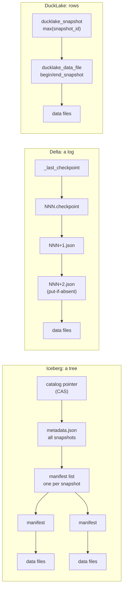

# Iceberg, Delta and DuckLake: three ways to name the files that are a table

A data lake stores a table as a pile of immutable Parquet files in an object
store. The pile is not the table: a half-written compaction, a file a crashed
job left behind, yesterday's version that a reader is still scanning — all of
them sit in the same bucket. Something has to say *which* files make up the
table at version 42, and has to change that answer atomically. Apache Iceberg,
Delta Lake and DuckLake are three specifications for that "something". Iceberg
answers with a **tree** of immutable metadata files rooted at a pointer; Delta
answers with a **log** of numbered commit files; DuckLake answers with
**rows in a SQL database**. This chapter reads all three specs at their pins,
with the two Databricks papers that started the design space as background —
Armbrust et al., "Delta Lake" (PVLDB 13(12), 2020) and "Lakehouse" (CIDR'21) —
and prices the first two with this topic's lane 1, which built both shapes on
a metered object store and committed 1,000 one-file appends to each.

The result is less flattering to the specs' stated goals than their prose: the
Iceberg spec promises planning in "O(1) remote calls", and a fast-append table
of 1,000 commits needs **1,003** metadata reads until someone rewrites its
manifests; both formats write metadata **quadratically** in the number of
commits unless maintenance runs. DuckLake's manifesto makes the opposite
pitch — a database makes all of this cheap — and this repo has not measured
it, so this chapter reports DuckLake's design and quotes its claims as
claims.

Every number below is quoted from the section or line cited next to it, or
from this topic's lane 1 output ([README.md](README.md), [notes.md](notes.md)).
Arithmetic was computed, not estimated.

## The problem in one sentence

An object store can replace one object atomically but never several, so a
table format must reduce "these 1,000 files, minus those 4, plus this one, are
now the table" to a single conditional write of a single object (or row) —
and every byte and every round trip a reader then spends finding that object's
consequences is the price of the encoding chosen.

## The concepts, step by step

### Step 1 — what an object store offers, and what it does not

> **In:** nothing yet — this step defines the storage primitives every later
> step builds on.
> **Out:** four operations (PUT, GET, LIST, conditional PUT) and two costs
> (requests and round trips). Step 2 uses them to define a table version;
> Steps 3–8 count them.

An **object store** (Amazon S3, Azure Blob Storage, Google Cloud Storage) is a
key–value store whose values are blobs up to terabytes in size: an **object**
is named by a string **key**, written whole by **PUT**, and read by **GET**,
optionally a byte range of it. Delta Lake §2.1 lists the properties that
shaped every format in this chapter:

- objects cannot be renamed cheaply and are not patched in place — "updating
  objects usually requires rewriting the whole object at once";
- **LIST** returns keys in lexicographic order from a start key, and "S3's
  LIST only returns up to 1000 keys per call, and each call takes tens to
  hundreds of milliseconds, so it can take minutes to list a dataset with
  millions of objects" (§2.1);
- "each read operation usually incurs at least 5–10 ms of base latency, and
  can then read data at roughly 50–100 MB/s" (§2.3);
- there is no atomic update across several keys (§2.2).

The one atomic primitive left is a **conditional PUT**: a write that succeeds
only if a condition on the target key holds. Two flavours appear below:
**put-if-absent** (create the key only if it does not exist) and
**compare-and-swap** (CAS: replace the value only if its version tag is still
the one the writer read). A **round trip** is one request whose answer the
next request depends on; requests whose keys are all known can be issued in
parallel and cost one round trip together. Lane 1 counts all of these on its
metered store ([`store.rs`](experiments/src/store.rs)).

A worked conversion with §2.3's figures: a reader that must make 4 dependent
round trips pays at least 4 × 5 ms = 20 ms before it reads a data byte, and a
GET of a 400 KB metadata object at 50 MB/s adds 400,000 / 50,000,000 s = 8 ms.
That is the "floor ms" column of lane 1 (rounds × 5 ms), a lower bound since
LIST calls cost "tens to hundreds of milliseconds".

### Step 2 — a table is a set of files at a version

> **In:** Step 1's primitives, and the fact that only one object can change
> atomically.
> **Out:** the vocabulary shared by all three specs — data file, snapshot,
> version, metadata layer, commit, optimistic concurrency. Steps 3, 6 and 8
> are three encodings of it.

A **data file** is an immutable Parquet file holding rows. A **snapshot** is
the set of data files that make up the table at one point; snapshots are
numbered by a monotonically increasing **version**. A **commit** turns
snapshot *v* into *v + 1* by adding and removing files; it must be atomic
(readers see all of it or none) and isolated (two commits cannot both build on
*v* and both win). The structure that records snapshots is the **metadata
layer** — Lakehouse §3.2's term for "metadata layers over data lake storage
that can raise its abstraction level to implement ACID transactions".

Why not just list the directory? Delta Lake §6.1 measured the "directory of
files" approach on S3 (Figure 4: a small table of 33,000,000 rows split into
1,000 to 1,000,000 partitions, a query summing all records): Hive took "more
than an hour" to find the objects at 10,000 partitions, Presto more than an
hour at 100,000, Databricks' parallel LIST 450 seconds at 100,000, while Delta
Lake took 108 seconds at 1,000,000 partitions and 17 seconds with its log
cached on SSD. A metadata layer replaces LIST with reads of a few known keys.

All three specs commit with **optimistic concurrency control** (OCC): a
writer reads the current version, writes its new data files under unique
names (invisible, because no snapshot references them), then attempts one
conditional write that installs *v + 1*; if another writer got there first,
it re-reads, checks whether its change still applies, and retries or aborts.
Iceberg's spec states the principle directly:

> Writers create table metadata files optimistically, assuming that the
> current version will not be changed before the writer's commit.
> — `format/spec.md`, "Optimistic Concurrency"

The three formats differ in *what* the conditional write targets and what a
reader must fetch afterwards:



### Step 3 — Iceberg's tree: table metadata, manifest list, manifests

> **In:** Step 2's snapshot and commit.
> **Out:** Iceberg's three metadata levels, what each holds, and the scan
> planning walk across them — four dependent round trips. Step 4 measures what
> the walk costs as commits accumulate; Step 5 adds the commit side.

The spec is `apache/iceberg` `format/spec.md` at `47677ab`. Its versioning
section states that "Versions 1, 2 and 3 of the Iceberg spec are complete and
adopted by the community" (line 27) and that "**Version 4 is under active
development and has not been formally adopted.**" (line 29); this chapter
describes v1–v3 and notes v4 where it changes the picture.

Three levels, read top-down (spec "Overview", lines 88–92, and "Manifests",
"Manifest Lists", "Snapshots"):

- the **table metadata file** (`metadata.json`): schema, partition spec,
  properties, and `snapshots` — "A list of valid snapshots" (line 1358). Every
  commit writes a new one: "All changes to table state create a new metadata
  file and replace the old metadata with an atomic swap" (line 88);
- per snapshot, a **manifest list**: one entry per manifest, carrying file and
  row counts and a `507 partitions` field — "A list of field summaries for
  each partition field in the spec" (line 1220), i.e. the lower and upper
  bound of each partition value inside that manifest. "A new manifest list is
  written for each attempt to commit a snapshot because the list of manifests
  always changes" (line 1196);
- **manifests**: one entry per data file with its partition tuple and column
  statistics (lower/upper bounds, null counts).

**Scan planning** is a walk: fetch the pointer to find the current
`metadata.json` (round 1), fetch it to find the snapshot's manifest list
(round 2), fetch the manifest list (round 3), and fetch every manifest the list
cannot rule out, all in parallel (round 4). The pruning rule is the spec's:
"Manifests that contain no matching files, determined using file counts,
partition summaries, or column stats, may be skipped" (line 1244). Four rounds
regardless of table size — lane 1's `rounds` column reads 4 for every Iceberg
row, a 20 ms floor at Step 1's 5 ms.

### Step 4 — fast append, merge append, and the O(1) goal measured

> **In:** Step 3's planning walk; lane 1's 1,000 one-file commits.
> **Out:** how many manifests a planner reads after *n* commits under the two
> append strategies, the negative result against the spec's stated goal, and
> the quadratic bill on the write side. Step 7 compares Delta's version of
> the same bill.

The spec's "Goals" section promises:

> **Speed** -- Operations will use O(1) remote calls to plan the files for a
> scan and not O(n) where n grows with the size of the table, like the number
> of partitions or files.
> — `format/spec.md:75`

It also defines the append that breaks that promise for small commits:

> Appends can add a new manifest to minimize the amount of data written,
> instead of adding new records by rewriting and appending to an existing
> manifest. (This is called a "fast append".)
> — `format/spec.md:1161`

A **fast append** writes one new manifest per commit and keeps all old ones,
so after *n* single-file commits the manifest list names *n* manifests, and
round 4 of Step 3 fetches all of them. Java Iceberg's default `newAppend()` is
not a fast append but a `MergeAppend` (`BaseTable.java:209–210`), which folds
small manifests together once enough accumulate:

```java
// core/src/main/java/org/apache/iceberg/TableProperties.java @ 47677ab
115    public static final String MANIFEST_TARGET_SIZE_BYTES = "commit.manifest.target-size-bytes";
116    public static final long MANIFEST_TARGET_SIZE_BYTES_DEFAULT = 8 * 1024 * 1024; // 8 MB
117
118    public static final String MANIFEST_MIN_MERGE_COUNT = "commit.manifest.min-count-to-merge";
119    public static final int MANIFEST_MIN_MERGE_COUNT_DEFAULT = 100;
```

The line to focus on is 119: merging waits until 100 manifests share a bin.
(`iceberg-rust` implements only the fast append — see
[reading-iceberg-rust.md](reading-iceberg-rust.md).) Lane 1 runs both, plus
two Delta variants; the planning cost of the latest snapshot after *n*
commits:

| after *n* commits | Iceberg fast append | Iceberg merge append (min 100) | Delta, checkpoint every 10 |
|---|---|---|---|
| 10 | 13 GETs | 13 GETs | 11 GETs |
| 100 | 103 GETs, 146,089 B | 4 GETs, 97,845 B | 11 GETs, 41,331 B |
| 1,000 | **1,003 GETs**, 1,373,885 B | 13 GETs, 889,448 B | 11 GETs, 399,735 B |

The fast-append count is *n* + 3: catalog pointer, metadata file, manifest
list, and one manifest per commit — 1,000 + 3 = 1,003. It is O(*n*) in
exactly the sense the Goals section rules out. The merge-append count cycles:
merges fire at commits 100, 199, 298, …, 991 (each leaves one manifest, and
99 more appends bring the count back to 100), so after commit 1,000 the list
holds 1 + 9 = 10 manifests and planning reads 10 + 3 = 13. The goal holds for
Iceberg *as Java writes it by default*, with a bounded constant (at most 99 +
3 = 102 reads), and fails for the fast append that the spec names and that
`iceberg-rust` implements — until a `rewrite manifests` maintenance job runs,
after which lane 1b plans the same 1,000 files in 4 GETs.

The write side is worse, and the spec's own sentences explain it: every
commit rewrites the manifest list (line 1196) and the metadata file with
"A list of valid snapshots" (line 1358). Commit *i* therefore writes *i*
snapshot entries and, under fast append, *i* manifest-list entries. Over *N*
commits that is 1 + 2 + … + *N* = *N*(*N* + 1)/2 entries of each kind — for
*N* = 1,000, 1,000 × 1,001 / 2 = **500,500**. Lane 1b measured the objects
stored after 1,000 fast-append commits:

| kind | bytes | ÷ 500,500 |
|---|---|---|
| table metadata files | 195,826,990 | ≈ 391 B per snapshot entry (fixed header included) |
| manifest lists | 202,285,853 | ≈ 404 B per manifest entry |
| manifests | 587,480 | (linear: one small manifest per commit) |

Total metadata written: 398,749,323 bytes — **398.7 MB to describe 1,000
files**. Merge append bounds the manifest lists (20,061,104 bytes) but not the
metadata files, which still carry every snapshot (the same 195,826,990):
219,263,669 bytes in all. The largest single fast-append commit wrote
786,993 bytes of metadata to add one file. Only **snapshot expiry** (spec
"Snapshot Retention Policy") shrinks the metadata file — lane 1b's
expire-to-1 drops a plan's bytes from 885,412 to 514,082 — and it deletes
the history time travel needs: after expiry, lane 1b's time travel to version
500 reports "gone". Lane 1 encodes manifests and manifest lists as JSON with
the spec's field names, where Iceberg uses Avro, so the byte counts are an
upper bound on Avro's; the counts of objects and entries do not depend on the
encoding.

### Step 5 — Iceberg's commit: an atomic swap and the conflict rules

> **In:** Step 2's OCC; Step 3's metadata file.
> **Out:** how the pointer swap is implemented, which concurrent commits may
> retry and which must fail, and why the rename-based scheme is deprecated.
> Lane 2 and [reading-lakevilla.md](reading-lakevilla.md) build on these
> rules.

The swap is a CAS on a pointer held by a catalog:

> The atomic swap needed to commit new versions of table metadata can be
> implemented by storing a pointer in a metastore or database that is updated
> with a check-and-put operation.
> — `format/spec.md:1539`, "Metastore Tables"

The older alternative, renaming `<uuid>.metadata.json` to `v<V+1>.metadata.json`,
is now flagged: "This file system based scheme to commit a metadata file is
**deprecated** and will be removed in version 4 of this spec. The scheme is
**unsafe** in object stores and local file systems" (line 1520) — object
stores have no atomic rename (Step 1).

When the CAS fails, the spec's "Commit Conflict Resolution and Retry" decides
whether the work can be replayed on the new version (lines 1513–1515):

> * Append operations have no requirements and can always be applied.
> * Replace operations must verify that the files that will be deleted are
>   still in the table. […]
> * Delete operations must verify that specific files to delete are still in
>   the table. Delete operations based on expressions can always be applied.

A **replace** is a commit that swaps files without changing table contents —
compaction is the example the spec gives. These three rules are exactly the
validation lane 2 asks for on a Delta-shaped log: blind appends retry forever
and never abort; two compactions of the same inputs cannot both win. Note the
**granularity**: the rules are per *table*. Nothing in the spec coordinates
two tables, which is the gap [reading-lakevilla.md](reading-lakevilla.md)
starts from.

### Step 6 — Delta's log: numbered action files and put-if-absent

> **In:** Step 1's put-if-absent and LIST; Step 2's snapshot.
> **Out:** Delta's commit file, its actions, the reconciliation rule that
> turns a log into a snapshot, and the read protocol's three round trips.
> Step 7 adds checkpoints.

The protocol is `delta-io/delta` `PROTOCOL.md` at `a7d0822`. "A table has a
single serial history of atomic versions, which are named using contiguous,
monotonically-increasing integers" (line 165). Each version is one object in
`_delta_log/`, named by the version zero-padded to 20 digits: "Delta files are
the unit of atomicity for a table" (line 219), and "Delta files use
newline-delimited JSON format, where every action is stored as a single-line
JSON document" (line 228). **Newline-delimited JSON** (NDJSON) is one JSON
value per line. An **action** is one change: `add` (a data file joins the
table, with its partition values and statistics), `remove` (one leaves),
`metaData`, `protocol`, `txn`, `commitInfo`.

The commit is a put-if-absent on the next file name — Delta Lake §3.2.2
step 4: "Attempt to write the transaction's log record into the r + 1 .json
log object, if no other client has written this object." The current protocol
keeps the primitive under catalog-managed tables as "Option 3: Catalog
implementations that use PUT-if-absent … can ratify and publish all-in-one by
atomically writing a published commit file" (line 1300). Delta Lake §3.4
prices it: object-store write latency of "tens to hundreds of milliseconds,
limiting the write transaction rate to several transactions per second", and
Lakehouse §3.2 repeats the limit as the cost of keeping the log in the object
store.

A reader turns a log into a snapshot by **action reconciliation** (protocol
"Action Reconciliation", lines 914–934): "The latest `metaData` action seen
wins" (line 927) and "To replay the log, scan all file actions and keep only
the newest reference for each logical file" (line 932). The read protocol
(Delta Lake §3.2.1) is: read `_last_checkpoint` (round 1), LIST the log from
that checkpoint's version (round 2, one more per 1,000 keys), then GET the
checkpoint and every later commit in parallel (round 3). Three rounds — lane
1's `rounds` column reads 3 for every Delta row, a 15 ms floor against
Iceberg's 20 ms.

What the log cannot do is prune. A one-day query must still reconstruct the
whole snapshot before it can filter `add` actions by partition value; lane 1
shows Delta's one-day plan reading the same 11 objects and 399,735 bytes as
its full scan, while Iceberg's manifest-list summaries cut fast append to 103
GETs and merge append to 4.

### Step 7 — checkpoints, `_last_checkpoint`, and log compaction

> **In:** Step 6's log and read protocol.
> **Out:** what a checkpoint contains, how a reader finds it, the
> quadratic write bill it brings, and the newer log-compaction file. Lane 3
> asks when to write one.

Replaying 1,000 commit files costs 1,000 GETs (lane 1: "Delta, no
checkpoints", 1,001 GETs including the `_last_checkpoint` probe). A
**checkpoint** folds them: "A checkpoint contains the complete replay of all
actions, up to and including the checkpointed table version, with invalid
actions removed" (line 271). The protocol does not fix a frequency — "writers
are encouraged to checkpoint reasonably frequently, so that readers do not
pay excessive log replay costs" (line 278) — but the reference clients do:
"By default, our clients write checkpoints every 10 transactions" (Delta
Lake §3.1.3). Readers find the newest one through `_last_checkpoint` because
"The Delta transaction log will often contain many (e.g. 10,000+) files"
(line 391) and listing them all is what Step 1 warned against.

Lane 1 with a checkpoint every 10: at 1,000 commits (versions 0–999) the
newest checkpoint is version 990, so a reader GETs `_last_checkpoint`, the
checkpoint, and commits 991–999: 1 + 1 + 9 = **11 GETs**, one LIST, 399,735
bytes. The write side repeats Step 4's arithmetic with a smaller constant.
Checkpoint *j* (at version 10*j*) holds 10*j* + 1 `add` actions; versions
10, 20, …, 990 give 99 checkpoints, so the checkpoints hold

  Σ_{j=1}^{99} (10*j* + 1) = 10 × (99 × 100 / 2) + 99 = 49,500 + 99 = **49,599** adds.

Lane 1b's totals: 20,307,084 bytes with checkpoints, 522,593 bytes for the
log alone, so the checkpoints and pointer updates cost 20,307,084 − 522,593 =
19,784,491 bytes, or 19,784,491 / 49,599 ≈ 399 bytes per `add` — the same
≈400 B the 1,000-file checkpoint measures directly (399,735 B / 1,000). PUTs:
1,000 commits + 99 checkpoints + 99 pointer writes = 1,198, as printed. Still
quadratic in *N* (the sum of *j*), but a tenth of the entries Iceberg's
metadata file rewrites, and only 20.3 MB against 398.7 MB.

The protocol's newer **log compaction file**, `<x>.<y>.compacted.json`,
"contains the aggregated actions for commit range [x, y]" (lines 345–351) and
is optional for both sides: "Writers: Can optionally produce log
compactions", and readers may substitute it for the commits it covers. It
trades a checkpoint's full rewrite for a partial one; lane 1 does not model
it.

### Step 8 — DuckLake: the snapshot is a row

> **In:** Step 2's vocabulary; Steps 4 and 7's observation that both file
> formats rewrite growing metadata.
> **Out:** DuckLake's catalog tables, its read query, its commit, and which
> of its claims this repo can and cannot vouch for.

DuckLake's spec (`duckdb/ducklake-web` at `42237d5`,
`docs/stable/specification/introduction.md:6`: "the specification for the
DuckLake format, version 1.1") moves the metadata layer into a **catalog
database**: "a database that supports transactions and primary key
constraints as defined by the SQL-92 standard" (line 12). Data stays in
Parquet on the object store; *which* files are the table is a SQL question.

A snapshot is a row of `ducklake_snapshot` (`snapshot_id` primary key,
`snapshot_time`, `schema_version`, `next_catalog_id`, `next_file_id`;
`tables/ducklake_snapshot.md:10–14`). Every data file row carries the snapshot
range in which it is live: "`begin_snapshot` … The file is part of the table
*starting with* this snapshot id" and "`end_snapshot` … *up to but not
including* this snapshot id. If `end_snapshot` is `NULL`, the file is
currently part of the table" (`tables/ducklake_data_file.md:30–31`). Planning
is one query (`queries.md`, "SELECT"):

```
103  FROM ducklake_data_file AS data
104  LEFT JOIN (
105      SELECT *
106      FROM ducklake_delete_file
107      WHERE
108          ⟨snapshot_id⟩ >= begin_snapshot AND
109          (⟨snapshot_id⟩ < end_snapshot OR end_snapshot IS NULL)
110      ) AS del
111  USING (data_file_id)
112  WHERE
113      data.table_id = ⟨table_id⟩ AND
114      ⟨snapshot_id⟩ >= data.begin_snapshot AND
115      (⟨snapshot_id⟩ < data.end_snapshot OR data.end_snapshot IS NULL)
116  ORDER BY file_order;
```

The lines to focus on are 114–115: time travel is a range predicate, not a
walk to an old metadata file. A commit inserts the new file rows, the new
snapshot row ("This should be `max(snapshot_id) + 1`", `queries.md:252`) and
a `ducklake_snapshot_changes` row, all in one SQL transaction; the database's
primary key on `snapshot_id` is what stops two writers from both creating the
same version — the same job Delta's put-if-absent and Iceberg's CAS do, done
by a database. Because the catalog holds every table, one transaction can
touch several tables, which neither file spec offers (Step 5).

In the terms of Step 4's arithmetic: a commit writes rows proportional to the
files it adds, not to the table's history, so nothing analogous to the
500,500 rewritten entries arises; history costs rows that stay, not rows that
are re-copied. That is a structural property readable from the spec. The
manifesto (`manifesto/index.md`) goes further — it describes "sub-millisecond
writes" with data inlining, says "Even the venerable Postgres can run
thousands of transactions *per second*", and that DuckLake can "manage
*millions of snapshots!*" (lines 147–151). **This repo has not measured any
of those**; lane 1 has no DuckLake shape, and they are the manifesto's
claims, not findings. LakeVilla (VLDB'26) did run DuckLake under contention
and is the place to look for an independent number
([reading-lakevilla.md](reading-lakevilla.md)). The trade DuckLake makes is
also on the page: the catalog database is now a service every reader and
writer must reach — the interoperability cost LakeVilla's Table 1 charges
it with.

### Step 9 — choosing, and what a graph engine would borrow

> **In:** Steps 3–8.
> **Out:** the three designs side by side, and the capstone mapping: graph
> snapshots and branches as Iceberg snapshot references.

| | Iceberg (v1–v3) | Delta | DuckLake 1.1 |
|---|---|---|---|
| atomic write | CAS on catalog pointer | put-if-absent on `N.json` | SQL transaction |
| planning rounds (lane 1) | 4 | 3 | one query (not measured) |
| metadata reads at 1,000 commits (lane 1) | 1,003 fast / 13 merge | 11 (checkpoint every 10) | — |
| partition pruning before reading entries | yes (manifest-list summaries) | no (replay first) | yes (SQL predicate) |
| metadata bytes written, 1,000 commits (lane 1b) | 398.7 MB fast / 219.3 MB merge | 0.52 MB log, 20.3 MB with checkpoints | — |
| multi-table commit | no | no | yes |

For the capstone, Iceberg's **snapshot references** are the ready-made model
for versioned graphs: "Tags are labels for individual snapshots. Branches are
mutable named references that can be updated by committing a new snapshot as
the branch's referenced snapshot" (spec line 1291). A graph stored as
immutable node/edge segment files on object storage (topic 28's M28,
[../28-cloud-native/README.md](../28-cloud-native/README.md)) can take a
snapshot by committing a manifest of segments, and fork a what-if branch by
naming a second reference to the same snapshot — no data copied. Step 4's
lesson travels with it: if each graph mutation batch is a fast append, the
planner of a long-lived branch pays one manifest per batch until something
merges them.

## How to read the specs (with the concepts in hand)

1. **Delta Lake (VLDB'20) §2 first** — the object-store constraints (Step 1),
   then §3.1–3.2 for the log and its protocols, then §6.1 Figure 4.
2. **Iceberg `format/spec.md`**: "Format Versioning" and "Goals" (lines
   25–80), "Overview" and "Optimistic Concurrency" (82–110), then
   "Snapshots", "Manifest Lists", "Scan Planning" (1116–1287) with Step 3's
   walk in hand, then "Commit Conflict Resolution and Retry" (1509–1552).
   Skip types, transforms and Appendices on a first pass.
3. **Delta `PROTOCOL.md`**: "Overview" (143–163), "Delta Log Entries",
   "Checkpoints", "Log Compaction Files", "Last Checkpoint File" (215–397),
   "Action Reconciliation" (914–934); then "Catalog-managed tables" for where
   the protocol is heading.
4. **DuckLake**: `introduction.md`, then `queries.md` top to bottom, then the
   two table pages quoted in Step 8; read the manifesto last and mark which
   sentences are design and which are performance claims.
5. **Lakehouse (CIDR'21) §3.2** as the bridge to
   [reading-lakevilla.md](reading-lakevilla.md): the one-table limitation
   and the transaction-rate limit are named there as open problems.

## Where each step lives in this topic

| step | lane / file | what to run or read |
|---|---|---|
| 1 (object store) | [`experiments/src/store.rs`](experiments/src/store.rs) | the meter, `LIST_PAGE` = 1000, put-if-absent and put-if-match |
| 3–4 (Iceberg tree) | `table_bench` lane 1a/1b, [`iceberg.rs`](experiments/src/iceberg.rs) | 1,003 vs 13 GETs; the bytes-by-kind breakdown |
| 5 (conflict rules) | lane 2, [`occ.rs`](experiments/src/occ.rs) | the exercise; [reading-iceberg-rust.md](reading-iceberg-rust.md) for the retry loop |
| 6–7 (Delta log) | lane 1a/1b, [`delta.rs`](experiments/src/delta.rs) | 11 GETs, 49,599 checkpointed adds; [reading-delta-rs.md](reading-delta-rs.md) |
| 7 (checkpoint frequency) | lane 3, [`policy.rs`](experiments/src/policy.rs) | every-10 against EOQ |
| 8 (DuckLake) | none | prose only; no lane models it |

## Questions (answer in notes.md)

1. Step 4's merge-append count cycles between 4 and 102 GETs. At which commit
   numbers between 1 and 1,000 is it worst, and what is the mean over all
   1,000 commits?
2. The Goals section says "O(1) remote calls". Count the remote calls of a
   fast-append plan *after* `rewrite manifests`. Is it O(1) in commits, in
   files, both? What grows instead?
3. Iceberg's metadata file carries every snapshot so that time travel needs
   no extra index. Design an alternative that keeps time travel but makes
   commit *i* write O(1) snapshot entries. What does a reader pay for it?
   (Compare v4's "adaptive metadata tree", spec line 64.)
4. Delta cannot prune before replay. Which existing protocol feature could a
   writer use to make one-day queries cheaper, and what would it cost the
   writer?
5. With checkpoints every *k* commits on an append-only table of *N* commits,
   write the total number of checkpointed `add` entries as a function of *N*
   and *k*, and check it against 49,599 for *N* = 1,000, *k* = 10.
6. DuckLake's commit takes the catalog database's write lock path. Which
   number would you measure first to test the manifesto's "thousands of
   transactions per second", and what would make that number meaningless
   for a lakehouse?
7. For the capstone: a graph branch is an Iceberg branch reference. What
   does snapshot expiry (Step 4) do to a branch nobody has committed to in a
   month, and which retention field protects it?

## Done when

Answer each before unfolding it.

- [ ] You can name the one atomic primitive each of the three formats commits through.

  <details><summary>Answer</summary>

  Iceberg: a compare-and-swap ("check-and-put") on a catalog pointer to the
  newest metadata file (spec "Metastore Tables", line 1539; the rename scheme
  is deprecated as unsafe on object stores, line 1520). Delta: put-if-absent
  on the next zero-padded `NNN.json` in `_delta_log/` (Delta Lake §3.2.2
  step 4; PROTOCOL.md line 1300 keeps it as "Option 3"). DuckLake: a SQL
  transaction in the catalog database, whose primary key on `snapshot_id`
  makes "next version" unique.

  </details>

- [ ] You can explain why a fast-append Iceberg table of 1,000 one-file commits plans in 1,003 GETs, and why Java's default writer would need 13.

  <details><summary>Answer</summary>

  Planning walks pointer → metadata file → manifest list → manifests, and a
  fast append adds one manifest per commit and keeps the old ones, so the
  last round fetches 1,000 manifests: 1,000 + 3 = 1,003 (lane 1a). Java's
  `newAppend()` is `MergeAppend`, which folds the manifests once 100 share a
  bin (`commit.manifest.min-count-to-merge` = 100, TableProperties.java:119).
  Merges fire at commits 100, 199, …, 991; after commit 1,000 there are 10
  manifests, so 10 + 3 = 13.

  </details>

- [ ] You can derive why 1,000 fast-append commits write ≈ 398.7 MB of metadata, and say which maintenance operation shrinks which part.

  <details><summary>Answer</summary>

  Commit *i* rewrites the metadata file with *i* snapshot entries and the
  manifest list with *i* manifest entries, so each kind totals
  1,000 × 1,001 / 2 = 500,500 entries. Lane 1b measured 195,826,990 bytes of
  metadata files (≈391 B per entry) and 202,285,853 of manifest lists (≈404 B
  per entry), plus 587,480 of manifests and the pointer writes:
  398,749,323 B. Merge append bounds the manifest lists (20.1 MB) but not
  the metadata files; only snapshot expiry shrinks those, and it removes the
  expired versions from time travel.

  </details>

- [ ] You can state the Iceberg spec's planning goal and say exactly when it holds.

  <details><summary>Answer</summary>

  "Operations will use O(1) remote calls to plan the files for a scan and not
  O(n) where n grows with the size of the table" (spec line 75). The walk has
  a constant 4 rounds, but the number of manifests fetched in the last round
  grows with the number of fast-append commits (1,003 GETs at 1,000). It
  holds with a bounded constant under merge append (≤ 102), and after a
  manifest rewrite (4 GETs in lane 1b); it does not hold for an unmaintained
  fast-append table.

  </details>

- [ ] You can list what a Delta reader fetches at version 999 with a checkpoint every 10, and why a one-day query costs the same.

  <details><summary>Answer</summary>

  `_last_checkpoint` (pointing at 990), one LIST from version 990, then the
  checkpoint and commits 991–999 in parallel: 1 + 1 + 9 = 11 GETs, 399,735
  bytes, 3 rounds (lane 1a). The log has no index over partition values;
  reconciliation must rebuild the whole snapshot before `add` actions can be
  filtered by day, so the one-day query reads the same 11 objects and bytes.
  Iceberg's manifest-list partition summaries let it skip manifests instead.

  </details>

- [ ] You can compute the checkpoint bill for 1,000 commits at interval 10.

  <details><summary>Answer</summary>

  Checkpoints at versions 10, 20, …, 990 — 99 of them — hold 10*j* + 1 adds
  each: Σ = 10 × 4,950 + 99 = 49,599 adds. Lane 1b: 20,307,084 − 522,593 =
  19,784,491 bytes for checkpoints and pointer updates, ≈399 B per add, and
  1,000 + 99 + 99 = 1,198 PUTs. Quadratic like Iceberg's, with a tenth of the
  entries (49,599 vs 500,500 of each kind).

  </details>

- [ ] You can describe DuckLake's snapshot model and separate its spec from its manifesto's unmeasured claims.

  <details><summary>Answer</summary>

  A snapshot is a row of `ducklake_snapshot`; each data file row is live for
  `begin_snapshot ≤ s < end_snapshot` (NULL end = current), so a scan at
  snapshot *s* is one SQL query with that range predicate (`queries.md`
  lines 113–115) and a commit is one SQL transaction inserting rows. That is
  the spec (v1.1). Sub-millisecond inlined writes, thousands of transactions
  per second on Postgres and millions of snapshots are manifesto claims
  (lines 147–151) that this repo has not measured.

  </details>

## References

**Specifications** (pinned in
[resources/codebases.md](../../resources/codebases.md)):

| where | what this chapter takes from it |
|---|---|
| `apache/iceberg` `format/spec.md` @ `47677ab`, "Format Versioning" (25–70), "Goals" (72–80) | v1–v3 adopted, v4 under development; "O(1) remote calls" (line 75) |
| same, "Overview", "Optimistic Concurrency" (82–110) | atomic swap of metadata files; optimistic writers |
| same, "Snapshots", "Manifest Lists", "Scan Planning" (1116–1287) | fast append (1161), manifest list rewritten per attempt (1196), partition summaries (1220), skipping (1244) |
| same, "Snapshot References", "Snapshot Retention Policy" (1288–1329) | branches and tags (1291); expiry |
| same, "Table Metadata Fields" (1336–1404) | `snapshots` list in the metadata file (1358) |
| same, "Commit Conflict Resolution and Retry", "File System Tables", "Metastore Tables" (1509–1552) | append / replace / delete rules (1513–1515); rename deprecated (1520); check-and-put (1539) |
| `apache/iceberg` `core/.../TableProperties.java:115–122`, `BaseTable.java:209–215` @ `47677ab` | min-count-to-merge 100, 8 MB target; `newAppend()` = `MergeAppend` |
| `delta-io/delta` `PROTOCOL.md` @ `a7d0822`, "Overview", "Delta Table Specification" (143–175) | serial history of versions (165); vacuum (162) |
| same, "Delta Log Entries", "Checkpoints", "Log Compaction Files", "Last Checkpoint File" (215–397) | unit of atomicity (219), NDJSON (228), checkpoint contents (271), frequency (278), compaction (345–351), 10,000+ files (391) |
| same, "Action Reconciliation" (914–934), "Commit Protocol" (1286–1313) | replay rules (927, 932); PUT-if-absent option (1300) |
| `duckdb/ducklake-web` @ `42237d5`, DuckLake spec 1.1: `introduction.md`, `queries.md`, `tables/ducklake_snapshot.md`, `tables/ducklake_data_file.md` | catalog requirements; the SELECT (103–116); `max(snapshot_id) + 1` (252); snapshot and file rows |
| same, `manifesto/index.md` (Raasveldt & Mühleisen) | the design argument; the unmeasured claims (147–151) |

**Papers** — Michael Armbrust et al., "Delta Lake: High-Performance ACID
Table Storage over Cloud Object Stores", PVLDB 13(12): 3411–3424, 2020
(§2.1–2.3 object-store properties; §3.1.3 checkpoints every 10; §3.2 read and
write protocols; §3.4 transaction rates; §6.1 Figure 4). Michael Armbrust,
Ali Ghodsi, Reynold Xin, Matei Zaharia, "Lakehouse: A New Generation of Open
Platforms that Unify Data Warehousing and Advanced Analytics", CIDR 2021
(§3.2 metadata layers, Delta at half of Databricks compute-hours within three
years, one-table transactions, the transaction-rate limit of a log in the
object store).

**This topic** — [README.md](README.md) and [notes.md](notes.md) (lane 1's
numbers), [reading-iceberg-rust.md](reading-iceberg-rust.md),
[reading-delta-rs.md](reading-delta-rs.md),
[reading-lakevilla.md](reading-lakevilla.md);
[topic 28](../28-cloud-native/README.md) for object storage and M28.
