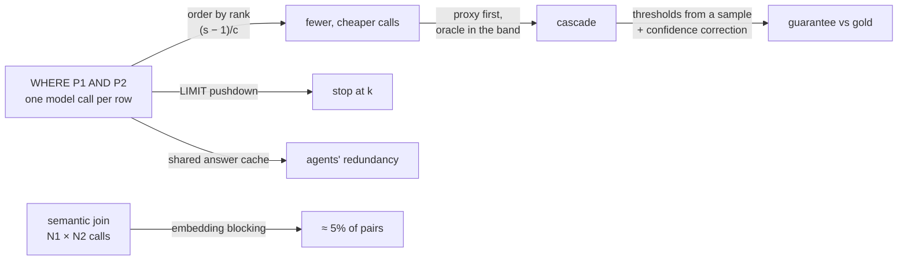

# Topic 50 — LLM-Era Query Processing: Semantic Operators, Text-to-Query, and Their Cost

Language models have entered the query processor through three doors. As
**operators**: a filter, join or ranking whose predicate is a sentence,
evaluated by a model call per row — LOTUS, Palimpzest, ThalamusDB and
BigQuery's `AI.IF` all ship them, and SemBench (VLDB'26) now benchmarks them.
As the **front end**: text-to-SQL (or text-to-Cypher) agents that write the
query, scored on leaderboards whose labels turn out to be wrong half the
time (Jin et al., CIDR'26). And as the **client**: agents that issue hundreds
of exploratory, overlapping queries per task (Liu et al., CIDR'26). CIDR'26
gave a day to this and VLDB'26 about twenty-five papers.

This topic takes the operator door seriously as a *query optimization*
problem, because that is what it is. An operator that costs dollars and
seconds per row and is wrong some of the time breaks every assumption a
relational optimizer makes — and the classic ideas survive, re-priced:
predicate ordering by **rank**, **model cascades** (a cheap proxy in front of
an expensive oracle), **caching**, **LIMIT pushdown**, **join blocking**.
Abacus (VLDB'26) is the first optimizer to search that space the way topic
10's Cascades searches join orders. The numbers below are from a
**simulation** — no LLM is called anywhere in this topic — and the README is
explicit about what that can and cannot tell you.



## The problem, measured (bench lane 1, provided — runs today)

`cargo run --release --bin semop_bench` — `SELECT * FROM reviews WHERE
P1(text) AND P2(text)` over 10,000 seeded documents. P1 ("mentions a delivery
problem") is common and cheap to ask; P2 ("is sarcastic") is rare and its
prompt is twice as long. Each predicate is answered by a simulated **oracle**
model that is right 97% of the time. Apple M3 Pro, measured 2026-10-26 (the
output does not depend on the machine: every number is a seeded count or a
count times a MODEL constant):

```
-- lane 1a: WHERE P1 AND P2 over 10000 rows — orderings of the oracle --
   P1 mentions a delivery problem   oracle $0.0010/call 0.80 s/call, accuracy 0.97; true selectivity 0.2987, oracle-measured 0.3090
   P2 is sarcastic                  oracle $0.0020/call 1.60 s/call, accuracy 0.97; true selectivity 0.1023, oracle-measured 0.1235
   ground-truth answer: 297 rows; gold (oracle on every row): 364 rows; parallelism 20

plan                                    oracle   proxy   $ MODEL  s MODEL   rows  F1 truth  F1 gold
(a) every predicate, every row           20000       0     30.00     1200    364     0.835    1.000
    short-circuit, written order P2,P1   11235       0     21.23      850    364     0.835    1.000
    selectivity order P2,P1              11635       0     21.84      874    364     0.835    1.000
(b) rank order P1,P2 (+200-row sample)   13490       0     16.78      672    364     0.835    1.000

   the 200-row sample cost 400 oracle calls ($0.60) and estimated:
   P1 mentions a delivery problem   selectivity 0.315  cost $0.0010  rank (s-1)/c =   -685.0
   P2 is sarcastic                  selectivity 0.130  cost $0.0020  rank (s-1)/c =   -435.0

   sanity: written-order calls 11235 = N + |P2 yes| = 10000 + 1235 → exact
   sanity: every ordering returns the gold set → same rows
   sanity: oracle F1 vs truth — closed form 0.822; this seed 0.835; mean over 30 other seeds 0.825
```

**The plan with the most model calls is the cheapest.** Ordering the
predicates by selectivity alone — the rare one first — makes the fewest
oracle calls (11,235) and costs **$21.23**; ordering by **rank**, (selectivity
− 1) / cost per call, puts the cheap common predicate first, makes 13,490
calls *including* the 400 it spent estimating selectivities, and costs
**$16.78 — 21% less** (and 672 s against 850 s of simulated wall time). Call
count is the wrong cost model the moment calls differ in price; this is
Hellerstein & Stonebraker's expensive-predicate rule (SIGMOD'93), and it is
exactly what Palimpzest's cost model computes when it multiplies a per-record
cost by the input cardinality the upstream filter left
([reading-abacus.md](reading-abacus.md), Step 7).

The second finding is in the last two columns: **the oracle is not the
truth**. With 97% per-row accuracy on each predicate, the oracle-on-every-row
answer — the "gold" set that LOTUS defines correctness against — has 364 rows
where the truth has 297, F1 **0.835**. A rare conjunction amplifies a small
error rate: 3% false positives on the 90% of rows where P2 is false is 2.7
points of selectivity, more than a quarter of P2's true 10%. The closed form
predicts 0.822 in expectation; the mean over 30 other seeds is 0.825. Every
F1-vs-gold figure in this topic should be read with that in mind.

The three sanity lines are part of the result. The short-circuit call count
must equal N plus the first predicate's yes-count exactly; every ordering
must return identical rows (ordering cannot change an oracle answer); and the
oracle's measured F1 must sit where the closed form puts it.

## What a simulation can and cannot tell you

Nothing here calls a model, and that is a choice, not a limitation to
apologise for: a network-bound LLM benchmark would be neither deterministic
nor free, and the claims this topic makes are about *plans*, which a seeded
model of the operators prices exactly. But the boundary matters:

| the bench can tell you | it cannot tell you |
|---|---|
| how many oracle calls each plan makes, exactly, for given selectivities | what the selectivities, accuracies or prices of a real predicate are |
| how ordering, cascades, caching and LIMIT interact, with costs that follow from stated constants | real dollars or seconds — they are counts × MODEL constants in `src/model.rs` |
| that a guarantee procedure meets (or misses) its δ over 100 seeded tables | whether a real proxy's scores look like `sigmoid(±μ + noise)` |
| how F1 vs gold and F1 vs truth diverge when the oracle errs independently | how real oracle errors correlate with the proxy's, with each other, or with the row — all independent here |
| | anything about prompt design, batching inside one prompt, or rate limits — SemBench's biggest effects ([reading-sembench.md](reading-sembench.md)) |

The constants and where each came from are listed in `src/model.rs`: the
proxy's latency is the oracle's / 17.4 (LOTUS §5.4, one task), the
parallelism of 20 is SemBench's §5.1 setting, and everything else — prices,
accuracies, selectivities, proxy separation μ — is an illustrative MODEL
value, labelled as such in the bench output.

## Step 1 — a semantic operator is an expensive, fallible predicate

A **semantic operator** is a relational operator whose predicate (or
projection, or ranking) is a natural-language instruction answered by a model
([reading-lotus-semantic-operators.md](reading-lotus-semantic-operators.md),
Step 1). Three properties separate it from a SQL predicate: it **costs**
per row on the order of 10⁻³ dollars and a second, nine orders of magnitude
above a comparison; it **errs**; and its **selectivity is unknown** until you
pay to observe it — there is no histogram of "is sarcastic". LOTUS fixes what
"correct" means by a **gold algorithm** (the oracle on every row, or every
pair); a cheaper plan is judged by **precision**, **recall** and **F1**
against it.

## Step 2 — ordering: rank, not selectivity

For a conjunction evaluated with short-circuiting, predicate i costs c_i per
row it sees and passes a fraction s_i. Two predicates in order (1, 2) cost
N·c₁ + N·s₁·c₂ in total; swapping wins when
c₁ + s₁c₂ > c₂ + s₂c₁, i.e. when (s₁ − 1)/c₁ > (s₂ − 1)/c₂. Sorting by
**rank** = (s − 1)/c ascending is optimal for independent predicates.
Worked on lane 1a's measured selectivities: P1 first costs
10,000 × $0.001 + 3,090 × $0.002 = **$16.18**; P2 first costs
10,000 × $0.002 + 1,235 × $0.001 = **$21.235** (printed as $21.23). Ranks from the 200-row sample: P1 (0.315 − 1)/0.001 =
−685, P2 (0.130 − 1)/0.002 = −435, so P1 goes first.

The new part is that s must be *bought*: the bench charges 400 oracle calls
($0.60) for the sample that estimates it, and still wins. Abacus's bandit
(Step 4 of [reading-abacus.md](reading-abacus.md)) is the general form of
that purchase.

## Step 3 — cascades: a proxy buys oracle calls, and gold is not truth

A **cascade** asks a cheap **proxy** model for a score on every surviving
row, accepts scores ≥ 0.5 + h, rejects scores ≤ 0.5 − h, and asks the oracle
only in between. Lane 1c sweeps the band half-width h with a proxy that is
right 88.7% (P1) and 82.1% (P2) of the time at a 0.5 cut:

```
    h  oracle   proxy   $ MODEL  s MODEL   P gold   R gold  F1 gold  F1 truth
 0.00       0   13419      0.67       31    0.260    0.615    0.366     0.385
 0.10    2259   13198      3.64      151    0.463    0.764    0.577     0.584
 0.20    4746   13112      6.82      279    0.692    0.846    0.761     0.741
 0.30    7702   13073     10.42      422    0.895    0.909    0.902     0.837
 0.40   11200   13082     14.66      592    0.983    0.973    0.978     0.846
 0.45   12642   13084     16.32      658    1.000    1.000    1.000     0.835
 0.50   13090   13090     16.83      678    1.000    1.000    1.000     0.835
```

**With this proxy the cascade barely pays.** Reaching F1 0.978 vs gold costs
$14.66 against plan (b)'s $16.18 main pass — 9% off — and at h = 0.5 (all
rows to the oracle) the proxy's own $0.65 makes the cascade dearer than not
having one. A proxy that is wrong on one row in eight cannot be trusted with
a 3%-selective conjunction. That is the negative result; lane 1c′ constructs
the case where cascades pay by varying only the proxy's quality μ:

```
       proxy | proxy alone       | cheapest h: F1 gold ≥ 0.95   | cheapest h: F1 truth ≥ oracle
   mu acc P1 | F1 truth  F1 gold |     h  oracle     F1  $ v b |     h  oracle     F1  $ v b
  0.5  0.698 |    0.170    0.175 |  0.40   12496  0.980    -0% |  0.45   13009  0.835     3%
  1.0  0.844 |    0.392    0.365 |  0.40   11582  0.975    -7% |  0.30    8325  0.846   -32%
  1.5  0.933 |    0.655    0.585 |  0.40    9886  0.955   -20% |  0.15    2193  0.867   -79%
  2.0  0.976 |    0.861    0.740 |  0.45   10855  0.968   -13% |  0.00       0  0.861   -96%
  2.5  0.993 |    0.964    0.812 |  0.50   13090  1.000     4% |  0.00       0  0.964   -96%
  3.0  0.999 |    0.993    0.833 |  0.50   13090  1.000     4% |  0.00       0  0.993   -96%
```

Read the two halves against each other. Judged **against truth**, savings rise
monotonically with proxy quality, to 96% when the proxy alone beats the
oracle. Judged **against gold** — LOTUS's frame — savings peak at a middling
proxy (−20% at μ = 1.5) and *vanish* once the proxy is more accurate than the
oracle: a proxy that agrees with the truth disagrees with the oracle's 3%
errors, and a gold-relative target forbids trusting it. This is the
simulation's sharpest finding, and the one most dependent on its
assumptions: here proxy and oracle err independently, which makes the
disagreement maximal. A distilled proxy that copies the oracle's mistakes
would score better against gold and no better against truth.

## Step 4 — guarantees: a threshold fitted on a sample misses half the time

LOTUS promises its cascade meets recall and precision targets "with
probability 1 − δ" by learning the thresholds on an oracle-labelled sample
and correcting for sampling error
([reading-lotus-semantic-operators.md](reading-lotus-semantic-operators.md),
Step 4). Lane 2's provided row shows why the correction is not optional:

```
-- lane 2: cascade thresholds for P1 alone, targets recall 0.9 precision 0.9 vs gold, δ = 0.2; 300-row sample; 100 workloads of 10000 rows --
learner                         missed  band calls mean recall  mean prec. sample calls
naive (fit the sample)             68%        2204       0.903       0.901          300
learned (lane 2)                  STUB           -           -           -            -
```

Thresholds that exactly meet the targets on 300 sampled rows miss on the
full table in **68 of 100** trials — the *mean* recall and precision are on
target (0.903, 0.901), so half the trials fall below. The exercise is the
corrected learner; [notes.md](notes.md) has the reference: a
normal-approximation correction misses in 6% of trials at 4,504 band calls,
a Hoeffding one in 0% at 9,122 — valid and nearly useless. LOTUS's own code
for this ([reading-lotus-source.md](reading-lotus-source.md)) draws its sample
from the first 200 rows of the table and spends a failure budget of 2δ, not
δ.

## Step 5 — joins, LIMIT and caches: where the large factors live

**Joins.** The gold semantic join asks the oracle once per pair: 300 × 200
papers × datasets is 60,000 calls, $60 and 2,400 simulated seconds (lane 3).
An **embedding** proxy costs one call per *row* (500), so blocking on
similarity is the only way to make a semantic join tractable — SemBench's
MMQA Q7 needed 40,000 calls at 200 × 200 and 160,000 at 400 × 400. The
reference blocked join in notes.md makes 3,000 oracle calls (5%) at precision
1.000. Its recall *against gold* is only 0.916, and lane 3 prints why: 27 of
gold's 417 pairs are oracle inventions on non-matching pairs, which no
similarity blocking proposes — against the oracle's *correct* matches, recall
is 0.977. The contract is written against those.

**LIMIT.** Lane 1e, `WHERE P2 LIMIT 10`:

```
evaluate every row, then LIMIT        10000     20.00      800
stream in waves of 20, stop at 10       120      0.24       10
```

**83×** fewer calls, from a rule every Volcano executor gets for free (topic
11). SemBench measured cost gaps of more than 100× between systems on exactly
these queries, because LOTUS applies LIMIT after evaluating every row (§5.3).

**Caches.** Lane 1d: ten agents run the same query on overlapping 2,000-row
subsets — Liu et al.'s *agentic speculation*. A shared (document, predicate)
answer cache cuts oracle calls from 26,150 to **11,615** with identical
answers, exactly distinct rows + distinct P1-yes rows. The oracle is
deterministic per (document, predicate) here (temperature 0); a cache over a
sampling model would be a semantic change, not an optimization.

## Step 6 — text-to-query, the agent as client, and the LLM as estimator

The front door has the same weakness as the gold algorithm. Jin et al. audit
BIRD Mini-Dev and Spider 2.0-Snow and find annotation errors in **52.8%** (263
of 498) and **66.1%** (80 of 121) of problems; correcting a 100-problem sample
moves CHESS from 62% to 81% execution accuracy and from fourth place to first
([reading-text-to-sql-broken.md](reading-text-to-sql-broken.md)). A metric
defined against a reference is only as good as the reference — lane 1a's 364
vs 297 rows, at the operator level.

Liu et al. argue agents will be the dominant client, and measure that their
speculation is redundant ("less than 10–20%" distinct sub-plans, from a
figure) and steerable (hints cut an o3 agent's queries by 18.1%, Table 1)
([reading-agent-first.md](reading-agent-first.md)). Their probe optimizer is
multi-query optimization, approximate query processing and caching with the
agent's next turn in the cost model.

The third door, the LLM *inside the optimizer*, is out of this topic's
measured scope but worth one number. Liu, Wang, Wu et al., "Can Large
Language Models be a Cardinality Estimator?" (arXiv 2603.28080, read in full;
the PDF names no venue) make inference cost explicit: calling a fine-tuned
Llama for every sub-query's cardinality loses end-to-end to the baselines on
JOB-light and ErgastF1 once inference time is counted, while calling it only
for sub-queries the Postgres cost model flags as expensive — "around 25%-35%
of sub-queries" — cuts inference time "by approximately 66%" and beats every
baseline on every workload (§10.1.3). That is a cascade too: cheap estimator
first, expensive one where it matters.

## Production shape — LOTUS and Palimpzest/Abacus

| mechanism | where (pinned commits) | what it shows |
|---|---|---|
| cascade knobs and defaults | `lotus/types.py:163-187` (lotus `136ae4f`) | γ = 0.8, δ = 0.2, 10% sample; the 200-row sample range |
| importance sampling | `lotus/sem_ops/cascade_utils.py:8-30` | √score weights mixed 90/10 with uniform; draws only from the first 200 entries |
| threshold learning | `lotus/sem_ops/cascade_utils.py:42-144` | normal-approximation bounds; recall correction; per-candidate precision LB |
| the cascade pass | `lotus/sem_ops/sem_filter.py:536-600` | accept/reject/oracle; routing counters |
| join plan choice | `lotus/sem_ops/sem_join.py:470-544` | sim-filter vs project-sim-filter, compared on band size only |
| cardinality-weighted cost | `src/palimpzest/query/optimizer/cost_model.py:246-261` (palimpzest `807ed30`) | cost = per-record cost × input cardinality; join input = product |
| plan-cost composition | `src/palimpzest/core/models.py:928-987` | pipeline quality multiplies; join quality averages its inputs |
| bandit bounds and frontier | `src/palimpzest/query/execution/mab_execution_strategy.py:470-580` | α = 0.5 × spread; a selectivity metric for filters |
| Pareto-Cascades input costs | `src/palimpzest/query/optimizer/tasks.py:423-500` | every Pareto-optimal input plan cost is carried up |

## Reading guides

1. [reading-lotus-semantic-operators.md](reading-lotus-semantic-operators.md) — the LOTUS paper: gold algorithms, two-threshold cascades, guarantees relative to gold, and three self-contradictions.
2. [reading-lotus-source.md](reading-lotus-source.md) — LOTUS's cascade in code: calibration, the 200-row sample range, the recall correction, Bonferroni on precision, the join optimizer's one number.
3. [reading-abacus.md](reading-abacus.md) — Abacus: Pareto-Cascades and a bandit; Table 2's derived ratios and §4.3's prose that disagrees with them; Palimpzest's cost model.
4. [reading-sembench.md](reading-sembench.md) — SemBench: LIMIT, joins and prompts as the big factors; Table 5.
5. [reading-text-to-sql-broken.md](reading-text-to-sql-broken.md) — annotation errors in BIRD and Spider 2.0, and a per-example table that does not reconcile.
6. [reading-agent-first.md](reading-agent-first.md) — agentic speculation as a workload: redundancy, steerability, probes.

## Experiments

`experiments/` is a dependency-free Rust crate (`semop_bench`; a hand-written
SplitMix64 so the seeded workload cannot drift with a crate upgrade).

| lane | status | what it measures |
|---|---|---|
| 1a | provided | four predicate orders; rank vs selectivity; oracle F1 vs truth with a closed-form check |
| 1c | provided | the cascade's band sweep; F1 vs gold and vs truth |
| 1c′ | provided | proxy quality μ swept; cheapest band under each quality bar |
| 1d | provided | ten agents' overlapping probes with and without a shared answer cache |
| 1e | provided | LIMIT 10 evaluated after vs pushed into the scan |
| 2 | **stub** (`src/threshold.rs`) | thresholds meeting recall/precision targets with probability 1 − δ; the naive learner's 68% miss rate is provided |
| 3 | **stub** (`src/join.rs`) | a blocked semantic join: precision ≥ 0.95 vs gold, recall ≥ 0.95 vs gold's correct matches, ≤ 10% of the N×M calls |

```bash
cd topics/50-llm-query-processing/experiments
cargo run --release --bin semop_bench     # lanes 1a–1e, provided rows of 2–3, [stub — …] notes
cargo test --release                      # 12 provided tests pass; 5 stub tests are the spec
```

## Exercises

1. **Lane 2 — guaranteed thresholds.** Implement `threshold::learn_thresholds`.
   Pass the three stub tests: ≤ 20% of 100 trials miss either target, mean
   band calls < 6,000 of 10,000, a well-formed band. Then report how much the
   guarantee cost you in oracle calls over the naive 2,204.
2. **Lane 3 — blocked join.** Implement `join::blocked_join` and pass its two
   tests on seeds 77–79. Compare per-left top-k with a global similarity
   threshold, and a threshold learned from a sampled band (LOTUS's way).
3. **A distilled proxy.** Change `gen.rs` so the proxy's score is a noisy
   function of the *oracle's* answer instead of the truth. Re-run lane 1c′
   and explain which half of the table moves.
4. **Correlated predicates.** Make P2 true more often when P1 is true. Does
   rank ordering from marginal selectivities still pick the cheapest order?
   (Topic 10's independence assumption, re-priced.)
5. **Cost-aware join choice.** Implement LOTUS's two join plans (sim-filter
   and a project-then-sim-filter whose map costs one call per left row) and an
   optimizer that compares *total* cost; find a workload where comparing band
   sizes alone, as `sem_join.py:533` does, picks wrong.

## Cross-topic threads

- **Topic 10 (query planning).** Lane 1a is the expensive-predicate ordering
  problem; Abacus is Cascades with a Pareto frontier per group
  ([reading-selinger-cascades.md](../10-query-planning/reading-selinger-cascades.md)).
  Selectivity estimation that costs money is the new part.
- **Topic 11 (execution models).** LIMIT pushdown is pipelining; a
  DataFrame-at-a-time semantic engine gives it up.
- **Topic 26 (probabilistic structures).** Approximate answers with error
  bounds — the AQP half of the agent-first probe optimizer.
- **Topic 25 (graph ML) and topic 38 (GraphRAG & agent memory).** Embedding
  similarity is the proxy in every semantic join here, as it is the retriever
  there; GraphRAG-SDK's two-step extraction — a local NER pass, then an LLM to
  verify and add relations (`graph_extraction.py:89`, read in topic 38) — is a
  model cascade by another name, and its guarantees are worth asking about in
  the same terms. Agent memory (Zep/Graphiti) is Liu et al.'s agentic memory
  store with a graph schema.
- **Topic 22 (benchmarks).** Jin et al. is a benchmark-validity paper; SemBench
  is a TPC for a new operator class.

## Capstone M50 — semantic predicates in the query engine

Add an `ExpensivePredicate` operator to the capstone engine's planner: a
predicate with a declared per-row cost, a selectivity estimated from a paid
sample, and an optional proxy. The planner orders conjunctive predicates by
rank, pushes LIMIT through them, caches answers by (row id, predicate), and
runs a two-threshold cascade whose thresholds come from lane 2's learner.
Measure on lane 1's workload with a mock model behind the operator: the
plan's call counts must match lane 1a/1c/1d/1e's rows exactly. Stretch: an
embedding-blocked semantic join between node sets, for a text-to-graph
pipeline that never pays N×M.
