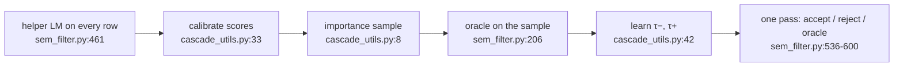

# LOTUS's cascade in code: two thresholds, a union bound, and a sample of the first 200 rows

The LOTUS paper ([reading-lotus-semantic-operators.md](reading-lotus-semantic-operators.md))
spends one paragraph of §3.1 on how a filter cascade's thresholds are learned
"using the central limit theorem and the normal approximation". The code that
does it is `lotus/sem_ops/cascade_utils.py`, 149 lines, and three call sites in
`sem_filter.py` and `sem_join.py`. Reading them answers questions the paper
leaves open — what the default targets are, how the sample is drawn, which
quantities the importance weights touch, and what the join optimizer actually
compares — and turns up two behaviours a user should know about before
trusting a guarantee: the importance sampler only ever draws from the **first
200** entries it is handed, and the join "optimizer" compares plans on band
size alone.



Every anchor below is `lotus-data/lotus` at commit `136ae4f` (`pyproject.toml`
version 1.2.4), quoted with the line numbers the code occupies at that commit.
The clone is recorded in the pin table in `resources/codebases.md`.

## The problem in one sentence

The paper promises that a cascade meets its recall and precision targets with
probability 1 − δ — so what, line by line, does the code compute to make that
promise, and where does what it computes differ from what the promise needs?

## The concepts, step by step

### Step 1 — the knobs, and how they differ from the paper's evaluation

> **In:** the paper's targets γ_R, γ_P and failure probability δ
> (reading-lotus-semantic-operators.md, Step 2).
> **Out:** the defaults a LOTUS user actually gets, which every later step
> reads from `cascade_args`.

A cascade is configured with a `CascadeArgs` object:

```python
# lotus/types.py:163-171, 176-177, 182-184 — CascadeArgs, at 136ae4f
163  class CascadeArgs(BaseModel):
164      recall_target: float = 0.8
165      precision_target: float = 0.8
166      sampling_percentage: float = 0.1
167      failure_probability: float = 0.2
168      map_instruction: str | None = None
169      map_examples: pd.DataFrame | None = None
170      proxy_model: ProxyModel = ProxyModel.HELPER_LM
     # ... 171-175: blank, comments, helper_filter_instruction ...
176      cascade_IS_weight: float = 0.9
177      cascade_num_calibration_quantiles: int = 50
     # ... 178-181: per-filter threshold overrides, blank, comment ...
182      min_join_cascade_size: int = 100
183      cascade_IS_max_sample_range: int = 200
184      cascade_IS_random_seed: int | None = None
```

The defaults are **γ_R = γ_P = 0.8, δ = 0.2, and a sample of 10% of the
rows** (lines 164–167). The paper's evaluation used γ = 0.9 and sampled 0.01%
of the data with a minimum of 100 (§5, "LOTUS"). Neither is wrong; they are
different settings, and a number quoted from the paper was not produced by
the defaults. Line 183 is the one to remember for Step 3: it sits under the
comment `# Join cascade args` (line 181), but the filter path reads it too.

Why it matters: a user who writes `CascadeArgs()` and nothing else gets an 80%
guarantee, not the paper's 90%.

### Step 2 — proxy scores: log-probabilities, flattened into quantiles

> **In:** the helper (proxy) model's output for every row of the table.
> **Out:** one score in [0, 1] per row, which Steps 3–5 sample and threshold.

With the default `ProxyModel.HELPER_LM`, `sem_filter` first runs the helper
model over **every** row (`sem_filter.py:461-475`) — the proxy pass costs N
calls, as lane 1c of this topic's bench charges it — and turns each answer's
log-probabilities into the probability of "True"
(`format_logprobs_for_filter_cascade`, `sem_filter.py:480-483`). Those
probabilities are then **calibrated** — here meaning replaced by their
quantile rank:

```python
# lotus/sem_ops/cascade_utils.py:33-39 — calibrate_llm_logprobs, at 136ae4f
33  def calibrate_llm_logprobs(true_probs: list[float], cascade_args: CascadeArgs) -> list[float]:
34      """Transforms true probabilities to calibrate LLM proxies."""
35      num_quantiles = cascade_args.cascade_num_calibration_quantiles
36      quantile_values = np.percentile(true_probs, np.linspace(0, 100, num_quantiles + 1))
37      true_probs = list((np.digitize(true_probs, quantile_values) - 1) / num_quantiles)
38      true_probs = list(np.clip(true_probs, 0, 1))
39      return true_probs
```

A **quantile** is the value below which a given fraction of the data lies;
line 36 computes the 0th, 2nd, 4th, … 100th percentiles (51 edges for the
default 50 quantiles), and line 37 replaces each probability by the index of
the bin it falls in, divided by 50. The line to focus on is 37.

Worked with 4 quantiles instead of 50: probabilities [0.02, 0.10, 0.55, 0.90,
0.99] give edges [0.02, 0.10, 0.55, 0.90, 0.99]; `digitize` returns bins
1, 2, 3, 4, 5; subtract 1 and divide by 4: scores **[0, 0.25, 0.5, 0.75,
1.0]** (checked with numpy). Whatever the model's confidence looked like, the
scores are now uniform on [0, 1]: the top 2% of rows get 1.0, the bottom 2%
get 0.0.

Why it matters: after calibration a threshold is a *rank*, not a confidence.
τ+ = 0.9 means "the top 10% of rows by proxy score", whether the model was
99.9% sure of them or 60% sure — the statistics of Steps 4–5 have to supply
the meaning.

### Step 3 — importance sampling, and the 200-row range

> **In:** the calibrated scores from Step 2, one per row.
> **Out:** the sample indices the oracle will label, and a correction factor
> per row — inputs to Steps 4 and 5.

**Importance sampling** draws rows with unequal probabilities and weights
each drawn row by (target probability) / (draw probability) so that weighted
averages over the sample remain unbiased. **Defensive mixing** blends the
skewed distribution with a uniform one so no row's draw probability is near
zero.

```python
# lotus/sem_ops/cascade_utils.py:8-30 — importance_sampling, at 136ae4f
 8  def importance_sampling(
 9      proxy_scores: list[float],
10      cascade_args: CascadeArgs,
11  ) -> tuple[NDArray[np.int64], NDArray[np.float64]]:
     # ... 12-15: docstring, optional seed ...
16      w = np.sqrt(proxy_scores)
17      is_weight = cascade_args.cascade_IS_weight
18      w = is_weight * w / np.sum(w) + (1 - is_weight) * np.ones((len(proxy_scores))) / len(proxy_scores)
19
20      sample_range = min(cascade_args.cascade_IS_max_sample_range, len(proxy_scores))
21      sample_w = w[:sample_range]
22      sample_w = sample_w / np.sum(sample_w)
23      indices = np.arange(sample_range)
24
25      sample_size = int(cascade_args.sampling_percentage * len(proxy_scores))
26      sample_indices = np.random.choice(indices, sample_size, p=sample_w)
27
28      correction_factors = (1 / len(proxy_scores)) / w
29
30      return sample_indices, correction_factors
```

Lines 16–18 are the textbook part: draw probability ∝ √score, mixed 90/10
with uniform (`cascade_IS_weight = 0.9`), and line 28's correction factor is
uniform probability over draw probability. The lines to focus on are **20–23
and 26**. Line 21 truncates the distribution to its first
`cascade_IS_max_sample_range` = 200 entries, line 23 makes the candidate
indices `0..200`, and line 26 draws `sample_size` = 10% of N indices **from
those 200**, with replacement (`np.random.choice` defaults to
`replace=True`). Line 28's correction factors, meanwhile, are computed from
the untruncated `w` over all N rows.

Worked: replicating lines 16–26 in isolation with numpy for N = 10,000 random
scores gives `sample_size` 1,000, **largest index drawn 199, distinct rows
194**. In `sem_filter` the indices are row positions
(`self._obj.loc[sample_indices]`, `sem_filter.py:510`), so the oracle labels
up to 1,000 rows that are all among the table's first 200 — duplicates
included — and with `enable_cache` at its default `False`
(`lotus/settings.py:24`) nothing deduplicates them before the oracle call at
`sem_filter.py:206`. For a 150-row table nothing is lost; for a 10,000-row
table sorted by date, the thresholds are learned on the oldest 2%.

Why it matters: every guarantee downstream assumes the sample represents the
table. Here it represents the table's prefix. If the table's order is
unrelated to the predicate the estimate is still unbiased for the prefix and
merely noisier than its size suggests; if order and predicate correlate, the
thresholds are learned on the wrong population. This is the reading at the
pin, not a claim about intent — `cascade_IS_max_sample_range` is a public knob
and a caller can raise it.

### Step 4 — τ−: the recall threshold and its correction

> **In:** the sample's scores, the oracle's labels for them, and the
> correction factors from Step 3.
> **Out:** τ−, the score at or below which rows are dropped without asking
> the oracle.

`learn_cascade_thresholds` sorts the sample by score, first finds τ− at the
raw target, then corrects the target and finds τ− again:

```python
# lotus/sem_ops/cascade_utils.py:52-56, 102-124 — bounds and the recall correction, at 136ae4f
 52      def UB(mean: float, std_dev: float, s: int, delta: float) -> float:
 53          return float(mean + (std_dev / (s**0.5)) * ((2 * np.log(1 / delta)) ** 0.5))
 54
 55      def LB(mean: float, std_dev: float, s: int, delta: float) -> float:
 56          return float(mean - (std_dev / (s**0.5)) * ((2 * np.log(1 / delta)) ** 0.5))
     # ... 57-101: recall() and precision() helpers, pairing, initial (τ+, τ−) = (1.0, 0.0) ...
102      # Find tau_negative based on recall
103      tau_neg_0 = calculate_tau_neg(sorted_pairs, best_combination[0], cascade_args.recall_target)
104      best_combination = (best_combination[0], tau_neg_0)
105
106      # Do a statistical correction to get a new target recall
107      Z1 = [int(x[1]) * x[2] for x in sorted_pairs if x[0] >= best_combination[1]]
108      Z2 = [int(x[1]) * x[2] for x in sorted_pairs if x[0] < best_combination[1]]
     # ... 109-114: means and standard deviations of Z1 and Z2 ...
115      ub_z1 = UB(mean_z1, std_z1, sample_size, cascade_args.failure_probability / 2)
116      lb_z2 = LB(mean_z2, std_z2, sample_size, cascade_args.failure_probability / 2)
117      if ub_z1 + lb_z2 == 0:  # Avoid division by zero
118          corrected_recall_target = 1.0
119      else:
120          corrected_recall_target = ub_z1 / (ub_z1 + lb_z2)
121      corrected_recall_target = min(1, corrected_recall_target)
122
123      tau_neg_prime = calculate_tau_neg(sorted_pairs, best_combination[0], corrected_recall_target)
124      best_combination = (best_combination[0], tau_neg_prime)
```

Lines 52–56 are the **normal-approximation confidence bound**: mean ± (σ /
√s) · √(2 ln(1/δ)). Each entry of `Z1` (line 107) is a sampled row's oracle
label (0 or 1) times its correction factor, for rows *at or above* the first
τ−; `Z2` (line 108) the same for rows below. The line to focus on is **120**:
the corrected target is an upper bound on Z1's mean over an upper-plus-lower
bound — "recall, made optimistic about what is kept and pessimistic about
what is dropped", so the second τ− (line 123) must sit lower.

Worked, uniform weights (factor 1), 300-row sample, 93 positives, δ = 0.2.
Suppose the first τ− keeps 84 of the 93 positives — raw sample recall
84 / 93 = **0.903** — with 150 sampled rows on each side. Then mean_z1 =
84 / 150 = 0.56, mean_z2 = 9 / 150 = 0.06, and 0.56 / (0.56 + 0.06) = 0.903:
the ratio of means equals the recall. Add the bounds (s = 300, δ/2 = 0.1):
the corrected target is **0.953**. Now move the same 93 positives so 120 rows
sit above and 180 below: mean_z1 = 84 / 120 = 0.70, mean_z2 = 9 / 180 = 0.05,
and the *uncorrected* ratio is already 0.70 / 0.75 = **0.933**, not 0.903 —
the corrected target becomes **0.971**. (Both computed with the formulas of
lines 52–56.)

The ratio on line 120 is a ratio of **per-side means**, and per-side means
are only proportional to per-side counts when both sides hold the same number
of sampled rows. So the corrected target depends on where τ− happens to
split the sample, not only on the recall it achieved. Whether the estimator
this follows (SUPG, the paper's [38]) defines Z1 and Z2 over the whole sample
with zeros — which would make the ratio of means a ratio of counts — is
something this topic did not read the SUPG paper to check; flag it as the
first thing to verify before relying on the guarantee.

Why it matters: a correction that is the right size by accident on one split
and too large or too small on another still produces *a* threshold, and what
the code logs afterwards is the sample recall with the correction factors set
to 1 (lines 140–141), not the corrected target it used.

### Step 5 — τ+: the precision threshold, Bonferroni-corrected

> **In:** the sorted sample and τ− from Step 4.
> **Out:** τ+, the score at or above which rows are kept without asking —
> and with it, the band the oracle must cover.

```python
# lotus/sem_ops/cascade_utils.py:126-138 — the precision threshold, at 136ae4f
126      # Do a statistical correction to get a target satisfying precision
127      candidate_thresholds: list[float] = [1.0]
128      for pair in sorted_pairs:
129          possible_threshold = pair[0]
130          Z = [int(x[1]) for x in sorted_pairs if x[0] >= possible_threshold]
131          mean_z = float(np.mean(Z)) if Z else 0.0
132          std_z = float(np.std(Z)) if Z else 0.0
133          p_l = LB(mean_z, std_z, len(Z), cascade_args.failure_probability / len(sorted_pairs))
134          if p_l > cascade_args.precision_target:
135              candidate_thresholds.append(possible_threshold)
136
137      best_combination = (max(best_combination[1], min(candidate_thresholds)), best_combination[1])
138      oracle_calls = sum(1 for x in proxy_scores if best_combination[0] > x > best_combination[1])
```

Every sampled score is a candidate τ+ (line 128). For each, line 130 takes
the oracle labels of the sampled rows at or above it — **unweighted**; the
correction factors that Step 4 used do not appear — and line 133 accepts the
candidate only if the lower confidence bound of their precision clears the
target. The δ there is `failure_probability / len(sorted_pairs)`: one test per
candidate, so the δ/2 the paper allots to precision is split across up to
300 tests. That division is the **union bound** (Bonferroni correction): if
each of k tests fails with probability δ/k, the chance any fails is at most
δ. Line 137 takes the lowest accepted candidate, never below τ−.

Worked: with 300 candidates and δ = 0.2, each test runs at δ′ = 0.2 / 300,
and √(2 ln(1/δ′)) = √(2 · 7.31) = 3.82. A candidate with 60 sampled rows
above it, 57 positive (precision 0.950): σ = √(0.95 · 0.05) = 0.218, LB =
0.950 − 0.218 / √60 · 3.82 = **0.842** — rejected at γ_P = 0.9 although the
sample precision is 0.95. With 59 of 60 positive: LB = **0.920**, accepted.
The union bound makes a precision threshold need a nearly clean sample above
it, which is why a weak proxy ends up with τ+ near 1 and a wide band.

Note also how δ is spent. The paper gives each threshold δ/2. The code's
recall correction takes two one-sided bounds at δ/2 each (lines 115–116), and
the precision candidates share the *full* δ (line 133, δ / count each). Added
up with the union bound, that is a failure budget of 2δ, not δ — a reader
auditing the guarantee should do the sum.

Why it matters: this is where the guarantee's price is set. Lane 2 of this
topic's bench measures the same trade on simulated data: fitting the sample
exactly misses a target in 68 of 100 trials; a corrected learner misses in 6
and needs about twice the oracle calls.

### Step 6 — the pass over the table

> **In:** τ+ and τ− from Steps 4–5, and the proxy scores from Step 2.
> **Out:** the filter's result — and two counters a user can read to see
> what the cascade saved.

`sem_filter.py:536-600` applies the rule. Rows with score ≥ τ+ or ≤ τ− are
"high confidence" and take the proxy's answer (lines 544–554); the rest are
sent, in one batch, to the oracle (lines 577–595), and the counts land in
`stats["num_routed_to_helper_model"]` (line 557). Two details matter for cost
accounting: the threshold sample's oracle answers are **not reused** — a
sampled row that falls in the band is asked again in the main pass — and the
helper model's own N calls (Step 2) are not in either counter.

Why it matters: the true bill is helper calls on every row + oracle calls on
the sample (with duplicates) + oracle calls in the band. Lane 1c of this
topic charges all three; when the band is wide, the first two can make the
cascade cost more than asking the oracle alone (lane 1c′, μ = 2.5: +4%).

### Step 7 — the join optimizer: two plans, one number

> **In:** the cascade machinery of Steps 3–6, applied to pairs.
> **Out:** what `join_optimizer` compares when it picks sim-filter or
> project-sim-filter — the code behind the paper's Table 5.

For a join, the proxy is a similarity score per pair. `run_sem_sim_join` asks
the similarity join for `K = len(l2)` matches per left row
(`sem_join.py:367-369`) — every pair, so the score table has N1 · N2 entries
before any threshold is learned. `join_optimizer` then evaluates both plans
and picks one:

```python
# lotus/sem_ops/sem_join.py:511-517, 532-533 — join_optimizer's choice, at 136ae4f
511      sf_high_conf, sf_low_conf, sf_high_conf_neg, sf_learn_cost, sf_t_pos, sf_t_neg = evaluate_plan("search_filter")
512      sf_cost = len(sf_low_conf)
513
514      msf_high_conf, msf_low_conf, msf_high_conf_neg, msf_learn_cost, msf_t_pos, msf_t_neg = evaluate_plan(
515          "map_search_filter"
516      )
517      msf_cost = len(msf_low_conf)
     # ... 518-531: logging, deep copy of cascade_args ...
532      learning_cost = sf_learn_cost + msf_learn_cost
533      if sf_cost < msf_cost:
```

The line to focus on is **533**: the comparison is band size against band
size (lines 512, 517). Project-sim-filter's extra pass — one semantic-map call
per left row, which `evaluate_plan` does add to its `total_cost` as
`len(l1)` (line 481) — is in `msf_learn_cost`, and so are both plans'
threshold samples; none of it enters the comparison, and line 532 shows both
are always paid, because both plans are fully evaluated before either runs.

Worked with Table 5's shape: if sim-filter's band were 5,000 pairs and
project-sim-filter's 4,800, line 533 picks project-sim-filter, which costs
4,800 + N1 map calls; at N1 = 250 that is 5,050 — more than the 5,000 it
rejected. The paper's BioDEX case is far from that edge (27,687 vs 5,290
total calls), which is why the choice there is right.

Why it matters: this is the "cost-based" decision in LOTUS, and its cost
model omits a term. Abacus ([reading-abacus.md](reading-abacus.md)) treats
the same choice as one of thousands of physical operators and charges every
call.

## Where each step lives in the code

| step | file:line at 136ae4f | what to look at |
|---|---|---|
| 1 | `lotus/types.py:163-187` | `CascadeArgs` defaults; `cascade_IS_max_sample_range` under the join comment |
| 2 | `lotus/sem_ops/sem_filter.py:461-485`, `cascade_utils.py:33-39` | helper pass on every row; quantile calibration |
| 3 | `lotus/sem_ops/cascade_utils.py:8-30`, `sem_filter.py:509-513` | √score weights, the 200-entry range, sampling with replacement |
| 4 | `lotus/sem_ops/cascade_utils.py:52-56, 88-124` | UB/LB; `calculate_tau_neg`; the corrected recall target |
| 5 | `lotus/sem_ops/cascade_utils.py:126-138` | per-candidate LB at δ / len(sample) |
| 6 | `lotus/sem_ops/sem_filter.py:536-600` | the pass; `num_routed_to_helper_model` |
| 7 | `lotus/sem_ops/sem_join.py:367-369, 470-544` | full similarity table; plan choice by band size |

`lotus/settings.py:24` (`enable_cache: bool = False`) is the global switch
that would deduplicate repeated oracle prompts.

## Questions to answer

1. Raise `cascade_IS_max_sample_range` to N. What changes in Step 3's
   output, and what new cost appears in Step 2's?
2. The precision bound ignores the importance weights the recall bound uses.
   Under √score sampling, are high-score rows over- or under-represented in
   Z on line 130, and in which direction does that bias τ+?
3. Rewrite line 120 so the corrected target is a ratio of counts. What
   inputs do you need that the current code discards?
4. Write the cost comparison line 533 *should* make, with every term from
   `evaluate_plan`. Is there a workload where it changes the choice?
5. The helper model runs on every row before thresholds are known. When is
   it cheaper to run the oracle on the sample first and decide whether to run
   the helper at all?

## Done when

Answer each before unfolding it.

- [ ] You can state LOTUS's default targets, δ and sample fraction, and how they differ from the paper's evaluation.

  <details><summary>Answer</summary>

  `CascadeArgs` defaults (`types.py:164-167`): recall and precision targets
  0.8, failure probability 0.2, sampling percentage 0.1 (10% of rows). The
  paper's evaluation set γ = 0.9 with δ = 0.2 and sampled 0.01% of the data
  with a minimum of 100 rows (§5). A number from the paper therefore comes
  from non-default settings.

  </details>

- [ ] You can explain what calibration does to the proxy's probabilities and compute it on five values.

  <details><summary>Answer</summary>

  `calibrate_llm_logprobs` replaces each probability by its quantile bin index
  divided by the number of quantiles (`cascade_utils.py:36-37`), so scores
  become ranks spread uniformly over [0, 1]. With 4 quantiles, [0.02, 0.10,
  0.55, 0.90, 0.99] have edges equal to themselves, `digitize` gives 1–5, and
  the scores are [0, 0.25, 0.5, 0.75, 1.0]. A threshold after calibration
  selects a fraction of rows, not a confidence level.

  </details>

- [ ] You can say which rows the importance sampler can return for a 10,000-row filter, how many draws it makes, and why.

  <details><summary>Answer</summary>

  `sample_range = min(200, N)` (line 20) truncates the distribution to the
  first 200 entries and `indices = np.arange(200)` (line 23); line 26 draws
  `int(0.1 · 10,000)` = 1,000 indices from those with replacement. So only
  positions 0–199 can be sampled; a numpy replication gave max index 199 and
  194 distinct rows. `sem_filter` uses them as row positions (line 510), and
  with caching off (`settings.py:24`) the duplicates reach the oracle.

  </details>

- [ ] You can work the recall correction on two splits of the same 93 positives and say why the answers differ.

  <details><summary>Answer</summary>

  84 of 93 positives kept (recall 0.903), 300 sampled rows, δ/2 = 0.1. With
  150 rows each side: means 0.56 and 0.06, ratio 0.903, corrected target
  0.953. With 120 above and 180 below: means 0.70 and 0.05, ratio 0.933,
  corrected 0.971. Line 120 divides per-side *means*, which track per-side
  counts only when both sides hold equally many sampled rows, so the
  correction depends on where τ− splits the sample.

  </details>

- [ ] You can compute the precision lower bound for 57 of 60 and 59 of 60 positives above a candidate, and name the correction that makes it so strict.

  <details><summary>Answer</summary>

  δ′ = 0.2 / 300 (line 133: full δ over the number of candidates — a union /
  Bonferroni bound), √(2 ln(1/δ′)) = 3.82. 57/60: 0.950 − √(0.95·0.05)/√60 ·
  3.82 = 0.842, rejected at 0.9. 59/60: 0.983 − √(0.983·0.017)/√60 · 3.82 =
  0.920, accepted. A τ+ needs an almost clean run of positives above it in the
  sample.

  </details>

- [ ] You can say what `join_optimizer` compares, what it pays, and construct a case where its choice is wrong.

  <details><summary>Answer</summary>

  It compares `len(sf_low_conf)` with `len(msf_low_conf)` — band sizes only
  (`sem_join.py:512, 517, 533`). It always pays both plans' threshold
  samples and project-sim-filter's N1 map calls (`learning_cost`, line 532),
  but neither enters the comparison. Band 5,000 vs 4,800 with N1 = 250 picks
  project-sim-filter at 4,800 + 250 = 5,050 calls over sim-filter's 5,000.

  </details>

## References

**Code** — `lotus-data/lotus` at `136ae4f` (version 1.2.4; pinned in
[resources/codebases.md](../../resources/codebases.md)):
`lotus/sem_ops/cascade_utils.py` (whole file), `lotus/sem_ops/sem_filter.py:139-235, 434-600`,
`lotus/sem_ops/sem_join.py:343-373, 424-620`, `lotus/types.py:163-187`,
`lotus/settings.py:24`.

**Paper** — Patel et al., "Semantic Operators", arXiv:2407.11418v3, §3.1–3.2
and §5; read in [reading-lotus-semantic-operators.md](reading-lotus-semantic-operators.md).
SUPG (Kang et al., VLDB'20) is the paper's [38] for the threshold
procedure; this topic did not read it, which is why Step 4's last question is
left open.

**This topic** — [README.md](README.md) Step 4 (why thresholds fitted on a
sample miss), [notes.md](notes.md) (lane 2's three reference learners).
