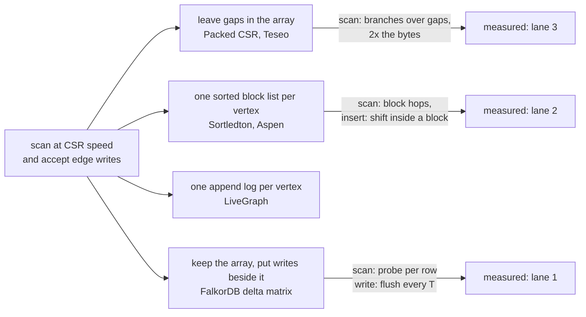

# Topic 51 — Dynamic Graph Storage: A CSR That Takes Writes

FalkorDB's graph lives in GraphBLAS matrices, and a GraphBLAS matrix in the
sparse format is a CSR: all the neighbours of all the vertices in one array,
packed, with no slack. That is why a multi-hop `MATCH` runs at memory speed —
and why one edge insert is a disaster. [Topic 20](../20-graphblas/README.md)
showed FalkorDB's answer, the **delta matrix**: keep the settled CSR
untouched, put new edges in a small side matrix and deleted ones in another,
fold them in when enough have piled up. This topic asks the question the
other way round: **what has the rest of the field done about the same
problem, what does each choice cost, and where does the delta design win and
lose against them?** Five published designs — LiveGraph, Sortledton, Teseo,
Aspen and Packed CSR — are read against one independent comparison of all
of them (Su et al., SIGMOD 2025) and against the same seeded graph in this
repo's own code, and the result is checked against a real FalkorDB.



## The problem, measured (bench lane 1, provided — runs today)

`cargo run --release --bin dyngraph_bench` — one seeded power-law graph
(R-MAT scale 20, the Graph500 generator: 1,048,576 vertices, 16 draws per
vertex, ids randomly permuted so hubs are not clustered), held several ways
and driven by **two-hop neighbourhood scans** (every neighbour of a vertex,
then every neighbour of those: the inner loop of a two-hop `MATCH`)
interleaved with edge inserts and deletes. Apple M3 Pro, measured 2026-10-26,
load average 4.49 at the start of the quoted run (other benchmarks were
running on the machine; counts are exact, timings are one run — notes.md
lists the other runs: absolute scan ns/edge moved by up to 1.7× between runs as
other jobs came and went, while the ratios inside a run and the flush times
(6.28–6.88 ms at T = 10,000) held to 10–20%):

```
graph: R-MAT scale 20 (a=.57 b=.19 c=.19), seed 51, 16 draws/vertex, ids permuted
   |V| = 1048576   |E| = 16084545 after de-dup (directed)   mean out-degree 15.34   max 39354   isolated 502214   top 1% of vertices own 49.8% of edges

-- lane 1a: why not just splice? one write into an eager CSR --
   edge array 64.3 MB + offsets 4.2 MB; a uniformly placed write moves about half of the 68.5 MB of both
   insert (random position): 0.641 ms each over 100 inserts    delete: 0.664 ms each over 100 deletes
   → 1561 inserts/s; the 10,000 edges of topic 20's write burst would take 6.4 s

-- lane 1b: two-hop scan, nothing pending (2000 queries from seeded starts, best of 5) --
   store                        edges touched    ns / edge           checksum
   static CSR                        36871342        0.161       1189b71a08ae
   CSR + empty delta                 36871342        0.160       1189b71a08ae
   Vec<Vec<u32>>                     36871342        0.145       1189b71a08ae

-- lane 1c: two-hop queries interleaved with writes, 200 blocks of 1000 ops ...

   10% writes (all inserts)
   store                           writes scan ns/edge  write ns/op   writes ok  flushes max flush ms
   CSR + delta (flush at 10000)     20000       0.191          490       18646        1       6.60
   Vec<Vec<u32>>                    20000       0.181          555       18646        0       0.00

   10% writes (half inserts, half deletes)
   CSR + delta (flush at 10000)     20000       0.189          621       19314        1       9.21
   CSR + delta, per-edge tombstone test     20000       0.339          489       19314        1       6.63
   Vec<Vec<u32>>                    20000       0.171          390       19314        0       0.00

-- lane 1d: delta growth — scan cost as pending changes pile up (no flush) --
           D   pending   DP rows scan ns/edge   × empty delta bytes/edge
           0         0         0       0.171      1.00           0.00
        1000      1033       906       0.161      0.94          76.65
       10000     10320      7725       0.165      0.97          65.38
      100000    103132     47804       0.186      1.09          32.96
     1000000   1030138    188772       0.366      2.14          16.24

-- lane 1e: the flush threshold, at 10% inserts (200 blocks of 1000) --
    threshold scan ns/edge  write ns/op  flushes max flush ms mean flush ms write ns/op ex-flush
         1000       0.193         2959       18         4.93         3.11            159
        10000       0.188          468        1         6.28         6.28            154
       100000       0.190          154        0         0.00         0.00            154
        never       0.185          146        0         0.00         0.00            146

-- lane 1f: bytes per edge, accounted from capacities (allocator overhead excluded) --
   static CSR (u32 offsets + u32 edges)         4.26 B/edge
   CSR + delta, 100,000 pending inserts         4.43 B/edge
   Vec<Vec<u32>>                                5.56 B/edge
```

(The full output has two more mixes, the splice store's row at 1% writes and
the sanity lines — three stores, one logical graph, identical checksums and
final edge counts after every mix; 36,871,342 edges touched by the same 2,000
queries in every store; 0.161 ns/edge is 24.8 GB/s of 4-byte edges, far below
this machine's memory ceiling.)

**One write, 1,000× apart.** Making the CSR itself take a write — `Vec::insert`
into the 64.3 MB edge array and `+1` over every later offset — costs
**0.641 ms** (lane 1a): it moves about 34 MB, at 53 GB/s. At 1% writes the
splicing store spends 615,536 ns per write; the delta design spends **220 ns**
and the adjacency list 1,237 ns. Topic 20's Step 1 predicted this shape from
bytes moved over bandwidth (200 MB at 30 GB/s = 6.7 ms for a 100 M-edge
matrix); on this graph the same arithmetic gives 34 MB ÷ 30 GB/s = 1.1 ms and
the machine's memmove is faster than that assumed 30 GB/s, 0.64 ms measured.

**Scans do not care which of the three layouts you use — until something is
pending.** With nothing pending (1b) the static CSR, the CSR with an empty
delta and `Vec<Vec<u32>>` scan within ±10% of each other (0.161, 0.160,
0.145 ns/edge here; across the runs in notes.md the adjacency list ranged
from 0.77× to 1.09× the CSR, so the honest reading is "no measurable
difference at this mean degree"). That is Sortledton's own Figure 4a result — "an adjacency list
mostly stays within 40% of the runtime of a csr" — reproduced on a different
graph and machine, and it matters for what follows: the *contiguity of the
whole graph* is not what CSR's speed rests on at mean degree 15. Per-neighbour
**versions** and **block hopping** are what cost the published designs their
2–4× (Revisiting, Table 5), and a delta design has neither.

**Where the delta loses, in order of size:**

1. **Deletes, if the scan tests every edge.** In the half-deletes mix the naive
   tombstone-aware scan — compare each edge of a row against the row's next
   tombstone — takes **0.339 ns/edge against 0.171** for the adjacency list:
   **1.98×**, and it was 1.6–2.0× in every run. Splitting a tombstoned row at
   its tombstones (one binary search each, then plain runs) brings it to 0.189,
   +11% over the adjacency list. The delta was never the problem; the
   per-edge branch was. **A general fix in the shared scan path**, and a
   negative result for anyone who implements the first version.
2. **Inserts, once the flush is charged.** The delta's insert is cheap
   (154 ns excluding the flush against `Vec<Vec<u32>>`'s 555) but a flush costs
   **6.28 ms** for this 16 M-edge graph at T = 10,000, and F/T per insert is
   628 ns in steady state — **782 ns per insert, 1.4× the adjacency list**
   (the 468 ns the 20,000-write stream shows has only paid for 1.86 flush
   intervals). At T = 1,000 it is 18 flushes of 3.11 ms and **2,959 ns per
   write, 5.3× the adjacency list**. Break-even against `Vec<Vec<u32>>` is
   T ≈ 15,700 at the 10,000-row flush time, and higher because flush time
   grows with T. [reading-falkordb-delta-in-context.md](reading-falkordb-delta-in-context.md)
   Step 2 works the c + F/T model on these numbers.
3. **Delta growth before the flush** (1d). With only inserts and a few deletes
   pending the scan is flat — 0.94×, 0.97×, 1.09× at 1,000, 10,000 and 100,000
   pending changes — then **2.14×** at a million (1.03 M pending changes over
   188,772 distinct rows; consistent with the side map outgrowing the cache,
   which was not isolated). The
   threshold of 10,000 keeps a FalkorDB-shaped delta where the curve is flat;
   a threshold of a million would not.
4. **Bytes.** 4.43 B/edge with 100,000 pending inserts against 4.26 for the
   settled CSR and 5.56 for the adjacency list (24-byte `Vec` header per
   vertex, 502,214 of them empty).

**Where it wins:** every cell where the alternative has to move edges — the
splice (1,000×), the adjacency list's hub shifts at low T — and every scan row
where nothing is deleted. At the default T the scan columns of 1c are within
the noise of the static CSR (0.186 vs 0.176 ns/edge at 0%, 0.191 at 10%
inserts).

### Lanes 2 and 3 — the exercises, and what the reference numbers say

Lane 2 (**Sortledton-style sorted blocks**) and lane 3 (**a packed-memory-array
CSR**) are stubs. On a fresh clone the bench prints `lane 2 STUB — not
implemented yet` and `lane 3 STUB …`, then exits 0. The reference numbers —
from reference implementations written and run before the stubs were cut, on
this graph and the same three write mixes (notes.md has the full tables):

| layout | scan, nothing pending | B/edge | ns/write, 10% inserts |
|---|---|---|---|
| static CSR (same run) | 0.165 ns/edge | 4.26 | — |
| CSR + delta (T = 10,000) | 0.160 | 4.26 | 498 |
| `Vec<Vec<u32>>` | 0.147 | 5.56 | 553 |
| **lane 2** — sorted blocks, capacity 256 | **0.206** (1.25×) | 7.98 | 404 |
| **lane 3** — PMA CSR, leaf 16 | **1.376** (8.3×) | 8.87 | 359 |

Sorted blocks cost 25% on a scan and 1.9× the bytes; they take inserts at
404 ns with no flush and no pause. The PMA is the surprise, and a negative
result against the paper: PCSR's authors report within 20–25% of CSR on
synthetic graphs and "about a factor of two" on real ones
([reading-packed-csr.md](reading-packed-csr.md) Step 4); this reference, whose
scan skips gaps with a branch per slot, is **8.3×** the CSR on a graph with mean
degree 15. A branchless gap-compaction of the scan (a variant timed in
notes.md) brings it to 0.867 ns/edge, 5.4× the CSR's 0.161 in that run, and its memory is 2.1× the CSR's, so bandwidth explains at
most a factor of two. What explains the rest was not isolated; lane 3's
exercise is to find out.

## The C engine, same graph (datapoint, not a lane)

`scripts/falkordb_datapoint.py` loads this exact graph (via `dump_edges`) into
the FalkorDB C engine built in `~/repos/FalkorDB/bin/` (redis-server 8.6.2 with
`falkordb.so`, port 6390, shut down afterwards), runs the same seeded start
vertices as Cypher two-hop queries, and inserts edges with `MERGE`. 16,084,545
relations load in 23.0 s through the bulk loader. Load average 5.85 at the
start of the quoted run (run A: 200 queries, 20,000 inserts; a second run, B, is
in notes.md and is quoted where it disagrees):

```
engine time per two-hop query (server-reported), 200 seeded starts
  empty delta, right after the bulk load        891 us      (answers equal the Rust distinct-vertex counts)
  ~5,000 inserted (below the 10,000 threshold)  921 us      +3%
  10,000 inserted (at the threshold)            971 us      +9%
  12,500 inserted (flush crossed)               947 us      +6%
  20,000 inserted                               961 us      +8%

end-to-end MERGE latency per insert, 2,500 at a time (median)
  inserts     0 ->  2,500    152 us          inserts 10,000 -> 12,500   166 us   (max 24,156 us)
  inserts 2,500 ->  5,000    204 us          inserts 12,500 -> 15,000   194 us
  inserts 5,000 ->  7,500    276 us          inserts 15,000 -> 17,500   236 us
  inserts 7,500 -> 10,000    335 us          inserts 17,500 -> 20,000   277 us
```

Three things to read off it. **The engine's per-query cost is ~47.6 ns per
two-hop path edge** (891 µs × 200 ÷ 3,745,348 edges) — about 300× the
in-process 0.16 ns/edge, because a Cypher query pays parse, plan, a result set
and a round trip that the scan loops of lane 1 do not; the two are not
comparable and are not meant to be. **A pending delta costs the read side
little**: +3% to +9% on engine time in run A (+5% to +15% in run B) up to
10,000 pending changes, the same order as run-to-run noise at this load, with
no step when the flush crossed — lane 1d's flat region, in the real engine. **The write side is a sawtooth**:
the median MERGE latency climbs from 152 µs to 335 µs as the pending count
grows to 10,000 (about 24 µs per thousand), drops back to 166 µs after the
flush, and climbs again; one insert paid **24.2 ms** (72× the preceding batch's median of 335 µs;
29.4 ms in run B, at the same insert, #10,734) — the flush, on this
16 M-edge graph (which of the relation, adjacency and transposed matrices it
folded was not decomposed). The
mechanism for the climb (a `GrB_wait` over `DP` on every query?) was not
verified.

## Step 1 — why a packed array hates one write

A settled sparse matrix is a CSR: `offsets[u]..offsets[u+1]` indexes into one
array of destinations. Inserting edge (u, v) means a binary search in u's row,
a shift of everything after it, and `+1` on every later offset — Θ(|V| + |E|)
work. [reading-packed-csr.md](reading-packed-csr.md) Step 1 turns that into
cache-line transfers (1,070,820 for this graph against 36 for a PMA, a bound
with constants removed); lane 1a measures the real thing at 0.64 ms. The
other direction matters as much: deletes shift the same way, and a CSR has no
tombstone, so *both* must be deferred, which is why FalkorDB has two delta
matrices.

## Step 2 — four ways to make room

| design | where writes go | scan | write | published numbers (verified) |
|---|---|---|---|---|
| **Packed CSR / Teseo** | into gaps in the one array; a rebalance re-spreads a window (density 1 at a leaf to 0.75 at the root) | one array, branch or skip per gap | shift to the next gap; amortised O(lg² N) | PCSR within ~2× of CSR on real graphs and 3–4× slower to insert than an adjacency list (Table II, §IV); Teseo ≈ 2.4 M inserts/s, scans ≈ 50% apart from CSR in the sequential pattern (§7) |
| **Sortledton / Aspen** | one sorted vector, or sorted blocks of ≤ B edges indexed by a skip list / tree, per vertex | sequential within a block | shift inside one block; split when full | Sortledton 1.22× CSR on average (its §9), but the independent test bench finds 1.11–4.10× across 16 cells (Revisiting Table 5) |
| **LiveGraph** | append to the vertex's log, two timestamps per entry | one sequential pass, a visibility test per entry | O(1) for a new edge; a scan to invalidate an old one | CSR's scan latency is 43% of a TEL's (§2.1); 4.9–16.7× CSR's memory in the test bench |
| **CSR + delta (FalkorDB)** | `DP` / `DM` side matrices, folded into the CSR every T changes | the CSR, plus a probe or an extra multiply while a delta is non-empty | small insert; a flush ~ one pass over the array | this topic's lane 1 |

The paper trail for the numbers in that table is the reading guides; the
comparison across designs is [reading-revisiting-dgs.md](reading-revisiting-dgs.md).

## Step 3 — the delta's two costs: c + F/T and a probe

An insert into a delta costs `c` (check the settled array, insert into one
small sorted row of `DP`: 154 ns here) plus its share of the flush,
`F(T)/T`. The flush must read the whole settled array however little is
pending (6.28 ms at T = 10,000 on 64.3 MB; 3.11 ms at T = 1,000), so a small T
is paid for in writes (2,959 ns at T = 1,000) and a large one in scans (lane
1d's 2.14× at a million). FalkorDB's default T = 10,000
(`config.h:19`) sits where the scan curve is still flat and the flush is
amortised over enough writes; whether that is the right default is a
statement about *its* flush time, which this topic measures only through the
engine (below).

## Step 4 — what the scan pays

Three things, in the order lane 1 measures them. **Per row, nothing** when a
delta is empty — the guard `if dm.is_empty()` is `delta_mxm.c:71`'s
`dm_nvals > 0` — so lane 1b's empty-delta row is the CSR row (0.160 vs 0.161).
**Per row, a probe** while it is not: the model probes a hash map for `DP`
and `DM`; FalkorDB instead runs up to three multiplies per hop
([reading-falkordb-delta-in-context.md](reading-falkordb-delta-in-context.md)
Step 3), a different cost shape. **Per edge, only if rows with tombstones
test every edge** — the 1.98× of 1c, removed by splitting at the tombstones.
Insert-only deltas cost nothing measurable up to ~100,000 pending (1.09×).

## Step 5 — the tax the other designs pay

Revisiting (Su et al.) puts the five systems in one framework and measures
what each costs relative to CSR: PageRank and triangle-counting kernels
1.11–4.10× slower (recomputed from its Table 5), **6.43×** the memory for
Sortledton with versions (4.31 GB against 0.67 on LiveJournal) and 3.3–10.8×
for Aspen, and a version-check bandwidth bill — derived from its Tables 7–8:
**21.6 bytes moved per edge scanned** for Sortledton, 19.1 for Teseo, 22.3 for
LiveGraph, against 4 for a CSR edge. A delta design has no per-neighbour
version at all, because FalkorDB's consistency comes from one writer and a
flush, not from MVCC. That is the structural reason the CSR + delta scan in
lane 1 matches CSR where the fine-grained designs cannot. It is also the
limit: **no concurrent writers**, which is what Sortledton and Teseo are
built for, and which this topic does not measure.

## Step 6 — what this means for FalkorDB

1. **Keep the delta; fix the scan path for deletions first.** The measured
   cliff in lane 1c is the per-edge tombstone test (1.98×), not the delta.
   FalkorDB's mask-based read (`A·DM` as a mask) is a different mechanism,
   whose cost on a deletion-heavy stream is the thing to measure next.
2. **The flush is the dial, and it is a latency, not a throughput, problem.**
   F is a pass over the whole settled matrix however little is pending, so the
   design's write cost per insert is `c + F/T` and its worst case is a pause of
   F: 6.3 ms here at T = 10,000, and **24–29 ms** for one insert in the C engine
   on the same graph (above, two runs).
3. **Sorted blocks are the alternative if a flush pause is unacceptable.**
   Lane 2 takes inserts at 404 ns with no pause for a 25% scan tax and 1.9×
   the bytes; that is Sortledton's trade, and it has no equivalent of the
   flush. It is also what a per-vertex store needs for sorted intersections —
   a delta's `DP` row is sorted but its scan order (M's row, then `DP`'s) is not.
4. **A PMA is not a free lunch for scans** — 8.3× naive, 5.4× branchless on
   this graph — but its insert is flat (359 ns), with no flush and no pause.

## Production shape — what FalkorDB does, where

| piece | where | what to notice |
|---|---|---|
| the trio | `FalkorDB` `src/graph/delta_matrix/delta_matrix.h:108-115` | `matrix`, `delta_plus`, `delta_minus`, and a `transposed` twin: six matrices per relation |
| the flush trigger | `delta_wait.c:89`, `:97` | `DM` and `DP` flush **independently**, each when its own count reaches the bound |
| the threshold | `src/configuration/config.h:19`, `config.c:57` | `DELTA_MAX_PENDING_CHANGES_DEFAULT` = 10,000 |
| the deletion fold | `delta_wait.c:29` | `GrB_transpose(m, dm, NULL, m, GrB_DESC_RSCT0)` = a masked copy of all of `M` |
| the addition fold | `delta_wait.c:51` | `GrB_Matrix_assign(m, dp, …)`; the comment at `:49` says the author has not checked which GraphBLAS path it takes |
| when it runs | `delta_wait.c:140-217` | `Delta_Matrix_synchronize`: under the matrix mutex, in the query that touches the matrix first |
| the read path | `delta_mxm.c:66-108` | `A·DM` mask, `A·DP`, then `A·M` masked, plus an element-wise add; guards at `:71`, `:80` |
| the point read order | `delta_isStored.c:25-40` | `DP`, then `DM`, then `M` (topic 20 Step 3) |

Anchors are FalkorDB at `ccb449a9a` (the pin), read with
`tools/pinned-source.py`. For the other systems the anchors are in their
guides, against clones this topic added to `~/repos`: `sortledton` at
`6eb638f3ad38f8a10a127e7e118528f4c8d07a6e`, `teseo` at
`2c37c2831c4d2acaaa838a86e1318363ce68c45b`, `LiveGraph` at
`eea5a40ce6ee443f901e44323c1119f59113eaf3`, `Packed-Compressed-Sparse-Row` at
`46bfe503239483286b85345f7c916e8e6403dccf`, `DynamicGraphStorage` at
`5cb0a99b5ecef2130f571be398ecaf7a4dfdf48f`.

## Reading guides

1. [reading-revisiting-dgs.md](reading-revisiting-dgs.md) — Su et al., "Revisiting the Design of In-Memory Dynamic Graph Storage" (arXiv:2502.10959; SIGMOD 2025): the abstraction, the five designs in one framework, the scan gap recomputed from Table 5, version bytes per edge derived from Tables 7–8, and a sorting of every cost into "a delta design pays / avoids / moves".
2. [reading-sortledton.md](reading-sortledton.md) — Fuchs, Margan & Giceva (PVLDB 15(6), 2022): why per-edge accesses dominate, sorted blocks and the vertex vector, the insert/split/merge code, and where the code departs from the paper (merge at 0.45, not 0.5).
3. [reading-teseo.md](reading-teseo.md) — De Leo & Boncz (PVLDB 14(6), 2021): sparse arrays and Equation (1) worked (with a sign error in the printed formula), the fat tree, read- and write-optimised segments, and the asynchronous rebalance.
4. [reading-packed-csr.md](reading-packed-csr.md) — Wheatman & Xu (HPEC 2018): PCSR's sentinels and density bounds in 700 lines of C++, the Table I cost worked on this graph, and "a factor of two" reconciled with its own Table II.
5. [reading-livegraph.md](reading-livegraph.md) — Zhu et al. (PVLDB 13(7), 2020): the Transactional Edge Log, double timestamps, and a 24-byte entry that every scan reads.
6. [reading-falkordb-delta-in-context.md](reading-falkordb-delta-in-context.md) — FalkorDB's delta matrix as a dynamic graph store: what a flush runs, c + F/T worked, and the read path as three multiplies. Cross-links [topic 20's delta guide](../20-graphblas/reading-falkordb-delta-matrix.md) rather than repeating it.

Not read directly: Aspen (Dhulipala, Blelloch & Shun, PLDI 2019) — its
design and numbers enter only through the Revisiting paper, and no Aspen figure
is quoted here that that paper does not state.

## Experiments

```
cd experiments
cargo test              # 4 provided tests pass; lanes 2 and 3's 11 stub tests fail until implemented
cargo run --release --bin dyngraph_bench
cargo run --release --bin dump_edges -- /tmp/t51 200 20000   # the C-engine datapoint's input
```

- `gen.rs` (PROVIDED) — the R-MAT generator, the seeded vertex permutation and
  the three pre-drawn operation streams (query starts, candidate inserts,
  candidate deletes).
- `store.rs` (PROVIDED) — the `GraphRead` / `GraphWrite` traits every lane
  implements, `two_hop`, and the interleaving harness. The scan method is
  generic over the visitor, not `dyn`, so no lane pays a virtual call per edge.
- `csr.rs`, `vecvec.rs`, `delta.rs`, `hash.rs` (PROVIDED, lane 1) — the static
  and splicing CSR, `Vec<Vec<u32>>`, the CSR-plus-delta model (invariants
  `DP ∩ M = ∅`, `DM ⊆ M`, `DP ∩ DM = ∅`, a flush that copies untouched
  ranges whole and merges touched rows, both tombstone scans) and a fixed-seed
  hasher. Tests check the delta against `Vec<Vec<u32>>` through random writes
  and flushes.
- `segblocks.rs` (stub, lane 2) — Sortledton-style storage. Contract: small
  vertices in one sorted vector; hubs in sorted blocks that stay between half
  and full; scans ascending; agreement with the reference through random
  writes.
- `pma.rs` (stub, lane 3) — a packed-memory-array CSR. Contract: power-of-two
  capacity, fill ≤ 3/4 with gaps left, rebalances and doublings under skewed
  inserts, order and every vertex's pointer surviving them, agreement with the
  reference.
- `scripts/falkordb_datapoint.py` — the C-engine datapoint.

## Exercises

1. Implement both stubs until every test passes, then compare lanes 2 and 3
   with the reference tables in [notes.md](notes.md) — counts must match, the
   scan columns need only be in the right order.
2. **Find the PMA's missing factor.** The reference scan is 8.3× the CSR at
   2.1× the bytes. Separate the per-row cost from the per-slot cost by
   building PMAs of different leaf sizes and fill, and explain the rest.
3. **Tombstones in `DM` order.** The split scan binary-searches each
   tombstone. Make `DM` a bitmap per hub row instead and measure when it wins.
4. **A flush that does not stop the world.** Make `flush` incremental (fold
   `k` touched rows per write) and report the maximum single-write latency
   against the 6.28 ms pause; what does it do to the scan's probe cost?
5. **The block size.** Sweep lane 2's capacity from 32 to 1,024 and find
   Sortledton's optimum (the paper's is 128 for inserts, Figure 7, and its
   evaluation uses 512) on this graph. Is it the same?
6. **Two writers.** Add a mutex per vertex to lane 2 and a single lock to
   the delta, and run two writer threads: this is the one case in the topic
   where Sortledton's design is built to win.

## Cross-topic threads

- **Topic 20 (GraphBLAS) ↔ 51.** [reading-falkordb-delta-matrix.md](../20-graphblas/reading-falkordb-delta-matrix.md)
  is the design from first principles; this topic is the measurement and the
  comparison. Its Step 1 arithmetic (200 MB at 30 GB/s) is lane 1a's
  prediction, checked.
- **Topic 4 (LSM deep dive) ↔ 51.** The delta is an LSM memtable with
  tombstones in front of one immutable run; the flush is a compaction with a
  single level; `c + F/T` is write amplification.
- **Topic 2 (in-memory structures) ↔ 51.** Skip lists (Sortledton's hub index),
  ART (Teseo's primary index) and the PMA are this topic's building blocks.
- **Topic 13 (graph engines) ↔ 51.** CSR scans are the engine's inner loop;
  every design here is a choice of what to put in front of them.
- **Topics 8 and 9 (MVCC, concurrency) ↔ 51.** Per-edge versions, G2PL,
  Sortledton's vertex latches and Teseo's optimistic segment latches are this
  topic's concurrency half, deliberately not measured.
- **Topic 52 (compression and reordering) ↔ 51.** Aspen's difference encoding
  and PCSR-style gaps pull in opposite directions; compressed blocks make an
  in-place insert harder.
- **Topic 56 (allocators) ↔ 51.** `Vec<Vec<u32>>` is one allocation per vertex
  (502,214 empty ones here); a flush allocates a new 64 MB array; LiveGraph's
  buddy allocator is the textbook answer.

## Capstone M51 — evaluate the capstone's delta core against the field

M20's sparse core carries delta matrices; M51 turns this topic's measurements
into acceptance tests for it.

- [ ] Port lane 1's workload (two-hop scans interleaved with 0/1/10% inserts,
      and the half-deletes mix) to the M20 core and report ns/edge for the
      scan, ns/write amortised with the flush, the maximum flush pause, and
      bytes/edge, against the static CSR and `Vec<Vec<u32>>` on the same graph.
- [ ] A tombstone-aware scan that never tests an edge individually; assert on
      the half-deletes mix that its scan is ≤ 1.2× the insert-only mix's.
- [ ] A flush-threshold sweep (1,000 / 10,000 / 100,000 / never) reporting the
      steady-state `c + F/T`, with F measured, not assumed.
- [ ] A bounded flush: either incremental, or an assertion that the maximum
      pause is ≤ 2× the 6.28 ms this topic measured on the same graph, scaled
      by array size.
- [ ] Benchmark against C FalkorDB on the same seeded graph with
      `scripts/falkordb_datapoint.py`'s queries: engine time for the two-hop
      query and the largest single-insert latency.
