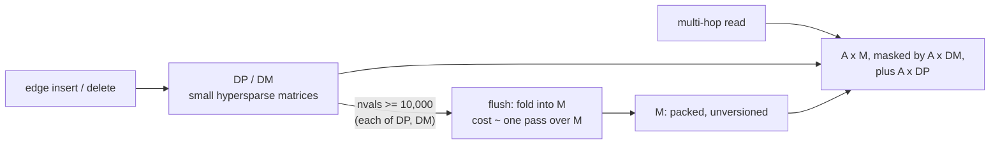

# FalkorDB's delta matrix, read as a dynamic graph store

[reading-falkordb-delta-matrix.md](../20-graphblas/reading-falkordb-delta-matrix.md)
(topic 20) built the delta matrix from first principles: the trio `M`, `DP`,
`DM`, its invariants, the read order, the masked-multiply fold. This guide does
not repeat any of that. It asks a different question of the same code: *where
does it sit among the other ways to make a CSR take writes, and which costs
that the published designs pay does it avoid, move or add?* Everything here is
FalkorDB's C engine at the pin in `resources/codebases.md`
(commit `ccb449a9a`, FalkorDB 4.x, the `master` branch); open a file with
`python3 tools/pinned-source.py show FalkorDB <path>`. The Rust engine on
`main` has no `src/graph/`.



## The problem in one sentence

A delta matrix keeps the settled graph in a packed, unversioned array and puts
every write in two small side matrices, so its cost is not "per write" or "per
edge" like the designs in the other guides but **a flush of the whole array
every T writes plus a probe of the side matrices on every read** — and nobody
has put those two terms next to the published alternatives.

## The concepts, step by step

### Step 1 — when the flush runs, and what the in-process model simplifies (delta_wait.c)

> **In:** topic 20 Step 6's account of the two folds and the threshold.
> **Out:** where in a query's life the flush lands, who waits for it, and the
> three ways this topic's model differs from the engine.

Topic 20 Step 6 ([reading-falkordb-delta-matrix.md](../20-graphblas/reading-falkordb-delta-matrix.md))
already takes the two folds apart: deletions are `GrB_transpose(m, dm, NULL, m,
GrB_DESC_RSCT0)` (`delta_wait.c:29`), whose flags cancel so that it is a copy of
`M` through the complement of `DM`; additions are one structurally masked
`GrB_Matrix_assign` of `DP` into `M` (`:51`); `DM` and `DP` are each tested
against the same bound (`:89`, `:97`), default **10,000**
(`src/configuration/config.h:19`, config name `DELTA_MAX_PENDING_CHANGES`,
`config.c:57`). Two facts from there matter for cost and are repeated only as
far as this guide needs them: the deletion fold reads and rewrites **all of
`M`** however small `DM` is (an inference from the operation: it must visit
every entry of `M` to decide whether `DM` masks it), and the comment at `:49`
says the addition fold's GraphBLAS path has not been checked. Both folds are
skipped when their delta is empty (`:25`, `:48`).

What topic 20 does not cover is *when* the fold runs:

```c
// src/graph/delta_matrix/delta_wait.c — Delta_Matrix_synchronize, 140-217 (elided)
   140  GrB_Info Delta_Matrix_synchronize
   ...
   152  	Delta_Matrix_lock (C) ;
   ...
   174  	bool already_sync = (C_nrows >= nrows &&
   175  						 C_ncols >= ncols &&
   176  						 !will_wait) ;
   177
   178  	if (already_sync == true) {
   179  		goto unlock ;
   180  	}
   ...
   205  	if (will_wait) {
   206  		info = Delta_Matrix_wait (C, false) ;
   ...
   213  unlock:
   214  	Delta_Matrix_unlock (C) ;
```

`Delta_Matrix_synchronize` is what runs when the graph hands out a matrix for
use. It takes the matrix's mutex (152), returns at once if the matrix is
already the right size and has no pending work (174–180), and otherwise calls
`Delta_Matrix_wait(C, false)` (205–206) — `false` meaning "fold only the
deltas that crossed the threshold" — before releasing the mutex (213–214). So
**the pause lands in whichever query first touches the matrix after a
threshold is crossed, while it holds that matrix's lock.** The cost is that query's latency,
and a stall for any other caller that wants the same matrix, since they
contend on the mutex taken at 152.

Three simplifications in this topic's model (`delta.rs`), stated once:

1. **Both deltas flush together, on their sum.** `CsrDelta` folds when
   `|DP| + |DM| ≥ T`; the engine folds `DP` when `|DP| ≥ T` and `DM` when
   `|DM| ≥ T`, independently. A graph with only inserts never runs the `DM`
   path; a balanced stream can carry up to 9,999 of each before either fires.
   On an insert-only stream the two agree exactly; on a mixed one the model
   flushes up to twice as often.
2. **One direction.** FalkorDB's `Delta_Matrix` carries a transposed twin with
   its own trio, so every write and every fold is done twice.
3. **A merge, not a masked copy.** The model's flush copies each untouched
   range of `M` whole and merges only the rows a delta touched; the engine's
   deletion fold rewrites `M` through a mask. Both are one pass over `M`, with
   different constants.

Why it matters: the flush cost is a function of `M`'s size, not of the delta's,
and it is paid as a latency by one query. That is the sawtooth every design
with a "settled + side structure" shape has, and lane 1e measures it
in-process while the README's C-engine datapoint shows it in the real one.

### Step 2 — the amortised cost of a delta insert: c + F/T, worked

> **In:** Step 1's flush trigger and lane 1e's measurements. **Out:** a
> two-term model of insert cost that reproduces the measured numbers, the
> difference between a stream average and a steady state, and the break-even
> against a plain adjacency list.

Topic 20 Step 6 prices the same trade in entries rewritten (N ÷ T = 100 M ÷
10,000 = 10,000 per edge for a 100 M-edge matrix); this step measures it in
nanoseconds. An insert into a delta design costs a small constant `c` (probe `M` for the
duplicate, insert into one small sorted row of `DP`) plus its share of the
flush: if a flush costs F and happens every T applied inserts, each insert pays
F/T. Lane 1e (this topic's bench; 16,084,545 edges, Apple M3 Pro, 20,000
writes — 18,646 of them applied inserts — at 10% of a 200,000-operation stream,
load average 4.49 at the start; see notes.md for the full table) measured:

| threshold T | flushes | mean flush F | measured ns/write | ns/write excluding flush (c) |
|---|---|---|---|---|
| 1,000 | 18 | 3.11 ms | 2,959 | 159 |
| 10,000 | 1 | 6.28 ms | 468 | 154 |

and the model reproduces them from the other columns:

```
T = 1,000:   F_total = 18 × 3.11 ms = 56.0 ms;  56.0 ms ÷ 20,000 writes = 2,799 ns;  159 + 2,799 = 2,958 ns   (measured 2,959)
T = 10,000:  F_total =  1 × 6.28 ms =  6.28 ms; 6.28 ms ÷ 20,000 writes =   314 ns;  154 +   314 =   468 ns   (measured   468)
```

(`c` is the measured remainder, so the match is by construction; what is not
by construction is the shape: at T = 1,000 the flush is 95% of the write cost
(2,799 of 2,958 ns), at T = 10,000 it is 67% (314 of 468).)

**A stream average is not a steady state.** The T = 10,000 row paid for one
flush across 18,646 applied inserts — 1.86 flush intervals, the last 8,646
inserts of which have not yet been charged for the next flush. In steady state
each applied insert owes F/T = 6.28 ms ÷ 10,000 = 628 ns to the flush, so the
steady-state cost is 154 + 628 = **782 ns per insert**, not 468. Against
`Vec<Vec<u32>>`'s 555 ns per write in the same 10%-insert stream (it has no
flush, only hub shifts), the delta is *worse* at FalkorDB's default T = 10,000
by 782 ÷ 555 = 1.4×. It breaks even where F/T falls to 555 − 154 = 401 ns:
T = 6.28 ms ÷ 401 ns ≈ 15,700 if F stayed at its T = 10,000 value (it grows
with T, so the real break-even is higher still). At T = 1,000 the steady-state
cost is 159 + 3,110 = 3,269 ns, about 5.9× the adjacency list.

**F is not constant.** It was 3.11 ms at T = 1,000 and 6.28 ms at T = 10,000: a
flush merges only the rows a delta touched, and ten times the changes touch
more rows, but both sit on one floor, a single pass over a 64 MB edge array.

Why it matters: the delta design buys scans at CSR speed (lanes 1b and 1d) and
pays for it with a write path that, once the flush is charged, is no cheaper
than an adjacency list's — on this graph, at this T. What it does buy on the
write side is a much *lower c* (154 ns against 555 ns) and a cost that is
concentrated into a pause rather than spread out; whether that is the right
trade depends on whether the writer can absorb a 6.3 ms stall. FalkorDB's own
flush (a GraphBLAS `assign` and a masked copy on 8-byte-index arrays, for the
matrix and its transposed twin) is a different F, and cannot be read off this
table; the C datapoint in the README shows the pause directly (24–29 ms for one
insert, which matrices it folded not decomposed).

### Step 3 — the read side: one extra multiply, not one extra probe (delta_mxm.c)

> **In:** topic 20's description of `Delta_mxm`. **Out:** what the engine pays
> per multiply for a non-empty delta, and why this topic's in-process model is
> a different cost shape.

```c
// src/graph/delta_matrix/delta_mxm.c — Delta_mxm's guards and calls, 66-108 (elided)
    66  	GrB_Matrix_nvals   (&dp_nvals, dp) ;
    67  	GrB_Matrix_nvals   (&dm_nvals, dm) ;
    ...
    71  	if (dm_nvals > 0) {
    72  		// compute A * 'delta-minus'
    ...
    74  		GrB_OK (GrB_mxm (mask, NULL, NULL, GxB_ANY_PAIR_BOOL, _A, dm, NULL)) ;
    ...
    80  	if (dp_nvals > 0) {
    81  		// compute A * 'delta-plus'
    ...
    86  		GrB_OK (GrB_mxm (accum, NULL, NULL, semiring, _A, dp, NULL)) ;
    ...
   104  	GrB_OK (GrB_mxm (_C, mask, NULL, semiring, _A, _B, desc)) ;
   105
   106  	if (additions) {
   107  		GrB_OK (GrB_eWiseAdd (_C, NULL, NULL, semiring, _C, accum, NULL)) ;
   108  	}
```

Lines 71 and 80 are the guard: with `nvals == 0` the extra multiplies do not
run, the same "an empty delta costs nothing" this topic's `CsrDelta::for_each`
reproduces with `is_empty()`. With a non-empty `DP`, the engine runs **three
multiplies instead of one** — `A·DP` (86), `A·M` (104) and `A·DM` (74, for the
mask) — then an element-wise add (107). Each is a whole GraphBLAS call with its
own setup, over the *frontier* `A` (the vertices reached so far), not per row.

So the delta's read cost in FalkorDB has two terms: a fixed per-multiply
overhead (extra calls, allocating `mask` and `accum`), and work proportional to
the number of `A`'s entries that hit a column of `DP` or `DM`. The in-process
model of this topic pays, instead, **one hash probe per visited row** (two with
deletions) — a per-vertex cost that grows with the *number of rows visited*, not
the number of multiplies. The shapes differ: the model is right about which
direction the cost grows with pending changes (lane 1d), not about its
constants, and FalkorDB's per-query datapoint in the README is the only place
this topic measures the engine itself.

What it shares with the model: A and C must be synced (`delta_mxm.c:47`, `:50`
in topic 20's snippet) — only the multiplied-*by* operand carries a delta — so
a path of k hops multiplies `A` through k matrices, each of which may have its
own delta.

Why it matters: the Revisiting guide's table ([reading-revisiting-dgs.md](reading-revisiting-dgs.md)
Step 6) lists "the per-row probe of `DP`/`DM`" as the cost a delta *moves*. In
FalkorDB it moves to "a few extra multiplies per hop", which is cheaper
per-query when the delta is tiny and unbounded in neither direction until the
flush.

### Step 4 — the write side, per call (delta_set_element_bool.c, delta_remove_element.c)

> **In:** topic 20 Step 3's four-call count. **Out:** the same count placed
> next to the in-process model's two probes and one small insert.

An insert (`delta_set_element_bool.c:27–40`, quoted in topic 20) probes `M`
once for the edge and then either clears `DM` (resurrecting a deleted edge) or
sets `DP`, in **both** the matrix and its transposed twin: four GraphBLAS calls
per logical insert. The in-process `CsrDelta::insert` does the same logical
steps once (the model has no transposed twin) — a `contains` binary search in
`M`'s row, then one sorted `Vec` insert into `DP`'s row — and costs 0.15–0.16 µs
(lane 1e, ns/write excluding the flush: 154–159). A Cypher `MERGE` against the
real engine costs hundreds of microseconds end to end (README datapoint),
because the round trip, parse, plan and result set dwarf the four calls. The two
numbers are not comparable and are not meant to be: the first is the
data-structure cost, the second the system's.

Why it matters: the doubled write (matrix and transpose) is a cost the
published designs, which store one direction, do not report; a fair comparison
to Sortledton's 4.8 M inserts/s halves it.

## How to read the code (with the concepts in hand)

1. **`delta_wait.c:13–57`** — the folds. Ask what each reads.
2. **`delta_wait.c:60–113`** — `Delta_Matrix_sync`, the trigger (89, 97).
3. **`delta_wait.c:140–217`** — when it runs, and under which lock.
4. **`delta_mxm.c:40–121`** — the read path (Step 3); topic 20's guide Step 5
   walks the mask semantics line by line.
5. **`config.h:19`** and **`config.c:57`** — the knob.

## Where each step lives in this topic

| step | file / lane | what to look at |
|---|---|---|
| 1 | `experiments/src/delta.rs` (`flush`) | the model's flush: one `memcpy` per untouched range, a merge per touched row |
| 2 | bench lane 1e | the threshold sweep; ns/insert with and without the flush |
| 3 | bench lane 1d, README C datapoint | scan cost vs pending changes; the engine's own query times |
| 4 | bench lane 1c | insert ns/op, delta vs `Vec<Vec<u32>>` vs a splicing CSR |

## Questions (answer in notes.md)

1. `Delta_Matrix_sync_deletions` reads and rewrites all of `M` however few
   deletions are pending. With 10,000 deletions against a 16 M-edge matrix,
   what fraction of the work is "useful"? What would an in-place compaction of
   only the affected rows do instead, and what does it need that GraphBLAS's
   array layout does not offer?
2. FalkorDB flushes `DP` and `DM` independently. For a 50/50 insert/delete
   stream, how many writes between flushes with T = 10,000 in FalkorDB versus
   this topic's model, and which is closer to the pending-changes bound a
   scan sees?
3. Step 2's model has F depending on T. From the two table rows, estimate F's
   floor (extrapolate to T → 0) and the marginal cost per pending change.
4. The flush pause lands in a query and holds the matrix's mutex. Using
   lane 1e's mean flush times, how long would a concurrent reader of the same
   relation wait, and is that above FalkorDB's usual query-latency budget?

## Done when

Answer each before unfolding it.

- [ ] You can say what a flush costs as a function of the settled matrix and the delta.

  <details><summary>Answer</summary>

  The deletion fold (`delta_wait.c:29`) is a masked copy of `M` through the
  complement of `DM` — it reads and rewrites all of `M`, independent of how
  many deletions are pending; the addition fold (51) assigns `DP` into `M`,
  whose cost depends on how GraphBLAS merges the pending tuples (the comment at
  49 says the author has not verified which path it takes). Both are skipped
  when their delta is empty (25, 48). So flush cost has a floor set by one pass
  over `M`, plus a term for the rows touched; topic 20 Step 6 puts the
  amortised cost per mutation at N ÷ T entries rewritten.

  </details>

- [ ] You can state where the threshold is applied and the default.

  <details><summary>Answer</summary>

  In `Delta_Matrix_sync` (`delta_wait.c:60–100`): `DM` is folded when its own
  `nvals ≥ delta_max_pending_changes` (89) and `DP` when its own `nvals ≥` the
  same bound (97). The default is 10,000 (`config.h:19`); the config name is
  `DELTA_MAX_PENDING_CHANGES` (`config.c:57`). The flush runs when
  `Delta_Matrix_synchronize` finds pending work (205–206), under the matrix's
  mutex (152), in whichever query first touches the matrix.

  </details>

- [ ] You can work the amortised insert cost c + F/T on lane 1e's numbers.

  <details><summary>Answer</summary>

  T = 10,000: one flush of 6.28 ms over 20,000 writes is 314 ns per write;
  added to 154 ns excluding the flush gives 468 ns, the measured value.
  T = 1,000: 18 flushes of 3.11 ms is 56.0 ms ÷ 20,000 = 2,799 ns, plus 159
  gives 2,958 against 2,959 measured. The flush is 95% of the write cost at
  T = 1,000 and 67% at T = 10,000. The stream average flatters T = 10,000:
  steady state owes F/T = 628 ns per insert, so 154 + 628 = 782 ns against the
  adjacency list's 555.

  </details>

- [ ] You can explain how the read path differs from the in-process model.

  <details><summary>Answer</summary>

  `Delta_mxm` (`delta_mxm.c:66–108`) computes `A·DM` (a mask) and `A·DP` only
  when those deltas are non-empty (guards at 71, 80), then `A·M` masked by the
  first and an element-wise add of the second: three multiplies instead of
  one, a per-multiply overhead plus work proportional to the frontier's hits
  on the delta. The model probes a hash map once per visited row (and checks a
  tombstone list on rows with deletions) — a cost that scales with rows
  visited. Both are zero for an empty delta and grow with pending changes;
  their constants are different.

  </details>

- [ ] You can name what the doubled (matrix + transpose) write costs a fair comparison.

  <details><summary>Answer</summary>

  Every logical edge insert runs the write path on the matrix and on its
  transposed twin (`delta_set_element_bool.c:27–29` recursion; four GraphBLAS
  calls in all, topic 20 Step 3), and every flush folds both. The published
  designs store one direction, so a like-for-like insert-rate comparison
  against them should either halve FalkorDB's rate or double theirs.

  </details>

## References

- FalkorDB C engine, commit `ccb449a9a` (pin table): `src/graph/delta_matrix/`
  (`delta_wait.c`, `delta_mxm.c`, `delta_isStored.c`,
  `delta_set_element_bool.c`, `delta_remove_element.c`, `delta_matrix.h`),
  `src/configuration/config.h`, `src/configuration/config.c`.
- [reading-falkordb-delta-matrix.md](../20-graphblas/reading-falkordb-delta-matrix.md)
  — the design from first principles.
- [reading-revisiting-dgs.md](reading-revisiting-dgs.md),
  [reading-teseo.md](reading-teseo.md), [reading-sortledton.md](reading-sortledton.md),
  [reading-packed-csr.md](reading-packed-csr.md), [reading-livegraph.md](reading-livegraph.md).
