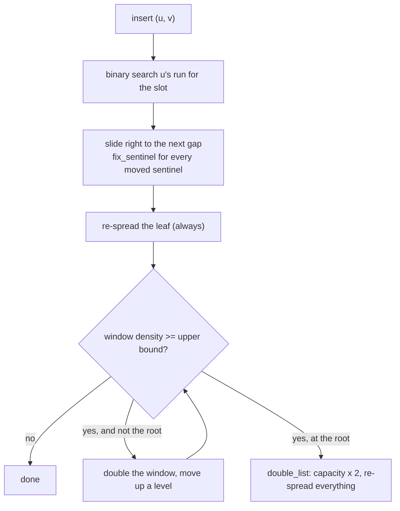

# Packed CSR: a CSR with gaps, and what a "factor of two" means

The shortest path from "CSR cannot take an insert" to "CSR takes an insert" is
to leave holes in its edge array. A hole turns "shift half the array" into
"shift to the nearest hole", and the only thing left to design is *where the
holes go and how they are replenished* — the **packed memory array** (PMA).
This guide reads the short paper that applied it to CSR, the 700-line C++ file
that implements it, and puts its "within a factor of two" claim next to the
numbers it was derived from.

**"Packed Compressed Sparse Row: A Dynamic Graph Representation"** — Brian
Wheatman and Helen Xu (MIT). IEEE HPEC 2018
([pdf](https://people.csail.mit.edu/hjxu/papers/pcsr.pdf), the author's copy;
there is no arXiv listing). The paper has roman-numeral sections (I
Introduction, II Graph Storage Formats, III PCSR, IV Results, V Conclusion);
tables and figures are cited by their printed numbers. The code is
`github.com/wheatman/Packed-Compressed-Sparse-Row` at
`46bfe503239483286b85345f7c916e8e6403dccf`, cloned to
`~/repos/Packed-Compressed-Sparse-Row` (not in the pin table; the commit is
stated here). One practical fact before reading: the file's `bsf_word` and
`bsr_word` helpers are **x86 inline assembly** (`PCSR.hpp:38–48`), so it does
not build on this repo's Apple-silicon machine; everything below about the
code was read, not run. (A multi-threaded descendant,
`github.com/domargan/parallel-packed-csr`, is cloned alongside at
`514d17452a8c1481c500ed0e198ad9f7be2dccbb` and not read for this guide.)



## The problem in one sentence

CSR packs every edge of every vertex into one array with no slack, so adding
an edge shifts, on average, half the array and adds one to every later offset
— Θ(|V| + |E|) work for one edge (§II) — and an adjacency list that fixes the
insert gives up CSR's locality.

## The concepts, step by step

### Step 1 — the cost in cache lines: Table I, worked on this graph (§II, Table I)

> **In:** Table I of the paper, with n = |V|, m = |E| and B the number of
> words per cache line. **Out:** the two asymptotic costs for one insert,
> computed on this topic's graph, and the caveat on what the ratio means.

Table I states costs in the **external-memory model**: count the number of
cache-line transfers, with B the number of elements that fit in one line.
The row "Add edge" says

```
CSR:         O( (m + n) / B )          one insert shifts and rewrites the whole structure
Packed CSR:  O( lg²(m + n) / B )       amortised
```

Worked on this graph — m = 16,084,545 edges, n = 1,048,576 vertices, so
m + n = 17,133,121 — and a 64-byte line holding sixteen 4-byte words (B = 16):

```
CSR:         17,133,121 / 16           = 1,070,820 line transfers
PCSR:        lg(17,133,121) = 24.03;  24.03² = 577.5;   577.5 / 16 = 36.1 line transfers
ratio        1,070,820 / 36.1          ≈ 29,700
```

This is a bound with its constants removed, not a prediction: the real
PCSR insert also copies, scans for density and re-spreads, and the CSR one is
a `memmove` that runs at memory bandwidth. Treat 29,700× as the *order* the
two curves are apart; this topic's lane 1a and lane 3 measure the real ratio
(notes.md), and it is far smaller because the memmove is so fast.

What the table also says, and the paper repeats: scanning all neighbours of v
is O(deg(v)/B) for both — the gaps cost a constant factor in lines read, not
an asymptotic one — and finding whether w is a neighbour is
O(lg(deg v)/lg B) for both.

Why it matters: this is the argument for the layout; the rest of the guide is
what it costs in practice.

### Step 2 — the layout: one packed memory array, a sentinel per vertex (§III)

> **In:** CSR's two arrays. **Out:** the structure PCSR replaces them with,
> and how a vertex finds its edges after elements move.

PCSR keeps CSR's two roles — a *vertex list* and an *edge list* — but the
edge list is a PMA. Its **leaf** (the smallest unit that is spread evenly) is
about lg N slots long; above the leaves sits an implicit binary tree of
windows, each with a density bound (Step 3). Every vertex's run of edges
starts with a **sentinel** slot that records which vertex owns the run, and
the vertex list stores each vertex's `beginning` and `end` slot positions.
The code's types:

```cpp
// PCSR.hpp — the three structs, 11-35
    11  typedef struct _node {
    12    // beginning and end of the associated region in the edge list
    13    uint32_t beginning;     // deleted = max int
    14    uint32_t end;           // end pointer is exclusive
    15    uint32_t num_neighbors; // number of edges with this node as source
    16  } node_t;
    17
    18  // each node has an associated sentinel (max_int, offset) that gets back to its
    19  // offset into the node array
    ...
    23  typedef struct _edge {
    24    uint32_t dest; // destination of this edge in the graph, MAX_INT if this is a
    25                   // sentinel
    26    uint32_t
    27        value; // edge value of zero means it a null since we don't store 0 edges
    28  } edge_t;
    29
    30  typedef struct edge_list {
    31    int N;
    32    int H;
    33    int logN;
    34    edge_t *items;
    35  } edge_list_t;
```

Read three things off it. A slot (`edge_t`, line 23) is **8 bytes** — a
destination *and* a weight — so unweighted storage in this code is twice a
4-byte CSR before any gap. A **null** is `value == 0` (line 26–27): "we don't
store 0 edges", so a zero-weight edge cannot be represented. And `N`, `H`,
`logN` (31–33) are the array length, the tree height and the leaf length;
the constructor derives the last two from N alone.

Worked, for N = 2²⁵ = 33,554,432 slots (the next power of two above
(m + n) ÷ 0.75 on this topic's graph, the size lane 3's reference uses):

```
bsr(N) = 25                        (index of the highest set bit)
logN   = 1 << bsr(25 + 1)          = 1 << bsr(26) = 1 << 4 = 16 slots per leaf
H      = bsr(N / logN)             = bsr(2^21)    = 21 levels above the leaves
```

(the formulas are `PCSR.hpp:295–296`, `699–700`.) So a leaf is 16 slots = 128
bytes = two cache lines, and the window tree has 21 levels.

When an element moves — a shift, a rebalance — a sentinel may move with it,
and the vertex list must follow. That is the whole job of `fix_sentinel`:

```cpp
// PCSR.hpp — fix_sentinel, 242-250
   242  void PCSR::fix_sentinel(int32_t node_index, int in) {
   243    nodes[node_index].beginning = in;
   244    if (node_index > 0) {
   245      nodes[node_index - 1].end = in;
   246    }
   247    if (node_index == nodes.size() - 1) {
   248      nodes[node_index].end = edges.N - 1;
   249    }
   250  }
```

The vertex list is `n` × 12 bytes (`node_t`), against CSR's 4 per vertex —
a fixed per-vertex price paid for being able to repair the pointer. Line 245
is the invariant: vertex *i*'s `end` is vertex *i+1*'s sentinel position, so
moving a sentinel updates two entries.

Why it matters: Lane 3's slot encoding (`0` empty, high bit marks a sentinel,
edge stored as `v + 1`) is this layout shrunk to 4-byte slots, and its
spec test "hammering one vertex … other vertices' pointers survived every
move" is `fix_sentinel` under stress.

### Step 3 — the density rule and the insert, in code (§III)

> **In:** Step 2's structure. **Out:** the four things an insert does, with
> the line each is on, and the bound that triggers a rebalance.

The bounds, by tree level (`level` = H at the leaf, 0 at the root):

```cpp
// PCSR.hpp — density_bound, 229-240
   229  // density bound
   230  pair_double density_bound(edge_list_t *list, int depth) {
   ...
   235    // between 1/8 and 1/4
   236    pair.x = 1.0 / 4.0 - ((.125 * depth) / list->H);
   237    pair.y = 3.0 / 4.0 + ((.25 * depth) / list->H);
   238    return pair;
   239  }
```

`pair.y` (237) is the **upper** bound: 0.75 + 0.25 · level/H — **1.0 at a leaf,
0.75 at the root**. `pair.x` (236) is the lower bound, 1/4 − (1/8) · level/H:
0.125 at a leaf, 0.25 at the root; deletions would use it, but "we have not
implemented removing edges" (§III). Worked at N = 2²⁵ (H = 21): the upper
bound at level 10 is 0.75 + 0.25 × 10/21 = 0.869; at level 20, 0.988.

The insert (the part of `PCSR::insert`, `PCSR.hpp:523–593`, after the element
is placed):

```cpp
// PCSR.hpp — PCSR::insert, the density loop, 558-592 (elided 568-572)
   558    double density = get_density(&edges, node_index, len);
   559
   560    // spill over into next level up, node is completely full.
   561    if (density == 1) {
   562      node_index = find_node(node_index, len * 2);
   563      redistribute(node_index, len * 2);
   564    } else {
   565      // makes the last slot in a section empty so you can always slide right
   566      redistribute(node_index, len);
   567    }
   ...
   575    while (density >= density_b.y) {
   576      len *= 2;
   577      if (len <= edges.N) {
   578        level--;
   579        node_index = find_node(node_index, len);
   580        density_b = density_bound(&edges, level);
   581        density = get_density(&edges, node_index, len);
   582      } else {
   583        // if you reach the root, double the list
   584        double_list();
   ...
   590    redistribute(node_index, len);
```

Four steps, then: (1) place the element by sliding the run to the right up to
the next empty slot (`slide_right`, lines 326–362; each moved sentinel calls
`fix_sentinel`, 335–353); (2) **always** redistribute the leaf (566) — "makes
the last slot in a section empty so you can always slide right" — so *every*
insert pays an O(leaf) re-spread, not only the ones that overflow;
(3) climb: while the window's density is at or above its upper bound
(575), double the window length (576) and move up a level (578); (4) at the
top (582–584) double the whole array, otherwise re-spread the window found
(590). The line to focus on is 566: the per-insert re-spread is why PCSR's
insert is "3–4 times slower" than an adjacency list's (§IV) — it is doing
O(log N) work on every insert, in exchange for the guaranteed O(lg² N)
amortised bound.

`redistribute` spreads the window's non-null elements evenly:

```cpp
// PCSR.hpp — redistribute, 255-291 (elided 256-263)
   255  void PCSR::redistribute(int index, int len) {
   ...
   264    for (int i = index; i < index + len; i++) {
   265      space[j] = edges.items[i];
   266      // counting non-null edges
   267      j += (!is_null(edges.items[i]));
   ...
   273    // evenly redistribute for a uniform density
   274    double index_d = index;
   275    double step = ((double)len) / j;
   276    for (int i = 0; i < j; i++) {
   277      int in = index_d;
   278
   279      edges.items[in] = space[i];
   280      if (is_sentinel(space[i])) {
   281        // fixing pointer of node that goes to this sentinel
   ...
   286        fix_sentinel(node_index, in);
   287      }
   288      index_d += step;
   289    }
```

The spread is step = len / j (275) — element i goes to slot
`index + int(index_d)`, where `index_d` is the running sum of `step` (274, 288).
Worked on a window of len = 16 holding j = 12 elements: step = 1.3333…, and
the accumulated doubles give offsets 0, 1, 2, 4, 5, 6, 7, 9, 10, 12, 13, 14, so
the gaps fall at 3, 8, 11 and 15 — one gap in every four slots, give or take.
(The exact rule `floor(i · len / j)` would put element 6 at offset 8, not 7;
the running floating-point sum is one ulp short of 8.0 at that step, and the
truncation at line 277 drops it to 7. Harmless, but it is why the C code and
an integer-arithmetic re-implementation place elements one slot apart in a
few positions.) (The function allocates a
temporary `malloc`ed array of `len` slots on every call, line 259, which is a
real cost the paper's O(lg² N) does not mention.)

Why it matters: the reference solution to Lane 3 spreads with
`floor(i · len / k)` in integer arithmetic — the same rule without the float drift — and counts rebalances and doublings
separately, which the spec test checks.

### Step 4 — the results, and the two numbers that do not agree (§IV)

> **In:** §IV's synthetic benchmarks (100,000 nodes, variable edges) and
> Table II (three real graphs, times normalised to PCSR). **Out:** the
> claim "a factor of two on traversals", checked against the table that
> backs it.

The paper's synthetic claims, quoted:

- inserts: CSR "starts about 3 orders of magnitude slower than all other
  representations" and "PCSR is about 3–4 times slower than AL based
  representations" (§IV, Fig. 6);
- space: "PCSR only has a space overhead of between 20% and 30%" over an
  *ideal* CSR (§IV, Fig. 5);
- traversal: "SpMV in PCSR is within a factor of 2 and often within 20% of
  SpMV in CSR" and "PCSR achieved within 25% of CSR's runtime on most input
  sizes" for PageRank and BFS (§IV, Figs. 7–8).

Table II uses real graphs and divides every format's time by PCSR's, so the
CSR column's entries below 1 say how much faster CSR is: 1 ÷ entry. For the
traversal rows:

| graph | SpMV (CSR col) | → CSR faster by | BFS | → | PageRank | → |
|---|---|---|---|---|---|---|
| Slashdot | 0.39 | 2.56× | 0.47 | 2.13× | 0.36 | 2.78× |
| Pokec | 0.51 | 1.96× | 0.48 | 2.08× | 0.54 | 1.85× |
| LiveJournal | 0.59 | 1.69× | 0.53 | 1.89× | 0.54 | 1.85× |

(worked once: LiveJournal PageRank 1 ÷ 0.54 = 1.85.) On the real graphs CSR is
**1.7× to 2.8×** faster at traversals — the paper's own concluding sentence
is "about a factor of 2 slower than CSR on graph computations", which is the
real-graph table, not the "within 25%" of the synthetic figures. Table II's
"Size" row says the same for space: CSR is 0.41, 0.45 and 0.49 of PCSR's size
on the three graphs, so PCSR is 2.0–2.4× larger — but that CSR is the paper's
"C++ vector with doubling" build (so it carries its own slack), not the ideal
CSR of the 20–30% figure. The two sets of claims (synthetic, real) measure
different things and must not be mixed.

The same table's "Adding edges" row — 1,000 random edges — has CSR at
525× (Slashdot), 31,628× (Pokec) and 70,787× (LiveJournal) PCSR's time:
the cost of the shift grows with the graph, as Step 1's formula says.

Why it matters: the PMA bet is that the factor of two on traversals buys
orders of magnitude on inserts. For a delta design the comparison is
different — the delta pays *no* traversal tax on the settled part — and this
topic's lane 3 asks what the factor is on a two-hop scan on a re-implemented,
branchy-versus-branchless PMA.

## How to read the paper (with the concepts in hand)

1. **§I and Table I** — Step 1; do the line-transfer arithmetic for your
   own graph.
2. **§II** — the formats; the CSR paragraph states the cost of one insert.
3. **§III** — the PMA description is two paragraphs and Fig. 3 is the
   picture to keep.
4. **§IV** — read Table II *before* the figures, then the figures against it.

Read the code in this order: the structs (11–35), `density_bound` (229),
`redistribute` (255), `slide_right` (326), `insert` (523–593), and finally
`add_edge` (663), which calls binary search over `[node.beginning + 1, node.end)`
(672–674) and then `insert`. Notice that `add_edge` does not check for a
duplicate — `add_edge_update` (678) does (688).

## Where each step lives in this topic

| step | file / lane | what to look at |
|---|---|---|
| 1 | bench lane 1a vs lane 3 | measured CSR splice vs measured PMA insert |
| 2 | `experiments/src/pma.rs` | `from_edges`, the sentinel slots, `start[]` |
| 3 | lane 3 spec tests | `capacity_is_a_power_of_two…`, `hammering_one_vertex…` |
| 4 | notes.md | the PMA scan ratio on this graph |

## Questions (answer in notes.md)

1. Step 1 gives 29,700× between the bounds and notes the measured ratio is
   far smaller. List the two largest constant factors a CSR splice enjoys
   that the O(·) forms hide.
2. `insert` re-spreads the leaf after every insert (line 566). What does the
   per-insert cost become if only overflowing leaves are re-spread, and what
   property of `slide_right` (line 332) breaks?
3. Table II reports CSR 525× to 70,787× slower at adding 1,000 edges.
   Why does the ratio grow with graph size, and what would it do if the
   edges were added in the order of their sources?
4. `edge_t` is 8 bytes. If the destination alone is stored (4 bytes) and
   "null" is a reserved id, what is the new load factor needed to match a
   4-byte CSR's footprint plus 20%?

## Done when

Answer each before unfolding it.

- [ ] You can state the PMA invariants and what a rebalance does.

  <details><summary>Answer</summary>

  The edge array is sorted with gaps; an implicit binary tree of windows over
  fixed-size leaves has a density upper bound that tightens from 1.0 at a
  leaf to 0.75 at the root (`density_bound`, PCSR.hpp:237). An insert slides
  elements to the nearest gap; if a window's density is at or above its bound,
  the insert climbs to the first ancestor within bound and re-spreads its
  elements evenly (`redistribute`, 255–291); if the root is over, the array
  doubles (`double_list`, 293–304).

  </details>

- [ ] You can say how a vertex finds its edges after they move.

  <details><summary>Answer</summary>

  Each vertex's run begins with a sentinel slot (dest = max int, value = the
  vertex's index) and the vertex list stores `beginning`/`end` slots. Any
  move that carries a sentinel calls `fix_sentinel`, which sets the vertex's
  `beginning` and the previous vertex's `end` (PCSR.hpp:242–250); both
  `slide_right` (335–353) and `redistribute` (280–287) do it.

  </details>

- [ ] You can work the Table I cost ratio on a graph of your choosing.

  <details><summary>Answer</summary>

  With m + n = 17,133,121 and B = 16: CSR (m + n)/B = 1,070,820 line
  transfers; PCSR lg²(m + n)/B = 24.03² / 16 = 36.1; ratio ≈ 29,700. It is an
  asymptotic bound with constants omitted, so it orders the two costs; it does
  not predict the measured ratio.

  </details>

- [ ] You can reconcile "within 25% of CSR" with "a factor of two".

  <details><summary>Answer</summary>

  The 25% (and "often within 20%") describes the synthetic graphs of §IV's
  figures; the factor of two is the real graphs of Table II, where CSR's
  traversal times, normalised to PCSR = 1, are 0.36–0.59, i.e. CSR is
  1.69–2.78× faster (SpMV, BFS and PageRank on Slashdot, Pokec and
  LiveJournal). The conclusion's "about a factor of 2 slower than CSR on graph
  computations" refers to the latter.

  </details>

- [ ] You can name two costs in the code the asymptotic bound hides.

  <details><summary>Answer</summary>

  Every insert re-spreads its leaf (PCSR.hpp:566), not only an overflowing
  one; `redistribute` mallocs and frees a temporary array of the window's
  length on every call (259); `get_density` counts the whole window with a
  scan each time it is called (206–211); and a slot is 8 bytes (dest +
  weight), doubling the bytes a traversal reads relative to a 4-byte CSR
  before any gap is counted.

  </details>

## References

- Wheatman, Xu. *Packed Compressed Sparse Row: A Dynamic Graph
  Representation.* IEEE HPEC 2018.
- Code: `github.com/wheatman/Packed-Compressed-Sparse-Row` at
  `46bfe503239483286b85345f7c916e8e6403dccf`.
- Bender, Hu. *An adaptive packed-memory array.* ACM TODS 32(4), 2007 — the
  PMA the paper builds on (cited as [BH07]; not read for this guide).
- [reading-teseo.md](reading-teseo.md) — the same idea with gaps at segment
  granularity, background rebalancing and MVCC;
  [reading-revisiting-dgs.md](reading-revisiting-dgs.md).
