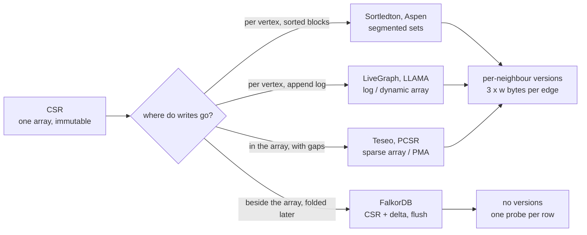

# Revisiting in-memory dynamic graph storage: what the tax on CSR actually is

Every dynamic graph store is judged against one baseline: a
[CSR](../20-graphblas/reading-suitesparse-internals.md) that never changes. This
paper is the only one in the topic that puts five published designs on one
test bench, re-implements their techniques inside one framework, and *says out
loud how far each one sits from CSR* — in time, in cache misses, and in bytes.
It is the reading guide to start with, because the other guides in this topic
each describe one design in its own authors' favourable light.

**"Revisiting the Design of In-Memory Dynamic Graph Storage"** — Jixian Su,
Chiyu Hao, Shixuan Sun, Hao Zhang, Sen Gao, Jiaxin Jiang, Yao Chen, Chenyi
Zhang, Bingsheng He, Minyi Guo. arXiv:2502.10959v1 (16 Feb 2025,
[pdf](https://arxiv.org/pdf/2502.10959)). The arXiv text names no venue; its
page headers carry the ACM article number "70" and the bibliographic indexes
list it as SIGMOD 2025 (*Proc. ACM Manag. Data* 3(1), article 70), which is
how this repo cites it. Section, table and figure numbers below are the
arXiv v1 PDF's. Its test framework is open source at
`github.com/SJTU-Liquid/DynamicGraphStorage`; the commit read for the code
anchors is `5cb0a99b5ecef2130f571be398ecaf7a4dfdf48f`, cloned to
`~/repos/DynamicGraphStorage` (it is not in the pin table; the commit is
stated here instead).

What the paper does **not** do matters as much as what it does: none of the
five systems it studies is a *CSR plus delta* design. The comparison that
tells a FalkorDB developer something is therefore indirect — it measures what
the other families pay, so that [Step 6](#step-6--reading-it-from-a-delta-matrix-seat)
can say which of those costs a delta design avoids and which it moves
somewhere else.



## The problem in one sentence

A graph that takes concurrent single-edge writes while analytics scan
neighbour lists is, in the five designs the paper studies, **2.4–11.0× slower
to query and 3.3–10.8× larger than CSR** by the authors' summary
(Introduction) — and the paper's own Table 5 supports a smaller query range,
1.1–4.1×, on the cells this guide re-derives in [Step 3](#step-3--the-scan-gap-table-5-and-what-it-does-and-does-not-say-613).

## The concepts, step by step

### Step 1 — the vocabulary and the cost model (§2, §3)

> **In:** nothing — the paper's own definitions. **Out:** the six graph
> operations, the five container families, and Equation 1 worked on one
> number set so the symbols mean something.

Terms the rest of the guide leans on, each defined once:

- A **neighbour set** N(u) is the set of vertices u has an edge to; its size
  d(u) is u's **degree**.
- **CSR** (compressed sparse row) keeps every neighbour set in *one* array,
  concatenated in vertex order, plus an **offset array** where `offsets[u]` says
  where u's slice starts. Scanning N(u) is one sequential read.
- An **adjacency list** (AdjLst in the paper) keeps one separate array per
  vertex, found through a vertex table. Scanning is still sequential *inside*
  one array, but each array lives wherever the allocator put it.
- A **dynamic array** (DA) is a growable array with amortised O(1) append;
  a **sorted dynamic array** (SDA) is one kept in order, so a search is a binary
  search and an insert shifts the tail.
- A **packed memory array** (PMA) is a sorted array deliberately left with
  gaps; an insert shifts only up to the next gap, and a periodic
  **rebalance** re-spreads elements to restore the gaps ([reading-packed-csr.md](reading-packed-csr.md)).
- A **skip list** is a sorted linked structure with express lanes; a
  **segmented** neighbour set splits N(u) into sorted **blocks** (the paper uses
  |B| = 256 by default, §5.1) and indexes the blocks.
- **MVCC** (multi-version concurrency control) lets readers see a frozen
  snapshot while writers proceed, by keeping several versions of data. A
  **fine-grained** scheme stamps every neighbour with a version; a
  **coarse-grained** one (copy-on-write, **CoW**) makes a whole new graph
  snapshot per write and shares what did not change.

The paper models the cost of one graph operation as (Equation 1, §3.2)

```
T = T_CC + Σ_{p ∈ P_V} α_p · T_p + Σ_{p ∈ P_N} α_p · T_p
```

where `T_CC` is the cost of coordinating access to the target vertex (taking
its lock), `P_V` and `P_N` are the sequences of primitive operators the
operation runs on the *vertex table* and on the *neighbour table*, `T_p` is the
cost of one primitive operator, and `α_p ≥ 1` is how much concurrency control
inflates it (1 means free). The authors say plainly it is "a tool to
systematically study these performance factors rather than predicting the
exact cost".

A worked example. `InsEdge(u, v)` runs `SearchVtx(u)` on the vertex table,
then `SearchEdge` (to refuse duplicates) and the insert itself on N(u)
(Figure 3: "InsEdge invokes SearchEdge"). With **hypothetical** unit costs —
these are not the paper's, they exist so the formula yields a number —
`T_CC` = 40 ns, `SearchVtx` 5 ns with α = 1, `SearchEdge` 200 ns with α = 1.5,
the shift-and-insert 100 ns with α = 1.5:

```
T = 40 + (1 × 5) + (1.5 × 200) + (1.5 × 100)
  = 40 + 5 + 300 + 150
  = 495 ns
```

The lesson the example carries is the paper's: for a fine-grained scheme α is
*per element visited*, so it multiplies the dominant term (the neighbour-table
work), not the vertex lookup.

Why it matters: when a later step says "the version check costs
2.0–5.7× on scans" it is a statement about α on `ScanNbr`, and when it says
"a dynamic array beats a hash table for the vertex index" it is a statement
about `T_p` on the vertex table.

### Step 2 — the five designs and their complexities (§4, Tables 1–2)

> **In:** Step 1's vocabulary. **Out:** one row per design saying how it
> stores N(u), how it versions, and what each costs asymptotically.

Table 1 of the paper (time and space of the building blocks, n = set size):

| structure | insert | search | scan | space |
|---|---|---|---|---|
| dynamic array (DA) | O(1) | O(n) | O(n) | O(n) |
| sorted dynamic array (SDA) | O(n) | O(log n) | O(n) | O(n) |
| packed memory array (PMA) | O(log² n) | O(log n) | O(n) | O(n) |
| skip list (SL) | O(log n) | O(log n) | O(n) | O(n log n) |
| hash table (HT) | O(1) | O(1) | O(n) | O(n) |
| AVL tree | O(log n) | O(log n) | O(n) | O(n) |
| parallel augmented map (PAM) | O(log n) | O(log n) | O(n) | O(n) |

and Table 2 (the five systems):

| system | version scheme | vertex index | neighbour index | extras |
|---|---|---|---|---|
| LiveGraph | fine-grained, versions stored contiguously, S2PL | dynamic array | dynamic array | Bloom filter |
| Sortledton | fine-grained, version chain, G2PL | dynamic array | segmented skip list | adaptive indexing |
| Teseo | fine-grained, version chain, OCC | hash table | PMA (one shared) | write-optimised segments |
| Aspen | coarse-grained, single writer, CoW | AVL tree | segmented PAM | flatten, difference encoding |
| LLAMA | coarse-grained, single writer | dynamic array | dynamic array | — |

Read the two tables together and the whole design space falls out. Every
scan in the "scan" column is O(n) — the asymptotics are *identical* — so the
differences the paper measures are constants: where the bytes live, how many
cache lines and pages a scan touches, how many instructions and branches it
runs per edge. That is why the paper goes on to measure hardware counters
(Step 3) instead of arguing from the table.

The remaining abbreviations: **2PL** is two-phase locking (acquire locks, then
release them all at the end); **S2PL** (strict) holds exclusive locks until
commit; **G2PL** is Sortledton's variant that sorts vertex ids and locks in
that order so deadlock cannot happen (§4.1.2); **OCC** (optimistic concurrency
control) lets transactions run without locks and validate at commit.

Why it matters: a FalkorDB delta matrix is *none* of these rows — it has no
per-neighbour version at all, because its consistency comes from a single
writer and a flush (the next steps return to this).

### Step 3 — the scan gap: Table 5, and what it does and does not say (§6.1.3)

> **In:** Table 5 (PageRank "PR" and triangle counting "TC" runtimes in
> seconds) and Table 4 (hardware counters for a 2^20-neighbour scan).
> **Out:** a per-cell ratio of "best segmented design" to CSR, recomputed
> from the table, and the counter explanation.

Table 5 reports whole-kernel runtimes. Taking the lowest of the five
segmented columns (Aspen with and without its flatten optimisation, Teseo,
Sortledton with and without adaptive indexing) in each row and dividing by the
CSR column:

| kernel · graph | CSR (s) | best segmented (s) | ratio |
|---|---|---|---|
| PR · lj | 4.66 | 13.06 (Sortledton, adaptive) | 2.80× |
| PR · dl | 1.39 | 2.01 (Teseo) | 1.45× |
| PR · ldbc | 20.57 | 44.28 (Aspen, flatten) | 2.15× |
| PR · g5 | 20.98 | 38.51 (Teseo) | 1.84× |
| PR · wk | 6.64 | 19.30 (Sortledton, adaptive) | 2.91× |
| PR · ct | 1.88 | 7.71 (Sortledton, adaptive) | 4.10× |
| PR · tw | 24.87 | 55.58 (Teseo) | 2.23× |
| PR · nft | 10.60 | 34.05 (Sortledton, adaptive) | 3.21× |
| TC · lj | 15.36 | 27.73 (Sortledton, adaptive) | 1.81× |
| TC · dl | 452.36 | 501.16 (Teseo) | 1.11× |
| TC · ldbc | 89.24 | 142.19 (Teseo) | 1.59× |
| TC · g5 | 1042.68 | 1395.10 (Teseo) | 1.34× |
| TC · wk | 7.63 | 17.05 (Sortledton, adaptive) | 2.23× |
| TC · ct | 3.17 | 5.31 (Sortledton, adaptive) | 1.68× |
| TC · tw | 801.14 | 958.66 (Teseo) | 1.20× |
| TC · nft | 218.23 | 382.77 (Teseo) | 1.75× |

(Worked once: PR on `lj` is 13.06 ÷ 4.66 = 2.80.) The range over the sixteen
cells is **1.11× to 4.10×**. The paper's text (§6.1.3) says CSR wins "ranging
from 1.2–53.7×" and its Introduction says "2.4–11.0×"; neither range can be
reproduced from any pair of columns in Table 5, so neither is used anywhere in
this repo. They may come from kernels or variants the arXiv text omits (the
paper says BFS, SSSP and WCC are "in the full version"). The table is what
was checked.

Why the segmented layouts lose even though every scan is O(n): Table 4
measures one scan of a 2^20-neighbour set with block size 256.

| metric | AdjLst | LiveGraph | Aspen | Teseo | Sortledton |
|---|---|---|---|---|---|
| L1 miss | 2.57e8 | 2.53e8 | 2.38e8 | 2.65e8 | 5.48e8 |
| LLC miss | 1.34e8 | 1.34e8 | 1.84e8 | 2.15e8 | 2.38e8 |
| DTLB miss | 1.19e4 | 1.20e4 | 1.94e6 | 4.20e6 | 4.32e6 |
| branch miss | 1.20e3 | 2.23e3 | 7.90e6 | 1.50e3 | 6.24e6 |
| instructions | 1.07e9 | 1.61e9 | 7.57e9 | 1.14e9 | 1.18e10 |

(**DTLB miss**: the translation of a virtual page to a physical one was not in
the CPU's small cache of recent translations; a scan that hops between
non-adjacent blocks pays it.) Read down the DTLB row: the contiguous layouts
take ~1.2e4 while the three block layouts take 1.9e6–4.3e6, **about 160× to
360×** more (4.20e6 ÷ 1.19e4 = 353 for Teseo). Read the branch row: Teseo's
PMA scan has 1.50e3 mispredictions, near the contiguous layouts', while
Aspen's and Sortledton's pointer-chasing indexes take 7.90e6 and 6.24e6.
That is the paper's explanation for "Teseo is the best segmented design and
reaches 52–77% of AdjLst's scan throughput" (§6.1.2): a PMA's blocks are
adjacent in memory and its scan loop is simple.

Why it matters: the scan gap is not about asymptotics, it is about contiguity.
CSR is the end of a spectrum whose other end is one-allocation-per-block, and
every dynamic design is somewhere along it. Lane 1b of this topic's bench puts
a number on the same axis for the layouts a FalkorDB engineer actually has.

### Step 4 — the version tax: bytes per edge moved (§4.2, §6.2.2, Tables 7–8)

> **In:** Table 7 (32-thread scan throughput, million edges per second) and
> Table 8 (memory bandwidth, GB/s, max 60). **Out:** a derived bytes-per-edge
> figure per design, and the memory-footprint ratios of Table 9.

§4.2 says each element in Sortledton, Teseo and LiveGraph "consumes 3 × w
bytes, where w is the word size: one for the vertex ID, one for the version,
and one for the pointer" — 24 bytes at w = 8 — while Aspen's elements are w
bytes (coarse-grained, no per-element version). A scan has to read them. The
paper never prints bytes-per-edge, but two of its tables imply it: divide
the bandwidth a design drew at 32 threads on g5 (Table 8) by the edges per
second it scanned (Table 7):

```
design      bandwidth (Table 8)   scan rate (Table 7)    bytes per edge
AdjLst      57.76 GB/s     ÷      3955.47 M edges/s   =   14.60 B
LiveGraph   56.69 GB/s     ÷      2540.43 M edges/s   =   22.31 B
Aspen       49.07 GB/s     ÷      4389.51 M edges/s   =   11.18 B
Teseo       57.81 GB/s     ÷      3021.91 M edges/s   =   19.13 B
Sortledton  55.62 GB/s     ÷      2570.57 M edges/s   =   21.64 B
```

(derived here, not printed in the paper; bandwidth × 10⁹ ÷ rate × 10⁶ gives
bytes per edge, e.g. 57.76e9 ÷ 3955.47e6 = 14.60). The fine-grained designs
read 19–22 bytes per edge, near the 24 the version layout predicts; Aspen
reads about 11. The machine's 60 GB/s ceiling is nearly saturated by all of
them at 32 threads (Table 8), so **the version bytes, not the instructions,
set the multi-threaded scan rate** — the paper's own conclusion in §6.2.2.
A CSR with 4-byte vertex ids reads 4.

Table 9 gives the resident-set sizes. Sortledton with versions ("w")
against CSR: lj 4.31 ÷ 0.67 = 6.43×, dl 4.09×, ldbc 7.11×, g5 4.95×,
wk 7.27×, ct 7.93×, tw 5.36×, nft 8.89× — the paper's "4.1–8.9×"
for "the optimal fine-grained methods" matches Sortledton's row exactly.
Aspen against CSR (Table 9, "w"): 5.34, 3.32, 6.32, 3.88, 8.35, 7.63, 4.91,
10.83× — "3.3–10.8×". (Teseo "w" is far larger: 30.98 GB against 0.67 on lj,
and out of memory on ldbc, tw and nft.)

Why it matters: a delta design keeps `M` unversioned and packed, so the part
of the graph that is scanned pays CSR's bytes per edge. What it adds is a
second structure consulted per row — the cost [Step 6](#step-6--reading-it-from-a-delta-matrix-seat)
and lane 1d measure.

### Step 5 — what the paper finds about writes (§6.1.2, §6.2.3, §6.3)

> **In:** Figures 11, 16–19 and Table 7. **Out:** the four write-side
> findings that carry over to any design.

1. **Sortedness is paid on insert, and block size trades it.** An insert into a
   sorted block shifts elements inside the block, so a bigger block means
   faster scans and slower inserts; for Teseo and Aspen insert throughput
   "first increases and then decreases slightly" as |B| grows (§6.1.2, Fig. 11a).
   The paper's tuned value is 256.
2. **Search dominates insert.** An insert must first check the edge is not
   there (`InsEdge` invokes `SearchEdge`, Fig. 3). LiveGraph's unsorted array
   makes that check a scan, so its insert is slow although the append is O(1);
   its Bloom filter helps only on absent edges and "struggles with existing
   edges" (§6.1.2).
3. **Fine-grained writers collide on hubs.** Insert throughput scales poorly
   with threads because "write queries require exclusive locks, and high-degree
   vertices frequently accessed amplify the lock contention" (§6.2.2, Fig. 15).
   With 31 readers and one writer, write throughput falls to 31.75–46.58% of
   the no-reader rate (§6.2.3).
4. **Batching flips the winner.** Aspen's copy-on-write loses on single
   updates but beats the fine-grained designs "when the batch size exceeds
   2⁸" because it builds one snapshot per batch (§6.3, Fig. 19).

Finding 4 is the one that points at a delta matrix: a delta *is* a batch —
single writes land in a small side structure, and one snapshot-sized fold
(the flush) pays for all of them. Where this topic's lane 1e measures
exactly that amortisation.

Why it matters: the paper's single-update, multi-writer setting is not
FalkorDB's (one writer per graph, queries run on a read snapshot), so findings
1–2 transfer and findings 3–4 transfer only in the sense of explaining why
the delta is a good fit.

### Step 6 — reading it from a delta-matrix seat

> **In:** Steps 3–5. **Out:** a table sorting every cost the paper
> measures into "a delta design pays it", "avoids it", or "moves it".

| cost in the paper | CSR + delta |
|---|---|
| per-edge version check (3×w bytes/element, Step 4) | **avoids** it on `M`; the delta holds no versions either |
| block hopping: DTLB and branch misses (Table 4) | **avoids** it on `M` (one contiguous array) |
| scanning a block layout | **moves** it: the per-row probe of `DP`/`DM` is paid on *every* row, even when nothing is pending |
| O(n) insert shift inside a block | **avoids** it: `DP` insert is O(|DP row|) into a small vector |
| writer contention on hubs | **moves** it: single writer, but a hub's `DP` row grows until the flush |
| O(|E|) structural work | **moves** it: one flush folds everything, a pause the authors' per-edge schemes never have |

The last two rows are the honest ones. A delta design has no equivalent of
"Teseo's insert throughput is stable"; it has a sawtooth — cheap inserts,
then a pause proportional to the graph — and a scan cost that rises with
the amount pending. The measurements in this topic's README are those two
curves.

Why it matters: this is the table to carry into [reading-falkordb-delta-in-context.md](reading-falkordb-delta-in-context.md),
which anchors each row to FalkorDB's source.

## How to read the paper (with the concepts in hand)

1. **§1 and Figure 1** — the lineage of the five systems; note which are
   transactional and which of the older ones (STINGER, GraphOne, Terrace) do
   not run reads and writes concurrently.
2. **§3.1–3.2 and Equation 1** — Step 1; skip the Lemma 3.1 proof on a first
   pass (it says reading the latest version at or before your start time is
   enough for serializability).
3. **§4.2** — the per-system comparison; the "3 × w bytes" sentence is the
   one to underline.
4. **§6.1.2 with Figures 10–12** — search, insert and scan against |B| and
   against neighbourhood size.
5. **Tables 4–5 (§6.1.3)** — Step 3. Do the division yourself for two rows.
6. **§6.2 with Tables 7–8** — Step 4.
7. **Table 9 (§6.4) and the Conclusion (§8)**.

For the code: `container/edge_index/{sorted_array,pma,skiplist}.hpp` in the
test-bench repo are the paper's own re-implementations of the neighbour
indexes. Its PMA insert is worth reading against the rule it implements:

```cpp
// container/edge_index/pma.hpp — PMALeaf::insert, 382-425 (elided 389-399, 410-421)
   382      bool PMALeaf<EdgeEntry>::insert(uint64_t dest, uint64_t timestamp) {
   383          uint64_t i = lower_bound(dest);
   ...
   393          uint64_t l = left_interval_boundary(i, w);
   394          uint64_t idx = l / segment_size;
   ...
   403          if (this->sizes[idx] < segment_size) {
   404              return this->insert_merge(l, dest, timestamp);
   405          } else {
   ...
   409              while (!in_limit) {
   410                  w *= 2;
   411                  level += 1;
   ...
   413                  if (level > this->level_num) {
   414                      // Root node is out of balance. Resize array.
   415                      this->resize(2 * this->impl.size());
   416                      return this->insert(dest, timestamp);
   417                  }
   ...
   422              this->rebalance_interval(l, level);
   423              return this->insert(dest, timestamp);
   424          }
```

The line to focus on is 403: the common case is "the segment has a free slot,
merge in place"; everything below it is the rare, expensive case — a window
that doubles in size (410) until its density is acceptable, then a rebalance
(422), or a whole-array resize (415). Note that each segment keeps its
elements packed to the left with a size counter (`sizes[idx]`), not
interleaved with gaps — the same trade Teseo's ROS segments make.

## Where each step lives in this topic

| step | file / lane | what to look at |
|---|---|---|
| 3 | bench lane 1b | `Vec<Vec<u32>>` and CSR on the same two-hop scan |
| 4 | bench lane 1f | bytes per edge, accounted from capacities |
| 5 | lane 1e | the flush amortisation (finding 4) |
| 6 | [reading-falkordb-delta-in-context.md](reading-falkordb-delta-in-context.md) | the delta rows, anchored |

## Questions (answer in notes.md)

1. Equation 1 puts α on every primitive operator. For a scan of d(u)
   neighbours with a per-element version check, write α·T_p for the neighbour
   term and say why it is *d(u)* times larger than the same term for a
   point lookup.
2. Table 5 lists Teseo as the best segmented design in 8 of the 16 cells
   recomputed in Step 3. Which two properties from Table 4 explain that, and
   which kernel family (PR or TC) shows it more?
3. Step 4 derives 14.60 bytes per edge for AdjLst although it stores only a
   vertex id (8 bytes) per neighbour. List two reasons the number could be
   larger than 8 that do not involve versions.
4. Aspen's insert rate on g5 at 32 threads is 0.32 M edges/s (Table 7), i.e.
   about 3.1 µs per insert. A delta design that flushes every T pending
   changes, with a flush that takes F, spends F/T per insert on the flush
   alone. Express the break-even T as a function of F, then plug in the flush
   time lane 1e measures.

## Done when

Answer each before unfolding it.

- [ ] You can state Equation 1's symbols and say which one a per-element version check inflates.

  <details><summary>Answer</summary>

  T is the cost of one graph operation; T_CC the cost of coordinating access
  to the target vertex (the lock); P_V and P_N the sequences of primitive
  operators run on the vertex table and on the neighbour table; T_p the cost
  of one primitive; α_p ≥ 1 the factor by which concurrency control inflates
  it. A per-element version check inflates α on the *neighbour-table*
  primitives — `ScanNbr` and `SearchEdge` — and because it is paid per
  element, on a scan it multiplies a term that already grows with the degree
  (§3.2, §6.2.1).

  </details>

- [ ] You can recompute one cell of the best-segmented-over-CSR table and say which cells it covers.

  <details><summary>Answer</summary>

  PR on lj: CSR 4.66 s; the lowest of Aspen (13.72 / 24.61), Teseo (13.19) and
  Sortledton (13.06 / 28.41) is Sortledton with adaptive indexing, 13.06;
  13.06 ÷ 4.66 = 2.80. The sixteen cells (PR and TC over the eight graphs)
  span 1.11× (TC on dl) to 4.10× (PR on ct). The paper's text quotes wider
  ranges (1.2–53.7× in §6.1.3, 2.4–11.0× in the Introduction) that Table 5
  does not reproduce.

  </details>

- [ ] You can explain from Table 4 why Teseo's scan is the best of the segmented designs.

  <details><summary>Answer</summary>

  For a 2^20-neighbour scan its branch mispredictions are 1.50e3 — close to
  the contiguous layouts' 1.20e3 (AdjLst) and 2.23e3 (LiveGraph) and far below
  Aspen's 7.90e6 and Sortledton's 6.24e6 — and its instruction count is 1.14e9
  against AdjLst's 1.07e9, against 7.57e9 and 1.18e10 for the others.
  Its PMA keeps blocks adjacent in memory and the scan loop simple. It still
  pays 4.20e6 DTLB misses against AdjLst's 1.19e4, which is the residual
  distance to CSR (§6.1.2).

  </details>

- [ ] You can derive the bytes-per-edge figure for one design from Tables 7 and 8 and say what it shows.

  <details><summary>Answer</summary>

  Bandwidth ÷ scan rate. Sortledton on g5 at 32 threads: 55.62 GB/s ÷
  2570.57 M edges/s = 21.64 bytes per edge, close to the 3 × 8 = 24 bytes per
  element §4.2 gives (vertex id, version, pointer). Aspen: 49.07 ÷ 4389.51 =
  11.18. Both machines' bandwidth is nearly the 60 GB/s ceiling, so at
  32 threads the scan rate is set by the bytes each design drags per edge —
  the version bytes — not by instruction count.

  </details>

- [ ] You can sort the paper's costs into those a CSR-plus-delta design pays, avoids or moves.

  <details><summary>Answer</summary>

  Avoids: the per-neighbour version (the delta holds none; the settled matrix
  is unversioned), block-hopping DTLB and branch misses (one contiguous
  array), and the O(n) shift inside a sorted block (a delta row is small).
  Moves, not removes: the per-row probe of the delta (paid on every scanned
  row), the hub contention (a hub's pending row grows until the flush), and
  the structural O(|E|) work (one flush folds everything at once — a pause the
  per-edge designs never have). The paper does not evaluate a delta design, so
  this sorting is the reader's inference, not a result of the paper.

  </details>

## References

- Su, Hao, Sun, Zhang, Gao, Jiang, Chen, Zhang, He, Guo. *Revisiting the
  Design of In-Memory Dynamic Graph Storage.* arXiv:2502.10959v1, 2025
  (SIGMOD 2025, *Proc. ACM Manag. Data* 3(1), article 70, per the
  bibliographic indexes). Section, table and figure numbers cited are the
  arXiv v1's.
- Test bench: `github.com/SJTU-Liquid/DynamicGraphStorage` at
  `5cb0a99b5ecef2130f571be398ecaf7a4dfdf48f`.
- Companion guides in this topic: [reading-sortledton.md](reading-sortledton.md),
  [reading-teseo.md](reading-teseo.md), [reading-packed-csr.md](reading-packed-csr.md),
  [reading-livegraph.md](reading-livegraph.md),
  [reading-falkordb-delta-in-context.md](reading-falkordb-delta-in-context.md).
