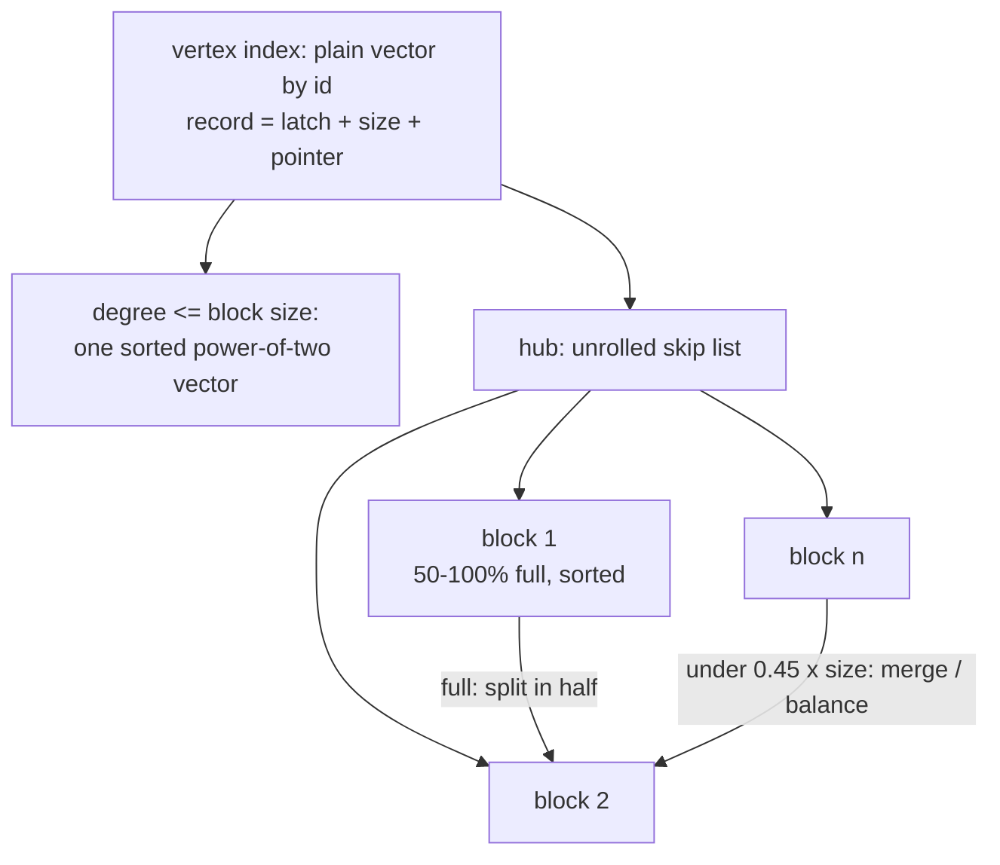

# Sortledton: sorted blocks, one latch per vertex, and a surprising claim about CSR

CSR's selling point is that the whole graph is one array. Sortledton's
argument is that this is *not* what makes analytics fast: what matters is that
the neighbour set of one vertex is contiguous enough, and that the vertex
index is a flat array. Give up the global array, the authors say, and you can
build a graph store from off-the-shelf sorted sets that is only ~1.2× slower
than CSR on average and takes writes at millions per second. This guide reads
that argument, checks it against the paper's own numbers, and then reads the
block code to see what the claim costs per insert.

**"Sortledton: a Universal, Transactional Graph Data Structure"** — Per Fuchs,
Domagoj Margan, Jana Giceva. PVLDB 15(6): 1173–1186, 2022
([pdf](https://www.vldb.org/pvldb/vol15/p1173-fuchs.pdf)). Section, figure
and table numbers are that PDF's. The code is the authors' repository at
`gitlab.db.in.tum.de/per.fuchs/sortledton`, commit
`6eb638f3ad38f8a10a127e7e118528f4c8d07a6e`, cloned to `~/repos/sortledton`
(not in the pin table; the commit is stated here). Its evaluation driver is
`github.com/PerFuchs/gfe_driver`, which this repo did not clone.



## The problem in one sentence

A graph store that wants fast scans, fast edge inserts *and* sorted
neighbourhoods (so triangle counting can intersect them in linear time) cannot
use a vector (slow intersection), a sorted array (slow insert) or a hash set
(gaps in every scan) alone (§2.1) — and the question is how much of CSR's
layout it must keep.

## The concepts, step by step

### Step 1 — which memory accesses a graph kernel makes, and which dominate (§2.2, §3.1–3.4)

> **In:** PageRank's inner loop (Listing 1 in the paper). **Out:** four named
> access patterns, and the paper's ranking of how much each one matters.

A **memory access pattern** is the order in which a program touches memory.
Sortledton names four, for a kernel that loops over every vertex and then every
neighbour of it:

1. **sequential vertex access** — visiting neighbour sets in vertex order;
2. **sequential neighbourhood access** — reading one neighbour set front to back;
3. **random access to algorithm properties** — `contrib[e]` in PageRank, an
   array indexed by the neighbour's id, so a random read per *edge*;
4. **random vertex access** — jumping to an arbitrary vertex's neighbour set,
   as a shortest-path search does.

The key observation is a count. Patterns 1 and 4 happen once per *vertex*
(|V| times); patterns 2 and 3 happen once per *edge* (|E| times). With a
mean degree of 15, the per-edge patterns outnumber the per-vertex ones 15 to
1, so they dominate the runtime. (§3.1 says |E| can be "at least 10×" |V| in
real graphs.)

Worked once, on this topic's graph: |V| = 1,048,576 and |E| = 16,084,545, so
|E| ÷ |V| = 15.34 — a PageRank iteration makes 15.3 pattern-2 and pattern-3
accesses for each pattern-1 access.

The paper checks the ranking with microbenchmarks. Replacing CSR by a plain
vector-of-vectors adjacency list (which loses pattern 1's contiguity) "mostly
stays within 40% of the runtime of a csr" (§3.1, Fig. 4a), with one kernel
(wcc on com-friendster) over 1.4×. Replacing a contiguous neighbour vector by
a linked list of sorted blocks costs "nearly equal performance … when (2) uses
a block size larger than or equal to 256 edges" (§3.2, Fig. 4b). A vector
vertex index beats a tree or hash index by 1.1–3× (§3.4).

Why it matters: this is the argument that lets Sortledton drop CSR's global
array. It also tells you what to measure — lane 1b's `Vec<Vec<u32>>` row is
the paper's Fig. 4a experiment on this graph.

### Step 2 — the data structure: vertex vector, small vectors, unrolled lists (§4.2)

> **In:** Step 1's four patterns. **Out:** the three storage shapes and their
> insert complexities.

A **vertex index** maps a vertex id to a *vertex record*. Sortledton uses a
plain vector indexed by id (so one memory access per lookup; §3.4), made
growable without locking via a two-level scheme (Figure 5): a small fixed first
level of pointers to exponentially growing second-level segments. A record
holds a pointer to the neighbourhood, its size, and a read–write latch (a
lightweight lock) — one per vertex.

The neighbourhood has two shapes, chosen by degree:

- **small** (degree ≤ block size): a "headerless, power of two-sized vector",
  sorted. Insertion shifts the tail: O(block size).
- **hub**: an **unrolled skip list** — a skip list whose elements are not
  single keys but whole sorted **blocks** of edges (each block carries a header
  with its edge count, its highest destination and the skip pointers). A block
  that fills up **splits** in two; one that drops below half full **merges**
  with a neighbour, "therefore, the fill ratio of our block is between 50% and
  100%". Insert and delete complete in O(max(log D, block size)), D being the
  vertex's degree.

Worked on the topic's largest hub: this graph's maximum out-degree is
39,354 (printed by the bench header), so for block size 256 the cost terms are
log₂ 39,354 = 15.3 and 256 — the *block shift* dominates by 17×, which is why
Figure 7 finds an optimum block size: "with smaller blocks, insertions suffer
from random memory access to find the correct block. For larger blocks,
insertions need to shift a larger number of edges within the blocks" (§4.2).
The measured optimum for insertion throughput is 128 (Figure 7); the
evaluation uses 512 "trading insertion for analytical performance" (§7).

The space cost follows from the fill ratio. At the paper's average of 75% full
(§7.3: "our blocks are 75% full on average"), a hub of 39,354 edges occupies
39,354 ÷ (0.75 × 256) = 205 blocks, i.e. 205 × 256 × 4 B = 210 KB for ids,
against 39,354 × 4 B = 157 KB packed: a 1.33× tax (= 1 ÷ 0.75) on the hub
before any header, index or version bytes.

Why it matters: this is Lane 2 of this topic's bench. Its spec tests are
exactly these invariants: blocks between half and full, small vertices in one
vector, ascending scans.

### Step 3 — the code: what an insert actually does (the repository)

> **In:** Step 2's description. **Out:** the three-way decision an insert
> makes, with the line each branch is on.

The insert path for a vertex that is still a single vector:

```cpp
// data-structure/VersioningBlockedSkipListAdjacencyList.cpp — insert_single_block, 514-552 (elided 519-521, 530-540, 549-551)
   514    if (eb.has_space_to_insert_edge()) {
   515      eb.insert_edge(edge.dst, version, properties);
   ...
   522    } else {  // else resize block or add skip list
   523      if (block_capacity == block_size) {
   524        // Block should be split into 2 skip list blocks, we do this in two steps, convert to SkipListHeader and then by recursion split into two.
   525        VSkipListHeader *new_block = new_skip_list_block();
   ...
   539        // recursive call of depth 2, inefficient could be done with one time less copying.
   540        return insert_skip_list(edge, version, properties);
   541      } else { // Block full: we double size and copy.
   542        auto new_eb = new_single_edge_block(block_capacity * 2);
   543        eb.copy_into(new_eb);
   544        new_eb.insert_edge(edge.dst, version, properties);
```

Three outcomes, one `if` each: room in the block (514), or the block is at the
configured maximum and becomes a skip-list hub (523), or it doubles (541–543).
The vector starts at `MIN_BLOCK_SIZE` = 2 (line 21 of the same file) and
doubles until it reaches `block_size` — which defaults to 128 in the driver
(`internal-driver/Driver.cpp:80`) — so a small vertex costs a handful of
doublings and a copy each time. The line to focus on is 523: the *only*
transition from "vector" to "hub" is "the vector's capacity already equals the
block size".

The insert itself, inside a block:

```cpp
// data-structure/EdgeBlock.h — EdgeBlock::insert_edge, 106-120
   106    bool insert_edge(dst_t e, version_t version, char *properties) {
   107      assert(has_space_to_insert_edge());
   108
   109      auto pos = find_upper_bound(start, start + edges_and_versions, e);
   110      if (pos == start + edges_and_versions || make_unversioned(*pos) != e) {  // No version of this edge exists.
   111        memmove((char*) (pos + 2), (char*) pos, (edges_and_versions - (pos - start)) * sizeof(dst_t));
   112        *pos = make_versioned(e);
   113        *(pos + 1) = inline_version(false, false, version);
```

Line 111 is the whole cost: a `memmove` of everything after the position, by
**two** words — the edge and its inline version record (`pos + 2`). A new edge
in this code is always stored as an edge word followed by a version word; a
long-lived edge stays that way until garbage collection strips it. That is
the 3 × w bytes per element of the Revisiting paper's §4.2 (see
[reading-revisiting-dgs.md](reading-revisiting-dgs.md) Step 4) showing up as a
`+ 2`.

Splitting a full block:

```cpp
// data-structure/EdgeBlock.h — EdgeBlock::split_into, 228-234
   228    tuple<size_t, size_t> split_into(EdgeBlock &other) {
   229      auto split = edges_and_versions / 2;
   230
   231      if (is_versioned(start[split-1])) { // Keep the versioned edge together with its version.
   232        split -= 1;
   233      }
   234      memcpy(other.start, start + split, (edges_and_versions - split) * sizeof(dst_t));
```

A half split (229) — with the care at 231 that an edge and its version record
are never separated.

And merging, where the code differs from the paper's "below half full":

```cpp
// data-structure/VersioningBlockedSkipListAdjacencyList.cpp — balance_block and its bound, 1395-1438 (elided)
  1395  VersioningBlockedSkipListAdjacencyList::balance_block(VSkipListHeader *block, VSkipListHeader *head, vertex_id_t src) {
  1396    if (block->size < low_skiplist_block_bound()) {   // Block is too empty
  ...
  1400      if (before_block == nullptr && next_block == nullptr) {
  1401        return; // NOP we do not implement merging back into a single block
  ...
  1416      if (balance_against->size + block->size <= block_size) {
  1417        merge_skip_list_blocks(block, head, src);
  1418      } else {
  ...
  1419        auto balanced = (balance_against->size + block->size) / 2;
  ...
  1437    return block_size *
  1438           0.45;  // We choose 0.4 to avoid going back and forth between growing and shrinking blocks due to removing versions.
```

Three things the paper's one sentence leaves out. The merge threshold is
**0.45 × block size** (1437), not 0.5; the comment above it says 0.4 and a
`TODO` on line 1436 says "lower to 0.4" — the code, the comment and the paper
all differ, and the reason is given: with versions occupying slots, deletions
shrink blocks and re-adding grows them, and a threshold at exactly one half
would make a block oscillate. A block next to a neighbour is balanced against
the *bigger* of its two neighbours (1405–1412) — either merged if the pair
fits (1416) or evened out by moving elements (1419–1431). And a hub that
shrinks is never converted back to a single vector (1400–1401), so the 50–100%
invariant has a hole at a single remaining block, which the spec tests in this
topic's lane 2 reproduce by exempting a vertex with one block.

Why it matters: Lane 2's reference solution was written from the paper, then
checked against this code. It splits at the half (like 229), merges at
cap/2 (the paper's number, not the code's 0.45), and keeps its block index
as a sorted vector of block minima instead of a skip list.

### Step 4 — versions without a chain per edge (§5)

> **In:** Step 3's `+ 2` words per edge. **Out:** how the protocol keeps the
> common case cheap, and the one optimisation that matters for a scan.

Every edge may carry versions — records saying "inserted at time t1, deleted
at t2" — so that a long analytic query reads a frozen graph. Sortledton stores
versions as a linked list "directly behind the edge in the block"; an edge
with one version (the overwhelmingly common case: inserted once, never
touched) carries *no* record at all — its version is the implicit first
version `T0` — and an edge with two stores the record inline (§5). Garbage
collection is done by the threads that write, "which leads to good data
locality, requires no background threads".

The protocol is two-phase locking with a global lock order: a write
transaction "claims all locks in a global order" (the vertex ids it will
touch, known in advance), then reads, then takes a commit timestamp, writes,
and releases (§5). A read-only transaction takes a read latch per *operation*,
reads the newest version at or before its timestamp, and releases at once.

The scan optimisation is the one to remember: "we allow direct memory access
to blocks without versions … It can lead to speedups of up to 2.3×" (§6,
Fig. 8). A block with no versioned edges can be scanned as a plain array by
the analytics kernel with no per-edge callback; a block with versions forces
the slow path. In the concurrent experiment the paper notes that "multi-
versioned edges … disable our direct access optimization" and the kernels'
latency rises (§7.6).

Why it matters: this is how a fine-grained scheme claws back CSR's scan speed
when nothing is in flight — a flag that says "this block is plain". The delta
matrix gets the same effect structurally: the settled matrix is *always*
plain.

### Step 5 — what the numbers say, and what they do not (§7)

> **In:** Figures 9–14. **Out:** four checkable claims, each with the cell
> it comes from, and the one place the claim and the independent re-test
> disagree.

- **Insert throughput.** "Teseo and Sortledton execute more than 3.1 and 4.8
  million checked edge insertions per second" on graph500-24 at up to 56
  threads (§7.4); "up to 5 million transactional edge updates" (§1).
- **Distance to CSR.** "Runtimes within 1.2× on average of csr" (§9). Against
  that, the independent test bench in the Revisiting paper finds the best
  segmented design — Sortledton's adaptive configuration in four of eight
  rows, Teseo or Aspen in the rest — 1.45–4.10× slower than CSR on PageRank
  ([reading-revisiting-dgs.md](reading-revisiting-dgs.md) Step 3). The two do
  not contradict each other as stated — different graphs, kernels and
  hardware — but they cannot both be the answer to "how far from CSR":
  1.2× is Sortledton's number on its own driver, 1.45–4.10× is someone
  else's, and this topic's lane 2 is the third datapoint.
- **Memory.** 18 GB for graph500-24 against 8.3 GB for a static CSR: "2.1×"
  in the paper (18 ÷ 8.3 = 2.17), attributed to 75%-full blocks and the
  vertex-id translation tables (§7.3).
- **Updates and deletes.** Sortledton's mixed insert/delete throughput is
  "slightly lower" than insert-only "due to the creation and maintenance of
  version chains"; a list-based design "struggles with deletions" (§7.3).

The honest caveat the paper itself names: "vertex-centric locking is a weak
point for bursty workloads", because loading edges in creation order hammers
one vertex's latch (§7.2, Fig. 10).

Why it matters: Sortledton is the answer for a workload with many concurrent
writers on a hot graph. FalkorDB has one writer per graph; the part of
Sortledton that transfers is the *layout* (sorted blocks, adaptive vector),
not the locking.

## How to read the paper (with the concepts in hand)

1. **§2.2 and Listing 1** — Step 1; count the per-edge and per-vertex
   accesses in the loop yourself.
2. **§3.1–§3.4 with Figure 4** — the three microbenchmarks. Do not skip
   Fig. 4b: block size 256 is the claim that justifies the whole design.
3. **§4 with Figures 5–7** — Step 2.
4. **§5** — Step 4; the five-step protocol is short.
5. **§7.2–§7.3 with Figures 9–11** — insert throughput and the memory number.
6. **§8** — the related-work paragraph on read-optimised versus write-optimised
   segments is the sharpest statement of why Sortledton rejects Teseo's
   design.

Read the code in this order: `EdgeBlock.h:106` (insert), `:228` (split),
`VersioningBlockedSkipListAdjacencyList.cpp:514` (the three outcomes),
`:1395` (merge). The skip list itself is the part this guide does not walk.

## Where each step lives in this topic

| step | file / lane | what to look at |
|---|---|---|
| 1 | bench lane 1b | `Vec<Vec<u32>>` vs CSR two-hop scan — Fig. 4a on this graph |
| 2–3 | `experiments/src/segblocks.rs` (lane 2) | block split/merge invariants as spec tests |
| 4 | — | not modelled: lane 2 has no versions |
| 5 | notes.md reference numbers | the same workload, measured on the reference solution |

## Questions (answer in notes.md)

1. The paper says blocks merge below half full; the code merges below 0.45 ×
   block size. With block size 256, how many edges separate the two
   thresholds, and what failure does the extra gap prevent?
2. Step 2 computes a 1.33× space tax from a 75% average fill. Why is the
   steady-state fill of a split-at-half policy under random inserts roughly
   that, and what would ascending-only inserts do to it?
3. `insert_edge` moves `pos + 2`. If a graph has no versioned edges at all
   (no concurrent readers), which parts of the 3 × w overhead disappear and
   which stay?
4. Lane 2's block index is a sorted vector of block minima. At which hub
   degree and block size does a binary search over that vector cost more than
   the in-block shift, so the skip list would pay off?

## Done when

Answer each before unfolding it.

- [ ] You can name the four access patterns and say which two dominate and why.

  <details><summary>Answer</summary>

  Sequential vertex access and random vertex access happen once per vertex
  (|V| times); sequential neighbourhood access and random access to
  algorithm properties (e.g. `contrib[e]`) happen once per edge (|E| times).
  Since |E| is at least 10× |V| in real graphs (§3.1) — 15.3× on this topic's
  graph — the per-edge patterns dominate, which is why the paper can drop
  CSR's global array (it only helps pattern 1) and keep contiguity only
  inside a neighbour set.

  </details>

- [ ] You can describe the neighbourhood storage and give an insert's cost.

  <details><summary>Answer</summary>

  Degree ≤ block size: one sorted power-of-two-sized vector, insert shifts the
  tail, O(block size). Hub: an unrolled skip list of sorted blocks kept between
  50% and 100% full (code: merge below 0.45); a full block splits in half, a
  low one merges with its larger neighbour; insert is O(max(log D, block
  size)) (§4.2). For D = 39,354 and block 256 the block term (256) exceeds the
  index term (log₂ D = 15.3) by 17×.

  </details>

- [ ] You can show what `insert_edge`'s `memmove` moves and why it is two words.

  <details><summary>Answer</summary>

  Everything after the insertion position, by `pos + 2` (EdgeBlock.h:111):
  the destination word and an inline version record, because a freshly
  inserted edge is stored versioned (`make_versioned`, line 112) until garbage
  collection strips it. Two words per edge is the version overhead, and it is
  paid on every in-block shift as well as every scan.

  </details>

- [ ] You can state where the code departs from the paper's description of merging.

  <details><summary>Answer</summary>

  The paper: a block "less than half full" merges (§4.2). The code merges at
  `0.45 * block_size` (VersioningBlockedSkipListAdjacencyList.cpp:1437), its
  comment says 0.4 and a TODO says "lower to 0.4" (1436), to stop a block
  oscillating between growing and shrinking when version removal changes its
  size. It also balances against the larger neighbour (1405–1412), and never
  converts a shrunken hub back into a single vector (1400–1401).

  </details>

- [ ] You can put the paper's distance-to-CSR claim next to an independent measurement and say what they do and do not show.

  <details><summary>Answer</summary>

  Sortledton claims 1.22× on average over CSR on its own driver and Graphalytics
  kernels (abstract, §9). The independent test bench recomputes PageRank on
  eight graphs and finds the best segmented design 1.45–4.10× slower than CSR
  (Table 5, recomputed in the Revisiting guide), with Sortledton adaptive the
  best in four of eight PageRank rows. Different graphs, kernels and
  machines: they show that "close to CSR" depends on the kernel and
  the graph, not that either source is wrong.

  </details>

## References

- Fuchs, Margan, Giceva. *Sortledton: a Universal, Transactional Graph Data
  Structure.* PVLDB 15(6): 1173–1186, 2022. doi:10.14778/3514061.3514065.
- Code: `gitlab.db.in.tum.de/per.fuchs/sortledton` at
  `6eb638f3ad38f8a10a127e7e118528f4c8d07a6e`.
- Platz, Mittal, Venkatesan. *Concurrent Unrolled Skiplist.* ICDCS 2019 — the
  structure Sortledton's hubs use (cited in the paper as [45]; not read for this
  guide).
- [reading-revisiting-dgs.md](reading-revisiting-dgs.md),
  [reading-teseo.md](reading-teseo.md).
