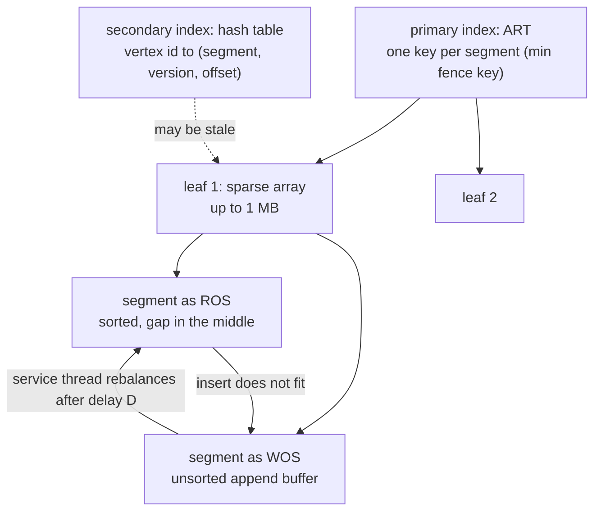

# Teseo: one giant gapped array, rebalanced in the background

Sortledton gives every vertex its own small sorted set. Teseo goes the other
way: **keep CSR's single sorted array of every edge, but leave gaps in it** so
that an insert does not shift the world. It is the CSR-shaped answer to the
topic's question — the closest published design to "CSR that takes writes" —
and its details (how big the gapped arrays are, when they are rebalanced, what
happens when a segment fills before the rebalance arrives) are where a delta
matrix's trade-offs show up in a different disguise.

**"Teseo and the Analysis of Structural Dynamic Graphs"** — Dean De Leo and
Peter Boncz (CWI). PVLDB 14(6): 1053–1066, 2021
([pdf](https://www.vldb.org/pvldb/vol14/p1053-leo.pdf)). Section, figure
and table numbers are that PDF's. The code is `github.com/cwida/teseo` at
`2c37c2831c4d2acaaa838a86e1318363ce68c45b`, cloned to `~/repos/teseo` (not in
the pin table; the commit is stated here). Names differ between paper and code: the paper's
"read-optimised segment" (ROS) is `memstore::SparseFile`, a sorted file with
gaps in the middle, and its "write-optimised segment" (WOS) is
`memstore::DenseFile`, an unsorted buffer with an index (Step 3 quotes the
two class comments).



## The problem in one sentence

A CSR's edge array is sorted and packed, so inserting one edge shifts, on
average, half of it — and a B+ tree of one-page leaves, the textbook fix,
makes a scan hop between leaves every few hundred edges (§3.2).

## The concepts, step by step

### Step 1 — a sparse array and its density windows (§2.1)

> **In:** a sorted sequence that must accept inserts. **Out:** the density
> rule that decides which stretch of an array to re-spread, worked on one
> small array, with a sign error in the printed formula found and fixed.

A **sparse array** (the paper's name for a *packed memory array*, PMA) is a
sorted array with deliberate empty slots, **gaps**. Cut it into equal
**segments** of C_S slots each. An insert goes into its segment's gap; when a
segment has no gap left, a **rebalance** takes a **window** — a run of
adjacent segments — and spreads its elements evenly across the window's
segments, restoring gaps. The **density** of a window is its element count
divided by its slot count. The art is choosing the window: the smallest
window whose density is acceptable. If no window, up to the whole array,
is acceptable, the array is resized.

Which densities are acceptable depends on the window's size, interpolating
from a loose bound at a one-segment leaf to a tight one at the whole-array
root. The paper's Equation (1), with h = ⌈log₂(C_A / C_S)⌉ the tree height
(C_A the array's capacity), |W| the window's segment count, and constants
0 < ρ₁ < ρₕ ≤ τₕ < τ₁ ≤ 1:

```
low(W)  = [ ρₕ − (ρₕ − ρ₁) · (h − log₂|W|)/h ] · C_S · |W|
high(W) = [ τₕ + (τₕ + τ₁) · (h − log₂|W|)/h ] · C_S · |W|        (as printed)
```

A window is acceptable when `low(W) ≤ cardinality(W) ≤ high(W)`. The paper sets
ρ₁ = 0.5, τ₁ = 1, ρₕ = τₕ = 0.75 and C_S = 4 KB (§2.1).

Worked on an array of 16 segments (h = 4) with C_S = 512 eight-byte slots
(4 KB), using the interpolation factor x = (h − log₂|W|)/h:

```
|W|   x      low(W) = (0.75 − 0.25x)·512·|W|    high(W) = (0.75 + 0.25x)·512·|W|
 1   1.00    0.5000 × 512   =  256               1.0000 × 512   =   512
 2   0.75    0.5625 × 1024  =  576               0.9375 × 1024  =   960
 4   0.50    0.6250 × 2048  = 1280               0.8750 × 2048  =  1792
 8   0.25    0.6875 × 4096  = 2816               0.8125 × 4096  =  3328
16   0.00    0.7500 × 8192  = 6144               0.7500 × 8192  =  6144
```

Read down the table: a one-segment leaf may be anywhere from 50% to 100%
full; each doubling of the window tightens the band; the root's band has zero
width, 75% exactly. That is why an overflow that climbs to the root always
ends in a **resize** to capacity C_A′ = 2N / (ρₕ + τₕ) = N / 0.75 — a fresh
array that is, by construction, 75% full ("the fill factor of a resize will be
≈ 75%", §2.1).

The printed `high(W)` has a sign error, which the table above silently
corrects. With the `+ τ₁` as printed, a one-segment window (x = 1) would
allow (0.75 + (0.75 + 1) · 1) × 512 = 1280 elements in 512 slots. The code's
version uses `τ₀ − τₕ`, i.e. the **difference** (`crawler.cpp:295`,
below), which gives the 1.0 × 512 = 512 in the first row. The PDF's printed
formula really does say `(τₕ + τ₁)` — checked on the rendered page, not just
the extracted text.

The complexity the thresholds buy: amortised O(log² N) per update in the
RAM model; O((log² N)/B) in the I/O model with C_S = O(B); O(log_B N) on
average for uniformly distributed keys (§2.1).

Why it matters: this is the rule Lane 3's spec tests as "root bound 3/4,
leaf bounds looser, array doubles when the root overflows".

### Step 2 — Teseo's layout: segments, leaves, and a fat tree (§3.2, §4.1)

> **In:** Step 1's sparse array. **Out:** the two-level structure that keeps
> scans long and rebalances short, and the two indexes that find things.

One sparse array holding the *whole* graph would make every rebalance and
resize O(|E|). Teseo therefore keeps **many** sparse arrays, each called a
**leaf** and "of the order of MBs" — the evaluation caps a leaf at C_L = 1 MB
(§7), a leaf being "a contiguous sequence of page-sized segments" — and
orders the leaves in a B+-tree-like **fat tree** ("fat" because the leaves
are three orders of magnitude larger than a page's worth, §3.3). A resize of
one leaf **splits** it in two instead of doubling (§4.2), so a structural
operation touches at most a leaf's worth of data.

Vertices and edges share the one key order: a vertex is stored as 16 bytes
(8 for its id, 8 for `sz`, the number of its edges that follow in the same
segment); an edge is 8 bytes, its destination id. "When the edges adjacent to
the same source span over multiple segments, we duplicate the source vertex
in each involved segment" (§4.1). That is CSR's two arrays folded into one
sorted run — the offsets array is replaced by in-line vertex entries.

Two indexes locate a position:

- a **primary index**, an adaptive radix tree (ART, a compressed trie) with one
  key per segment (the segment's minimum fence key), for general lookups and
  updates;
- a **secondary index**, a hash table from vertex id to its position, used
  "to initialise scans" and to give the random-access pattern O(1) (§4.3).

Both are updated only by background threads, so "occasionally, a concurrent
thread can retrieve an outdated entry" and detects it by comparing the
segment's **fence keys** (its `[min, max)` key range) to the key it wanted
(§4.3).

Why it matters: this is "CSR with the vertex offsets made lazy" — the
position of a vertex is a hint that can go stale, which is the same idea as
a flush-deferred settled matrix.

### Step 3 — read-optimised, write-optimised, and the asynchronous rebalance (§4.1–4.2)

> **In:** Step 1's rebalance rule and Step 2's segments. **Out:** what a
> writer does when its segment has no gap, and why the rebalance is delayed.

A segment is in one of two formats. The **read-optimised segment (ROS)** keeps
elements sorted, "packed together towards the start and the end of the
segment, while the free space resides in the middle"; an insert reclaims some
of the middle space by shifting. The **write-optimised segment (WOS)** keeps
elements **unsorted** in an outside buffer, as 16-byte `(source, destination)`
pairs, "accompanied by a secondary dense index for quick point look-ups" — a
sequential ART. When a ROS runs out of free space a writer *does not*
rebalance: it converts the segment to a WOS and appends. The code reads
exactly like that:

```cpp
// src/memstore/segment.cpp — Segment::update, 580-600 (elided 582-584, 586-589)
   580      if(segment->is_sparse()){
   581          SparseFile* sf = sparse_file(context);
   ...
   585          bool success = sf->update(context, update, has_source_vertex);
   ...
   590          if(!success){
   591              to_dense_file(context);
   592              segment->m_used_space += dense_file(context)->update(context, update, has_source_vertex);
   593          }
   594
   595      } else {
   596          assert(segment->is_dense());
   597          segment->m_used_space += dense_file(context)->update(context, update, has_source_vertex);
   598      }
   599
   600      request_async_rebalance(context);
```

Line 585 is the common case (the update fits in the sorted file); the line to
focus on is 590: only when `sf->update` *fails* does the segment flip to the
dense (write-optimised) file; and line 600, which runs on **every** update
whatever happened, asks a **service thread** — a background thread owned by
the system — to rebalance, after a delay D. The evaluation fixes D = 200 ms
(§7). The code's own class comments confirm the mapping: `SparseFile` is "a
sorted file consisting of a sorted dense area, followed by gaps, followed by
another dense area" (`include/teseo/memstore/sparse_file.hpp:47-50`),
`DenseFile` is "a sorted file consisting of an unsorted dense area properly
indexed" (`include/teseo/memstore/dense_file.hpp:35-38`).

Why delay? "The purpose of the delay D is to mitigate the worst-case
complexity of sparse arrays, which occurs in presence of skew. … By filling a
WOS and delaying the rebalance, many more elements can be redistributed in a
single rebalance. This resembles the effect of a batch insertion into a
sparse array, which has only a logarithmic cost" (§4.2). The price is stated
in the same breath: "a large WOS is detrimental to readers, these are already
impaired, in the first place, by the concurrent writers".

Deletions are treated asymmetrically: "we never rebalance a segment when it
becomes underfilled due to deletions"; a service thread periodically merges
neighbouring leaves when the merged fill is ≤ ρₕ = 0.75 (§4.2).

The thresholds themselves in code:

```cpp
// src/rebalance/crawler.cpp — the density constants and get_thresholds, 273-302 (elided 277-285, 297)
   273  constexpr static double DENSITY_RHO_0 = 0.5; // lower bound, leaf
   274  constexpr static double DENSITY_RHO_H = 0.75; // lower bound, root of the calibrator tree
   275  constexpr static double DENSITY_TAU_H = 0.75; // upper bound, root of the calibrator tree
   276  constexpr static double DENSITY_TAU_0 = 1; // upper bound, leaf
   ...
   286  std::pair<int64_t, int64_t> Crawler::get_thresholds(int window_height, uint64_t num_segments_leaf) const {
   ...
   293          const double scale = static_cast<double>(tree_height - window_height) / static_cast<double>(tree_height -1);
   294          rho = /* max density */ DENSITY_RHO_H - /* delta */ (DENSITY_RHO_H - DENSITY_RHO_0) * scale;
   295          tau = /* min density */ DENSITY_TAU_H + /* delta */ (DENSITY_TAU_0 - DENSITY_TAU_H) * scale;
   ...
   298      int64_t num_segs = std::min<int64_t>(num_segments_leaf, pow(2.0, window_height -1));
   299      int64_t space_per_segment = memstore::SparseFile::max_num_qwords();
   300      int64_t min_space = num_segs * space_per_segment * rho;
   301      int64_t max_space = num_segs * (space_per_segment - /* always leave 5 qwords of space in each segment */ 5) * tau;
   302      if(min_space >= max_space) min_space = max_space - 1;
```

Four things the paper does not say. The constants are the paper's (273–276),
and the interpolation at 295 uses `TAU_0 − TAU_H`, the fix of Step 1. The
`/* max density */` and `/* min density */` comments at 294–295 are swapped
(`rho` is the *lower* bound, `tau` the upper — see 300–301). The windows are
measured in **qwords of space**, not element counts, and the upper bound
subtracts **5 qwords per segment** (301) — "always leave 5 qwords of space in
each segment" — so a segment is never allowed to be literally full. And line
302 is the root case: at the root ρ = τ = 0.75, so the lower bound would equal
the upper; the code forces `min < max` rather than trusting the arithmetic.

Why it matters: the delay D is the same knob as a delta's flush threshold,
turned by time instead of by count. Teseo accepts a degraded read path
(unsorted write-optimised segments) between a write and its rebalance;
a delta matrix accepts an extra probe per row between a write and its flush.

### Step 4 — what it cost and what it bought (§7)

> **In:** §7.2–§7.4 and Table 3. **Out:** four checkable numbers and their
> orientation (Table 3 reports the CSR's speed-up over each system, so 1.42×
> means the CSR is faster).

- **Inserts.** "With p = 40, Teseo can insert ≈ 2.4M edges/sec, and about 20%
  less for smaller graphs due to contention" (§7.2, Fig. 6). The sequential
  `unordered_map` + `vector` adjacency list the authors wrote reaches 70 k
  edges/s on the skewed graphs and 736 k on the uniform ones (§7.2) — the
  checked-insert cost of searching a hub's unsorted edge list.
- **Updates (a mix of inserts and deletes holding |E| steady).** "≈ 3.20M
  updates per second. This is 25% ∼ 30% higher than the scenario with only
  insertions", because deletions make room and trigger fewer rebalances (§7.3).
- **Scans.** "Teseo ranks second, after the CSR baseline, in the raw scans
  when using the real vertex identifiers. In the sequential pattern, the
  difference with the CSR is ≈ 50%" (§7.4, Fig. 9). Table 3 on Graph500 SF 24
  (CSR PageRank 5.16 s): Teseo with real vertex ids 1.42× slower, with
  logical ids 2.54×; LiveGraph 2.34×; Stinger 2.10×.
- **Memory.** Teseo's footprint is "comparable w.r.t. Stinger with p = 1, and
  it gradually increases up to 1.6× with p = 40, due to the extra pressure in
  the internal GC" (§7.3).

The caveat that matters for a CSR-shaped comparison is *logical identifiers*:
algorithms want vertex ids in [0, |V|) so they can index arrays, but Teseo
stores arbitrary 64-bit ids. Translating each edge's destination to a dense
id costs "an additional penalty of up to 7×" on raw scans (§7.4). The
independent test bench in [reading-revisiting-dgs.md](reading-revisiting-dgs.md)
finds Teseo the best of the segmented designs on both PageRank (3 of 8
graphs) and triangle counting (5 of 8), its scan reaching 52–77% of an
adjacency list's throughput (§6.1.2 there), and its "w" memory footprint
many times Sortledton's (30.98 GB against 4.31 GB on lj, and out of memory on
three of eight graphs).

Why it matters: Teseo is the one design here whose *scan path is almost a
CSR's* — a single array with gaps. Lane 3 asks whether that survives a
careful re-implementation on this topic's graph, and the answer in notes.md
is more nuanced than the paper's "≈ 50%".

## How to read the paper (with the concepts in hand)

1. **§2.1 with Figure 2 and Equation (1)** — Step 1; redo the window table
   above for C_A = 8 segments and check the sign yourself.
2. **§3.1–3.2 with Figures 3–4** — why a B+ tree is wrong and what a fat
   tree changes.
3. **§4.1–4.3** — the layouts, the asynchronous rebalance, the two indexes.
4. **§5 (concurrency)** — hybrid latches and the HyPer-style MVCC; this
   guide does not walk it — it is the same per-element-version cost the
   Revisiting guide prices, with the fast path "a data item without a
   history is implicitly visible to all transactions" (§2.3).
5. **§7.2–§7.4** — inserts, updates, scans.

Read the code in this order: `crawler.cpp:273` (the constants) and `:286`
(`get_thresholds`), then `segment.cpp:568` (`Segment::update`), then the two
class comments in `sparse_file.hpp` and `dense_file.hpp`.

## Where each step lives in this topic

| step | file / lane | what to look at |
|---|---|---|
| 1 | `experiments/src/pma.rs` (lane 3) | density bounds and the root-doubling test |
| 2 | lane 3 | the sentinel-per-vertex layout is Teseo's in-line vertex entry, simplified |
| 3 | notes.md, lane 3 reference | rebalances counted per insert |
| 4 | notes.md | the scan ratio on this graph |

## Questions (answer in notes.md)

1. Redo Step 1's table for C_A = 8 segments (h = 3). At which window does a
   segment that has just overflowed first find an acceptable rebalance if its
   neighbours are each 60% full?
2. Teseo's thresholds are in qwords of space with 5 reserved per segment.
   For a 4 KB segment of 8-byte words, what fraction of the segment is
   unavailable to the upper bound, and how much does that change `high(W)`
   at the leaf?
3. In the WOS format an insert is an append. What does a point lookup of an
   edge cost in a WOS segment, given its secondary ART index, compared with a
   binary search in a ROS?
4. A delay D = 200 ms means a skewed writer can fill a WOS for 200 ms. At
   2.4 M inserts/s on one hot segment, how many elements is that, and why
   does the delay still help (§4.2)?

## Done when

Answer each before unfolding it.

- [ ] You can state the window rule and compute low(W) and high(W) for a window.

  <details><summary>Answer</summary>

  A window of |W| segments is acceptable when low(W) ≤ cardinality ≤ high(W),
  with low(W) = [ρₕ − (ρₕ − ρ₁)·x]·C_S·|W| and high(W) = [τₕ + (τ₁ − τₕ)·x]·C_S·|W|,
  x = (h − log₂|W|)/h (the paper prints `τₕ + τ₁`; the code at
  `crawler.cpp:295` and the leaf bound τ₁ = 1 require `τ₁ − τₕ`). For 16
  segments of 512 slots: |W| = 4 gives x = 0.5, low = 0.625 × 2048 = 1280 and
  high = 0.875 × 2048 = 1792; the root (|W| = 16, x = 0) gives 6144 for both,
  i.e. exactly 75%, which forces a resize.

  </details>

- [ ] You can explain the ROS/WOS pair and what happens when a ROS fills.

  <details><summary>Answer</summary>

  A ROS keeps elements sorted with free space in the middle of the segment; a
  WOS holds them unsorted in an outside buffer with a dense index. When an
  insert does not fit a ROS, the writer converts the segment to a WOS and
  appends rather than rebalancing (segment.cpp:590–593), and every update
  requests an asynchronous rebalance (line 600) that a service thread runs
  after the delay D = 200 ms, which turns the WOS back into a ROS (§4.2).

  </details>

- [ ] You can describe the two indexes and how a stale entry is detected.

  <details><summary>Answer</summary>

  A primary ART (radix trie) with one key per segment — its minimum fence key
  — and a secondary hash table from vertex id to physical position, entered
  as (segment, version, offset). Both are updated only by background threads
  during structural operations, so a reader can read an outdated entry; it
  detects this by checking that its key falls within the segment's fence
  keys, and for the hash table that the stored latch version still equals the
  segment's (§4.3). A mismatch falls back to a search from the neighbouring
  segments or a linear scan.

  </details>

- [ ] You can give Teseo's insert, update and scan figures and their orientation.

  <details><summary>Answer</summary>

  ≈ 2.4 M edge inserts/s at p = 40 (§7.2); ≈ 3.20 M updates/s on the
  insert-and-delete mix, 25–30% above insert-only (§7.3); scans second only
  to the CSR, ≈ 50% apart in the sequential pattern with real vertex ids
  (§7.4). Table 3 reports the CSR's speed-up over each system, so on
  Graph500 SF 24 PageRank Teseo with real ids at 1.42× means the CSR is 1.42×
  faster; with logical ids it is 2.54×.

  </details>

- [ ] You can name two places the code differs from or adds to the paper's thresholds.

  <details><summary>Answer</summary>

  The upper-bound interpolation uses (τ₀ − τₕ) (crawler.cpp:295) where the
  paper's printed formula has (τₕ + τ₁); the code works in qwords of space and
  reserves 5 qwords in every segment so a segment is never full (line 301);
  at the root, where ρ = τ = 0.75, it forces min < max (line 302); and its
  comments at 294–295 label the lower and upper bounds the wrong way round.

  </details>

## References

- De Leo, Boncz. *Teseo and the Analysis of Structural Dynamic Graphs.* PVLDB
  14(6): 1053–1066, 2021.
- Code: `github.com/cwida/teseo` at `2c37c2831c4d2acaaa838a86e1318363ce68c45b`.
- De Leo, Boncz. *Packed Memory Arrays — Rewired.* ICDE 2019 (the source of the
  constants, per `crawler.cpp:271`; cited in the Revisiting paper as [11]; not
  read for this guide).
- [reading-packed-csr.md](reading-packed-csr.md) for the PMA as a plain CSR
  replacement; [reading-sortledton.md](reading-sortledton.md) for the
  per-vertex alternative.
